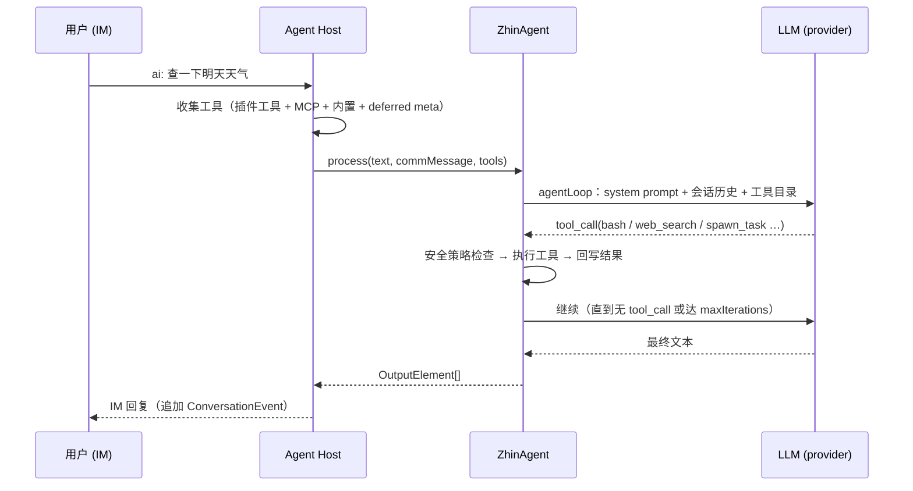

# Agent 深入

群里发一句 `ai: 查一下明天天气`，几秒后 Bot 回了带数据的回答——中间发生了什么？本页沿着这条路径，展开 [AI 总览](./index.md) 没有细讲的运行机制。

还没启用 AI？先看 [AI 总览](./index.md)。想让 AI 调用你的函数？看 [Agent 工具与技能](../authoring/agent-tools.md)。


### 每轮用量日志

默认 INFO 级别在 Agent 回合结束时输出一条 `[ai.usage] turn`，失败和取消也有汇总；无需手动执行 `zhin trace`。字段顺序固定，聊天正文、思考正文、提示词、工具参数与返回内容不会进入这组日志。

```text
[INFO] [ai.usage] turn | trace: trace-1 | turn: turn-1 | scene: qq/group | status: completed | model: main/model | calls: 2 | input: 4200 | output: 180 | cache_read: 3000 | cache_write: 0 | reasoning: ? | ms: 1850
```

- `input`、`output`、`cache_read`、`cache_write`、`reasoning` 单位均为 token；缓存读写属于输入的分项，思考属于输出的分项，不能重复相加。数值沿用 Provider 经 SDK 归一化后的 usage，不用字符估算替代。
- `?` 表示没有可证明的数据；`0` 表示明确的零值，或没有记录到模型响应；`>=60` 表示部分调用缺少该字段，已确认的部分合计为 60。旧记录无法证明的零值也会显示为 `?`。
- `calls` 是本回合记录到的模型响应次数，包括统一完成链路中的摘要、进度总结、回复修复和同步子回合；`subagent_calls` 是其中的子回合次数，不能再加一次。SDK 内部 HTTP 重试没有独立响应事件，不按网络请求次数计数。
- 汇总包含当前 trace 中已记录的子回合；`partial` 表示回合未正常完成、子回合结果不完整或记录达到上限；此时显示的只是已记录用量，不能当作全部消耗。它不是整个账号的账单：独立决策、嵌入、图像生成等没有进入该 trace 的调用不在此汇总，Provider 未回传的失败请求用量也无法推算。
- `ms` 是 trace 记录的回合耗时；`trace` 用于串联日志，`turn` 可以交给 `zhin trace <turn>` 查看已有归档。日志无需归档开关；只开日志不会新增落盘存储。

需要逐次排查时，将 Root 配置中的 `log_level` 设为 `debug`。`[ai.usage] call` 展示每次已记录响应的模型、结束原因、用量和已知耗时；`[ai.usage] context` 展示现有首个请求预算，并明确标为 `unit: estimated_tokens`。它不是每次调用的真实计费用量。恢复 `info` 后只保留每轮汇总；`warn`、`error` 或 `silent` 不输出这组 INFO/DEBUG 日志。其他模块原有的 DEBUG 日志仍遵循各自规则。

```yaml
log_level: debug
```


SQL 数据库会独立保存结构化用量，默认保留 30 天。字段、查询与升级方式见[结构化存储与用量查询](../operations/structured-storage.md)。

## 按问题查找

| 我想知道…… | 看这里 |
| --- | --- |
| AI 一轮对话是怎么跑的、会迭代几次、多久超时 | [一轮对话是怎么运行的](#一轮对话是怎么运行的) |
| 让用户看到"思考中"的进度，或中途取消 | [显示进度](#显示进度) · [取消正在执行的回合](#取消正在执行的回合) |
| 工具很多时怎么不撑爆提示词 | [按需加载工具](#按需加载工具) |
| 把耗时任务交给后台 | [子 Agent 与 spawn_task](#子-agent-与-spawn-task) |
| 对话历史存在哪里、怎么重置、上下文太长怎么办 | [会话与会话树](#会话与会话树) · [上下文压缩](#上下文压缩) |
| AI 记住了什么、谁能改记忆 | [语义记忆](#语义记忆) |
| AI 自带哪些工具、文件和网络的边界 | [内置工具](#内置工具) |
| 让 AI 每天定时做事 | [定时任务与助手人设](#定时任务与助手人设) |
| 给某个模型单独调参数 | [按模型调整参数](#按模型调整参数) |
| 多个 Agent 在群或仓库里分工协作 | [Workroom Kernel](#workroom-kernel) |

## 一轮对话是怎么运行的

消息满足触发条件后，Agent Host 调用 `zhinAgent.process(text, commMessage, tools)` 运行一个**回合**（turn）：



模型可能多次调用工具、再根据结果继续推理，每一次叫做一轮**迭代**。需要记住的几点：

- **迭代上限**：`maxIterations` 默认 15（`DEFAULT_CONFIG.maxIterations`），可以按模型单独调整，见 [按模型调整参数](#按模型调整参数)。
- **超时有三层**：触发侧单回合受 `ai.trigger.timeout` 限制（默认 60000ms）；Agent 回合整体默认 120000ms（`DEFAULT_CONFIG.timeout`）；工具预执行另有 15000ms 上限（`preExecTimeout`）。
- **回合运行中又来了消息**：同一会话同时只跑一个回合，后到的消息按下面的默认规则处理（`ai.agent.inboundQueue`），保证不重复回复、不丢消息、不串回合：
  - **同一个人追加**：如果当前回合还没回复，就停掉它，把两条消息合在一起重新回答（`groupMode: fifo` 时改为排队）；如果已经回复过，就排到后面。他已经在排队的话，新消息直接并进排队的那一条，不会多一次回复。
  - **其他人的消息**：一律按到达顺序排队，绝不打断、也不并入别人的回合，所以权限也不会串到别人身上。
  - **叫停**：发起人（或主人）发送 `取消` / `cancel` / `/cancel` 会停止当前回合，并丢掉他自己排队的消息；其他成员发这个词按普通消息处理。
  - **上限**：每个会话最多排 `maxQueuedTurns` 条（默认 5），超出时回复“请稍后再发”；排队超过 `ttlMs`（默认 180000ms）的消息会跳过并提示。
  - 只合并纯文字消息；带图片、文件、引用或转发的消息总是单独成一个回合。排队等待、合并和替换都会记录在 `zhin trace` 的时间线里（`admission`）。
  - 工作室回合，以及 Host 自定义了 `resolveTurnIntent` 或消息自带 `turnIntent` 的情况，仍按原有的意图处理。
- **模型失败会自动切换**：首选模型失败时，按候选链切换到同一 provider 的其他可用模型。
- **行为一致**：主 Agent、子 Agent、后台 worker、`AIService.runAgent` 走的是同一条 agentLoop。

一个回合可用的工具 = 插件注册的工具 + `ai.mcpServers` 连接的工具 + 内置工具 + 按需加载的元工具 + `schedule_*` + `bash` + Host 扩展工具（如 `voice_stt` / `voice_tts`）。

### 显示进度

回合执行时，Agent 会通过 [执行状态反馈](../advanced/activity-feedback.md) 向聊天界面推送状态。默认是一句静态的"思考中…"；开启 **thinking 透明**后，用户能看到模型实际思考内容的片段：

```yaml
ai:
  agent:
    thinkingPreview: true          # 展示 LLM 实际 thinking 内容（截断），默认 false
    thinkingPreviewMaxLength: 200  # 展示的最大字符数，默认 200
```

需要多轮工具迭代时，每轮开始会发出 `iteration_start` 事件，状态更新为 `处理中 [2/15]...` 这样的进度。插件可以监听 `TurnEvent` 流获取进度：

| TurnEvent 类型 | 说明 |
|----------------|------|
| `iteration_start` | 新一轮迭代开始，含 `iteration`（当前轮次）和 `maxIterations` |
| `thinking` | LLM thinking 文本片段（`thinkingPreview` 开启时持续推送） |

### 取消正在执行的回合

用户在聊天里发送 `取消`、`/cancel` 或 `cancel`，即可中断当前回合：ZhinAgent 通过 `PromptController.cancelSession()` 中止模型调用和工具执行，并回复"已取消"。没有正在执行的回合时，回复"当前没有正在执行的任务"。

在 `TurnEvent` 流中，主动取消表现为 `turn_cancelled`（`code: 'cancelled'`）；超时中断同样是 `turn_cancelled`（`code: 'timeout'`）。

## 按需加载工具

工具很多时，把所有工具的参数定义都塞进提示词会占满上下文。Zhin 的做法是**延迟加载**：回合只常驻少量元工具，模型需要时再检索、按名加载。

默认常驻的核心工具集（`alwaysLoadedTools`）分两组：

- 交互与编排：`ask_user`、`spawn_task`，以及元工具 `discover`、`load_tool`、`load_skill`。
- 工作区文件：`read_file`、`list_dir`、`glob`、`grep`、`edit_file`、`write_file`。模型最常直接调用它们，常驻可以省掉一次"未知工具"的往返。它们仍然受本回合的工具过滤和执行策略约束，例如群成员发起的回合拿不到写文件工具。

`bash` 不常驻，因为它能不能用取决于本回合的 shell 隔离策略。配置 `alwaysLoadedTools` 会在默认列表上**追加**；如需完全替换默认列表，设置 `alwaysLoadedMode: replace`。

插件工具默认延迟加载。插件作者可以在 `defineAgentTool` 里写 `alwaysLoaded: true` 让个别高频工具常驻（每轮最多 8 个，`alwaysLoadedMode: replace` 时忽略），详见[让工具常驻](../authoring/agent-tools.md#让工具常驻)。常驻工具的参数定义每轮都会发送，集合越小越省上下文和 token。

其余工具不发送参数定义，只在系统提示的 `## Deferred tools` 段里列出名称和一句不超过 60 字符的说明，最多 40 个，超出部分提示用 `discover` 检索。模型可以先 `load_tool(name)` 拿到参数定义；直接调用也会自动加载。这份索引只包含本回合有权使用的工具，被策略拿掉的工具（例如没有 shell 权限时的 `bash`）不会出现。

技能采用渐进披露：系统提示只列出技能名称和第一行触发说明（最多 96 字符，最多 40 个），专家 agent 目录同样如此。技能正文在 `load_skill` 之后，或意图匹配自动激活后才进入上下文。

每轮第一次模型请求的上下文开销会按段估算，写进回合追踪的 `context_budget` 字段，`zhin trace last` 会显示：系统提示、工具 schema、按需工具索引、技能目录、专家 agent 目录、已加载技能、记忆、bootstrap、历史消息、本轮输入各占多少 token，以及最大的几个提示段。这是估算值（中日韩字符约 1 字 1 token，其余约 4 字符 1 token），真实用量仍以模型调用记录为准。

内置提示词保留必要规则，消息字段结构由 JSON Schema 描述；平台特有的说明由适配器提供，只披露当前场景适用的 Skill、Tool 和消息段。精简固定说明不会新增意图分类请求，也不会改变文件工具、多 Agent、权限或审批配置。对比用量时要同时查看工具 Schema、消息输出 Schema、历史、模型请求次数与缓存，不能把提示词字符数的降幅当作整轮费用降幅。

| 元工具 | 作用 |
|--------|------|
| `discover` | 按关键词检索工具 / 技能（`kind: tool|skill|all`，可按 MCP server 过滤），返回 Top-K 摘要 |
| `load_tool` | 按名把工具定义载入本会话，之后即可调用 |
| `load_skill` | 载入技能说明全文，并解锁它声明的工具 |

调整参数（`ai.agent.deferredTools`）：

```yaml
ai:
  agent:
    deferredTools:
      maxLoadedPerSession: 12   # 单会话最多载入工具数（默认 12）
      discoverTopK: 5           # discover 返回条数（默认 5）
      alwaysLoadedTools: [ask_user, spawn_task, discover, load_tool, load_skill]
      mcpServers:
        icqq: { alwaysLoaded: [send_msg] }   # 指定 MCP server 的常驻工具
```

`bash`、`read_file`、`spawn_task` 等保留的内置工具名不能被插件覆盖；非保留工具重名时，后注册的覆盖先注册的，并记录 warn。

## 子 Agent 与 spawn_task

主 Agent 可以用 `spawn_task` 把复杂或耗时的任务交给**后台子 Agent**，主对话不会被阻塞。

```yaml
ai:
  agent:
    maxParallelSubagents: 5        # 并行子 Agent 上限（默认 5）
    toolExecution: tiered          # parallel | sequential | tiered（默认）
    subagentAutoContinue: true     # 子任务完成后唤醒主 Agent 继续对话（默认 true）
    subagentDirectImDelivery: false # 额外把子任务摘要直接发到聊天（默认 false）
    subagentTools: []              # 追加子 Agent 可用的工具
```

`spawn_task` 的主要参数：

| 参数 | 说明 |
|------|------|
| `task` | 任务描述：目标、范围、期望产出 |
| `agent` | 子 Agent 名（须在 `ai.agents` 或 `agents/<name>/agent.json` 中存在） |
| `wait` | `true` 时同步等待，结果作为工具返回值回到当前回合 |
| `context` | `fork`（带上父会话最近的消息）/ `fresh`（空上下文） |
| `tools` / `skills` | 子任务需要的工具与技能 |

- 同一回合可以发起多个 `spawn_task`；互相独立的子任务建议并行。`tiered` 模式下，只读工具与 spawn 并行执行，写入和 `bash` 顺序执行。
- 子 Agent 默认只有受限的工具集：`read_file` / `write_file` / `edit_file` / `list_dir` / `glob` / `grep` / `web_search` / `web_fetch` / `bash` 加上按需加载的元工具，不会继承主会话的全部工具。需要更多时用 `ai.agent.subagentTools` 追加。
- 主 Agent 能派出哪些子 Agent，由 `ai.agents.<name>.permission.task`（glob → allow / deny）控制。
- 异步任务完成后，结果**先交还给主 Agent**（写入主会话并自动继续），再由主 Agent 整理成给用户的回复。
- 子 Agent 用 `agents/<name>/agent.json` 与三个核心 Markdown 文件声明，启动时自动发现。见 [Agent 工具与技能 · 定义子 Agent](../authoring/agent-tools.md#定义子-agent)。

## 会话与会话树

数据库可用时，对话会持久化到下面这些表（没有数据库时使用内存）：

| 表 | 内容 |
|----|------|
| `agent_sessions` | Agent 会话元数据（含会话树的 `parent_id` / `active_leaf`） |
| `agent_messages` | Agent 回合消息 |
| `conversation_events` | 聊天消息、引用关系与通知（幂等追加） |
| `conversation_event_cursors` | 各 Agent 会话的未读事件游标 |

设置 `ai.sessions.useDatabase: false` 可强制使用内存。

同一个聊天会话还可以分叉成**会话树**，用聊天命令管理：

| 命令 | 作用 |
|------|------|
| `/compact` | 手动压缩当前会话上下文 |
| `/tree` / `/tree N` | 查看 / 切换会话分支 |
| `/reset` | 重置会话 |
| 发送 `clear` / `清空` / `重置` | 归档并清空本会话的 AI 上下文 |

master 或有权限的用户还可以使用：`/models`、`/health`、`/cmd`、`/endpoints`、`/bindings`、`/tools`、`/mcp`。

## 上下文压缩

对话太长、接近模型的上下文窗口时会自动压缩（`ai.agent.compaction`）：

```yaml
ai:
  agent:
    compaction:
      enabled: true
      auto: true
      keepRecentTokens: 20000   # 保留最近消息的 token 预算（默认 20000）
      minKeepCount: 2           # 至少保留的消息条数（默认 2）
      thresholdRatio: 0.7       # 占上下文窗口多少时触发自动压缩（默认 0.7）
```

压缩分两步：

1. 消息超过 `contextWindow × 0.6` 时先做轻量裁剪，去掉冗余的工具结果等。
2. 消息 token 超过可用消息预算时，让模型生成一段 `[Previous conversation summary]` 摘要替换旧历史。预算从 `contextWindow × thresholdRatio` 扣除系统提示、已披露工具的完整输入 Schema 和结构化输出 Schema；窗口大于 13k 时，也受“窗口减 13k 缓冲再减固定开销”的上限约束，预算最低为 0。这同样适用于 QQ 等插件运行时会话。

`keepRecentTokens` 是期望保留的近期预算。小窗口或较大的固定提示下，有效预算收紧为“配置值”和“可用消息预算 ÷ 1.25”的较小值，向下取整。`minKeepCount` 和工具调用／结果配对仍优先保留；若最近一次工具调用或单条消息本身就超过窗口，压缩不保证能使请求装下，不会为此强删最新消息。调整的只是送给模型的上下文，持久化原始消息仍保留。

估算会计入工具调用参数、文本与思考块。媒体使用粗略的单块预算，不把 base64 长度当文本 token；实际成本因 provider、分辨率、页数和时长而异，估算不等于计费或安全上界。

摘要提示要求保留未完成事项、用户偏好，以及**已经告诉用户的结论和承诺**。只有正常结束、非空且加上摘要包装后确实比被替换历史更短的文本摘要会被采用。截断、错误、取消或请求工具的摘要不会写入；失败保留摘要前的上下文（已有的轻量裁剪不回滚），不额外删除历史。连续自动压缩失败达到上限后会停止自动压缩，避免反复消耗。

摘要检查点绑定本次真正被摘要的已持久化前缀；前缀包含未落库消息、分支或摘要已变化、无法确认来源时，只压缩当前投影，不写猜测锚点。自定义 `ContextRepository` 可实现可选的 `saveCompactionSummary`；未实现时不会保存检查点。等待写入期间取消会跳过保存，已提交给数据库的写入无法撤回。

### 已告知账本

每个会话会记住已经发给用户的内容，最多 8 条，每条最多 120 字符：

- 最终回复的第一句记为结论；
- 带“我会 / 稍后 / 会在…提醒”等字样的句子记为承诺；
- 进度汇报（#718）每条记为进展。

进度汇报和最终回复共用这一份记录，重复的内容只保留最新的一条。下一轮会在 `[Turn context]` 里以 `[Already told the user]` 短块提供给模型，让它不重复告知、不前后矛盾；压缩时也会要求摘要保留这些内容。账本只在当前会话内可见，保存在进程内存里，重启后由持久化历史和压缩摘要承接。

### 提示缓存

系统提示按“稳定在前、易变在后”排列：每轮变化的 git 状态放在最后一段（`§12_git_status`），时间、会话等易变信息在用户消息的 `[Turn context]` 里。provider 返回的缓存命中 token 会记进回合追踪，`zhin trace last` 会显示“提示缓存命中 N tokens（占输入 X%）”。

## 信任分级

每个回合都有一个发起人信任级别，回合能用的权限 = 发起人信任级别的上限 ∩ 配置策略（`masterShell`、文件权限等）。信任级别只会收窄权限，不会放宽。

| 级别 | 谁 | 上限 |
|------|----|------|
| `owner` | 主人（`master` 角色） | 不额外限制，按配置策略 |
| `trusted_member` | `trigger.trusted` 信任名单里的成员；非 IM 入口（HTTP、CLI、定时任务等）也按这一级处理 | 不额外限制，按配置策略 |
| `group_member` | IM 上既不是主人、也不在信任名单里的人：群聊、频道里的其他人，以及**私聊**的陌生人 | 不提供 `bash`；文件只读；不提供向其他会话发消息的工具 |
| `external_content` | 不发起回合，只用来标注回合里的数据 | 同 `group_member`，且永远不能提升权限 |

级别只由接入层给出的角色和会话场景决定，消息内容或昵称里自称“主人”不会改变级别。

`group_member` 回合里，`bash`、写入和编辑类工具、外发工具（名称含 send/forward/notify 等，或带 `outbound` 标签）在回合开始前就会移除，模型看不到。即使工具通过延迟加载等途径出现，执行时也会被拒绝（策略名 `trust-level`），并给出明确的中文原因。子 agent 继承发起人的信任级别。

以下内容按 `external_content` 渲染成带来源的数据块，其中的指令不会提升权限：

- 子 agent 的报告（`source="subagent_report"`）；
- 第三方插件注册的提示词段落（`source="plugin:<插件>"`）和已加载的技能说明（`source="skill"`）；
- 群里的背景消息（`source=external_content`）；
- 工具输出、网页、文件、转发消息本来就以工具结果的形式交给模型，不会被当作发起人的指令。

`zhin trace last` 会显示每个回合的发起人和信任级别，回合里每次工具调用（包括被拒绝的高危调用）都可以追溯到它。

**私聊陌生人**：私聊不再自动按 `trusted_member` 处理。主人和信任名单里的人私聊权限不变；其他人私聊按 `group_member` 处理，拿不到 `bash`、写文件和外发工具。

**白名单配置**：需要放开某个群成员或私聊用户时，把他的用户 ID 加入 `trigger.trusted`，他发起的回合会按 `trusted_member` 处理。没有额外的开关。

## 注入防护与用量配额

信任分级管“谁发起”，这一节管“回合里读到了什么”和“发出去的是什么”。

### 读取外部内容后的高危动作

回合里只要有外部内容进入模型（工具结果、网页、文件、子 agent 报告、群聊背景消息），之后模型发起的高危动作就一律先审批，即使配置策略本来允许直接执行：

| 类别 | 判定 |
|------|------|
| 执行命令 | `bash`，或带 `shell` 标签的工具 |
| 向其他会话发消息 | 名称含 send/forward/notify 等，或带 `outbound` 标签 |
| 修改配置 | 名称含 config/settings、安装插件等（`get_`/`list_` 等读取类除外），或带 `config` 标签 |
| 定时任务 | 名称含 schedule/cron/reminder/timer 等（读取类除外），或带 `schedule` 标签 |

审批卡片会写明来源链，例如“来源链：主人的消息 → 工具 fetch_page 的结果 → 本次调用 bash”。这类审批每次单独确认，不会沿用会话里已记住的批准。没有审批通道的回合（定时任务等无人值守回合）会直接拒绝，策略名为 `external-content-confirmation`。

`discover`、`load_tool`、`load_skill`、`ask_user` 这些 harness 自己的工具不算外部内容。第一方插件的工具如果结果可信，可以加 `trusted_output` 标签，或写进 `injectionGuard.trustedOutputTools`。

### 出站检查

回复、进度更新和外发工具的文本参数在发出前都会检查，命中的内容会被替换成提示，其余部分照常发送：

- 系统提示：人设和引导上下文里的整行原文（至少 24 个字符）→ `[已隐藏：系统提示内容]`；
- 密钥：常见密钥格式（`sk-`、`ghp_`、私钥块等），以及名称含 KEY/TOKEN/SECRET/PASSWORD 的环境变量的值 → `[已隐藏：密钥]`；
- 其他会话的记忆：本回合从 `data/memory/sessions/<其他会话>/` 读到的内容 → `[已隐藏：其他会话的记忆]`。

检查是回复通道上的一步：处理完后交给原来的发送链，渲染和 `before.sendMessage` 中间件都不受影响。

### 用量配额

回合用量累计该回合经模型完成接口返回的所有响应，包括工具选择、最终回答、上下文压缩、进度或耗尽总结，以及格式纠正。已返回但格式不合法的响应仍计入；没有返回用量的传输异常不估算为账单用量。它是供应商报告用量的累计值，不是账单对账结果。

按用户、按群限制 token 用量，另外可以限制每个群每分钟的回合数（单个用户的频率仍由 `rateLimit` 控制）。默认全部关闭，主人默认不受限制。超额时回复会说明原因和恢复时间，只影响超额的用户或群：用户超额不影响别人，群超额不影响私聊和其他群。计数保存在内存中，重启后清零。

```yaml
ai:
  agent:
    injectionGuard:
      confirmHighRisk: external_content   # off 关闭
      outboundCheck: redact               # off 关闭
      trustedOutputTools: []
    usageQuota:
      windowMs: 86400000                  # 配额周期，默认 24 小时
      perUserTokens: 200000               # 0 不限（默认）
      perGroupTokens: 1000000             # 0 不限（默认）
      perGroupRequestsPerMinute: 20       # 0 不限（默认）
      exemptOwner: true
```

## 语义记忆

开启 `ai.memory.semantic.enabled` 后，`memory_upsert` / `memory_search` 把记忆存进数据库的 `memory_entries` 表。每条记忆包含：

| 字段 | 含义 |
| --- | --- |
| `scope` / `scope_key` | 可见范围：`global`、`platform`、`session`（当前会话）、`user`（当前发起人） |
| `kind` | `user_fact`（稳定事实）、`preference`（偏好）、`task_state`（任务临时状态，会过期）、`episodic`（发生过的事） |
| `source` / `source_turn` / `trust_level` | 由哪个回合、以哪个[信任级别](#信任分级)写入。由运行时填写，模型无法指定 |
| `confidence` | 置信度 0–1 |
| `created_at` / `updated_at` / `expires_at` / `last_used_at` | 创建、更新、过期、最近一次被检索到的时间 |
| `history` | 内容被覆盖时保留的旧版本（最多 5 个，最新在前） |

写入规则：

- 群成员（`group_member`）只能写自己的 `user` 范围或当前 `session`，不能写 `global` / `platform`；不指定 `scope` 时默认写 `user`。主人和信任成员不指定时仍默认 `global`。
- 已有的 `user_fact` / `preference` 不能被更低信任级别覆盖，所以群成员改不了主人记下的事实。同级或更高级别写入时以新值为准，旧值进入 `history`。
- `task_state` 一定会过期：默认 24 小时，`ttl_hours` 最多 168 小时；可用 `task_id` 绑定任务，宿主通过 `SemanticMemoryRuntime` 的 `isTaskActive` 告知任务已结束时，这条状态不再被检索到。
- 文件记忆（`data/memory/**/MEMORY.md`）保持不变，仍可直接阅读；`renderMemoryEntriesMarkdown()` 可把结构化记忆导出为 Markdown。

升级时，旧版 `memory_entries` 表会在启动时自动补齐新列（`ALTER TABLE … ADD COLUMN`），已有数据不变：旧记录视为 `user_fact`，信任级别为空，按信任成员同级保护。

### 检索与按轮召回

`memory_search` 和按轮召回都用 BM25 排序（英文按词、中日韩按单字和双字切分，不依赖分词库）。每轮开始时，Agent 用当前消息在发起人可见的范围（当前会话、自己的 `user`、当前平台、`global`）里检索，把最相关的几条写进回合上下文的 `Relevant memory` 段，标明是数据而不是指令。注入量只取决于 `topK` 和 `maxTokens`，与库里有多少条记忆无关；过期、已删除和别人的 `user` 记忆不会被召回。被召回或检索到的条目会更新 `last_used_at`。

```yaml
ai:
  memory:
    semantic:
      enabled: true
      recall:
        enabled: true    # 默认 true；false 时只保留 memory_search 工具
        topK: 5          # 每轮最多注入条数，最大 20
        maxTokens: 400   # 召回段的 token 预算（估算值）
```

### 查看与遗忘

- 任何用户都可以发 `/memory` 查看关于自己的记忆（自己的 `user` 范围，最多 20 条），发 `/forget <key 或 id>` 遗忘一条，`/forget all` 全部遗忘。只作用于发送者自己的记忆；未启用语义记忆时这两个命令不拦截。
- 宿主和 Console 通过 `SemanticMemoryRuntime` 的 `list` / `upsert` / `delete` 查看、编辑和删除任意范围的记忆。

Markdown 文件记忆（`MEMORY.md`）仍按原有字符预算整体注入，本次未改。

## 内置工具

| 类别 | 工具 |
|------|------|
| 执行 | `bash` |
| 文件 | `read_file`、`write_file`、`edit_file`、`list_dir`、`glob`、`grep` |
| 网络 | `web_search`、`web_fetch` |
| 交互 | `ask_user` |
| 任务 | `spawn_task`、`todo_read`、`todo_write` |
| 记忆 / 检索 | `memory_search`、`memory_upsert`、`knowledge_search`、`inspect_conversation_reference` |
| 媒体 | `generate_image`；收到的图片直接交给支持视觉的模型 |
| 元工具 | `discover`、`load_tool`、`load_skill` |
| 定时 | `schedule_list`、`schedule_add`、`schedule_remove`、`schedule_pause`、`schedule_resume`、`schedule_preview` |

**文件边界**：文件工具只能在当前回合授权的项目目录内工作。相对路径以该目录为根；绝对路径必须仍在其中；`~`、`../` 越界以及通过符号链接指向目录外的路径都会被拒绝。通过检查的规范化路径才会交给工具；`glob` / `grep` 不启动 shell 子进程。

**网络边界**：只有 `ai.agent.execPreset: network` 时，网络工具才获得 HTTPS 访问权限，`readonly` 等其他预设不会隐式开放网络。`web_fetch` 对初始 URL 和每一次重定向都重新检查协议、域名和 SSRF；私网、link-local、CGNAT 与组播地址会被拒绝，实际连接固定到已检查的地址。

**待办**：`todo_read` / `todo_write` 只操作当前会话的计划，不接受 `chat_id` 或路径参数。状态原子写入 `.zhin/todos`；`.zhin/` 整体是运行时私有目录，文件工具无法读取或列出。

## 定时任务与助手人设

Assistant 运行时把"定时做事"做成了现成功能：任务持久化在 `data/schedule-jobs.json`，由 `ScheduleJobEngine` 到点执行，并把结果推回聊天。

```yaml
assistant:
  enabled: true
  profile:
    enabled: true
    file: assistant.profile.yml   # 相对项目根，默认即此名
  events:
    enabled: true                 # 开放 POST /api/assistant/events 外部事件入口
  defaults:
    notifyOnFailure: false
```

工作区的引导文件（`SOUL.md`、`AGENTS.md`、`TOOLS.md`）可以写 `{{nickname}}` 插槽，拼提示词时替换成当前 Agent 的
`ai.agents.<名字>.nickname`；未配置时为 `Zhin`。这样同一份 SOUL 可以给多个昵称不同的机器人共用：

```md
# 我是谁

我是 {{nickname}}，混在这几个群里的老成员。
```

`assistant.profile.yml` 声明人设与例行任务（routines），启动时同步为定时任务：

```yaml
version: 1
persona:
  soul: 你是贴心的生活助手。
routines:
  heartbeat:
    enabled: true
    everyMs: 1800000
    prompt: 检查待办并汇报。
  morningBrief:
    enabled: true
    scheduleKind: solar      # solar | lunar | workday | freeDay | holiday
    cron: "0 0 8 * * *"
    tz: Asia/Shanghai
    prompt: 生成今日早报。
```

- 内置 routine 有 `heartbeat`（间隔执行）、`morningBrief`（默认 08:00）、`bedtimeCheck`（默认 22:00）、`weatherReport`，也可以自定义键名。
- 中国大陆的"工作日"请用 `workday`（会考虑调休），不要用 solar 的 `1-5`。
- 用户也可以在聊天里让 AI 用 `schedule_add` / `schedule_list` / `schedule_preview` 等工具管理任务；外部系统可通过 `POST /api/assistant/events` 注入事件，用 `GET /api/assistant/jobs` 查询任务。命令行管理见 [CLI · schedule](../cli/index.md#schedule-持久化调度任务)。

## 按模型调整参数

按 provider / model 覆盖执行参数（目前用于 `maxIterations`）。合并顺序：内置默认 → `providerPatterns`（支持 `*` 通配）→ `models` 精确匹配：

```yaml
ai:
  agent:
    modelHarness:
      providerPatterns:
        "open*": { maxIterations: 7 }
      models:
        "gpt-4o": { maxIterations: 8 }
        "openai:gpt-4o": { maxIterations: 9 }
```

## Provider 韧性

主回合的每次模型请求都经过统一的重试 / 超时 / 降级层（`createResilientCompletionPort`）：

- **错误分类**：429 限流、超时、5xx、网络错误可重试；鉴权失败、上下文超长、调用方取消不重试，原样上抛（上下文超长仍走压缩重试）。
- **退避**：指数退避加抖动；服务端给出 `Retry-After` 时按其等待（OpenAI 的 `retry-after-ms` 精度更高，优先采用），超过上限则直接降级。重试由这一层统一负责，AI SDK 自带重试被关闭，避免叠加。
- **fallback**：同一模型重试耗尽后，按 `modelCandidates` 顺序切换到下一个模型；每次重试 / 切换 / 放弃都会写一条 `provider_retry` / `provider_fallback` / `provider_give_up` 日志。
- **用户反馈**：全部失败时回复中文说明（如"模型服务当前限流…请稍后再试"），不暴露原始报错。
- **流内错误**：HTTP 200 的流中途出现的错误（Anthropic `overloaded_error`、OpenAI `server_error`、Responses API `rate_limit_exceeded`）保留 message / type / code，并推断出对应的 HTTP 状态（如 `overloaded_error` → 529），与同类 HTTP 错误一样重试或降级。DeepSeek 以 finishReason `insufficient_system_resource` 结束时按 5xx 退避重试，不再误报为"无法解析的工具调用"。
- **上下文超长**：重试层与压缩共用同一个判定（`llm/context-overflow.ts`），覆盖 OpenAI、Anthropic "prompt is too long"、Gemini "input token count (N) exceeds the maximum number of tokens allowed" 与 Vertex "input token count is N but model only supports up to M"；超长不重试、不降级，交给压缩后重问一次。
- **Groq**：每分钟限额（RPM / TPM）的 429 按 `retry-after` 重试；429 消息里写明是按天的限额（`requests per day (RPD)` / `tokens per day (TPD)`）时归为 `quota_exhausted`，不重试，直接切换到下一个候选模型（限额按模型计算）。
- **余额不足**：402、OpenAI `insufficient_quota`、Anthropic "credit balance is too low"、DeepSeek "Insufficient Balance"、OpenRouter "Insufficient credits" 归为 `billing`：**不重试**，降级时**跳过同一 provider 别名下的所有候选**——同一别名共用一个 API key，也就是同一个账户，换模型只会重复失败、白白增加延迟；其他别名（各自的 key）仍会尝试。没有可用候选时提示"模型服务账户余额不足或额度已用完，请联系管理员充值或检查账单"，而不是"请稍后再试"。不同别名配置了同一个 key 的情况无法识别，代价只是多一次失败请求。
- **工具参数解析失败**：模型给出的参数不是合法 JSON 对象时，保留原文与解析错误（`inputError`），工具结果把原文（最多 500 字符）回给模型，让它重发正确的调用，而不是对着 `{}` 报"缺少字段"。
- **Gemini**：429 `RESOURCE_EXHAUSTED` 按 `RetryInfo.retryDelay` 重试；按天的配额（`QuotaFailure` 的 `quotaId` 含 `PerDay`）当天重试也没用，直接切换到下一个候选模型（配额按项目和模型分别计算），没有候选时提示"今天的调用额度已用完"。503 `UNAVAILABLE` 退避重试后降级；504 `DEADLINE_EXCEEDED` 按超时处理。安全拦截（finishReason `SAFETY` / `PROHIBITED_CONTENT` / `BLOCKLIST` / `SPII` / `IMAGE_SAFETY` / `RECITATION`，或提示词的 `blockReason`）**不重试、不降级**，直接给用户一句礼貌的拒答，并记一条 `provider_refused` 日志：同样的内容再问一次结果相同，换模型绕过拒答等于绕过运营方配置的 `safetySettings`，还会把被拦截的内容发给更多模型。

```yaml
ai:
  agent:
    providerResilience:
      maxRetries: 2            # 每个模型首次之后的重试次数；0 关闭重试
      baseDelayMs: 1000        # 首次退避，之后翻倍
      maxDelayMs: 10000        # 单次退避上限
      maxRetryAfterMs: 30000   # Retry-After 超过该值时跳过重试，直接 fallback
      requestTimeoutMs: 180000 # 单次请求（整段流式输出）超时；0 关闭
      emptyReplyRetries: 0     # 空回复（无文本、无工具调用）额外重试次数
      fallback: true           # 重试耗尽后是否切换到下一个候选模型
```

按模型的怪癖通过 `modelHarness` 覆盖 `emptyReplyRetries` 与 `requestTimeoutMs`。内置预设：MiniMax M 系列 `emptyReplyRetries: 1`；Gemini（`gemini-…`、`google/gemini-…`）`emptyReplyRetries: 1`，对空回复和 `MALFORMED_FUNCTION_CALL` 在同一模型上重问一次。

## Workroom Kernel

Workroom 让多个 Agent 在一个群、频道或 GitHub 仓库里**按角色分工**处理多步骤任务：Orchestrator 负责理解需求和分派，Executor 执行，Reviewer 审核。和普通对话不同，它的每一步都记录在只追加的日志里，可审计、可恢复。

**普通聊天和 `spawn_task` 都不会自动创建 Workroom**，只有显式的 Project 命令（如 `/work`）才会。

### 核心规则

- `WorkroomKernel` 只接受显式的、限定 Project 的命令，用带版本的只追加 Journal 作为 Run / Task / Assignment 的唯一事实来源。
- 不提供让模型伪造"已执行 / 已验收"的通用状态切换工具。命令适配器必须持有认证后的 Project capability，并分别接入 Scheduler、Executor 与 Acceptance 端口。
- 人类的消息先按完整空间地址进入 content-free 的 Project Inbox，再由 Orchestrator 仲裁成任务。`conversation.agent` 标识这个 Inbox 所属的 Orchestrator，但**不能**绕过仲裁直接把消息变成 Task 状态。
- 普通讨论持久化后，以一次性 handoff 继续执行该 Orchestrator 回合，直接返回 Agent 回复。这个回合使用限定 Project 的会话和可信的 Project / Proposal envelope：不读取普通群聊的会话尾部、不暴露 `spawn_task`，回复固定经 Catalog Orchestrator Endpoint 的统一出站链路发出。
- 回复投影卡片或 `@` 具名成员时，只有在**唯一**一个 active Assignment 时才生成精确的 TaskInput，否则会请求澄清。
- 只有显式的 `/work` 才会通过受治理的规划入口创建 Run / Task。

### 在 Console 中声明 Workroom

在 Console 的 **Workrooms** 菜单声明 Project 边界、Agent 成员与角色，以及绑定的群、频道或 GitHub 仓库。Workroom 定义保存在**持久化的运行时 Catalog** 中，而不是 `ai` 配置文件；保存立即生效，不需要重启。旧的 `ai.workrooms` 配置会被明确拒绝并提示迁移。记录键就是 Workroom Kernel 使用的 `projectId`：

```json
{
  "projectId": "support",
  "name": "客户支持",
  "enabled": true,
  "members": [
    { "agent": "zhin", "role": "orchestrator" },
    { "agent": "support", "role": "executor" },
    { "agent": "reviewer", "role": "reviewer" }
  ],
  "conversation": {
    "adapter": "telegram",
    "endpoint": "support-bot",
    "kind": "group",
    "id": "10001",
    "agent": "support"
  }
}
```

| 字段 | 规则 |
| --- | --- |
| `members[].agent` | 必须引用 `ai.agents` 中的 Agent，且每个角色引用独立的 binding |
| `members[].role` | `orchestrator | executor | reviewer | integration` 之一 |
| `members[].assignmentRoute` | `{ "kind": "local" }` 固定本地执行，或 `{ "kind": "remote", "endpointId": "..." }` 固定唯一的 A2A endpoint。省略时视为本地；远程执行绝不会在多个 endpoint 之间猜测。该路由随 Catalog revision / digest 持久化，并在认领前复验 |
| `members[].messageRoute` | 如 `{ "adapter": "icqq", "endpoint": "reviewer-bot" }`：该成员在共享群里用哪个 Bot 发言。省略时用 `conversation` 的主 Endpoint。配置后，从该 Bot 收到的同群消息也进入同一 Workroom，该成员的进度、里程碑和结论由它发出 |
| `sponsors[]` | 可以执行 Project Sponsor 控制的认证身份 id（如 `owner:<platform-user-id>`）。属于持久的 Catalog 权限，不读取消息 metadata 中自报的身份 |
| `conversation` | 普通 Workroom 空间 |
| `sponsorConversation` | 可选，独立的 `group | channel` Sponsor Room：承载 Sponsor 命令、生命周期 / 超期通知，以及 Portfolio 的 lane / queue / grant / budget / fairness 卡片 |

更多约束：

- 两种 conversation 的 `agent` 都必须是承担 `orchestrator` 角色的成员。启用的 Workroom 至少需要一个 Orchestrator 和一个普通协作空间。
- 一个 Workroom 绑定一个完整空间地址；**同一个 Bot / App Endpoint 可以服务多个 Workroom**，但普通 Workroom 地址不能复用，也不能和 Sponsor Room 冲突。
- 多个 Project 可以声明同一个 Sponsor Room，形成 Portfolio 级的聚合房间，但每条投影仍是独立的 Project 视图。在聚合房间里写治理命令：`/control data-lifecycle project <projectId> ...`；Portfolio 命令：`/control portfolio <portfolioId> project <projectId> ...`；回复当前单个 Project 的卡片时可以省略 Project 段。房间地址本身不代表 Project 权限：显式 Project 与回复的卡片不一致、卡片 revision 过期或 Endpoint 版本漂移时，只会请求澄清，不会执行命令。
- Host 在启动或扫描时，根据持久 Catalog 与当前 Endpoint 能力建立 Sponsor 投递绑定，所以第一条纯出站告警不依赖房间先收到消息。

### 把 GitHub 仓库作为 Workroom

GitHub 适配器用 Webhook 中稳定的 `repo` 元数据（`owner/repo`）匹配 `repository` 类型的 Workroom，因此同一仓库下所有 Issue / PR 评论都归入同一个 Workroom：

```json
{
  "projectId": "zhin-repo",
  "name": "Zhin Repository",
  "enabled": true,
  "members": [{ "agent": "zhin", "role": "orchestrator" }],
  "conversation": {
    "adapter": "github",
    "endpoint": "my-github-bot",
    "kind": "repository",
    "id": "zhinjs/zhin",
    "agent": "zhin"
  }
}
```

GitHub Project Item 是 Task 的外部投影 / 同步目标，**不是** Workroom 身份的一部分。Console 的 Task 页目前只读 Journal 与 Kernel 事实；同步到 Project V2 需要独立的 Integration Port、幂等的 task-key ↔ item-id 映射和冲突策略，不能由 Console 直接修改 Task 状态。完整方案见 [GitHub 仓库 Workroom](../solutions/github-workroom.md)。

### 用 `/work` 规划任务

`/work` 不会退化成单个固定任务：

- 只有在 composition root 安装了受治理的 `HumanIngressPlanningPort` 后才会创建 Run；否则持久化请求，并返回 `planning_unavailable` 请求澄清。
- 推荐使用 `DynamicWorkflowPlanningPort`：模型或 Strategy 只返回**不可信**的结构化 DAG 候选；Project / Catalog、Profile、Orchestrator、规划策略、预算和 Sponsor Gate 权限全部由可信端口注入。
- 候选经 `WorkflowPlanBuilder` 重新校验 Profile 能力上限、必选 / 可选、依赖与环、Task / 尝试预算和审批门；只有 `WorkroomKernel.admitWorkflowPlan()` 能原子写入 Plan / Task 事实。
- Plan Gate 会先变成 `approval` Blocker，普通 Orchestrator 的 `resolve_blocker` 无法解除。安装 `WorkroomPlanGateAuthorityPort` 后，人类 Sponsor 可以用 `/control plan-gate <approve|reject|request-changes|cancel> <runId> <taskKey> <gateId> [reason]` 提交精确、可重放的决定。

### 首次启用规划

在 Console 的 **Workrooms → 规划与披露配置** 中输入 `projectId` 并运行诊断。写操作需要绑定了 `principalId` 的 full token，而且同一身份必须同时出现在 Project 的 `sponsors` 和进程固定的共享 Pack 发布者列表中：

```yaml
http:
  tokens:
    - token: ${WORKROOM_SPONSOR_TOKEN}
      scope: full
      principalId: workroom-admin
ai:
  workroom:
    trustedPackPublishers:
      - workroom-admin
    disclosure:
      modelProviders:
        PROVIDER_ALIAS:
          endpoint: REPLACE_WITH_CONTRACTED_ENDPOINT
          processingRegions: [REPLACE_WITH_CONTRACTED_REGION]
          maxConfidentiality: project_internal
          external: true
          noTraining: REPLACE_WITH_PROVIDER_GUARANTEE
          loggingMode: REPLACE_WITH_LOGGING_MODE
          maximumRetentionSeconds: REPLACE_WITH_MAX_RETENTION_SECONDS
          allowsRedisclosure: REPLACE_WITH_PROVIDER_GUARANTEE
          supportsDeletion: REPLACE_WITH_PROVIDER_GUARANTEE
```

1. 上面的 `REPLACE_WITH_*` 是故意无效的占位符，不能原样保存。`modelProviders` 的键必须是 Orchestrator 使用的 `ai.providers` 别名；处理地区、训练、日志、保留和删除等字段是治理声明，必须与提供商的真实策略和账号设置一致。使用 OpenRouter 时，还应在其 [Privacy / ZDR](https://openrouter.ai/docs/guides/features/zdr) 中启用零留存并禁止 data collection。
2. 保存真实配置后重启 Host，用该 token 登录 Console，并在 Catalog Project 的 `sponsors` 中加入 `workroom-admin`。
3. 诊断通过后点击"初始化编排能力"。Console 会根据当前版本真实的 Agent / Tool / Skill digest 发布 Capability Pack，激活首个 Project Profile，发布默认 Planning Policy，并由认证的 Sponsor 签发 Project Data Governance 权限。
4. 成功后状态会显示 Planning 与 Disclosure 都已就绪，此时才能提交 `/work`。

::: warning 备份数据治理根密钥
自托管 Host 首次签发时会生成权限为 `0600` 的 `.zhin/workroom-data-governance-root-key.json`，用于本机的数据密钥包装与权限签名。必须纳入加密备份：**丢失后，既有 Payload Vault 中的正文无法恢复。**
:::

::: details 存储后端、Console 控制面与远程执行
- **存储后端**：Catalog 与 Run Journal 使用相同的持久化选择。`ai.sessions.useDatabase !== false` 时使用数据库的 `workroom_catalog` / `workroom_events`，Database Root Host 未就绪会使新版本发布失败；显式设为 `false` 时回退到 `.zhin/workroom-catalog.json` 与 `.zhin/workroom-journal` 的原子文件事件流。后端在进程启动时固定，**热重载不能切换**，修改必须重启进程，避免新旧版本写入两个没有 CAS 关系的事实来源。
- **Catalog 编辑**：保存采用 revision CAS；成员引用以当前版本的 `ai.agents` 为准，失效引用会被拒绝。已有 Run 的 Journal 事实不会被 Catalog 编辑覆盖。
- **只读投影**：Console 的 Run 列表与详情是限定 Project 的只读投影（例如 `GET /api/agent/workroom/runs?projectId=...`），不能直接修改 Task / Assignment。
- **类型化控制面**（彼此隔离）：Profile 与 Project Knowledge 通过 `workroom.profile.*` / `workroom.knowledge.*` RPC 发布或回滚；Portfolio Sponsor 通过 `POST /api/agent/workroom/portfolio/commands` 提交精确命令；Effect Sponsor 通过 `POST /api/agent/workroom/effects/sponsor-decisions` 只对绑定了精确 Intent 的授权做决定，只接受闭集 `reasonCode`，不保存任意解释文本；Data Steward / Privacy / Compliance 通过 `/api/agent/workroom/data-lifecycle`、`/overdue` 与 `/commands` 查询生命周期投影，执行 Hold、主体删除 / 导出、保留期清理 / 对账——这些入口只有在 Root 私有角色权限、当前 Catalog Project 与 P12 Console recipient 同时匹配时才会发布。所有入口都从认证 token 重新推导身份，并复验当前 Catalog / Profile / 治理 revision；请求体自报的身份、审批或讨论都不能获得写权限。
- **远程执行**：可选的 Remote A2A Executor 复用同一套 Assignment lease / fence / event 契约。只有持久 Profile、Authority Grant、Workspace、Disclosure 与 endpoint 的 Card / auth / transport 快照全部精确匹配时才允许新认领，缺项会持久阻塞。旧的 `ai.remoteAgents` poller 已不存在。
:::

### 旧数据

旧格式（内嵌 payload 的 Journal）以及旧 Run 不再受支持，也没有迁移工具；打开旧格式 store 时会 fail-closed。详见 [旧概念兼容说明](../contributing/legacy-concepts.md)。

## 相关

- [AI 总览](./index.md)：启用 AI、模型、触发规则与安全策略。
- [Agent 工具与技能](../authoring/agent-tools.md)：编写工具、Skill、Prompt Section 与子 Agent。
- [语音](./speech.md)：语音识别与语音回复。
