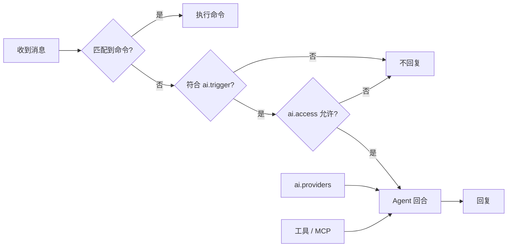

# AI 能力总览

默认安装的 Zhin 只会执行命令，不会"聊天"。启用 AI 后，**没有匹配到任何命令的消息**会交给大模型回答，模型还可以调用你写的工具。

AI 是可选的：不启用时，Bot 不依赖任何模型 SDK，也不需要 API Key。

## 三步启用

**1. 运行向导**

```bash
npx zhin setup --ai
pnpm install
```

向导会让你选择模型服务（OpenAI、Anthropic、DeepSeek、Google、OpenAI 兼容接口，或本地的 Ollama），然后安装对应 SDK 和 Agent 运行时，并在 `package.json` 里声明工具与 Prompt Section 能力。

**2. 填写密钥**

云端模型的 Key 写在 `.env` 里（向导会提示变量名，例如 `AI_API_KEY`）。使用本地 Ollama 时不需要 Key。

**3. 试一试**

```bash
pnpm dev
```

在 Sandbox 私聊里直接发一句话，或者在群聊里发 `ai: 你好`，Bot 会用模型回复。

向导写入 `zhin.config.yml` 的配置大致如下：

```yaml
ai:
  enabled: true
  providers:
    openai-main:          # 自己起的名字
      sdk: openai
      apiKey: ${AI_API_KEY}
  agents:
    zhin:                 # 主 Agent，必须叫 zhin
      provider: openai-main
      model: gpt-4o-mini
```

`providers` 定义"连哪个模型服务"，`agents` 定义"哪个 Agent 用哪个模型"。

::: details 不用向导，手动安装
```bash
pnpm add @zhin.js/agent zod ai
pnpm add @ai-sdk/openai   # 按所用厂商安装对应的 SDK
```

只装 `@zhin.js/agent` 不足以让 `tools/`、`prompt-sections/` 目录生效，还需要在 `package.json#zhin.features` 中声明 `@zhin.js/tool` 与 `@zhin.js/prompt-section`。代码里从 `zhin.js/agent`（或 `@zhin.js/agent`）导入 `ZhinAgent`、`AIService` 等。模型 SDK 是可选依赖，缺失时启动会报 `Missing peer dependency` 并给出安装命令。
:::

## AI 什么时候会回复

没有匹配到命令的消息，按下面的顺序判断是否交给 AI：

| 顺序 | 情况 | 默认行为 |
| --- | --- | --- |
| 1 | 消息以 `/`、`!`、`！` 开头 | 跳过 AI，避免和命令冲突 |
| 2 | 消息以 `#`、`AI:`、`ai:` 开头 | 交给 AI（私聊和群聊都生效），去掉前缀后作为问题 |
| 3 | 群聊或频道中 @ 了 Bot | 交给 AI |
| 4 | 私聊 | 整条消息直接交给 AI |
| 5 | 私聊中包含设置的关键词 | 交给 AI |

所以在群里，Bot 默认**不会**插话，只有被 @ 或使用前缀时才回复。这些规则都可以修改，见 [ai.trigger](#ai-trigger)。

## 让 AI 做事

AI 默认只能聊天。要让它查天气、搜歌、操作数据库，写一个工具放进 `tools/`：

```ts
// tools/weather/index.ts
import { defineAgentTool } from '@zhin.js/tool';
import { z } from 'zod';

export default defineAgentTool<{ city: string }>({
  description: '查询城市的实时天气',
  inputSchema: z.object({ city: z.string().min(1) }),
  async execute({ city }) {
    const response = await fetch(`https://wttr.in/${encodeURIComponent(city)}?format=3`);
    return response.text();
  },
});
```

工具参数的 schema 会原样发给模型，`enum`、`anyOf`、可空类型、`integer`、`format` 和取值范围都会保留，MCP 工具也一样。模型传回的参数按同样的约束校验，不符合时会把错误告诉模型，让它重新调用。Gemini 不接受没有类型的字段，这类字段发给 Gemini 时会按字符串处理。

限制工具的使用范围、要求用户确认、用 Skill 封装流程、补充业务背景，见 [Agent 工具与技能](../authoring/agent-tools.md)。

## 常见调整

| 我想…… | 改这里 |
| --- | --- |
| 换模型或厂商、接入本地模型 | [ai.providers](#ai-providers) |
| 让群里不 @ 也能触发，或修改前缀 | [ai.trigger](#ai-trigger) |
| 只对部分用户或群开放 AI | [ai.access](#ai-access) |
| 不同的群用不同的 Agent 或模型 | [ai.agents](#ai-agents) |
| 让 AI 使用外部 MCP 服务器的工具 | [ai.mcpServers](#ai-mcpservers) |
| 控制 AI 能执行哪些 Shell 命令、是否需要审批 | [ai.agent](#ai-agent) |
| 让 AI 理解语音、回复语音 | [语音](./speech.md) |

## 配置参考

全部配置位于 `zhin.config.yml` 的 `ai:` 段，`${VAR}` 会从环境变量展开。

### ai.providers

每个 provider 以你起的名字为键，`sdk` 决定使用哪个模型 SDK：

```yaml
ai:
  providers:
    openrouter:
      sdk: openai-compatible
      baseUrl: ${OPENROUTER_BASE_URL}
      apiKey: ${OPENROUTER_API_KEY}
```

| sdk | 需要安装 | 关键配置 |
|-----|-----------|----------|
| `openai` | `@ai-sdk/openai` | `apiKey`，可选 `baseUrl`（代理根路径自动补 `/v1`，规则同 `openai-compatible`） |
| `openai-compatible` | `@ai-sdk/openai-compatible` | `baseUrl` + `apiKey`（路径里没有版本号时自动补 `/v1`，见下方 `compat`）；Cloudflare Workers AI 可用 `accountId` 代替 `baseUrl` |
| `anthropic` | `@ai-sdk/anthropic` | `apiKey`，可选 `baseUrl`（自动补 `/v1`） |
| `deepseek` | `@ai-sdk/deepseek` | `apiKey`，可选 `baseUrl` |
| `minimax` | `@ai-sdk/minimax` | `apiKey`，可选 `baseUrl`（默认 `https://api.minimax.io/anthropic/v1`；国内站写 `https://api.minimaxi.com/anthropic`，自动补 `/v1`） |
| `google` | `@ai-sdk/google` | `apiKey`，可选 `baseUrl`（自动补 `/v1beta`） |
| `ollama` | `@ai-sdk/openai-compatible`（通过 OpenAI 兼容接口） | `host`（默认 `http://127.0.0.1:11434`，自动补 `/v1`），不需要 `apiKey`；建议写 `contextWindow`（见下方） |

可选字段：

- `models`：允许使用的模型列表。不写时，启动后会自动从 `/v1/models` 获取（先用上次的缓存，再在后台刷新）。
- `input`：模型能接收的内容类型，`text | image | audio | video | file`。不写时按 SDK 和模型名取默认值：
  - `sdk: google` 的 Gemini 对话模型原生多模态，默认 `text, image, audio, video, file`；TTS、embedding、图像生成和 Live 模型只按文本处理。
  - `sdk: openai` 的 GPT-4o、GPT-4.1、GPT-4.5、GPT-5.x 以及 o1、o3、o4-mini，和 `sdk: anthropic` 的 Claude 3 及以后的模型，默认 `text, image`。audio、realtime、TTS、search、embedding、图像生成这些变体，以及 o1-mini、o3-mini，只按文本处理。PDF 等文件不默认开启，需要时写 `input: [text, image, file]`。
  - 其他 SDK（DeepSeek、MiniMax、Ollama、各类网关）只按文本处理，因为同一家的模型能力不一样。

  写了 `input` 就以它为准。
- `contextWindow`：上下文窗口大小。不写时一般按 128k 估算；`sdk: ollama` 例外：先读 `OLLAMA_CONTEXT_LENGTH` 环境变量（zhin 和 Ollama 在同一台机器时有效），否则按 4096 计算。Ollama 按显存分配上下文（24 GiB 以下 4k，24–48 GiB 32k，48 GiB 以上 256k），OpenAI 兼容接口无法逐请求调大，超出部分会被**静默截掉开头**（包括 system prompt），所以框架宁可少估。请把 `contextWindow` 写成 `ollama ps` 里 CONTEXT 列的值；没写时启动会给出提示。
- `thinkingLevel`：思考深度，`off | low | medium | high`。不写时用 provider 默认。框架把它作为 AI SDK 的 `reasoning` 参数传给各 SDK，再由 SDK 换成自己的设置：Gemini 3 的 `thinkingLevel`（`off` 对应 `minimal`）、Gemini 2.5 的思考预算、Claude 的 thinking 预算、OpenAI 和 DeepSeek 的 reasoning effort。如果 `providerOptions` 里已经写了思考设置（`thinkingConfig`、`thinking`、`reasoningEffort` 或 `effort`），以 `providerOptions` 为准。MiniMax 固定用自适应思考，不受影响。
- `maxOutputTokens`：每次请求的输出 token 上限，默认 `8192`。Gemini 和 Claude 的思考 token 也算在里面，所以 `thinkingLevel: high` 时建议调大，免得回复被截断。
- `compat`（`openai-compatible` / `ollama`）：
  - `includeUsage`：是否请求流式 usage（`stream_options.include_usage`），默认 `true`。不写的话大多数兼容服务流式时不返回 token 用量；少数拒绝该字段的服务设为 `false`。
  - `appendV1`：`baseUrl` 是否补 `/v1`。不写时：路径里已有版本段（如 `/api/v3`、`/api/paas/v4`、`/v1beta/openai`）或以 `/openai` 结尾就原样使用，否则补 `/v1`（旧配置 `https://host`、`https://host/api` 行为不变）。`true` 总是补（旧行为），`false` 总是原样。
  - `promptCacheKey`：是否发送 OpenAI 的 `prompt_cache_key`，默认 `false`（严格的网关会拒绝未知字段）。
  - `supportsDeveloperRole`（`sdk: openai`）：设为 `false` 时推理模型（o 系列、gpt-5）的系统提示用 `system` 角色发送，给不认 `developer` 的 OpenAI 协议端点用。
  - `supportsReasoningContent`、`toolCallsInAssistant` 已废弃，不起作用。
- `authScheme`：`Authorization` 头方案。不写时用 SDK 默认（OpenAI 系 `Bearer`，Anthropic `x-api-key`，Google `x-goog-api-key`）；`''` 发送 `Authorization: <key>`；`Bearer`、`Token` 等发送 `Authorization: <scheme> <key>`。对话请求和模型列表请求用同一规则。
- `timeout`、`maxRetries`：该 provider 的单次请求超时（毫秒，0 关闭）和每个模型的重试次数，覆盖 `ai.providerResilience` 的 `requestTimeoutMs` / `maxRetries`；按模型配置的 `modelHarness.requestTimeoutMs` 仍然优先。
- `firstChunkTimeoutMs`、`chunkTimeoutMs`：流式卡顿超时（毫秒），默认关闭。前者限制等响应头和第一个 chunk 的时间，后者限制两个 chunk 之间的静默时间。超时按 timeout 处理：重试，用尽后切换备用模型。比 `timeout` 更早发现“连上了但不出字”的请求，建议设成几十秒。
- `imageGeneration`：文生图的默认参数。
- `providerOptions`：按 SDK 名分组的 AI SDK `providerOptions`，每次请求都会合并进去。Gemini 常用的是安全设置和思考深度：

  ```yaml
  ai:
    providers:
      gemini:
        sdk: google
        apiKey: ${GEMINI_API_KEY}
        defaultModel: gemini-3.8-flash
        providerOptions:
          google:
            safetySettings:
              - { category: HARM_CATEGORY_HARASSMENT, threshold: BLOCK_ONLY_HIGH }
            thinkingConfig: { thinkingLevel: low }
  ```

  Gemini 因安全策略（SAFETY、PROHIBITED_CONTENT、RECITATION、提示词被拦截等）拒答时，用户会看到一句礼貌的说明（“抱歉，这条内容触发了模型的内容安全策略，没能生成回复（SAFETY），换个说法再试试吧”），而不是一条空回复。这种拒答不会重试，也不会切换到备用模型：同样的内容再问一次结果相同，换模型绕过拒答等于绕过你配置的 `safetySettings`。Gemini 走隐式缓存：system prompt 和工具定义保持不变，命中的 token 记在 usage 的 `cacheRead` 和 turn trace 的 `cache_read_tokens` 里。如果想要更稳定的折扣，可以开显式缓存：`contextCache: { mode: explicit, ttlSeconds: 600 }`。开启后，框架会给 system prompt 和工具定义建一个 `cachedContents`，在 TTL 内复用；前缀变了就新建一个并删掉旧的，服务端缓存失效时自动退回完整请求，建不了（比如前缀太短）时退回隐式缓存。缓存按存储时长计费。显式缓存只支持 Gemini 3 / 2.5，Gemini 4 Argon 及以后不支持。

- **Gemini 走自己的代理**：如果代理只是原样转发（请求、`x-goog-api-key` 鉴权和响应都和官方一致，只是域名不同），把 `baseUrl` 指到代理即可。写到根路径或带 `/v1beta` 都行，结尾的 `/` 会被去掉，不会出现重复的 `/v1beta`。不写时默认 `https://generativelanguage.googleapis.com`。`generateContent`、流式的 `streamGenerateContent`、显式缓存的 `cachedContents`（创建和删除）以及模型列表都会走这个地址。代理需要额外请求头时可以加 `headers`，所有请求都会带上，可不填：

  ```yaml
  ai:
    providers:
      gemini:
        sdk: google
        apiKey: ${GEMINI_API_KEY}
        baseUrl: https://gemini-proxy.example.com   # 等价于 https://gemini-proxy.example.com/v1beta
        headers:                                   # 可选
          x-proxy-tag: zhin
  ```

### ai.agents

把 Agent 名字绑定到 `provider + model`。`zhin` 是主 Agent，必须存在：

```yaml
ai:
  agents:
    zhin:
      provider: openrouter
      model: openrouter/free
      mcpServers: [icqq]        # 这个 Agent 使用的 MCP 服务器
      nickname: 小智            # AI 的自称和界面展示名
    planner:
      provider: openrouter
      model: openrouter/free
      match:                    # 什么样的消息交给它（可以是数组）
        scene: group
      permission:               # 它能派出哪些子 Agent
        task: { "researcher": allow, "*": deny }
```

| 字段 | 说明 |
|------|------|
| `provider` / `model` | 引用 `ai.providers` 的名字与模型 id（必填） |
| `mcpServers` | 引用 `ai.mcpServers` 中的 `name` |
| `nickname` | AI 的自称与展示名 |
| `match` | 路由条件：`adapter` / `endpoint` / `scene` / `sceneId` / `hasMedia` / `contentContains` |
| `permission.task` | glob → `allow` / `deny`，限制 `spawn_task` 能派出的子 Agent |

### ai.mcpServers

让 AI 连接**外部的 MCP 服务器**，使用对方提供的工具。需要安装 `@modelcontextprotocol/sdk`。

```yaml
ai:
  mcpServers:
    - name: icqq
      transport: streamable-http      # stdio | streamable-http | sse
      url: ${ICQQ_MCP_URL}
      headers:
        Authorization: Bearer ${ICQQ_MCP_TOKEN}
    - name: filesystem
      transport: stdio
      command: npx
      args: ["-y", "@modelcontextprotocol/server-filesystem", "/tmp/zhin-mcp-test"]
```

- 连接成功后，对方的工具以带服务器名前缀的名字加入工具池。
- **任何一个服务器连接失败，新配置都不会生效**，旧版本继续服务。
- `ai.agents.<name>.mcpServers` 只能引用这里声明过的名字，否则配置校验失败。

::: tip 反过来：把你的 Bot 变成 MCP 服务器
如果想让外部 AI 客户端连接你的 Bot，使用顶层的 `mcp:` 配置，并运行 `pnpm add @zhin.js/mcp @zhin.js/agent zod ai`。这与 `ai.mcpServers` 是两回事，设置其中一个不会开启另一个。见 [MCP Server 配置](https://github.com/zhinjs/zhin/blob/main/packages/host/mcp/README.md)。
:::

### ai.trigger

```yaml
ai:
  trigger:
    prefixes: ["ai:"]          # 默认 ['#', 'AI:', 'ai:']
    ignorePrefixes: ["/"]      # 默认 ['/', '!', '！']
    respondToAt: true          # 默认 true：群里 @ Bot 时触发
    respondToPrivate: true     # 默认 true：私聊直接触发
    keywords: []               # 私聊中包含这些词时触发
    timeout: 60000             # 单轮超时（毫秒）
    thinkingMessage: 思考中…    # 可选：开始处理前的占位回复
    errorTemplate: "❌ AI 处理失败: {error}"
    masters: ["10001"]         # 有审批权的用户
    trusted: []                # 受信任用户（权限低于 master）
```

@ 触发依赖适配器标记消息为"提到了 Bot"（例如 CQ 码、Slack 的 app_mention）。

### ai.access

控制哪些会话可以使用 AI（例如为满足平台对 AIGC 的合规要求）：

```yaml
ai:
  access:
    mode: whitelist     # open（默认）| closed | whitelist
    users: ["10001"]    # 允许的用户 id
    groups: ["123456"]  # 允许的群 / 频道 id
    denyMessage: 当前会话未开放 AI 功能。
```

私聊被拒绝时回复 `denyMessage`；群聊和频道被拒绝时不回复。

### ai.agent

`ai.agent` 控制 AI 的运行方式，其中最重要的是 `bash` 等执行类工具的安全策略：

```yaml
ai:
  agent:
    execSecurity: allowlist       # deny | allowlist（默认）| full
    execPreset: readonly          # readonly | network | development | custom
    execAllowlist: [make]         # execPreset=custom 时的白名单
    execApprovalMode: ask         # ask（默认）| bypass | auto
    gitStatus: true               # 默认 true：在提示词中注入一行 git 状态（非 git 仓库自动跳过）
    contextPaths: []              # 额外注入系统提示词的上下文文件（支持 ~ 与相对路径）
    systemPromptMaxChars: 100000  # 系统提示词总字符上限
    inboundQueue:
      groupMode: supersede        # 默认：同一发起人的新消息替换他尚未回复的回合；fifo：全部按到达顺序排队
      maxQueuedTurns: 5           # 每个会话最多排队的回合数
      ttlMs: 180000               # 排队超时
```

**命令白名单**：`execPreset` 逐级放宽——`readonly`（ls、cat、grep、find 等）→ `network`（再加 curl、wget、ping 等）→ `development`（再加 npm、node、git、python 等）。无论哪种模式，`sudo`、`eval`、`dd`、`export` 等危险命令一律拒绝，`rm -rf node_modules` 这类操作直接阻断。

**审批方式**：

| `execApprovalMode` | 行为 |
| --- | --- |
| `ask`（默认） | 向 master 请求审批 |
| `auto` | 交给一个没有工具的审核 Agent 判断；它无法判断时再询问 master；模型出错、超时或输出无效时直接拒绝 |
| `bypass` | 跳过审批，但仍然不能绕过危险命令黑名单、工具权限、文件 / 网络边界和沙箱 |

审批时，群聊和频道里可以选择"拒绝 / 仅本次 / 当前会话 / 始终允许"，私聊里是"拒绝 / 仅本次 / 始终允许"。"当前会话"对会话中所有人生效；"始终允许"只对当前发送者生效；所有持续决定都只绑定当前会话。`/approve always bash` 与 `/approve rule <正则>` 管理本账号的持久放行规则。

::: details 更多细节
- **全局上下文文件**：除 `contextPaths` 外，还会自动加载 `~/.config/zhin/AGENTS.md` 与 `~/.config/zhin/ZHIN.md`（不存在则跳过），作为 `# User Context` 段放在项目上下文之前；单个文件最多 8KB，总计最多 16KB。
- **提示词预算**：超过 `systemPromptMaxChars` 时，先移除 `opportunistic` 的内容；`required` 的内容放不下时，本轮明确失败。
- **命令检查链**：危险黑名单 → 去掉环境变量前缀（`FOO=bar cmd` 按 `cmd` 匹配）→ 去掉 wrapper（`timeout 10 cmd`）→ 拆分复合命令（`&&`、`|` 逐段检查）→ 非 `full` 模式下拒绝换行、`$(...)` 和反引号 → 只读命令自动放行。审批通过当前回合的 `ApprovalPort` 发起。
- **旧版审批文件**：V1 审批文件不会在线迁移，升级前需要显式重建规则。
- **消息排队**：`inboundQueue.groupMode` 也是默认的回合意图策略。`supersede` 表示同一发起人的新消息会替换他自己尚未回复的回合（其他成员的消息总是排队，不会打断别人）；`fifo` 表示按到达顺序等待。详见 [Agent：回合运行中又来了消息](./agent.md)。`steer`、`follow_up`、`observe` 由适配器、命令或其他策略显式指定；跨参与者的 `steer` / `follow_up` 授权只能由 Host 的可信 `resolveTurnIntent` 策略产生，消息 metadata 不能自行声明。工具始终受当前回合的权限约束，执行日志会记录发起控制的用户与回合 ID。
:::

## 它是怎么工作的



启动时，Zhin 会自动清理 `ai:` 配置：凭据展开后为空的 provider 会被剔除（只记录 debug 日志），绑定到它的 Agent 一并跳过；如果最终没有可用的 `zhin` Agent，AI 不会启用，但**不影响** Bot 的其他功能正常启动。

## 下一步

- [Agent 工具与技能](../authoring/agent-tools.md)：让 AI 调用你的函数。
- [Agent 深入](./agent.md)：回合、按需加载工具、子任务、会话与上下文压缩。
- [结构化决策](./structured-decisions.md)：Agent / Skill / Tool 推荐、检索排序与自动审核。
- [语音](./speech.md)：语音识别与语音回复。
- [Console](../console/index.md)：在浏览器里观察 AI 会话与运行情况。
