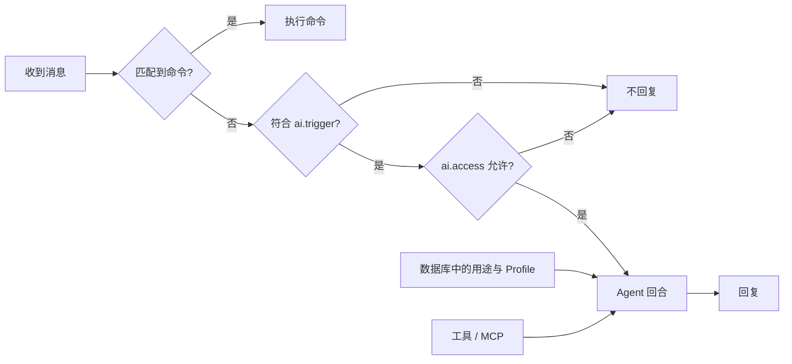

# AI 能力总览

默认安装的 Zhin 只会执行命令，不会"聊天"。启用 AI 后，**没有匹配到任何命令的消息**会交给大模型回答，模型还可以调用你写的工具。

AI 是可选的：不启用时，Bot 不依赖任何模型 SDK，也不需要 API Key。

## 2 分钟快速上手

1. **运行向导选择模型服务**：

   ```bash
   npx zhin setup --ai
   pnpm install
   ```

   向导会在 `zhin.config.yml` 中开启 `ai: { enabled: true }`，并根据你选择的预设（OpenAI、DeepSeek、通义千问 DashScope、硅基流动 SiliconFlow、火山引擎 Volcengine、MiniMax、OpenRouter、Anthropic 或本地 Ollama）生成 `ai.plan.yml` 与 `.env` 密钥占位。

2. **启动并直接开聊**：

   ```bash
   pnpm dev
   ```

   首次启动（数据库尚无模型配置）时，`ai.plan.yml` 会**自动种子化（seed）导入 Host 数据库**——无需手动打开 Console 点击导入，直接访问本地 `/sandbox` 就能和 Bot 对话！后续你可以随时在 Console 的「模型管理」页面调整服务、账号、Profile 和用途，保存后下一轮对话立即生效，无需重启进程。

```yaml
# ai.plan.yml 示例（DeepSeek）
version: 1
services:
  deepseek:
    driver: deepseek
    models:
      deepseek-chat:
        id: deepseek-chat
        kinds: [language]
        protocol: openai-chat
        input: [text]
        streaming: true
        toolCalling: true
accounts:
  default:
    service: deepseek
    auth:
      method: api-key
      source: env://DEEPSEEK_API_KEY
profiles:
  chat-default:
    account: default
    model: deepseek-chat
purposes:
  chat:
    profile: chat-default
```

云端 API Key 保存在 `.env` 并通过 `env://...` 引用，或在 Console 私有密钥表单中输入；Host 的订阅账号通过 OAuth 登录授权。详见[模型服务与订阅账号](./providers.md)和[目标接口升级](./provider-upgrade.md)。

手动安装同样采用按需 AI 分档：`pnpm add @zhin.js/agent zod ai`，并按 Driver 安装对应 `@ai-sdk/*`。默认 IM 安装不引入 AI 引擎或模型 SDK。

## AI 什么时候会回复

没有匹配到命令的消息，按下面的顺序判断是否交给 AI：

| 顺序 | 情况 | 默认行为 |
| --- | --- | --- |
| 1 | 消息以 `/`、`!`、`！` 开头 | 跳过 AI，避免和命令冲突 |
| 2 | 消息以 `#`、`AI:`、`ai:` 开头 | 交给 AI（私聊和群聊都生效），去掉前缀后作为问题 |
| 3 | 群聊或频道中 @ 了 Bot | 交给 AI |
| 4 | 私聊 | 整条消息直接交给 AI |
| 5 | 私聊中包含设置的关键词 | 交给 AI |

所以在群里，Bot 默认**不会**插话，只有被 @ 或使用前缀时才回复。这些规则都可以修改，见 [ai.trigger](#ai-trigger)。

## 让 AI 做事

AI 默认只能聊天。要让它查天气、搜歌、操作数据库，写一个工具放进 `tools/`：

```ts
// tools/weather/index.ts
import { defineAgentTool } from '@zhin.js/tool';
import { z } from 'zod';

export default defineAgentTool<{ city: string }>({
  description: '查询城市的实时天气',
  inputSchema: z.object({ city: z.string().min(1) }),
  async execute({ city }) {
    const response = await fetch(`https://wttr.in/${encodeURIComponent(city)}?format=3`);
    return response.text();
  },
});
```

工具参数的 schema 会原样发给模型，`enum`、`anyOf`、可空类型、`integer`、`format` 和取值范围都会保留，MCP 工具也一样。模型传回的参数按同样的约束校验，不符合时会把错误告诉模型，让它重新调用。Gemini 不接受没有类型的字段，这类字段发给 Gemini 时会按字符串处理。

限制工具的使用范围、要求用户确认、用 Skill 封装流程、补充业务背景，见 [Agent 工具与技能](../authoring/agent-tools.md)。

## 常见调整

| 我想…… | 改这里 |
| --- | --- |
| 换模型或厂商、接入本地模型 | [服务、账号与 Profile](./providers.md) |
| 让群里不 @ 也能触发，或修改前缀 | [ai.trigger](#ai-trigger) |
| 只对部分用户或群开放 AI | [ai.access](#ai-access) |
| 给角色设置昵称、可用的 MCP 服务器 | [ai.agents](../configuration/index.md#ai-agents) |
| 让 AI 使用外部 MCP 服务器的工具 | [ai.mcpServers](#ai-mcpservers) |
| 控制 AI 能执行哪些 Shell 命令、是否需要审批 | [ai.agent](#ai-agent) |
| 让 AI 理解语音、回复语音 | [语音](./speech.md) |

## 配置参考

全部配置位于 `zhin.config.yml` 的 `ai:` 段，`${VAR}` 会从环境变量展开。

### 模型服务与角色

Service、Account、Profile 和用途（`chat`、`compaction`、`ambient`、`perception` 等）保存在 Host 数据库中。首次启动时若数据库为空，`ai.plan.yml` 会自动导入作为初始配置；之后也可在 Console 中预览导入或随时在线调整。完整示例见[模型服务与订阅账号](./providers.md)与[个人 Session 与用途选择](./model-policy.md)。旧 `ai.providers`、`modelCatalog/modelPolicy` 及 Agent 中的 provider/model/preset 需要[显式迁移](./provider-upgrade.md)。

`ai.agents` 只保留角色的昵称兜底、MCP 选择与权限；平台资料优先于配置昵称。角色对应的模型由用途 `agents.<name>.profile` 选择，不在角色里复制服务或密钥。

### ai.imageStorage

可选的公开图片存储。启用后，`generate_image` 的结果和最终结构化回复里的内联图片先上传 R2，工具结果、后续模型上下文与出站消息保留 URL。上传失败会明确报错，不退回 base64；框架不会因上传失败自动重跑生图。

```yaml
ai:
  imageStorage:
    accountId: ${R2_ACCOUNT_ID}
    bucket: ${R2_BUCKET}
    accessKeyId: ${R2_ACCESS_KEY_ID}
    secretAccessKey: ${R2_SECRET_ACCESS_KEY}
    publicBaseUrl: https://images.example.com
    prefix: agent-images/
```

桶的公开域名和生命周期由运营者配置，Zhin 不修改桶权限或删除规则。临时图片建议设置 7 天删除；链接公开，持有链接的人可在删除前访问。R2 不频繁访问存储有最低存储计费期，短期资源应先核对其费用规则。

启用后还提供 `upload_image(file_path)`：只接受已授权工作区的 PNG、JPEG、GIF、WebP 文件，单张上限 25 MiB，每次发布经过现有的人类审批。不能传入远程 URL 或 base64；私有 MCP 资源目录也不能通过这个工具读取。未配置 `imageStorage` 时不开放上传工具，既有生图行为保持兼容。

### MCP 私有图片

Host 将 MCP 标准图片块及嵌入的图片资源保存到工作区的 `data/agent-assets`，在工具日志和模型上下文里只留下资源 ID、类型、大小和到期时间，不自动上传 R2。模型需要看图时调用 `get_local_assets(asset_id)`（本地资源工具）；仅原 Host、账号、会话、发起人及继承该身份的授权子任务可读取，不增加发布审批。

有视觉能力的模型只在下一次请求中收到图片输入，原图不会作为文本或历史消息保存。文本模型使用已配置的 `perception` 用途 Profile（配合 [`ai.multimodal.perception`](#ai-multimodal-perception)），原图会发送给该识图供应商；未配置、到期或识图失败会明确标为未识别。按需查看共用本回合的识图数量预算，主任务和子任务不各自重置额度；识图调用计入用量。

本地图片保留 7 天，读取不延长。每 Host 最多 1 GiB 或 1,000 张，单张 25 MiB；启动、写入前和每小时清理过期资源。清理后仍满则拒存新图并返回明确说明，不删除未过期图片，也不自动上传云端。该目录仅供 Host 管理，通用文件工具不能读取；不要将整个 `data` 目录作为公开静态文件目录。程序直接使用 Agent 而不安装 Host 时，需注入本地资源存储与认证会话范围；否则 MCP 图片返回不可用提示。

### ai.mcpServers

让 AI 连接**外部的 MCP 服务器**，使用对方提供的工具。需要安装 `@modelcontextprotocol/sdk`。

```yaml
ai:
  mcpServers:
    - name: icqq
      transport: streamable-http      # stdio | streamable-http | sse
      url: ${ICQQ_MCP_URL}
      headers:
        Authorization: Bearer ${ICQQ_MCP_TOKEN}
    - name: filesystem
      transport: stdio
      command: npx
      args: ["-y", "@modelcontextprotocol/server-filesystem", "/tmp/zhin-mcp-test"]
```

- 连接成功后，对方的工具以带服务器名前缀的名字加入工具池。
- **任何一个服务器连接失败，新配置都不会生效**，旧版本继续服务。
- `ai.agents.<name>.mcpServers` 只能引用这里声明过的名字，否则配置校验失败。

::: tip 反过来：把你的 Bot 变成 MCP 服务器
如果想让外部 AI 客户端连接你的 Bot，使用顶层的 `mcp:` 配置，并运行 `pnpm add @zhin.js/mcp @zhin.js/agent zod ai`。这与 `ai.mcpServers` 是两回事，设置其中一个不会开启另一个。见 [MCP Server 配置](https://github.com/zhinjs/zhin/blob/main/packages/host/mcp/README.md)。
:::

### ai.trigger

```yaml
ai:
  trigger:
    prefixes: ["ai:"]          # 默认 ['#', 'AI:', 'ai:']
    ignorePrefixes: ["/"]      # 默认 ['/', '!', '！']
    respondToAt: true          # 默认 true：群里 @ Bot 时触发
    respondToPrivate: true     # 默认 true：私聊直接触发
    keywords: []               # 私聊中包含这些词时触发
    timeout: 60000             # 单轮超时（毫秒）
    thinkingMessage: 思考中…    # 可选：开始处理前的占位回复
    # errorTemplate: "出错了：{error}"   # 可选；不配置时用聊天口吻说"刚卡了一下"，主人会额外看到原因
```

@ 触发依赖适配器标记消息为"提到了 Bot"（例如 CQ 码、Slack 的 app_mention）。

出错时，Bot 在聊天里像群友一样说"刚卡了一下，你再说一遍？"，不提模型、密钥、重试这些内部细节；发送者是主人（聊天角色 owner）时，会在括号里附上简短原因，例如"（模型额度用完了）"。完整错误只写日志。HTTP、Console 等非聊天入口保留原来的精确提示。配置了 `errorTemplate` 时，入口层的报错按模板发送。

被 @、引用和私聊的消息总会交给 Agent，Agent 也可以判断不需要回复，返回空消息（`{"messages":[]}`）后什么都不发。

#### 群聊旁听（ambient）

群里没人叫 Bot 时，可以让它自己决定要不要接话：

```yaml
ai:
  trigger:
    ambient:
      conversations: ["icqq:1048877509"]  # platform:groupId；"*" 表示所有群
      quietMs: 4000                       # 群安静这么久之后，对这一串消息判断一次
      cooldownMs: 120000                  # 两次主动插话之间的最短间隔
      maxPerHour: 3                       # 每个群每小时最多主动插话次数
      conversationWindowMs: 180000        # Bot 说话后这段时间内算作对话进行中
      judgeIntervalMs: 30000              # 没在对话时，同一个群至少隔这么久才判断一次（窗口内的消息顺延判断，不丢）
      minConfidence: 0.7                  # 判断模型的置信度门槛
      mode: active                        # shadow：只记录判断结果，不回复
```

流程：
1. 群里有新消息后等群安静 `quietMs`，期间的新消息合并为一次判断。
2. 判断模型读最近 20 条消息（Bot 自己的话标为 `You (this bot)`），给出要不要接话和置信度。
   - **对话进行中**（Bot 在 `conversationWindowMs` 内说过话，无论是被 @ 还是主动接话）：群友接它的话只看判断结果，不受冷却和每小时次数限制，只有每小时 30 次的安全上限。
   - **没有对话时**：主动插话受 `cooldownMs` 和 `maxPerHour` 限制；判断本身至多每 `judgeIntervalMs` 一次，窗口内到达的消息会顺延到窗口结束再判（期间有新消息就改判最新的那串），不会被丢掉。
3. 达到门槛后交给主 Agent 正常处理。这一轮的上下文会注明"没人叫你"，Agent 仍然可以选择不说话。

每次判断都会记一条 `ambient_engagement` 日志（结果、置信度、理由）。建议先用 `shadow` 跑一段时间，看判断是否靠谱，再改成 `active`。

##### 判断模型

旁听语言模型通过 Console 的 `ambient` 用途选择，未配置时继承部署聊天 Profile。显式选定模型失败时不自动换模型。模型温度和输出上限由该 Profile 决定。

如使用 TypeSafe 等结构化决策，为 `decisions.ambient` 选择一个 `decision` Profile，并按既有策略设置 `off`／`shadow`／`active`。它与旁听语言模型是不同合同：结构化决策只提供证据，实际旁听业务继续负责冷却、次数、阈值和回复。见[结构化决策](./structured-decisions.md)。

### ai.access

控制哪些会话可以使用 AI（例如为满足平台对 AIGC 的合规要求）：

```yaml
ai:
  access:
    mode: whitelist     # open（默认）| closed | whitelist
    users: ["10001"]    # 允许的用户 id
    groups: ["123456"]  # 允许的群 / 频道 id
    denyMessage: 当前会话未开放 AI 功能。
```

私聊被拒绝时回复 `denyMessage`；群聊和频道被拒绝时不回复。

### ai.multimodal.perception

当主模型不支持收到的媒体时，感知层使用 Console 选中的 `perception` Language Profile。Service 目录必须明确声明该模型支持相应输入。只有明确配置的主项和备用链会被尝试；普通聊天失败不换模型。

启动文件保留处理行为设置：

```yaml
ai:
  multimodal:
    perception:
      kinds: [image]
      maxChars: 800
      timeoutMs: 30000
      maxItemsPerTurn: 4
```

音频仍走转写。描述是不可信外部内容，不授予工具、文件或网络权限。相同媒体沿用已有内容摘要缓存；超时、空回答或不支持输入时按明确配置的感知备用链处理，取消立即停止。所有候选失败保留未识别占位，不编造图片内容。

### ai.agent

`ai.agent` 控制 AI 的运行方式，其中最重要的是 `bash` 等执行类工具的安全策略：

```yaml
ai:
  agent:
    execSecurity: allowlist       # deny | allowlist（默认）| full
    execPreset: readonly          # readonly | network | development | custom
    execAllowlist: [make]         # execPreset=custom 时的白名单
    execApprovalMode: ask         # ask（默认）| bypass | auto
    gitStatus: true               # 默认 true：在提示词中注入一行 git 状态（非 git 仓库自动跳过）
    contextPaths: []              # 额外注入系统提示词的上下文文件（支持 ~ 与相对路径）
    systemPromptMaxChars: 100000  # 系统提示词总字符上限
    mailbox:
      groupMode: supersede        # 默认：同一发起人的新消息替换他尚未回复的回合；fifo：全部按到达顺序排队
      maxQueuedTurns: 5           # 每个会话最多排队的回合数
      ttlMs: 180000               # 排队超时
      merge:                      # 群聊合流（ADR 0038），仅群聊
        enabled: true
        quietMs: 1500             # 安静多久发车
        maxWaitMs: 6000           # 窗口最多等多久
        maxSenders: 5             # 一次合并回复最多几个人
      live:                       # 弹幕模式（ADR 0038），仅 liveDanmaku 适配器
        mode: pick-one            # pick-one 挑一条回 / summary 概括后回一次
        windowMs: 10000           # 弹幕窗口
        minIntervalMs: 15000      # 两次弹幕回复的最小间隔
```

**命令白名单**：`execPreset` 逐级放宽——`readonly`（ls、cat、grep、find 等）→ `network`（再加 curl、wget、ping 等）→ `development`（再加 npm、node、git、python 等）。无论哪种模式，`sudo`、`eval`、`dd`、`export` 等危险命令一律拒绝，`rm -rf node_modules` 这类操作直接阻断。

**审批方式**：

| `execApprovalMode` | 行为 |
| --- | --- |
| `ask`（默认） | 向 master 请求审批 |
| `auto` | 交给一个没有工具的审核 Agent 判断；它无法判断时再询问 master；模型出错、超时或输出无效时直接拒绝 |
| `bypass` | 跳过审批，但仍然不能绕过危险命令黑名单、工具权限、文件 / 网络边界和沙箱 |

审批时，群聊和频道里可以选择"拒绝 / 仅本次 / 当前会话 / 始终允许"，私聊里是"拒绝 / 仅本次 / 始终允许"。"当前会话"对会话中所有人生效；"始终允许"只对当前发送者生效；所有持续决定都只绑定当前会话。`/approve always bash` 与 `/approve rule <正则>` 管理本账号的持久放行规则。

::: details 更多细节
- **全局上下文文件**：除 `contextPaths` 外，还会自动加载 `~/.config/zhin/AGENTS.md` 与 `~/.config/zhin/ZHIN.md`（不存在则跳过），作为 `# User Context` 段放在项目上下文之前；单个文件最多 8KB，总计最多 16KB。
- **提示词预算**：超过 `systemPromptMaxChars` 时，先移除 `opportunistic` 的内容；`required` 的内容放不下时，本轮明确失败。
- **命令检查链**：危险黑名单 → 去掉环境变量前缀（`FOO=bar cmd` 按 `cmd` 匹配）→ 去掉 wrapper（`timeout 10 cmd`）→ 拆分复合命令（`&&`、`|` 逐段检查）→ 非 `full` 模式下拒绝换行、`$(...)` 和反引号 → 只读命令自动放行。审批通过当前回合的 `ApprovalPort` 发起。
- **旧版审批文件**：V1 审批文件不会在线迁移，升级前需要显式重建规则。
- **消息排队**：`mailbox.groupMode` 也是默认的回合意图策略。`supersede` 表示同一发起人的新消息会替换他自己尚未回复的回合（其他成员的消息总是排队，不会打断别人）；`fifo` 表示按到达顺序等待。详见 [Agent：回合运行中又来了消息](./agent.md)。`steer`、`follow_up`、`observe` 由适配器、命令或其他策略显式指定；跨参与者的 `steer` / `follow_up` 授权只能由 Host 的可信 `resolveTurnIntent` 策略产生，消息 metadata 不能自行声明。工具始终受当前回合的权限约束，执行日志会记录发起控制的用户与回合 ID。
:::

## 它是怎么工作的



Host 可以在空模型图下启动管理界面。没有有效聊天选择时，推理明确报告未配置；查询数据库失败不当作空配置，也不使用启动文件偷偷降级。
## 下一步

- [Agent 工具与技能](../authoring/agent-tools.md)：让 AI 调用你的函数。
- [Agent 深入](./agent.md)：回合、按需加载工具、子任务、会话与上下文压缩。
- [结构化决策](./structured-decisions.md)：Agent / Skill / Tool 推荐、检索排序与自动审核。
- [语音](./speech.md)：语音识别与语音回复。
- [Console](../console/index.md)：在浏览器里观察 AI 会话与运行情况。
