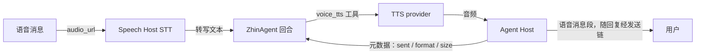

# 语音能力（Speech）

群里发来一条语音，Bot 听懂了内容，还能回一段合成语音——这就是可选包 `@zhin.js/speech` 提供的能力：

- **入站语音自动转文字**（STT），转写结果交给 AI 处理；
- **给 AI 两个语音工具**：`voice_stt`（识别）和 `voice_tts`（合成）。

没有安装这个包时，`speech:` 配置会被跳过并记录 warn，不影响其他功能。



## 快速启用

```bash
pnpm add @zhin.js/speech
```

在 `zhin.config.yml` 顶层加入 `speech:` 段，重启后实例会自动装配 Speech Host：

```yaml
speech:
  stt: { provider: openai, model: whisper-1, host: https://api.openai.com, apiKey: ${OPENAI_API_KEY} }
  tts: { provider: edge, voice: zh-CN-XiaoxiaoNeural }
```

## 配置

```yaml
speech:
  stt:
    provider: openai          # ollama | openai
    model: whisper-1
    host: https://api.openai.com
    apiKey: ${OPENAI_API_KEY}
  tts:
    provider: edge            # edge | openai | azure | custom
    voice: zh-CN-XiaoxiaoNeural
```

## STT（语音转文字）

| provider | 说明 |
|----------|------|
| `openai` | 调 `{host}/v1/audio/transcriptions`（OpenAI 兼容 whisper 接口）；`model` 默认 `whisper-1`，`host` 默认 `https://api.openai.com`，语言固定 `zh`，超时 60s |
| `ollama` | **当前不可用**：Ollama 没有音频转写模型，调用会直接报错并提示改用 `openai` |

`stt.enabled: false` 可单独关闭 STT。入站语音先走统一媒体物化与真实 MIME/大小校验；策略为 `transcribe` 时，Agent Host 再转写并作为派生文本加入当前 Turn。下载、校验或转写失败都会产生明确媒体终态，不会伪装成模型已识别成功。

音频格式按 MIME 推断扩展名（wav / mp3 / ogg / webm / amr / silk / m4a / flac），无法识别时按 wav 处理。

## TTS（文字转语音）

`tts.provider` 缺省为 `edge`。四个 provider：

| provider | 关键配置 | 说明 |
|----------|----------|------|
| `edge` | `voice`（默认 `zh-CN-XiaoxiaoNeural`）、`rate`（默认 `+0%`）、`pitch`（默认 `+0Hz`）、`edgeTtsCommand`（默认 `edge-tts`） | 调本机 `edge-tts` CLI，输出 mp3；需自行安装该命令 |
| `openai` | `host`（默认 `https://api.openai.com`）、`model`（默认 `tts-1`）、`voice`（默认 `alloy`）、`speed` | 调 `{host}/v1/audio/speech`；apiKey 取 `tts.apiKey`，缺省回落 `stt.apiKey` |
| `azure` | `region`（默认 `eastasia`）、`subscriptionKey`、`voice` | Azure Cognitive Services REST，输出 16kHz mp3 |
| `custom` | `baseUrl`（必填）、`headers`、`model`、`voice`、`speed` | 任意 OpenAI 兼容 TTS 端点，body 同 `/v1/audio/speech` |

TTS 请求超时统一 30s，输出格式 mp3（`openai` / `custom` 可选 wav）。

### edge-tts 与托管环境（launchd / systemd）

`edge` provider 调用本机命令 `edge-tts`（`pip install edge-tts`）。实例由 launchd、systemd、pm2 等托管时，进程的 `PATH` 往往很短，通常**不包含** `~/.local/bin` 或虚拟环境的 `bin`，在终端里能用的 `edge-tts` 在服务里会找不到。托管运行时请把 `edgeTtsCommand` 写成**可执行文件的绝对路径**（不要用 `~`，它不会被展开）：

```yaml
speech:
  tts:
    provider: edge
    edgeTtsCommand: /Users/me/.local/bin/edge-tts   # `command -v edge-tts` 的输出
```

`edgeTtsCommand` 只能填可执行文件路径，不支持带参数（例如 `uvx edge-tts`）。Windows 上要指向 `edge-tts.exe`：Node 不经 shell 无法直接运行 `.cmd` / `.bat`。

启动时 Speech Host 会检查 `edgeTtsCommand` 能否执行（只在 `PATH` / 文件系统里查找，不运行命令，最多 3 秒）。不能执行时：

- 启动日志记 warn，写成 `degraded | … | tts: edge (unavailable: not-found edge-tts)`，不再写 `ready`；
- Console「需要你处理」出现「语音合成（edge）不可用」（`speech.unavailable`，指向 `speech.tts.edgeTtsCommand`），`zhin doctor` 在实例运行时也会列出这一条；
- `voice_tts` 被调用时先重新检查一次（装好 edge-tts 后无需重启），仍不可用就直接返回原因（「未找到 edge-tts……」），模型据此如实告诉用户。返回给模型的报错和日志中，命令路径只保留最后一段（如 `…/edge-tts`），不暴露家目录。

其他 provider（openai / azure / custom TTS，openai / ollama STT）都是 HTTP 服务，没有本机命令依赖；服务地址或密钥有问题时在调用时报出具体原因。

## Agent 工具

Speech Host 装配后向 Agent 注册两个工具（`source: speech`）：

| 工具 | 参数 | 返回 |
|------|------|------|
| `voice_stt` | `audio_url` 或 `file_path`（本地绝对路径，二选一） | `{ text }`；失败返回 `{ error }` |
| `voice_tts` | `text`（必填）、`voice`（覆盖默认）、`provider`（`edge` / `openai` / `azure` / `custom`） | 模型看到 `{ format, size, sent: true, note }`；失败返回 `{ error }`（含原因） |

`voice_tts` 可按调用临时切换 provider，便于一次部署同时挂多种音色。

合成的音频**不会交给模型**：Agent 在工具结果进入模型之前把音频拆出来，作为语音消息段随本轮回复经正常发送链（`Message.$reply` → OutboundRenderer → Endpoint）发出，只发一次；模型只看到元数据和「语音已发送，不要重复输出音频内容」的提示。工具结果里 2048 字符以上的 base64 / data URL 在进入模型前会被替换为一行说明（读文件、搜索、shell 类工具只截断 64 KB 以上的串并标明「已截断」，`write_file` / `edit_file` 拒绝写入这类占位）；会话历史里已发送的语音只记占位（如「[语音 mp3 18.6KB 已发送]」）；本轮工具已经产出语音时，模型回复里抄写的内嵌音频（含流式回复）不会再作为第二段语音发出。

## 相关

- [AI 能力总览](./index.md)
- [Agent 深入](./agent.md)
