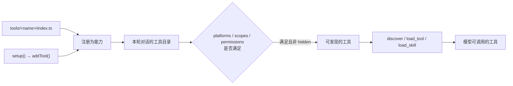

# Agent 工具与技能

启用 AI 后，Bot 会用大模型回答没有匹配到命令的消息。本页讲怎样让它**做事**：

- **Tool**：AI 可以调用的函数，例如查天气、搜歌、查数据库。
- **Skill**：一份操作手册，AI 需要时才加载，可以附带专用的 Tool。
- **Prompt Section**：给 AI 的背景知识，例如产品术语和回答规范。
- **子 Agent**：有独立职责、规则和工具的专门助手。

::: tip 开始前
先运行 `npx zhin setup --ai` 启用 AI。向导会安装模型 SDK，并声明 `@zhin.js/tool` 与 `@zhin.js/prompt-section`，`tools/`、`prompt-sections/` 目录才会被识别。详见 [AI 总览](../ai/index.md)。
:::

## 写第一个工具

```ts
// tools/weather/index.ts
import { defineAgentTool } from '@zhin.js/tool';
import { z } from 'zod';

export default defineAgentTool<{ city: string }>({
  description: '查询城市的实时天气',
  inputSchema: z.object({ city: z.string().min(1) }),
  requiresApproval: 'never',
  async execute({ city }) {
    const response = await fetch(`https://wttr.in/${encodeURIComponent(city)}?format=3`);
    return response.text();
  },
});
```

保存后在私聊里问 Bot "北京今天天气怎么样"，AI 会调用这个工具并根据结果回答。

- `description` 和 `inputSchema` 是**写给模型看的**：清楚地说明这个工具做什么、参数是什么，模型才会在正确的时机调用它。
- `inputSchema` 可以是 Zod 4 对象，也可以是根节点为 `object` 的 JSON Schema。调用前框架会先校验参数。
- `execute` 的返回值会交给模型，由模型组织成回复。

## 常见需求

### 限制工具的可用范围

```ts
export default defineAgentTool({
  description: '踢出群成员',
  platforms: ['icqq'],          // 只在 QQ 上提供
  scopes: ['group'],            // 只在群聊中提供
  permissions: ['role(master)'], // 只有 master 发起的对话才提供
  // ...
});
```

不满足条件时，模型根本看不到这个工具。`permissions` 与命令的 [`permit`](./commands.md) 使用同一套规则。`hidden: true` 表示注册但不提供给模型，只能按名字调用。

### 执行前让用户确认

```ts
export default defineAgentTool({
  description: '删除一条记录',
  requiresApproval: 'always',
  // ...
});
```

| 取值 | 何时需要用户确认 |
| --- | --- |
| `'always'` | 每次调用 |
| `'once'` | 同一会话中第一次调用 |
| `'on-risk'`（默认） | 有风险时。未知的插件操作会确认；`bash`、文件和网络工具在安全策略已经验证具体命令、路径或 URL 后不再重复确认 |
| `'never'` | 不需要确认 |

`'never'` 只是跳过确认步骤，**不能**绕过权限、网络、文件系统和 Shell 等安全策略。

### 根据配置决定是否提供工具

需要按配置开关或已有资源决定时，在 `plugin.ts` 的 `setup` 里注册：

```ts
// plugins/utils/lottery/plugin.ts（节选）
import { definePlugin } from 'zhin.js';
import { defineAgentTool } from '@zhin.js/tool';

export default definePlugin({
  name: 'lottery',
  async setup(context) {
    if (!context.config.get().agentToolsEnabled) return; // 配置关闭时不提供
    context.addTool('lottery_sync', defineAgentTool({
      description: 'Synchronize lottery draws',
      requiresApproval: 'always',
      inputSchema: { type: 'object', properties: {} },
      execute: async (_input, toolContext) => {
        const database = toolContext.use(lotteryDatabaseToken);
        return database.sync();
      },
    }));
  },
});
```

`addTool` 与 `tools/` 目录的效果完全相同，热重载时会自动替换，不需要手动注销。

### 在工具里使用插件服务

`execute` 的第二个参数可以取用插件提供的服务和当前上下文：

| 字段 | 说明 |
| --- | --- |
| `config` | 本插件配置 |
| `use(token)` | 取用插件提供的服务 |
| `origin` / `principal` | 本次调用来自哪个会话、代表哪个用户 |
| `policy` | 当前生效的安全策略 |
| `question` | 向用户提问的接口（见下一节） |
| `$client` | 按适配器推断的平台客户端 |

请始终通过这个参数取用依赖，而不是在执行时查找其他插件。这样工具在热重载期间也能使用正确版本的资源。

`config` 默认是 `unknown`。要给它加类型，用 `defineAgentTool.withConfig` 先固定配置类型，第二次调用再写输入类型（`inputSchema` 用 Zod 时输入类型会自动推断）：

```ts
export default defineAgentTool.withConfig<WeatherConfig>()<{ city: string }>({
  description: '查询天气',
  inputSchema: { type: 'object', properties: { city: { type: 'string' } }, required: ['city'] },
  execute({ city }, { config }) {
    return fetchWeather(city, config.apiKey); // config: WeatherConfig
  },
});
```

`defineAgentTool<Input, Result, Config>({...})` 的写法不变。

### 在工具里向用户提问

需要用户补充信息时使用 `context.question`。定时任务等无人值守的场景不会提供它，所以必须处理它不存在的情况。框架内置的 `ask_user` 工具也基于同一机制，会按会话和用户身份匹配回复。

### 只在特定场景下提供的工具

工具放在哪个目录，决定了模型**什么时候**能看到它：

| 位置 | 模型何时能看到 |
| --- | --- |
| `tools/<name>/index.ts` | 插件启用后，可被发现 |
| `skills/<skill>/tools/<name>/index.ts` | 该 Skill 被加载后 |
| `agents/<agent>/tools/<name>/index.ts` | 选中该子 Agent 后 |
| `agents/<agent>/skills/<skill>/tools/<name>/index.ts` | 选中该 Agent 且加载其 Skill 后 |

根目录 `tools/` 只放通用、高频、不需要额外说明的工具。只在某个平台、工作流或角色下才有意义的工具，应放进对应的 Skill 或 Agent，避免平时占用提示词。所有工具都会在启动时校验，即使暂时不提供给模型。

### 让工具常驻

插件工具默认**延迟加载**：模型只在系统提示的工具索引里看到名称和一句说明，要用时通过 `discover` / `load_tool` 拿到参数定义（直接调用也会自动加载）。几乎每轮对话都要用的工具，可以声明 `alwaysLoaded: true`，让它的参数定义每轮都直接发给模型：

```ts
export default defineAgentTool({
  description: '把文本翻译成指定语言',
  alwaysLoaded: true,
  execute: async (input) => { /* ... */ },
})
```

::: warning 常驻集合要尽量小
每个常驻工具的参数定义每次调用模型都会发送，会占用上下文、增加 token 费用，也会让模型在更多工具之间犹豫。只给真正高频的一两个工具开启；其余保持默认，由模型按需加载。
:::

规则：

- 不写或写 `false` 都是延迟加载，已有插件的行为不变。
- 这个开关只决定“是否常驻”，不放宽准入：`platforms`、`scopes`、`permissions` 不满足时工具仍然不可见，`hidden` 或放在 Skill / Agent 目录下的私有工具也不会因此常驻。
- 每轮最多 8 个插件工具能通过这个开关常驻，超出的按工具顺序保持延迟加载（仍可 `discover`），日志会提示一次。
- 运维方说了算：`ai.agent.deferredTools.alwaysLoadedMode: replace` 时，常驻集合完全由 `alwaysLoadedTools` 决定，插件声明被忽略；也可以把工具名写进 `alwaysLoadedTools` 让它常驻，不受 8 个的限制。
- 只在某个平台提供的工具（设置了 `platforms`）通过准入后本来就常驻，不需要再声明。

### 给 AI 补充业务背景

用 Prompt Section 告诉 AI 产品术语、回答规范或工具使用约束：

```ts
// prompt-sections/project-rules/index.ts
import { defineAgentPromptSection } from '@zhin.js/prompt-section';

export default defineAgentPromptSection({
  title: 'Project rules',
  content: 'Answer with repository-local terminology and cite changed files.',
  layer: 'context',
  order: 70,
  retention: 'preferred',
  maxChars: 1000,
  profiles: ['interactive'],
});
```

目录名就是这段背景的名字，不需要手写 `id`。保存后，新的对话使用新内容；已经开始的对话继续使用原来的版本。

- `order` 决定同一层中的先后顺序；`retention` 决定提示词预算不够时先舍弃谁。字段说明见 [参考](#prompt-section-字段)。
- 在 Console 的能力目录里可以看到 **Prompt Sections** 是否生效（来源、版本、预算策略），但不会显示正文，因为其中可能包含内部策略。可运行示例：`examples/full-bot/prompt-sections/custom/index.ts`。
- Prompt Section **只影响模型的上下文，不授予任何工具、数据或审批权限**。

::: details 手动声明 Prompt Section 能力
如果没有使用 `npx zhin setup --ai`，需要在 `package.json` 里同时声明依赖和 Feature：

```json
{
  "dependencies": {
    "@zhin.js/prompt-section": "latest"
  },
  "zhin": {
    "features": [
      { "package": "@zhin.js/prompt-section", "api": "^1.0.0" }
    ]
  }
}
```
:::

### 用 Skill 封装一套流程

Skill 是 `skills/<name>/SKILL.md`：一份带 frontmatter 的说明书，平时只向模型展示摘要，需要时才加载全文，并解锁它目录下的专用工具。

```markdown
---
name: memory-consolidate
description: 回合末或 master 说「记住」时，将 1–3 条可检索事实写入 memory_entries
tools:
  - memory_upsert
  - memory_search
---

（这里写详细的操作步骤……）
```

一个 Skill 如果包含多个可以独立触发的任务，应拆成多个 Skill，避免加载一个简单任务时带出所有工具。适配器提供的 Skill 放在 `agents/<platform>/skills/<name>/`，只在对应平台的对话中出现。

先分类，再披露：适配器负责自己的 Skill 说明、Tool 描述和平台消息段提示；框架根据当前可信入站身份筛选。用 `platforms` 指定平台，`scopes` 指定会话类型，按用途划分 Skill，`permissions` 继续控制权限。不要只在文字中写“仅群聊”。

例如 ICQQ 的点赞放在通用 `icqq-interaction`，戳一戳和签到放在 `icqq-group-interaction`；后者的 SKILL.md frontmatter 和每个私有 Tool 都声明 `scopes: ['group']`。私聊不会获得这个 Skill 的目录、正文或工具，之前加载过也不会绕过本轮筛选。未声明 `scopes` 表示所有场景，不代表拥有所有权限。

群管理只在群聊披露，服务器/频道管理使用适配器实际归一化后的场景：Slack 的频道是 `group`，Discord、KOOK、QQ 频道是 `channel`。创建新群、账号查询、用户资料等通用能力独立保留；混合场景的 Skill 应拆分。

### 定义子 Agent

子 Agent 是 `agents/<name>/` 目录，有自己的职责、边界和工具。它必须包含四个文件：

| 文件 | 内容 |
| --- | --- |
| `agent.json` | 名称、模型、额外的公共工具等 |
| `system.md` | 角色与职责 |
| `boundaries.md` | 不能做什么 |
| `conventions.md` | 工作约定，只能在插件根目录 `AGENTS.md` 的基础上延伸，不能冲突 |

可选的 `workflows/`、`tools/`、`skills/`、`hooks/`、`knowledge/` 放场景流程、私有工具、私有 Skill、钩子和知识库。反复出现的错误应该写进 `conventions.md`。

平台适配器的 Agent 会在对应平台的消息到来时自动选中；同一平台有多个自动候选时，路由会报冲突，需要合并职责或由用户显式选择。完整格式见 [`@zhin.js/agent-feature`](https://github.com/zhinjs/zhin/blob/main/packages/im/agent-feature/README.md)。

## 推荐的目录组织

```text
my-plugin/
├── AGENTS.md                         # 主 Agent 的规则
├── tools/
│   └── short-url/
│       ├── index.ts                  # 只声明工具
│       └── client.ts                 # 实现放在同一目录
├── skills/short-url/
│   ├── SKILL.md
│   ├── tools/normalize/index.ts      # Skill 专用工具
│   └── hooks/audit/index.ts
├── hooks/audit/index.ts
└── agents/reviewer/
    ├── agent.json
    ├── system.md
    ├── boundaries.md
    ├── conventions.md
    ├── workflows/
    ├── tools/check-result/index.ts   # Agent 专用工具
    ├── skills/review/
    │   ├── SKILL.md
    │   ├── tools/check-result/index.ts
    │   └── hooks/audit/index.ts
    ├── hooks/audit/index.ts
    └── knowledge/
```

- 工具的 `index.ts` 只负责声明，实现放在同一目录；同一 Skill 的多个工具共用的代码放在 Skill 根目录（例如 `skills/github-account/handlers.ts`）。
- 不要从叶子目录用 `../../../../src/...` 引用插件内部实现。确实需要共享的运行时契约，应做成稳定的包 API，或由所属 Skill / Agent 的一个桥接模块集中引入。

## 参考

### Tool 字段

| 字段 | 必填 | 说明 |
| --- | --- | --- |
| `description` | 是 | 给模型看的功能描述 |
| `inputSchema` | 否 | Zod 4 对象，或根节点为 `object` 的 JSON Schema；执行前校验 |
| `requiresApproval` | 否 | `'never' \| 'on-risk' \| 'once' \| 'always'`，默认 `'on-risk'` |
| `platforms` | 否 | 限定平台，如 `['icqq']`；为空表示全部 |
| `scopes` | 否 | 限定场景 `'private' \| 'group' \| 'channel'`；为空表示全部 |
| `permissions` | 否 | 权限规则列表，全部满足才提供 |
| `hidden` | 否 | 注册但不提供给模型，仍可按名字调用 |
| `alwaysLoaded` | 否 | 设为 `true` 时参数定义每轮常驻给模型；默认 `false`（延迟加载），见[让工具常驻](#让工具常驻) |
| `execute(input, context)` | 是 | 执行函数，`context` 见上文 |

### 权限规则

`permissions` 由 `@zhin.js/permission` 统一解析：`adapter(name)`、`group(id,...)`、`private(id,...)`、`channel(id,...)`、`user(id,...)`、`role(master|trusted|user)`，以及由适配器判断的平台身份 `platform(adapter,perm)`（例如群主 / 管理员）。列表中的规则全部满足才通过；一条规则括号内的逗号表示满足其一。**无法识别的规则一律拒绝。**

### Prompt Section 字段

| 字段 | 含义 |
| --- | --- |
| `layer` | 语义分层：`role` / `task` / `context` / `safety` 等 |
| `order` | 同一层中，数字越大越靠前 |
| `retention` | 预算不足时：`required` 不可丢弃（放不下时本轮明确失败，而不是悄悄截断）；`preferred` 优先保留；`opportunistic` 最先让出 |
| `maxChars` | 这一段的字符上限 |
| `profiles` | `interactive`（对话）、`schedule`（定时任务）或两者 |
| `platforms` | 可选，只在指定平台的对话中注入，例如 `['github']` |
| `scopes` | 可选，只在指定 IM 场景注入：`private`、`group`、`channel`，可组合；声明时不能为空 |

总预算由 `ai.agent.systemPromptMaxChars` 控制。

### 工具发现配置

工具不会全部塞进提示词。`ai.agent.deferredTools`（`ZhinAgentConfig`）控制按需加载：

| 键 | 默认 | 说明 |
| --- | --- | --- |
| `maxLoadedPerSession` | `12` | 每个会话最多同时加载的工具数 |
| `discoverTopK` | `5` | `discover` 每次返回的条数 |
| `alwaysLoadedTools` | `['ask_user', 'spawn_task', 'discover', 'load_tool', 'load_skill']` | 始终对模型可见的工具；配置值追加到默认列表 |
| `alwaysLoadedMode` | `'extend'` | 设为 `'replace'` 时 `alwaysLoadedTools` 完全替换默认列表 |
| `mcpServers` | `{}` | 按 MCP 服务器覆盖 `alwaysLoaded` 名单 |

## 它是怎么工作的



1. **准入。** 每轮对话开始时，框架按消息的平台、场景和发送者筛选工具；不满足条件的工具对模型不可见。
2. **按需加载。** 默认只向模型暴露 `alwaysLoadedTools`、通过准入的平台专属工具，以及声明了 `alwaysLoaded: true` 的插件工具。模型通过 `discover` 搜索工具和 Skill（返回名称与简介），用 `load_tool` 加载工具的参数定义，用 `load_skill` 加载 Skill 全文并解锁其工具。已加载的状态按会话保存，超过上限会逐出。并发的对话和子任务彼此隔离。Anthropic 通道会把未加载的工具以 `deferLoading` 标记下发，其他通道只下发已加载的工具。
3. **审批与执行。** 通过准入后、执行前判断 `requiresApproval`；执行时绑定工具所属插件的配置和资源。

::: details 实现细节
- 两种注册方式写入同一张能力表，由唯一的 `ToolIndex` 发布，不存在第二个动态注册表。`addTool()` 在新版本准备阶段写入，准备失败时从不可见，切换成功后随整个版本一起生效。
- Plugin Runtime 通过 `CapabilityIngress` 按当前回合的可信 `origin.platform`、`origin.scope` 与权限主体筛选 Tool、Skill。提示段也按平台与场景筛选；带 IM 限定的能力不会因非 IM 请求缺少场景而放行。
- 工具的模型可见名（`qualifiedName`）：根插件的工具保持本地名；子插件的工具由插件路径段与目录名以 `__` 连接，例如 `maps__get-weather`。执行时仍绑定原插件的固定版本上下文。
- 按需加载由每轮独占的 deferred controller 管理（`packages/im/agent/src/tool-catalog/deferred-turn-controller.ts`），状态保存在 `DeferredToolSessionSnapshot`，不以 IM `Message` 作为状态键。
- `ask_user` 是框架提供的能力，通过当前回合的 `QuestionPort` 请求输入；无人值守的回合（如定时任务）不注入该端口，也不会回退到全局消息、适配器或用户队列。
- Agent / Skill 私有工具在启动准备阶段统一校验，但不会提前进入模型工具目录。
:::

## 下一步

- [AI 总览](../ai/index.md)：配置模型、触发规则、记忆与 MCP。
- [Agent 深入](../ai/agent.md)：安全策略、审批、子任务与执行日志。
- [AI Agent 学习路径](../paths/ai-agent.md)：从 IM Bot 一步步加上 Agent。
