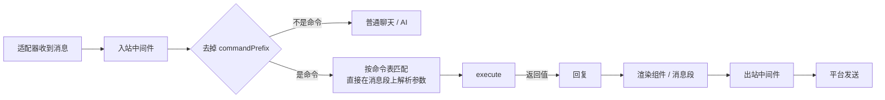

# 命令

要改反馈文案或整个菜单布局，见[定制内置展示](./behavior-customization.md)。

命令是用户输入 `/hello`、`/remind 10 喝水` 这类消息时执行的函数。本页从最简单的命令开始，逐步加上参数、选项、权限和富文本回复。

本页的 `remind` 是命令开发示例。需要直接使用持久提醒及补问流程，请看[不启用 AI，也能设置提醒](../solutions/reminders.md)。

## 最简单的命令

在插件根目录创建 `commands/hello/index.ts`：

```ts
// commands/hello/index.ts
import { defineCommand } from 'zhin.js/command';

export default defineCommand({
  description: '打个招呼',
  execute: () => 'Hello from zhin.',
});
```

保存后发送 `/hello`，Bot 回复 `Hello from zhin.`。

- **文件路径就是命令名**，只有 `index.ts`（或 `index.tsx`）是命令入口，同目录的其他文件可作为辅助模块。
- **`execute` 的返回值就是回复。**
- `description` 会出现在命令列表和帮助里，建议都写上。

::: details 单文件写法
不想建目录时，可以在 `plugin.ts` 里注册同一个定义，效果完全相同：

```ts
import { definePlugin } from 'zhin.js';
import { defineCommand } from 'zhin.js/command';

export default definePlugin({
  name: 'my-bot',
  setup({ addCommand }) {
    addCommand('hello', defineCommand({
      description: '打个招呼',
      execute: () => 'Hello from one file.',
    }));
  },
});
```

两种写法共用同一套命令表和冲突检测。命令变多后移到 `commands/` 目录，修改单个命令时只会重载这一个文件。
:::

## 常见需求

### 查看已加载的指令菜单

启用 Command Feature 后，内置关键词是 **`菜单`**，不需要另装帮助插件。像普通命令一样在 Bot 会话中发送；当前账号配置了 `commandPrefix: '/'` 时，下面的消息都要加 `/`：

| 消息（无前缀时） | 返回内容 |
| --- | --- |
| `菜单` | 根插件的指令、说明和直接子插件列表 |
| `菜单 rss` | 实例键为 `rss` 的插件所拥有的指令和直接子插件 |
| `菜单 foo.bar` | 嵌套插件 `foo` 下的 `bar` 的指令和子插件 |
| `菜单 --page 2` | 根菜单的第 2 页 |
| `菜单 rss --page 2` | `rss` 实例菜单的第 2 页 |
| `remind --help` | 某条命令的参数、选项和用法；不会执行该命令 |

菜单按插件逐层查看，不会一次展开所有插件的全部指令。这里的插件名是**实例键**，不是 npm 包名；先发 `菜单`，再按返回的子插件列表继续查看。

关键词在项目根 `zhin.config.yml` 的顶层配置，与 `plugins` 同级：

```yaml
menuKeyword: 帮助
```

这会把入口改成 `帮助`（有 `/` 前缀时是 `/帮助`）；`menuKeyword: false` 或 `menuKeyword: ''` 关闭内置菜单。未配置时仍是 `菜单`，`help` 不是默认别名。

安装 `@zhin.js/html-renderer` 后，菜单通过统一发送链输出 HTML 样式卡片：图片平台渲染为菜单图，原生 HTML 平台遵循自身声明的策略。渲染失败、平台要求纯文本或不能接收生成的图片时，保留原菜单文本；未安装渲染器时仍返回文本。插件浏览、命令前缀和自定义关键词保持一致。

每页最多 **30 项**，指令与子插件合计。菜单显示总数、当前页和可以直接发送的上一页／下一页消息，沿用当前前缀和关键词。文本降级也只返回同一页，不会一次发送所有分页。页码必须为正整数；超出范围时提示实际总页数。图片中的长名称和说明最多显示两行，完整的指令声明仍可通过 `--help` 查看。

当端点同时声明支持**原生 Markdown 和原生按钮**时，多页菜单还会附上 Markdown 页码和“上一页 / 下一页”按钮：第一页禁用上一页，最后一页禁用下一页，只有一页时不显示翻页控件。点击后通过统一回复链发送目标页，保留自定义关键词、前缀和插件路径；回调只在原会话和当前 generation 内有效，过期或旧代按钮不能调用旧处理器。缺少任意一项能力的端点继续使用文本导航。Telegram 的禁用按钮映射需要 Bot API 10.3+，见 [DisabledButton](https://core.telegram.org/bots/api#disabledbutton)。

默认背景插画、装饰和图标均内置，不需要下载外部素材。项目根配置可自定义展示：

```yaml
menuStyle:
  title: 知音 · 指令指南
  subtitle: 在日常里，发现一点不一样。
  accentColor: '#e7c993'
  # 可选：换成自己的背景图；省略则使用内置山月插画。
  backgroundImage: https://example.com/my-menu.webp
```

`backgroundImage` 支持 HTTP(S) 图片地址或 PNG/JPEG/WebP 的 base64 data URL，不支持文件路径或可执行 CSS。远程背景需要 Bot 所在机器能访问，其可用性与渲染器本身独立；离线使用自定义图片时可填写 data URL。`accentColor` 接受六位十六进制颜色，不合法的可选值使用默认样式。这些配置只改变图片展示，不改变文本菜单。

### 接收参数

在 `params` 里按顺序声明参数，`execute` 收到的 `params` 会自动带上正确的类型：

```ts
// commands/remind/index.ts  →  /remind 10 喝水
import { defineCommand } from 'zhin.js/command';

export default defineCommand({
  description: '创建提醒',
  params: {
    minutes: { type: 'integer', min: 1, max: 1440, description: '分钟数' },
    note: { type: 'text', default: '休息一下', description: '提醒内容' },
  },
  execute({ params }) {
    // params.minutes: number，params.note: string
    return `好的，${params.minutes} 分钟后提醒你：${params.note}`;
  },
});
```

- 用户输入 `/remind 10 喝水`：`minutes` 是 `10`，`note` 是 `喝水`。
- 只输入 `/remind 10`：`note` 使用默认值 `休息一下`。
- 输入 `/remind abc`：Bot 自动回复参数错误提示，`execute` 不会执行。

常用的约束：

| 写法 | 作用 |
| --- | --- |
| `default: …` | 未输入时的默认值 |
| `optional: true` | 可以不输入，此时值为 `undefined` |
| `min` / `max` | 数值大小或文本长度的范围 |
| `choices: [...]` | 只允许这些值 |
| `pattern` | 用正则检查文本 |
| `validate(value, session)` | 自定义校验，返回 `true`、`false` 或错误提示 |
| `rest: true` | 收集剩余的所有输入为数组，必须是最后一个参数 |

全部参数类型见 [参考 · 参数类型](#参数类型)。

### 加选项

选项是 `--count 2`、`-q` 这类可以出现在任意位置的开关：

```ts
export default defineCommand({
  description: '创建提醒',
  params: {
    minutes: { type: 'integer', min: 1 },
  },
  options: {
    count: { type: 'integer', alias: 'c', default: 1, min: 1, max: 10 },
    quiet: { type: 'boolean', default: false },
  },
  execute({ params, options }) {
    // options.count: number，options.quiet: boolean
    if (options.quiet) return;                  // 不回复
    return `提醒 ${options.count} 次`;
  },
});
```

`--count 2`、`--count=2`、`-c 2` 三种写法等价；`--quiet` 表示 `true`，`--quiet=false` 表示 `false`。

### 自动生成的帮助

只要声明了 `params` 或 `options`，用户发送 `/remind --help` 就会看到根据声明生成的帮助，其中会显示当前平台的命令前缀。

### 起别名和快捷方式

```ts
export default defineCommand({
  description: '点赞',
  alias: ['zan'],                         // /zan 等价于本命令
  shortcut: { '赞满': { count: 10 } },     // 用户整句发"赞满"时，相当于传入 count=10
  params: { count: { type: 'integer', default: 1 } },
  execute: ({ params }) => `点赞 ${params.count} 次`,
});
```

别名可以是多个词（如 `'gh issue'`）。快捷方式要求消息去掉首尾空白后与键**完全相同**才会触发。别名、快捷方式与正式命令名之间不能重名，冲突会在启动时报错。

### 限制谁能使用

用 `permit` 声明规则，不满足时 Bot 拒绝执行：

```ts
export default defineCommand({
  description: '清空数据',
  permit: ['role(master)'],              // 仅 master 可用
  execute: () => '已清空',
});
```

| 规则 | 含义 |
| --- | --- |
| `role(master)` / `role(trusted)` | 发送者角色 |
| `adapter(icqq)` | 只在某个平台上可用 |
| `group()` / `private()` / `channel()` | 限制会话类型，空值或 `*` 不限该类型的会话 ID |
| `group(123)` / `private(…)` / `channel(…)` / `user(…)` | 比较相应会话或发送者 ID；不限制完整账号、父容器或话题 |

数组中的多条规则**同时满足**才通过；一条规则内用逗号分隔表示**满足其一**即可。没有权限的用户也看不到这个命令的帮助。

内置角色判断只让 `master` 隐含 `trusted`，不会额外推导 `user`、`admin` 或 `owner`。角色来自当前真实消息；适配器配置可以指定谁是 master：

```yaml
configVersion: 2
# zhin.config.yml
plugins:
  qq: "@zhin.js/adapter-qq"
qq:
  master: '10001' # 整个适配器的 master
  endpoints:
    - name: main
      appid: ${QQ_APPID}
      master: '10001' # 也可以给单个账号单独设置
```

需要逐项理解规则时，可在[Console 命令权限说明](../paths/console.md#命令权限说明)中查看内置条件或填写假设身份。它不执行平台 checker，也不授予权限；`adapter(...)` 与会话 ID 规则不能当作完整会话白名单。

在中间件或事件处理中需要同样的判断时，使用 `checkPermissions`：

```ts
import { checkPermissions } from 'zhin.js';

if (!(await checkPermissions(context, ['group(team)', 'role(trusted)']))) return;
```

它复用同一套权限规则，但不替代 AI 工具的审批或执行安全策略。

### 限制重复执行与提示耗时任务 {#execution-policy}

给昂贵命令单独声明 `execution`，未声明的命令保持原行为。以下是可直接放入 `commands/slow/index.ts` 的演示：

```ts
import { setTimeout as delay } from 'node:timers/promises';
import { defineCommand } from 'zhin.js/command';

export default defineCommand({
  description: '演示有冷却和并发限制的耗时任务',
  execution: { cooldownMs: 10_000, maxConcurrent: 1, progressAfterMs: 1_500 },
  async execute({ signal }) {
    await delay(3_000, undefined, { signal });
    return '演示任务已完成';
  },
});
```

由真实用户在同一完整会话发送 `slow`，约 1.5 秒后可收到一次处理中提示，业务结束后收到结果。按账号实际前缀与插件命名空间调整命令；这是本地延时演示，不调用业务服务。短任务结束前会取消尚未触发的提示；开始最终回复前等待已开始的提示，避免最终结果先到、处理中提示后到。

额度按指令 capability、真实发送者与完整会话隔离，包括 Endpoint、会话类型和 ID、父容器与话题。别名与快捷方式共用额度；它不是整个插件或所有用户共享的并发上限。

- `cooldownMs`：接纳业务执行时开始计时，失败和取消仍消耗这次冷却；帮助、参数无效、权限拒绝与准入拒绝不消耗。上限一天。
- `maxConcurrent`：占用持续到该次业务、渲染、出站中间件及最终发送实际结束。热更新或退役发出取消信号不会提前释放仍在运行的任务；不同运行代沿用同一额度。上限 1000。
- `progressAfterMs`：默认不发提示，显式设置后每次处理对该指令最多提示一次。提示仅在业务等待阶段启动，经原会话的统一回复链发送；失败或结果不确定不重试。上限一小时。

三个值均为正整数，`execution` 至少声明一项。冷却拒绝包含记录时的剩余时间；并发已满无法预知何时结束，不伪造等待倒计时。诊断状态为 `limited`，与 `denied` 权限拒绝及平台投递失败分开，也不会转交 Agent 再执行。

启用策略需要 Core 的真实入站操作和完整身份；脱离该操作的直接 `CommandIndex` 调用不能伪造来源绕过检查。额外回复仍应 `await input.$reply(...)`，任意未来定时器里启动的工作不属于已经结束的处理。冷却不替代幂等、权限或投递对账，不能用于自动重试 `unknown`，也不会为不支持取消的操作生成取消按钮。

### 回复图片、卡片或多条消息

`execute` 可以返回：

| 返回值 | 效果 |
| --- | --- |
| 字符串 | 文本回复 |
| `component('status-card', props)` | 渲染一个[组件](./middleware-components.md)，支持图片的平台会显示为图片 |
| `raw({ type: 'html', data: { html, width } })` | 原样发送的平台消息段 |
| 由以上值组成的数组 | 多段消息 |
| `undefined` | 不回复（例如你已经用 `input.$reply()` 自己回复过了） |

```ts
// commands/card/index.ts
import { defineCommand } from 'zhin.js/command';
import { component } from 'zhin.js/component';

export default defineCommand({
  description: '状态卡片',
  execute: () => component('status-card', { title: 'my-bot', lines: [] }),
});
```

需要多轮交互时，让 `execute` 返回 `Promise`：先回复第一条，之后用 `input.$reply(...)` 继续发送。

### 知道是谁、在哪里发的

```ts
export default defineCommand({
  description: '谁在哪',
  execute: ({ adapter, endpoint, scene, sender }) =>
    `${sender?.name ?? sender?.id} @ ${scene?.type}:${scene?.id} via ${adapter}/${endpoint} roles=${sender?.role.join(',')}`,
});
```

`sender` 是发送者（含角色），`scene` 是群 / 私聊 / 频道，`adapter` 和 `endpoint` 是消息来自的平台和账号。全部字段见 [参考 · execute 参数](#execute-参数)。

### 使用插件里的服务

在 `plugin.ts` 的 `setup` 里用 `context.resources.provide(token, value)` 提供的服务，命令里用 `use(token)` 取出：

```ts
export default defineCommand({
  description: '查看今日推荐',
  async execute({ use }) {
    const { db } = use(lotteryRuntimeToken);
    // ……查询并返回
  },
});
```

找不到对应服务时 `use` 会抛错。参见 [definePlugin · 把资源提供给自己的命令和工具](./define-plugin.md)。

### 给 config 加类型 {#typed-config}

约定目录里的命令不知道自己属于哪个插件，`config` 默认是 `unknown`。用 `defineCommand.withConfig` 先固定配置类型，再定义命令：

```ts
import { defineCommand } from 'zhin.js/command';
import type { EchoConfig } from '../../../src/index.js'; // 与 schema.json 保持一致

export default defineCommand.withConfig<EchoConfig>()({
  params: { text: { type: 'string' } },
  execute({ params, config }) {
    return `${config.prefix ?? ''}${params.text}`; // params.text: string，config: EchoConfig
  },
});
```

`defineCommand.withConfig<EchoConfig>()` 返回的函数可以复用：在 `src/` 里写一次 `export const defineEchoCommand = defineCommand.withConfig<EchoConfig>()`，各个命令文件直接调用它即可。

旧写法 `defineCommand<EchoConfig>({...})` 仍然有效，但 TypeScript 不支持只写一部分类型参数、其余自动推断，`params` 会退化成 `Record<string, CommandParameterValue>`。需要 `params` / `options` 推断时请用 `withConfig`。

### 子命令

目录嵌套就是子命令，目录段之间用空格连接：

| 文件 | 命令 |
| --- | --- |
| `commands/hello/index.ts` | `hello` |
| `commands/qq/endpoint/list/index.ts` | `qq endpoint list` |
| `commands/qq/endpoint/add/[[name]]/index.ts` | `qq endpoint add [name]` |

插件名不会自动加到命令前面。多个插件的命令重名时，可以给其中一个插件配置 `commandNamespace: admin`，它的所有命令都会变成 `admin xxx`。

如果只是个别命令和别的插件重复，可以在该插件实例的配置里用 `disabledCommands` 把它们去掉，其余命令保持原名：

```yaml
plugins:
  60s: "@zhin.js/plugin-60s"
60s:
  disabledCommands: [fanyi, weather]   # 写插件内的命令路径，不含 commandNamespace 和参数
```

写上级路径（如 `netease`）会连同 `netease login`、`netease status` 等子命令一起去掉。被去掉的命令不进路由表，也不占用路由，别的插件可以使用同名命令；没有匹配到任何命令的条目会被忽略。

### 用目录声明参数

参数也可以写成路径的最后一段，风格与 Next.js 相同。类型和默认值仍然在 `params` 里声明：

| 目录 | 含义 | 帮助中显示 | `params` 声明 |
| --- | --- | --- | --- |
| `[name]/index.ts` | 必填参数 | `<name>` | `params: { name: { type: 'string' } }` |
| `[[name]]/index.ts` | 可选参数 | `[name]` | `params: { name: { type: 'string', default: '' } }` |
| `[...name]/index.ts` | 收集剩余所有输入 | `<...name>` | `params: { name: { type: 'text' } }`，值为数组 |
| `[[...name]]/index.ts` | 可选的收集剩余输入 | `[...name]` | 同上，未输入时为空数组 |

一般更推荐在 `commands/remind/index.ts` 里声明多个参数，而不是为每个参数建一层目录。目录参数适合"命令名之后紧跟一个对象名"的场景，例如 `qq endpoint remove <name>`。规则细节见 [参考 · 目录参数规则](#目录参数规则)。

### 接收图片、@ 等非文本参数

参数类型可以是 `image`、`mention` 等消息段：

```ts
// commands/upload/[asset]/index.ts  →  /upload [图片] 说明文字
import { defineCommand } from 'zhin.js/command';

export default defineCommand({
  params: {
    asset: { type: 'image', description: '要上传的图片' },
  },
  execute: ({ params, args, segments }) => ({
    uploaded: params.asset,          // 图片的 MediaRef
    captionWords: args,              // 剩余文字，按空白切分
    remainingSegments: segments,     // 剩余内容，保留图片、@ 等结构
  }),
});
```

框架直接在消息段上匹配，不会先把图片、@ 转成文字再解析。这类参数不支持默认值。

### 设置命令前缀

默认**没有**前缀：任何消息都会尝试匹配命令。给某个平台连接配置 `commandPrefix` 后，只有以它开头的消息才会被当作命令，其余消息会进入普通聊天或 AI：

```yaml
configVersion: 2
plugins:
  qq: "@zhin.js/adapter-qq"
qq:
  commandPrefix: '/' # 只有 "/qq endpoint list" 这样的消息才会触发命令
  endpoints:
    - name: main
      commandPrefix: '' # 可为单个账号单独覆盖
```

`npm create zhin-app` 生成的 Sandbox 已设置为 `/`。

## 输入有误时会怎样

| 情况 | Bot 的行为 |
| --- | --- |
| 消息不是任何命令 | 不响应，交给后续中间件、普通聊天或 AI |
| 命令名正确，但参数缺失或类型错误 | 自动回复错误原因和帮助 |
| 没有权限 | 自动回复拒绝提示，不显示帮助 |
| 执行成功 | 回复 `execute` 的返回值 |

只有能确定是某个命令时才会提示参数错误。例如 `remind nope` 会提示；而 `reminder 3` 或普通聊天不会被当作命令。权限检查先于参数校验。

## 参考

### 参数类型

| 类别 | `type` | 得到的值 |
| --- | --- | --- |
| 文本 | `string` / `word` / `text` | 字符串；`text` 会读取剩余的连续文本，保留引号和换行 |
| 数值 | `number` / `integer` / `float` | 数字；`integer` 要求整数，`float` 要求小数 |
| 布尔 | `boolean` | `true` / `false` |
| 消息段 | `mention` / `image` / `face` / `reply` / `forward` / `dice` / `rps` | 对应消息段的字段 |

### 参数声明规则

- 参数按声明顺序读取输入。必填参数不能放在可选参数之后；`rest: true` 必须是最后一个。
- `text` 会读取连续文本，应放在其他普通参数之后。
- 默认值可以是动态函数；动态默认值和快捷方式的预填值同样会被校验。
- 非法的静态默认值、参数顺序错误、重复的选项别名在**加载时**报错；动态默认值在派发时校验。
- 选项可以出现在参数之间；负数不会被误认为选项；`--` 之后不再解析选项。声明了 `params` 或 `options` 时，未知或重复的选项会报校验失败。
- 没有声明参数的命令，可以从 `args`（剩余文字）和 `segments`（剩余消息段）自行解析输入。

真实示例：[二维码生成](https://github.com/zhinjs/zhin/tree/main/plugins/utils/qrcode) 使用文本、图片尺寸与默认值；[代码运行](https://github.com/zhinjs/zhin/tree/main/plugins/utils/code-runner) 使用目录参数声明语言，并提供代码和超时选项。

### execute 参数

`execute(context)` 收到一个只读对象：

| 字段 | 说明 |
| --- | --- |
| `params` | 声明的参数，类型由声明推导 |
| `options` | 声明的选项；未设置且无默认值时为 `undefined` |
| `args` | 匹配命令名之后剩余的词（按空白切分） |
| `segments` | 剩余的消息段，保留图片、@ 等非文本内容 |
| `config` | 本插件的配置 |
| `input` | 触发命令的消息；由 Host 或程序调用时可能不存在 |
| `adapter` | 适配器实例 id，如 `root/icqq` |
| `endpoint` | 账号 / 连接名 |
| `scene` | `{ id, type, name? }`：群、私聊或频道 |
| `sender` | `{ id, name?, role: string[] }`：发送者及其角色 |
| `use(token)` | 取出插件提供的服务，缺失时抛错 |
| `owner` | 命令所属的插件 |
| `generation` | 当前版本号（每次热重载递增） |

`input` 不一定是消息（可能来自 Host 调用），读取发送者前要做类型判断；非消息来源时 `$reply` 不做任何事。`input` 的类型默认为 `CommandMessage`，与运行时的 `Message` 结构兼容（因分层限制，`@zhin.js/command` 不能直接依赖 `@zhin.js/core`）。

### alias / permit / shortcut

| 字段 | 行为 |
|---|---|
| `alias` | 替换命令名的全部静态部分；目录参数接在后面 |
| `permit` | 内置规则：`adapter\|group\|private\|channel\|user\|role(...)`。失败返回 `denied`；没有鉴权主体时同样拒绝，程序化的 `CommandIndex.execute` 也不能绕过 |
| `shortcut` | `{ 触发文本: 预填的 params }`，去掉首尾空白后完全相同才触发 |

冲突按完整的词序列判断：`b` 和 `b list` 可以共存。

### 目录参数规则

- 每条命令只能有一个目录参数，且必须是路径的最后一段。`commands/[note]/index.ts` 匹配顶层单词输入；`commands/remind/[note]/index.ts` 形成 `remind <note>`。
- 参数有 `default` 时目录名必须用双方括号 `[[name]]`；目录声明了参数但 `params` 里没有对应声明，都会抛 `CommandPathSyntaxError`。
- TypeScript 读不到目录形态：使用无默认值的 `[[id]]` 时声明 `params.id.optional: true`；使用 `[...items]` 时声明 `params.items.rest: true`。目录参数应放在 `params` 的第一项。
- 收集剩余输入时，元素的粒度由类型决定：`text` 按消息段收集（纯文本整体为一个元素）；`word` / `string` 按空白切词；数值和布尔按词切分后逐个转换；`mention` / `image` 等按消息段收集。
- 静态目录名使用小写 kebab-case（`hello/`、`lottery-today/`），也可以使用含非 ASCII 字符、无 ASCII 大写的名字（如 `赞我/`）；参数目录只能用 ASCII。
- **静态优先**：`list/index.ts` 总是优先于 `[name]/index.ts`；动态路由之间，静态段多的优先。
- 加上 `commandNamespace` 后仍然相同的路由会在启动时报错，可以给冲突的插件配置不同的命名空间。

## 深入

### 一条命令是怎么被执行的



匹配按固定优先级进行：静态命令先于动态命令，动态命令中路径更具体的优先。命中后，剩余文字按空白切分进入 `args`，完整的剩余消息段保留在 `segments`。例如 `qq endpoint remove mybot` 命中 `qq endpoint remove <name>`，`args` 为空，`params.name === 'mybot'`。

`commandPrefix` 按消息所属的适配器实例读取（默认 `''`）；实例配置了 `endpoints` 时，以消息来源账号的 `commandPrefix` 为准。实现见 `packages/im/core/src/plugin-runtime/im/message-dispatcher.ts`。

程序化调用 `CommandIndex.dispatch()` 时返回 `status: unmatched | invalid | denied | executed`：`unmatched` 的 `matched` 为 `false`；`invalid` 带有 `issues: { field, message }[]` 和 `help`；`denied` 表示权限拒绝；只有 `executed` 有业务返回值。Host 可以传入真实的 `PermissionSubject` 进行鉴权。

### 适配器的 endpoint 管理命令

::: details 给适配器生成 list / add / remove 命令
`@zhin.js/adapter` 的 `createEndpointCommands(spec, defineCommand)` 为适配器生成 `<adapter> endpoint list / add / remove` 三个命令，用来在聊天里管理账号。除 email（配置是嵌套对象）和 sandbox（无凭据）外，所有平台适配器都已接入：qq、icqq、napcat、onebot11、onebot12、milky、satori、slack、telegram、discord、kook、lark、dingtalk、line、wecom、wechat-mp、weixin-ilink、github。

- `list`：列出运行中的账号，以及 `<adapterKey>.endpoints` 中配置的账号。
- `add <name> <key=value...>`：录入字段。标记为 `env: true` 的凭据写入 `.env`（键名如 `TELEGRAM_BOT1_TOKEN`），配置文件中保存 `${REF}` 引用；YAML 会保留原有注释；重名拒绝。
- `remove <name>`：从配置中移除，重启后生效；`.env` 中的键需手动清理。
- 特殊的添加流程（如 QQ 扫码绑定）通过 `spec.bindFlow` 接管 `add`，QQ 因此多一个 `qq endpoint cancel`。
- `add` / `remove` 只允许 master 执行；未配置 master 时放行，首个绑定者会被写为新账号的 `master`。

这些命令只依赖 `EndpointConfigurationStore`，不直接读写文件。官方 CLI 会提供 `endpointConfigurationStoreToken`；自行组装 `RootRuntime` 时需要提供同一接口的实现。`plugins` 必须是对象映射，旧的数组形态需要先显式迁移。

接入步骤（以 telegram 为例）：

```ts
// 1. src/telegram-runtime-state.ts：运行中账号的注册表
export const telegramRuntimeStateToken = defineEndpointRuntimeStateToken('telegram');

// 2. plugin.ts setup() 中提供状态；adapters/telegram/index.ts 的 create() 中登记
context.resources.provide(telegramRuntimeStateToken, createEndpointRuntimeState());
// create(): context.use(telegramRuntimeStateToken).endpoints.set(config.name, { name: config.name, mode: config.mode });

// 3. src/telegram-endpoint-commands.ts：生成命令（defineCommand 由适配器传入，避免包之间互相依赖）
export const telegramEndpointCommands = createEndpointCommands({
  adapterKey: 'telegram',          // = zhin.config.yml 的顶层实例名
  adapterDisplayName: 'Telegram',
  fields: [{ key: 'token', required: true, env: true, description: 'Telegram bot token' }],
  running: (use) => use(telegramRuntimeStateToken).endpoints.values(),
  describeEntry: (entry) => `token: ${String(entry.token)}`,
}, defineCommand);

// 4. commands/telegram/endpoint/list/index.ts、add/[[name]]/index.ts、remove/[name]/index.ts
export default telegramEndpointCommands.list; // / .add / .remove
```

`fields` 应与适配器 `schema.json` 中 `endpoints.items.properties` 一致；`add` 的 `key=value` 参数从 `args` 读取，值中含 `=` 时按第一个 `=` 切分。

需要更细的业务权限时，可以在 `execute` 里自行判断，例如 endpoint 管理命令的 `isEndpointOperator`：用 `config` 取出 `master` 名单，用 `input` 取出发送者 id，比对后返回拒绝文案。
:::

## 下一步

- [中间件与组件](./middleware-components.md)：关键词回复、消息卡片与 JSX。
- [约定目录](./conventions.md)：其他能力放在哪里。
- [Agent 工具](./agent-tools.md)：让 AI 也能调用你的功能。
