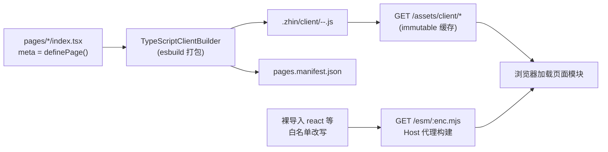

# Console 页面与布局

插件不仅能往群里发消息，还能给 Remote Console 贡献完整的 React 页面。Sandbox 适配器的 `/sandbox` 聊天页就是这样来的。

和命令一样，页面放在**约定目录** `pages/` 里，文件会被自动发现，并编译成浏览器能加载的模块。

## 写第一个页面

```tsx
// pages/index/index.tsx
import { definePage } from '@zhin.js/console-contract';

export const meta = definePage({
  title: '我的插件',
  icon: 'Box',
  order: 10,
});

export default function MyPluginPage() {
  return <div>Hello from my plugin</div>;
}
```

- **默认导出**一个 React 组件，就是页面内容。
- **命名导出 `meta`** 声明标题、图标和排序。
- 只有 `pages/<name>/index.tsx`（或 `index.ts`）是页面，同目录的其他文件可以作为组件和辅助模块被引用。

启动 Bot 后，打开 Console 就能在导航里看到这个页面。

## 页面元数据

`meta` 的字段都可选，写了未知字段时 `definePage` 会报错：

| 字段 | 默认 | 说明 |
| --- | --- | --- |
| `title` | 由目录名生成（`foo-bar` → `Foo Bar`） | 导航与页头标题 |
| `icon` | 无 | lucide 风格的图标名，如 `'Box'`、`'Workflow'` |
| `order` | `100` | 导航排序，越小越靠前 |
| `hideInNav` | `false` | 不在导航中显示 |
| `requiredPermissions` | `[]` | 访问所需权限，对应令牌的 `permissions` |
| `requiredRoles` | `[]` | 访问所需角色，对应令牌的 `roles` |

导航和页面清单按调用者的令牌过滤：full 令牌能看到全部页面；其他令牌只能看到它的 `permissions` 和 `roles` 满足要求的页面；不带令牌只能看到没有要求的页面。令牌怎么配置见 [Console 的用户与权限](../console/index.md#用户与权限)。

## 页面的地址

地址 = 插件路径 + 页面名：

| 文件 | 所属插件 | 地址 |
| --- | --- | --- |
| `pages/index/index.tsx` | `sandbox` | `/sandbox` |
| `pages/workroom/index.tsx` | 你的 Bot（root） | `/p-workroom` |
| `pages/index/index.tsx` | 你的 Bot（root） | `/` |

`index` 对应插件路径本身，其他页面对应 `p-<name>`。两个页面算出同一个地址时，启动会报错。规则实现见 `packages/console/plugin-contract/src/page.ts` 的 `pageRoute`。

## 自定义导航和页脚

`pages/` 下有两个保留名字：

- `pages/nav/index.tsx`：导航区
- `pages/footer/index.tsx`：页脚区

默认导出一个 React 组件即可，不需要 `meta`。同一位置同时有 `.ts` 和 `.tsx` 时以 `.tsx` 为准。`npm create zhin-app` 生成的项目里已经带了这两个文件作为示例。

## 例子：Sandbox 聊天页

Sandbox 适配器（`plugins/adapters/sandbox`）同时提供了一个适配器和一个页面，它的 `package.json#zhin` 声明了两个 Feature：

```json
{
  "zhin": {
    "protocol": 1,
    "type": "plugin",
    "entry": "./plugin.ts",
    "runtime": "trusted",
    "features": [
      { "package": "@zhin.js/adapter", "api": "^1.0.0" },
      { "package": "@zhin.js/page", "api": "^1.0.0" }
    ]
  }
}
```

- `@zhin.js/adapter` 发现 `adapters/` 下的适配器，提供 WebSocket `/sandbox` 连接。
- `@zhin.js/page` 发现 `pages/index/index.tsx`，Console 里因此出现 `/sandbox` 聊天页。

页面里的 `SandboxChat` 组件通过 WebSocket 连接 `/sandbox`（地址与 token 见 `pages/sandboxTransport.ts`）。在页面里发一条消息，等价于真实平台收到一条消息：同样会经过中间件、命令匹配和 AI。所以不接任何真实平台也能完整调试命令、组件渲染和 Agent。Sandbox 会直接显示出站的 HTML 内容，不转成图片或文字，见 [中间件与组件](./middleware-components.md#不同平台上的效果)。

插件入口本身什么都不用写，页面和适配器都是自动发现的：

```ts
// plugins/adapters/sandbox/plugin.ts
import { definePlugin } from 'zhin.js';

export default definePlugin({
  name: 'sandbox',
  metadata: { displayName: 'Sandbox Adapter' },
});
```

## 页面数据：插件 RPC

页面需要显示插件的运行状态，或者提供几个按钮时，插件可以注册自己的 Console RPC，不用自己开 WebSocket 或 HTTP 路由。

插件在 `setup` 里注册一个只读的 `status`，再按需加几个有限的动作：

```ts
// plugin.ts
import { definePlugin } from 'zhin.js';
import { definePluginConsoleRpc, PluginConsoleRpcError, pluginConsoleRpcToken } from 'zhin.js/plugin-runtime';

export default definePlugin({
  name: 'ambient',
  setup(context) {
    context.resources.provide(pluginConsoleRpcToken, definePluginConsoleRpc({
      status: {
        page: 'index', // 与 pages/index 的访问规则一致
        handler: async () => ({
          mode: 'shadow',
          recent: recentJudgments(10).map(j => ({ at: j.at, spoke: j.engaged })),
        }),
      },
      actions: {
        'clear-cooldown': {
          page: 'index',
          handler: async ({ group }) => {
            if (typeof group !== 'string') throw new PluginConsoleRpcError('invalid_input', '请选择一个群');
            return { cleared: clearCooldown(group) };
          },
        },
      },
    }));
  },
});
```

页面里用 `@zhin.js/client` 的 `pluginRpc` 调用。`pluginId` 是插件的 PluginId（比如 `root/ambient`），和页面清单里的 `owner` 相同：

```tsx
import { pluginRpc } from '@zhin.js/client';

const status = await pluginRpc<{ mode: string }>('root/ambient', 'status');
await pluginRpc('root/ambient', 'clear-cooldown', { group: '123' });
```

请求走现有的 `POST /api/console/request`，类型名是 `plugin.<pluginId>.status` 或 `plugin.<pluginId>.<动作名>`。动作名只能用小写字母、数字和 `-`，`status` 是保留名。

除了 `status`，还可以用 `queries` 注册几个**只读查询**，规则和 `status` 一样（可以写 `page`、`demo`、`requiredPermissions`）。查询和动作不能重名：

```ts
definePluginConsoleRpc({
  queries: {
    history: { page: 'index', handler: async () => ({ days: last7Days() }) },
  },
});
```

访问规则：

- **跟随页面**：写了 `page` 时，调用者必须满足这个页面的 `requiredPermissions` 和 `requiredRoles`，方法自己声明的要求会叠加上去。页面在当前代没有加载时直接拒绝。
- **full 令牌**可以调用全部方法。
- **其他令牌**可以读取 `status`，前提是它持有全部要求的权限和角色。`status` 完全没有要求时，只有写了 `demo: true` 才对这些令牌开放。
- **动作**只允许 full 令牌调用。

返回给页面的内容会被普通用户看到，所以：

- 只返回页面需要的少量字段，不要直接返回日志记录、提示词、聊天原文或密钥。
- 返回值必须是 JSON，超过 256 KB 会被拒绝；请求的 `data` 也必须是不超过 64 KB 的 JSON 对象。
- 处理函数 10 秒没返回就算超时，`signal` 会被中止。
- 想给用户看错误原因，就抛 `PluginConsoleRpcError`，它的消息会原样显示。其他异常只会显示「插件操作失败」。

插件 RPC 不负责改配置。改配置请用 `config:patch`。

### 内置状态：群聊插话和技能助手

群聊插话和技能助手由 Host 自己提供，不是插件，所以挂在根插件下：

| 方法 | 调用 | 需要的权限 |
| --- | --- | --- |
| `plugin.root.ambient` | `pluginRpc('root', 'ambient')` | `ambient:read` |
| `plugin.root.skills` | `pluginRpc('root', 'skills')` | `skills:read` |

full 令牌不需要这些权限。页面在 `requiredPermissions` 里写同样的权限，令牌在 `http.tokens[].permissions` 里给出（见 [用户与权限](../console/index.md#用户与权限)）。两个查询都只读，不接收参数。

数据只保存在内存里：最近 24 小时，最多 2000 条，重启后清空。不包含聊天内容、提示词、判断理由或密钥。时间都是毫秒时间戳。

`plugin.root.ambient` 返回：

```ts
interface AmbientStatus {
  enabled: boolean;                       // 配置了至少一个群
  mode: 'off' | 'shadow' | 'active';      // shadow：只判断不发言
  groups: number | 'all';                 // 配置的群数，'*' 时为 'all'
  judges: string[];                       // 判断用的模型，按顺序（provider/model）
  last24h: { spoke: number; watched: number; stayed_quiet: number; skipped: number };
  decisionShadow: { agreed: number; disagreed: number }; // ai.decisions.ambient 影子模式和聊天模型判断是否一致
  recent: Array<{                         // 最新在前，最多 20 条
    at: number;
    group: string;                        // platform:groupId
    outcome: 'spoke' | 'watched' | 'stayed_quiet' | 'skipped';
    skipReason?: 'cooldown' | 'hourly_cap' | 'judge_interval' | 'no_context' | 'judge_failed';
    confidence?: number;                  // 0..1，两位小数
    judge?: 'decision' | 'chat-model';
  }>;
  updatedAt: number | null;
}
```

`watched` 是影子模式下判断要发言但没有发。

`plugin.root.skills` 返回结构化决策（技能、工具、记忆、子代理、审批、群聊插话的选择）的调用统计：

```ts
interface SkillsStatus {
  tasks: Array<{                          // 每个任务一行，按名字排序
    task: 'skills' | 'tools' | 'memory' | 'agents' | 'approval' | 'ambient';
    mode: 'off' | 'shadow' | 'active';    // 最近一次调用的模式
    calls: number; selected: number; abstained: number; shadow: number; failed: number;
    averageMs: number;
    inputTokens: number; outputTokens: number;
    lastModel?: string;
    lastAt: number;
  }>;
  totals: { calls: number; inputTokens: number; outputTokens: number };
  recent: Array<{                         // 最新在前，最多 20 条
    at: number; task: string; mode: string;
    outcome: 'selected' | 'abstained' | 'failed' | 'shadow';
    durationMs: number;
    model?: string;
    reason?: string;                      // 机器可读的失败/放弃原因，不是文字说明
  }>;
  updatedAt: number | null;
}
```

## 它是怎么工作的

页面文件运行在**浏览器**里，所以不会被 Node 直接加载，而是交给客户端构建器（`TypeScriptClientBuilder`，`packages/console/pagemanager`）用 esbuild 打包：



- **产物**：每个页面打包为 `<owner>-<localName>-<contentHash>.js`，写入项目的 `.zhin/client/`，通过 `GET /assets/client/*` 提供（`cache-control: immutable`，内容变了文件名就变）。`@zhin.js/console-contract` 在打包时被替换成空实现，`meta` 通过静态分析提取。
- **React 只有一份**：浏览器不认识 `import 'react'` 这样的裸导入，所以白名单 `ALLOWED_ESM_CANONICAL`（`react`、`react-dom`、`react-dom/client`、`react/jsx-runtime(-dev)`、`react-router`、`react-router-dom`）中的导入会被改写成 `/esm/<enc>.mjs`，由 Host 按需构建和代理，保证整个 Console 只有一份 React。白名单之外的包返回 403。
- **路由**：在 `basic/cli/src/plugin-runtime/console/host.ts` 中注册。`GET /console` 是页面索引，`GET /console/api/pages` 返回页面清单，其余路径按地址匹配页面并返回页面外壳（包含 importmap 和挂载脚本）；未匹配返回 404，权限不足返回 403。浏览器用 `import(moduleUrl)` 加载页面模块，把默认导出挂载到 `#root`。

## 下一步

- [约定目录](./conventions.md)：其他能力放在哪里。
- [Console](../console/index.md)：Console 本身能做什么。
