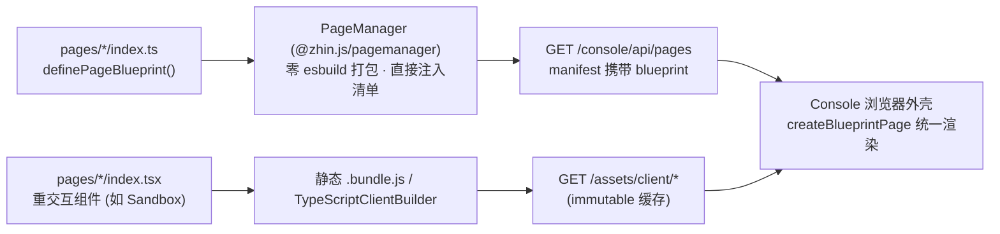

# Console 页面与布局

插件不仅能往群里发消息，还能给 Remote Console 贡献管理页面。Zhin 采用 **Server-Driven Blueprints（服务端驱动蓝图）** 作为唯一一等公民（覆盖 90% 的插件），同时为 10% 的重交互插件（如 Sandbox 聊天模拟器）提供静态前端资产挂载协议。

和命令一样，页面放在**约定目录** `pages/` 里，文件会被自动发现。

## 写第一个页面（Pure Blueprint，推荐）

绝大多数插件（记账、提醒、RSS、日历、群管、内容审核、平台适配器）需要的只是**统计卡片（`stat-cards`）+ 表格/列表（`table`）+ 过滤表单（`filter-form`）+ 操作按钮（`action-bar`）**。直接使用纯 TypeScript（`pages/<name>/index.ts`）声明 `definePageBlueprint`，由 Console UI 统一渲染：

- **零 `.tsx`、零 `esbuild` 预打包、零 `lib/pages/*.bundle.js`、零 React 版本耦合**；
- **多端自动投影**：同一份 Blueprint 不仅能在 Web Console 渲染，还能通过 `projectBlueprintToImCard` 自动投影为跨平台 IM 卡片消息（含交互按钮），或通过 `projectBlueprintToCliPanel` 投影为终端 CLI TUI 面板！

```ts
// pages/index/index.ts
import { definePage, definePageBlueprint } from '@zhin.js/console-contract';

export const meta = definePage({
  title: '我的插件',
  titleI18n: { en: 'My Plugin' },
  icon: 'Box',
  order: 10,
});

export default definePageBlueprint({
  kind: 'custom',
  subtitle: '插件运行概览与快捷操作',
  statusQuery: 'status',
  widgets: [
    {
      type: 'stat-cards',
      title: '核心指标',
      cards: [
        { key: 'total', label: '总记录数', tone: 'accent' },
        { key: 'active', label: '今日活跃', tone: 'success' },
      ],
    },
    {
      type: 'action-bar',
      title: '快捷操作',
      actions: [
        { action: 'refresh-cache', label: '刷新缓存', variant: 'primary' },
      ],
    },
    {
      type: 'table',
      title: '最近记录',
      dataKey: 'items',
      rowKey: 'id',
      emptyText: '暂无记录',
      columns: [
        { key: 'id', label: 'ID' },
        { key: 'title', label: '标题' },
      ],
    },
  ],
});
```

- **默认导出** `definePageBlueprint(...)`（纯数据蓝图）或重交互场景下的 React 组件。
- **命名导出 `meta`** 声明标题、图标和排序。
- 只有 `pages/<name>/index.ts`（或重交互插件的 `index.tsx`）是页面，同目录的其他文件可以作为辅助模块被引用。

启动 Bot 后，打开 Console 就能在导航里看到这个页面。

### 多端自动投影（Web Console / IM Card / CLI TUI）

`@zhin.js/console-contract` 内置了零依赖的多端投影器，允许命令或 CLI 直接复用页面的 Blueprint 与 `status` 数据：

```ts
import {
  projectBlueprintToImCard,
  projectBlueprintToCliPanel,
} from '@zhin.js/console-contract';
import blueprint, { meta } from '../pages/index/index.js';

// 1. 投影为跨平台 IM 卡片消息段（Segment[]，自动附带 action 交互按钮）
const segments = projectBlueprintToImCard(blueprint, statusData, {
  title: meta.title,
  commandPrefix: '/my-plugin ',
});

// 2. 投影为终端 CLI TUI 面板（带 ANSI 色彩的 बॉक्स 表格与统计卡）
const ansiPanel = projectBlueprintToCliPanel(blueprint, statusData, {
  title: meta.title,
  width: 72,
});
```

## 页面元数据

`meta` 的字段都可选，写了未知字段时 `definePage` 会报错：

| 字段 | 默认 | 说明 |
| --- | --- | --- |
| `title` | 由目录名生成（`foo-bar` → `Foo Bar`） | 导航与页头标题 |
| `titleI18n` | 无 | 显式标题翻译，如 `{ en: 'My Plugin' }`；支持 `zh-CN` / `en`，缺失时保留 `title` |
| `icon` | 无 | lucide 风格的图标名，如 `'Box'`、`'Workflow'` |
| `order` | `100` | 导航排序，越小越靠前 |
| `hideInNav` | `false` | 不在导航中显示 |
| `requiredPermissions` | `[]` | 访问所需权限：内置权限（如 `status.view`）或插件自定义的权限名 |
| `requiredRoles` | `[]` | 访问所需角色名（如 `operator`） |
| `section` | — | Console 导航分区：`overview` / `conversations` / `features` / `plugins` / `ops` / `access`；省略时由 Console 决定（ADR 0052） |

导航和页面清单按调用者过滤：全局所有者能看到全部页面；其他用户只能看到角色权限满足要求的页面（插件自定义的权限名按级别授予，见[插件权限的级别](#插件权限的级别)）；未登录只能看到没有要求的页面。用户与角色见 [Console 的用户与权限](../console/index.md#用户与权限)。

Console 根据独立的界面语言选择 `titleI18n`，只改变导航和面包屑显示，不改路由、权限或页面正文。Page 正文本地化由插件自己的组件负责；未声明翻译的第三方标题保留原文。

## 页面的地址

地址 = 插件路径 + 页面名：

| 文件 | 所属插件 | 地址 |
| --- | --- | --- |
| `pages/index/index.tsx` | `sandbox` | `/sandbox` |
| `pages/reports/index.tsx` | 你的 Bot（root） | `/p-reports` |
| `pages/index/index.tsx` | 你的 Bot（root） | `/` |

`index` 对应插件路径本身，其他页面对应 `p-<name>`。两个页面算出同一个地址时，启动会报错。规则实现见 `packages/console/plugin-contract/src/page.ts` 的 `pageRoute`。

## 自定义导航和页脚

`pages/` 下有两个保留名字：

- `pages/nav/index.tsx`：导航区
- `pages/footer/index.tsx`：页脚区

默认导出一个 React 组件即可，不需要 `meta`。同一位置同时有 `.ts` 和 `.tsx` 时以 `.tsx` 为准。`npm create zhin-app` 生成的项目里已经带了这两个文件作为示例。

## 例子：Sandbox 聊天页

Sandbox 适配器（`plugins/adapters/sandbox`）同时提供了一个适配器和一个页面，它的 `package.json#zhin` 声明了两个 Feature：

```json
{
  "zhin": {
    "protocol": 1,
    "type": "plugin",
    "entry": "./plugin.ts",
    "runtime": "trusted",
    "features": [
      { "package": "@zhin.js/adapter", "api": "^2.0.0" },
      { "package": "@zhin.js/page", "api": "^1.0.0" }
    ]
  }
}
```

- `@zhin.js/adapter` 发现 `adapters/` 下的适配器，提供 WebSocket `/sandbox` 连接。
- `@zhin.js/page` 发现 `pages/index/index.tsx`，Console 里因此出现 `/sandbox` 聊天页。

页面里的 `SandboxChat` 组件通过 WebSocket 连接 `/sandbox`（地址与 token 见 `pages/sandboxTransport.ts`）。在页面里发一条消息，等价于真实平台收到一条消息：同样会经过中间件、命令匹配和 AI。所以不接任何真实平台也能完整调试命令、组件渲染和 Agent。Sandbox 会直接显示出站的 HTML 内容，不转成图片或文字，见 [中间件与组件](./middleware-components.md#不同平台上的效果)。

插件入口本身什么都不用写，页面和适配器都是自动发现的：

```ts
// plugins/adapters/sandbox/plugin.ts
import { definePlugin } from 'zhin.js';

export default definePlugin({
  name: 'sandbox',
  metadata: { displayName: 'Sandbox Adapter' },
});
```

## 页面数据：插件 RPC {#plugin-rpc}

页面需要显示插件的运行状态，或者提供几个按钮时，插件可以注册自己的 Console RPC，不用自己开 WebSocket 或 HTTP 路由。

插件在 `setup` 里注册一个只读的 `status`，再按需加几个有限的动作：

```ts
// plugin.ts
import { definePlugin } from 'zhin.js';
import { definePluginConsoleRpc, PluginConsoleRpcError, pluginConsoleRpcToken } from 'zhin.js/plugin-runtime';

export default definePlugin({
  name: 'ambient',
  setup(context) {
    context.resources.provide(pluginConsoleRpcToken, definePluginConsoleRpc({
      status: {
        page: 'index', // 与 pages/index 的访问规则一致
        handler: async () => ({
          mode: 'shadow',
          recent: recentJudgments(10).map(j => ({ at: j.at, spoke: j.engaged })),
        }),
      },
      actions: {
        'clear-cooldown': {
          page: 'index',
          handler: async ({ group }) => {
            if (typeof group !== 'string') throw new PluginConsoleRpcError('invalid_input', '请选择一个群');
            return { cleared: clearCooldown(group) };
          },
        },
      },
    }));
  },
});
```

页面里用 `@zhin.js/client` 的 `pluginRpc` 调用。`pluginId` 是插件的 PluginId（比如 `root/ambient`），和页面清单里的 `owner` 相同：

```tsx
import { pluginRpc } from '@zhin.js/client';

const status = await pluginRpc<{ mode: string }>('root/ambient', 'status');
await pluginRpc('root/ambient', 'clear-cooldown', { group: '123' });
```

请求走现有的 `POST /api/console/request`，类型名是 `plugin.<pluginId>.status` 或 `plugin.<pluginId>.<动作名>`。动作名只能用小写字母、数字和 `-`，`status` 是保留名。

除了 `status`，还可以用 `queries` 注册几个**只读查询**，规则和 `status` 一样（可以写 `page`、`demo`、`requiredPermissions`）。查询和动作不能重名：

```ts
definePluginConsoleRpc({
  queries: {
    history: { page: 'index', handler: async () => ({ days: last7Days() }) },
  },
});
```

访问规则：

- **跟随页面**：写了 `page` 时，调用者必须满足这个页面的 `requiredPermissions` 和 `requiredRoles`，方法自己声明的要求会叠加上去。页面在当前代没有加载时直接拒绝。
- **全局所有者**可以调用全部方法。
- **其他用户和 API 令牌**逐个方法检查：方法自己的要求和页面的要求都要满足，插件权限按级别授予（见[插件权限的级别](#插件权限的级别)）。不满足返回 403「没有查看权限」/「没有操作权限」。
- **都没声明时的兜底**：读方法和页面都没有要求时需要 `feature.view`；动作自己没有声明要求时需要 `feature.configure`（页面的要求照样叠加），页面的要求不会单独放行动作。
- **适配器插件**：调用拥有适配器的插件（`root/<适配器>`）时，绑定在这个适配器（账号方法带 `id` 时也包括这个账号）上的角色同样算数；绑定在别的适配器上的不算。账号方法（`endpoint-add` 等）另外接受目标上的 `endpoint.manage`；首次迁移账号清单只有持有 `endpoint.manage` 的用户能确认。
- **任选其一**：`anyOfPermissions` 列出的权限持有其中**一个**即可（和 `requiredPermissions` 叠加）。适合新权限点与旧权限点并存，例如审批卡结算接受 `ops:approve` 或旧的 `tool_approvals:resolve`。

```ts
actions: {
  'clear-cooldown': {
    page: 'index',                       // 先满足页面的要求
    requiredPermissions: ['ambient:write'], // 再要求这个权限，普通用户才能执行
    handler: async ({ group }) => ({ cleared: clearCooldown(String(group)) }),
  },
},
```

返回给页面的内容会被普通用户看到，所以：

- 只返回页面需要的少量字段，不要直接返回日志记录、提示词、聊天原文或密钥。
- 返回值必须是 JSON，超过 256 KB 会被拒绝；请求的 `data` 也必须是不超过 64 KB 的 JSON 对象。
- 处理函数 10 秒没返回就算超时，`signal` 会被中止。
- 想给用户看错误原因，就抛 `PluginConsoleRpcError`，它的消息会原样显示。其他异常只会显示「插件操作失败」。

插件 RPC 不负责改配置。改配置请用 `config:patch`。

### 插件权限的级别

插件自定义的权限名写成 `<插件>:<动作>`（如 `rss:read`、`rss:write`、`ops:approve`），每个属于一个级别，内置角色按级别授予（`viewer` → `read`，`operator` → `read` + `operate`，`admin` / `owner` → 全部；见 [Console 的插件权限的级别](../console/index.md#插件权限的级别)）。没声明时按后缀推断：`:read` / `:view` 是 `read`；`:approve` / `:manage` / `:admin` / `:write` / `:config` 是 `manage`；其他是 `operate`。

推断结果不合适时，在 `definePluginConsoleRpc` 的 `permissions` 里声明：

```ts
definePluginConsoleRpc({
  permissions: [
    { id: 'rss:read', level: 'read', description: '查看订阅' },
    // 日常增删订阅交给运营：不声明的话 `:write` 会推断为 manage，只有管理员能用
    { id: 'rss:write', level: 'operate', description: '编辑订阅' },
  ],
  status: { page: 'index', requiredPermissions: ['rss:read'], handler: readStatus },
  actions: { add: { page: 'index', requiredPermissions: ['rss:write'], handler: addFeed } },
});
```

- 声明只作用于本插件页面与方法用到的权限名；同一个权限名被几个插件声明成不同级别时取最严格的（`manage` > `operate` > `read`），后加载的插件不能把别人的门槛调低。
- 只在页面元数据里出现、没有 RPC 的权限名按后缀推断。
- `level` 只能是 `read`、`operate`、`manage`；`id` 不合格式或重复会在 setup 时抛错。

### 内置状态：群聊插话和技能助手 {#builtin-status}

群聊插话和技能助手由 Host 自己提供，不是插件，所以挂在根插件下：

| 方法 | 调用 | 需要的权限 |
| --- | --- | --- |
| `plugin.root.ambient` | `pluginRpc('root', 'ambient')` | `ambient:read` |
| `plugin.root.skills` | `pluginRpc('root', 'skills')` | `skills:read` |

全局所有者不需要这些权限；它们是插件自定义的权限名，按级别授予：`*:read` 给 `viewer` 及以上（见 [插件权限的级别](../console/index.md#插件权限的级别)）。两个查询都只读，不接收参数。

数据只保存在内存里：最近 24 小时，最多 2000 条，重启后清空。不包含聊天内容、提示词、判断理由或密钥。时间都是毫秒时间戳。

`plugin.root.ambient` 返回：

```ts
interface AmbientStatus {
  enabled: boolean;                       // 配置了至少一个群
  mode: 'off' | 'shadow' | 'active';      // shadow：只判断不发言
  groups: number | 'all';                 // 配置的群数，'*' 时为 'all'
  judges: string[];                       // 判断用的模型，按顺序（provider/model）
  last24h: { spoke: number; watched: number; stayed_quiet: number; skipped: number };
  decisionShadow: { agreed: number; disagreed: number }; // ai.decisions.ambient 影子模式和聊天模型判断是否一致
  recent: Array<{                         // 最新在前，最多 20 条
    at: number;
    group: string;                        // platform:groupId
    outcome: 'spoke' | 'watched' | 'stayed_quiet' | 'skipped';
    skipReason?: 'cooldown' | 'hourly_cap' | 'judge_interval' | 'no_context' | 'judge_failed';
    confidence?: number;                  // 0..1，两位小数
    judge?: 'decision' | 'chat-model';
  }>;
  updatedAt: number | null;
}
```

`watched` 是影子模式下判断要发言但没有发。

`plugin.root.skills` 返回结构化决策（技能、工具、记忆、子代理、审批、群聊插话的选择）的调用统计：

```ts
interface SkillsStatus {
  tasks: Array<{                          // 每个任务一行，按名字排序
    task: 'skills' | 'tools' | 'memory' | 'agents' | 'approval' | 'ambient';
    mode: 'off' | 'shadow' | 'active';    // 最近一次调用的模式
    calls: number; selected: number; abstained: number; shadow: number; failed: number;
    averageMs: number;
    inputTokens: number; outputTokens: number;
    lastModel?: string;
    lastAt: number;
  }>;
  totals: { calls: number; inputTokens: number; outputTokens: number };
  recent: Array<{                         // 最新在前，最多 20 条
    at: number; task: string; mode: string;
    outcome: 'selected' | 'abstained' | 'failed' | 'shadow';
    durationMs: number;
    model?: string;
    reason?: string;                      // 机器可读的失败/放弃原因，不是文字说明
  }>;
  updatedAt: number | null;
}
```

### 内置查询：决策回放 {#builtin-decision-replay}

「机器人状态」页的决策回放（ADR 0036 切片 C）同样由 Host 提供，读的是 `ai_decision_events` 决策审计表：机器人每次进不进模型、说不说话、调没调工具，各记一行，同一回合的行共享 `turn_id`。

| 方法 | 调用 | 需要的权限 |
| --- | --- | --- |
| `plugin.root.decisions` | `pluginRpc('root', 'decisions', { ... })` | `decisions:read` |
| `plugin.root.decision-turn` | `pluginRpc('root', 'decision-turn', { turnId })` | `decisions:read` |
| `plugin.root.decisions-export` | `pluginRpc('root', 'decisions-export', { since, until, ... })` | `decisions:read` |

三个查询都只读。时间都是毫秒时间戳；`kind` / `outcome` 只认 ADR 0036 里的枚举，拼错会返回 `invalid_input`，不会当成空结果。

- `decisions`：列表，新的在前。可选参数 `platform`、`sceneId`、`kind`、`outcome`、`reasonCode`（如 `cold_field_mention_only_on`，用于复用 kind 的行）、`since`（含）、`before`（不含）、`limit`（默认 50，最多 200）。返回 `{ persistent, items, nextBefore }`；`nextBefore` 不为 `null` 时，把它作为 `before` 再查一次就是下一页。
- `decision-turn`：一个回合的时间线，按时间正序。返回 `{ turnId, startedAt, endedAt, truncated, events }`；没有记录（或已过保留期）返回 `not_found`。
- `decisions-export`：导出一个时间窗，`since`、`until` 必填（两端都含，最多 31 天），可叠加和列表相同的过滤。按时间正序分页返回 `{ table, exportedAt, window, filters, count, nextSince, events }`；`nextSince` 不为 `null` 时把它作为 `since` 继续取，把各页 `events` 依次拼起来就是完整导出。

每一行的字段和表结构同名（`id`、`ts`、`turn_id`、`instance_id`、`platform`、`scene_id`、`user_id`、`kind`、`outcome`、`reason_code`、`reason_detail`、`payload`、`actor`、`actor_id`），`payload` 是对象。写入时已经脱敏：不含密钥、Cookie、token 或完整提示词。

单次返回受 256 KB 上限约束，所以列表和导出按大小分页；同一毫秒的多行总在同一页，用时间戳翻页不会漏行或重复。没有接数据库时（`persistent: false`）只能看到进程内最近 200 条。

默认保留 14 天，用 `ai.audit.retentionDays` 修改；启动时和之后每小时清理一次过期行。开关控制见下面的控制面。

### 内置查询：用量统计

`plugin.root.usage-stats`（`pluginRpc('root', 'usage-stats', { ... })`，权限 `control:read`）只读，给用量图表用。数据来自 `data/agent-traces/*.jsonl`，和 `zhin usage report` 用同一套聚合。

- 参数（都可选）：`since`、`until`（毫秒时间戳，默认 `until` = 现在、`since` = `until` 往前 7 天）、`bucket`（`'hour'` 或 `'day'`，范围超过 2 天默认 `day`，否则 `hour`）、`session`（会话键子串，或带 `*` 的通配）。范围最多 31 天，超过返回 `invalid_input`。
- 返回：`range`（含主机时区 `timeZone`）、`totals`、`byModel`（按输入 token 降序）、`bySession`（前 50）、`series`（范围内每个时间桶一项，缺的补 0，按时间升序）、`segments`（历史 / 固定 / 用户的上下文估算之和）、`filesRead`、`malformedLines`。`totals`、`byModel`、`bySession`、`series` 里都带 `cacheReadTokens`、`cacheWriteTokens` 和 `cacheShare`（0 到 1）；`totals.cacheShareByCall` 是单次调用缓存命中率的 p50 / p90。
- 只返回计数、会话键和 provider / model 名，不返回消息文本。结果在内存里缓存 60 秒（最多 32 条），换代时清空。

### 内置操作：控制面 {#builtin-control-plane}

「机器人状态」页的控制面（ADR 0036 切片 D）也由 Host 提供，是让机器人立刻安静的统一止损开关。

| 方法 | 调用 | 需要的权限 |
| --- | --- | --- |
| `plugin.root.control` | `pluginRpc('root', 'control')` | `control:read` |
| `plugin.root.control-set` | `pluginRpc('root', 'control-set', { expectedRevision, instance?, sessions? })` | `control:write`（动作；所有者总可调用） |

四个开关：

| 开关 | 效果 |
| --- | --- |
| `emergency_stop` | 不进模型、不出站（含定时通知等主动出站）；只保留审计和 Console 可读 |
| `muted` | 不发言：入站、旁听插话、scene event 唤醒都不进模型 |
| `read_only` | 不做写操作：不进模型、不出站 |
| `mention_only` | 只有 @机器人（命中触发）或私聊才进模型；旁听和 scene event 唤醒直接跳过 |

两级：实例默认（`instance`）+ 会话覆盖（`sessions`，按 `platform` + `sceneId`，`sceneId` 形如 `group:123`，和会话画像同口径）。会话覆盖只能更严：会话里写 `false` 只是去掉这条覆盖，放宽不了实例级开关。生效顺序是 `emergency_stop → 实例 muted → 会话 muted → read_only → mention_only → 常规发言 / 旁听 / scene event 策略`，先命中先返回；控制面在会话画像发言判定之前，拦下时不再判定会话画像和旁听。回合进行中开关变了，发送前还会再判一次，止损类开关（前三个）命中就不发。

- `control`：返回 `{ revision, instance, sessions, temporary, updatedAt, updatedBy, persistent, available, precedence }`。`temporary[]` 是策略加的临时覆盖（目前只有冷场 `mention_only`，见下），每项含 `platform`、`sceneId`、`switch`、`source`（`cold_field`）、`actor`（`policy`）、`since`、`expiresAt`；它不计入 `revision`。`available: false` 表示持久化状态暂时读不出来，这时所有判定都按 `emergency_stop` 处理（fail closed），并且拒绝写入，直到重新读成功。
- `control-set`：只改给出的开关。必须带 `expectedRevision`（先用 `control` 读出）；不一致返回 `conflict`，不会覆盖。成功返回新的状态和 `changed`（实际变化的范围数）。显式写 `mention_only: false`（会话级清该会话、实例级清全部）会一并清除冷场临时覆盖，每个会话写一行 `control_change` / `cold_field_mention_only_cleared`（`actor=operator`）。

每次被拦截写一行 `kind=control_gate`（`reason_code` 为 `control_emergency_stop` / `control_muted_instance` / `control_muted_session` / `control_read_only` / `control_mention_only`）；每次变更按变化的范围写 `kind=control_change`、`actor=operator`，`payload` 记前后值，可以在决策回放里看到。开关存在 `ai_control_state` 表里，重启后保留；没接数据库时只在进程内。

模型没有任何工具能读写这些开关：它不能自己解除禁言，也不能关掉 `emergency_stop`。危险工具硬闸是切片 E，不在这里。

### 内置操作：入群欢迎 / 退群记录

会话运营配置（ADR 0037 第 1 期切片 A）同样由 Host 提供。前端页面另做；这里只有 RPC。

| 方法 | 调用 | 需要的权限 |
| --- | --- | --- |
| `plugin.root.session-ops` | `pluginRpc('root', 'session-ops')` | `control:read` |
| `plugin.root.session-ops-preview` | `pluginRpc('root', 'session-ops-preview', { platform, sceneId, template? })` | `control:read` |
| `plugin.root.session-ops-set` | `pluginRpc('root', 'session-ops-set', { expectedRevision, defaults?, sessions? })` | `control:write`（动作；所有者总可调用） |

配置按 `platform` + `sceneId`（形如 `group:123`，和会话画像同口径）存放，不写进会话画像：

| 字段 | 说明 | 默认 |
| --- | --- | --- |
| `welcome.enabled` | 是否发欢迎（只能按会话打开） | `false` |
| `welcome.template` | 模板，变量 `{members}`（逐个 @）、`{nickname}`、`{group}`、`{rules_url}`；未知变量原样保留 | `欢迎 {members} 加入{group}！` |
| `welcome.mergeWindowMs` | 窗口内多人入群合并为一条；`0` 不合并 | `60000` |
| `welcome.maxPerHour` | 每会话每小时最多几条欢迎 | `10` |
| `welcome.rulesUrl` | `{rules_url}` 的值 | 空 |
| `leave.record` | 退群写审计 | `true` |
| `leave.notify` | 退群在群里发消息（本期只存配置，不发） | `false` |
| `coldField.enabled` | 冷场（切片 C）：是否启用（只能按会话打开） | `false` |
| `coldField.threshold` | 连续多少条群消息未点名且旁听判定不参与后进入临时 `mention_only`（1–1000） | `20` |
| `coldField.durationMs` | 临时 `mention_only` 持续时长（1 分钟 – 24 小时） | `1800000` |
| `ops.cooldownMs` | 群管冷却（切片 E）：同一 `platform + sceneId + 动作`（工具本地名，如 `kick_member`）在这段时间内只生成一张硬闸审批卡；`0` 不冷却，上限 24 小时。实例默认和会话覆盖都可设 | `60000` |

- `session-ops`：返回 `{ revision, defaults, sessions, updatedAt, updatedBy, persistent, available }`，每个会话带 `overrides`（显式设置过的字段）和 `effective`（合并实例默认后的生效值）。
- `session-ops-preview`：只渲染，不发送，不写审计。用该会话最近一次真实入群（进程内），没有则用示例成员；返回 `{ text, parts, unknownVars, sample, members, enabled }`。传 `template` 可以预览还没保存的模板。
- `session-ops-set`：`defaults` 只接受模板和参数（不含开关）；`sessions[]` 里给出的字段覆盖原值，字段写 `null` 回落实例默认，`reset: true` 删除整个会话配置。必须带 `expectedRevision`，不一致返回 `conflict`。每个实际变化的范围写一行 `kind=config_change`、`actor=operator`。

群管冷却（ADR 0037 §3，切片 E）：危险工具在硬闸**生成新审批卡之前**先查冷却。计时从审批卡创建开始，不论之后批准、驳回还是超时；冷却中再调用同一动作直接拒绝，**不生成新卡**，给模型的结果说明「冷却中」和剩余毫秒，审计写 `kind=ops_cooldown`、`outcome=deny`、`reason_code=ops_cooldown_hit`（`payload` 含 `action`、`target`、`remainingMs`、`platform`、`sceneId`），并在同一 `turn_id` 下写一行 `tool_hard_gate` 拒绝；未在冷却中写 `ops_cooldown_passed` 后照常进入审批。运营者已在 Console 批准的同参数卡片照常执行（那张卡创建时已经计时）。冷却计时只存在进程内存，重启后清空；它只是防刷卡的节流，危险工具仍然每次需要人工审批。

冷场（ADR 0037 §1.3，切片 C）：只统计群消息。一条未点名的群消息进入了旁听判定且没有参与（含旁听自身的冷却 / 限频跳过）时计 1；点名、旁听参与、Bot 主动发言（scene event 唤醒发出、模板欢迎、公告）清零；未启用旁听或被控制面 / 会话画像提前拦下的消息不计也不清零。达到 `coldField.threshold` 后给该会话加一条临时 `mention_only`（`actor=policy`，`expiresAt` = 现在 + `durationMs`），写 `kind=control_change`、`reason_code=cold_field_mention_only_on`；到期自动撤销并写 `cold_field_mention_only_expired`。临时覆盖与运营者的手动开关分开存放，只会更严，从不改动手动开关，在 `control` 的 `temporary[]` 里可见；期间被跳过的入口照常写 `control_gate`，`reason_detail` 为 `policy:mention_only`。计数和临时覆盖只在进程内存，重启即清。会话已经处于 `mention_only` 时不会再叠加。

欢迎的发送顺序：入群 → 合并窗口 → 小时上限 → 控制面（模板欢迎按被点名判定：`mention_only`（含冷场临时覆盖）不拦，止损类开关照常拦）→ 会话画像发言判定 → 出站。被拦只写审计、不补发；发送失败不自动重试。会话开启 `welcome.enabled` 后，scene event 唤醒不再因为入群事件调模型，避免和模板欢迎双发。审计写 `kind=member_lifecycle`，`reason_code` 为 `welcome_sent` / `welcome_merged` / `welcome_rate_limited` / `welcome_disabled` / `member_leave_recorded`，被控制面或会话画像拦下时沿用 `control_*` / `cannot_speak_*`。配置存在 `ai_session_ops` 表里；读不出来时一律不发欢迎，退群照常记审计。

### 内置操作：公告（草稿 → 审批 → 发送）

公告（ADR 0037 第 1 期切片 B）由 Host 提供 RPC，前端页面另做。读用 `control:read`；起草、编辑、提交用 `control:write`；**批准、驳回、重发用审批权限 `ops:approve`**（切片 E），只有 `control:write` 不能批准。`ops:approve` 同时可以查看并结算危险工具审批卡（见 [危险工具审批卡](#builtin-tool-approval)）。

| 方法 | 调用 | 需要的权限 |
| --- | --- | --- |
| `plugin.root.announcements` | `pluginRpc('root', 'announcements', { platform, sceneId, status? })` | `control:read` |
| `plugin.root.announcement` | `pluginRpc('root', 'announcement', { id })` | `control:read` |
| `plugin.root.announcement-create` | `pluginRpc('root', 'announcement-create', { platform, sceneId, content, endpoint? })` | `control:write`（动作） |
| `plugin.root.announcement-edit` | `pluginRpc('root', 'announcement-edit', { id, expectedRevision, content })` | `control:write`（动作） |
| `plugin.root.announcement-submit` | `pluginRpc('root', 'announcement-submit', { id, expectedRevision })` | `control:write`（动作） |
| `plugin.root.announcement-approve` | `pluginRpc('root', 'announcement-approve', { id, expectedRevision })` | `ops:approve`（动作） |
| `plugin.root.announcement-reject` | `pluginRpc('root', 'announcement-reject', { id, expectedRevision, reason? })` | `ops:approve`（动作） |
| `plugin.root.announcement-resend` | `pluginRpc('root', 'announcement-resend', { id, expectedRevision })` | `ops:approve`（动作） |

状态只前进：`draft` → `pending` → `approved` → `sent`，旁路 `rejected` / `expired` / `failed`。改正文（任何非终态）都回到 `draft` 并重算 `contentHash`；`pending` 超过 24 小时自动 `expired`。模型只能用 `announcement_draft` 工具建草稿（`risk: safe`），不能提交、审批或发送。

- `announcement-approve`：批准后**立即发送**，返回发送后的状态与 `send.result`（`sent` / `failed`）。发送顺序：摘要复核 → 控制面（按被点名判定，`mention_only` 不拦）→ 会话画像发言判定 → 硬闸（以这次批准作硬闸批准，**不再弹审批卡**）→ 平台公告接口。
- 被拦或失败一律置 `failed` 并写原因，不排队、不自动重试；`announcement-resend` 把它放回 `pending`，需要再批一次才会发。正文与审批时的摘要不符时直接拒绝（`announcement_hash_mismatch`）。
- 全部带 `expectedRevision`，不一致返回 `conflict`，不覆盖。每次状态迁移写一行 `kind=announcement`（`announcement_drafted` / `_submitted` / `_approved` / `_rejected` / `_expired` / `_sent` / `_send_failed` / `_resend` / `_hash_mismatch`），被控制面或会话画像拦下时沿用 `control_*` / `cannot_speak_*`。数据存在 `ai_announcements` 表里。

### 内置操作：会话日程（提醒）

会话日程（ADR 0037 第 1 期切片 D）由 Host 提供 RPC，前端页面另做。读用 `control:read`，新建、修改、取消用 `control:write`。

| 方法 | 调用 | 需要的权限 |
| --- | --- | --- |
| `plugin.root.session-events` | `pluginRpc('root', 'session-events', { platform, sceneId, status? })` | `control:read` |
| `plugin.root.session-event` | `pluginRpc('root', 'session-event', { id })` | `control:read` |
| `plugin.root.session-event-create` | `pluginRpc('root', 'session-event-create', { platform, sceneId, title, at, remindBefore?, template?, endpoint? })` | `control:write`（动作） |
| `plugin.root.session-event-update` | `pluginRpc('root', 'session-event-update', { id, expectedRevision, title?, at?, remindBefore?, template? })` | `control:write`（动作） |
| `plugin.root.session-event-cancel` | `pluginRpc('root', 'session-event-cancel', { id, expectedRevision })` | `control:write`（动作） |

- `at` 是毫秒时间戳（UTC 存储，`{at}` 按实例时区 `TZ` 展示，缺省 `Asia/Shanghai`）；`remindBefore` 是提前量（毫秒）数组，最多 5 个、每个不超过 30 天。**`at` 本身总会提醒一次**，`remindBefore` 只追加提前提醒；创建 / 修改时已经过去的提前量直接记为已触发。`title` 最多 60 字符；`template` 可用 `{title}` `{at}` `{in}`，留空用默认模板 `【日程提醒】{title}：{at}（{in}）`。
- 状态：`scheduled` → `done`（全部提醒都已触发）/ `cancelled`。修改 / 取消只在这里（包括模型建的事件）；模型只能用 `session_event_create` 工具（`risk: safe`）为**当前群 / 频道**新建事件。
- 到点：同一会话同一分钟的提醒合并成一条消息。顺序：`inbound_wake`（`schedule_wake_fired`）→ 控制面（按被点名判定：`mention_only` 含冷场临时覆盖不拦，止损类开关照常拦）→ 会话画像发言判定 → 模板直发（不调模型）。被拦或发送失败都把该提醒记为已触发，**不补发、不重试**。
- 重启补偿：错过超过 10 分钟的提醒不再发送，写 `schedule_wake_missed`；10 分钟内的照常发送。
- 全部写操作带 `expectedRevision`，不一致返回 `conflict`，不覆盖。审计写 `kind=schedule`：`schedule_event_created` / `_updated` / `_cancelled`、`schedule_wake_fired`（单条发出）/ `schedule_wake_merged`（合并发出）/ `schedule_wake_missed`，被控制面或会话画像拦下时沿用 `control_*` / `cannot_speak_*`。数据存在 `ai_session_events` 表里（不写 `schedule-jobs.json`）。

### 内置操作：群管规则（起草 → 群内审批 → 生效）

群管规则（ADR 0039 切片 B）是「批准一次的违规阶梯」：例如「发广告先提醒，再犯禁言 10 分钟」。读用 `control:read`，起草 / 停用用 `control:write`，批准 / 驳回用 `ops:approve`。

| 方法 | 调用 | 需要的权限 |
| --- | --- | --- |
| `plugin.root.group-rules` | `pluginRpc('root', 'group-rules', { platform, sceneId, status? })` | `control:read` |
| `plugin.root.group-rule` | `pluginRpc('root', 'group-rule', { id })` | `control:read` |
| `plugin.root.group-rule-create` | `pluginRpc('root', 'group-rule-create', { platform, sceneId, trigger, ladder, windowMs?, exempt?, content })` | `control:write`（动作） |
| `plugin.root.group-rule-disable` | `pluginRpc('root', 'group-rule-disable', { id, expectedRevision, reason? })` | `control:write`（动作） |
| `plugin.root.group-rule-approve` | `pluginRpc('root', 'group-rule-approve', { id, expectedRevision, contentHash? })` | `ops:approve`（动作） |
| `plugin.root.group-rule-reject` | `pluginRpc('root', 'group-rule-reject', { id, expectedRevision, reason? })` | `ops:approve`（动作） |

- `sceneId` 只能是 `group:<群号>`；`trigger` 为 `advertising` / `abuse` / `flood`；`ladder` 每档 `{ action: 'remind' | 'warn' | 'mute' | 'suggest_kick', durationSec? }`，`mute` 时长 60 秒–24 小时；`windowMs` 冷静期默认 30 分钟。
- `group-rule-create` 起草后**立即送审**（`pending`），并把预览卡发回该群。模型只有 `rule_draft` 工具（`risk: safe`，只在群里可用）：发起人必须是本群群主 / 管理员（按消息携带的平台实时角色判定），否则拒绝并写 `rule_draft_forbidden`。
- 群里的审批命令（只在规则所在的群生效）：`/rule approve <短码>`、`/rule reject <短码>`、`/rule disable <短码|trigger>`、`/rules`（列出本群规则，任何人可看）。短码是卡片上的 `content_hash` 前 8 位，规则改过一个字短码就变，旧卡片批不了新内容。审批人 = 本群群主 / 管理员 ∪ `ai.agent.toolHardGate.imApproval.approverIds`；Console 侧是 `ops:approve`。
- 状态只前进：`draft` → `pending` → `active`，旁路 `rejected` / `expired`（24 小时未批）/ `disabled`。同群同 `trigger` 只有一条 `active`，批准新规则会把旧规则停用（`rule_superseded`）。停用不需要审批；放宽 = 停用后另起新规则。
- 审计写 `kind=group_rule`（`rule_drafted` / `_submitted` / `_approved` / `_rejected` / `_expired` / `_disabled` / `_superseded` / `_hash_mismatch`、`rule_draft_forbidden`）。数据存在 `ai_group_rules` 表；终态规则 30 天后或每群超过 50 条时删除（启动时与每小时清理）。
- 执行（切片 C）：违规判定方报告一次命中后，按该群生效规则的当前档执行，审计写 `kind=rule_enforcement`：
  - `remind` / `warn`：模板提醒 @ 当事人（不调模型），过控制面（`emergency_stop` / `muted` / `read_only` 拦）与会话画像；`rule_hit_remind` / `rule_hit_warn`。
  - `mute`：**自动执行、不弹卡**——规则的审批记录就是这次禁言的硬闸批准（`tool_approval` 行 `via: rule`、`approvalId` = 规则 id、`actor` = 批准人），仍过控制面 `emergency_stop` / `read_only` 与 `ops_cooldown`；`rule_hit_mute`。
  - `suggest_kick`：**不自动踢**，出一张 `member` 类审批卡（附证据与规则短码），批准才踢；冷却期内重复命中不再出卡；`rule_hit_kick_suggested`。
  - 当事人是群主 / 管理员或在豁免名单：`rule_hit_exempt`；Bot 不是管理员：`rule_hit_bot_not_admin`，每群每天提示一次。
  - 阶梯：冷静期内再犯升一档，走完后重复最后一档；提醒送达前发出的消息不算再犯；没落地的动作（被拦、冷却、平台失败）不升档。阶梯进度只在进程内（有上限、过期清理），重启后归零。
  - `flood`（复读刷屏）：本地判定、不调模型。**同一成员** 60 秒内发送规范化后相同或高度相似的消息达 3 条即命中（多人各发一次同一句不算）；文本去空白 / 标点 / 大小写后比较，6 字以上的文本按字符二元组相似度 ≥ 0.8 也算；纯表情 / 图片按内容摘要比较，引用段不计。命中交给本群生效的 `flood` 规则执行，另写一行 `rule_hit_flood`（与执行行同 `turn_id`）；没有生效规则时什么都不做。检测只在进程内（每成员至多 20 条、至多跟踪 5000 个成员、过窗清理），不落盘。
  - `advertising` / `abuse`：由 content-moderation 插件判定（LLM 审核），经 `groupRuleViolationToken`（`@zhin.js/core/runtime`）上报给执行器；插件自己不再禁言或踢人。**迁移（行为收紧）**：插件 `groupModeration` 名单里的群首次有消息时，按默认模板「提醒 → 警告 → 禁言 600 秒，冷静期 30 分钟」为广告、辱骂各生成一条 `pending` 规则（起草人 `content-moderation`）并出预览卡，群主 / 管理员确认一次才自动禁言；确认前插件只提醒 / 警告。该群该类型已有任意状态的规则（含驳回 / 停用）就不再生成。入群 10 分钟内发广告改为出一张踢人审批卡（引用生效或待确认的广告规则，不推进阶梯，审计带 `newcomer: true`），不再无人审批直接踢。

### 内置操作：危险工具审批卡 {#builtin-tool-approval}

硬闸（ADR 0036 §3）拦下的危险调用在这里留审批卡。审批人权限是 `ops:approve`（ADR 0037 §3，切片 E），与 `control:write` 分开；为了兼容已有令牌，旧权限仍然有效，持有任意一个即可。

| 方法 | 调用 | 需要的权限 |
| --- | --- | --- |
| `plugin.root.tool-approvals` | `pluginRpc('root', 'tool-approvals')` | `tool_approvals:read` 或 `ops:approve` |
| `plugin.root.resolve-tool-approval` | `pluginRpc('root', 'resolve-tool-approval', { id, decision: 'approve' \| 'deny' })` | `ops:approve` 或 `tool_approvals:resolve`（动作；所有者总可调用） |

### 内置操作：自我变更审批（ADR 0040）

Bot 起草的受控自我变更（见[让 Bot 改自己](../ai/self-change.md)）。列表只含元数据；文件正文与配置值只在详情里给审批人。

| 方法 | 调用 | 需要的权限 |
| --- | --- | --- |
| `plugin.root.self-changes` | `pluginRpc('root', 'self-changes')` | `tool_approvals:read` 或 `ops:approve`（待审 / 最近变更与暂存区占用 `usageBytes`，不含正文） |
| `plugin.root.self-change-detail` | `pluginRpc('root', 'self-change-detail', { id })` | **仅** `ops:approve`（逐文件 unified diff，全部文件合计 ≤ 64 KB，按行截断；配置补丁值按审计口径脱敏；完整试跑检查与 `skippedChecks`；已瘦身时 `bodiesAvailable: false`） |
| `plugin.root.resolve-self-change` | `pluginRpc('root', 'resolve-self-change', { id, decision: 'approve' \| 'reject' })` | `ops:approve`（动作） |
| `plugin.root.mark-self-change-handled` | `pluginRpc('root', 'mark-self-change-handled', { id })` | `ops:approve`（动作；`failed` 现场已处理） |

## 页面 UI 套件

不想自己写样式时，用 `@zhin.js/client/ui`：按钮、徽标、提示、空/加载/失败状态、行内确认、表单字段，以及带“加载中 / 为空 / 失败 / 数据过期”四态的 `usePluginRpc`。它直接使用 Console 的主题变量，亮暗色自动跟随，不依赖 Tailwind（远程页面不会被 Console 的 Tailwind 扫描）。用法与导出清单见 [`@zhin.js/client` README](https://github.com/zhinjs/zhin/blob/main/packages/console/client/README.md)。

## 适配器 Console 页面

内置平台适配器（`plugins/adapters/*`）各自带一个纯 `.ts` 的 `pages/index/index.ts`，统一用 `@zhin.js/console-contract` 的 `defineAdapterPage(adapterKey)` 声明零编译蓝图（无需依赖 `@zhin.js/client` 或 React），服务端用 `@zhin.js/adapter` 的 `createAdapterConsoleRpc(spec)` 提供数据：

```ts
// pages/index/index.ts
import { defineAdapterPage, definePage } from '@zhin.js/console-contract';

export const meta = definePage({
  title: 'Telegram',
  icon: 'Send',
  order: 74,
  requiredPermissions: ['telegram:read'],
});

export default defineAdapterPage('telegram');
```

页面里能做的事：

- 查看 Host `endpoint.list` 里该适配器的运行中连接，点「测试连接」调用 `endpoint.test`；
- 读取 `plugin.<pluginId>.status` 的所属 Adapter 账号清单与运行状态；敏感配置一律遮蔽；
- 调 `endpoint-add` / `endpoint-update` / `endpoint-start` / `endpoint-stop` / `endpoint-remove` / `endpoint-replace` 管理账号；经 Host 持久化 CAS 保存，不改启动文件或 `.env`；
- 显示 LoginAssist 的 `login.list` 待办，并用 `login.submit` / `login.cancel` 完成扫码、滑块、短信或设备确认；
- 渲染适配器自定义动作（`status.actions`），例如 QQ 的扫码绑定、公域 / 私域选择。

权限按适配器分开：页面读取需要 `<adapterKey>:read`（`read` 级别），写操作（账号变更、自定义动作）需要 `<adapterKey>:write`，默认声明为 `operate` 级别，`operator` 就能维护账号（只给管理员时设 `writePermissionLevel: 'manage'`）；绑定到该适配器的角色同样有效，持有该适配器 `endpoint.manage` 的角色也能维护账号；全局所有者不受限。首次修改启动账号需持有 `endpoint.manage` 的管理员核对清单并确认迁移；缺少持久化管理端口时，`runtime.canManage` 为 `false` 或请求明确不可用，不回退写配置文件。

每次变更提交清单中的 `expectedGeneration` 与 `expectedRevision`，目标使用 `instanceId`；首次迁移经用户确认附 `confirmMigration: true`。新增与替换只保存为未启动状态；普通配置更新只重连目标账号。冲突或提交结果未知时先刷新核实，不自动重试；持久化保存成功与异步启动、关闭完成是不同状态。

`createAdapterConsoleRpc` 的 `spec` 只放可公开的字段元数据：`env: true` 或 `secret: true` 的字段按敏感内容遮蔽，前者不再授予写 `.env` 的能力。编辑仅提交平台声明的可更新字段，空白或遮蔽的 secret 保留原值；替换账号需完整填写新配置。`extraStatus` 只返回少量状态（如 `bindState`、`scanUrl`），不要放日志、聊天原文或密钥。

## 评论审批页

「AI 起草 → 人工审批 → 发送」的评论回复适配器（Bilibili、掘金）同样使用纯 `.ts` 蓝图：`pages/index/index.ts` 用 `@zhin.js/console-contract` 的 `defineCommentReviewPage(spec)` 即可得到账号区、登录状态、草稿卡片（修改 / 发送 / 丢弃草稿）和统一的错误、过期数据提示。`spec` 只描述平台差异：平台名与中英文案、资源名词、账号 / 草稿资源的字段映射，以及可选的登录二维码 / 轮询配置。服务端按 `plugin.<pluginId>.status` / `edit` / `send` / `drop` 提供数据，各适配器仍在自己的 `src/console.ts` 里实现。完整字段见 [`@zhin.js/client` README](https://github.com/zhinjs/zhin/blob/main/packages/console/client/README.md)。

## 在页面里保存设置 (config:patch)

页面要改几项设置时，用 `config:patch` 只写具体路径，不要用 `config:set` 覆盖整块配置。`zhin.config.yml` 里其他内容和注释都会保留；YAML/配置页仍然保留给高级用户。

```ts
const { revision } = await wsManager.getConfigSource();
const result = await wsManager.patchConfig({
  instanceKey: 'typesafe',          // 省略则使用 Host 白名单
  expectedRevision: revision,
  patches: [
    { op: 'set', path: ['ai', 'decisions', 'skills', 'mode'], value: 'shadow' },
    { op: 'remove', path: ['typesafe', 'timeoutMs'] },
  ],
});
if (result.status === 'saved' && result.restartRequired) showRestartHint(result.message);
if (result.status === 'conflict') showLatest(result.current, result.revision); // 不会覆盖别人的修改
if (result.status === 'invalid') showErrors(result.errors);
```

**能写哪些路径**

| 调用方式 | 可写范围 |
| --- | --- |
| 带 `instanceKey` | 该插件实例自己的配置块 `[instanceKey, ...]`，加上插件 `schema.json` 根部 `x-zhin-config.patchPaths` 声明的 Host 子路径 |
| 省略 `instanceKey` | `HOST_CONFIG_PATCH_PATHS`（`@zhin.js/console-protocol` 导出，目前是 `ai.trigger.ambient`） |

插件声明跨作用域归属的写法（以 TypeSafe 决策服务为例）：

```json
{
  "type": "object",
  "x-zhin-config": { "patchPaths": ["ai.decisions"] },
  "properties": { "...": {} }
}
```

`patchPaths` 只能写 Host 配置下至少两级的路径（如 `ai.decisions`），不能声明 `plugin`、`http`、`plugins`、整块 Host 键或其他插件的配置块。超出范围的路径会直接报错，不写入任何内容。

**规则**

- `expectedRevision` 必填，取自 `config:get-source`。文件已被别处修改时返回 `status: 'conflict'`，附带最新 `revision` 和每个路径的当前值，不会静默覆盖。
- 写入前按 schema 校验每个被改动的顶层配置块，失败时返回 `status: 'invalid'` 和带完整路径的错误（如 `$.ai.trigger.ambient.mode`），不写入。
- 成功时 `restartRequired` 表示是否改到了 Host 配置：为 `true` 时文件已保存，需要重启进程才能生效，`message` 为「配置已保存，需重启进程才能生效」。
- 成功后发布 `config:updated` 事件，带 `paths`（实际写入的路径）和新 `revision`。
- 需要 `agent.configure`（带 `instanceKey` 写插件配置时需要 `feature.configure`）。一次最多 32 个 patch，每个路径最多 16 段。
- 插件状态与动作走 plugin RPC（`plugin.<PluginId>.status` / `plugin.<PluginId>.<action>`），不要用它写配置。

## 它是怎么工作的

Console 页面按**纯蓝图（90% 插件）**与**重交互静态模块（10% 插件，如 Sandbox）**分流处理：



- **Pure Blueprint（`.ts`）**：Node 端只解析纯数据蓝图描述，**彻底跳过 `esbuild` 打包与 `.bundle.js` 产物**。`GET /console/api/pages` 在页面清单中直接携带 `blueprint` JSON，`@zhin.js/pagemanager` 的 `renderConsoleShell` 使用 `@zhin.js/client` 的 `createBlueprintPage` 在浏览器端直接渲染统计卡片、过滤表单、动作栏与表格。
- **重交互静态资产（`.tsx`）**：仅对 `pages/*/index.tsx`（如 `plugins/adapters/sandbox`）启用静态 `.bundle.js` 挂载或 `TypeScriptClientBuilder` 打包，Node 进程绝不在运行时 `import()` 浏览器 React 代码。浏览器裸导入 `ALLOWED_ESM_CANONICAL`（`react`、`react-dom` 等）会被改写为 `/esm/<enc>.mjs` 代理，保证整个 Console 只有一份 React。
- **路由与外壳**：Console 外壳渲染器位于 `@zhin.js/pagemanager`（`packages/console/pagemanager/src/shell/page-renderer.ts`），由 `packages/im/zhin/src/instance/console/host.ts` 装配路由。`GET /console` 是页面索引，`GET /console/api/pages` 返回页面清单，其余路径按地址匹配页面并返回页面外壳；未匹配返回 404，权限不足返回 403。

## 下一步

- [约定目录](./conventions.md)：其他能力放在哪里。
- [Console](../console/index.md)：Console 本身能做什么。
