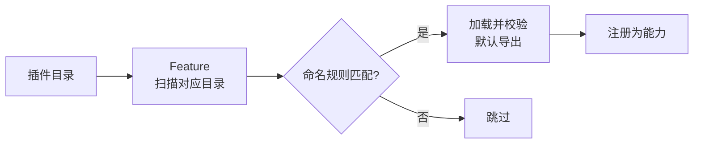

# 约定目录

**把文件放进约定的目录，能力就会自动注册**，不需要在 `plugin.ts` 里写注册代码。本页告诉你每种能力放在哪个目录、怎么命名。

## 三条规则

1. **一个能力一个目录，入口叫 `index.ts`**（组件和页面可用 `index.tsx`）。例如 `commands/hello/index.ts`。
2. **目录名就是能力的名字。** `commands/hello/` 是 `hello` 命令，`tools/weather/` 是 `weather` 工具。
3. **同目录下的其他文件不会被注册**，可以放辅助函数、类型和测试，由 `index.ts` 引用。

```text
my-plugin/
├── plugin.ts
├── commands/
│   └── hello/
│       ├── index.ts      # ✅ /hello 命令
│       └── format.ts     # 普通模块，被 index.ts 引用
└── middlewares/
    └── keyword-reply/
        └── index.ts      # ✅ keyword-reply 中间件
```

Skill 和 Agent 是例外：它们用 Markdown / JSON 描述，入口分别是 `skills/<name>/SKILL.md` 和 `agents/<name>/agent.json`。

## 目录速查

| 目录 | 用来做什么 | 默认导出 | 详细文档 |
| --- | --- | --- | --- |
| `commands/` | 用户输入 `/xxx` 时执行的命令 | `defineCommand()` | [命令](./commands.md) |
| `middlewares/` | 每条消息都经过的拦截器：关键词回复、过滤 | `defineMiddleware()` | [中间件与组件](./middleware-components.md) |
| `handlers/` | 监听平台事件：入群、好友申请、登录 | `defineHandler()` | [本页](#handlers-监听平台事件) |
| `components/` | 可复用的 JSX 消息卡片 | `defineComponent()` | [中间件与组件](./middleware-components.md) |
| `schedules/` | 定时任务 | `defineSchedule()` | [本页](#schedules-定时任务) |
| `adapters/` | 接入一个新平台 | `defineAdapter()` | [适配器开发](./adapters.md) |
| `pages/` | Console 里的自定义页面 | 页面组件 | [Console 页面](./console-pages.md) |
| `tools/` | 给 AI 调用的函数 | `defineAgentTool()` | [Agent 工具](./agent-tools.md) |
| `prompt-sections/` | 给 AI 的背景知识 | `defineAgentPromptSection()` | [Agent 工具](./agent-tools.md) |
| `skills/` | AI 按需加载的操作手册 | `SKILL.md` | [Agent 工具](./agent-tools.md) |
| `agents/` | 子 Agent 定义 | `agent.json` + Markdown | [Agent 工具](./agent-tools.md) |
| `hooks/` | Agent 回合的钩子 | `defineHook()` | [Agent 深入](../ai/agent.md) |
| `mcps/` | 声明 MCP 服务 | `defineMcp()` | [AI 总览](../ai/index.md) |

`commands/`、`middlewares/`、`handlers/`、`components/`、`schedules/`、`adapters/` 对你的 Bot 默认可用。`tools/`、`prompt-sections/` 等 AI 目录需要先启用 AI（`npx zhin setup --ai` 会自动声明）；子插件要用哪个目录，需在自己的 `package.json` 里声明，见下文 [它是怎么工作的](#它是怎么工作的)。

目录不存在时直接跳过，插件只需要创建自己用到的目录。

## 各目录的写法

### commands/：命令

```ts
// commands/lottery-today/index.ts  →  /lottery-today
import { defineCommand } from 'zhin.js/command';

export default defineCommand({
  description: '查看今日推荐',
  async execute() {
    return '今天的推荐是……'; // 返回值就是回复
  },
});
```

嵌套目录就是子命令：`commands/admin/ban/index.ts` 对应 `/admin ban`。参数可以写成目录：`[name]` 必填、`[[name]]` 可选、`[...name]` 捕获剩余所有内容。参数、选项、权限的完整写法见 [命令](./commands.md)。

一条命令最多只有一个参数目录，而且必须是 `index.ts` 前的最后一层目录。`commands/term/[word]/[...definition]/index.ts` 会报 `CommandPathSyntaxError`；应写成 `commands/term/[word]/index.ts`，其余参数在 `defineCommand({ params })` 里接在目录参数后面声明：

```ts
// commands/term/[word]/index.ts  →  /term <word> <...definition>
import { defineCommand } from 'zhin.js/command';

export default defineCommand({
  params: {
    word: { type: 'string' },                    // 目录参数，必须放在第一项
    definition: { type: 'text', rest: true },    // 剩余输入
  },
  execute: ({ params }) => ({ word: params.word, definition: params.definition }),
});
```

### middlewares/：中间件

```ts
// middlewares/keyword-reply/index.ts
import { defineMiddleware } from 'zhin.js/middleware';
import type { Message } from 'zhin.js';

export default defineMiddleware<Message>({
  async handle({ input }, next) {
    if (input.content === '早') return '早上好！'; // 命中：直接回复
    return next();                                  // 未命中：交给后续中间件和命令
  },
});
```

中间件按顺序组成一条链，必须调用 `next()` 才会继续往下走。详见 [中间件与组件](./middleware-components.md)。

### handlers/：监听平台事件

中间件处理"消息"，handler 处理"事件"：入群、退群、好友申请、登录二维码等。handler 不参与消息链，没有 `next()`。

```ts
// handlers/request-receive/index.ts
import { defineHandler } from 'zhin.js/handler';

export default defineHandler({
  event: 'request.receive', // 带点的事件名需要显式写出
  async handle(event) {
    const request = event.payload;
    const ok = await this.interaction?.ask({ type: 'confirm', title: '同意该请求？' });
    if (ok) await request.$approve();
  },
});
```

可以监听的事件：

| 事件 | 什么时候触发 |
| --- | --- |
| `message.receive` | 收到消息（在中间件和命令之前） |
| `notice.receive` | 通知：成员变动、撤回、戳一戳等 |
| `request.receive` | 需要审批的申请：好友请求、入群申请 |
| `system.receive` | 系统事件：登录、上线、下线 |

::: details Handler 的更多细节
- 省略 `event` 时，目录名就是事件名；`handlers/<name>/` 只能是一级目录，所以监听 `message.receive` 这类带点的事件时必须显式声明 `event`。
- `this.interaction` 用来向用户提问、确认或让其选择，与命令里的交互能力相同。Notice / Request 只有在有真实会话时才提供；SystemEvent 不提供。
- `Message`、`Notice`、`Request`、`SystemEvent` 类型可从 `zhin.js` 导入，与 handler 收到的 payload 一致。普通字段使用 camelCase：
  - `id`、`type`、`name`、`timestamp`、`metadata`：事件身份、完整事件名、毫秒时间戳、平台原始字段。
  - `endpoint`、`generation`：事件所属的连接与版本；`endpointId` 是平台账号标识，`clientAdapter` 是平台标识。
  - Notice / Request 的 `conversation?`、`actor?`、`target?` 只在实际存在时提供；Request 的 `actor` 必有。SystemEvent 没有这三个字段。
- `$client`、Request 的 `$approve()` / `$reject()` 只在本次处理期间有效，处理结束后失效。平台原始字段从 `metadata` 读取；需要平台 SDK 的强类型事件时，使用带 `adapter` 的原生事件 handler。
- 适配器统一通过 `endpoint[endpointSpec].events` 上报事件，由运行时构造上面这些标准对象。
- 也可以在 `setup` 里用 `addHandler(name, defineHandler(...))` 注册，效果相同。
:::

### components/：消息卡片

```tsx
// components/status-card/index.tsx
import { defineComponent } from 'zhin.js/component';

export default defineComponent<{ title: string }>({
  render: ({ title }) => <text>{title}：在线</text>,
});
```

在命令里用 `component('status-card', { title: '…' })` 渲染它。支持图片的平台会把 JSX 渲染成图片，其他平台降级为文字。详见 [中间件与组件](./middleware-components.md)。

### schedules/：定时任务

`schedules/<name>/index.ts` 默认导出 `defineSchedule(...)`。`execute(ctx)` 能拿到本次执行的插件配置和 `use(token)`，也可以在 `plugin.ts` 里用 `addSchedule` 注册同一定义。

定时任务没有"收到的消息"可回复；要发消息请使用主动推送（见 [definePlugin · 主动发消息](./define-plugin.md)）。需要在重启后保留的数据，应保存到数据库等持久存储，不要缓存 `ctx` 或客户端对象。完整示例见 [Schedule Feature](https://github.com/zhinjs/zhin/blob/main/packages/im/schedule-feature/README.md) 与 [持久提醒插件](https://github.com/zhinjs/zhin/blob/main/plugins/utils/reminder/README.md)。

### adapters/：接入新平台

```ts
// adapters/napcat/index.ts
import { defineAdapter } from 'zhin.js/adapter';
import { NapcatAdapter } from '../../src/adapter.js';
import type { NapCatEndpointConfig } from '../../src/protocol.js';

export default defineAdapter<NapCatEndpointConfig>({
  capabilities: ['inbound', 'outbound'],
  operations: ['recall'],
  createAdapter: context => new NapcatAdapter(context),
});
```

只有要接入一个 Zhin 还不支持的平台时才需要写适配器。详见 [适配器开发](./adapters.md) 与 [端点生命周期](./endpoint-lifecycle.md)。

### tools/：给 AI 调用的工具

```ts
// tools/music-search/index.ts
import { defineAgentTool } from '@zhin.js/tool';

export default defineAgentTool<{ keyword: string }>({
  description: '搜索音乐并返回结果列表',
  inputSchema: {
    type: 'object',
    properties: { keyword: { type: 'string', description: '搜索关键词' } },
    required: ['keyword'],
  },
  requiresApproval: 'never',
  execute: ({ keyword }) => searchMusic(keyword),
});
```

`description` 和 `inputSchema` 是写给模型看的，写清楚"什么时候该用、参数是什么"。工具名允许 kebab-case 或 snake_case（如 `send_user_like`）。详见 [Agent 工具](./agent-tools.md)。

### skills/ 与 agents/：用文档描述的 AI 能力

`skills/<name>/SKILL.md` 是一份带 frontmatter 的操作手册，AI 需要时才加载；同目录可以放参考资料和脚本：

```markdown
---
name: memory-consolidate
description: 回合末或 master 说「记住」时，将 1–3 条可检索事实写入 memory_entries
tools:
  - memory_upsert
  - memory_search
---
```

`agents/<name>/` 定义一个子 Agent，必须包含 `agent.json`、`system.md`、`boundaries.md`、`conventions.md`；可选的 `workflows/`、`tools/`、`skills/`、`hooks/`、`knowledge/` 分别放场景流程、私有工具、私有 Skill、私有钩子和知识库。主 Agent 的规则写在插件根目录的 `AGENTS.md`，子 Agent 的 `conventions.md` 只能在此基础上延伸。详见 [`@zhin.js/agent-feature`](https://github.com/zhinjs/zhin/blob/main/packages/im/agent-feature/README.md)。

### pages/：Console 页面

`pages/<name>/index.tsx` 会被编译成浏览器代码，显示在 Remote Console 里。`pages/nav/index.tsx` 和 `pages/footer/index.tsx` 是特殊名字，分别注入导航栏和页脚。详见 [Console 页面](./console-pages.md)。

## 命名规则

- 目录名使用小写 kebab-case：`keyword-reply`、`lottery-today`。
- `commands/` 的静态目录还允许中文等 Unicode 名（如 `commands/赞我/`），但参数目录（`[name]` 等）只能用 ASCII。
- `tools/` 额外允许 snake_case（如 `send_user_like`）。
- 同一插件内名字重复会在启动时报 `DiscoveryConflictError`。

::: details 每个目录如何推导能力名
| 目录 | 能力名推导 | 示例 |
| --- | --- | --- |
| `commands/` | 从 `commands/` 到 `index.ts` 的目录段用 `/` 拼接；`[name]`、`[[name]]`、`[...name]`、`[[...name]]` 分别表示必需、可选、捕获所有、可选捕获所有参数 | `commands/lottery-today/index.ts` → `lottery-today`；`commands/lottery/[[game]]/index.ts` → `lottery/$game` |
| `middlewares/` | 一级命名目录 | `middlewares/keyword-reply/index.ts` → `keyword-reply` |
| `handlers/` | 一级命名目录；省略 `event` 时目录名作为事件名 | `handlers/message-receive/index.ts` → `message-receive` |
| `components/` | 一级命名目录 | `components/share-music/index.ts` → `share-music` |
| `adapters/` | 同上 | `adapters/napcat/index.ts` → `napcat` |
| `tools/` | `<name>/index.ts`；ASCII kebab 或 snake | `tools/music-search/index.ts` → `music-search`；`tools/send_user_like/index.ts` → `send_user_like` |
| `hooks/` | `<name>/index.ts`；私有 Hook 可嵌入 Agent 或 Skill | `hooks/audit/index.ts` → `audit` |
| `prompt-sections/` | 一级命名目录 | `prompt-sections/project-rules/index.ts` → `project-rules` |
| `skills/` | 一级子目录名；只识别其中的 `SKILL.md` | `skills/memory-consolidate/SKILL.md` → `memory-consolidate` |
| `agents/` | 一级目录名；只识别含 `agent.json` 的目录 | `agents/planner/agent.json` → `planner` |
| `mcps/` | 一级命名目录 | `mcps/my-server/index.ts` → `my-server` |
| `schedules/` | 一级命名目录 | `schedules/daily-report/index.ts` → `daily-report` |
| `pages/` | 一级命名目录；`nav` / `footer` 是布局槽 | `pages/workroom/index.tsx` → `workroom`；`pages/nav/index.tsx` → `nav` |

命令参数目录的方括号写错会抛 `CommandPathSyntaxError`；参数有默认值时目录名必须用双方括号，且 `params` 中必须声明对应参数，否则同样报错。一条命令出现多个参数目录、或参数目录后面还有静态目录（如 `commands/[name]/info/`）时也会报错，错误信息会列出文件路径和改正后的写法；目录参数没有放在 `params` 第一项时，错误信息会给出调整后的顺序。
:::

## 它是怎么工作的

每个约定目录由一个 **Feature**（能力包）负责扫描。插件启动或热重载时，Feature 遍历自己负责的目录，加载符合命名规则的入口文件、校验默认导出，再注册为能力：



**你的 Bot（Root 插件）** 依赖 `zhin.js` 时，会自动获得官方 Stable Features，所以 `commands/` 等目录开箱即用。**子插件** 需要在自己的 `package.json` 里声明要用的 Feature：

```jsonc
{
  "peerDependencies": { "@zhin.js/command": "^1.1.0" },
  "peerDependenciesMeta": { "@zhin.js/command": { "optional": true } },
  "zhin": {
    "features": [{ "package": "@zhin.js/command", "api": "^1.0.0" }]
  }
}
```

- `zhin.features` 里出现的包，必须同时写在 `dependencies` / `peerDependencies` / `optionalDependencies` 之一，否则启动报 `PackageResolutionError`。
- 子插件对 Stable Feature（command / middleware / component / handler）声明为**可选 peer**，由 Bot 统一提供，不要装进自己的 `dependencies`，避免出现两份。
- `@zhin.js/adapter`、`@zhin.js/tool` 等按需放进 `dependencies` 或非可选 peer。

::: details 完整的目录 ↔ Feature 对照表
能力的完整 id 形如 `owner\0feature\0localName`（`\0` 分隔）。`target: server` 的模块在 Node 侧执行；`target: client` 的页面由构建产物在浏览器加载。

| 目录 | 文件形态 | 递归 | target | Feature 包 | featureId | 默认导出 |
| --- | --- | --- | --- | --- | --- | --- |
| `commands/` | 路由目录 + `index.ts` / `index.tsx` | 是（目录段拼层级） | server | `@zhin.js/command` | `zhin.command` | `defineCommand(...)` |
| `middlewares/` | `<name>/index.ts` | 命名目录 | server | `@zhin.js/middleware` | `zhin.middleware` | `defineMiddleware(...)` |
| `handlers/` | `<name>/index.ts` | 命名目录 | server | `@zhin.js/handler` | `zhin.handler` | `defineHandler(...)` |
| `components/` | `<name>/index.ts` / `index.tsx` | 命名目录 | server | `@zhin.js/component` | `zhin.component` | `defineComponent(...)` |
| `adapters/` | `<name>/index.ts` | 命名目录 | server | `@zhin.js/adapter` | `zhin.adapter` | `defineAdapter(...)` |
| `tools/` | `<name>/index.ts` | 命名目录 | server | `@zhin.js/tool` | `zhin.agent-tool` | `defineAgentTool(...)` |
| `hooks/` | `<name>/index.ts` | 命名目录 | server | `zhin.js/agent` | Agent Hook | `defineHook(...)` |
| `prompt-sections/<name>/` | `index.ts` | 是 | server | `@zhin.js/prompt-section` | `zhin.agent-prompt-section` | `defineAgentPromptSection(...)` |
| `skills/` | 子目录 + `SKILL.md` | 一层 | server | `@zhin.js/skill` | `zhin.skill` | Markdown 文本 |
| `agents/` | `<name>/agent.json` + 3 个核心 Markdown | 一层 | server | `@zhin.js/agent-feature` | `zhin.agent` | 目录化 Agent 定义 |
| `mcps/` | `<name>/index.ts` | 命名目录 | server | `@zhin.js/mcp-feature` | `zhin.mcp` | `defineMcp(...)` |
| `schedules/` | `<name>/index.ts` | 命名目录 | server | `@zhin.js/schedule-feature` | `zhin.schedule` | `defineSchedule(...)` |
| `pages/` | `<name>/index.ts(x)`；`nav` / `footer` 为布局槽 | 命名目录 | client | `@zhin.js/page` / `@zhin.js/layout` | `zhin.page` / `zhin.layout` | 页面构件 |

依赖 `zhin.js` 的应用可从门面子路径导入 `define*`：`zhin.js/command`、`zhin.js/middleware`、`zhin.js/handler`、`zhin.js/adapter`、`zhin.js/component`，以及主入口 `zhin.js` 的 `definePlugin`。
:::

## 仓库里的真实例子

| 想看 | 去这里 |
| --- | --- |
| 命令（含参数目录 `lottery/[[game]]/index.ts`） | `plugins/utils/lottery/commands/` |
| 中间件 | `plugins/utils/group-suite/middlewares/`、`plugins/games/*/middlewares/` |
| 组件 | `plugins/utils/music/components/share-music/index.ts` |
| 适配器 | `plugins/adapters/napcat/adapters/napcat/index.ts` |
| AI 工具 | `plugins/utils/music/tools/`、`plugins/utils/group-suite/tools/` |
| Skill | `examples/full-bot/skills/memory-consolidate/SKILL.md` |
| 子 Agent | `examples/multi-agent-room/agents/` |
| Console 页面 | `examples/full-bot/pages/workroom/index.tsx` |

## 下一步

- [命令](./commands.md)：参数、选项、权限与帮助。
- [中间件与组件](./middleware-components.md)：关键词回复、消息卡片与 JSX。
- [Agent 工具](./agent-tools.md)：让 AI 调用你的函数。
