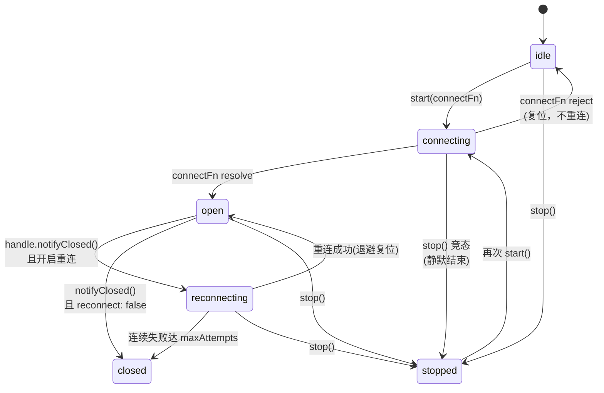

# 端点生命周期

**写 WebSocket 或 SSE 长连接适配器时读这一页。** 长连接都需要同一套逻辑：连接、断开后指数退避重连、心跳检测、主动停止。`zhin.js/adapter` 提供的 `createEndpointLifecycle` 把它们做成了现成的基座，napcat 等官方适配器都在用。

自己手写这套逻辑时最常踩的坑：旧 socket 迟到的 close 事件误杀了新连接；`stop()` 和连接竞争导致未处理的 Promise 拒绝；退避计时器忘了清理。用基座就能避开它们，**不要再手写 `#started` / `#reconnectTimer` 这类标志位。**

## 最小用法

```ts
import { createEndpointLifecycle } from 'zhin.js/adapter';

const lifecycle = createEndpointLifecycle({ name: config.name });

// 连接：connectFn 在连接打开时 resolve，失败或打开前就关闭时 reject
await lifecycle.start(async (handle) => {
  const ws = new WebSocket(url, { headers });
  // 登记强制关闭函数：stop() 和心跳看门狗都会调用它
  handle.onForceClose(() => { try { ws.close(); } catch { /* ignore */ } });

  await new Promise<void>((resolve, reject) => {
    let settled = false;
    ws.on('open', () => {
      settled = true;
      lifecycle.startHeartbeat(() => ws.ping(), config.heartbeat_interval);
      resolve();
    });
    ws.on('close', (code, reason) => {
      // 对端断开时通知基座；只有曾经打开过的连接才会触发重连
      handle.notifyClosed(new Error(`WS closed: ${code} ${reason}`));
      if (!settled) { settled = true; reject(new Error(`WS closed: ${code}`)); }
    });
    ws.on('error', (err) => {
      if (!settled) { settled = true; reject(err); }
    });
  });
});

// 停止：清理所有计时器、强制关闭连接，且不会触发重连
await lifecycle.stop();
```

记住两条行为：

- **首次连接失败不会自动重连。** `start()` 直接把错误抛给你，由你决定是否重试；只有**曾经打开过**的连接断开后，才会自动重连。
- **`stop()` 是主动停止**：可以重复调用，不会触发重连；如果正在连接时调用 `stop()`，`start()` 会安静地 resolve（主动停止不算失败）。

在适配器自己的 `stop()` 里，先调用基座，再做自己的清理：

```ts
// plugins/adapters/napcat/src/ws-endpoint.ts（节选）
async stop(): Promise<void> {
  await this.#lifecycle.stop();          // 清计时器 + 强关 ws + 结束竞态等待
  this.#unregisterAgent?.();             // 适配器自己的清理
  rejectAllPending(this.#pending);
  this.#inboundDeduper.clear();
  if (this.#ws) {
    try { this.#ws.close(); } catch { /* ignore */ }
    this.#ws = undefined;
  }
}
```

## 配置重连与心跳

```ts
const lifecycle = createEndpointLifecycle({
  name: config.name,              // 只用于日志
  reconnect: {
    initialIntervalMs: 5_000,     // 首次重连间隔，默认 5000
    multiplier: 2,                // 退避倍数，默认 2（设为 1 即固定间隔）
    maxIntervalMs: 60_000,        // 间隔上限，默认 60000
    jitterMs: 250,                // 随机抖动上限，默认 250
    maxAttempts: Infinity,        // 连续失败上限，用尽后进入 closed
  },
  heartbeat: {
    intervalMs: 30_000,           // startHeartbeat 的默认间隔；<=0 不开启
    watchdogMisses: 0,            // 看门狗容忍的轮数，默认 0 = 关闭
  },
});
```

- `reconnect: false` 关闭自动重连，对端断开后直接进入 `closed`。
- 实际等待时间 = `min(initial × multiplier^attempt, max) + random(0, jitter)`；重连成功后重新计数。第一次断开记 WARN，后续重试记 DEBUG，避免刷屏。
- 测试时可以传入 `random: () => 0`，得到确定的退避序列。

### 心跳看门狗

```ts
lifecycle.startHeartbeat(beat, intervalMs?);  // 启动心跳（重复调用会先清掉旧的）
lifecycle.stopHeartbeat();                    // 手动停止（关闭、停止、看门狗触发时会自动调用）
lifecycle.notifyHeartbeatAck();               // "喂狗"：收到任何回包时调用
```

设置 `watchdogMisses: N` 后，如果**连续 N 轮心跳都没有收到任何回包**，基座会调用你登记的强制关闭函数；随后 socket 的 `close` 事件触发 `notifyClosed`，走正常的退避重连。所以在 `message` 和 `pong` 回调里都要喂狗：

```ts
ws.on('pong', () => this.#lifecycle.notifyHeartbeatAck());
ws.on('message', (data) => {
  this.#lifecycle.notifyHeartbeatAck();   // 有流量就说明连接还活着
  handleMessage(data);
});
```

## 一个适配器挂多个账号

适配器只声明一次（`adapters/napcat/index.ts` → `defineAdapter`），但可以在配置里展开为**多个账号连接（Endpoint）**：

```yaml
# examples/full-bot/zhin.config.yml（节选）
plugins:
  napcat:
    connection: ws                 # 公共配置：所有账号共享
    endpoints:
      - id: full-bot-napcat        # 每个账号的独立配置
        url: ${ONEBOT11_WS_URL}
        access_token: ${ONEBOT11_ACCESS_TOKEN}
```

- `endpoints` 非空时，每一项创建一个账号：公共配置（去掉 `endpoints` 键）与该项**浅合并**，`id` 强制写入。`endpoints` 为空或省略时，按公共配置创建一个账号。
- `id` 必须是非空字符串，不能包含 `~` 或 `\0`；重复或非法的 `id` 会让新配置失败。展开后的账号 id 为 `<capabilityId>~<id>`。
- `create(context)` 拿到的 `context.config` 就是**合并后的单账号配置**，`context.endpointId` 是账号 id（`context.name` 是适配器名）。适配器代码不需要关心有几个账号，一个实例只服务一条连接。

展开逻辑在 `packages/im/adapter/src/adapter-index.ts` 的 `expandEndpointConfigs`。

## Endpoint 的生命周期钩子

继承 `Endpoint` 自己实现连接流程时，框架会在版本切换的各个阶段调用这些钩子：

| 钩子 | 时机 |
| --- | --- |
| `start()` | 新版本激活时，分配连接资源 |
| `open()` | 新版本激活时，开放本地事件流；新版本正式切换前，入站消息仍会被拒绝 |
| `close()` | 停止接收新事件，保留进行中的工作 |
| `stop()` | 释放连接资源，必须可以重复调用 |
| `send(request)` | 发送消息 |

以 `NapCatWsEndpoint` 为例：`start()` 里调用 `lifecycle.start(...)` 建立连接；`open()` / `close()` 切换一个 `#open` 标志（只有打开时才接收事件）；`stop()` 调用基座的 `stop()` 再做自己的清理。

## 回查引用、合并转发与媒体

如果平台能按原生 id 回查消息内容，Endpoint 应提供唯一的 `content: EndpointContentPort`，不要把 `$getMsg`、引用 metadata 或提前展开的转发文本塞进消息里：

```ts
interface EndpointContentPort {
  resolve(
    reference: ConversationReference, // message | forward | media
    context: {
      signal: AbortSignal;
      maxDepth: number;
      maxEntries: number;
      maxChars: number;
    },
  ): Promise<ConversationResolution>;
}
```

- 结果必须是 `resolved | not_found | unsupported | forbidden | expired | failed` 之一。平台不支持时返回 `unsupported`，不要返回空内容或猜测的内容。
- `resolve()` 必须响应 `signal`，并遵守深度、条数和字符预算；整个异步调用期间，Core 持有当前版本的快照租约。
- 消息和转发中的作者只写成中性的 `actor` 数据，**不能**映射成模型的 role。
- 媒体可以返回稳定 URL、经过校验的 base64 / 路径，或明确失败；不要把带 token 的下载 URL 暴露给 Agent。

## 深入

### 状态机



- `started` 为 `true` 当且仅当状态是 `connecting` / `open` / `reconnecting`。
- 每次连接尝试都会递增内部版本号，**过期连接句柄上的 `notifyClosed` / `onForceClose` 一律被忽略**，所以旧 socket 的迟到事件不会影响新连接。

### 范例：napcat 的 ws-endpoint

`plugins/adapters/napcat/src/ws-endpoint.ts` 是基座的标准用法，结构只有四块：

```ts
export class NapCatWsEndpoint extends Endpoint<NapcatClient> {
  readonly client = new NapcatClient((action, params) => this.#callApi(action, params));
  readonly #lifecycle: EndpointLifecycle;
  #ws?: NapCatWsSocket;

  constructor(options: NapCatWsEndpointOptions) {
    super();
    // 1. 构造时创建基座；reconnect_interval 沿用旧语义的固定间隔：
    //    倍数 1、无抖动、不封顶
    this.#lifecycle = createEndpointLifecycle({
      name: options.config.name,
      reconnect: {
        initialIntervalMs: options.config.reconnect_interval,
        multiplier: 1,
        maxIntervalMs: Number.MAX_SAFE_INTEGER,
        jitterMs: 0,
      },
    });
  }

  async start(): Promise<void> {
    if (this.#lifecycle.started) return;                 // 幂等
    await this.#lifecycle.start((handle) => this.#connect(handle));
  }
  // stop() 见「最小用法」；#connect(handle) 的写法同上
}
```

基座替你删掉了这些字段和分支：

| 手写时 | 使用基座后 |
| --- | --- |
| `#started` / `#stopping` / `opened` 标志位 | `lifecycle.state` / `lifecycle.started` |
| `#reconnectTimer` + 手写 `setTimeout` 链 | 内置退避循环，等待可中断，`stop()` 立即唤醒 |
| `#heartbeatTimer` + 漏回包计数 | `startHeartbeat` + `watchdogMisses` + `notifyHeartbeatAck` |
| 旧 socket 迟到的 close 误杀新连接 | 过期句柄自动失效 |
| `stop()` 与连接竞争导致未处理的拒绝 | 竞态等待被统一结束，静默 resolve |

适配器只保留协议本身的逻辑：Client 的 API 调用、待回复请求的拒绝（`rejectAllPending`）和入站去重器清理（`deduper.clear()`）。Client 是独立对象；Endpoint 只负责账号连接、生命周期和事件入口。

## 下一步

- [适配器开发](./adapters.md)：`defineAdapter` 的基本写法。
- [消息流](../concepts/message-flow.md)：入站和出站的完整路径。
