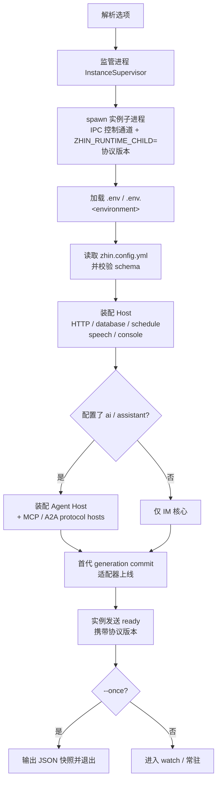

# zhin runtime start

`zhin runtime start` 是启动 Bot 的唯一命令。它直接运行项目里的 TypeScript 源码，不需要先编译；按配置装配 HTTP、数据库、Console、Agent 等服务。只有显式传入 `--watch` 才监听变化，与运行模式无关。

## 常见用法

```bash
# 日常开发：HMR + Console
pnpm dev

# 生产：关闭 watch，日志走 stdout（交给 systemd / 容器收集）
zhin runtime start --mode production --no-watch

# 裸机常驻：daemon + 开机自启
zhin runtime start --daemon
zhin service install

# CI 冒烟：起一次确认配置与装配无误
zhin runtime start --once --mode test
```

| 场景 | 用哪种 |
| --- | --- |
| 本地开发 | `pnpm dev`：监听文件、热重载 |
| 服务器上由 systemd / Docker 管理 | `--mode production --no-watch`：不监听文件，日志输出到 stdout |
| 服务器上没有进程管理器 | `--daemon`：自带守护进程，崩溃自动拉起 |
| CI 中检查配置和装配 | `--once`：启动一次就退出，输出 JSON |

## 选项

| 选项 | 说明 |
| --- | --- |
| `--mode <mode>` | 运行模式：`development`（默认）/ `test` / `production` |
| `--environment <name>` | 环境名，默认与 `--mode` 相同；决定加载 `.env.<name>`，须匹配 `/^[a-z0-9][a-z0-9-]*$/` |
| `--watch <scope...>` | 显式监听 `source` / `config`；可组合为 `--watch source config`。不传则均不监听 |
| `--no-watch` | 全部不监听的兼容入口；不能与 `--watch` 同用 |
| `--once` | 完成一次启动后输出 JSON 快照并退出 |
| `--open` | 在终端（TTY）启动成功后用浏览器打开 Remote Console；也可设置 `ZHIN_OPEN=1` |
| `-d, --daemon` | 守护进程模式：写 pid 文件、日志重定向、崩溃自动重启 |
| `--log-file <path>` | daemon 日志文件，默认 `<项目根>/.zhin/logs/instance.log`（按大小轮转） |
| `--standalone` | 仅开发 / 测试：不经监管进程，实例在本进程内自带 Node HTTP 服务器；没有受管重启 |

`zhin runtime start --help` 会列出以上选项和常用示例。未知选项会在启动前直接报错（fail fast），不会进入重启循环。

## 原生 TypeScript（strip-types）

运行时不经过项目编译步骤，插件源码由 Node 直接执行。支持版本与仓库 `engines` 一致：`>=22.19.0`，不满足时直接报错。

前台模式会按 Node 的 TypeScript 支持能力决定是否需要 wrapper。daemon 模式始终使用 supervisor → 子进程两层结构，见下文进程管理。

因为是「源码即运行时」，import 本地 TS 文件必须带 `.js` 扩展名（由运行时做 specifier 重映射），这也是仓库代码约定之一。

::: details `.tsx` 入口是怎么加载的
服务端约定入口也支持 `.tsx`。CLI 会优先交给进程现有 loader；Node 不识别 `.tsx` 时，再为该入口启用隔离的 TSX loader，因此开发 watch、`--no-watch`、supervisor 与 daemon 使用同一条启动命令。项目的 `tsconfig.json` 需设置 `"jsx": "react-jsx"` 和合适的 `"jsxImportSource"`；新脚手架默认使用 `zhin.js`，单文件可用 `/** @jsxImportSource zhin.js */` 覆盖。
:::

## 启动流程



注意 Agent 栈是**按需加载**的：只有配置了 `ai` / `assistant` 任一段，才会解析 `@zhin.js/agent`；纯 IM 项目不会载入 AI 依赖。启动成功后的输出也因环境而异——TTY 下是一行摘要（插件数、HTTP 地址、在线/离线适配器），非 TTY 或 `--once` 则输出结构化 JSON（`{ started: true, ... }`），便于脚本消费。配置校验失败会报 `Invalid Plugin config in zhin.config.yml` 并列出全部问题。

## HMR 语义

只有显式使用 `--watch source config`、`--watch source` 或 `--watch config` 才监听对应范围，`--once` 不注册监听。不指定 `--watch` 时仍可在 Console 显式保存并申请应用配置；监听范围不等于手动操作权限。脚手架和仓库示例的 `pnpm dev` 已显式选择源码和配置监听，旧项目如需保持开发热重载，请相应更新自己的脚本。

源码变更按影响面分两级处理：

| 变更内容 | 处理方式 |
| --- | --- |
| 插件 / 应用源码 | **进程内世代（generation）重载**：只重建受影响的 capability slot 与插件子树，Console 经 SSE 收到 `hmr:reload` |
| 依赖清单类文件（`pnpm-lock.yaml`、`pnpm-workspace.yaml`、`package-lock.json`、`yarn.lock`） | **进程级重启**：实例经控制通道发送 `restart-request`，监管进程回以 `shutdown`，实例完整停止后由监管进程重新拉起 |

世代重载是事务式的：新世代先完成装配与 commit，再异步 dispose 旧世代；HTTP 端口在世代切换时先释放再 listen，不会出现端口占用导致的 Console 丢失。同一批文件事件会合并为一次世代事务，避免连续抖动。

## 进程管理

### daemon 模式

```bash
zhin runtime start --daemon            # 日志进 .zhin/logs/instance.log（按大小轮转）
zhin runtime start -d --log-file ./bot.log
zhin stop                              # 停止（读取 .zhin.pid）
```

监管进程常驻并把自身 pid 写入 `<项目根>/.zhin.pid`，实例的 stdout/stderr 写入日志文件（默认 `.zhin/logs/instance.log`，超过 10 MiB 轮转为 `instance.log.1` … `.5`），同时保留最近 1000 行的内存缓冲。崩溃（信号或非零退出）会触发重新拉起；`zhin stop` 或 `kill -TERM <pid>` 正常结束。另有**风暴保护**：自动重启（崩溃与实例请求的重启）最多每分钟 10 次、每次间隔 3 秒，超出预算实例停在 `crashed`，监管进程退出，避免崩溃循环刷爆平台连接。前台运行（不带 `--daemon`）共享终端输出，实例请求的重启照常执行，崩溃不自动重启。

### 控制通道与重启

监管进程以 Node IPC（`serialization: 'advanced'`）拉起实例（ADR 0054 §3），协议定义在 `@zhin.js/host-http/bridge`：

| 方向 | 消息 | 说明 |
| --- | --- | --- |
| 实例 → 监管 | `ready` | 启动完成，携带协议版本与 generation；版本不兼容时监管进程拒绝该实例并停止它，不再重启 |
| 实例 → 监管 | `restart-request` | Console 重启、依赖变化、数据库切换、受控自我变更等需要整进程重启的场景（取代旧的退出码 `75`） |
| 监管 → 实例 | `shutdown` | `{ reason, budgetMs }`：实例在预算内完整停止；超时后监管进程依次发送 SIGTERM、SIGKILL |
| 实例 → 监管 | `routes` | 路由表（HTTP 路由、WebSocket 路径及其认证方式、`apiBase`、generation），插件热重载与世代切换后更新 |
| 监管 → 实例 | `http.request` / `http.request.body` / `http.request.end` / `http.request.abort` | 请求头（含网关认证后的主体）与分块请求体 |
| 实例 → 监管 | `http.response.head` / `http.response.body` / `http.response.end` / `http.response.error` | 响应头与分块响应体（SSE、大文件） |
| 双向 | `http.request.credit` / `http.response.credit` | 按信用额度的背压：每个方向最多 256 KiB 在途，单块 ≤ 64 KiB |
| 双向 | `ws.open` / `ws.accepted` / `ws.rejected` / `ws.message` / `ws.close` / `ws.drain` | WebSocket 连接与帧（文本 / 二进制），`ws.drain` 驱动 `bufferedAmount` |

**实例不含 HTTP 服务器**（ADR 0054 §2）：在监管进程下，实例用 `BridgedHttpHost` 经控制通道承载自己的路由，不监听端口，也不导入 `node:http` / `ws`；HTTP 由网关唯一的服务器接收后转发。网关认证调用方并随请求传递主体，实例只做授权（按 Console 权限表），不再自行解析凭据。

实例就绪超时（默认 60 秒）按启动失败处理。`--once` 不处理重启请求。`ZHIN_RUNTIME_CHILD` 的值是网关的协议版本，版本不兼容时实例拒绝启动。`zhin.js/instance` 没有控制通道时拒绝启动；开发与测试可用 `zhin runtime start --standalone`（编程方式：`runStartCommand({ standaloneHttp: true })`）在本进程内自带 HTTP 服务器，此时没有受管重启，重启请求只会停止进程。

### 退出码

| 退出码 | 含义 |
| --- | --- |
| `0` | 正常退出 |
| `130` | 被信号中断（Ctrl+C / SIGTERM） |
| 其他非零 | 实例启动失败或崩溃且未被重新拉起（取实例的退出码） |

### 孤儿保护

监管进程消失（被 `kill -9`、终端关闭或崩溃）时 IPC 通道断开，实例随即完整停止并退出——不会留下仍握着平台连接和文件监听的僵尸进程。监管进程收到 SIGINT / SIGTERM（前台还有 SIGHUP）时向实例发送 `shutdown`；第二次信号直接结束实例。

## 下一步

相关命令与退出行为见 [CLI 参考](./index.md)，配置项见 [配置参考](../configuration/index.md)，备份与恢复见[生产部署与运维](../operations/production)。
