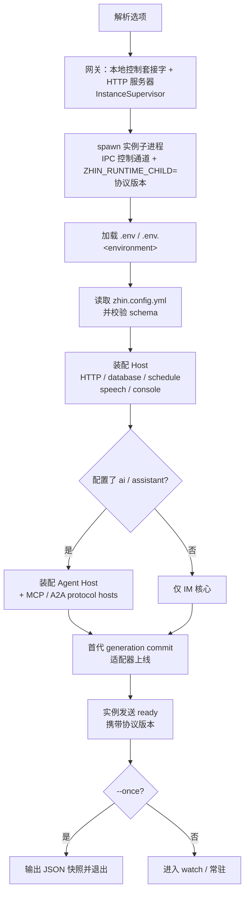

# zhin start

`zhin start` 启动项目的**管理网关**（ADR 0054）：网关常驻运行，监听 `http.port`、承载 Console，并以子进程拉起 **Zhin 实例**（IM Runtime、插件、适配器、Agent）。实例崩溃、被停止或安装依赖期间网关照常运行，Console 能看状态和日志。项目里的 TypeScript 源码直接运行，不需要先编译；只有显式传入 `--watch` 才监听变化。

`zhin runtime start` 是 `zhin start --foreground` 的别名（前台运行网关）。

## 常见用法

```bash
# 日常开发：前台运行网关与实例，HMR + Console；Ctrl+C 同时停止两者
pnpm dev                      # = zhin start --foreground --watch source config

# 服务器：后台运行（默认），日志写入 .zhin/logs/
zhin start --mode production --no-watch
zhin status                   # 网关与实例状态（--json 供脚本使用）
zhin logs -f                  # 实例日志
zhin restart                  # 只重启实例，网关与 Console 不中断
zhin stop                     # 停止实例与网关

# systemd / Docker / PM2：由服务管理器托管前台进程
zhin start --foreground --mode production --no-watch

# CI 冒烟：起一次确认配置与装配无误，随后网关一起退出
zhin start --once --mode test
```

| 场景 | 用哪种 |
| --- | --- |
| 本地开发 | `pnpm dev`：前台运行、监听文件、热重载 |
| 服务器上没有进程管理器 | `zhin start`：后台运行网关；`zhin status / logs / restart / stop` 管理 |
| 服务器上由 systemd / Docker / PM2 管理 | `zhin start --foreground --mode production --no-watch`：前台运行，日志输出到 stdout |
| CI 中检查配置和装配 | `--once`：启动一次就退出，输出 JSON |

## 选项

| 选项 | 说明 |
| --- | --- |
| `-f, --foreground` | 前台运行网关（开发、systemd、容器、PM2）；实例输出回显到终端。标准输入是终端、且网关是终端的前台作业时，实例共用该终端输入（终端适配器、登录辅助）；作为后台作业（`… &`）启动时不交给实例，之后 `fg` 也不会再接上。实例退出或崩溃后网关恢复启动时的终端设置（`stty`，Windows 除外）。`--once`、`--standalone` 总是前台 |
| `-d, --daemon` | 后台运行（`zhin start` 的默认行为，可省略）。后台网关自身的输出写入 `.zhin/logs/gateway.log` |
| `--mode <mode>` | 运行模式：`development`（默认）/ `test` / `production` |
| `--environment <name>` | 环境名，默认与 `--mode` 相同；决定加载 `.env.<name>`，须匹配 `/^[a-z0-9][a-z0-9-]*$/` |
| `--watch <scope...>` | 显式监听 `source` / `config`；可组合为 `--watch source config`。不传则均不监听 |
| `--no-watch` | 全部不监听的兼容入口；不能与 `--watch` 同用 |
| `--once` | 完成一次启动后输出 JSON 快照并退出（网关随实例退出） |
| `--open` | 在终端（TTY）启动成功后用浏览器打开 Remote Console；也可设置 `ZHIN_OPEN=1` |
| `--log-file <path>` | 实例日志文件，默认 `<项目根>/.zhin/logs/instance.log`（按大小轮转；`zhin logs` 读取） |
| `--standalone` | 仅开发 / 测试：不经网关，实例在本进程内自带 Node HTTP 服务器；没有受管重启 |

`zhin start --help` 会列出以上选项和常用示例。未知选项会在启动前直接报错（fail fast），不会进入重启循环。

## 管理命令

| 命令 | 网关在运行 | 网关未运行 |
| --- | --- | --- |
| `zhin start` | 提示已在运行并显示状态 | 后台启动网关与实例，等到控制套接字就绪后打印 HTTP 地址与 Console 链接 |
| `zhin stop [--timeout <ms>]` | 发送 `gateway.shutdown`：先停实例再停网关，等待进程退出 | 无事可做（仍兼容旧版只有 `.zhin.pid` 的进程） |
| `zhin restart` | `gateway.instance.restart`：只重启实例 | 无事可做 |
| `zhin restart --gateway` | 停止后台网关，再用原启动参数重新启动（前台网关请在其终端或服务管理器里重启） | 无事可做 |
| `zhin status [--json]` | 网关 pid、模式、版本、HTTP 地址、Console 链接，实例状态（`stopped / starting / running / stopping / backoff / crashed`、pid、generation、最近失败与日志尾部） | 显示未运行，**退出码 3** |
| `zhin logs [-f] [-n N]` | `gateway.instance.logs`：最近 N 行（1–1000，默认 200）；`-f` 轮询输出新行 | 读取 `.zhin/logs/instance.log`；`-f` 跟随文件 |
| `zhin install / uninstall / update` | 经网关执行依赖事务：停实例 → 包管理器 → 启实例，失败回滚；进度实时输出 | 直接在项目里执行同一事务 |

经网关安装只接受 npm 注册表包（`name` / `name@范围`）；git 地址、本地路径与 `--save-dev` 需要先 `zhin stop`。`zhin update` 不带包名时更新全部依赖。

### 本地控制套接字

CLI 通过本地控制套接字与网关通信：

- 位置：`<项目根>/.zhin/gateway.sock`（路径超过 Unix 套接字长度上限时改用 `<tmp>/zhin-gateway-<项目路径哈希>.sock`）；Windows 为命名管道 `\\.\pipe\zhin-gateway-<项目路径哈希>-<随机串>`（每次启动重新生成，实际名称记录在 `.zhin/gateway.json`）。
- 权限：套接字以 `0600` 创建，所在目录必须属于当前用户且不能被其他用户写入；能连上的就是本机所有者（主体 `local`），因此 `zhin` 必须以启动网关的同一用户运行，否则报「属于其他用户」。
- 握手：每次启动网关生成一个握手密钥，只写入 `0600` 的 `.zhin/gateway.json`；CLI 连接后先发 `gateway.hello { nonce }`，网关必须回以该密钥的 HMAC，否则 CLI 拒绝继续（防止连到别人抢先创建的同名端点）。
- Windows 限制：Node 无法为命名管道设置属主或 DACL，管道沿用系统默认安全描述符。随机管道名与握手校验能防止其他账户抢占管道冒充网关，但前提是其他账户读不到项目目录下的 `.zhin/gateway.json`；多用户 Windows 主机请把项目放在仅当前用户可读的目录（如用户目录）里。
- Agent：网关把实际端点路径（含上面的 `<tmp>` 回退路径）通过 `ZHIN_GATEWAY_SOCKET` 告诉实例，实例的 Agent 文件工具拒绝访问它，`bash` 中出现网关端点名（`gateway.sock`、`zhin-gateway-<哈希>…`）或该路径的命令一律拒绝。这是按命令文本的拦截：与网关同一系统用户运行、且不受沙箱约束的插件代码仍能连接，套接字本身不区分同一用户下的进程。
- 协议：每行一个 JSON（上限 1 MiB，按 UTF-8 字节计）。请求 `{ id, type, data? }`，`type` 为 `gateway.*` RPC（`gateway.instance.*`、`gateway.packages.*`）或仅本地可用的 `gateway.info` / `gateway.shutdown` / `gateway.http.request`；应答 `{ id, ok, data | error }`，依赖事务的进度以 `{ id, event }` 行先行推送。
- `gateway.http.request`：`zhin config` / `schedule` / `send` / `watch` 等在网关运行时经它访问 `{base}/…`，走与 HTTP 相同的路由表（网关自有路由优先，然后是实例）。默认以本机所有者执行；设置了 `ZHIN_CONSOLE_TOKEN`（或 `--token-env`）时，网关按该 API 令牌认证并以令牌的主体执行与审计（`http.token` / `HTTP_TOKEN` 不会经套接字发送）。请求或响应体超过约 1 MiB、或响应是事件流（SSE）时返回「改用 HTTP」的错误；路径不能含 `\\`，`GET` 不能带请求体。
- 唯一性：同一项目只能有一个网关。已有网关在应答时，第二个网关启动即失败；网关被 `kill -9` 留下的失效套接字会在下次启动时自动清理。
- 状态文件：`.zhin/gateway.json`（`0600`）记录 `{ pid, ports, origins, socket, startedAt, version, mode, args, logFile, handshakeKey }`，网关退出时删除；`.zhin.pid` 记录网关 pid（迁移命令据此判断 Bot 是否在运行）。

## 原生 TypeScript（strip-types）

运行时不经过项目编译步骤，插件源码由 Node 直接执行。支持版本与仓库 `engines` 一致：`>=22.19.0`，不满足时直接报错。

网关总是以「网关 → 实例子进程」两层结构运行，见下文进程管理。

因为是「源码即运行时」，import 本地 TS 文件必须带 `.js` 扩展名（由运行时做 specifier 重映射），这也是仓库代码约定之一。

::: details `.tsx` 入口是怎么加载的
服务端约定入口也支持 `.tsx`。CLI 会优先交给进程现有 loader；Node 不识别 `.tsx` 时，再为该入口启用隔离的 TSX loader，因此开发 watch、`--no-watch`、前台与后台使用同一条启动命令。项目的 `tsconfig.json` 需设置 `"jsx": "react-jsx"` 和合适的 `"jsxImportSource"`；新脚手架默认使用 `zhin.js`，单文件可用 `/** @jsxImportSource zhin.js */` 覆盖。
:::

## 启动流程



注意 Agent 栈是**按需加载**的：只有配置了 `ai` / `assistant` 任一段，才会解析 `@zhin.js/agent`；纯 IM 项目不会载入 AI 依赖。启动成功后的输出也因环境而异——TTY 下是一行摘要（插件数、HTTP 地址、在线/离线适配器），非 TTY 或 `--once` 则输出结构化 JSON（`{ started: true, ... }`），便于脚本消费。配置校验失败会报 `Invalid Plugin config in zhin.config.yml` 并列出全部问题。

## HMR 语义

只有显式使用 `--watch source config`、`--watch source` 或 `--watch config` 才监听对应范围，`--once` 不注册监听。不指定 `--watch` 时仍可在 Console 显式保存并申请应用配置；监听范围不等于手动操作权限。脚手架和仓库示例的 `pnpm dev` 已显式选择源码和配置监听，旧项目如需保持开发热重载，请相应更新自己的脚本。

源码变更按影响面分两级处理：

| 变更内容 | 处理方式 |
| --- | --- |
| 插件 / 应用源码 | **进程内世代（generation）重载**：只重建受影响的 capability slot 与插件子树，Console 经 SSE 收到 `hmr:reload` |
| 依赖清单类文件（`pnpm-lock.yaml`、`pnpm-workspace.yaml`、`package-lock.json`、`yarn.lock`） | **进程级重启**：实例经控制通道发送 `restart-request`，监管进程回以 `shutdown`，实例完整停止后由监管进程重新拉起 |

世代重载是事务式的：新世代先完成装配与 commit，再异步 dispose 旧世代；HTTP 端口在世代切换时先释放再 listen，不会出现端口占用导致的 Console 丢失。同一批文件事件会合并为一次世代事务，避免连续抖动。

## 进程管理

### 网关与实例

网关常驻：实例的 stdout/stderr 写入日志文件（默认 `.zhin/logs/instance.log`，超过 10 MiB 轮转为 `instance.log.1` … `.5`），同时保留最近 1000 行的内存缓冲供 `zhin logs` 与 Console 读取；前台运行时同时回显到终端。实例崩溃（信号或非零退出）会被重新拉起，**风暴保护**限制自动重启（崩溃与实例请求的重启）最多每分钟 10 次、每次间隔 3 秒；超出预算实例停在 `crashed`，**网关继续运行**，Console 与 `zhin status` 显示最近失败与日志尾部，等人处理（`zhin restart` 或 Console 重新启动）。经 Console / `zhin` 停止实例、或依赖事务进行中，网关同样不退出。

网关只在以下情况结束：前台 Ctrl+C / SIGTERM（以及前台的 SIGHUP）、`zhin stop`（`gateway.shutdown`），或 `--once` 的实例结束。结束时先向实例发送 `shutdown` 等它完整停止，再关闭 HTTP 监听与控制套接字；第二次信号直接结束实例。

### 控制通道与重启

监管进程以 Node IPC（`serialization: 'advanced'`）拉起实例（ADR 0054 §3），协议定义在 `@zhin.js/host-http/bridge`：

| 方向 | 消息 | 说明 |
| --- | --- | --- |
| 实例 → 监管 | `ready` | 启动完成，携带协议版本与 generation；版本不兼容时监管进程拒绝该实例并停止它，不再重启 |
| 实例 → 监管 | `restart-request` | Console 重启、依赖变化、数据库切换、受控自我变更等需要整进程重启的场景（取代旧的退出码 `75`） |
| 监管 → 实例 | `shutdown` | `{ reason, budgetMs }`：实例在预算内完整停止；超时后监管进程依次发送 SIGTERM、SIGKILL |
| 实例 → 监管 | `routes` | 路由表（HTTP 路由、WebSocket 路径及其认证方式、`apiBase`、generation），插件热重载与世代切换后更新 |
| 监管 → 实例 | `http.request` / `http.request.body` / `http.request.end` / `http.request.abort` | 请求头（含网关认证后的主体）与分块请求体 |
| 实例 → 监管 | `http.response.head` / `http.response.body` / `http.response.end` / `http.response.error` | 响应头与分块响应体（SSE、大文件） |
| 双向 | `http.request.credit` / `http.response.credit` | 按信用额度的背压：每个方向最多 256 KiB 在途，单块 ≤ 64 KiB |
| 双向 | `ws.open` / `ws.accepted` / `ws.rejected` / `ws.message` / `ws.close` / `ws.drain` | WebSocket 连接与帧（文本 / 二进制），`ws.drain` 驱动 `bufferedAmount` |
| 实例 → 监管 | `catalog` | 当前世代的插件权限目录，监听与变化时上报；网关缓存，用于 `/auth/me` 与角色编辑 |
| 实例 → 监管 | `audit` | 实例侧写的审计条目（审计日志在网关） |
| 监管 → 实例 | `principal-revoked` | 用户被禁用 / 删除、改密或绑定变化：实例关闭该用户的 SSE 与 WebSocket |

**实例不含 HTTP 服务器**（ADR 0054 §2）：在监管进程下，实例用 `BridgedHttpHost` 经控制通道承载自己的路由，不监听端口，也不导入 `node:http` / `ws`；HTTP 由网关唯一的服务器接收后转发。网关认证调用方并随请求传递主体，实例只做授权（按 Console 权限表），不再自行解析凭据，也不访问 `console_*` 表（协议版本 3）。

**网关监听 `http.port`**：`zhin start`（`pnpm dev`）的网关进程同时是监管进程，在配置的 `http.host` / `http.port`（以及 `http.listeners` 额外端口）上监听，按项目的 `http.*` 与 `.env.<environment>` 解析。`/pub/health` 由网关回答（含实例状态）。**Console 访问控制在网关**：网关自己打开项目数据库（与实例同一份 `database` 配置；SQLite 为 WAL 模式，两个进程共用文件），持有 `console_*` 表，处理 `{base}/auth/*`（登录、初始化向导、`/auth/me`、自助令牌）、终端（`{base}/console/terminal*`）与审计；`POST {base}/console/request` 里的 `gateway.*`（依赖事务、实例起停与日志）、`iam.*` 与 `onboarding.update` 由网关处理，其他类型原样转发给实例；`{base}/events` 由网关合并实例事件与 `gateway.packages.progress`（实例离线时只含网关事件）；其余请求全部转发。没有实例（未启动、崩溃、已停止、依赖事务中）时 Console 照样能登录、初始化并使用网关 RPC。初始化向导切换数据库后，网关关闭自己的连接、打开新库，再重启实例。实例未就绪时转发请求得到 `503 { code: 'instance_unavailable', state }` 与 `Retry-After`，超时 `504 instance_timeout`，其他桥接失败 `502 instance_error`。实例停止、崩溃或依赖事务进行中，网关都不会退出。

实例就绪超时（默认 60 秒）按启动失败处理。`--once` 不处理重启请求。`ZHIN_RUNTIME_CHILD` 的值是网关的协议版本，版本不兼容时实例拒绝启动。`zhin.js/instance` 没有控制通道时拒绝启动；开发与测试可用 `zhin start --standalone`（编程方式：`runStartCommand({ standaloneHttp: true })`）在本进程内自带 HTTP 服务器，此时没有受管重启，重启请求只会停止进程。

### 退出码

| 命令 | 退出码 | 含义 |
| --- | --- | --- |
| `zhin start --foreground` / `zhin runtime start` | `0` | 正常结束（SIGTERM、`zhin stop`）；systemd 视为正常停止 |
| | `130` | 被 Ctrl+C（SIGINT）中断 |
| | 非零 | 启动失败（端口被占用、同一项目已有网关、Node 版本不满足、配置读取失败）。实例崩溃**不会**结束网关 |
| `zhin start --once` | 实例退出码 | 实例完成一次启动后的退出码；启动失败或崩溃时非零 |
| `zhin start`（后台） | `0` / `1` | 网关就绪 / 网关进程提前退出或 30 秒内未就绪（打印 `.zhin/logs/gateway.log` 尾部） |
| `zhin status` | `0` / `3` | 网关在运行 / 未运行 |
| 其他管理命令 | `0` / `1` | 成功 / 失败（套接字属于其他用户、网关无响应、事务失败已回滚等） |

### systemd

```ini
[Service]
Type=simple
WorkingDirectory=/srv/my-bot
ExecStart=/usr/bin/env npx zhin start --foreground --mode production --no-watch
Restart=always
RestartSec=10s
```

服务管理器托管的是网关；实例由网关监管重启，崩溃风暴后停在 `crashed` 而网关保持在线，所以 `Restart=always` 只在网关本身退出时生效。`zhin service install` 与脚手架生成的服务文件使用同一条命令。

### 孤儿保护

网关消失（被 `kill -9`、终端关闭或崩溃）时 IPC 通道断开，实例随即完整停止并退出——不会留下仍握着平台连接和文件监听的僵尸进程。网关被 `kill -9` 后留下的 `.zhin/gateway.sock` 在下次 `zhin start` 时被识别为失效并清理。

## 下一步

相关命令与退出行为见 [CLI 参考](./index.md)，配置项见 [配置参考](../configuration/index.md)，备份与恢复见[生产部署与运维](../operations/production)。
