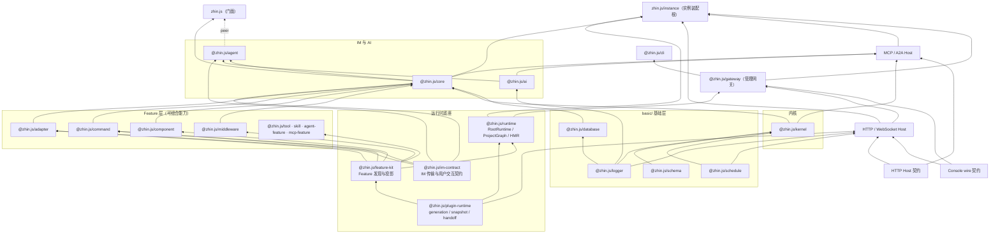
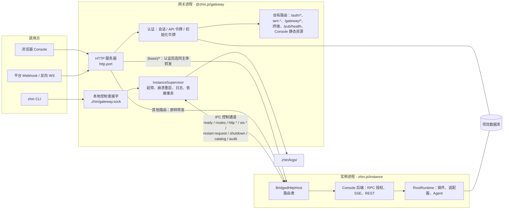

# 分层架构

Zhin.js 由几十个小包组成，但**写 Bot 和插件时，你几乎只需要安装和导入 `zhin.js`**。本页解释这些包怎样分层、为什么这样分，适合想理解内部原理或参与贡献的读者。

## 先记住三件事

1. **对外只有一个入口。** `zhin.js` 重新导出插件作者需要的 API：`definePlugin` 从 `zhin.js` 导入，`defineCommand` 等从 `zhin.js/command`、`zhin.js/middleware` 等子路径导入。
2. **AI 是可选的。** 默认安装只有 IM 核心（不到 10MB）；`@zhin.js/agent`、`@zhin.js/ai` 是可选依赖，通过 `zhin.js/agent`、`zhin.js/ai` 使用。
3. **依赖只能向下。** 上层包可以依赖下层，下层永远不知道上层的存在。这条规则由 `pnpm check:architecture` 在 CI 中强制检查，不是口头约定。

| 你要做的事 | 依赖哪里 |
| --- | --- |
| 写 Bot、普通插件 | 只依赖 `zhin.js` |
| 写 AI 工具 | 再加 `@zhin.js/tool`（`npx zhin setup --ai` 会处理） |
| 写一种新的能力类型（Feature） | 只依赖 `@zhin.js/feature-kit` / `@zhin.js/plugin-runtime`，不要依赖 `@zhin.js/core` |
| 给框架本身贡献代码 | 遵守下文的分层规则 |

## 分层总览



依赖关系以各包的 `package.json` 为准。从下往上读这张图：

底座是两个彼此独立的零依赖契约：`@zhin.js/plugin-runtime` 提供 generation、snapshot、dispose 与 token；`@zhin.js/im-contract`（含 `/interaction` 子路径）提供传输中立的身份、消息段、会话事件、投递语义与用户交互的请求及结论。往上一层，`@zhin.js/feature-kit` 只依赖运行时底座，提供 Feature provider 的注册、发现与投影机制。Feature 层各包（adapter / command / component / middleware / handler / tool / skill / …）只依赖这些底层契约，彼此不互相依赖。

再往上，`@zhin.js/core` 把 adapter / command / component / middleware 四个 Feature 和 kernel 组装成 IM 层（Plugin、Adapter、Endpoint、消息收发）。门面包 `zhin.js` 把核心包重新导出为统一入口——插件作者只需 `import { ... } from 'zhin.js'`。`@zhin.js/agent`、`@zhin.js/ai` 等是可选 peer 依赖，默认安装只含 IM 核心，AI 按需加装。

## Adapter、Endpoint 与单次消息

Plugin 正常注册 command、component、page、middleware 等能力，Adapter 只是其中的 IM Channel 能力。`Adapter<E, Config, Events>` 基类统一持有所属账号的 desired 状态、连接代次和操作租约；平台子类负责创建 SDK Endpoint 及平台特殊逻辑。`AdapterIndex` 提供目录与路由，不另建 Controller 或 Worker 管理账号。

平台 Endpoint 继承真实 SDK 或实质协议 Client，通过 `endpointSpec` 实现框架规范并保留原生 SDK API。`Endpoint` 是结构 interface；唯一构造入口是 `defineAdapter({ createAdapter })`，平台类型只注册到实际 `AdapterRegistry`，不保留旧基类、紧凑 create 或 Client token。

Core 从实际入站实例捕获单次操作 Session，提供 Adapter、Endpoint、场景、发言者、规范消息与原生事件。Command、Handler、Middleware 读取同一数据的作者绑定视图；平台类型通过开放注册表与 `adapter: 'icqq'` 推导。这个操作 Session 与持久化的个人 AI Session 分开。

账号的运行时配置加密持久化，账号停止/重连只取消目标实例的操作，Root generation 与其他账号保持运行。框架回复和群管端口持有具体 incarnation 租约，不能在停止后改用同名新连接。私有账号仓储只交给所属 Feature 的构建阶段，不进入公开 snapshot 或普通插件资源。详细合同与实施验收见[重构方案](https://github.com/zhinjs/zhin/blob/main/docs/plans/adapter-session-runtime-refactor.md)。

## 各层职责

| 层 | 包 | 职责 |
|----|----|------|
| 基础层 | `basic/logger` `schema` `schedule` `database`（亦由 `@zhin.js/kernel` 统一再导出） | 日志、配置校验、定时、数据库，零/近零依赖 |
| 运行时底座与 IM 契约 | `@zhin.js/plugin-runtime`（含 `/im-contract` 与 `/interaction`，用户从 `zhin.js` 导入） | generation 事务、快照租约、handoff、显式能力图（`definePluginCapabilityGraph`），以及 Endpoint、会话、消息段与结构化用户交互契约 |
| Feature 机制 | `@zhin.js/feature-kit` | 声明 Feature provider、按约定发现能力、投影成运行时索引 |
| 内核 | `@zhin.js/kernel` | 插件系统、错误体系与基础机制重导出，无 IM 概念 |
| Feature 层 | `@zhin.js/adapter` `command` `component` `middleware` … | 一类能力的契约（如 `defineAdapter`）+ 投影索引（如 `AdapterIndex`） |
| AI 引擎 | `@zhin.js/ai`（含 provider-auth 与 model-registry） | Provider、认证、模型注册表、agentLoop、会话、记忆，无 IM 概念 |
| Agent Harness | `@zhin.js/harness` | 多 Agent 协作微内核：Actor 串行信箱（Mailbox）、权限收窄（Authority）、守恒预算账本（BudgetLedger）、确定性准入（GuardKernel）、共享黑板（Blackboard）与唯一事件账本（`engagement_events` Journal） |
| IM 层 | `@zhin.js/core`（含 handler、actor 与 `@zhin.js/core/runtime` IM Host 安装器） | Plugin、消息入站脊柱（`inbound-spine`）、出站链路、命令分发、多 Bot 协作场所（Venue）及 Database/Outbound/Inbox Host 实现 |
| Agent | `@zhin.js/agent`（含 `@zhin.js/agent/runtime` Agent/Inference Host 运行时） | 统一信箱入站脊柱（`unified-mailbox-spine`）、多模型编排、协作工具、工具安全策略、MCP client |
| Console | `@zhin.js/console-protocol`（含 contract / review-kit）、`@zhin.js/pagemanager`、`@zhin.js/client` | Server-Driven Blueprints（`definePageBlueprint`）、多端投影（Web / IM Card / CLI TUI）、Console 外壳渲染（`renderConsoleShell`）与浏览器 SDK |
| 门面 | `zhin.js` | 再导出 core 创作面；`zhin.js/agent`、`zhin.js/ai` 子路径按需暴露 |
| 运行时 | `@zhin.js/runtime`（含 `/config-file`、`/isolate` 子路径） | `RootRuntime`：扫描项目图、组合配置、执行 generation 事务、HMR 及通用 Host 生命周期 |
| 装配 | `zhin.js/instance` | 实例装配根（ADR 0054 §0）：把各域 Host 装配成进程，并持有 HTTP/Protocol（MCP、A2A）/Speech/HTML-Renderer/Schedule 等通用 Host 安装器（`packages/im/zhin/src/instance/*-host-installer.ts`）与运行时侧 Console 后端 |
| 管理 | `@zhin.js/gateway`、`@zhin.js/cli` | 管理网关：HTTP 端口、Console 账号与权限、终端、项目配置与依赖事务、实例监管与日志；CLI 管理项目，经本地控制套接字与网关通信。两者都不依赖 `zhin.js` 与 IM 层（见[四个包、两个进程](#gateway-and-instance)） |

图展示主要依赖，完整依赖仍以各包的 `package.json` 为准。允许的分层边界由
`scripts/check-architecture-layers.mjs` 执行；新增依赖时同时核对文档与门禁，不能只修改其中一处。

## 四个包、两个进程 {#gateway-and-instance}

一个 Zhin 项目运行时由四个对外的包协作（[ADR 0054](../adr/0054-management-gateway.md)）：

| 包 | 是什么 | 依赖边界 |
| --- | --- | --- |
| `create-zhin-app` | 建项目：只问语言、项目名、初始化令牌（ADR 0053） | 只依赖 `@zhin.js/scaffold-wizard` |
| `@zhin.js/cli`（`zhin` 命令） | 管理项目：`start / stop / restart / status / logs`、`install / uninstall / update`、`console init / user`、`setup`、插件开发工具 | 依赖 `@zhin.js/gateway`，**不依赖 `zhin.js` 与 IM 层** |
| `@zhin.js/gateway` | 管理网关进程：HTTP 服务器、认证与权限、初始化与引导、实例监管、依赖事务、终端、日志、本地控制套接字 | 依赖 `host-http`、`database`、`console-protocol`、`runtime`（仅配置与项目文件工具）、`scaffold-wizard`；**不依赖 `zhin.js` 与 IM 层，不加载插件** |
| `zhin.js` | Zhin 实例：IM Runtime、插件、适配器、Agent；实例装配根 `zhin.js/instance` | 现有 IM 层；HTTP 只通过 `BridgedHttpHost`（`@zhin.js/host-http/bridge`） |

新项目依赖 `zhin.js`、`@zhin.js/gateway` 与 `@zhin.js/cli`。`pnpm check:architecture` 强制 CLI 与网关不导入 IM 层。



### 谁拥有什么 {#ownership}

| 职责 | 归属 | 说明 |
| --- | --- | --- |
| 对外端口（`http.port`、额外监听端口） | 网关 | 实例不监听任何端口，也不加载 `node:http` / `ws` |
| 认证（会话、API 令牌、初始化令牌） | 网关 | 实例不解析任何 Bearer 凭据，只接收随请求转发的主体 |
| 授权 | 两边 | 网关检查自有路由；实例的 Console RPC 分发点按 `CONSOLE_RPC_PERMISSIONS` 检查转发来的主体（只有它知道 RPC 类型与载荷里的作用域）。两边用同一份权限表 |
| `console_*` 表（用户、角色、会话、令牌、审计） | 网关 | 实例侧的拒绝与写操作经 `audit` 消息交给网关写入 |
| 业务数据 | 实例 | 插件、Journal、会话、用量等表 |
| 数据库连接 | 两边各一个 | 同一份 `database` 配置；SQLite 使用 WAL |
| 初始化、引导、终端 | 网关 | 实例崩溃时仍可用 |
| 依赖安装 / 卸载 / 升级 | 网关 | 停实例 → 包管理器 → 启实例，失败回滚 |
| 原始配置文件与 `.env` | 网关（实例离线时）/ 实例 | 写入都走同一条带修订号的原子路径 |
| 日志 | 网关 | 采集实例 stdout / stderr 到 `.zhin/logs/instance.log`（轮转）与内存环形缓冲 |
| 插件、适配器、Agent、定时任务、大部分 Console API | 实例 | 依赖运行时快照 |
| 插件自己的 HTTP / WS 路由 | 实例声明，网关承载 | Webhook、反向 WS 不经网关认证，由插件自己鉴权 |

网关与实例的 IPC 协议（消息类型、版本号）定义在 `@zhin.js/host-http/bridge`，两边共用；版本不兼容时网关拒绝该实例。网关按项目解析 `node_modules` 里的 `zhin.js/instance` 并以子进程拉起，不打包实例代码。只支持一个项目一个实例（内部以 `instanceId = 'default'` 表达）。

### 实例装配根：`zhin.js/instance` {#composition-root}

框架本身不"启动"任何东西——各层只提供机制。把机制组装成可运行实例的入口集中在 `zhin.js/instance`（`packages/im/zhin/src/instance/`），这是全仓库唯一允许跨层组合所有 IM 包的 composition root。IM 与 Agent 的领域 Host 实现在所属领域包（`@zhin.js/core/runtime`、`@zhin.js/agent/runtime` 与 `@zhin.js/pagemanager`）；HTTP、Protocol、Speech、HTML-Renderer 等通用 Host 的安装器在 `packages/im/zhin/src/instance/`。

实例启动时：

1. 用 `createConfigDocument`（`@zhin.js/runtime`）把唯一的 YAML/JSON Root 配置包装成带事务的 `ConfigDocumentPort`；
2. 创建 `RootRuntime`（`@zhin.js/runtime`），注入模块加载器、配置端口和 Root 资源安装器；
3. 通过 `installResources` 组装各域 Host 级资源：HTTP（`BridgedHttpHost`）/ Protocol / Speech / HTML-Renderer Host、Database / Outbound / Inbox / IM Host（`@zhin.js/core/runtime`）、Agent / Inference Host（`@zhin.js/agent/runtime`）、Console 外壳与 Blueprint 路由（`@zhin.js/pagemanager`）；
4. 首代 generation 提交后向网关发送 `ready`（携带协议版本与路由表），之后挂上 `HmrCoordinator`：文件变更触发 generation 重载，需要整进程重启时发 `restart-request`。

`zhin.js/instance` 没有控制通道时拒绝启动；`zhin start --standalone` 只用于开发与测试，此时实例在本进程内自带 Node HTTP 服务器并装配登录与终端。

用户项目的入口因此可以极小。脚手架生成的 `package.json`（节选，依赖略去；运行时依赖 `zhin.js`，开发依赖 `@zhin.js/cli`，后者带上 `@zhin.js/gateway`）：

```json
{
  "type": "module",
  "scripts": {
    "dev": "zhin start --foreground --watch source config",
    "start": "zhin start --foreground --mode production --no-watch",
    "stop": "zhin stop"
  },
  "zhin": {
    "protocol": 1,
    "type": "plugin",
    "entry": "./plugin.ts",
    "engine": "^1.0.0",
    "runtime": "trusted",
    "features": [],
    "plugins": []
  }
}
```

项目本身就是一个插件（Root Plugin），由网关拉起的实例发现并启动它。启动命令的完整说明见 [zhin start](../cli/runtime.md)，插件清单字段见 [插件模型](./plugin-model.md)，配置的声明与校验见 [配置即数据](./config-as-data.md)。

## 分层规则的推论

写 Feature（新能力类型）时只依赖 `feature-kit` / `plugin-runtime`，不要 import `core`。
`kernel`、`ai` 不知道群、私聊这些 IM 概念。`im-contract` 定义 IM 契约，Adapter 和 Core 消费这些契约。
Host 均由实例装配根 `zhin.js/instance` 装配，但不属于同一依赖层：HTTP / WebSocket Host 只依赖基础服务、
Plugin Runtime、HTTP 契约和 Console wire 契约，不依赖 Core 或 Agent；MCP / A2A Host
可以消费 Core、AI 与 Kernel，通过 HTTP 契约接入路由，不依赖具体 HTTP Host 实现。
插件不直接依赖 Host 进程。

`@zhin.js/harness` 仅依赖基础契约与内核，不感知具体 IM 平台或 LLM 实现；`@zhin.js/core` 的 `venue/` 模块负责多 Bot 群聊场所的路由与投影，`@zhin.js/agent` 将本地与跨实例（`@zhin.js/a2a`）Actor 协作统一接入 Harness；该单向依赖边界由 `pnpm check:architecture` 强制检查。

## JSX 与展示组件

`@zhin.js/jsx` 提供惰性 JSX tree 与 HTML serializer，仅依赖基础 `im-contract` 的类型。Core 默认把 JSX 排版成有序 Segment；只有 `<html>` / `<Html>` 子树转为 `segment.html`。小写原生标签具有类型提示且无需导入，注册组件可按名字作为标签使用；`zhin.js/jsx` 是作者门面。可选 `@zhin.js/components` 使用 JSX 基础包及 Markdown／代码高亮依赖，展示位接受 `JSXRenderable`，不依赖 Core、React 或图片引擎。图片工具只消费 HTML，平台差异由 Adapter 声明策略承接。

```tsx
// 1. 原生消息段 JSX（自动降级为各平台原生卡片/按钮或文本菜单）
<card title="构建结果">
  <text>全部测试已通过</text>
  <button onClick={async () => '已触发发布'}>发布到生产</button>
</card>

// 2. HTML 子树（经 @zhin.js/html-renderer 渲染为高清图片段发出）
<html>
  <div style={{ padding: '24px', background: '#0f172a', color: '#f8fafc' }}>状态看板</div>
</html>
```

可选 `@zhin.js/tailwind` 使用官方 Tailwind 编译器将静态工具类转换为内联样式，输出可用于 JSX、组件局部样式和共享主题。它不依赖 Core、组件库或渲染引擎；JSX 基础包也不加载它。图片渲染统一由可选 `@zhin.js/html-renderer` 使用 `@pixel.js/shotium` 完成，不再维护 Satori 图片工具包。
