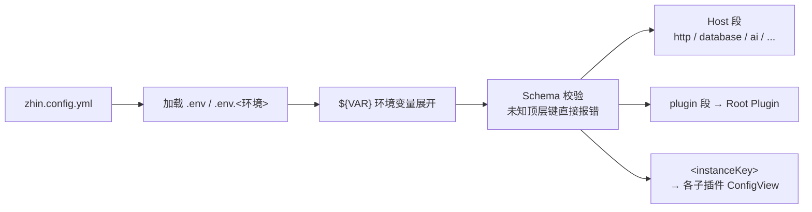

# 配置参考

语言与个人偏好见[语言与本地化](./localization.md)。

本页是 `zhin.config.yml` 的完整参考。第一次配置时，先运行 `npx zhin setup` 生成一份能启动的配置，再回来查需要改的字段。

## 最常见的修改

| 我想…… | 看这里 |
| --- | --- |
| 换 HTTP 端口、让外网访问 Console | [http](#http) |
| 接入数据库 | [database](#database) |
| 给插件或适配器填配置、填平台凭据 | [plugin 与 plugins](#plugin-与-plugins) |
| 一个适配器登录多个账号 | [endpoints 数组](#endpoints-数组-一个实例挂多个账号) |
| 设置命令前缀 | [适配器实例](#适配器实例-commandprefix) |
| 配置 AI 模型 | [ai](#ai)，或直接看 [AI 总览](../ai/index.md) |
| 引用 `.env` 里的密钥 | [环境变量展开](#环境变量展开) |
| 修改配置后按需生效 | [修改后如何生效](#修改后如何生效) |
| 看一份完整的最小配置 | [最小配置](#最小配置) |

## 配置文件的位置

启动时（`zhin start`）实例会在项目根目录找配置文件，按下面的顺序找到第一个就停；同时存在多个则直接报错，不会帮你猜：

1. `config.yml`
2. `config.yaml`
3. `config.json`
4. `zhin.config.yml`
5. `zhin.config.yaml`
6. `zhin.config.json`

建议统一用 `zhin.config.yml`，本文的示例都以它为准。

需要逐字段核对类型、必填项、默认值与插件 Schema 时，请使用[自动生成配置字段参考](./generated)。该页面由 Runtime 源码与插件的单一配置声明（`config: Schema.object(...)` 或 `schema.json`）生成，并由 CI 阻止漂移。

## 这份参考怎么用

提交前运行 `npx zhin doctor` 检查。启动后以 Console 显示的实际运行状态为准——配置文件写了什么，不等于已经生效了什么（例如新配置校验失败时，运行中的仍是旧配置）。

| 你要改变什么 | 应该放在哪里 |
| --- | --- |
| 安装哪些插件与 Feature | `package.json#zhin` 与依赖 |
| Host、插件实例与 AI 参数 | `zhin.config.yml` |
| 密钥与环境差异 | `.env` / `.env.<环境>`，由 `${VAR}` 引用 |
| 多 Bot 协作场所（Venue） | `zhin.config.yml` 的 `ai.venues` |
| Agent 之间能联系谁、协作预算上限 | `agents/<name>/agent.json` 的 `collaboration` |
| 当前运行时到底发布了什么 | Console 的 Endpoint、能力目录与 generation 状态 |

主配置使用 `configVersion: 2`。先安装依赖，再在 `plugins` 映射实例名与包，业务参数放在顶层同名块；`disable_plugins` 列出停用实例（可用 `zhin disable` / `zhin enable` 或 Console 的全局开关修改；运行中由网关停启实例、失败回滚，需要 `plugin.manage`）。Feature 需求仍在 `package.json#zhin.features`。旧配置请先阅读[迁移指南](../migrations/plugin-instance-declarations.md)。

## 加载与校验流程



配置文件会经过 JSON Schema 校验，**顶层只允许下文列出的键**。键名写错会在启动时报 `Invalid Plugin config in zhin.config.yml`。

Host 键由实例装配层（`zhin.js/instance`）与管理网关消费；每个插件只收到顶层同名块的业务值，不会收到其他实例的配置。

## 修改后如何生效

`zhin start` **只有显式传入 `--watch` 才监听变化**。不传时，编辑文件不会自动应用；已有开发脚本若需要热更新，应显式选择范围：

```bash
npx zhin start --foreground --watch source config  # 源码与配置
npx zhin start --foreground --watch config         # 仅配置
npx zhin start --foreground --watch source         # 仅源码
npx zhin start --foreground --mode production      # 均不监听
```

`--no-watch` 保留为均不监听的兼容入口，不能与 `--watch` 同用。源码监听不代替配置监听；源码重载也不会顺带应用尚待重启的配置。

**保存成功不等于全部生效。** Console 配置表单保存后会请求应用，并分别显示文件修订与各项生效结果。关闭监听时，仍可在新版 Console 的运行生效状态面板点击“应用已保存配置”：它只应用当前已保存版本，不保存未提交的表单草稿，也不重启进程。旧 Host 未提供生效明细时，Console 会明确提示无法确认。

| 修改内容 | 生效边界 |
| --- | --- |
| 仅修改已声明资料原地更新能力的适配器的 `nickname` / `profile` 配置兜底 | 新资料读取使用新兜底，保留连接；不调用平台资料写入。已观察到的平台昵称仍优先 |
| 在模型管理中修改 Profile／用途选择 | 领域事务独立持久化，下一操作读取新图；在途操作保持原图、模型与租约，不属于文件应用分组 |
| HTTP 监听、数据库连接、`.env` 输入、YAML 中的账号角色等启动依赖 | 未支持安全替换的部分显示待进程重启，当前继续使用旧值 |
| 其他插件配置 | 沿所属插件的现有局部重载；未声明更新能力不视为原地更新 |

同次文件保存可以部分生效。例如同时修改账号兜底昵称和 HTTP 端口，昵称在满足条件时生效，端口仍待重启。模型图更新有独立的领域修订和提交回执，文件保存／应用不修改模型图、凭据或个人绑定。完整候选配置校验失败时保留当前运行。失败、结果未确认和被较新修订替代分别显示；结果未确认时先只读刷新核对，不重复提交。

Agent 安装、角色权限和其他未声明可替换的启动依赖保留待重启边界。Profile 的模型／参数修改下一回合生效；旧选择不因同名资源删除重建而继承账号身份。插件推理通过本次 operation 的 InferenceClient 取得，不能长期保存 SDK/provider 实例。

### 在聊天中管理配置

安装根 Command Feature 后，Bot 主人可以在与 Bot 的**私聊**中使用 `config`（中文别名 `配置`）查看用法。子命令只有四个：

- `config fields [范围]`：列出聊天可管理的字段路径和类型，不含值；
- `config get <路径>`：读取一个字段的当前保存值；
- `config set <路径> <值>`：修改一个字段；
- `config unset <路径>`：删除一个可选字段。

提示会自动带上当前账号的实际命令前缀和 namespace，无需 AI Agent。

**谁能用**：只有在接收这条私聊的同一适配器（同一平台实例）上拥有聊天角色 `owner` 的人——全局、适配器层或该适配器任一账号上的 `owner`（[聊天角色](../concepts/chat-roles.md)）；身份按适配器登记，其他适配器（包括同一适配器包的另一个插件实例）的主人不能使用。群聊、频道和伪造的 metadata 都不能进入保存流程。

**入口按适配器，字段范围按项目**：授权（入口）只看接收消息的同一适配器实例上的主人；一旦通过，可管理的字段范围是**整个项目**中所有聊天安全的叶子字段加上 Host 白名单 `HOST_CONFIG_PATCH_PATHS`，并不局限于授权适配器所属的插件——即任一合法主人可管理全局的聊天安全字段（包括其他插件的字段）。若不希望某个主人改动其他插件，请勿在聊天中授予其主人身份，或改用 CLI/Console 管理。

**能改什么**：

- Host 段只开放与 Console 普通页面相同的白名单（`HOST_CONFIG_PATCH_PATHS`，目前只有 `ai.trigger.ambient` 下的字段）；`locale`、`http`、`database` 等其余 Host 配置请用 CLI 或 Console。
- 插件段需要 Schema 能证明安全：密钥、token、密码等敏感字段、缺少 Schema 或无法判断范围的字段一律拒绝。
- 主人、信任名单、审批与工具门槛等权限字段（如 `master`、`trusted`、`roles`、`endpoints[*].roles`、`toolHardGate.*`；人员名单本身已移入数据库，见[升级到聊天角色](../migrations/chat-roles.md)）不能通过聊天读写。按包含/前后缀匹配，复合名同样拒绝，例如 `adminIds`、`ownerId`、`masterId`、`trustedUsers`、`superUsers`、`whitelist`/`allowlist`/`blacklist`、`bypass`（如 content-moderation 的 `inbound.whitelist.userIds`、`inbound.bypass`）；该规则偏保守，名称中含这些词的普通字段（如 `masterVolume`）也请用 CLI 修改。
- `endpoints[*].id` / `endpoints[*].name` 用于绑定账号级主人与信任名单，属于间接的权限变更，不能通过聊天修改；`set`/`unset` 只能作用于 `config fields <根>` 列出的字段。
- `set` 的新值不能包含 `${…}` 或 `env://` 环境变量引用（无论变量名是否像密钥），以免之后读取或回显时泄露环境值；已有引用不受其他操作影响。
- 只能读写**单个叶子字段**（标量或标量数组），不能整体覆盖或删除对象；必填字段不能 `unset`。`configVersion`、`plugins`、`disable_plugins`、根 `plugin` 和未声明实例同样不能修改。

路径可写 `mybot.nickname`，也可写 JSON Pointer，例如 `/mybot/dot.key`（`~1` 表示 `/`，`~0` 表示 `~`）。值按字段类型解析：数字、布尔和数组用 JSON 写法；字符串字段可以直接写文本，例如 `config set mybot.nickname -- 小智`（这里省略实际前缀）。不接受对象值。

保存沿用上文的完整候选校验和按组应用。保存前失败会明确提示未保存；提交确认丢失时提示结果未确认，请勿重复发送，先用 `get` 核对，指令层不会自动重试或回滚。拒绝回执只给原因，不回显任何值、默认值或原始异常。

### 文件与数据库记录各管什么

一条配置放哪，看谁改、什么时候改、条目有多少（[ADR 0057](../adr/0057-config-storage.md)）：

| 存放处 | 放什么 | 谁写 |
|---|---|---|
| `zhin.config.yml` | **声明**：部署时定下、随代码进 git 评审、改了要重载或重启——插件实例与插件配置、`disable_plugins`、主机基础设施（`http`、`database` 连接、`console`、`gateway`、`mcp`、`a2a`、`log_level`、`locale`）、`ai.*` 行为与安全策略、功能的全局默认值与 `features.selfService` | 人：手改、CLI、Console 配置表单（都经网关配置事务） |
| 数据库 | **运行时状态**：聊天角色、账号与凭据、模型目录、适配器 / 账号 / 会话三级功能覆盖（表 `feature_overrides`）、控制面开关、定时任务、消息 / 会话 / 记忆、插件状态 | Console RPC、聊天命令、AI 工具、插件 |
| `.env` | **密钥与环境差异**：yml 里只写 `${VAR}` 引用 | 人、`zhin doctor --fix`、网关 |
| `.zhin/` | **本机运行文件**：socket、锁、日志、缓存、引导进度、加密钥匙；网关的 Console 账号存储 `gateway.db`（账号、会话、API 令牌、审计，[ADR 0059](../adr/0059-gateway-storage-isolation.md)）。`keys/` 与 `gateway.db` 必须持久化并备份 | 运行时、网关 |

**密钥字段**：Schema 用 `x-zhin-secret: true` 标注（主机 Schema 的 `http.token`、`database.password`、`mcp.token`、`a2a.token` 等已标注；插件用 `Schema.string().secret()` 生成）；没有标注时按字段名兜底（`token`、`password`、`secret`、`apiKey`、`privateKey` 及 `*Token`、`*Secret` 等）。启动时若发现这些字段是字面值而不是 `${…}` 引用，会打一条警告，只列路径、不打印值。`zhin doctor` 同样报告；`zhin doctor --fix` 把每个字面值写进 `.env`（变量名 `ZHIN_<路径大写下划线>`，如 `ZHIN_HTTP_TOKEN`；同名已有相同值时直接复用，值不同时追加 `_2`、`_3`），再把 yml 里的值换成 `${变量名}`。yml 经配置文件事务写入（修订号检查、文件锁、原子替换），`.env` 同样加锁、临时文件 + fsync + rename 原子写，并保留原文件权限（新文件为 `0600`）。网关运行时也直接改这两个文件（与 `zhin doctor` 其他修复一致，同一把锁防止并发覆盖）；实例在下次加载配置时读到新的引用。

**功能覆盖**：功能的全局默认值就是 yml 里插件自己的配置块，全局开关是 `disable_plugins`；适配器、账号、会话三级覆盖都存在项目数据库表 `feature_overrides`，由 Console 功能页或聊天命令「功能 设置 / 开启 / 关闭」写入，立即生效、不重启。yml 里不再接受插件块下的 `overrides`：旧项目首次启动时自动导入数据库，再从 yml 删除（原文件先备份到 `.zhin/backups/`），之后再写会在启动时报错，见[升级：功能覆盖迁入数据库](../migrations/feature-overrides.md)。数据库是 MongoDB、Redis 或内存方言时无法保存这些覆盖，写入会被拒绝。

**仍在迁移中**（ADR 0057 后续步骤，目前行为不变）：

- 插件块里的 `endpoints[]` 与项目的 `ai.plan.yml` 仍是首次启动导入数据库的种子：已导入后，YAML 中的账号种子不会改写已经存在的受管账号记录，适配器资料默认值仍能作用于继承它的账号；两边不一致时启动日志与 Console「需要你处理」会提示，可逐个导入或写回，见[配置文件账号与已保存账号](#endpoints-drift)；
- 永久批准仍在 `data/owner-approve-always.json`；
- 加密钥匙仍在 `.zhin/inference/`、`.zhin/endpoint-credentials/`，尚无 `zhin backup`——备份数据库时请一并保存 `.zhin/` 中的钥匙，否则无法解密凭据。

文件热更新不覆盖数据库里的显式领域记录，也不清空个人会话选择。

## 环境变量展开

字符串值中的 `${VAR}`、`${VAR:-default}`、`${VAR:=default}` 会被展开：

```yaml
http:
  token: ${HTTP_TOKEN:-dev-token}   # 未设置 HTTP_TOKEN 时回退为 dev-token
```

变量未设置且没有默认值时会展开为空字符串。对 `apiKey` 等字段，这会触发 AI provider 的 soft-prune。

dotenv 按 `.env` → `.env.<环境>` 加载。环境名由 `--environment` 指定，默认 `development`。密钥一律走环境变量，不要硬编码进配置文件。

## 顶层键

| 键 | 类型 | 说明 |
| --- | --- | --- |
| `log_level` | string \| number | 日志级别（如 `info`、`debug`）；`ZHIN_LOG_LEVEL` / `LOG_LEVEL` 环境变量可临时覆盖 |
| `http` | object | HTTP Host（Console / API 入口） |
| `database` | object | 数据库 |
| `speech` | object | 语音 STT/TTS（需安装 `@zhin.js/speech`） |
| `assistant` | object | Assistant Runtime（调度任务 / 事件 API） |
| `ai` | object | AI 栈（需安装 `@zhin.js/agent` 等，见下文） |
| `mcp` | object | MCP Host（把 bot 工具暴露为 MCP Server） |
| `a2a` | object | A2A Host（Agent Card / 远程 Agent 互调） |
| `htmlRenderer` | object | Shotium HTML 渲染（如 `width` / `viewport` / `scale`） |
| `menuKeyword` | string \| false | 内置菜单关键词；默认 `菜单`，`false` 或空字符串关闭 |
| `menuStyle` | object | 菜单标题、副标题、强调色与背景图；渲染能力可用时生效 |
| `commandSuggestion` | boolean \| object | 未命中但与指令名相似时回复「你是不是想用」；`false` 关闭，可设 `maxDistance` / `limit` |
| `plugin` | object | Root Plugin（应用自身）的配置 |
| `configVersion` | number | 必须为 2 |
| `plugins` | object | 实例名到插件包的映射 |
| `disable_plugins` | string[] | 停用实例名，配置仍保留 |
| `<instanceKey>` | object | 已声明实例的业务配置 |

## http

```yaml
http:
  port: 8068                 # 未配置时的默认值；只接受 1–65535 的整数或 ${VAR} 引用
  host: 127.0.0.1            # 默认 127.0.0.1
  token: ${HTTP_TOKEN}       # 初始化令牌：只用于创建第一个 Console 所有者，之后失效
  corsOrigins:               # 允许的跨域来源
    - "https://console.zhin.dev"
  base: /api                 # API 挂载路径
```

未配置 `http.port` 时网关监听 8068，与脚手架写入的值一致（1.x 早期版本的运行时默认是 8086，已写入端口的项目不受影响）。`http.port` 只接受 1–65535 的整数，或展开后为该范围整数的 `${VAR}` 引用（`0` 表示由系统分配空闲端口，用于测试）；其他值在 `zhin config set`、Console 保存和 `zhin config check` 时都会被拒绝，启动时报错退出，不会悄悄换成默认端口。

`token` 未设置时本地开发可直接访问；生产环境务必设置。`tokens` 支持按作用域配置多枚令牌。

## database

推荐让 CLI 同时生成配置引用和 `.env` 连接参数：

```bash
npx zhin setup --database
npx zhin config check
```

`setup` 会把非敏感结构写入 `zhin.config.yml`，把实际连接值写入项目根目录 `.env`。Runtime
先读取 `.env`，再用所选环境的 `.env.<environment>` 覆盖同名变量；例如生产启动使用
`zhin start --mode production` 默认读取 `.env.production`；显式传入
`--environment <name>` 可选择其他环境覆盖层。

### SQLite

```yaml
database:
  dialect: sqlite            # 默认 sqlite
  filename: ./data/bot.db
```

完全不写 `database` 时，默认使用 `<项目根>/.zhin/data.sqlite`。SQLite 使用 Node 内置驱动，不需要连接环境变量。

### PostgreSQL

配置中的方言名是 `pg`（不是 `postgres`）：

```yaml
database:
  dialect: pg
  host: ${DB_HOST}
  port: ${DB_PORT}
  user: ${DB_USER}
  password: ${DB_PASSWORD}
  database: ${DB_DATABASE}
```

```dotenv
DB_HOST=127.0.0.1
DB_PORT=5432
DB_USER=postgres
DB_PASSWORD=change-me
DB_DATABASE=zhin_bot
```

`DB_PORT` 只写端口数字，不要写 `http://`、主机名或 `host:port`。目标数据库 `DB_DATABASE`
必须已经创建，并允许 `DB_USER` 从 Bot 所在机器连接。在容器中运行 Bot 时，`127.0.0.1`
指向容器自身，应改成 PostgreSQL 服务名或宿主机可访问地址。

### Console SQL 的受限账号（`database.console`） {#database-console}

PostgreSQL / MySQL 上，Console 数据库页的 SQL 控制台只用单独登录的受限账号执行（[ADR 0059](../adr/0059-gateway-storage-isolation.md)）。用 CLI 创建：

```bash
npx zhin db console-role            # 用主账号建号；无建号权限时加 --print-sql 交给 DBA
```

它把随机密码写进 `.env`，并在配置里写入引用：

```yaml
database:
  dialect: pg
  # …主账号连接字段…
  console:
    user: ${ZHIN_DB_CONSOLE_USER}
    password: ${ZHIN_DB_CONSOLE_PASSWORD}
```

- 只有 `user` 与 `password` 两个字段，交给驱动前从主连接剥离；`user` 不能与主账号相同。两个变量都没设置时视为未配置（SQL 控制台关闭，其余照常）。
- 实例启动时探测这个账号的权限，不合格时 SQL 控制台关闭并在页面上说明原因（`capabilities.sqlReason`）；实例启动时**不会**自动建号。
- SQLite、MongoDB、Redis、内存方言忽略这个块。SQLite 的实例连接总是拒绝 `ATTACH`（不能配置）。
- Console 账号本身不在项目数据库里，而在 `.zhin/gateway.db`，见[升级说明](../migrations/gateway-storage.md)。

### 其他方言

CLI 的数据库选择项会同时显示当前支持的服务端实机验收版本与生成项目使用的驱动版本：

| 方言 | 当前支持（实机验收版本） | 生成的驱动依赖 |
| --- | --- | --- |
| `sqlite` | Node.js 内置 `node:sqlite`（Node.js 22.5+） | 无 |
| `mysql` | MySQL 8.4 LTS | `mysql2 ^3.23.2` |
| `pg` | PostgreSQL 17 | `pg ^8.22.0` |
| `mongodb` | MongoDB 7 | `mongodb ^7.5.0` |
| `redis` | Redis 8 | `redis ^6.1.0` |
| `memory` | Zhin 内置实现 | 无 |

“实机验收基线”表示维护测试覆盖的明确版本，不表示驱动只能连接这一版服务端；更宽的兼容范围由对应驱动和数据库服务端协议共同决定。

| 方言 | 配置字段 | CLI 生成的环境变量 |
| --- | --- | --- |
| `mysql` | `host`、`port`、`user`、`password`、`database` | `DB_HOST`、`DB_PORT`（默认 `3306`）、`DB_USER`、`DB_PASSWORD`、`DB_DATABASE` |
| `mongodb` | `url`、`dbName` | `DB_URL`（如 `mongodb://127.0.0.1:27017`）、`DB_NAME` |
| `redis` | `socket.host`、`socket.port`、`password`、`database` | `REDIS_HOST`、`REDIS_PORT`（默认 `6379`）、`REDIS_PASSWORD`、`REDIS_DB` |
| `memory` | 无 | 无 |

网络数据库对应的驱动依赖分别是 `mysql2`、`pg`、`mongodb`、`redis`；通过创建项目或
`zhin setup --database` 选择数据库时，CLI 会按上表把经过验收的驱动版本写入 `package.json`。
`create-zhin-app` 会自动安装依赖；`zhin setup` 会提示你随后手动运行 `pnpm install`。

启动前运行 `npx zhin config check`；若连接值只在 `.env.production`，请运行
`npx zhin config check --environment production`。数据库环境变量缺失会作为错误报告；端口为空、非整数或超出
`1-65535` 时，Runtime 会在加载驱动前指出具体配置路径和 `.env` 变量。若旧版本出现
`ERR_SOCKET_BAD_PORT` / `Received type number (NaN)`，通常是 `${DB_PORT}` 未在项目根目录 `.env`
中设置；补齐变量或重新运行 `npx zhin setup --database`。

## speech

```yaml
speech:
  stt: { provider: openai, model: whisper-1, apiKey: ${OPENAI_API_KEY} }
  tts: { provider: edge, voice: zh-CN-XiaoxiaoNeural }
```

配置后启用语音管道，并向 Agent 暴露 `voice_stt` / `voice_tts` 工具。`@zhin.js/speech` 是 optional peer，需自行安装。

## assistant

```yaml
assistant:
  enabled: true                    # 启用统一 JobStore，默认 false
  profile:
    enabled: true
    file: assistant.profile.yml    # profile 文件，驱动调度任务
  events:
    enabled: true                  # 开放 POST /api/assistant/events
    rateLimitPerMinute: 60         # 默认 60
  defaults:
    notifyOnFailure: false         # Job 失败时是否通知，默认 false
```

其余子键：`queue`（Schedule execution 的并发/重试/超时）。任务事实持久化在数据库中（未配置关系型数据库时回退到 `schedule-jobs.json`），可在 Bot 运行时用 [`zhin schedule`](../cli/index.md#schedule-持久化调度任务) 管理。

## mcp / a2a {#mcp-a2a}

```yaml
mcp:
  enabled: true
  path: /mcp
  token: ${MCP_TOKEN}                   # MCP 协议令牌；不回退 http.token
  allowUnauthenticatedLocalhost: false  # 生产建议 false

a2a:
  enabled: true
  path: /a2a
  token: ${A2A_TOKEN}                   # A2A 协议令牌；不回退 http.token
```

两段都挂在 HTTP Host 上，按需启用；未配置时对应 SDK 不会被加载。

**鉴权**：Bearer 只接受两种凭据——

- 协议令牌 `mcp.token` / `a2a.token`；
- Console API 令牌：给账号（或其角色）授予**全局**权限 `mcp.access` / `a2a.access` 后签发，见[访问控制 · API 令牌](../console/access-control.md#api-tokens)。令牌的权限不超过签发账号，账号禁用或令牌吊销后立即失效。

`http.token` 是初始化令牌，只在创建首个所有者之前有效（那时它也能通过 MCP / A2A），之后处处拒绝，不能当作协议凭据。非生产环境下：A2A 未配置 `a2a.token` 时只放行本机回环请求；MCP 默认放行本机请求，设 `allowUnauthenticatedLocalhost: false` 关闭。生产环境一律要求 Bearer。

跨进程的 Agent 协作通过 `a2a.mailbox` 传输（ADR 0048）：Mail 连同 Authority 与预算一起签名传递，远端不能放大权限或超出划拨的预算。

```yaml
a2a:
  enabled: true
  mailbox:
    enabled: true
    path: /a2a/mailbox                  # 入站路由，默认 /a2a/mailbox
    secret: ${A2A_MAILBOX_SECRET}       # 签名密钥；生产环境必须配置
    peers:
      - actor: remote-reviewer          # 本地 Agent 的 contacts 里写这个名字
        url: https://agents.example.com/a2a/mailbox
        secret: ${A2A_MAILBOX_SECRET}   # 可选，覆盖全局 secret
```

`a2a.workroomCallbacks` 与 `a2a.workroomRemoteExecutors` 已随 ADR 0048 删除，启动时遇到会直接报错。字段清单见[配置字段（自动生成）](./generated.md)。

## ai

`ai` 只保存 Agent 启动行为与工具权限。模型资源由 Console 的模型管理或显式 plan 导入维护，持久化到 inference 数据库；空模型图仍可启动管理界面，缺少所需 Profile 时推理明确报未配置。

### providers：模型资源改由运行时管理

启动文件不再接受 `ai.providers`、`modelCatalog`、`modelPolicy`、`decisions` 或 Agent 的 `provider/model/preset` 选择器。Service 描述服务协议，Account 保存认证方式与私有凭据引用，Profile 选择模型与参数；chat、summary、ambient、image、perception 和决策用途引用 Profile。个人 Session 可单独选择已授权的语言 Profile。

项目根目录的 `ai.plan.yml` 只在模型数据库为空时自动导入一次作为初始配置；之后它是显式 review/apply/export 的输入，不会覆盖已有设置，也不放在 `zhin.config.yml` 的 `ai.plan` 下。升级步骤、备份和恢复边界见[模型接口升级](../ai/provider-upgrade.md)。

### agents：角色与工具权限 {#ai-agents}

```yaml
ai:
  enabled: true
  agents:
    zhin:
      mcpServers: [icqq]             # 引用 ai.mcpServers 的 name
    researcher:
      nickname: '搜搜'               # 任务角色显示名；IM 资料优先取当前 Endpoint
```

| 字段 | 说明 |
| --- | --- |
| `nickname` | 任务角色显示名；当前账号资料仍由 Endpoint 提供 |
| `mcpServers` | 该 Agent 可见的 MCP Server 名列表 |

模型角色绑定在运行时用途配置中管理。IM 消息总是交给 `zhin`。`priority` / `match` 已弃用（从未生效），`zhin config check --fix` 会删除。

### mcpServers：外部 MCP Server

```yaml
ai:
  mcpServers:
    - name: icqq
      transport: streamable-http     # stdio | streamable-http | sse
      url: ${ICQQ_MCP_URL}
      headers:
        Authorization: Bearer ${ICQQ_MCP_TOKEN}
    - name: local-tools
      transport: stdio
      command: npx
      args: ["-y", "some-mcp-server"]
      env: { FOO: bar }
```

连接成功后，这些 Server 的工具进入 Agent 工具池（按 `agents.<name>.mcpServers` 分配）。

### 其余 ai 子段

```yaml
ai:
  sessions:                # 会话存储
    maxHistory: 200        # 数据库模式默认 200，内存模式默认 100
    expireMs: 604800000    # 数据库模式默认 7 天，内存模式默认 24h
    useDatabase: true      # 默认 true；使用 Database Root Host（未写 database 时为 .zhin/data.sqlite）
  context:                 # 群聊上下文记录
    enabled: true
    maxRecentMessages: 100
    summaryThreshold: 50
    keepAfterSummary: 10
    maxContextTokens: 4000
  memory:                  # 三层 Markdown 文件记忆，默认启用
    semantic:
      enabled: true        # 语义记忆：generation-owned memory_search/memory_upsert；要求 Database Host
      autoConsolidate: false
      recall:              # 每轮 BM25 召回，默认开启
        topK: 5
        maxTokens: 400
    # 启用后 memory_entries 必须在候选代激活时可用，否则该代 fail-closed、不发布
    # memoryMcp 已弃用；语义记忆由上述原生 memory_search / memory_upsert 提供
  access:                  # AI 访问控制
    mode: open             # open | closed | whitelist，默认 open
    users: []              # whitelist 模式下允许的用户 id
    groups: []
    denyMessage: ...
  agent:                   # 工具执行安全
    mailbox:
      groupMode: supersede # supersede（默认）| fifo
    execSecurity: allowlist    # deny | allowlist | full
    execPreset: readonly       # readonly | network | development | custom
    execAllowlist: ["^ls ", "^cat "]
    maxIterations: 15          # 单回合最大工具迭代轮次，默认 15
    thinkingPreview: false     # Activity 反馈展示 LLM 实际 thinking 内容（截断），而非静态 "思考中..."，默认 false
    thinkingPreviewMaxLength: 200  # thinkingPreview 展示的最大字符数，默认 200
  trigger:                 # AI 触发规则
    prefixes: ["ai:"]          # 触发前缀，默认 ['#', 'AI:', 'ai:']
    respondToAt: true          # 响应 @机器人，默认 true
    respondToPrivate: true     # 私聊免前缀直达，默认 true
    ignorePrefixes: ['/', '!', '！']  # 避免与命令冲突
    timeout: 60000
```

`ai.multimodal` 管理多模态入出站；主模型不能看图时可用 模型管理中的 perception 用途让另一个 Profile 先描述图片，见 [AI · ai.multimodal.perception](../ai/index.md#ai-multimodal-perception)。仅在显式配置 `ai.knowledge.baseDir` 时发布 `knowledge_search`；该目录必须位于项目根目录内。

`ai.remoteAgents`、`ai.workroom` / `ai.workrooms` 已随 ADR 0048 删除，启动时遇到会直接报错。远程 Agent 改在 `a2a.mailbox.peers` 声明；多 Bot 共享的群或频道改在 `ai.venues` 声明；Agent 之间能联系谁、单次协作预算上限写在 `agents/<name>/agent.json` 的 `collaboration`。用法见[多 Agent 协作与场所](../ai/multi-agent-harness.md)。

## plugin 与 plugins

```yaml
configVersion: 2
# Root Plugin（应用自身）的配置，键由应用的 config schema 决定
plugin:
  terminal:
    interactive: true

# 子插件配置，键为 instanceKey
plugins:
  sandbox: "@zhin.js/adapter-sandbox"
sandbox:
  endpoints:
    - id: sandbox-bot
      owner: sandbox-user
```

`instanceKey` 默认取包名最后一段，并移除 `adapter-` / `plugin-` / `service-` 前缀。例如 `@zhin.js/adapter-icqq` → `icqq`。

`zhin install` 将包引用写入 `plugins.<instanceKey>`，业务参数写入顶层 `<instanceKey>`；不再写入包清单的旧挂载数组。

### 适配器实例：commandPrefix

平台适配器插件的实例配置支持通用键：

| 键 | 位置 | 说明 |
| --- | --- | --- |
| `commandPrefix` | 实例顶层 / endpoints 逐项 | 命令前缀，默认 `''`；endpoints 逐项的值覆盖顶层 |

主人（`owner`）与受信任用户（`trusted`）不再写在配置里：用 Console 对象页的「角色」页签或聊天 `角色 授予` 管理；旧的 `master` / `trusted` 首次启动时自动迁入数据库，见[升级到聊天角色](../migrations/chat-roles.md)。平台身份不映射为 zhin 角色，`roles`（映射规则）已删除，出现时启动报错（见[升级到聊天角色](../migrations/chat-roles.md#mappings)）。

### endpoints 数组：一个实例挂多个账号

多账号适配器用 `endpoints` 数组声明多个 Endpoint：

```yaml
configVersion: 2
plugins:
  icqq: "@zhin.js/adapter-icqq"
icqq:
  endpoints:
    # 逐项：id 必填，其余字段与顶层合并（逐项优先）
    - id: "${ICQQ_ACCOUNT_1}"
    - id: "${ICQQ_ACCOUNT_2}"
```

展开规则（`@zhin.js/adapter` 的 `expandEndpointConfigs`）：

- 连接字段浅合并，逐项覆盖顶层；资料兜底单独按字段合并。
- 每项必须提供非空 `id`；包含保留分隔符（`~` 和 NUL）、重复 ID 或非法条目时明确报错。
- 未提供 `endpoints` 或数组为空时，创建一个 Endpoint，使用顶层 `id`，未提供时使用 instanceKey。

#### 配置文件账号与已保存账号 {#endpoints-drift}

`endpoints` 只是**首次种子**：项目数据库里还没有该适配器的账号记录时，启动按这里的列表创建账号；之后账号以数据库（`.zhin/endpoint-credentials/` 加密的账号文档）为准，Console 新增、修改、启停的都是数据库里的记录。此后再改 yml 的 `endpoints` **不会自动生效**：删掉的账号照样登录，新加的账号不会运行。

两边不一致时：

- 启动（以及修改配置触发的重载）时记一条 `endpoint_config_drift` 警告，列出账号 id 和差异类别，不含任何字段值；
- Console「需要你处理」出现「配置文件账号与已保存账号不一致」，按适配器实例列出三类：**仅在配置文件**（未运行）、**已不在配置文件**（仍按已保存账号运行）、**配置不同**；
- 账号页可以逐个处理：
  - **从配置导入**（`plugin.<实例>.endpoint-import`，可选同时启动）：把 yml 里该账号写入已保存账号。`${VAR}` 引用原样保存，启动时才按当前环境解析，数据库里不存解析后的值；已存在同名账号时以 yml 为准覆盖其配置（账号身份不变）。yml 里该账号的身份字段（平台声明的账号身份，如机器人 uin、appid）与已保存账号不同时**拒绝导入**——那是另一个平台账号，请用「替换账号」，或删除后重新导入；导入的配置与新增、修改一样经过适配器的校验和准备。调用必须带 `expectedRevision`（账号清单的版本，缺省即拒绝）；导入一个尚未保存的账号相当于新增账号，需要该适配器级别的 `endpoint.manage`（只绑定到某个账号的权限不够）；
  - **写回配置文件**（`plugin.<实例>.endpoint-writeback`）：把已保存账号写回 yml 的 `endpoints`。密钥类字段只写成 `${VAR}` 引用，明文绝不写进 yml：
    - yml 里原有的引用（该条目自己的，或从实例块继承的）只有在**解析后等于已保存的值**时才保留——比较在进程内完成，值不输出、不记录；解析结果不同或变量未设置时，改写成新的占位引用（如 `${QQ_MAIN_SECRET}`，与原变量同名时加 `_NEW`），在结果的 `placeholders` 里标出原因（`reference_mismatch` / `reference_unresolved`），请在 `.env` 里补上；
    - 原来没有引用的密钥字段写成占位引用（`reason` 省略即 `credential`）；
    - 除按字段名识别外，也按值识别凭据：URL 里的用户信息（`ws://user:pass@host`）、带凭据的查询参数（`?access_token=…`、`?sign=…` 等）写成占位引用；包含凭据的列表（如 `tokens: [...]`、元素里带密码）无法整体引用，**拒绝写回**，请直接编辑配置文件；
    - 单账号写法（没有 `endpoints` 列表的那个账号）请直接编辑配置文件。它会改写配置文件，所以除该适配器的 `endpoint.manage` 外还需要全局的 `ops.config.write`（与其他配置写入相同）；
    - 写回会重新生成整个 `endpoints` 序列：列表内部的注释会丢失，未被写回的条目也会按标准格式重新序列化（内容不变）；
    - 写回改了该实例的配置块，会触发该插件实例的配置重载：**该适配器实例的全部账号都会重新连接**，不只是写回的那几个（结果里 `reconnectsAll: true`，提示文案同样说明）。
  - 已不在配置文件、也不想保留的账号，直接在账号页删除。

比较规则：按账号 id 对应（id 写成 `${VAR}` 时按解析后的 id 对应）；引用与同一个引用相等。yml 写的是引用而已保存账号存的是值（升级前首次导入的账号都是这样）时，在进程内解析引用再比较（值不输出）：不同就算差异（标为敏感字段），变量未设置则列为「未核对」，不算差异；导入一次后即转为引用。

真实示例（QQ 官方 bot，主账号走代理网关 + 沙箱账号并存）：

```yaml
configVersion: 2
plugins:
  qq: "@zhin.js/adapter-qq"
  slack: "@zhin.js/adapter-slack"
qq:
  endpoints:
    - id: zhin
      appid: "${QQ_APPID}"
      secret: "${QQ_SECRET}"
      mode: websocket
      sandbox: false
      gatewayUrl: "https://bots.example.com/gateway/102005927"
      intents: [ GUILDS, GROUP_AND_C2C_EVENT, PUBLIC_GUILD_MESSAGES ]
    - id: "102069707"
      appid: "${QQ_SANDBOX_APPID}"
      secret: "${QQ_SANDBOX_SECRET}"
      mode: websocket
      sandbox: true
      intents: [ GUILDS, GROUP_AND_C2C_EVENT ]
slack:
  endpoints:
    - id: zhin
      token: "${SLACK_TOKEN}"
      appToken: "${SLACK_APP_TOKEN}"
      signingSecret: "${SLACK_SIGNING_SECRET}"
      socketMode: true
```

各适配器自己的字段（`appid`、`intents`、`socketMode`、`url`、`access_token` 等）见对应适配器包的 README。

## 最小配置

不写任何 Host 段也能跑——这是 `examples/minimal-bot` 的全部配置：

```yaml
configVersion: 2
plugin:
  terminal:
    interactive: true

plugins: {}
```

启动后按 `zhin setup` 向导逐步补齐 database / 适配器 / AI（见 [CLI 参考](../cli/index.md)）；运行方式见 [zhin start 详解](../cli/runtime.md)。

## 账号自身资料

Agent 优先使用当前 Endpoint 的平台资料。适配器顶层的 `nickname` 和 `profile` 是缺失字段
的默认值；`endpoints[]` 可逐项覆盖，`profile` 按字段合并。这些值不会自动修改平台资料。

```yaml
icqq:
  nickname: 小知
  profile:
    gender: unknown
    interests: [音乐, 摄影]
    bio: 喜欢交流的生活助手
  endpoints:
    - id: "机器人 QQ 号"
      nickname: 小知同学
      profile:
        interests: [音乐, 读书]
```

例如平台能读到昵称，就使用平台昵称；读不到兴趣，才使用此账号覆盖后的兴趣。平台明确
返回空签名或空兴趣时，不会恢复配置中的旧值。群名片单独保留。已有 AI 配置的昵称仍是
最终兜底，内部子 Agent 的角色名称保持独立。

`profile` 支持 `gender`、`age`、`birthday`（`YYYY-MM-DD`）、`signature`、`avatar`（图片 URL）、
`interests`（字符串数组）和 `bio`。没有配置或平台证据的信息保持未知。普通回合复用本次
账号实例已读取的资料；需要重新查询时使用 `get_self_profile`。修改实际账号资料使用
`set_self_profile`，它只开放适配器确实支持的字段，并沿用身份类操作审批。配置表单编辑
的是兜底值，和平台资料修改是不同操作。
