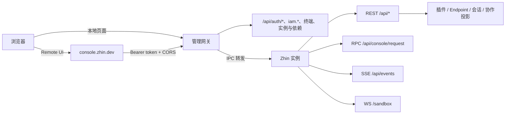

# Console

Console 是 Bot 的浏览器管理后台。你可以在里面**接入聊天账号、按群开关插件、授予聊天角色、安装插件、查看消息为什么没被回复、管理实例与访问控制**。

它不需要你部署：打开 <https://console.zhin.dev>，填入 `zhin start` 启动时打印的 API 地址（新项目默认 `http://127.0.0.1:8068`）。第一次连接时用 `.env` 里的 `HTTP_TOKEN`（初始化令牌）完成[初始化与引导](./onboarding.md)，之后用账号登录。也可以直接打开 Host 自带的本地 `/console` 与 Sandbox 页面。

Console 连接的是**管理网关**（[ADR 0054](../adr/0054-management-gateway.md)）：网关负责登录、权限、初始化、实例起停、依赖安装与终端，其余接口转发给 Zhin 实例。实例崩溃、停止或正在安装依赖时，Console 仍能登录、看实例状态与日志；只有实例提供的页面暂时返回 `503`，页面顶部显示「实例不可用」横幅（见[实例离线怎么办](#instance-offline)）。

| 专题 | 内容 |
| --- | --- |
| [初始化与引导](./onboarding.md) | 数据库 → 所有者 → AI → 聊天平台，每步的凭据与权限 |
| [功能与分层配置](./features.md) | 对象页的「功能」页签：全局 / 适配器 / 账号 / 会话四层启停与覆盖、继承与锁定；「角色」页签与聊天角色 |
| [访问控制](./access-control.md) | Console 用户、角色、API 令牌、审计日志，权限目录与插件权限级别 |
| [运维](./operations.md) | 实例（运行状态与项目依赖）、插件安装与回滚、数据库 / 配置 / 定时任务 / 文件、终端 |

## 导航结构 {#navigation}

Console 的主干是一棵四级对象树：**全局 ─ 适配器 ─ 账号 ─ 会话**（与[分层功能配置](./features.md)、[聊天角色](../concepts/chat-roles.md)的四个层级一致）。每个对象只有一个页面，关于它的一切都放在这一页的页签里。侧栏的「账号与会话」进入全局页，从这里逐级点进下级对象。

| 层级 | 路由 | 页签（顺序固定） |
| --- | --- | --- |
| 全局 | `/scope` | 概览 · 功能 · 角色 · 记录 |
| 适配器 | `/scope/:adapter` | 概览 · 功能 · 角色 · 记录 |
| 账号 | `/scope/:adapter/:endpoint` | 概览 · 聊天 · 接入 · 功能 · 角色 · 记录 |
| 会话 | `/scope/:adapter/:endpoint/:conversation` | 概览 · 聊天 · 功能 · 角色 · 记录 |

- `:adapter` 是适配器实例别名（配置里的顶层键，如 `qq`、`tg-main`），`:endpoint` 是账号 ID，`:conversation` 是 `<类型>:<ID>`（类型为 `group` 群聊 / `private` 私聊 / `channel` 频道）整体做一次 URI 编码，例如 `/scope/qq/bot-1/group%3A123`。
- 当前页签记在 `?tab=` 里（`chat`、`access`、`features`、`roles`、`records`；「概览」是默认页签，不写进地址），刷新和分享链接都能直达。
- 没有权限的页签仍然显示（带锁），内容说明缺少哪个权限，不会悄悄隐藏：概览需要 `endpoint.view` 或 `feature.view`，聊天与接入需要 `endpoint.view` 或 `endpoint.operate`，功能需要 `feature.view`，角色需要 `iam.manage`，记录需要 `status.view`。

| 页签 | 内容 |
| --- | --- |
| 概览 | 全局：全部聊天账号（状态、待处理事件、等待登录的账号）、各适配器的在线数，以及「接入新平台账号」。适配器：该适配器的账号列表与「连接管理」（由适配器插件提供：添加、编辑、启停账号与登录方式）。账号：运行状态、好友申请与邀请、通知，以及有覆盖的会话与最近活跃的会话。会话：这个会话单独改过的功能 |
| 聊天 | 账号：会话列表与聊天窗口（会话、好友申请与邀请、通知），选中的会话记在地址里（`?tab=chat&conversation=<类型>:<ID>`）。会话：只有这个会话的聊天，成员、「最近诊断」与历史在会话顶部 |
| 接入 | 仅账号页：连接状态与「测试连接」（只读取状态，不发送消息）、待完成的登录验证（扫码、滑块 Ticket、短信或设备锁），以及去适配器「连接管理」改连接参数的入口 |
| 功能 | 每个插件一行：有效状态、来源层级、本层覆盖、锁定层级。展开后逐字段显示继承值 / 本层覆盖 / 有效值 / 来源。全局「功能」是全部功能的总览，可切到「矩阵」视图（`?view=matrix`）。见[功能与分层配置](./features.md) |
| 角色 | 这一层的聊天角色（所有者 / 管理员 / 受信任）：在这一层授予的、从上级继承的，以及「授予角色」。见[聊天角色](./features.md#chat-roles) |
| 记录 | 按这个范围筛选好的入口：聊天记录、决策回放、运行日志、审计日志；每个入口标明筛选有多精确（精确 / 范围更宽 / 文本匹配） |

对象页的页头：面包屑（全局以下每级带层级名，祖先可点）、显示名与状态徽标（在线 / 离线 / 有覆盖 / 已锁定）、完整身份（如 `qq / bot-1 / group:123`）旁的「复制范围键」，以及右侧的「切换范围」。**切换范围只改变查看的对象，不会授予权限。**

### 侧栏 {#sidebar}

对象树之外的页面在侧栏里，按下面的分组排列。分组里没有当前身份能看的页面时，整组不显示。

| 分组 | 入口（路由） | 不在菜单里、从上级页面进入 |
| --- | --- | --- |
| 概览 | 首页 `/dashboard`、运行日志 `/logs`、机器人状态 `/agent/workbench`、Token 用量 `/agent/usage` | 决策回放 `/agent/replay`（从机器人状态与「记录」页签进入） |
| 会话 | 试聊一下 `/sandbox`（Sandbox 插件页）、账号与会话 `/scope`、聊天记录 `/agent/sessions` | 适配器 / 账号 / 会话的对象页 |
| 功能 | 功能矩阵 `/features`、AI 与模型 `/features/ai`、技能助手 `/features/ai/skills`、群聊插话 `/features/ai/ambient`、Workroom `/features/ai/workrooms`、运行时能力 `/introspection`、消息场景试验台 `/scenario-lab`，以及没有声明分组的插件页 | 全局配置 `/features/global/:plugin`、Workroom 配置 `/features/ai/workrooms/catalog`、命令权限说明 `/permissions`、群欢迎配置流程 `/use-cases/group-welcome` |
| 插件 | 插件 `/plugins`、插件市场 `/marketplace` | 插件详情 `/plugins/:name` |
| 运维 | 实例 `/ops/instance`、数据库 `/ops/database`、配置文件 `/ops/config`、环境变量 `/ops/env`、定时任务 `/ops/schedules`、项目文件 `/ops/files`、终端 `/ops/terminal` | — |
| 访问控制 | 用户 `/access/users`、角色 `/access/roles`、API 令牌 `/access/tokens`、审计日志 `/access/audit` | — |

顶栏的用户名进入个人设置 `/account`（改密码、我的 API 令牌）；引导未完成时页面顶部的横幅进入开始使用 `/onboarding`。插件贡献的页面按 `/entries` 里声明的分组（`metadata.section`，如 `ops` 或 `运维`）落位，未声明的进「功能」；适配器插件自己的页面（如 `/qq`）仍然可以打开，它的账号管理同时嵌在该适配器对象页的「连接管理」里。

::: details 旧地址会跳到哪里
旧书签不会失效，Console 把它们重定向到新位置：

| 旧地址 | 现在 |
| --- | --- |
| `/endpoints` | `/scope`（全局概览） |
| `/endpoints/:adapter/:endpointId` | 账号页「聊天」；带 `channelType` + `channelId` 时到该会话的「聊天」 |
| `/features/adapters`、`/features/adapters/:adapter` | `/scope`、`/scope/:adapter` |
| `/features/adapters/:adapter/endpoints/:endpoint` | 账号页「功能」（`?tab=conversations` → 账号概览） |
| `/features/adapters/:adapter/endpoints/:endpoint/conversations/:conversation` | 会话页「功能」 |
| `/features/global`、`/features/ai/models` | `/features`、`/features/ai` |
| `/config` | `/ops/config`（`/config?plugin=x` → `/features/global/x`） |
| `/env`、`/files`、`/database` | `/ops/env`、`/ops/files`、`/ops/database` |
| `/tasks`、`/cron`、`/assistant/jobs` | `/ops/schedules`（后两个分别打开「定时提醒」「助手任务」页签） |
| `/agent/models`、`/agent/skills`、`/agent/ambient`、`/agent/workrooms` | `/features/ai`、`/features/ai/skills`、`/features/ai/ambient`、`/features/ai/workrooms` |
:::

## 在哪里做什么 {#tasks}

| 我想… | 去哪里 |
| --- | --- |
| 接入一个平台账号 | [接入账号](#connect-account) |
| 让某个群不用某个插件 | [按会话关插件](#turn-off-in-conversation) |
| 让某人能在群里管理功能 | [授予角色](#grant-role) |
| 安装、更新、卸载插件 | [装插件](#install-plugin) |
| 查清一条消息为什么没被回复 | [看为什么没回复](#why-no-reply) |
| 页面顶部出现「实例不可用」 | [实例离线怎么办](#instance-offline) |
| 发一条测试消息 | 侧栏「试聊一下」，或账号页「聊天」 |
| 看机器人和大家聊过什么 | 侧栏「聊天记录」，或任一对象页的「记录」页签（已按范围筛选） |
| 确认命令、中间件、工具已加载 | 侧栏「运行时能力」；某个插件的能力在插件详情的「能力清单」 |
| 查看定时任务 | 运维 → 定时任务（「全部任务」总览，各类任务在各自页签） |
| 改配置文件、环境变量 | 运维 → 配置文件 / 环境变量（插件的配置在「全局配置」） |
| 给同事开账号、发 API 令牌 | 访问控制 → 用户 / API 令牌，见[访问控制](./access-control.md) |

### 接入账号 {#connect-account}

1. 打开「账号与会话」（`/scope`），在「接入新平台账号」里选平台。适配器还没安装时按钮是「先安装适配器」，进入插件市场安装（见[装插件](#install-plugin)）；已安装时点「前往接入」，进入该适配器的页面。
2. 在适配器页「概览」的「连接管理」里点「添加账号」，填写 Token、地址或登录方式。需要 `endpoint.manage`。
3. 打开新账号的「接入」页签：点「测试连接」确认连接；需要扫码、滑块、短信或设备锁验证时，验证出现在「登录」区块，完成后账号自动上线。全局概览的「等待登录」也会列出这些账号。
4. 到账号的「聊天」页签收一条消息、回一条消息，确认收发正常。

Host 当前没有运行这个账号时，「接入」页签会说明原因（已从配置移除、被停用或还没启动），并给出「打开适配器」。

### 按会话关插件 {#turn-off-in-conversation}

1. 进入会话页：「账号与会话」→ 适配器 → 账号 → 在账号「概览」的会话列表（或「聊天」里）点这个会话。
2. 打开「功能」页签，找到插件那一行，关掉开关，在操作回执里确认。
3. 只影响这个会话：命令不再匹配、中间件不执行、Agent 工具在这里不可见。要对整个账号或适配器关，在对应对象页的「功能」页签里做；上级关掉后，下级显示「已锁定」，不能再打开。

会话层只能改插件声明为会话可改的字段，其余字段只读。规则见[继承规则](./features.md#resolution)。

### 授予角色 {#grant-role}

1. 进入目标范围的对象页（全局、适配器、账号或会话），打开「角色」页签。需要 `iam.manage`（绑定到该适配器 / 账号的作用域角色也算）。
2. 在「授予角色」里填平台用户 ID，选「所有者」「管理员」或「受信任」，确认。角色在这一层及其下所有范围生效。
3. 撤销只撤销在这一层直接授予的角色；从上级继承的角色要到授予它的那一层撤销。

聊天角色只影响机器人在聊天里的权限，不影响 Console 登录与权限（那是[访问控制](./access-control.md)的角色）。平台群主 / 管理员是平台身份，不会自动成为 zhin 角色。见[聊天角色](../concepts/chat-roles.md)。

### 装插件 {#install-plugin}

1. 打开「插件市场」（`/marketplace`），搜索并打开插件详情；详情会核验注册表的 latest 版本。
2. 点「安装」：网关先生成安装计划，确认后停止实例、安装、校验并重新启动；失败自动回滚，进度实时显示。需要 `plugin.manage`。
3. 插件有必填配置时显示「需要配置」，按按钮打开配置表单，提交后网关写入声明并重启实例。
4. 在对象页的「功能」页签决定它在哪些范围开启。插件详情的「在哪开了」汇总了各层开关。

已安装插件在「插件」（`/plugins`）里列出来源、版本与健康状态；更新与卸载在插件详情「版本与依赖」里执行，同样走网关事务。项目里全部依赖在「实例」页的「项目依赖」管理。见[依赖安装与回滚](./operations.md#packages)。

### 看为什么没回复 {#why-no-reply}

1. 进入会话页「聊天」，在会话顶部点「最近诊断」，或点那条入站消息旁的诊断按钮。诊断显示实际处理阶段、指令状态、回复目标与投递结果（只读，不会重放消息）。
2. 打开会话页「记录」页签 →「决策回放」：机器人每次回或不回、调没调模型、发没发消息的原因。
3. 怀疑命令被权限挡住：打开「命令权限说明」（`/permissions`，也可从运行时能力的命令目录进入），用假设的 zhin 角色与平台身份试算规则。
4. 怀疑插件在这里被关了：看会话页「功能」页签里这个插件的有效状态与来源层级。
5. 怀疑实例本身有问题：看「实例」页的运行状态与实例日志。

诊断记录只在内存保留最近 15 分钟、最多 500 条；查不到不代表处理成功。细节见[消息处理排查](../troubleshooting/messages.md)。

### 实例离线怎么办 {#instance-offline}

网关返回 `503 instance_unavailable`（实例没在运行）、`504 instance_timeout`（没在限定时间内答复）或 `502 instance_error`（答复失败或过载）时，所有页面顶部显示「实例不可用」横幅：按 `Retry-After` 倒计时并自动重试，也可以「立即重试」，或点「查看实例」。

- 访问控制、实例与终端由网关提供，照常可用；其他页面只在对应区块显示「实例不可用」，不整页拦截。实例恢复后横幅消失，各区块自动重新读取。
- 在「实例」页看状态与「失败前的日志」，修复后点「启动」或「重启」（需要 `ops.restart`）。见[实例](./operations.md#instance)。
- 横幅出现时刚提交的写操作，回执会显示「结果未知」：先点「核对当前状态」，不要重复提交（见[操作回执](#receipts)）。

## 首页 {#home}

首页（`/dashboard`）回答「现在需要处理什么」：

- **需要关注**：离线的聊天账号、未连接的 MCP 服务、历史错误与警告、Host 不可达等，每项带去处理的入口。
- **关键指标**的口径各不相同，卡片上写明来源：
  - 「收到消息」是**缓冲内观察**：来自 Host 的内存事件缓冲（覆盖最近 24 小时，缓冲更短时注明从何时起），实例重启后清空；
  - 「错误日志」是**持久统计**：来自日志库，清理日志后重新计数；
  - 「在线聊天账号」是**当前状态**，附在线率。
- 最近 24 小时消息量、最近的消息、进程与资源（运行环境、内存、CPU）。进程与实例的完整运行状态只在「实例」页。

## 状态提示与操作回执 {#receipts}

一种情况只有一种说法：「暂无数据」「无权限」（列出需要的权限）「未安装」（去插件市场）「需要新版 Host」「已锁定」（链到锁定的上级）「内容已被修改」（重新读取后再决定）「数据库忙」「实例不可用」「需要配置」「已断开连接」「结果未知」「读取失败」。原始错误放在「技术详情」里；读取失败不会显示成空列表。

写操作（开关功能、改覆盖、授予 / 撤销角色、安装插件等）都先列出要改什么，再确认、提交，结果就地显示为一张操作回执：

| 结果 | 含义 | 下一步 |
| --- | --- | --- |
| 已完成 / 部分完成 | Host 确认了修改 | 关闭回执 |
| 未执行 | Host 明确拒绝（权限、校验、冲突、锁定，或实例不可用未转发） | 看原因，重新准备 |
| 结果未知 | 请求已发出，没有收到可信答复（超时、断连、`504` / `502`） | 只能「核对当前状态」（只读重读），不要重复提交 |

删除、撤销、全局停用等影响面大的操作会要求再确认一次。

## 命令权限说明 {#command-permissions}

「命令权限说明」（`/permissions`）解释一条命令的 `permit` 为什么匹配或不匹配，按[聊天角色](../concepts/chat-roles.md)的维度试算：

- 选当前运行代里的命令（按命令名、说明或插件实例搜索），页面逐项解释它声明的 `permit` 与 `adapter` 约束：数组各项都要满足（AND），同一项括号内逗号任选其一（OR）。
- 可选填假设会话与账号、发送者 ID、**假设 zhin 角色**（普通用户 / 受信任 / 管理员 / 所有者）与**假设平台身份**（群主 / 管理员 / 成员 / 访客，以及平台角色 ID），点「检查假设条件」。
- 身份完全由你假设，不向平台核实；留空表示未知，不会被当作已知角色。页面不执行命令，也不执行平台与自定义 checker，这些条件显示「未评估」，缺少依据时显示「缺少依据」。「条件符合」不代表已授权或可执行。
- 需要持有 `status.view` 的账号登录；运行代变化后要刷新目录重新检查。

## Console 与 Host 的连接 {#architecture}

浏览器可以打开远程 Console（console.zhin.dev），也可以打开 Host 自带的本地页面；两者都只和管理网关通信，网关把实例的接口经 IPC 转发给 Zhin 实例。

::: details 为什么 Bot 还在登录时 Console 就能连上？
HTTP 服务、Console RPC 与 SSE 属于进程控制面，会在插件全部启动（首个 generation 发布）之前就开始监听。所以 ICQQ 等适配器即使还在等待扫码、滑块或设备确认，浏览器也能通过 `login.list`、`login.submit` 与 `endpoint.login.pending` 完成登录。此时依赖已启动插件的页面可能暂时为空或显示未就绪；适配器全部启动完成后才会正常显示。
:::



## 部署与配置

全部配置在 `zhin.config.yml` 顶层 `http:` 段：

```yaml
http:
  port: 8068                 # 脚手架默认；以项目配置为准
  host: 127.0.0.1            # 默认 127.0.0.1；远程访问需改 0.0.0.0
  token: ${HTTP_TOKEN}       # 初始化令牌：只用于创建第一个所有者
  corsOrigins:               # CORS 白名单；https://console.zhin.dev 总是自动并入
    - "http://localhost:5173"
  base: /api                 # API 前缀，默认 /api
```

`/api` 请求需携带 Bearer 凭据（登录会话或 API 令牌，见[用户与权限](#用户与权限)）；`/pub/*`、Console shell 与页面路由保持公开。`corsOrigins` 会与 Remote Console 源合并。

`http.port` 由管理网关监听；端口被占用时 `zhin start` 直接启动失败。Console 发起的重启只重启实例（经控制通道），网关与 Console 连接不中断。

未配置 `http.port` 时网关监听 8068，与脚手架默认写入的值一致。连接地址始终以项目配置和启动日志为准。

## 按问题找入口

| 你看到的现象 | 先看哪里 | 要确认的事实 |
| --- | --- | --- |
| Console 连不上 | 首页 / 启动日志 | Host、端口、token、CORS 与 HTTP Host 是否降级 |
| 页面顶部「实例不可用」 | 实例 | 实例状态、最近一次失败与实例日志 |
| 平台在线但收不到消息 | 账号页「接入」「概览」 | 连接状态、待完成的登录验证、好友申请与通知、平台回调 |
| 收到了但没回复 | 会话页「聊天」→ 最近诊断；「记录」→ 决策回放 | 处理阶段、指令状态、回不回的原因、投递结果 |
| 命令、中间件或组件没生效 | 运行时能力 + 会话页「功能」 | 当前 generation 是否发布能力、顺序与 owner；插件在这个会话是否被关或被上级锁定 |
| 命令对某人不可用 | 命令权限说明 + 「角色」页签 | `permit` 各项、发送者的 zhin 角色与平台身份 |
| Agent 没调用工具 | 机器人状态 + 运行时能力 | Tool 可见性、审批、安全策略、轨迹与取消终态 |
| 刷新后消息缺失 | 会话页「聊天」+ 运行日志 | history RPC 是否恢复、SSE 是否报告 recovery gap |
| 多 Bot 群里没有按预期的 Agent 接话 | Workroom + 机器人状态 | `ai.venues` 的 `conversation` 是否与群一致、`members[].botEndpoint` 是否在线、`entry` 是否是成员之一 |
| 配置文件写了但行为没变 | 配置文件 + 首页 | 保存是否成功，是否发布了新 generation |

## 页面功能

| 页面 | 数据来源 | 说明 |
|------|----------|------|
| 首页 | `GET /api/system/status`、`GET /api/stats`、事件缓冲、日志统计 | 需要关注的事项、关键指标（标明口径）、最近消息、进程与资源 |
| 账号与会话（对象树） | RPC `endpoint.list` / `endpoint.test`、`login.*`、`feature.get` / `feature.set-*` / `feature.conversations`、`chat-roles.list` / `grant` / `revoke` + 收件箱表 | 全局 / 适配器 / 账号 / 会话四级对象页；账号「聊天」含统一收件箱（消息 / 请求 / 通知），「接入」含连接测试与 LoginAssist 登录待办 |
| 适配器连接管理 | `plugin.<pluginId>.status` + RPC `endpoint.list` / `endpoint.test` + `login.*` | 由适配器插件提供，嵌在适配器对象页「概览」：连接状态与测试、账号增删改启停；QQ 另有扫码绑定 |
| 插件 / 插件详情 | `GET /api/plugins`、`GET /api/plugins/<name>`、RPC `plugin:*`、`gateway.packages.*` | 已安装插件的来源、版本与健康状态；详情含版本与依赖、在哪开了、声明与配置、权限、能力清单；安装 / 更新 / 卸载计划与提交、配置校验、诊断 |
| 插件市场 | `GET /pub/marketplace/search`、`/pub/marketplace/detail/*`、`GET /api/marketplace/updates` | 插件索引（plugins.json + npmmirror）、核验 latest、检查更新；搜索带 `locale=zh-CN\|en` 时按语言解析显示名与描述，展示字段见[插件市场元数据](../authoring/plugin-delivery.md#marketplace-metadata) |
| 功能矩阵 / 全局配置 | RPC `feature.matrix`、`feature.get`、`config:*` | 每个功能在全局与各适配器的开关；插件的全局 Schema 表单 |
| 配置文件 | RPC `config:get-source` / `config:replace-source` / `config:set` / `config:patch` | 按当前 YAML/JSON 格式在线查看、带 revision 编辑 Root 配置；简单页面用 `config:patch` 按路径写入（见[插件页面](../authoring/console-pages.md#在页面里保存设置-config-patch)） |
| 运行日志 | `GET /api/logs`、`GET /api/logs/stats`、`DELETE /api/logs`、`POST /api/logs/cleanup` | 系统日志（`SystemLog` 表，需 Database 启动） |
| 定时任务 | RPC `cron:*`、`GET /api/tasks/*`、`POST /api/tasks/create` / `change` | 「全部任务」总览；管理员任务、定时提醒、助手任务、执行记录各一个页签 |
| 数据库 | RPC `db:info` / `db:tables` / `db:select` / `db:insert` / `db:update` / `db:delete` / `db:kv:*` | 数据库浏览与编辑、KV 存储 |
| 项目文件 / 环境变量 | RPC `files:tree` / `files:read` / `files:save`、`env:list` / `env:save` | 项目文件树与 `.env` 管理 |
| 实例 | RPC `gateway.instance.status` / `logs` / `start` / `stop` / `restart`、`gateway.packages.*` | 运行状态的唯一详情页：状态、起停、实例日志、项目依赖 |
| 运行时能力 | `GET /api/introspection/{commands,middlewares,components,tools,prompt-sections,endpoints,bindings,mcp}`、`POST /api/introspection/components/render` | 当前 generation 的能力契约、owner、中间件顺序、组件渲染实验台与 Prompt Section 治理信息 |
| 聊天记录 | `GET/POST /api/agent/sessions/*`、`GET /api/conversations/history?sessionKey=...&beforeSequence=...` | AI 会话树查看与分支切换；渠道会话尚未产生 AI 对话时，GET 返回 `state: not_started` 空树。实际收发的 canonical 记录与 Agent 内部会话树分开，不要求曾触发 AI |
| Workroom | `GET /api/agent/engagements[/*]`（需要 `agent.view`）；RPC `agent.engagements.list` / `agent.engagements.get` / `agent.venues.list` | 只读投影：最近的 Engagement、单个 Engagement 的事件与黑板、已配置的 Venue；数据来自 `engagement_events` Journal，Console 不能改写 |
| 试聊一下（Sandbox） | WS `/sandbox` | 内置沙箱聊天，免平台联调直接对话 |

实时推送走 SSE：`GET /api/events`（页面目录同步、HMR 重载、消息/配置事件）。 事件流与历史（`/api/events`、`/api/events/history`）需要 `status.view`。

::: details HTTP / RPC 协议状态码与边界契约

会话树的 `preview` 仍是短摘要。按需读取完整用户正文使用 `GET /api/agent/sessions/<encoded-sessionKey>/message?sessionId=<tree.sessionId>&messageId=<positive-safe-integer>`，沿用会话接口的 HTTP 鉴权，响应 `data: { messageId, text }`，不返回图片内容，也不切换分支。会话实例已变化返回 `409`，消息不存在或不是该会话的用户消息返回 `404`，旧 runtime 未提供读取能力返回 `501`；完整正文只限仍保留的消息。

聊天记录接口需要 `endpoint.view`，固定每页最近 50 条 canonical 事件，并按 sequence 升序返回。响应为 `data: { conversation, items, nextBeforeSequence, hasMore }`，加载更早记录时传入排他的 `beforeSequence`。消息事件含完整正文与安全媒体引用，撤回事件含 `messageRef`；其他事件仅返回类型、时间和 sequence，仍计入分页。不会返回本地图片路径、base64 或平台原始数据。未保存记录返回 `404 history_not_recorded`，同一 sessionKey 对应多个父频道／话题返回 `409 conversation_ambiguous`，当前账号地址或存储无法解析返回 `503 history_unavailable`，不以 Agent 内部历史代替。响应禁止缓存；客户端拼接分页前应核对完整 `conversation` 未变化。

聊天的“此轮用量”和“轨迹”读取现有 Agent 归档。`GET /api/agent/trace-archive/turns` 返回回合摘要、可信来源和包含子 Agent 的用量明细；`GET /api/agent/trace-archive/turn` 按需返回一次回合的执行详情，正文通过 `GET /api/agent/trace-archive/request?sessionKey=...&turnId=...&requestId=...` 单独读取。当前聊天需传完整 canonical `conversation` JSON，不能仅凭时间或粗粒度 sessionKey 关联消息；旧记录缺少来源时不作为该聊天的事实。接口均要求 `agent.view`，并禁止 HTTP 缓存。

用量是供应商报告的输入、输出和缓存／推理分项，缺报不显示为零；分类 token 为估算，不能当作计费分摊。请求正文是在模型 SDK 调用边界捕获的输入，按系统提示、工具定义、消息序列和输出格式展示，不是 HTTP 抓包，也不证明上游已接收。框架发起的重试和降级分别记录；SDK 内部对相同输入的重试合并在同一次语义请求中，不作为逐次 HTTP 尝试记录。旧请求没有正文时不从当前配置重建。

请求正文默认保存在 Host 的 `data/agent-traces`，只记录脱敏文本，图片／音频等二进制仅留占位。默认保留最多 7 天、归档硬上限 64 MiB；容量不足会清理最旧记录，正文过大时保留统计并标记未保存。`ai.agent.recordRequestBodies: false` 可停止新增正文留存。现有 `ZHIN_TRACE_RETENTION_DAYS` / `ZHIN_TRACE_MAX_MB` 配置仍可显式调整保留范围；用量数据库的保留规则独立。过期记录立即停止返回；文件在启动后的维护、写入和既有每小时维护中清理。每个数据目录由一个 Host 进程写入。64 MiB 是归档容量，不是进程内存上限；原子替换期间可能短暂存在临时副本，并发回合和待写队列也会占用内存。

插件写操作都采用“计划后提交”：Console 先调用 `plugin:plan-install`、
`plugin:plan-update` 或 `plugin:plan-uninstall`（实例只读）展示变更，再携带当前配置 revision
向管理网关提交 `gateway.packages.install | update | uninstall`（`plugin.manage`，见 ADR 0054 §4）；
实例内已没有安装、更新、卸载入口。网关停止实例后执行事务，维护 package manifest、锁文件、
`zhin.plugins` 与插件配置，再启动实例并等待就绪；失败时恢复文件快照并启动旧版本。
配置保存前调用 `plugin:validate-config`，详情页可用 `plugin:diagnose` 汇总安装、挂载、schema
与环境变量状态。

固定字符串选项不必退回整份源码：例如日历的 `provider`，纯字符串常量 `anyOf` 会投影为
现有选择框。首版限 1–64 个唯一、非空且不超过 256 字符的值，分支不附加其他校验约束，
默认值只采用外层声明；对象联合、混合类型、`oneOf` 和其他无法完整表达的组合仍回退源码。
表单投影不改变原始 JSON Schema 校验。保存值不在选项内（如环境引用）时应保留原值，
由用户明确选择替换；只改该字段，不删除未选日历后端或其他实例的配置。此展示需要配套 Console 更新。
:::

## 试聊一下的 Agent 运行策略

在「试聊一下」里开 Agent 会话时，工作目录与安全策略属于每一次运行，不写入 Prompt，也不会由模型自行提升。新手可以从默认组合开始：工作目录留空时使用当前项目目录，`safetyMode` 选 `workspace-write`，`approvalMode` 选 `ask`，`networkAccess` 保持关闭。

| 字段 | 可选值 | 怎么选 |
| --- | --- | --- |
| `safetyMode` | `read-only` / `workspace-write` / `danger-full-access` | 只检查时选只读；需要修改项目文件时选工作区写入；完整主机权限只用于明确理解风险的本地任务 |
| `approvalMode` | `ask` / `auto` / `bypass` | 默认 `ask`；`auto` 由专用审核 Agent 裁决，拿不准时询问 master；`bypass` 直接通过审批，但仍受权限与沙箱约束 |
| `networkAccess` | `false` / `true` | 只有任务确实要访问网络时开启；`danger-full-access` 会天然包含网络权限 |
| `workingDirectory` | 目录路径 | 指向本次任务允许工作的项目目录，不要用宽泛的系统根目录 |

这些是固定契约，不是自由文本。未知的 `safetyMode` / `approvalMode` 会回退到 `workspace-write` / `ask`；页面应始终回显最终生效值供用户确认。

## 一次标准验收

1. 首页显示连接正常，「需要关注」里没有未处理的项，版本与运行时信息可读。
2. 在「试聊一下」发送消息；再在某个账号页「聊天」里收发一条，刷新后确认历史仍存在。
3. 在运行时能力核对命令、中间件、组件、Tool 与 Prompt Section 的当前 owner；在会话页「功能」页签确认插件在这个会话的有效状态。
4. 运行一条 Agent 任务，验证工作目录、安全策略、审批、取消、轨迹和产物。
5. 若配置了 `ai.venues`，在对应的群里发一条真实消息，验证由入口 Agent 接话，并能在 Workroom 与 `zhin trace --engagements` 看到这次协作。

只有当前 generation 与持久投影都符合预期，才算发布成功。磁盘配置和插件清单只是候选输入。

## /entries 插件页面机制

插件可以向 Console 贡献自己的页面。机制分三步：

1. 插件声明 client 页面（pagemanager），构建产物由 Host 服务在 `/assets/client/*`；
2. Host 的 ConsoleRuntime 汇总页面目录，`GET /entries` 返回 `{ entries, runtimeEnvHint }`——每条 entry 含 `id`、`title`、`route`、`module`（页面模块 URL）、`order`、`hash`；
3. Remote Console / 本地 shell 拉取 `/entries` 后动态 import 对应模块渲染；浏览器裸导入（react 等）由 Host 的 `/esm/*` 代理为可执行 ESM。

页面目录变化通过 SSE `sync` 事件实时推给已连接的 UI。页面落在侧栏的哪个分组见[侧栏](#sidebar)。

## 用户与权限

Console 的用户、角色、会话和 API 令牌存在项目数据库里（ADR 0049），不写在配置文件中。页面与权限的完整说明见[访问控制](./access-control.md)；从旧版本升级见[升级到 Console 访问控制](../migrations/console-access-control.md)与[升级到管理网关](../migrations/management-gateway.md)。

- **初始化**：数据库里还没有所有者时，`http.token` 是初始化令牌，只能用来创建第一个所有者（Console 向导，或 `zhin console init`）。创建之后它在所有接口上失效。没有配置 `http.token` 的本地 Host 在初始化前对所有人开放。
- **登录**：用户用用户名和密码登录，得到会话令牌（默认 12 小时滑动过期，最长 30 天）。改密码、禁用或删除用户会立即吊销该用户的全部会话。
- **API 令牌**：用户可以为自动化签发长期令牌，权限不超过签发人，可单独吊销。命令行工具从 `ZHIN_CONSOLE_TOKEN` 读取。
- **角色**：内置 `owner`（全部）、`admin`（除终端和用户管理外全部）、`operator`（运营：收发消息、功能配置）、`viewer`（只读）。角色可以绑定到全局、某个适配器或某个账号。
- **权限检查**：每个 Console RPC 和每条 `/api` 路由都在 `@zhin.js/console-protocol` 的权限表里登记；没登记的一律拒绝。所有被拒绝的请求和写操作都记入审计日志，被拒绝的条目在 `detail.reason` 写明原因（`not_authenticated`、`setup_required`、`unmapped_permission`、`unmapped_route`、`insufficient_permission`、`scope_denied`、`handler_denied`、`no_plugin_handler`）。
- **未知 RPC**：Host 根本没有的 RPC 类型（没有处理器、也不在权限表）回 `404 { code: 'unknown_rpc' }`，不执行、不算安全拒绝、不写审计（只按类型去重记 debug 日志）；有处理器却漏登记权限的仍按 `unmapped` 拒绝并审计。Console 连接后读一次 `GET /api/console/capabilities`（任何已登录主体，返回 `{ version, rpc, features, complete }`），不调用 Host 没列出的可选 RPC；旧 Host 没有这个接口时，Console 遇到 `unknown_rpc` / 「未登记权限」后本次会话不再调用该 RPC。
- **离线救援**：`zhin console user create|passwd|disable|enable|list` 直接打开项目数据库，不需要运行中的 Host。
- **在网关里**（ADR 0054 §3、§7）：登录、初始化向导、`/auth/me`、`iam.*`、`onboarding.update`、终端和审计日志都由管理网关处理，网关自己打开项目数据库（SQLite 为 WAL 模式，与实例共用同一个文件）。实例停止、崩溃或依赖安装期间 Console 仍能登录、初始化、看实例状态与日志；只有实例提供的页面和接口返回 `503`。禁用 / 删除用户、改密码或改角色绑定时，该用户在实例上的实时连接（事件流、WebSocket）随即断开。
- **引导状态**：`GET {base}/auth/setup` 与（持有 `plugin.manage` 的调用方的）`/auth/me` 带 `onboarding` 字段；RPC `onboarding.update { step: 'ai' | 'adapters' | 'finish', status: 'done' | 'skipped' }` 需要 `plugin.manage`，第 3 步（`ai`）另需 `agent.configure`，第 4 步（`adapters`）另需 `endpoint.manage`（ADR 0053 §2）。依赖安装进度在 Console 事件流上以 `gateway.packages.progress` 推送，也可单独订阅 `GET {base}/gateway/packages/progress`。

页面的 `requiredPermissions` 与 `requiredRoles` 决定谁能看到它：内置权限（如 `status.view`）按角色授予；插件自己定义的权限名（形如 `<插件>:<动作>`，如 `ambient:read`、`decisions:read`、`control:read`、`ops:approve`）按**级别**授予。页面清单（`/entries`、`/console/api/pages`、`/console/api/topology`）按调用者过滤，且不会被缓存。

### 插件权限的级别

每个插件权限属于一个级别：`read`（查看）、`operate`（日常操作）或 `manage`（管理、审批、改配置）。插件可以在 `definePluginConsoleRpc({ permissions })` 里声明级别（见[插件 Console 页面](../authoring/console-pages.md#插件权限的级别)）；没声明时按动作后缀推断：

| 后缀 | 级别 |
| --- | --- |
| `:read`、`:view` | `read` |
| `:approve`、`:manage`、`:admin`、`:write`、`:config` | `manage` |
| 其他（如 `:resolve`、`:send`） | `operate` |

内置角色按级别授予插件权限，靠的是三个目录权限 `plugin.perms.read`、`plugin.perms.operate`、`plugin.perms.manage`：

| 角色 | 插件权限 |
| --- | --- |
| `viewer` | `read` |
| `operator` | `read`、`operate` |
| `admin` | 全部级别 |
| `owner` | 全部（不变） |

- **自定义角色**可以勾选上面三个级别权限，也可以直接列出某个插件权限（如只给 `ops:approve`）。格式必须是 `<插件>:<动作>`；当前没有插件使用的权限名也能保存（插件可能还没装或被停用），接口会返回 `warnings` 提示，在有插件用到它之前它不放行任何东西。
- **作用域**：页面可见性只看全局绑定。调用插件 Console RPC 时逐个方法检查它声明的权限；调用拥有适配器的插件（`root/<适配器>`）时，绑定到这个适配器（或账号方法指名的账号）的角色也算数，绑定到别的适配器的不算。
- **API 令牌**签发时可以只列某个插件权限（如 `onebot11:read`）；只有签发人自己持有它（按名或按级别）时才生效，不会超过签发人。
- `iam.roles.list` 返回每个角色当前生效的插件权限（`pluginPermissions`，含来源 `level` / `explicit`）和已加载插件的权限目录（顶层 `pluginPermissions: [{ permission, plugin, level, description? }]`），Console 用它渲染角色编辑器。

插件的反向 WebSocket、Webhook 等路由不经过 Console 账号，由插件用自己的凭据鉴权（例如 OneBot 的 `access_token`）。

## 终端

`console.terminal.enabled: true` 时 Console 提供宿主 Shell 与白名单 SSH 目标（ADR 0051），只有持有 `ops.terminal` 的所有者能用，会话开始与结束写入审计日志。默认关闭；关闭时不注册任何终端路由。开启前先读[终端的安全须知与 SSH 指纹固定](./operations.md#terminal)；字段见[配置参考](../configuration/generated.md)。

## 相关

- [AI 能力总览](../ai/index.md)
- [Agent 深入](../ai/agent.md)：Console「机器人状态」「聊天记录」页对应的运行时
- [Console 管理路径](../paths/console.md)：按任务走一遍 Console
