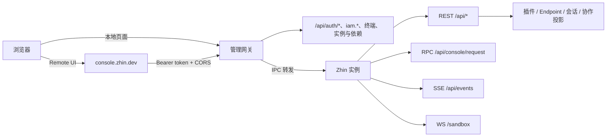

# Console

Console 是 Bot 的浏览器管理后台。你可以在里面**发测试消息、看日志、改配置、管理插件和账号、观察 AI 在做什么**。

它不需要你部署：打开 <https://console.zhin.dev>，填入 `zhin start` 启动时打印的 API 地址（新项目默认 `http://127.0.0.1:8068`）。第一次连接时用 `.env` 里的 `HTTP_TOKEN`（初始化令牌）完成[初始化与引导](./onboarding.md)，之后用账号登录。也可以直接打开 Host 自带的本地 `/console` 与 Sandbox 页面。

Console 连接的是**管理网关**（[ADR 0054](../adr/0054-management-gateway.md)）：网关负责登录、权限、初始化、实例起停、依赖安装与终端，其余接口转发给 Zhin 实例。实例崩溃、停止或正在安装依赖时，Console 仍能登录、看实例状态与日志；只有实例提供的页面暂时返回 `503`。

| 专题 | 内容 |
| --- | --- |
| [初始化与引导](./onboarding.md) | 数据库 → 所有者 → AI → 适配器，每步的凭据与权限 |
| [访问控制](./access-control.md) | 用户、角色、API 令牌、审计日志，权限目录与插件权限级别 |
| [功能矩阵与三级配置](./features.md) | 全局 / 适配器 / 账号三层启停与覆盖 |
| [运维](./operations.md) | 实例状态与起停、依赖安装与回滚、数据库 / 配置 / 文件、终端 |

## 连上之后能做什么

| 页面 | 用来做什么 |
| --- | --- |
| 聊天账号 / 试聊一下 | 给 Bot 发测试消息，查看各平台账号的收发情况 |
| 聊天记录 | 回看机器人和大家聊过什么，并可从某段继续 |
| 运行时能力（高级） | 确认命令、中间件、组件、工具是否已加载，以及来自哪个插件 |
| 运行记录 | 按时间和来源查看运行日志 |
| 配置（高级） | 用表单或源码编辑 `zhin.config.yml`，保存失败会自动回滚 |
| 机器人状态 | 查看 AI 的对话、调用了哪些工具、审批与取消记录；「决策回放」按时间倒序列出机器人每次回 / 不回的原因，可按回合展开时间线、按时间范围导出 JSON（需要令牌有 `decisions:read` 权限，默认保留 14 天，`ai.audit.retentionDays` 可改） |
| 群聊插话 | 决定没人 @ 机器人时它要不要自己在群里接话（关闭 / 只观察 / 主动参与）、在哪些群、每小时最多几次，并查看最近 24 小时的情况。保存后需要重启才生效；查看需要令牌有 `ambient:read` 权限，修改需要管理员令牌 |
| 技能助手 | 让一个专门的小助手帮机器人挑技能、挑工具、挑记忆、决定交给哪个助手、自动通过审批、判断群里要不要接话，每项选「关闭 / 只观察 / 正式使用」，并查看最近 24 小时用了几次、成功几次。需要先安装 `@zhin.js/service-typesafe`（`zhin setup --decisions`）。保存后需要重启才生效；查看需要令牌有 `skills:read` 权限，修改需要管理员令牌 |
| 协作图谱（高级） | 只读查看多 Agent 协作（Engagement）的参与者、消息跳数、共享黑板与预算，以及已配置的协作场所（`ai.venues`） |

## 侧栏导航

导航分六个区（[ADR 0052](../adr/0052-console-information-architecture.md)）：前四个是日常，后两个是管理。没有权限的区整体隐藏。

| 区 | 回答的问题 | 页面 | 权限 |
| --- | --- | --- | --- |
| 概览 | 现在怎么样？ | 仪表盘、日志、Agent 观测 | `status.view` |
| 会话 | 在和谁说话？ | 账号工作区（会话、收件箱、请求通知）、沙盒 | `endpoint.view` / `endpoint.operate` |
| 功能 | 机器人能做什么、在哪里做？ | 功能矩阵、全局配置、适配器、账号配置、AI 与模型 | `feature.*`、`agent.*` |
| 插件 | 装了什么？ | 已安装、市场、插件详情（版本、依赖、日志） | `plugin.manage` |
| 运维 | 宿主机怎么样？ | 实例、数据库、配置文件、环境变量、定时任务、文件、终端 | `ops.*`、`status.view` |
| 访问控制 | 谁能做什么？ | 用户、角色、API 令牌、审计日志 | `iam.*` |

插件贡献的页面按 `metadata.section` 落到对应区，未声明的落到「功能」。旧路由保留重定向：插件详情的配置页 → `/features/global/:plugin`，旧的数据库 / 配置 / 定时任务页 → `/ops/*`。

::: details 为什么 Bot 还在登录时 Console 就能连上？
HTTP 服务、Console RPC 与 SSE 属于进程控制面，会在插件全部启动（首个 generation 发布）之前就开始监听。所以 ICQQ 等适配器即使还在等待扫码、滑块或设备确认，浏览器也能通过 `login.list`、`login.submit` 与 `endpoint.login.pending` 完成登录。此时依赖已启动插件的页面可能暂时为空或显示未就绪；适配器全部启动完成后才会正常显示。
:::



## 部署与配置

全部配置在 `zhin.config.yml` 顶层 `http:` 段：

```yaml
http:
  port: 8068                 # 脚手架默认；以项目配置为准
  host: 127.0.0.1            # 默认 127.0.0.1；远程访问需改 0.0.0.0
  token: ${HTTP_TOKEN}       # 初始化令牌：只用于创建第一个所有者
  corsOrigins:               # CORS 白名单；https://console.zhin.dev 总是自动并入
    - "http://localhost:5173"
  base: /api                 # API 前缀，默认 /api
```

`/api` 请求需携带 Bearer 凭据（登录会话或 API 令牌，见[用户与权限](#用户与权限)）；`/pub/*`、Console shell 与页面路由保持公开。`corsOrigins` 会与 Remote Console 源合并。

`http.port` 由管理网关监听；端口被占用时 `zhin start` 直接启动失败。Console 发起的重启只重启实例（经控制通道），网关与 Console 连接不中断。

Runtime 无配置时回退到 8086，当前脚手架默认写入 8068。连接地址始终以项目配置和启动日志为准。

## 按问题找入口

| 你看到的现象 | 先看哪里 | 要确认的事实 |
| --- | --- | --- |
| Console 连不上 | Dashboard / 启动日志 | Host、端口、token、CORS 与 HTTP Host 是否降级 |
| 平台在线但收不到消息 | Endpoint 详情 | 连接状态、统一收件箱、请求/通知与平台回调 |
| 命令、中间件或组件没生效 | 运行时能力 | 当前 generation 是否发布能力、顺序与 owner |
| Agent 没调用工具 | Agent 工作台 + 运行时能力 | Tool 可见性、审批、安全策略、轨迹与取消终态 |
| 刷新后消息缺失 | Endpoint 会话 + 日志 | history RPC 是否恢复、SSE 是否报告 recovery gap |
| 多 Bot 群里没有按预期的 Agent 接话 | 协作图谱 + 机器人状态 | `ai.venues` 的 `conversation` 是否与群一致、`members[].botEndpoint` 是否在线、`entry` 是否是成员之一 |
| 配置文件写了但行为没变 | Config + Dashboard | 保存是否成功，是否发布了新 generation |

## 页面功能

| 页面 | 数据来源 | 说明 |
|------|----------|------|
| Dashboard | `GET /api/system/status`、`GET /api/stats` | 运行状态、版本、统计概览 |
| Plugins | `GET /api/plugins`、`GET /api/plugins/<name>`、RPC `plugin:*` | 插件列表与详情；安装/更新/卸载计划与提交、配置校验、诊断和启停管理 |
| Endpoints | Endpoint 摘要 + RPC `endpoint.test` + 收件箱表 | 各平台端点连接状态和连通性诊断；详情页含统一收件箱（消息 / 请求 / 通知） |
| 适配器页面 | `plugin.<pluginId>.status` + RPC `endpoint.list` / `endpoint.test` + `login.*` | 每个平台适配器自带页面（路由 `/<adapter>`）：连接状态与测试、endpoint 增删、LoginAssist 登录待办；QQ 另有扫码绑定 |
| Config | RPC `config:get-source` / `config:replace-source` / `config:set` / `config:patch` | 按当前 YAML/JSON 格式在线查看、带 revision 编辑 Root 配置；简单页面用 `config:patch` 按路径写入（见[插件页面](../authoring/console-pages.md#在页面里保存设置-config-patch)） |
| Logs | `GET /api/logs`、`GET /api/logs/stats`、`DELETE /api/logs`、`POST /api/logs/cleanup` | 系统日志（`SystemLog` 表，需 Database 启动） |
| Cron | RPC `cron:*` | 插件注册的内存任务（list）；安装 Agent 后可增删暂停持久化任务 |
| Database | RPC `db:info` / `db:tables` / `db:select` / `db:insert` / `db:update` / `db:delete` / `db:kv:*` | 数据库浏览与编辑、KV 存储 |
| Files | RPC `files:tree` / `files:read` / `files:save`、`env:list` / `env:save` | 项目文件树与 `.env` 管理 |
| 运行时能力 | `GET /api/introspection/{commands,middlewares,components,tools,prompt-sections,endpoints,bindings,mcp}`、`POST /api/introspection/components/render` | 当前 generation 的能力契约、owner、中间件顺序、组件渲染实验台与 Prompt Section 治理信息 |
| Agent Sessions | `GET/POST /api/agent/sessions/*` | AI 会话树查看与分支切换；渠道会话尚未产生 AI 对话时，GET 返回 `state: not_started` 空树 |
| 聊天记录 | `GET /api/conversations/history?sessionKey=...&beforeSequence=...` | 实际收发的 canonical 记录，与 Agent 内部会话树分开；不要求曾触发 AI |
| 协作图谱 | `GET /api/agent/engagements[/*]`（需要 `agent.view`）；RPC `agent.engagements.list` / `agent.engagements.get` / `agent.venues.list` | 只读投影：最近的 Engagement、单个 Engagement 的事件与黑板、已配置的 Venue；数据来自 `engagement_events` Journal，Console 不能改写 |
| Marketplace | `GET /pub/marketplace/search`、`/pub/marketplace/detail/*`、`GET /api/marketplace/updates` | 插件市场（plugins.json + npmmirror）与更新检查 |
| Sandbox | WS `/sandbox` | 内置沙箱聊天，免平台联调直接对话 |

实时推送走 SSE：`GET /api/events`（页面目录同步、HMR 重载、消息/配置事件）。 事件流与历史（`/api/events`、`/api/events/history`）需要 `status.view`。

::: details HTTP / RPC 协议状态码与边界契约

会话树的 `preview` 仍是短摘要。按需读取完整用户正文使用 `GET /api/agent/sessions/<encoded-sessionKey>/message?sessionId=<tree.sessionId>&messageId=<positive-safe-integer>`，沿用会话接口的 HTTP 鉴权，响应 `data: { messageId, text }`，不返回图片内容，也不切换分支。会话实例已变化返回 `409`，消息不存在或不是该会话的用户消息返回 `404`，旧 runtime 未提供读取能力返回 `501`；完整正文只限仍保留的消息。

聊天记录接口需要 `endpoint.view`，固定每页最近 50 条 canonical 事件，并按 sequence 升序返回。响应为 `data: { conversation, items, nextBeforeSequence, hasMore }`，加载更早记录时传入排他的 `beforeSequence`。消息事件含完整正文与安全媒体引用，撤回事件含 `messageRef`；其他事件仅返回类型、时间和 sequence，仍计入分页。不会返回本地图片路径、base64 或平台原始数据。未保存记录返回 `404 history_not_recorded`，同一 sessionKey 对应多个父频道／话题返回 `409 conversation_ambiguous`，当前账号地址或存储无法解析返回 `503 history_unavailable`，不以 Agent 内部历史代替。响应禁止缓存；客户端拼接分页前应核对完整 `conversation` 未变化。

聊天的“此轮用量”和“轨迹”读取现有 Agent 归档。`GET /api/agent/trace-archive/turns` 返回回合摘要、可信来源和包含子 Agent 的用量明细；`GET /api/agent/trace-archive/turn` 按需返回一次回合的执行详情，正文通过 `GET /api/agent/trace-archive/request?sessionKey=...&turnId=...&requestId=...` 单独读取。当前聊天需传完整 canonical `conversation` JSON，不能仅凭时间或粗粒度 sessionKey 关联消息；旧记录缺少来源时不作为该聊天的事实。接口均要求 `agent.view`，并禁止 HTTP 缓存。

用量是供应商报告的输入、输出和缓存／推理分项，缺报不显示为零；分类 token 为估算，不能当作计费分摊。请求正文是在模型 SDK 调用边界捕获的输入，按系统提示、工具定义、消息序列和输出格式展示，不是 HTTP 抓包，也不证明上游已接收。框架发起的重试和降级分别记录；SDK 内部对相同输入的重试合并在同一次语义请求中，不作为逐次 HTTP 尝试记录。旧请求没有正文时不从当前配置重建。

请求正文默认保存在 Host 的 `data/agent-traces`，只记录脱敏文本，图片／音频等二进制仅留占位。默认保留最多 7 天、归档硬上限 64 MiB；容量不足会清理最旧记录，正文过大时保留统计并标记未保存。`ai.agent.recordRequestBodies: false` 可停止新增正文留存。现有 `ZHIN_TRACE_RETENTION_DAYS` / `ZHIN_TRACE_MAX_MB` 配置仍可显式调整保留范围；用量数据库的保留规则独立。过期记录立即停止返回；文件在启动后的维护、写入和既有每小时维护中清理。每个数据目录由一个 Host 进程写入。64 MiB 是归档容量，不是进程内存上限；原子替换期间可能短暂存在临时副本，并发回合和待写队列也会占用内存。

插件写操作都采用“计划后提交”：Console 先调用 `plugin:plan-install`、
`plugin:plan-update` 或 `plugin:plan-uninstall` 展示变更，再携带当前配置 revision 提交。
安装、更新和卸载会维护 package manifest、锁文件、`zhin.plugins` 与插件配置；失败时恢复文件快照。
配置保存前调用 `plugin:validate-config`，详情页可用 `plugin:diagnose` 汇总安装、挂载、schema
与环境变量状态。

固定字符串选项不必退回整份源码：例如日历的 `provider`，纯字符串常量 `anyOf` 会投影为
现有选择框。首版限 1–64 个唯一、非空且不超过 256 字符的值，分支不附加其他校验约束，
默认值只采用外层声明；对象联合、混合类型、`oneOf` 和其他无法完整表达的组合仍回退源码。
表单投影不改变原始 JSON Schema 校验。保存值不在选项内（如环境引用）时应保留原值，
由用户明确选择替换；只改该字段，不删除未选日历后端或其他实例的配置。此展示需要配套 Console 更新。
:::

## Agent 工作台运行策略

工作目录与安全策略属于每一次运行，不写入 Prompt，也不会由模型自行提升。新手可以从默认组合开始：工作目录留空时使用当前项目目录，`safetyMode` 选 `workspace-write`，`approvalMode` 选 `ask`，`networkAccess` 保持关闭。

| 字段 | 可选值 | 怎么选 |
| --- | --- | --- |
| `safetyMode` | `read-only` / `workspace-write` / `danger-full-access` | 只检查时选只读；需要修改项目文件时选工作区写入；完整主机权限只用于明确理解风险的本地任务 |
| `approvalMode` | `ask` / `auto` / `bypass` | 默认 `ask`；`auto` 由专用审核 Agent 裁决，拿不准时询问 master；`bypass` 直接通过审批，但仍受权限与沙箱约束 |
| `networkAccess` | `false` / `true` | 只有任务确实要访问网络时开启；`danger-full-access` 会天然包含网络权限 |
| `workingDirectory` | 目录路径 | 指向本次任务允许工作的项目目录，不要用宽泛的系统根目录 |

这些是固定契约，不是自由文本。未知的 `safetyMode` / `approvalMode` 会回退到 `workspace-write` / `ask`；工作台应始终回显最终生效值供用户确认。

## 一次标准验收

1. Dashboard 显示连接正常，版本与运行时信息可读。
2. 在 Sandbox 发送消息，并在 Endpoint 会话刷新后确认历史仍存在。
3. 在运行时能力核对命令、中间件、组件、Tool 与 Prompt Section 的当前 owner。
4. 运行一条 Agent 任务，验证工作目录、安全策略、审批、取消、轨迹和产物。
5. 若配置了 `ai.venues`，在对应的群里发一条真实消息，验证由入口 Agent 接话，并能用 `zhin trace --engagements` 看到这次协作。

只有当前 generation 与持久投影都符合预期，才算发布成功。磁盘配置和插件清单只是候选输入。

## /entries 插件页面机制

插件可以向 Console 贡献自己的页面。机制分三步：

1. 插件声明 client 页面（pagemanager），构建产物由 Host 服务在 `/assets/client/*`；
2. Host 的 ConsoleRuntime 汇总页面目录，`GET /entries` 返回 `{ entries, runtimeEnvHint }`——每条 entry 含 `id`、`title`、`route`、`module`（页面模块 URL）、`order`、`hash`；
3. Remote Console / 本地 shell 拉取 `/entries` 后动态 import 对应模块渲染；浏览器裸导入（react 等）由 Host 的 `/esm/*` 代理为可执行 ESM。

页面目录变化通过 SSE `sync` 事件实时推给已连接的 UI。

## 用户与权限

Console 的用户、角色、会话和 API 令牌存在项目数据库里（ADR 0049），不写在配置文件中。页面与权限的完整说明见[访问控制](./access-control.md)；从旧版本升级见[升级到 Console 访问控制](../migrations/console-access-control.md)与[升级到管理网关](../migrations/management-gateway.md)。

- **初始化**：数据库里还没有所有者时，`http.token` 是初始化令牌，只能用来创建第一个所有者（Console 向导，或 `zhin console init`）。创建之后它在所有接口上失效。没有配置 `http.token` 的本地 Host 在初始化前对所有人开放。
- **登录**：用户用用户名和密码登录，得到会话令牌（默认 12 小时滑动过期，最长 30 天）。改密码、禁用或删除用户会立即吊销该用户的全部会话。
- **API 令牌**：用户可以为自动化签发长期令牌，权限不超过签发人，可单独吊销。命令行工具从 `ZHIN_CONSOLE_TOKEN` 读取。
- **角色**：内置 `owner`（全部）、`admin`（除终端和用户管理外全部）、`operator`（运营：收发消息、功能配置）、`viewer`（只读）。角色可以绑定到全局、某个适配器或某个账号。
- **权限检查**：每个 Console RPC 和每条 `/api` 路由都在 `@zhin.js/console-protocol` 的权限表里登记；没登记的一律拒绝。所有被拒绝的请求和写操作都记入审计日志。
- **离线救援**：`zhin console user create|passwd|disable|enable|list` 直接打开项目数据库，不需要运行中的 Host。
- **在网关里**（ADR 0054 §3、§7）：登录、初始化向导、`/auth/me`、`iam.*`、`onboarding.update`、终端和审计日志都由管理网关处理，网关自己打开项目数据库（SQLite 为 WAL 模式，与实例共用同一个文件）。实例停止、崩溃或依赖安装期间 Console 仍能登录、初始化、看实例状态与日志；只有实例提供的页面和接口返回 `503`。禁用 / 删除用户、改密码或改角色绑定时，该用户在实例上的实时连接（事件流、WebSocket）随即断开。
- **引导状态**：`GET {base}/auth/setup` 与（持有 `plugin.manage` 的调用方的）`/auth/me` 带 `onboarding` 字段；RPC `onboarding.update { step: 'ai' | 'adapters' | 'finish', status: 'done' | 'skipped' }` 需要 `plugin.manage`，第 3 步（`ai`）另需 `agent.configure`，第 4 步（`adapters`）另需 `endpoint.manage`（ADR 0053 §2）。依赖安装进度在 Console 事件流上以 `gateway.packages.progress` 推送，也可单独订阅 `GET {base}/gateway/packages/progress`。

页面的 `requiredPermissions` 与 `requiredRoles` 决定谁能看到它：内置权限（如 `status.view`）按角色授予；插件自己定义的权限名（形如 `<插件>:<动作>`，如 `ambient:read`、`decisions:read`、`control:read`、`ops:approve`）按**级别**授予。页面清单（`/entries`、`/console/api/pages`、`/console/api/topology`）按调用者过滤，且不会被缓存。

### 插件权限的级别

每个插件权限属于一个级别：`read`（查看）、`operate`（日常操作）或 `manage`（管理、审批、改配置）。插件可以在 `definePluginConsoleRpc({ permissions })` 里声明级别（见[插件 Console 页面](../authoring/console-pages.md#插件权限的级别)）；没声明时按动作后缀推断：

| 后缀 | 级别 |
| --- | --- |
| `:read`、`:view` | `read` |
| `:approve`、`:manage`、`:admin`、`:write`、`:config` | `manage` |
| 其他（如 `:resolve`、`:send`） | `operate` |

内置角色按级别授予插件权限，靠的是三个目录权限 `plugin.perms.read`、`plugin.perms.operate`、`plugin.perms.manage`：

| 角色 | 插件权限 |
| --- | --- |
| `viewer` | `read` |
| `operator` | `read`、`operate` |
| `admin` | 全部级别 |
| `owner` | 全部（不变） |

- **自定义角色**可以勾选上面三个级别权限，也可以直接列出某个插件权限（如只给 `ops:approve`）。格式必须是 `<插件>:<动作>`；当前没有插件使用的权限名也能保存（插件可能还没装或被停用），接口会返回 `warnings` 提示，在有插件用到它之前它不放行任何东西。
- **作用域**：页面可见性只看全局绑定。调用插件 Console RPC 时逐个方法检查它声明的权限；调用拥有适配器的插件（`root/<适配器>`）时，绑定到这个适配器（或账号方法指名的账号）的角色也算数，绑定到别的适配器的不算。
- **API 令牌**签发时可以只列某个插件权限（如 `onebot11:read`）；只有签发人自己持有它（按名或按级别）时才生效，不会超过签发人。
- `iam.roles.list` 返回每个角色当前生效的插件权限（`pluginPermissions`，含来源 `level` / `explicit`）和已加载插件的权限目录（顶层 `pluginPermissions: [{ permission, plugin, level, description? }]`），Console 用它渲染角色编辑器。

插件的反向 WebSocket、Webhook 等路由不经过 Console 账号，由插件用自己的凭据鉴权（例如 OneBot 的 `access_token`）。

## 终端

`console.terminal.enabled: true` 时 Console 提供宿主 Shell 与白名单 SSH 目标（ADR 0051），只有持有 `ops.terminal` 的所有者能用，会话开始与结束写入审计日志。默认关闭；关闭时不注册任何终端路由。开启前先读[终端的安全须知与 SSH 指纹固定](./operations.md#terminal)；字段见[配置参考](../configuration/generated.md)。

## 相关

- [AI 能力总览](../ai/index.md)
- [Agent 深入](../ai/agent.md)：Console 的 Agent Sessions / Orchestration 页对应的运行时
