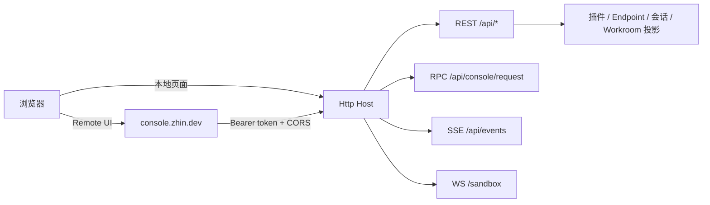

# Console

Console 是 Bot 的浏览器管理后台。你可以在里面**发测试消息、看日志、改配置、管理插件和账号、观察 AI 在做什么**。

它不需要你部署：打开 <https://console.zhin.dev>，填入 Bot 启动时打印的 API 地址（新项目默认 `http://127.0.0.1:8068`）和 `.env` 里的 `HTTP_TOKEN` 即可。也可以直接打开 Bot 自带的本地 `/console` 与 Sandbox 页面。

## 连上之后能做什么

| 页面 | 用来做什么 |
| --- | --- |
| 聊天账号 / 试聊一下 | 给 Bot 发测试消息，查看各平台账号的收发情况 |
| 聊天记录 | 回看机器人和大家聊过什么，并可从某段继续 |
| 运行时能力（高级） | 确认命令、中间件、组件、工具是否已加载，以及来自哪个插件 |
| 运行记录 | 按时间和来源查看运行日志 |
| 配置（高级） | 用表单或源码编辑 `zhin.config.yml`，保存失败会自动回滚 |
| 机器人状态 | 查看 AI 的对话、调用了哪些工具、审批与取消记录；「决策回放」按时间倒序列出机器人每次回 / 不回的原因，可按回合展开时间线、按时间范围导出 JSON（需要令牌有 `decisions:read` 权限，默认保留 14 天，`ai.audit.retentionDays` 可改） |
| 群聊插话 | 决定没人 @ 机器人时它要不要自己在群里接话（关闭 / 只观察 / 主动参与）、在哪些群、每小时最多几次，并查看最近 24 小时的情况。保存后需要重启才生效；查看需要令牌有 `ambient:read` 权限，修改需要管理员令牌 |
| 技能助手 | 让一个专门的小助手帮机器人挑技能、挑工具、挑记忆、决定交给哪个助手、自动通过审批、判断群里要不要接话，每项选「关闭 / 只观察 / 正式使用」，并查看最近 24 小时用了几次、成功几次。需要先安装 `@zhin.js/service-typesafe`（`zhin setup --decisions`）。保存后需要重启才生效；查看需要令牌有 `skills:read` 权限，修改需要管理员令牌 |
| Workroom（高级） | 查看持久任务空间与任务看板 |

## 侧栏导航

Console 面向普通用户，侧栏按“想做什么”分组，页面用大白话命名。原来的页面链接（路由）都不变。

| 分组 | 页面 |
| --- | --- |
| 常用 | 首页、聊天账号、聊天记录、定时提醒、运行记录 |
| 机器人 | 机器人状态、试聊一下、助手任务（启用助手时显示）、群聊插话、技能助手 |
| 功能 | 功能管理、功能商店、任务中心 |
| 高级（默认折叠） | 配置、环境变量、项目文件、数据库、运行时能力、消息场景试验台、Workroom |

旧名对照：工作台 → 首页，渠道与会话 → 聊天账号，对话分支 → 聊天记录，Agent 试验台 → 试聊一下，Agent 概览 / Agent 工作台 → 机器人状态，定时任务 → 定时提醒，日志 → 运行记录，插件 → 功能管理，市场 → 功能商店。

`zhin.config.yml` 等 YAML 编辑能力仍然保留，放在「高级 → 配置」里，供熟悉配置的用户和 CI 使用。

::: details 为什么 Bot 还在登录时 Console 就能连上？
HTTP 服务、Console RPC 与 SSE 属于进程控制面，会在插件全部启动（首个 generation 发布）之前就开始监听。所以 ICQQ 等适配器即使还在等待扫码、滑块或设备确认，浏览器也能通过 `login.list`、`login.submit` 与 `endpoint.login.pending` 完成登录。此时依赖已启动插件的页面可能暂时为空或显示未就绪；适配器全部启动完成后才会正常显示。
:::



## 部署与配置

全部配置在 `zhin.config.yml` 顶层 `http:` 段：

```yaml
http:
  port: 8068                 # 脚手架默认；以项目配置为准
  host: 127.0.0.1            # 默认 127.0.0.1；远程访问需改 0.0.0.0
  token: ${HTTP_TOKEN}       # 主 token（full scope）
  tokens:                    # 附加作用域 token（可选）
    - token: ${DEMO_TOKEN}
      scope: demo            # full | demo
  corsOrigins:               # CORS 白名单；https://console.zhin.dev 总是自动并入
    - "http://localhost:5173"
  base: /api                 # API 前缀，默认 /api
```

配置 token 后，`/api` 请求需携带 Bearer token；`/pub/*`、Console shell 与页面路由保持公开。`corsOrigins` 会与 Remote Console 源合并。

端口占用会让 HTTP Host 软降级：Adapter 与 Agent 继续启动，但 Console 不可用。Console 发起重启时，CLI daemon 会在进程以 code 51 退出后重新拉起。

Runtime 无配置时回退到 8086，当前脚手架默认写入 8068。连接地址始终以项目配置和启动日志为准。

## 按问题找入口

| 你看到的现象 | 先看哪里 | 要确认的事实 |
| --- | --- | --- |
| Console 连不上 | Dashboard / 启动日志 | Host、端口、token、CORS 与 HTTP Host 是否降级 |
| 平台在线但收不到消息 | Endpoint 详情 | 连接状态、统一收件箱、请求/通知与平台回调 |
| 命令、中间件或组件没生效 | 运行时能力 | 当前 generation 是否发布能力、顺序与 owner |
| Agent 没调用工具 | Agent 工作台 + 运行时能力 | Tool 可见性、审批、安全策略、轨迹与取消终态 |
| 刷新后消息缺失 | Endpoint 会话 + 日志 | history RPC 是否恢复、SSE 是否报告 recovery gap |
| Workroom 没接管群或仓库 | Workrooms + Task 看板 | Catalog revision、完整空间地址、Orchestrator 与 Project Inbox |
| 配置文件写了但行为没变 | Config + Dashboard | 保存是否成功，是否发布了新 generation |

## 页面功能

| 页面 | 数据来源 | 说明 |
|------|----------|------|
| Dashboard | `GET /api/system/status`、`GET /api/stats` | 运行状态、版本、统计概览 |
| Plugins | `GET /api/plugins`、`GET /api/plugins/<name>`、RPC `plugin:*` | 插件列表与详情；安装/更新/卸载计划与提交、配置校验、诊断和启停管理 |
| Endpoints | Endpoint 摘要 + RPC `endpoint.test` + 收件箱表 | 各平台端点连接状态和连通性诊断；详情页含统一收件箱（消息 / 请求 / 通知） |
| Config | RPC `config:get-source` / `config:replace-source` / `config:set` / `config:patch` | 按当前 YAML/JSON 格式在线查看、带 revision 编辑 Root 配置；简单页面用 `config:patch` 按路径写入（见[插件页面](../authoring/console-pages.md#在页面里保存设置-config-patch)） |
| Logs | `GET /api/logs`、`GET /api/logs/stats`、`DELETE /api/logs`、`POST /api/logs/cleanup` | 系统日志（`SystemLog` 表，需 Database 启动） |
| Cron | RPC `cron:*` | 插件注册的内存任务（list）；安装 Agent 后可增删暂停持久化任务 |
| Database | RPC `db:info` / `db:tables` / `db:select` / `db:insert` / `db:update` / `db:delete` / `db:kv:*` | 数据库浏览与编辑、KV 存储 |
| Files | RPC `files:tree` / `files:read` / `files:save`、`env:list` / `env:save` | 项目文件树与 `.env` 管理 |
| 运行时能力 | `GET /api/introspection/{commands,middlewares,components,tools,prompt-sections,endpoints,bindings,mcp}`、`POST /api/introspection/components/render` | 当前 generation 的能力契约、owner、中间件顺序、组件渲染实验台与 Prompt Section 治理信息 |
| Agent Sessions | `GET/POST /api/agent/sessions/*` | AI 会话树查看与分支切换；渠道会话尚未产生 AI 对话时，GET 返回 `state: not_started` 空树 |
| 聊天记录 | `GET /api/conversations/history?sessionKey=...&beforeSequence=...` | 实际收发的 canonical 记录，与 Agent 内部会话树分开；不要求曾触发 AI |
| Workrooms | 持久 Workroom Catalog + Profile RPC + `GET /api/agent/workroom/runs[/*]` | 以 revision CAS 管理 Project、成员、Agent 角色和群/频道/仓库绑定；诊断并初始化 Profile/Planning Policy；查看 replayed Run / Task / Assignment |
| Marketplace | `GET /pub/marketplace/search`、`/pub/marketplace/detail/*`、`GET /api/marketplace/updates` | 插件市场（plugins.json + npmmirror）与更新检查 |
| Sandbox | WS `/sandbox` | 内置沙箱聊天，免平台联调直接对话 |

会话树的 `preview` 仍是短摘要。按需读取完整用户正文使用 `GET /api/agent/sessions/<encoded-sessionKey>/message?sessionId=<tree.sessionId>&messageId=<positive-safe-integer>`，沿用会话接口的 HTTP 鉴权，响应 `data: { messageId, text }`，不返回图片内容，也不切换分支。会话实例已变化返回 `409`，消息不存在或不是该会话的用户消息返回 `404`，旧 runtime 未提供读取能力返回 `501`；完整正文只限仍保留的消息。

聊天记录接口仅允许 full scope，固定每页最近 50 条 canonical 事件，并按 sequence 升序返回。响应为 `data: { conversation, items, nextBeforeSequence, hasMore }`，加载更早记录时传入排他的 `beforeSequence`。消息事件含完整正文与安全媒体引用，撤回事件含 `messageRef`；其他事件仅返回类型、时间和 sequence，仍计入分页。不会返回本地图片路径、base64 或平台原始数据。未保存记录返回 `404 history_not_recorded`，同一 sessionKey 对应多个父频道／话题返回 `409 conversation_ambiguous`，当前账号地址或存储无法解析返回 `503 history_unavailable`，不以 Agent 内部历史代替。响应禁止缓存；客户端拼接分页前应核对完整 `conversation` 未变化。

实时推送走 SSE：`GET /api/events`（页面目录同步、HMR 重载、消息/配置事件）。

插件写操作都采用“计划后提交”：Console 先调用 `plugin:plan-install`、
`plugin:plan-update` 或 `plugin:plan-uninstall` 展示变更，再携带当前配置 revision 提交。
安装、更新和卸载会维护 package manifest、锁文件、`zhin.plugins` 与插件配置；失败时恢复文件快照。
配置保存前调用 `plugin:validate-config`，详情页可用 `plugin:diagnose` 汇总安装、挂载、schema
与环境变量状态。

固定字符串选项不必退回整份源码：例如日历的 `provider`，纯字符串常量 `anyOf` 会投影为
现有选择框。首版限 1–64 个唯一、非空且不超过 256 字符的值，分支不附加其他校验约束，
默认值只采用外层声明；对象联合、混合类型、`oneOf` 和其他无法完整表达的组合仍回退源码。
表单投影不改变原始 JSON Schema 校验。保存值不在选项内（如环境引用）时应保留原值，
由用户明确选择替换；只改该字段，不删除未选日历后端或其他实例的配置。此展示需要配套 Console 更新。

## Agent 工作台运行策略

工作目录与安全策略属于每一次运行，不写入 Prompt，也不会由模型自行提升。新手可以从默认组合开始：工作目录留空时使用当前项目目录，`safetyMode` 选 `workspace-write`，`approvalMode` 选 `ask`，`networkAccess` 保持关闭。

| 字段 | 可选值 | 怎么选 |
| --- | --- | --- |
| `safetyMode` | `read-only` / `workspace-write` / `danger-full-access` | 只检查时选只读；需要修改项目文件时选工作区写入；完整主机权限只用于明确理解风险的本地任务 |
| `approvalMode` | `ask` / `auto` / `bypass` | 默认 `ask`；`auto` 由专用审核 Agent 裁决，拿不准时询问 master；`bypass` 直接通过审批，但仍受权限与沙箱约束 |
| `networkAccess` | `false` / `true` | 只有任务确实要访问网络时开启；`danger-full-access` 会天然包含网络权限 |
| `workingDirectory` | 目录路径 | 指向本次任务允许工作的项目目录，不要用宽泛的系统根目录 |

这些是固定契约，不是自由文本。未知的 `safetyMode` / `approvalMode` 会回退到 `workspace-write` / `ask`；工作台应始终回显最终生效值供用户确认。

## 一次标准验收

1. Dashboard 显示连接正常，版本与运行时信息可读。
2. 在 Sandbox 发送消息，并在 Endpoint 会话刷新后确认历史仍存在。
3. 在运行时能力核对命令、中间件、组件、Tool 与 Prompt Section 的当前 owner。
4. 运行一条 Agent 任务，验证工作目录、安全策略、审批、取消、轨迹和产物。
5. 若启用 Workroom，用一个真实群、频道或仓库事件验证它进入正确 Project。

只有当前 generation 与持久投影都符合预期，才算发布成功。磁盘配置和插件清单只是候选输入。

## /entries 插件页面机制

插件可以向 Console 贡献自己的页面。机制分三步：

1. 插件声明 client 页面（pagemanager），构建产物由 Host 服务在 `/assets/client/*`；
2. Host 的 ConsoleRuntime 汇总页面目录，`GET /entries` 返回 `{ entries, runtimeEnvHint }`——每条 entry 含 `id`、`title`、`route`、`module`（页面模块 URL）、`order`、`hash`；
3. Remote Console / 本地 shell 拉取 `/entries` 后动态 import 对应模块渲染；浏览器裸导入（react 等）由 Host 的 `/esm/*` 代理为可执行 ESM。

页面目录变化通过 SSE `sync` 事件实时推给已连接的 UI。

## 用户与权限

Console 用户就是 `zhin.config.yml` 里 `http.tokens` 的条目：每个附加令牌就是一个用户，没有单独的账号库，也没有登录和注册。加用户就加一条令牌，停用就删掉这条令牌。给它配上 `permissions` 和 `roles`，Console 就只给它看满足要求的页面，插件页面的状态接口也按同样的规则放行：

```yaml
http:
  token: ${HTTP_TOKEN}            # 管理员：full，能看和改全部内容
  tokens:
    - token: ${ALICE_TOKEN}
      scope: user                 # 普通用户（与 demo 等价）：不能改配置
      principalId: alice
      permissions: [ambient:read, ambient:write] # 对应页面和插件操作的 requiredPermissions
      roles: [member]             # 对应页面的 requiredRoles
```

- **full 令牌**（包括主 `token`）能看到全部页面，`permissions` 和 `roles` 对它不起作用。
- **`scope: user` 令牌**是普通用户。`user` 和 `demo` 完全等价，新配置建议写 `user`；没写 `scope` 或写了其他值时也按普通用户处理，不会变成管理员。
- 普通用户只能看到 `permissions` 和 `roles` 满足 `requiredPermissions` 和 `requiredRoles` 的页面。插件动作只有在动作自己声明了 `requiredPermissions` 或 `requiredRoles`、并且令牌全部满足时才能执行（见 [插件 RPC](../authoring/console-pages.md#页面数据插件-rpc)）。改配置、管理插件等内置管理操作仍然只给 full 令牌。
- **不带令牌**只能看到没有任何要求的页面。
- **没有配置任何令牌**时（本地开发），所有人都等同于管理员，和以前一样。
- 页面清单（`/entries`、`/console/api/pages`、`/console/api/topology`）都按令牌过滤，且不会被缓存。

权限名和角色名由页面自己约定，比如 `ambient:read`。内置的群聊插话和技能助手状态使用 `ambient:read` 和 `skills:read`（见 [内置状态](../authoring/console-pages.md#内置状态群聊插话和技能助手)），决策回放使用 `decisions:read`（见 [决策回放](../authoring/console-pages.md#内置查询决策回放)），控制面使用 `control:read` 和 `control:write`（见 [控制面](../authoring/console-pages.md#内置操作控制面)），审批人（危险工具审批卡、公告批准 / 驳回 / 重发）使用 `ops:approve`（见 [危险工具审批卡](../authoring/console-pages.md#内置操作危险工具审批卡)）。

## Demo scope（只读部署）

给演示环境签发 `scope: demo` token，Console 会进入只读模式。Demo 只展示服务端允许的脱敏数据，不能把前端遮罩当成秘密边界。

- 放行：事件流与历史、运行时能力目录、只读 Console RPC、系统状态、统计与插件目录；
- WebSocket 仅 `/sandbox`；
- 其余写操作（改配置、清日志、DB 写入等）一律 `403`。

主 token 为 `full` scope，拥有全部权限。

## 相关

- [AI 能力总览](../ai/index.md)
- [Agent 深入](../ai/agent.md)：Console 的 Agent Sessions / Orchestration 页对应的运行时
