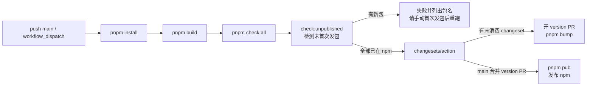

# 开发流程

改完代码到合进 main，中间有几道关卡：本地构建与测试、完整 harness 门禁、changeset、CI 发版。本页按这个顺序讲一遍日常闭环。

## 协作入口

在 [Issue](https://github.com/zhinjs/zhin/issues) 记录问题和验收标准，通过关联的 PR 提交实现。[交付看板](https://github.com/orgs/zhinjs/projects/3) 跟踪当前开放 Issue 和 PR，按 Todo → In Progress → Done 推进；新建或更新且仍开放的条目会自动进入看板。历史已合并 PR 不需要补录。文档入口见 [GitHub Wiki](https://github.com/zhinjs/zhin/wiki)，技术内容仍在本仓库 `docs/` 中维护。

插件易用性相关工作按[插件开发与安装体验改进计划](./plugin-experience-plan.md)分阶段验收。

## 环境准备

- Node.js `>=22.19.0`
- pnpm 9（仓库锁定 `packageManager: pnpm@9.0.2`）

```bash
pnpm install   # 安装全部 workspace 依赖
```

## 常用命令

```bash
pnpm dev        # 启动 examples/minimal-bot（Sandbox + Console），首次验证改动推荐它
pnpm dev:full   # 启动 examples/full-bot（L4 参考）
pnpm dev:test   # 启动 examples/test-bot（维护者厨房水槽）
pnpm build      # turbo 按 basic → packages → plugins 顺序构建全部包
pnpm test       # 全量 Vitest
pnpm type-check # tsc --noEmit（tsconfig.typecheck.json）
pnpm lint       # ESLint
```

只验证单个包时优先用 `pnpm --filter <pkg> build|test`，不要默认跑全量构建。

CI 的 Windows 构建使用 `scripts/ci/build-windows.ps1`：单个 pnpm 进程按 workspace
依赖顺序串行执行 `basic/`、`packages/`、`plugins/` 的全部 `build` 脚本，减少每个包
重复启动 pnpm 与 cmd 的开销。Linux 和日常本地构建继续使用 Turbo。Windows 作业保留
原始失败退出码，并上传 `windows-build-resources-*` 诊断附件，记录 runner 镜像、Node
版本以及进程、句柄和内存采样；不记录环境变量、命令行或凭据。
采样峰值同时写入构建日志，即使 runner 无法启动附件上传进程也能查看。

排查 CI 时先看失败步骤及原始日志：类型错误、断言失败、文档漂移必须修复源码或测试；
`0xC0000142`（`STATUS_DLL_INIT_FAILED`）发生在 Windows 子进程初始化阶段，应结合
资源附件检查。若连后续进程与清理步骤也无法启动，原地重试不能恢复 runner。
更换 runner 后同一提交通过只能证明该次环境故障恢复，不能证明偶发问题已根治。

改 CLI 或 create-zhin-app 之前，如果报找不到 `@zhin.js/scaffold-wizard`，先构建它（产物在 `lib/`，未构建时 Node 无法解析）：

```bash
pnpm --filter @zhin.js/scaffold-wizard build   # 或 pnpm prepare:cli
```

## harness 门禁（pnpm check:all）

发布候选还必须通过 `pnpm check:created-project`：脚本打包候选依赖，在临时空目录运行
已打包的 `create-zhin-app -y --skip-install`，安装后通过真实 Sandbox WebSocket 验证
`/hello`、命令热重载、生产重启和 `doctor --live`。CI 的 Linux/Node 24 作业及发布
workflow 均执行此项；它需要 npm 网络与本机随机端口，不属于离线单测。
Sandbox 验收同时用已安装的 CLI 在工作区子包预演和执行 `migrate`，重新安装依赖并导入本地包，
确认显式 `workspace:` 链接、自定义脚本、配置和用户文件保留；这验证当前候选包的升级流程，
不代表所有历史版本或数据库迁移都已验证。
失败时可设置 `ZHIN_KEEP_ACCEPTANCE_TEMP=1` 保留临时项目排查，成功时自动清理。

`pnpm check:platform-candidates` 验证 QQ 官方与 Telegram 的离线契约，
覆盖范围与实机缺口见[平台稳定认证](./platform-acceptance.md)。离线通过不会自动升档。

提交前最值得跑一次的是 `pnpm check:all`：它运行 `scripts/check-all-harness.mjs` 中登记的全部检查（含 type-check、lint、单测），全部通过才算绿——CI 跑的就是同一套。CI 若另跑 coverage 作业，可设 `HARNESS_SKIP_TEST=1` 跳过其中的 `pnpm test`，避免双跑。

下面按职责分组列出（括号内是单项命令，均可单独运行）。

**质量基线**

| 检查 | 说明 |
| --- | --- |
| Type Check（`pnpm type-check`） | `tsc --noEmit` |
| Lint（`pnpm lint`） | ESLint（.ts/.tsx） |
| Unit Tests（`pnpm test`） | 全量 Vitest |
| Production Config（`pnpm check:prod`） | 生产配置无调试代码 |

**架构与依赖**

| 检查 | 说明 |
| --- | --- |
| Architecture Layers（`pnpm check:architecture`） | 分层依赖方向（basic → kernel → ai → core → agent → zhin） |
| Dependency Policy（`pnpm check:dependency-policy`） | 脚手架依赖策略、Changesets 配置与内部 peer 范围 |
| Release Plan（`pnpm check:release-plan`） | 只允许 patch；minor/major（含依赖传播）均由门禁拒绝 |
| No Koa Import（`pnpm check:no-koa`） | 插件不得直接 import koa |
| Install Size（`pnpm check:install-size`） | zhin.js IM 核心 production `node_modules` ≤ 10MB |

**API 快照与插件规范**

| 检查 | 说明 |
| --- | --- |
| API Surface（`pnpm check:api-surface`） | public API surface 快照 |
| Plugin Runtime API（`pnpm check:plugin-runtime-api`） | 约定式插件运行时 API surface 快照 |
| Plugin Spec（`pnpm check:plugin`） | 插件符合标准规范 |
| Plugin Capability Publish（`pnpm check:plugin-capability-publish`） | 插件能力目录发布清单（files、prepublishOnly、peer 依赖） |
| Publish Repository（`pnpm check:publish-repository`） | 可发布包 `repository.url` 匹配 github.com/zhinjs/zhin（npm provenance） |
| Agent Tool Schema（`pnpm check:agent-tool-schema`） | `tools` inputSchema 与 defineAgentTool/execute 类型一致 |
| Skill Authoring Boundaries（`pnpm check:skill-authoring-boundaries`） | Skill 统一使用 `skills/<name>/SKILL.md`，并显式挂载 Feature |

**IM 链路与运行时约定**

| 检查 | 说明 |
| --- | --- |
| IM Send Path（`pnpm check:harness-paths`） | 不得绕过 Adapter.sendMessage 统一链路 |
| IM Session SSOT（`pnpm check:im-session-ssot`） | IM 场景/session 身份解析走 core SSOT |
| Removed Plugin API（`pnpm check:no-removed-plugin-api`） | 禁止在生产源码中重新引入已删除的 Plugin lookup API |
| Workroom SSOT（`pnpm check:workroom-ssot`） | Workroom 状态只经 Journal + CAS Kernel；禁止恢复并行可变权威 |

**AI 层**

| 检查 | 说明 |
| --- | --- |
| LLM Runtime Boundaries（`pnpm check:llm-runtime-boundaries`） | 运行时代码经 owner-scoped `LlmApiRuntime` 解析模型，不导入歧义 `getModel` |
| Legacy AI Exports（`pnpm check:legacy-ai-exports`） | `@zhin.js/ai` 不再导出 SessionManager 等符号 |
| Provider Gateway（`pnpm check:provider-gateway`） | LLM 网关 sdk/contextWindow 预设契约 |
| A2A Mesh（`pnpm check:a2a-mesh`） | 禁止残留 MCP Agent Mesh v1 符号 |

**适配器契约**

| 检查 | 说明 |
| --- | --- |
| Outbound Media Policies（`pnpm check:outbound-media-policies`） | segments.outboundMedia 声明与契约测试 |
| AI Outbound Adapters（`pnpm check:ai-outbound`） | aiOutboundExtensions 声明与契约测试 |
| Interactive Segments（`pnpm check:interactive-segments`） | interactivePolicy 声明与契约测试 |
| Segment Adapters（`pnpm check:segments`） | defineAdapter segments 声明契约（sandbox 必须达标） |

**文档一致性**

| 检查 | 说明 |
| --- | --- |
| Doc Links（`pnpm check:doc-links`） | 文档相对链接不断裂 |
| Doc Orphans（`pnpm check:doc-orphans`） | 站点 Markdown 都在侧栏或 allowlist |
| ADR Manifest（`pnpm check:adr-manifest`） | ADR README 与侧栏覆盖所有 ADR |
| README Exports（`pnpm check:readme-exports`） | README import 与包导出一致 |
| Config Docs（`pnpm check:config-docs`） | 配置文档与 DEFAULT_CONFIG 关键字段对齐 |
| Generated Config Reference（`pnpm check:config-reference`） | 自动生成配置字段与 Runtime 源码、插件 JSON Schema 无漂移 |
| Source-owned Config Enums（`pnpm check:config-enums`） | 源码既定配置枚举在 Runtime/插件 Schema、生成参考和叙事文档间无漂移 |
| Troubleshooting Center（`pnpm check:troubleshooting`） | 故障目录与“症状 → 原因 → 操作 → 验证”中英文页面无漂移 |
| Install Tiers SSOT（`pnpm check:install-tiers-ssot`） | 中文 `README.zh-CN.md` Install tiers 表与 `docs/snippets/install-tiers.md` 一致 |
| Adapter Docs Sync（`pnpm check:adapter-docs`） | 平台适配器文档与 `plugins/adapters/*/README.md` 同步（修复用 `pnpm sync:adapter-docs`） |
| Platform Tiers SSOT（`pnpm check:platform-tiers-ssot`） | 能力分档/适配器索引与 `scripts/adapter-meta.mjs` 一致 |
| Deployment Templates（`pnpm check:deployment-templates`） | Compose、systemd、Kubernetes 模板与中英文下载入口一致 |

**冒烟**

| 检查 | 说明 |
| --- | --- |
| Stable Smoke（`pnpm check:stable`） | Sandbox + Agent 核心单测 + minimal-bot 契约 |
| L4-CI（`pnpm check:l4-ci`） | L4 确定性子集（编排/记忆/full-bot 契约）；全量 `pnpm check:l4` 在 nightly 跑 |

## Agent 评测规则

- **修复 agent 行为 bug 的 PR 必须附带评测用例。** 先在 `packages/im/agent/evals/cases/` 里写一条能复现问题的用例（脚本化模型，确定性），确认它在修复前失败、修复后通过，再提交修复。用例的 `source` 写明对应的 issue、PR 或 QQ 事故。写法见 [`packages/im/agent/evals/README.md`](https://github.com/zhinjs/zhin/blob/main/packages/im/agent/evals/README.md)。
- PR 门禁只跑脚本化用例：`pnpm eval:agent`，不调用真模型。
- 真模型的能力矩阵只在 nightly 跑（`.github/workflows/nightly-evals.yml`，`pnpm eval:nightly`），作为趋势指标，不作为 PR 必过项；预算上限见评测 README。
- 聊天质量（像不像真人、人设、分寸）用 `pnpm eval:chat --workspace <工作区>` 在本地跑：用工作区真实的模型和 SOUL 跑固定场景，确定性检查加判断模型打分，并和上一次报告对比。改聊天提示词、回复格式或换模型时，PR 里附上前后对比。写法见 [`evals/chat/README.md`](https://github.com/zhinjs/zhin/blob/main/evals/chat/README.md)。

## 包导出与发布清单

workspace 包的 `exports` 带 `"development": "./src/*.ts"` 条件，仓库内的 Vitest、Vite、tsx 靠它直接跑 TypeScript 源码。`src/` 不在 npm 包里，所以发布出去的 `package.json` 不能带这个条件，否则开启 `development` 条件的工具（Vitest 4 默认开启）会去找不存在的文件。

- 每个可发布包的 `publishConfig.exports` 等于去掉 `development` 后的 `exports`。`pnpm publish`（也就是 `changeset publish`）打包时会用它替换 `exports`，本地开发不受影响。
- 修改 `exports` 后运行 `pnpm sync:publish-exports` 重新生成；`scripts/sync-publish-exports.test.ts` 在漂移、发布清单仍带 `development` 或导出目标不在 `files` 里时失败。
- `pnpm check:pack-imports` 按 `pnpm publish` 的视角（先套用 `publishConfig`）检查每个包：所有 `exports` 条件（包括 `development`）的目标都必须在 tarball 里。同时按[发布包目录规范](./publishing.md#发布包目录规范)检查布局：`zhin.entry` 必须是已打包的 JS，tarball 里不能有测试文件；构建配置、断开的 source map、没人引用的 `.ts` 源文件只报警告。
- `pnpm check:plugin-scaffold` 打包 `zhin.js` 的依赖闭包，确认打包后的清单都不再带 `development`，再用本地构建的 CLI 跑 `zhin new`，对这些 tarball 安装后执行生成的 Vitest、`tsc` 和 `pnpm pack`。
- 只用 `pnpm publish` 发布：`npm publish` 不认 `publishConfig.exports`，也不会替换 `workspace:` 协议。

## changeset 工作流

### 变更审查与兼容性

一个 PR 应围绕一个可验收目标组织。纯内部重构应保持公开导出、配置格式和运行行为，
并用原调用方或场景测试验证；大型重构分步提交，避免把目录迁移、行为变化和新功能混在一起。

涉及公开契约时，在 PR 中说明受影响的导出、配置、插件清单、Console 协议或投递语义，
列出原调用方式是否继续有效，以及相应测试。changeset 是发布记录，不是兼容性证明。
在当前仅允许 patch 的发布策略下，发现不兼容变更应先保留旧调用方的兼容路径；
无法兼容时先单独讨论发布策略与迁移方案，不以 patch 名义直接发布。

新增门禁必须证明既能拒绝违规样例，也能接受合法样例；说明它保护的范围，避免把
检查通过解释为超出覆盖范围的保证。运行用户项目的验证必须保留用户配置与凭据。

仓库用 [changesets](https://github.com/changesets/changesets) 管理版本与 changelog（配置见 `.changeset/config.json`：`baseBranch: main`、`access: public`）。任何影响已发布包行为的改动都要记 changeset：

```bash
pnpm release   # = pnpm changeset，交互式选择受影响的包与 semver 级别，生成 .changeset/*.md
pnpm bump      # = pnpm changeset version，消费 changeset、升版本号、写 CHANGELOG
pnpm pub       # = pnpm changeset publish，发布到 npm
```

日常开发只需 `pnpm release` 提交 changeset 文件；`bump` 和 `pub` 由 CI 执行。

版本策略只允许 `patch`。所有 changeset 声明都必须使用 `patch`，
`.changeset/version-policy.json` 的 `approvedNonPatchReleases` 必须保持为空。
`pnpm check:release-plan` 会同时检查原始声明和 Changesets 推导出的完整发布计划；
只要出现 `minor` 或 `major`（包括依赖传播推导出的升级）就会让 CI 失败，不提供豁免入口。
发布覆盖检查只忽略测试文件和 Changesets 生成的 `CHANGELOG.md`。包内构建、类型检查和
工具配置仍可能改变最终产物或声明文件，因此这些配置变更也必须由 patch changeset 覆盖。

版本 PR 与合并后的发布任务使用同一套覆盖检查。当前版本 tag 尚未创建时，门禁检查
Git 历史中是否存在消费 patch changeset、提升 patch 版本并新增对应 CHANGELOG 条目的
升版提交，以该提交作为待发布包的校验基线。升版提交之后新增的包内改动仍需 changeset；
既没有 tag、也没有有效升版记录的包会被拦截。tag 由实际发布流程创建，无需提前补造。

内部 `peerDependencies` 使用 `workspace:^`，避免兼容的内部 minor 升级被发布成精确版本，
进而把无关的上游包推成 major。私有示例包不参与 Changesets version/tag。

### 1.1 稳定线

官方 npm 生态统一使用 1.1.x 稳定线。81 个未占用该版本号的包从 1.1.0 开始；
7 个历史上已经发布过 1.1.0 的包使用各自在 1.1.x 中下一个可用 patch，因为 npm
不允许复用已发布版本号。历史更高版本保留在 npm 以免破坏已有 lockfile，并标记为
由对应包的 1.1.x 稳定版本取代。发布后每个官方包的 `latest` 与 `stable` 均指向其
1.1.x 稳定版本，后续常规发布只增加 patch。

| 1.1.0 已占用的包 | 稳定版本 |
| --- | --- |
| `@zhin.js/adapter` | `1.1.12` |
| `@zhin.js/agent` | `1.1.23` |
| `@zhin.js/ai` | `1.1.33` |
| `@zhin.js/client` | `1.1.5` |
| `@zhin.js/console-protocol` | `1.1.5` |
| `@zhin.js/core` | `1.1.35` |
| `@zhin.js/plugin-runtime` | `1.1.9` |

## 发版（GitHub CI）

发版由 `.github/workflows/publish.yml` 驱动：`push` 到 `main` 或在 Actions 里 **workflow_dispatch 手动运行**。



npm 认证优先走可信发布（OIDC），未配置可信发布者的包回退到 npm token，所有发布都带 provenance。配置方法和每个包的 npmjs.com 清单见 [npm 发布与可信发布](./publishing.md)。

### 新包首次发包

npm 可信发布不能创建新包名：包名必须先由维护者手动发布一次，并在 npmjs.com 配置可信发布者，之后才走 changesets。

本地检测：

```bash
pnpm check:unpublished
```

若列出未发布包，构建后逐个首次发布，例如：

```bash
pnpm build
(cd path/to/pkg && npm publish --access public)
```

再为它配置可信发布者（npm ≥ 11.15.0）：

```bash
npm trust github <包名> --repo zhinjs/zhin --file publish.yml --env npm-production --allow-publish --yes
```

然后到 Actions → **Build and Publish** → **Run workflow** 重新执行（或再 push `main`）。

PR 门禁在 `.github/workflows/ci.yml`（Linux / Windows × Node 22/24/26 矩阵）。
Linux Node 24 额外执行 `pnpm check:all`、文档构建、文档浏览器测试和覆盖率检查；文档浏览器测试与 Pages 部署使用同一组用例，在 PR 阶段验证搜索、隐私、导航和布局。其他 Linux 矩阵执行构建与单测，Windows 矩阵执行构建。

## 调试

- **日志级别**：`zhin.config.yml` 的 `log_level` 调为 `debug`（默认 `info`），可看到框架内部细节日志。
- **Console 日志页**：运行期日志经 `DatabaseLogTransport` 写入 `SystemLog` 数据库模型，Remote Console 的 logs 页读取它。浏览器打开 [console.zhin.dev](https://console.zhin.dev)，填 API Base URL（如 `http://127.0.0.1:8086`）和 Bearer Token（`http.token` 配置）即可查看。
- **单包调试**：`pnpm --filter <pkg> test` 加 `-t '<用例名>'` 过滤用例；`pnpm test:watch` 进入 watch 模式。
