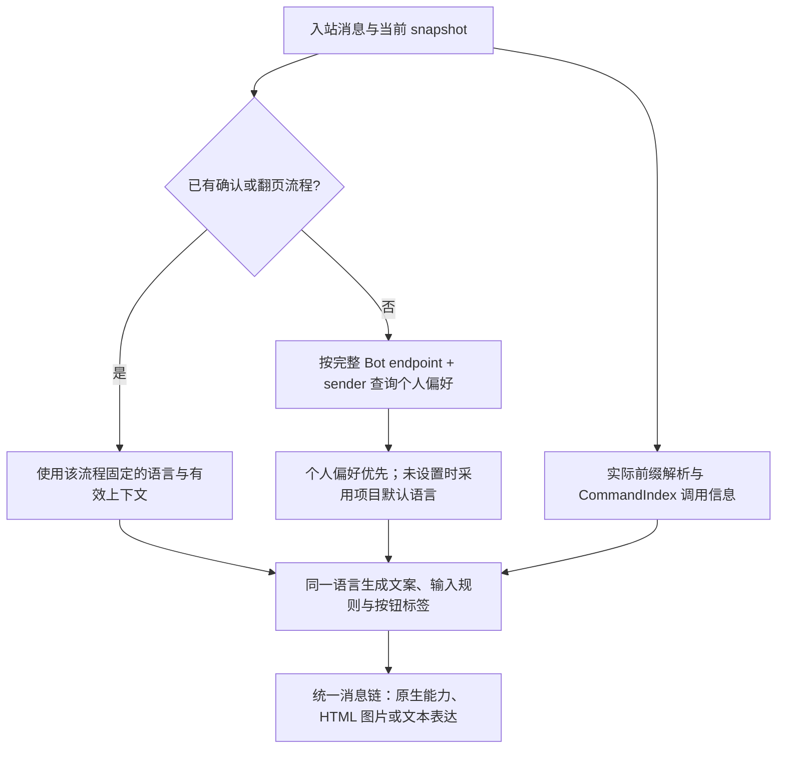

# Zhin 国际化与本地化实施计划

更新：2026-10-26。本文记录已确认的产品规则、实施范围和验收证据。跟踪 Issue：[#986](https://github.com/zhinjs/zhin/issues/986)。未勾选的项目仍在实施或等待验证。

实现分支为 `feat/issue-986-localization`，已整合主分支 `325530be5`。展示策略 PR #985 已合并。实现分别提交至 [Zhin #990](https://github.com/zhinjs/zhin/pull/990) 与 [Console #31](https://github.com/zhinjs/console/pull/31)；本轮不合并、发布、手动部署或启用定时跟进。

## 已确认的行为

| 项目 | 决定 |
| --- | --- |
| 语言 | 首批简体中文、英文；未配置时保留中文；新建项目可选语言 |
| 个人偏好 | 优先于项目默认值；群聊、频道也跟随本次发送者 |
| 身份范围 | 同一 Bot 账号跨私聊、群聊、频道共享；不自动跨账号或平台合并用户 |
| 多轮流程 | 确认、补问、菜单翻页固定开始时的语言；偏好修改只影响新操作 |
| 输入语言 | 内置菜单、确认、取消只接受所选语言的对应输入 |
| 切换入口 | 固定 `language zh-CN` / `language en`，沿用当前环境的命令前缀 |
| Console | 界面语言单独设置，不从管理员的界面语言推导聊天用户语言 |
| 时区 | 与语言独立，不根据英文或中文推断时区 |
| 命令示例 | 输出时从实际环境生成前缀与调用路径，不能硬编码或让模型猜测 |

示例：同一群内 A 的偏好为中文、B 为英文，各自的新操作按各自偏好回复。A 开始中文确认后，在另一会话设置英文，原确认仍按中文完成；之后的新操作使用英文。

已有交互优先消费当前发送者的回答。固定语言不意味着新增一个能绕过在途补问的全局指令通道；是否允许设置指令打断补问属于另一项行为，不能顺带改变路由。

## 实施前确认的源码缺口

| 位置 | 当前行为 | 必须解决的问题 |
| --- | --- | --- |
| `packages/im/command/src/provider.ts` | 创建 CommandIndex 时固定 `菜单` 或自定义关键词 | 同一索引服务不同语言用户，默认关键词必须在操作中解析 |
| `packages/im/command/src/arguments.ts` | 参数错误只有 `field/message`，消息多为英文 | 补充稳定原因和参数，再由展示层本地化，不能匹配错误字符串翻译 |
| `packages/im/core/src/built/user-interaction.ts` | 中文提示，输入同时接受中英；确认按钮内部值为 `yes/no` | 显示、文字输入与合法按钮动作必须分清，不能删掉英文集合后让中文按钮也失效 |
| `packages/im/core/src/plugin-runtime/im/command-menu-navigation.ts` | 翻页重新 dispatch，按钮与页码提示写死中文 | 首次菜单与翻页共用固定语言，不因后来点击者或偏好变化混用文案 |
| `plugins/utils/reminder/src/create-reminder.ts` | 接受 `取消/cancel`，只接受中文“确认”；多处写死 `remind list/create` | 文案、确认规则和可执行示例一起调整 |
| `packages/im/plugin-runtime/src/persistent-state.ts` | 已有按 owner、完整 endpoint、sender 分区的用户状态 | 复用身份与存储机制，不新建进程级语言 Map |
| `packages/im/runtime/src/host-config-schema.json` | 无统一 locale 配置，大量描述为固定中文 | 本地化显示元数据，保持配置字段和值的机器含义不变 |
| `packages/toolkit/scaffold-wizard` | 创建和增量配置共用向导，但语言未进入共享选项 | 一次语言选择贯通向导和生成配置，避免两套实现 |
| `packages/im/agent/src/user-profile.ts` | 已有可影响模型回复的 language/preferred_language 偏好 | 接入统一偏好前需明确优先级，不能让菜单和 Agent 各选一种语言 |

Console UI 属于独立仓库；实施前需刷新其远程源码，不能把历史本地检索当作当前部署审计。

## 命令输出必须和执行使用同一份事实

已核实，实际 IM 分发的默认前缀来自所属适配器实例：endpoint 配置覆盖实例配置，最终默认空字符串。显式传给 ImRuntime 的前缀还会覆盖默认解析器。不能只读取 Root 配置，也不能永远补 `/`。

现有菜单和命令 help 已接收到实际前缀，应复用这条链路。缺口在业务命令上下文：`CommandIndex.dispatch` 接收前缀，却没有把它传给 `execute` 的上下文；插件于是手拼命令名，提醒甚至从原输入用正则猜调用头。

建议通过现有命令上下文提供调用格式化能力，具体 API 名称在实现时统一，不在业务插件中重新实现前缀解析：

1. 从本次操作使用的 snapshot 与实际分发结果取得生效前缀。
2. 从 CommandIndex 取得目标命令的真实调用路径；考虑插件实例挂载路径、目标命令和参数，不能只拼包名。
3. 展示层把生成的命令作为翻译模板参数：例如“请使用 {command} 查看”，英文使用同一命令值。
4. 菜单、参数错误、超时、失败后核对提示、补问和 Agent 指引共用这份事实。
5. 输出只负责生成可复制的调用，不改变路由、权限或自动执行命令。不得通过扫描整条回复替换斜杠，破坏 URL、代码和用户原文。
6. 区分已确认的空前缀与缺少环境；未绑定目标的 CLI/API 路径不能假定一个聊天前缀。

假设真实调用路径为 `remind list`：

| 当前生效前缀 | 正确输出 |
| --- | --- |
| `/` | `/remind list` |
| `!` | `!remind list` |
| 空字符串 | `remind list` |

已有命令层级和挂载规则必须由索引确认，上表不表示所有安装都必然使用相同调用路径。固定 `language` 入口也经过相同格式化规则。

Agent 获得由运行时提供的调用信息，不依赖历史对话记忆。环境相关事实放在本轮上下文中，保留稳定系统提示和工具定义；不能为了输出命令，每轮改写全部工具 schema。生成式回答的正确性与确定性模板分开验收，不能声称给出提示后模型就绝不会误写。

## 设计方案

### 操作内解析，流程内固定

- 不引入可变的全局 currentLanguage；并发用户必须相互隔离。
- 保留当前 generation、owner、会话、父容器、线程与 sender 准入规则。语言偏好不提供新的执行或审批权限。
- 流程固定语言仍受现有取消、超时与 generation 失效规则约束，不能为了延续翻译让旧按钮继续有效。
- 个人偏好的持有者应统一，复用现有 Root 所有权与用户 scope；业务插件读取解析后的视图，避免每个插件保存一份语言偏好。

### 文案、输入和命令引用分开建模

- 文案目录由各包/插件维护，使用命名空间、稳定 key 和参数；缺失翻译要可检测。
- 本地化的是用户可见的标签、说明、错误和格式；配置 key、工具名、协议值、权限判定、普通插件命令名保持原义。
- 菜单等已确认要本地化的输入，从同一语言定义获取识别词与显示词。默认规则与用户显式自定义 menuKeyword 要区分，不能把显式配置悄悄翻译掉。
- 内部按钮动作采用结构化结果，不拿普通文本 `yes` 充当免校验的通行证。文本输入仍按该流程语言校验；序号和回调不能因此误接到其他用户或流程。
- 命令引用先解析成当前环境下的调用，再注入翻译；翻译者和模型都不负责选择前缀。
- 第三方插件提供的原文和显式自定义标签不会被自动机器翻译。通过文档说明如何主动接入翻译接口。

### 复用现有模块

- CLI 继续作为装配点；底层翻译契约不能依赖 Core 或可选 Agent。
- 展示复用已合并的命令反馈和菜单策略入口，不要求每个项目为切换语言另写 presenter。
- 翻译目录可按包独立维护；共享的纯翻译机制与操作上下文分开，具体包归属应在接口审查时确定，避免仅为翻译提前引入多个包和新的 Feature 体系。
- 日期和数字按明确的 locale 格式化，日期时间仍使用明确的 timezone。调度执行时区、超时和重试规则不随语言改变。
- UI 长文本需要布局验收；HTML 图片、Markdown、纯文本共享同一语义，不能只有图片是英文、降级文本仍是中文。

## 已批准的交付范围

用户已确认同时覆盖核心聊天闭环、官方插件、Console，并纳入与中文规则对应的有限英文自然时间。以下按依赖次序实施。

| 阶段 | 交付 | 完成条件 |
| --- | --- | --- |
| 1. 核心聊天闭环 | 项目语言配置、新建项目选择、个人语言设置、运行时语言上下文、统一命令引用；菜单/help/参数错误/确认/取消/超时等框架文案 | 同一个 Bot 中两名不同语言用户并发使用；切换后新操作生效、旧流程不变；所有命令提示可按当前前缀执行 |
| 2. 官方插件与 Console | 提醒/RSS 等官方路径、Schema 显示元数据、Console 界面选择；衔接 Agent 回复偏好 | 语言设置从创建到业务配置、聊天与管理端均可使用；明确后台通知的语言归属 |
| 3. 扩展本地化 | 英文自然时间、复数与数量、长文本排版及字体覆盖；插件作者指南与目录验证 | 支持明确列出的输入语法和字体，不把文案翻译冒充自然时间解析能力 |

按仓库交付可运行的路径和中文 issue/PR；不在 main 提交。新增实现使用 patch changeset。合并、发布和真实平台发送另按既有授权处理，不恢复自动跟进任务。

## 验收应覆盖的边界

- **身份**：同 Bot 同 sender 跨会话共享；不同 Bot、平台、sender 不串偏好；无 Agent 安装也能使用核心语言能力。
- **默认行为**：未配置仍中文；新项目英文选择贯通生成文件与运行时；`-y` 不擅自更改默认语言。
- **输入**：中文流程拒绝英文确认/取消，英文流程拒绝中文确认/取消；固定 `language` 入口可用；机器回调和序号在原权限范围内可用。
- **多轮**：修改偏好后原确认、补问、翻页及其失败/超时文案保持一致；新流程使用新偏好；旧代失效仍按原机制执行。
- **前缀**：空前缀、`/`、`!`、多字符前缀、endpoint 覆盖、适配器实例隔离、运行时显式覆盖、挂载路径、热重载前后分别验证。
- **调用真实性**：对生成的指令，在同一 synthetic endpoint 和对应 snapshot 派发，证明命中预期命令；不只断言字符串里含有 `/`。不存在或无目标环境的命令不能伪装成可执行示例。
- **交互链**：原生按钮、文本回退、菜单第一页/末页禁用、过期回调、取消和超时走真实消息运行链，不仅测试翻译函数。
- **展示**：中文/英文的文本、Markdown、HTML 菜单截图检查；长标题、分页、字体和排版不截断关键操作。
- **配置**：Schema 标签翻译不改变保存值；仍正确渲染、回显和校验；密钥、展开值不进入翻译日志。
- **缓存**：语言上下文仅携带必要信息；不把所有翻译目录塞进 prompt，不对稳定工具定义逐轮翻译。
- **证据**：分别报告源码检查、模拟端点集成、构建包消费者、本地截图、CI 与真实平台验证；未验证的项目不标完成。

## 补充确认与边界

- 项目语言无数据库也可使用；个人切换需要 SQLite、MySQL 或 PostgreSQL，不新增内存回退，不自动换数据库。
- 后台任务创建时固定语言：聊天任务为创建者当时语言，Console 管理员任务为项目语言。Console 当前界面语言仅影响管理展示。
- 提醒支持有限中英文对应语法，复用现有时区、夏令时和期限校验，不使用模型解析。
- 统一入站语言优先于旧 Agent profile 中的语言偏好；运行时将其作为本轮可信信息传递，不重写工具 schema 或稳定系统目录。
- 第三方没有翻译时保留作者原文。自动检测语言、更多语言和跨账号身份联动均不在本轮范围。

## 实施与验收记录

- [x] 纯文案目录与项目语言资源；无可变全局语言。
- [x] 真实 language 指令、SQL 持久偏好与完整 endpoint/sender 隔离；本地 SQLite 重启和能力热重载验证通过。
- [x] 命令上下文与 Message 从当前索引格式化调用；确认流程固定语言，后续操作读取新偏好；合成端点入站回归通过。
- [x] Tool 使用可信执行上下文语言，模型工具参数不能覆盖语言。
- [x] Schema 声明、JSON 投影和选项的显示翻译保持字段、验证和存储值不变；对应回归通过。
- [x] 新建项目和增量配置向导语言选择；中英文分别完成打包、干净安装、启动、切换语言及 SQLite 偏好重启保留的完整验收。
- [x] 官方插件、游戏、活动反馈与审核默认文案；任务创建语言贯通 Host 与适配器。包级构建和对应集成回归通过；自定义内容保持原样。
- [x] Console 静态文案、动态模型、Schema 与任务展示；411 项测试、类型检查和构建通过，实际 dist 配合模拟 Host 完成浏览器核验，英文切换保留草稿。
- [x] 中英文指南、patch changesets、独立安装后的公共类型与运行时消费者；完整本地 `check:all` 已在 `af2999693` 通过。
- [ ] 中文 PR、当前提交 CI 与审查闭环。

证据：`af2999693` 的 103 个包构建、完整本地 harness、中英文打包新装验收均通过。Console `9d2bfb6` 的 Validate CI 和仓库自动触发的预览检查通过。后台通知与活动反馈补齐后的 `66b640480` 通过本批 337 项回归、类型与架构门禁、常规 PR CI，文档完整构建及 6 项浏览器路径通过。[完整验收](https://github.com/zhinjs/zhin/actions/runs/40324810281) 中，MySQL/PostgreSQL 服务与四个平台的候选安装验收通过；其余检查被手动分支缺失本地 main 基准的 changeset 错误连带取消，修复后补跑。以上不代表真实平台发送或线上部署验证。

## 源码定位

- 前缀与实际派发：`packages/im/core/src/plugin-runtime/im/message-dispatcher.ts`
- 命令路径、菜单、help 与上下文创建：`packages/im/command/src/command-index.ts`、`definition.ts`
- 默认菜单关键词：`packages/im/command/src/provider.ts`
- 交互文字与按钮：`packages/im/core/src/built/user-interaction.ts`
- 交互生命周期与入站优先顺序：`packages/im/core/src/plugin-runtime/im/interaction-runtime.ts`、`inbound-runtime.ts`
- 用户状态及持久化范围：`packages/im/plugin-runtime/src/persistent-state.ts`、`basic/cli/src/plugin-runtime/database-state.ts`
- 提醒真实补问链：`plugins/utils/reminder/src/create-reminder.ts`
- 项目创建共享选项：`packages/toolkit/scaffold-wizard/src/types.ts`
