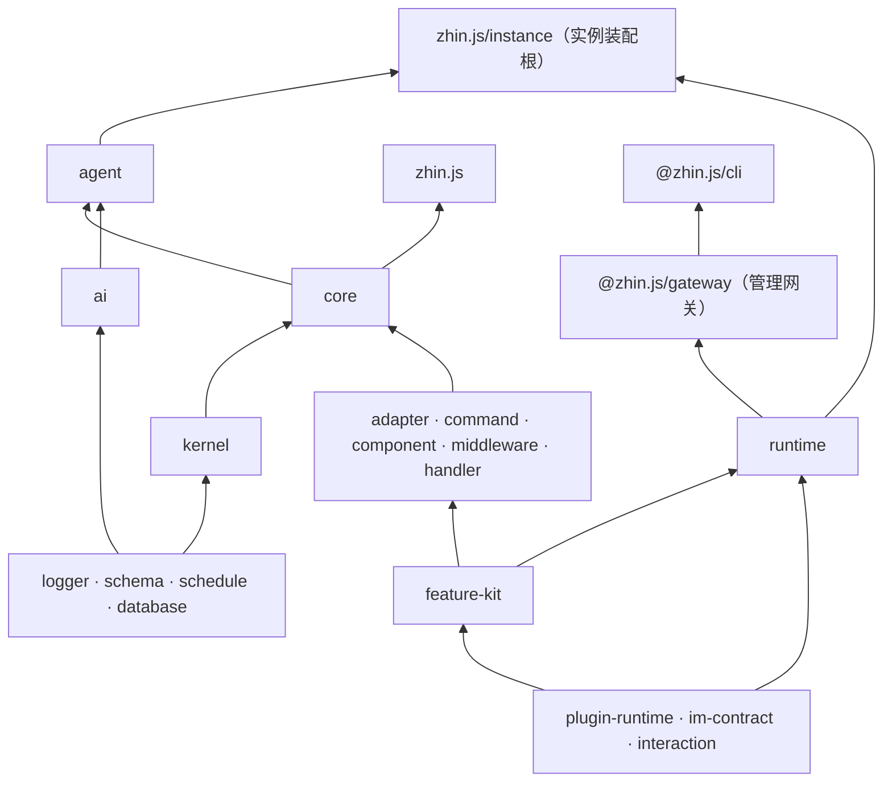

# 仓库结构

第一次 clone 这个仓库，顶层二十多个目录容易劝退；其实它们是 pnpm workspace（pnpm 9，构建编排用 turbo）按职责切出来的几块，看完本页就知道改东西该往哪钻。工作区覆盖范围以根目录 `pnpm-workspace.yaml` 为准。

## 顶层目录

| 目录 | 内容 |
| --- | --- |
| `basic/` | 基础层：`cli`、`database`、`logger`、`schedule`、`schema`（日志、数据库、配置校验、命令行） |
| `packages/im/` | IM 核心层：`adapter`、`agent`、`ai`、`command`、`component`、`config-file`、`core`、`feature-kit`、`harness`、`isolate`、`kernel`、`mcp-feature`、`middleware`、`plugin-runtime`（含 `im-contract`）、`runtime`（含 `host/` 通用安装器）、`skill`、`tool`、`zhin` 等 |
| `packages/console/` | Remote Console 支撑包（`client`、`layout`、`page`、`pagemanager`、`protocol` 含 `contract`/`review-kit`）。Host 提供 Server-Driven Blueprints 与 API，UI 在独立仓库 [zhin-console](https://github.com/zhinjs/console)（console.zhin.dev） |
| `packages/host/` | Host 运行时：`http`（`@zhin.js/host-http`）、`mcp`（MCP Server）、`a2a`（A2A Server）、`gateway`（`@zhin.js/gateway`，管理网关，ADR 0054） |
| `packages/toolkit/` | `create-zhin`（`pnpm create zhin-app`）、`scaffold-wizard`（配置向导）、`components`（纯 JSX 样式）、`tailwind`（静态工具类）、`html-renderer`（Shotium）、`speech` |
| `packages/game-kit/` | 游戏开发套件（供 `plugins/games/` 使用） |
| `plugins/adapters/` | 平台适配器：sandbox、qq、icqq、napcat、onebot11/12、discord、telegram、slack、kook、dingtalk、lark、line、wecom、email、github、satori 等 |
| `plugins/features/` | 功能插件（如 `process-monitor`） |
| `plugins/games/` | 游戏插件（blackjack、guess-number、idiom-chain、rps、tic-tac-toe 等） |
| `plugins/services/` | 服务插件（如 `activity-feedback`） |
| `plugins/utils/` | 工具插件（rss、repeater、lottery、music、qrcode、short-url、code-runner 等） |
| `examples/` | 参考实现，按复杂度分层：`single-file-bot`（一个 `bot.ts`）→ `minimal-bot`（Stable 约定目录，仅 IM）→ `full-bot`（L4）→ `test-bot`（维护者厨房水槽，非用户模板） |
| `deploy/` | 部署样例（如 `huggingface/`） |
| `scripts/` | harness 门禁脚本与构建/发布辅助脚本（`check-*.mjs`、`run-*.mjs`、`sync-*.mjs`） |
| `tests/` | 跨包契约测试、文档/配置对齐测试、快照（`contracts/`、`docs/`、`snapshots/`） |
| `docs/` | 本站点（VitePress） |
| `config/` | 仓库自用的 `zhin.config.yml` 参考配置 |
| `data/` | 本地运行数据（数据库、媒体、记忆等，不入库） |

每个 workspace 包都有独立的 `package.json`。目录内部的惯例也统一：Node 侧源码放 `src/`、构建产物放 `lib/`；浏览器侧源码放 `client/`、产物放 `dist/`。

## 分层与依赖方向

核心包之间的依赖方向是单向的，由 `pnpm check:architecture`（`scripts/check-architecture-layers.mjs`）强制检查。完整关系以[架构概览](../concepts/architecture.md)为 SSOT，常用主干如下：

`packages/im/harness`（`@zhin.js/harness`）是 ADR 0048 的多 Agent 协作微内核（Mailbox、Authority、预算账本、Guard Kernel、Engagement Journal），不含 IM 概念；`packages/im/agent/src/collaboration/` 把它接到 Agent 运行时并提供协作工具，多 Bot 协作场所（Venue）在 `packages/im/core/src/venue/`。

`plugin-runtime`、`im-contract` 与 `interaction` 是底层契约；Feature 包在其上描述单一能力，
`core` 负责组装 IM 链路。`kernel` 与 `ai` 不含 IM 概念。唯一跨层装配点是
`packages/im/zhin/src/instance/`（`zhin.js/instance`，ADR 0054 §0），在这里组合 IM、Agent 与 Console Host。
`@zhin.js/gateway`（`packages/host/gateway`：Console 账号与权限、终端、项目配置与依赖事务）与
`@zhin.js/cli` 不依赖 `zhin.js` 与 IM 层。

## 四个包与两个进程

| 包 | 目录 | 运行在哪里 |
| --- | --- | --- |
| `create-zhin-app` | `packages/toolkit/create-zhin` | 只在建项目时运行 |
| `@zhin.js/cli`（`zhin`） | `basic/cli` | 用户的终端；`zhin start` 拉起网关后，`stop / status / logs / install` 经 `.zhin/gateway.sock` 请求网关 |
| `@zhin.js/gateway` | `packages/host/gateway` | 网关进程：唯一的 HTTP 端口、认证、`console_*` 表、初始化与引导、终端、实例监管、依赖事务、日志 |
| `zhin.js` | `packages/im/zhin`（实例装配根 `src/instance/`） | 实例进程：由网关以子进程拉起，IM Runtime、插件、适配器、Agent、大部分 Console API |

两个进程之间是 Node IPC 控制通道，协议（路由表、分块请求 / 响应、WebSocket 帧、`restart-request`、`shutdown`、`catalog`、`audit`）在 `packages/host/http/src/bridge/`（`@zhin.js/host-http/bridge`），两边共用。改协议时同时改两边并提升协议版本；网关与实例的版本必须一起发布。进程模型与所有权见[分层架构](../concepts/architecture.md#gateway-and-instance)。

| 改什么 | 在哪里 |
| --- | --- |
| 登录、用户、角色、API 令牌、审计 | `packages/host/gateway/src/iam/` |
| 网关 HTTP 服务器、转发与 `gateway.*` RPC | `packages/host/gateway/src/http/` |
| 实例监管、日志采集 | `packages/host/gateway/src/supervisor/` |
| 本地控制套接字 | `packages/host/gateway/src/local/` |
| 依赖事务 | `packages/host/gateway/src/packages/`、`plugin-management/` |
| 初始化与引导 | `packages/host/gateway/src/onboarding/`、`iam/`（初始化服务） |
| 终端 | `packages/host/gateway/src/terminal/` |
| 网关自己的数据库连接 | `packages/host/gateway/src/database/` |
| 权限表 | `packages/console/protocol/src/permissions.ts` |
| 实例侧 Console RPC 与路由 | `packages/im/zhin/src/instance/console/` |
| CLI 命令 | `basic/cli/src/commands/` |

大型领域采用“一个 canonical 入口 + 单向内部协作”的深模块结构。当前收敛后的阅读入口是：

| 领域 | 阅读入口 | 内部职责 |
| --- | --- | --- |
| Agent Harness | `packages/im/harness/src/index.ts` | Mailbox、Authority 收窄、预算账本、Guard Kernel、Engagement Journal |
| Extended Console RPC | `packages/host/http/src/console-rpc-extended/index.ts` | 薄 Dispatcher、schedule/inbox/login/Endpoint RPC 域 |

目录存在的目的不是缩短单个文件，而是让调用方只依赖稳定入口，让状态、策略和 IO
实现保持单向关系。`pnpm check:domain-module-boundaries` 禁止模块外深层导入和旧平面入口回归（当前登记的受保护目录是 Extended Console RPC）。

## 核心模块的维护边界

核心目录的代码审查责任登记在 `.github/CODEOWNERS`，当前由 `@lc-cn` 维护。
CODEOWNERS 负责请求审查；是否要求审查通过由 GitHub 分支保护设置决定。

| 模块 | 修改入口 | 状态与职责边界 | 主要验证 |
| --- | --- | --- | --- |
| Plugin Runtime / RootRuntime | `packages/im/plugin-runtime/CONTEXT.md`、`packages/im/runtime/src/root-runtime.ts`、`packages/im/runtime/src/host/` | generation、snapshot、资源租约与切换；`runtime/src/host/` 是进程生命周期、就绪探针与发布日志等通用 Host 机制，HTTP/Protocol/Speech/HTML-Renderer Host 安装器在 `packages/im/zhin/src/instance/*-host-installer.ts` | 生命周期与热重载测试、`check:architecture` |
| IM / Adapter | `packages/im/core/src/plugin-runtime/im/inbound-spine.ts`、`packages/im/adapter/src/adapter-index.ts` | Core 组合入站脊柱（`inbound-spine` / `inbound-runtime`）与出站链路；Database/Outbound/Inbox Host 位于 `@zhin.js/core/runtime` | 消息链路与端点测试、`check:harness-paths`、`check:adapter-endpoint-boundaries` |
| Agent / Harness | `packages/im/agent/src/plugin-runtime/ingress/unified-mailbox-spine.ts`、`packages/im/harness/src/harness.ts`、`packages/im/agent/src/collaboration/` | 统一信箱入站脊柱（`unified-mailbox-spine`）与协作护栏分开；Agent/Inference Host 运行时位于 `@zhin.js/agent/runtime`，其安装器在 `packages/im/zhin/src/instance/agent/host-installer.ts` | 领域与持久化测试、`check:architecture` |
| HTTP / Console | `packages/host/http/src/http-host.ts`、`packages/console/protocol/`、`packages/console/pagemanager/src/shell/page-renderer.ts` | Host 拥有监听与路由；wire 与 Blueprint 契约在 `protocol/`；Console 外壳与 Blueprint 渲染在 `pagemanager/` | Host/RPC 测试、`check:console-protocol-boundaries`、`check:console-contract` |
| 实例装配根 | `packages/im/zhin/src/instance/start-command.ts` | `zhin.js/instance` 组合 IM、Agent 与 Console Host；运行时侧 Console 后端在 `instance/console/` | 装配与 Console 测试、`check:architecture` |
| 管理网关 | `packages/host/gateway/src/` | Console 账号与权限（`iam/`）、终端（`terminal/`）、项目配置（`config/`、`project/`）、依赖事务（`plugin-management/`）、实例监管；不依赖 `zhin.js` 与 IM 层 | 网关测试、`check:architecture` |
| CLI / 脚手架 | `basic/cli/src/commands/`、`packages/toolkit/scaffold-wizard/src/` | CLI 只管理项目、不依赖 IM 层，需要实例代码时按项目解析 `zhin.js/instance`；向导提供配置机制，用户配置文件不由模板覆盖 | CLI/向导测试、`check:created-project` |

修改前先确认状态归属、公开入口和实际调用方。拆分大型文件时，以可独立变化的规则、
状态所有权和 IO 为边界，保留对外入口；不要同时引入新的能力或配置格式。
新增受保护领域目录时，登记门禁并补充允许入口、违规导入与失败路径测试。
当前领域目录门禁只保护已登记的深模块（Extended Console RPC），不代表所有领域内部都已受到相同约束。

插件的约定能力也遵循同一原则：`commands/<path>/index.ts`、`adapters/<name>/index.ts`、
`agents/<name>/`、`skills/<name>/`、`tools/<name>/index.ts` 是能力所有权边界。仅供某个能力
使用的 definition、handler 或 helper 放在该能力目录内；多个能力共享且属于插件运行态的实现
才放在 `src/`，并通过稳定包入口或一个局部桥接模块使用。叶子 `index.ts` 不得用多层相对路径
回穿包根 `src/`。适配器 Command 与 Agent Skill Tool 的这项约束由
`pnpm check:agent-tool-authoring-boundaries` 强制检查。

## AGENTS.md 导读

改代码前，先读仓库根目录的 [`AGENTS.md`](https://github.com/zhinjs/zhin/blob/main/AGENTS.md)——它是给 AI 编码代理和贡献者的最小入口。里面有项目概览与版本约束（Node `>=22.19.0`、pnpm 9、changesets 发布流）、常用命令（`pnpm dev` / `pnpm build` / `pnpm test` / `pnpm check:all`，详见[开发流程](./development.md)）、必须遵守的代码约定（`.js` 扩展名导入、**新插件走 `definePlugin` / 约定目录**、Legacy `usePlugin`/`getPlugin` 残留规则、消息统一链路等，详见[代码约定](./conventions.md)），还有一份任务路由：按改动领域列出该看的包和文档（核心 → `packages/im/core`，AI 引擎 → `packages/im/ai`，编排 → `packages/im/agent`，适配器 → `plugins/adapters`……），外加最常改动的高价值文件清单（`plugin.ts`、`adapter.ts`、`dispatcher.ts` 等）。

部分子目录还有自己的 `AGENTS.md` 或 `CONTEXT.md`（如 `packages/im/plugin-runtime/CONTEXT.md` 描述 generation / Root lifecycle 的术语与约束）。在某个包里工作时，优先看离它最近的那一份。
