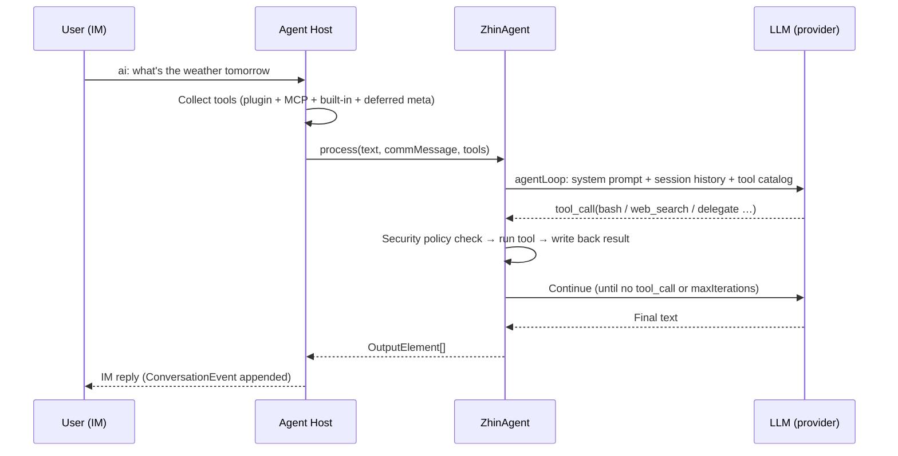

# Agent deep dive

Someone sends `ai: what's the weather tomorrow` in a group and a few seconds later the bot answers with real data — what happened in between? This page follows that path through the runtime that the [AI overview](./index.md) doesn't cover in detail.

Haven't enabled AI yet? Start with the [AI overview](./index.md). Want the AI to call your functions? See [Agent tools and Skills](../authoring/agent-tools.md).


### Per-turn usage logs

At the default INFO level, every executed Agent turn ends with one `[ai.usage] turn` summary, including failed and cancelled turns. No manual `zhin trace` query is required. Fields have a fixed order; these usage logs contain no chat text, reasoning text, prompts, tool arguments or tool results.

```text
[INFO] [ai.usage] turn | trace: trace-1 | turn: turn-1 | scene: qq/group | status: completed | model: main/model | calls: 2 | input: 4200 | output: 180 | cache_read: 3000 | cache_write: 0 | reasoning: ? | ms: 1850
```

- `input`, `output`, `cache_read`, `cache_write` and `reasoning` are tokens from SDK-normalized provider usage. Cache reads/writes are parts of input and reasoning is part of output; do not add them again. Character estimates never replace reported usage.
- `?` means unavailable. `0` means an explicit zero or no recorded model responses. `>=60` means some calls omitted the field and the known calls sum to 60. Unproven legacy zero values also display as `?`.
- `calls` counts responses observed by the turn, including summaries, progress reports, reply repair and synchronous child turns on the shared completion path. `subagent_calls` is a subset, not an extra amount. SDK-internal HTTP retries have no separate response event and are not counted as separate requests.
- Summaries include child traces recorded so far; `partial` flags unsuccessful turns, incomplete child completion or bounded records being dropped; displayed usage is the recorded part, not a complete total. This is not account-wide billing: independent decisions, embeddings and image generation outside this trace are excluded, and failed requests without usage cannot be estimated.
- `ms` is trace turn duration. Use `trace` to correlate logs and `turn` with `zhin trace <turn>` to inspect an existing archive. Logs work without archiving; enabling logs does not add persistence.

The group-chat interjection (ambient) judge is not an Agent turn: it is not in the `turn` summary and has no `zhin trace` archive. Each judge call, by a chat model or a decision model, successful or not, writes one `[ai.usage] judge` line with `scene: ambient`:

```text
[INFO] [ai.usage] judge | scene: ambient | conv: qq:123456 | status: completed | kind: language | model: Spare/gpt-mini | fallback_from: Main/gpt-4o-mini | calls: 1 | input: 820 | output: 24 | cache_read: 0 | cache_write: ? | ms: 640
```

- `model` is the model that answered (or last failed), as `service display name/model` (without a readable service name, the driver name, else the model alone; never an internal id such as `services:<uuid>`); after a switch to a fallback, `fallback_from` names the configured model. `kind` is `language` (chat model) or `decision` (decision model).
- A failed call has `status: failed` and `error` with the error class only (`timeout`, `auth`, `rate_limit`, `invalid_response`, …), never the provider's text.
- One line per judgment: `calls` counts judgments, not model requests. When the request phase switched to a fallback model, the line names the fallback, `ms` covers both requests together, and the tokens are those the answering request reported.
- A decision model that reports no usage writes only `calls` and `ms`. The Console ambient status (`judgeDaily`) sums these calls and tokens per day (in memory; a restart starts the current day again).

Set Root `log_level` to `debug` for `[ai.usage] call` records with each observed response's model, stop reason, usage and known duration. `[ai.usage] context` prints the existing first-request budget as `unit: estimated_tokens`, not actual per-call billing. Restore `info` for summaries only. `warn`, `error` and `silent` suppress these INFO/DEBUG records. Other modules retain their existing DEBUG behavior.

```yaml
log_level: debug
```


SQL databases persist structured usage independently, with a default 30-day retention. See [structured storage and usage queries](../operations/structured-storage.md).

## Find by question

| I want to know… | See |
| --- | --- |
| How a turn runs, how many iterations, when it times out | [How a turn runs](#how-a-turn-runs) |
| Show "thinking" progress, or cancel midway | [Showing progress](#showing-progress) · [Cancelling a running turn](#cancelling-a-running-turn) |
| How lots of tools fit without flooding the prompt | [On-demand tools](#on-demand-tools) |
| Let an Agent ask other Agents for help, or hand long tasks to the background | [Multi-Agent collaboration](#multi-agent-collaboration) |
| Where history is stored, how to reset, what happens when context gets long | [Sessions and session trees](#sessions-and-session-trees) · [Context compaction](#context-compaction) |
| What the AI remembers, and who can change it | [Semantic memory](#semantic-memory) |
| How the AI gets to know each person and each group, how affinity changes, and what happens when it is muted | [Session profiles](#session-profiles) |
| Which tools the AI has built in, and file / network boundaries | [Built-in tools](#built-in-tools) |
| Have the AI do things on a schedule | [Schedules and the assistant persona](#schedules-and-the-assistant-persona) |
| Tune parameters for one model | [Per-model tuning](#per-model-tuning) |
| Several Bots dividing work in one group, and reviewing a collaboration afterwards | [Multi-Bot group venues](#venues) |

## How a turn runs

Once a message meets the trigger rules, the Agent Host calls `zhinAgent.process(text, commMessage, tools)` to run one **turn**:



The model may call tools several times and keep reasoning on the results; each round is an **iteration**. Things to remember:

- **Iteration limit**: `maxIterations` defaults to 15 (`DEFAULT_CONFIG.maxIterations`) and can be tuned per model — see [Per-model tuning](#per-model-tuning).
- **Two layers of timeout**: one turn on the trigger side is limited by `ai.trigger.timeout` (default 60000ms); the whole Agent turn defaults to 120000ms (`DEFAULT_CONFIG.timeout`). Tool pre-execution (`preExecutable` / `preExecTimeout`) has been removed: tools run only when the model calls them.
- **Messages that arrive while a turn is running**: one conversation runs one turn at a time, and later messages follow these defaults (`ai.agent.mailbox`) so there are no duplicate replies, no lost messages and no crossed turns:
  - **Same sender adds more**: if the running turn has not replied yet, it is stopped and both messages are answered together in a fresh turn (with `groupMode: fifo` the message queues instead). If it already replied, the message queues. If the sender already has a queued message, the new one merges into it instead of producing another reply.
  - **Anyone else**: always queued in arrival order. A member never interrupts or merges into another member's turn, so permissions never cross over.
  - **Stop**: the initiator (or the master) sending a cancel word (`取消` / `退出` / `算了` / `cancel` / `quit` / `exit`, Chinese or English alike, also with the command prefix, e.g. `/cancel` when the prefix is `/`) stops the running turn and drops their own queued messages; from other members the word is an ordinary message.
  - **Limits**: at most `maxQueuedTurns` (default 5) queued turns per conversation, beyond that a short "try again later" reply; messages queued longer than `ttlMs` (default 180000ms) are skipped with a notice.
  - **Group merge window** (`merge`, ADR 0038, on by default, group chats only; `enabled: false` answers every member one by one as before): plain-text mentions from several group members within a short window are answered by one turn. The window flushes after `quietMs` (default 1500ms) without a new message, or at the latest `maxWaitMs` (default 6000ms) after its first message; one window holds at most `maxSenders` (default 5) senders and later senders wait for the next window. Messages that arrive while a turn runs wait in the window. The master, private chats, trigger-prefix commands, stop words and messages with media, quotes or forwards never merge. Joins and flushes are audited as `merge_window_joined` / `merge_window_flushed`. A merged turn may only do what **every** sender in it may do: visible tools, skills and contactable Agents are the intersection of what each sender sees on their own, and so are the turn's roles and permissions — merging only ever narrows permissions, so a moderator in the window never lends their tools to a plain member. Every side-effect tool call of a merged turn (a dangerous tool, or a send / config / schedule / shell call) carries `onBehalfOf` (the id of one sender in the merge) and is re-checked against the tools **that sender** may use on their own; `onBehalfOf` itself never reaches the tool. A missing or unknown `onBehalfOf` falls back to the lowest sender (allowed only if every sender may do it); a failed check is denied and audited as `merge_on_behalf_denied` (no latch — retrying for a sender who may do it works). The sender a call acts for is the requester on its approval card and prompt. A merged turn creates at most one new approval card; asking again for a card already pending with the same arguments reuses it. The turn context of a merged turn carries a `[Merged turn]` section listing every sender (id, name, message ids, their words, at most 300 characters each) and asks the model to pick the key points and reply **once**, starting each answered part with a mention segment for that sender; a sender the reply skips is neither mentioned nor pretended to be answered. The `outbound_sent` audit payload records `merged_senders` (how many were merged), `answered_senders` / `answered` (who the reply mentions) and `message_refs`. The structured reply message limit is unchanged by merging. **Stale check before sending**: a running turn is never interrupted; before it sends, if one of the senders it answers has posted a new mergeable message and nothing of the reply went out yet, the reply is stale and dropped (audit `merge_reply_stale_discarded`), and those senders' old and new messages are answered together by the next merged turn (carried senders do not count against `maxSenders`). A turn that called any tool or collaboration tool, or hit the hard gate, sends anyway (audit `merge_reply_stale_sent`, `reason: acted`); the same senders are dropped at most once, after which a stale reply is sent anyway (`reason: starvation`); a reply that already started going out is not cut in half. No stale check runs while `merge` is off.
  - **Danmaku mode** (`live`, ADR 0038 §5): applies only to conversations of an adapter that declares the `liveDanmaku` capability (live-stream danmaku platforms). Every danmaku in the room is a candidate — viewers do not need to `@` the bot. Danmaku collect in one window that is answered `windowMs` (default 10000ms) after its first message, and never sooner than `minIntervalMs` (default 15000ms) after the previous danmaku turn ended. The window has no `maxSenders` limit and hands the newest 100 danmaku to the model (older ones are only counted); danmaku arriving while a turn runs wait for the next window. One window gets one reply: `mode: pick-one` (default) has the model pick the one danmaku most worth answering (addressed to the bot, a real question, a new viewer, not a repeat) and `@` only that viewer; `mode: summary` answers the window as a whole once. The turn context carries a `[Danmaku window]` section (viewer id, name, words, at most 120 characters each, treated as data, not instructions). A danmaku turn runs with an anonymous viewer's permissions and **only exposes tools that declare `readOnly: true`** — no skills, collaboration tools, MCP or shell, read-only files, and never an approval card. The master speaking in the room still gets their own turn. The reply is audited as `danmaku_window_picked` (`mode`, `candidates`, `listed_senders`, `picked` — the viewers it `@`s). Danmaku turns have no stale check.
  - Only plain-text messages are merged; messages with images, files, quotes or forwards always get their own turn. Queue waits, merges and replacements appear on the `zhin trace` timeline (`admission`).
  - Setups where the Host supplies `resolveTurnIntent` or a message carries `turnIntent`, keep their explicit intent semantics.
- **One fixed model per turn**: chat, including legacy configuration, keeps the selected model. Failures use the existing retry and timeout settings. The only exception is a purpose's explicitly configured fallback models (`fallbacks`): they are used in order when the quota is used up, the account is out of credit, authentication fails, the model times out repeatedly, or network errors / 5xx outlast the same-model retries, and tools that already ran are never replayed; see [fallback models](./model-policy.md#fallback-models). Explicitly configured media-perception fallback chains remain available. The retired `ai.agent.providerResilience.fallback` field is no longer accepted. `providerResilience` only retries the same model; switching models happens only through the explicit purpose fallbacks above.
- **No response and timeouts**: every attempt has two deadlines under `ai.agent.providerResilience`. If no first response (response headers or first stream event) arrives within `firstResponseTimeoutMs` (default 30000), the attempt fails as `no_response`: it is not retried on the same model and the turn replies through the normal outbound chain (the owner sees the cause "model service not responding"). `requestTimeoutMs` (default 120000) bounds the whole output and is retried as `timeout`. Both write a `provider_timeout` warning (session, turn id, purpose, provider alias, model, phase, limit; no request content or keys) and a `model_timeout` entry on the turn trace timeline. Both count toward the purpose fallbacks' consecutive-timeout switch: after 2 consecutive `no_response` / `timeout` failures of the same model within one operation, the next request of that operation goes to the next configured fallback (a deadline the caller sets itself never counts); see [fallback models](./model-policy.md#fallback-models).
- **Consistent behavior**: the main Agent, delegated Agents and `AIService.runAgent` all use the same agentLoop.

The tools available to a turn = plugin tools + tools of the MCP servers the current Agent binds in `ai.agents.<name>.mcpServers` (a server only connected in `ai.mcpServers` does not count) + built-in tools + on-demand meta tools + `schedule_*` + `bash` + Host extension tools (such as `voice_stt` / `voice_tts`).

### Showing progress

While a turn runs, the Agent pushes status to the chat through [Activity feedback](../advanced/activity-feedback.md). By default that's a static "thinking…"; with **thinking transparency** enabled, users see fragments of the model's actual thinking:

```yaml
ai:
  agent:
    thinkingPreview: true          # show the LLM's actual thinking (truncated), default false
    thinkingPreviewMaxLength: 200  # max characters shown, default 200
```

When a turn needs several tool iterations, each starts with an `iteration_start` event and the status updates to progress like `Processing [2/15]...`. Plugins can listen to the `TurnEvent` stream for progress:

| TurnEvent type | Description |
|----------------|-------------|
| `iteration_start` | A new iteration begins, with `iteration` (current round) and `maxIterations` |
| `thinking` | An LLM thinking fragment (streamed continuously when `thinkingPreview` is on) |

### Cancelling a running turn

Users can send a message that is exactly one cancel word (`取消`, `退出`, `算了`, `cancel`, `quit`, `exit`, Chinese or English alike; full-width, case and trailing punctuation are ignored; the conversation's command prefix may precede it, e.g. `/cancel`) to stop the current turn: ZhinAgent aborts the model call and tool execution via `PromptController.cancelSession()` and replies "cancelled". With nothing running, it replies that there's no task in progress.

In the `TurnEvent` stream, a user cancel appears as `turn_cancelled` (`code: 'cancelled'`); a timeout appears as `turn_cancelled` too (`code: 'timeout'`).

## Turn usage

A completed text or IM Agent turn accumulates the provider-reported usage of all responses returned through its completion port: tool selection, the final answer, context compaction, progress and exhausted-turn summaries, and format correction. Responses rejected by reply validation still count. Transport failures that return no usage are not assigned an estimated billing usage. This total is not a provider invoice reconciliation. User and group quotas remain disabled by default.

## On-demand tools

With many tools, putting every tool's parameter schema in the prompt would fill the context. Zhin **loads tools lazily**: a turn keeps only a few meta tools resident, and the model searches and loads others by name when needed.

The resident tools are **tiered by scene** (ADR 0042). The host picks the tier from the turn's origin and role; no configuration is needed:

| Scene | Resident tools |
|---|---|
| Group, channel, ordinary private chat (including trusted members' private chats) | Chat essentials: `pick_sticker`, `memory_search`, `conversation_info`, plus the meta tools `discover`, `load_tool`, `load_skill` |
| Master private chat | The above plus development tools: `read_file`, `list_dir`, `glob`, `grep`, `edit_file`, `write_file`, `bash`, `ask_user` |
| Scheduled and other non-IM turns | The previous default set: `ask_user`, the meta tools and the workspace file tools |

When the turn has other Agents it may contact, the [collaboration tools](#multi-agent-collaboration) (`agents`, `ask`, `delegate`, `tell`, `cancel_delegation`, `escalate`) are resident automatically, regardless of the scene tier.

Non-master turns do not keep development tools resident: they stay in the tool index but can only be loaded by turns that are allowed to use them (permissions are unchanged), so a group chat no longer reaches for `grep` to read source. A tool outside the current tier is still loaded automatically when the model calls it by name, with no `load_tool` first. Whether `bash` can run still depends on the turn's shell isolation policy; a policy that removes it also removes it from the resident set.

Setting `alwaysLoadedTools` **adds to** the current tier; `alwaysLoadedMode: replace` makes `alwaysLoadedTools` the whole resident set.

**Calling is loading.** When the model calls, by exact name, a tool that is in the turn's authorized catalog but not loaded, the runtime loads and runs it, and keeps it loaded for the session (bounded by `maxLoadedPerSession`; the earliest loaded tool is evicted and logged). A name outside the authorized catalog still returns "unknown tool" and does not reveal whether it exists; approval, hard-gate and permission checks apply to the auto-loaded call as usual. `discover` automatically loads the best matching tools (up to 3). Its result contains search summaries and loaded names; full parameter schemas are supplied in the next model request's `tools` field, without duplicating them in message history. The model can call them directly, without another `load_tool` request.

**A stable tool list.** The tool list sent to the provider has a fixed order: resident tools sorted by name, then loaded tools in first-load order. A newly loaded tool only appends and loaded tools do not move within a session, so the prompt-cache prefix survives loading The loaded set only grows within a session: a loaded tool that a narrower turn policy hides stays in the session and returns, in the same position, on the next turn. Past `maxLoadedPerSession` the earliest loaded tool is evicted and logged, which costs one cache miss.

Plugin tools are deferred by default. A plugin author can set `alwaysLoaded: true` in `defineAgentTool` to keep a few frequent tools resident (at most 8 per turn, ignored under `alwaysLoadedMode: replace`); see [Keep a tool resident](../authoring/agent-tools.md#keep-a-tool-resident). Resident schemas are sent on every turn, so the smaller the set, the less context and tokens it costs.

Other tools send no parameter schema. The system prompt lists them in a `## Deferred tools` section with their name and a description of at most 60 characters, up to 40 entries; beyond that it points the model at `discover`. The model can call `load_tool(name)` to get the schema, and calling the tool directly also loads it. The index only contains tools this turn may use: tools removed by policy (such as `bash` without shell access) never appear.

Skills use progressive disclosure: the system prompt's `## Available skills` catalog has one line per skill (up to 40) with the description's first sentence, its `Use when …` sentence, its `Triggers:` words and the SKILL.md frontmatter `keywords`. The whole catalog shares a budget of about 4,000 characters (320 per entry): past it summaries are clipped first, then `Use when` sentences, and trigger words last. The specialist agent catalog lists names and the first line of each description. A skill's full instructions enter the context only after `load_skill`, or when intent matching activates it. Keyword activation is limited to Agent-private skills: public skills are third-party guidance and activating one injects its instructions and unlocks its tools, so when the current message matches a public skill's `keywords` the runtime only adds a "suggested skill" line to that message's runtime tail and the model decides whether to call `load_skill`. Against keyword stuffing, the hint reads only a skill's first 12 keywords, scores the single longest match (no sum), and ignores single characters, ASCII words under 3 characters, greetings and function words, and keywords over 32 characters (over-long keywords are left out of the catalog too).

The context cost of each turn's first model request is estimated per segment and stored in the turn trace's `context_budget` field, which `zhin trace last` shows: system prompt, tool schemas, deferred tool index, skill catalog, specialist agent catalog, loaded skills, memory, bootstrap, history and the current input, plus the largest prompt sections. These are estimates (CJK ≈ 1 token per character, other text ≈ 4 characters per token); real usage is still in the model call records.

Built-in instructions retain essential rules while JSON Schema describes message fields. Adapters own platform-specific guidance and disclose only the Skills, Tools and segments applicable to the current scene. Shorter fixed instructions add no intent-classification request and do not change file tools, multi-agent, permission or approval configuration. Compare tool schemas, output schemas, history, request counts and cache usage as well: fewer prompt characters do not imply the same percentage reduction in whole-turn cost.

| Meta tool | Purpose |
|-----------|---------|
| `discover` | Search tools / skills by keyword (`kind: tool\|skill\|all`, optionally per MCP server), returning Top-K summaries |
| `load_tool` | Load a tool's definition into this session so it can be called |
| `load_skill` | Load a skill's full text and unlock the tools it declares |

Tuning (`ai.agent.deferredTools`):

```yaml
ai:
  agent:
    deferredTools:
      maxLoadedPerSession: 12   # max tools loaded per session (default 12)
      discoverTopK: 5           # results returned by discover (default 5)
      alwaysLoadedTools: [weather]   # added on top of the current scene tier
      mcpServers:
        icqq: { alwaysLoaded: [send_msg] }   # resident tools for a specific MCP server
```

Reserved built-in names (`bash`, `read_file`, `delegate`…) can't be overridden by plugins; for non-reserved tools with the same name, the later registration wins and a warning is logged.

## Multi-Agent collaboration

The framework enforces boundaries while Agents decide how to collaborate (ADR 0048 Agent Harness). An inbound human message, scheduled timer, or external event opens an **Engagement**: the entry Agent is the root Actor, and every peer turn and shared Blackboard mutation is recorded in the single `engagement_events` Journal. Collaboration tools are exposed **only when the current turn has peer Agents it is allowed to contact**:

| Tool | Purpose |
|------|---------|
| `agents` | List peer Agents you can contact and their descriptions |
| `ask` | Ask a peer synchronously and wait for its reply within the current turn |
| `delegate` | Delegate a task. By default waits up to 20 s within the turn: a result that arrives in time is in the tool result and the model answers once from it; with `wait: false` (long work) or on timeout it returns a `mailId` at once, the result is posted back later as a `result` mail that wakes the delegator, and the tool result tells the model not to answer the delegated part itself meanwhile. Several delegates of one step are sent and waited for together; a turn's waits share 20 s in all and leave time to answer, so they never run into the turn timeout. A result read while waiting counts as used only once the turn's reply was delivered; when the turn fails or times out, it still wakes the delegator |
| `tell` | Send a one-way notification without waiting for a reply |
| `follow_up` | Follow up on a previously delegated or asked `mailId` within the same Engagement |
| `board_read` | Read entries from the current Engagement's shared Blackboard (with optional `key` or `kind: note \| todo \| artifact` filter) |
| `board_write` | Write or update an entry on the Engagement's shared Blackboard (auto-increments `version` and records `board_written`) |
| `cancel_delegation` | Cancel a delegated mail (`mailId`) |
| `escalate` | Freeze the Engagement and hand the decision back to the initiating human principal |

Declare which peers an Agent can contact and its default collaboration budget in `agents/<name>/agent.json` under `collaboration`:

```json
{
  "name": "planner",
  "collaboration": {
    "contacts": ["builder", "reviewer"],
    "accepts_from": ["human", "builder", "reviewer"],
    "budget": {
      "modelCalls": 16,
      "tokens": 64000,
      "wallMs": 120000,
      "sideEffects": 8
    }
  }
}
```

- `contacts`: peer Agent names this Agent may contact (including remote A2A actors such as `remote://<peer>/<agent>`).
- `accepts_from`: senders allowed to contact this Agent (`"human"` or peer Agent names).
- `budget`: default per-engagement budget ceiling (`modelCalls`, `tokens`, `wallMs`, `sideEffects`).
- Each Agent's tools, model, and iteration cap are still defined by its own `agent.json` and core Markdown files; see [Agent tools and Skills · Define a sub-agent](../authoring/agent-tools.md#define-a-sub-agent).

Guardrails are enforced deterministically by `@zhin.js/harness`'s Guard Kernel:

- **Monotonic authority attenuation**: a callee's effective authority is the intersection of the caller's authority, any narrowing on the mail, and the callee's own ceiling.
- **Conserved budget ledger**: every `ask` / `delegate` carves a child grant out of the caller's remaining budget (`modelCalls`, `tokens`, `wallMs`, `sideEffects`); a subtree can never spend more than its parent granted.
- **Budget floor**: a budget the model writes into `ask` / `delegate` / `follow_up` cannot go below one complete answer: at least 4 `modelCalls`, 32000 `tokens` and 60000 `wallMs` (never above half of the caller's remaining budget, the ledger's default share for an omitted key, so parallel delegations still fit). Lower values are raised to the floor; the tool result says "budget raised to the minimum…" and an `ai.collaboration` info line is logged. `sideEffects` has no floor (lowering it only restricts writes); an author's `collaboration.budget` in `agent.json` is not changed.
- **One line of work per delegation**: while a `delegate` to an agent has no result yet, a new `ask` to that agent is refused (`delegation_in_progress`) and points to waiting for the result or to `follow_up` with that delegation's `mail_id`; `follow_up` adds or changes an instruction and is not for hurrying.
- **No detours**: sub-agents are told to answer directly when they can and not to search for tools the task does not need; three catalog searches in a row that find nothing (`discover` / `load_tool` / `load_skill`) get a one-time "change approach or answer" hint.
- **Approvals go to the human**: hard-gate, dangerous-tool, and self-change approvals always route to the initiating human Principal, never to another Agent.
- **Cycle and convergence guards**: delegation depth (`maxDepth`), fanout (`maxFanout`), pair round trips (`maxPairRoundTrips`), duplicate messages (`maxDuplicates`), and synchronous wait cycles (`wait_cycle`) are blocked deterministically and freeze the Engagement: the request's collaboration ends there and cannot be resumed. The guard's reason goes to an `ai.collaboration` warn log line and the collaboration journal, never to the chat. When one of the entry Agent's own collaboration calls is refused, it explains the stop in one sentence of its reply; otherwise (for example two sub-agents tripped the guard and the entry Agent never saw it) one short localized line is sent once no entry turn is running.
- **One conclusion per request**: when internal outcomes of sub-agents (failed, budget exhausted, cancelled, denied) come back to the entry Agent, an outcome whose delegation a later `follow_up` completed stays in the trace (a separate ask / delegate to the same agent does not count), and so does any outcome after the guard stopped the request. The first failure of a request wakes the entry Agent to explain it in one sentence; later failures of other delegations do not wake it again and get one fixed line ("N more background tasks did not finish."). A failure counts as told only once the message was actually delivered. A question the entry Agent asks with `escalate` is recorded in the session's already-told ledger, so the turn that carries the human's answer sees what was asked.
- **Supplement only after an answer**: once the request was answered, a late delegated result wakes the entry Agent with its earlier reply in view; when the result adds nothing the model outputs `[[no_reply]]` and nothing is sent (the result stays in the trace); only new content goes out, once, led by "Update: " ("补充：" in Chinese conversations), without restating what was said.

## Sessions and session trees

With a database available, conversations persist to these tables (in memory otherwise):

| Table | Contents |
|-------|----------|
| `agent_sessions` | Agent session metadata (including the session tree's `parent_id` / `active_leaf`) |
| `agent_messages` | Agent turn messages |
| `conversation_events` | Chat messages, quote relations and notices (idempotent append) |
| `conversation_event_cursors` | Unread event cursors per Agent session |

Set `ai.sessions.useDatabase: false` to force memory mode.

One chat conversation can also branch into a **session tree**, managed with chat commands:

| Command | Purpose |
|---------|---------|
| `/compact` | Compact the current session's context manually |
| `/tree` / `/tree N` / `/fork N` | View / switch session branches |
| `/reset` | Senders with a chat role: archive the session directly; everyone else: the same as `/clear` (see below) |
| Send `clear` / `清空` / `重置`, or `/clear` / `/new` / `/reset` | Clear this conversation's AI context (see below) |

These Agent management commands (and `/models`, `/health`, `/memory`) are Root commands (#1250 batch 83): they use the real command prefix configured for the adapter / endpoint (the table uses `/`), appear in the menu and help like plugin commands, get near-miss suggestions, answer a malformed argument with the usage, and record the message outcome `command_replied`; a message a command claims no longer goes on to an AI turn. `/compact`, `/tree`, `/fork`, `/models` and `/health` need any zhin chat role on the conversation's chain (permit `trusted`: owners, admins and trusted users all qualify), and the menu lists them only for those senders; the one refusal reason is `denied:trusted`. `/reset` is open to everyone and listed for everyone: a sender with a chat role archives the session directly (their own session in a private chat or a group, the shared scene session in a live room) and gets "The current session was archived…"; for everyone else `/reset` is the clear command `/clear`, with exactly its rules (see below). The two differ (the first ignores the AI trigger and mention rules, has no confirmation limit, and also archives the shared session of a live room), so the distinction stays. None of these commands has a cooldown (a `/reset` from a sender without a chat role keeps the clear confirmation cooldown). Commands answer people only (since #1250 batch 84 for every command, plugin commands included): a message labelled as coming from another bot (its trusted `origin`, or without one the adapter's self-reported `metadata.origin`, other than `human`) reaches no command — nothing runs, no no-permission answer, no near-miss suggestion — with the outcome `ignored_bot`. The filter has two layers: a trusted origin the inbound classifier assigns (`self` / `member` / `peer_bot`) is dropped at ingress (outcome `ignored_self` / `ignored_bot`, stage `ingress`), so no middleware, event handler or command sees the message; the command-dispatch filter is the fallback for messages without a trusted origin that only self-report `metadata.origin` (reason `non_human_origin`, stage `command`), and middlewares and event handlers still receive those. "People only" covers only zhin bots registered in the PeerRegistry (and this instance's own messages the outbound ledger recognises): a third-party bot that is not in the PeerRegistry is classified `human`, and commands answer it as usual.

Current behaviour (known, tracked separately): `/compact`, `/tree`, `/fork` and `/reset` act on the sender's own session; with the group merge window on (`ai.agent.mailbox.merge`) a merged AI turn uses the group's scene session, which these commands do not touch. Without the Agent installed they are not registered. The old unprefixed `ai.health` is gone (use `/health`), and `/forget` is now `/memory forget`.

When embedding the Agent yourself (#1250 batch 84): `createRuntimeManagementCommands()` must be used with the Agent Host's operation resources — provide the `im` port of one `createHostOperationResources()` instance as the Root's `imOperationResourcesToken` and pass that same instance's `isDispatchLease` to `createRuntimeManagementCommands({ …, isDispatchLease })`. The commands accept only dispatch leases that instance issued (a port a plugin mints by calling the public `createHostOperationResources()` itself does not count), and the Host also checks the lease against the real snapshot store. Without the Host resources, `/models`, `/health`, `/tree`, `/fork`, `/compact` and `/reset` do not run even when sent directly and answer "Management commands are not available on this instance." (outcome `refused`, reason `management_unavailable`); an instance `zhin start` assembles always has them. A Host that wired those resources also passes `createRuntimeManagementCommands({ …, hostResourcesInstalled: true })` (batch 85; `imOperationResourcesToken` is a Root-private token the commands cannot see in the run-time snapshot, so the Host declares it): a caller's own `operation` that provides no resources at all then gets the direct-send request (`direct_command_required`); without the flag it is treated as an unwired instance (`management_unavailable`). The Host side accepts only a lease its own dispatch handed out (batch 85): the embedder must pass the same `createHostOperationResources()` instance's `holdsDispatchLease` to `new AgentTurnIngressRoute({ …, holdsDispatchLease })` — **a behaviour change**: without it `/models`, `/health`, `/tree`, `/fork`, `/compact` and `/reset` never run. With any other lease (one `acquire()`d from the snapshot store directly included), or no lease at all, the command does not run either and answers "This management command failed the Agent Host's dispatch check on this instance and was not run." (outcome `refused`, reason `dispatch_lease_rejected`). `ingressRouteToken` is a Root-private token: plugin scopes cannot read it and the run-time snapshot's public resources do not carry it; only the IM runtime reads it, through the Root's real snapshot store. What it carries is itself only a narrow facade of the inbound hooks (`preRoute` / `shouldRouteBeforeDispatch` / `route`), never the route object. The route's inbound hooks act only on an active lease the Root's real snapshot store issued; a forged lease is not routed (silently ignored).

**Clearing the conversation context**: in a private chat just send it; in a group mention the bot and send `clear`, `清空`, `重置`, or `/clear`, `/new`, `/reset` (any letter case, ASCII or full-width slash, nothing else in the message; in a Telegram group `/clear@<this bot's username>` works too, while a command addressed to another bot does not). The bot archives your AI conversation context in this conversation (in a private chat your private session with the bot, in a group your own session in that group; nobody else's) and answers "Cleared the AI conversation context for this session. Long-term memory and scheduled tasks are not affected." Long-term memory (`/memory`), scheduled tasks and conversation settings are left alone. When a plugin command claims the message first, the plugin command handles it. With the `/` command prefix `/reset` is the Agent's Root management command: a sender with a chat role archives the session directly (see above); for everyone else it is exactly `/clear` — the same clear path, trigger and mention requirements, confirmation cooldown and gates, never a no-permission answer — with the message outcome `command_replied` (carrying `cleared`; `cleared` itself when the cooldown held the confirmation back) when it cleared; when it did not, the outcome says so: `not_addressed` (reason `clear_command`) where the AI does not answer you (no mention in a group and so on), `filtered_by_policy` (reason `outbound_stopped`) when the control plane stopped outbound messages, and `not_addressed` (reason `live_room_clear`) in a live room. Clearing only acts where the bot answers you: a private chat or a mention of the bot, past the control-plane and speaking gates (the control plane has not stopped or muted the conversation, the bot may speak there, the AI trigger is on and answers private chats or mentions); `ai.access` plays no part. Live rooms and ambient interjections (the bot joining in on its own) never trigger a clear, because their session is shared by everyone there; text such as `clear` or `/clear` is handled as an ordinary message instead, while a `/reset` (the Root command) from a sender without a chat role in a live room neither clears nor starts an AI turn, and gets no reply. When the control plane stops outbound messages nothing is cleared and nothing is sent. Repeating it quickly does not flood the chat: with nothing left to clear, the same person in the same conversation gets at most one confirmation per 60 seconds.

Owners and users with a chat role also have `/models` (list the language models) and `/health` (AI service health).

**Unauthorized senders get no reply in groups (#1250)**: confirmation, approval and management commands only act for people allowed to use them. When someone without the permission sends one in a **group or channel**, the bot **does not reply and does not run it**, and the message does not go on to an AI turn (no model answers "you are not allowed" in its place), so bystanders cannot flood the conversation; in a **private chat** the bot still says why. Mistakes of someone who holds the permission (an expired confirmation code, a malformed command, a private-chat-only command sent in a group, …) are answered as before. Either way the refusal is recorded as the message's outcome `permission_denied` (Console message outcomes; `reply: no` means nothing was said in chat), and commands that are audited still are. This covers:
- the Agent management commands `/models`, `/health`, `/tree`, `/fork` and `/compact` (senders without a chat role; they are Root commands refused by the permit `trusted`, outcome reason `denied:trusted`; `/reset` is open to everyone, and from a sender without a chat role it is `/clear`; `/memory` and `/memory forget` only touch your own memory, are open to everyone and unchanged);
- the approval-card commands `approve <id>` / `deny <id>` (senders who are not on the approver list and are not a global owner able to settle that self-change card) and the owner command `/approve …` (senders who are not a global owner; a global owner sending it in a group is still told to use a private chat);
- the group-rule commands `rule approve|reject|disable …` (senders who are neither group admins nor approvers; outside a group, for example in a channel, the approver check also comes first: only approvers are told the command works in its group only or that rules are unavailable; the `rules` list is open to everyone and unchanged);
- `/restart` and `/restart confirm` (senders who are not a global owner get no reply; another global owner confirming a restart someone else asked for is audited and recorded with the reason `confirmation-not-own`, but holds the permission and is told "no restart is waiting" in a group as well);
- feature / role self-service `feature …` / `role …` (a sender holding admin at no scope is refused for the permission before the arguments are read, so a malformed command gets no reply either; no admin role at that scope, a role too low to grant or revoke, or another sender's confirmation code. When the confirmer of another sender's global switch is a global admin, the hint is still given, with the reason `confirm-not-own`);
- the buttons of a prompt asked of someone else (only the person asked can answer; a bystander pressing them gets no reply, and a bystander typing an answer was never taken as one. For 10 minutes after a prompt ended (at most 512 buttons, the oldest forgotten first) the bot still knows whom it asked, so a bystander pressing the buttons of an ended prompt in a group is not told "expired" either; the person asked still is; once the record is gone the press is answered as expired, as before) and buttons with a `permit` the clicker does not meet;
- a plugin command whose declared `permit` is not met where the unmet condition is **on the sender** (the zhin roles `owner` / `admin` / `trusted` / `role(…)`, the platform standing `platform:*` / `platform-role:*` / `platform-permission:*`, `user(…)`, and custom plugin permits — the framework cannot tell whether one is about the sender, so it counts as one). There is no "You do not have permission to run this command" reply, and a custom command feedback renderer is not asked; the outcome is `permission_denied` with the reason `denied:<condition>`.

Conditions on the **place** (`private()`, `group()`, `channel()`, `adapter(…)`) and on the **bot itself** (`bot:admin`, …) are still answered when unmet, since "it cannot run here" is the same for everyone: `config` (`permit: ['owner@global', 'private()']`), for example, gets no reply in a group from anyone who is not a global owner; a global owner sending it in a group is told "This command works in a private chat only; send it to the bot privately."; in a private chat a sender who is not a global owner gets the global-owner explanation (see restarting below). When a command declares both kinds (group-suite's `teach` / `forget`: `group()` + `trusted`) and the sender fails the condition on the sender too, the refusal is about the sender: silent in a group, and a private chat is told a zhin role is missing; a sender who meets it is told the place is wrong.

**Restarting the instance**: `/restart` (aliases `/重启`, `/reboot`) is for a **global** `owner` only (not trusted users, account / conversation owners or platform group owners: in a private chat they get "Only a global chat owner can use this command." with where a global owner is granted — the Console "Chat roles" page, or `claim <code>` in a private chat while there is none; `config`, `approve` and `owner@global` commands share that text; in a group no reply) and works in private chats and groups alike (in a group it is triggered like any command, with the command prefix). The first message only answers with a confirmation prompt; the restart runs when the **same person in the same conversation** sends `/restart confirm` (or `/重启 确认`; any confirm word such as `确定`, `ok` or `yes` works, in either language) within 60 seconds. An expired confirmation, another sender or another conversation does not count; start again (confirming someone else's restart in a group gets no reply; your own expired confirmation is still pointed out). Once confirmed it replies "Restarting…" and shortly after asks the gateway to restart the instance along the same path as the Console restart (ADR 0054); when the instance is not supervised by the gateway (`--standalone`, `--once`) it says so and does nothing. After the instance is back online it reports the result in the same conversation. Every request, refusal and confirmation goes to the Console audit log (`instance.chat:restart`, identity and conversation identifiers only; a wrong argument only gets the usage hint and is not audited).

## Context compaction

When a conversation nears the model's context window it's compacted automatically (`ai.agent.compaction`):

```yaml
ai:
  agent:
    compaction:
      enabled: true
      auto: true
      keepRecentTokens: 20000   # token budget for recent messages (default 20000)
      minKeepCount: 2           # minimum messages kept (default 2)
      thresholdRatio: 0.7       # share of the context window that triggers auto-compaction (default 0.7)
```

Compaction has two steps:

1. Above `contextWindow × 0.6` of messages, a light trim drops redundant tool results and the like.
2. When message tokens exceed the available message budget, the model writes a `[Previous conversation summary]` to replace older history. The budget deducts the system prompt, full input schemas of disclosed tools, and the structured output schema from `contextWindow × thresholdRatio`. For windows larger than 13k, it is also capped by the window minus the 13k buffer and fixed request cost, with a minimum budget of zero. This applies to plugin-runtime sessions such as QQ as well.

`keepRecentTokens` is the requested recent-history budget. Small windows or large fixed prompts reduce the effective budget to the smaller of the configured value and the available message budget divided by 1.25, rounded down. `minKeepCount` and tool call/result pairing still take precedence. If a single message or the latest tool exchange already exceeds the window, compaction cannot guarantee the request fits and does not force-delete recent messages. Only the model's context projection changes; persisted original messages remain available.

Estimates include tool arguments, text and thinking blocks. Media uses a rough per-block allowance, not the length of its base64 encoding. Actual costs depend on the provider, resolution, page count and duration; estimates are neither billing figures nor a safe upper bound.

The summary prompt asks the model to retain unfinished work, user preferences and **conclusions and commitments already given to the user**. A summary is accepted only when it finishes normally, contains text, and is smaller than the replaced history including its message wrapper. Truncated, failed, cancelled or tool-calling summaries are not persisted. Failure retains the context from before summarization (existing micro-compaction is not rolled back), without deleting additional history. After a limit of consecutive failed auto-compactions, auto-compaction stops to avoid repeated cost.

Summary checkpoints use the actual persisted prefix summarized in this run. If the prefix contains unpersisted messages, its provenance is unknown, or the branch or summary revision changed, only the current projection is compacted; no guessed checkpoint is saved. Custom `ContextRepository` implementations can implement the optional `saveCompactionSummary`; otherwise checkpoint persistence is skipped. Cancellation while waiting to write skips the save, but cannot undo a write already submitted to the database.

### "Already told" ledger

Each session remembers what was already sent to the user, up to 8 entries of at most 120 characters each:

- the lead sentence of each final reply is recorded as a conclusion;
- sentences that promise future action ("I'll…", "我会…", "稍后…") are recorded as commitments;
- each progress update (#718) is recorded as progress.

Progress updates and final replies share this one record, and a repeated statement keeps only its newest copy. The next turn gets it as a short `[Already told the user]` block inside `[Turn context]`, so the model neither repeats itself nor contradicts what it said, and compaction is told to keep these items in its summary. The ledger is visible only within its own session and lives in process memory; after a restart, the persisted history and its compaction summary carry the same facts.

### Prompt caching

Stable rules stay in the system prompt. Git status, time, session details and the current deferred-tool catalog belong to the current user context, so loading tools or changing files does not rewrite the system prefix. Tool definitions have a stable name order; current permissions and platform capabilities still determine the offered tools and schema.

Runtime-injected workspace rules and loaded skills carry provenance. The model sees the first full version and short references for identical repetitions; changes emit the full new version. Raw history retains every original body. Tail loads, branch switches and compaction recompute the first full version from the available history, so references cannot point outside it. Unmarked legacy records, user text and ordinary tool results are never deduplicated by guessing from their text. `load_tool` confirms loading; the following request's tool definition supplies the arguments.

Anthropic marks both the current input end and the input boundary before the latest assistant response, alongside system and tools: at most four runtime breakpoints. The prior boundary is reconstructed from current history so added content cannot push the previous write beyond the 20-block lookback window. These are transport-only markers; raw history is unchanged. `promptCache: false` still disables these markers. OpenAI keeps its existing routing key and automatic prefix caching; compatible gateways still require the declared capability for extra fields, and Gemini explicit caching keeps its existing configuration. TTLs and model-call counts are unchanged.

`zhin trace last` reports cache-hit tokens returned by the provider. Context estimates include the output schema and projected messages after deduplication. Prefix tests prove reuse eligibility, not a server-side cache hit: actual hits, costs and latency depend on the model, cache lifetime and returned usage.

## Semantic memory

With `ai.memory.semantic.enabled`, `memory_upsert` / `memory_search` store memory in the `memory_entries` database table. Each entry has:

| Field | Meaning |
| --- | --- |
| `scope` / `scope_key` | Visibility: `global`, `platform`, `session` (this conversation), `user` (the current initiator) |
| `kind` | `user_fact` (stable fact), `preference`, `task_state` (temporary, expires), `episodic` (something that happened) |
| `source` / `source_turn` / `trust_level` | Which turn wrote it and at which trust level. Filled in by the runtime; the model cannot set it |
| `confidence` | 0–1 |
| `created_at` / `updated_at` / `expires_at` / `last_used_at` | Created, updated, expiry, and last recalled times |
| `history` | Previous versions kept when content is replaced (up to 5, newest first) |

Write rules:

- A group member (`group_member`) can write only to their own `user` scope or the current `session`, never `global` / `platform`. Without a `scope` their writes default to `user`; owner and trusted members still default to `global`.
- An existing `user_fact` / `preference` cannot be overwritten from a lower trust level, so a group member cannot change what the owner recorded. Writes from the same or a higher level win, and the old value moves to `history`.
- **Approval tier (#1250)**: `memory_upsert` has its own approval tier. In a live turn, a write to the **initiator's own `user` memory** runs without approval in every `execApprovalMode` (including `ask`). The `user` scope key always comes from the turn's initiator; `scope_key` or similar model arguments are ignored, so no call reaches another person's personal memory. Writes to `global` / `platform` / `session` (shared with, and possibly written by, other people) keep the ordinary approval (policy `memory-scope`); unattended turns (schedules, background events) need approval for every scope (decided by the reviewer under `auto`, denied in other modes); an unknown `scope` is refused. After external content entered the turn (`web_fetch` and other tool results, group background), and in merged or ambient turns, even a write to the initiator's own `user` memory first asks the initiator to confirm their intent (so external content cannot write memory through the model); with the initiator absent (merged, ambient) nobody can be asked and the write is refused. Only the bot owner approves `global` / `platform` memory; in an admin's own private chat the admin may approve `session` memory. Owners and trusted members default to `global` when no `scope` is given, so their writes still ask — personal preferences belong in `user` (the tool description says so). A plugin tool with the same name does not get this tier.
- `task_state` always expires: 24 hours by default, `ttl_hours` at most 168. Bind it to a task with `task_id`; when the host's `isTaskActive` (on `SemanticMemoryRuntime`) reports the task gone, the state is no longer recalled.
- File memory (`data/memory/**/MEMORY.md`) is unchanged and stays readable; `renderMemoryEntriesMarkdown()` exports structured memory as Markdown.

On upgrade, an existing `memory_entries` table gains the new columns at startup (`ALTER TABLE … ADD COLUMN`) and keeps its rows: old entries read as `user_fact` with an empty trust level, protected like a trusted member's.

### Retrieval and per-turn recall

`memory_search` and per-turn recall rank with BM25 (Latin text by word, CJK by single characters and bigrams; no segmenter needed). At the start of each turn the Agent searches the scopes the initiator can see (this session, their own `user` scope, the current platform, `global`) with the current message and adds the best matches to the turn context under `Relevant memory`, labelled as data, not instructions. How much is injected depends only on `topK` and `maxTokens`, not on how many entries exist. Expired, deleted, and other users' `user` entries are never recalled. Recalled or searched entries update `last_used_at`.

```yaml
ai:
  memory:
    semantic:
      enabled: true
      recall:
        enabled: true    # default true; false keeps only the memory_search tool
        topK: 5          # entries injected per turn, at most 20
        maxTokens: 400   # token budget for the recall block (estimated)
```

### Viewing and forgetting

- Any user can send `/memory` to see what is stored about them (their own `user` scope, up to 20 entries), `/memory forget <key or id>` to forget one entry, or `/memory forget all` to forget everything (with the actual command prefix). They only touch the sender's own memory. Both are Root commands registered only when semantic memory is configured; while its database is not ready they answer that long-term memory is not enabled.
- Memories are listed in private chats only: in a group or channel `/memory` does not post your memories to the room and answers "Memories are listed in private chats only. Send /memory to the bot in a private chat to see yours."; `/memory forget` still works there and answers only how many entries were forgotten, never their content.
- Current behaviour (known, a data migration is tracked separately): personal memory is keyed by the sender id (`scope_key`) without the platform, so accounts with the same id on different platforms see the same personal memory.
- Hosts and the Console view, edit, and delete memory in any scope through `SemanticMemoryRuntime` `list` / `upsert` / `delete`.

Markdown file memory (`MEMORY.md`) is still injected whole within its character budgets; this release does not change it.

## Approvals and honest results (#1250)

### High-risk actions after external content

Once external content reaches the model in a turn (tool results, web pages, files, sub-agent reports, background group messages), a later high-risk action is confirmed first, even when the configured policy would allow it. There are five categories, each with its own level ([ADR 0067](../../adr/0067-high-risk-confirm-tiers.md)):

| Category (config key) | Matched by | Default level |
|---|---|---|
| Running commands (`shell`) | `bash`, or the `shell` tag | `any_content` |
| Writing files (`fileWrite`) | `write_file`, `edit_file`, `apply_patch`, `delete_file` and similar, or the `file_write` tag | `any_content` |
| Messaging other conversations (`outbound`) | send / forward / notify names, or the `outbound` tag | `any_content` |
| Changing configuration (`config`) | config / settings / plugin install names, or the `config` tag | `any_content` |
| Schedules and reminders (`schedule`) | schedule / cron / reminder / timer names, or the `schedule` tag | `untrusted_content` |

Levels: `off` (never asks because of provenance); `untrusted_content` (asks after external content; **trusted first-party read-only output does not count**); `any_content` (asks after any content, trusted output included); `always` (asks every time). Ordinary and read-only tools are not affected by this gate.

**Reads are not high-risk (#1250).** A tool that falls into the configuration or schedule category by its name alone asks no provenance confirmation when it reads: its name starts with a read verb (`get_`, `list_`, `show_`, `query_` and so on), ends with one (`_list`, `_get`, `_show`, `_status`, such as `schedule_list`, `remind_list`, `config_get`), or its definition declares `readOnly: true` (the Host's `schedule_list` does). Only the declaration in the tool's code counts, never an argument the model passes. The stricter marker wins: a `schedule` / `config` / `shell` / `outbound` / `file_write` tag, a built-in command / file-write / outbound name, `risk: 'dangerous'`, a declared `riskCategory`, a name that is not plain ASCII, or a write verb in the name keeps the category. Write verbs are looked for in every spelling of the name (case-insensitive, camelCase and `-` split into `_`, so `schedule_Add_list` and `config_set-x_get` are writes); the list includes `add`, `set`, `update`, `remove`, `delete`, `pause`, `resume`, `install`, `snooze`, `toggle`, `grant`, `revoke`, `dismiss`, `allow`, `block`, `deny`, `enable`, `disable`, `clear`, `reset`, `cancel`, `approve`, `kick`, `ban`, `mute` and more. A name that mentions a kept list (`white_list`, `blacklist`, `allowlist`, `trust_list` and similar) is not a read because of its read suffix either: the suffix may name the list being written. `schedule_preview` runs its prompt right away and stays in the schedule category. This relaxation applies to the provenance confirmation only; two other rules keep their earlier behaviour: whether such a read's result is trusted output (`schedule_list` lists prompts other people may have written, so its result is still external content), and whether `readOnly: true` waives the declarative approval under `requiresApproval: 'on-risk'` (a tool whose name falls into the configuration or schedule category, a plugin's `schedule_list` or `config_get` included, still needs that approval, and unattended turns still treat it as needing one). The Host's own `schedule_list` is the exception: its definition declares `requiresApproval: 'never'`, so listing jobs shows no approval card (batch 91: with master shell on and its approval mode `ask` the owner was asked every time, and a member nobody could approve for was refused). The role and visibility filter (only the jobs the caller may see are listed) still applies, its result is still external content, and a later write still asks for the provenance confirmation.

**Trusted output.** A tool declared `readOnly: true` in a first-party plugin (package `zhin.js` or the `@zhin.js/` scope) produces trusted output, e.g. weather and exchange rates. With the defaults, "look up the weather, then set a reminder" needs no confirmation, even in a conversation without a confirmation channel; running a command, writing a file, messaging elsewhere or changing configuration after the weather lookup still asks. The relaxation covers creating the task only: a task the model creates after any recorded content (trusted output included) remembers it, and every due run (and every `schedule_preview`) starts as if it had read external content, so commands, file writes, messages elsewhere and configuration changes in it are denied. `schedule_preview` runs the prompt right away and is not relaxed (it asks at `any_content` at least). These count as external content even when read-only: MCP tools (including upstream `readOnlyHint`), `web_fetch` / `web_search`, file and knowledge tools (`read_file`, `grep`, `glob`, `list_dir`, `knowledge_search`, `get_local_assets`), `memory_search`, `todo_read`, `get_self_profile`, and any tool tagged `external_content` (such as the slacking-off calendar, fuel and gold prices, ledger list / summary). Plugin authors: tag a read-only tool `external_content` when it returns text other people can write (member nicknames, join-request messages), splices upstream free text as is, or returns text earlier turns wrote.

**The bot's own reply in the background is not a source (#1250).** The previous turn's reply comes back as a background message of the next turn (the conversation cursor stops at the inbound message). The model still sees it, but it does not make the turn count as having read external content: session history is not a source either, and the bot's own reply is treated like history. Only replies the Agent delivered verbatim in this session qualify; members' messages, scene events, and the bot's messages sent by plugin commands or other sessions, or rewritten by middleware, still count as external content, and so do earlier replies after a process restart. Scheduled deliveries are covered in the next paragraph. A reply written by a turn that read external content (tool results, members' messages, and so on) does not qualify either: it may repeat injected text, so the next turn still counts it. Resetting the session (`/clear`) clears the delivery record. In a private chat the source chain says "私聊里的背景消息" (background messages of the private chat); in groups it says "群聊背景消息" ([ADR 0067 D7](../../adr/0067-high-risk-confirm-tiers.md)).

**A clean delivery of this instance's own scheduled job is not a source (#1250).** A due run delivers its reply to a conversation (for example the morning briefing in the owner's private chat), and the next turn there sees that message as background. It is treated like the Agent's own reply, and does not make the turn count as having read external content, when all of these hold: the run read no recorded content (tool results, web pages, files, background messages, sub-agent reports and so on, trusted first-party output included) and the job was not created after recorded content (it has no stored provenance); the job is not an outside-event job; and the platform receipt confirms this exact text was sent as one message (the text digest matches: not rewritten by middleware, not split). The record lives in process memory only, keyed by the platform message and its text digest, so the same text typed by a user is another message and earns nothing; after a restart such a message counts again. Who is exempt follows the job's creator: a job created in chat is exempt only for turns of its creator, matched the way job ownership is (the same sender id on the same adapter and endpoint, that is the same IM account), started by a person and not merged; a job the deployer created without a chat creator (a Console or CLI job, `source: 'manual'`, or a Profile routine, `source: 'profile'`, with the source set explicitly by whoever created it) is exempt for every turn. A job added without a `source` (for example by a plugin; the scheduler no longer defaults a missing source to `manual`), an older job with no recorded creator, and a job whose creator has no chat address (A2A, MCP and other non-IM origins), are not exempt. A run that read external content still delivers external content.

**The initiator's own original messages in a private chat are not a source (#1250).** An earlier message of the person who started the turn that nothing handled (for example `/clear`, which is not a command) comes back as background of the next turn. The model still sees it, but in a private chat it does not make the turn count as having read external content. Only plain-text messages qualify that were stored exactly as the endpoint delivered them, in the same platform, endpoint and conversation, from the same sender id as the turn's initiator, and only from an adapter whose capability profile declares `messaging.inboundTextAuthoredBySender` (it guarantees that forwards, quotes and cards never arrive as plain text segments; declared today by sandbox, telegram, onebot11, napcat and discord). The core keys the evidence with an instance secret (an HMAC over the conversation, the message, the sender and the text) before any middleware runs and checks it again when reading; evidence from before a restart no longer verifies. Messages from adapters without the capability (for example email, ipad-wechat, the official qq adapter, slack, lark, kook, dingtalk), messages with the forward marker (Telegram forwards, inline-bot results, cross-chat quotes), messages that quote, forward, carry media or mentions, come from someone else, were rewritten, or lack the evidence still count. Groups and channels are not relaxed: the same message there still counts as "群聊背景消息". An unhandled `/clear`, `/reset` or `/new` (any letter case, ASCII or full-width slash) clears the conversation context directly (see [Sessions and session trees](#sessions-and-session-trees)); the clear and archive confirmations are fixed texts and do not count as a source in the next turn ([ADR 0067 D8](../../adr/0067-high-risk-confirm-tiers.md)).

**Configuration.** `confirmHighRisk` takes per-category levels (unset categories keep their defaults), or one string for every category: `external_content` (the previous meaning, `any_content` everywhere, so a reminder after a weather lookup still asks), `always`, `off`. An explicit string is never relaxed. `off` also drops the protection for commands, file writes, outbound messages and configuration; `zhin doctor` warns about it. To be asked less, switch off one category instead, e.g. `confirmHighRisk: { schedule: off }`.

The rest of this section applies to every category. The confirmation names the source chain and is never covered by a remembered grant.

**One task is confirmed once per turn (#1250).** Within one turn, once the initiator has confirmed a high-risk action of one category (the table above) with one tool on one target, later calls of that tool on that target in the same turn are not confirmed again, as long as no further external content reached the turn after that answer. Batching by target applies to the configuration and schedule categories only, and only to a tool whose input schema declares exactly one identifying argument (`id`, `job_id`, `target`, `group_id`, `user_id`, `path`, `key` and similar, compared without `_` / `-` and ignoring case, declared as a single string or number type) plus known value arguments (`cron`, `schedule_kind`, `delay_minutes`, `label`, `enabled`, `value`, `description`, `prompt`), within the same plugin, MCP server and tool: two `schedule_update` calls on job `job-1` (with different times) ask once, while `schedule_remove` of the same job after `schedule_update` asks again. A tool that declares any other argument (such as `field`, `slug`, `index`, `url`, `name`), more than one identifying argument, or an identifying argument of an array or combined type, and a call that passes an argument the tool does not declare, share a confirmation only with an identical call. Shell commands, file writes and messages to other conversations always share one only with an identical call: the command, the file content and the message text are what was confirmed, so two different commands on the same host, two different messages to the same person and two different contents for the same file each ask. When external content reaches the turn after a confirmation (another tool result, a web page, background messages, including the confirmed call's own result when it is recorded as external content), the next call asks again, also when the same tool reads again (such as `web_fetch` of another URL). Another target, another tool, another category, another initiator (per `onBehalfOf` in a merged turn) and every new turn ask again; a rejected or timed-out confirmation is not recorded. A confirmation never covers more than it settled: an intent-only answer (the initiator confirming their own intent) leaves the ordinary approval of later calls in place, a confirmation of a call that needed no authorization does not stand in for one a later call needs, and an admin's answer does not cover a call that needs the owner. Tools with `requiresApproval: 'human'` are confirmed every time, and the dangerous-tool hard gate is unaffected. The record lives in the turn's memory only: it is never stored and never reaches another session. Unattended turns (schedules, background events) cannot confirm and are refused (policy `external-content-confirmation`).

**Who approves in an IM conversation (#1250).** The global owner approves their own turns; in a group or channel with a bot owner configured, the owner approves. Admin self-approval is **off by default**: only with `ai.agent.approval.adminSelfApprove: true` may a zhin `admin` held at endpoint level or above approve, once (allow once / reject, nothing remembered), in their own private chat when the owner cannot answer there — and only operations a policy marks admin-approvable: tools tagged `admin_approvable` (the Host's `schedule_add` and `schedule_update` are) and writes to `session` memory. Everything else needs the bot owner even with the switch on: sensitive files and protected paths (e.g. reading `.git/config` or `.env`), shell commands, `global` / `platform` memory, plugin tools without the tag (`always` / `once` / `on-risk`), auto-reviewer escalations, `requiresApproval: 'human'` and the dangerous-tool hard gate. A conversation-level admin or a demoted conversation owner never counts, and a group without a configured owner never falls back to an admin. With the switch off (the default), such turns behave as before: the owner, or nobody can approve. `execApprovalMode: ask` therefore still requires the owner by default. Anyone else, with nobody to ask, can only confirm their own intent for a high-risk action after external content; that confirmation never replaces an approval.

```yaml
ai:
  agent:
    approval:
      adminSelfApprove: true   # default false
```

**Owner turns confirm too.** For the global owner, the owner's approval exemption no longer settles this confirmation. Under `execApprovalMode: ask` and `bypass` the owner gets a one-shot prompt: only the owner's own reply in the same conversation counts, the only choices are "allow once" / "reject", nothing is remembered, and silence counts as a rejection. When the owner did not address the bot in this turn (merged, ambient or scene turns) the action is refused with an alternative (for example the Console page for schedules); unattended turns are refused as above. An owner who read no external content sees no extra prompt.

**Risk of `auto`.** Under `execApprovalMode: auto` (the default) the approval reviewer still decides this confirmation; that behaviour is unchanged. The reviewer reads the model-written arguments, so prompt injection in the external content can sway its verdict towards "allow". For high-value instances (bots that run commands, change configuration, message other conversations or manage members) prefer `ask`, or keep the default `confirmHighRisk` (do not set it to `off`) and let the owner confirm in a private chat; keep `bypass` for local development.

### Tools that did not run are reported as not run

A denied or failed tool reaches the model as 「未执行」 / "NOT EXECUTED" (or "NOT COMPLETED") with the reason; for a tool not declared `readOnly: true` (it may write or change something) the result also tells the model to say it was not done. At the end of the turn, whenever such a side-effect call was denied or failed and was not followed by a successful call of the same tool, the framework **always** adds one fixed line naming the kind of operation, e.g. "（记忆操作未执行）" / "（提醒、记忆等操作未执行）" (English locale: "(Not done: memory.)"; an unknown tool is named by its tool name). It no longer guesses from keywords whether the reply already admitted it ("记住啦，你不能吃香菜" contains 不能 but admits nothing); an occasional redundant line is the accepted cost. Before the reply is sent the line is appended to it; once the reply was streamed (or a reply phase was already published) it goes out as a separate short message through the normal outbound chain. Appended, follow-up and failed follow-up are all recorded on the turn trace (`unexecuted_tool_notice`: `tools`, `delivered: appended | followup | failed`) for decision replay. The framework only adds; it never rewrites model text. Declare read-only plugin tools `readOnly: true` to avoid false notices.

### Denials from an earlier approval policy

Each denial the model sees ends with the policy it was decided under: `[当时的策略 policy@<fingerprint>: execApprovalMode=…, confirmHighRisk=…, rules=r<revision>]`. The fingerprint covers the approval settings (`execApprovalMode`, `masterShell*`, `execSecurity` / `execPreset` / `execAllowlist`, `network`, `allowedTools` / `disabledTools`, `injectionGuard`, `toolHardGate`) and the revision of the built-in approval rules. When the history of a session still holds a denial from a **different** policy that was not followed by a successful call of that tool, the turn's runtime context gets an `approval-policy-change` note: the policy changed, earlier refusals may no longer apply, retry when the user still wants it. Detection reads only the history, so it works across restarts and config reloads; the note stops once the tool succeeds or is denied again under the current policy.

## Session profiles

Session profiles tell the Agent who it is talking to and where. A session is where a conversation happens: a private chat is a session with one person, a group or channel is a multi-person session. A session profile has two parts:

- **Relations and affinity** (`ai_user_relations`): who this person is to the bot. Keyed by `platform + user_id`, so the same person is one person across groups and channels.
- **Session context and speak limits** (`ai_session_profiles`): what this session is talking about, who the admins are, roughly how many people are talking, and whether the bot itself may speak. Keyed by `platform + scene_key` (`private:<id>` / `group:<id>` / `channel:<id>`); private chats and groups share the table, and in a private chat the member and admin fields stay empty.

The `ai_user_profiles` key/value preferences (`set` / `get` / `delete` on the `user_profile` tool) have 8 fixed dimensions: `name`, `language`, `timezone`, `style`, `interests`, `dislikes`, `occupation`, `location` (common aliases such as `preferred_language`, `tz`, `hobbies` are normalized). Writing the same dimension overwrites it, any other key is refused, and values are capped at 80 characters and filtered for sensitive content, so each user has at most 8 rows and storage cannot grow without bound. Keys written by older versions are no longer read or injected.

Every list field is replaced or deduplicated with a fixed cap:

| Field | Cap | Write semantics |
| --- | --- | --- |
| Preferences (`ai_user_profiles`) | 8 dimensions, ≤80 chars each | overwrite per dimension |
| `notes` | 8 items, ≤60 chars each | case-insensitive dedupe, oldest dropped on overflow |
| `tone_hints` | 4 tags, ≤24 chars each | replaced as a whole, deduped |
| `topics` | 5 items, ≤24 chars each | replaced as a whole, deduped |
 Without a database, session profiles live in memory and are cleared on restart.

### Relations and affinity

| Field | Meaning |
| --- | --- |
| `display_name` / `preferred_address` | Platform nickname (refreshed every turn) / how they want to be called |
| `notes` | Short facts or running jokes, ≤60 characters each, at most 8 (oldest dropped first) |
| `tone_hints` | Tone tags for talking to this person, at most 4 |
| `affinity` | Affinity from -100 to 100; new people start at 0 |
| `relation_override` | Manually set relation; when empty it is derived from affinity and interactions |
| `recent_scenes` | Groups or channels they appeared in recently (up to 5), for atmosphere only; a person is never split per group |
| `interactions` / `last_seen_at` / `updated_at` | Interaction count, last seen, last updated |

The relation is derived from affinity and interaction count: `stranger` → `acquaintance` (affinity ≥10 and ≥3 interactions) → `familiar` (≥30 and ≥8) → `close` (≥60 and ≥20). Hosts can pin it with `userProfiles.relations.setRelationOverride(platform, userId, relation)`; pass `null` to go back to the derived value.

Affinity changes by rule, with no model call:

- Normal chat that addresses the bot +1, thanks or praise +3, insults -5.
- Using the bot only as a tool (the turn ran a business tool with no small talk) earns nothing; from the third such turn in a row each costs 1, and one normal chat resets the streak.
- Gains have a 10-minute cooldown and a daily cap of +8; losses are capped at -20 per day.
- Ambient turns (nobody addressed the bot) never change affinity, only last-seen and scenes, so group noise is not pinned on anyone.
- The owner (`master`) stays at 100 and `close` and is never demoted.

After the turn, once the reply is sent, affinity and presence are written back asynchronously; a failed write is only logged and never affects the reply.

### Session context and speak limits

| Field | Meaning |
| --- | --- |
| `title` | Group or channel name, when the platform provides one |
| `topics` | Current topics, at most 5, each ≤24 characters |
| `admins` | Owner and admins, at most 8; from sender platform roles and admin-change events |
| `recent_speakers` / `joined_count` / `left_count` | People who spoke in the last day (at most 30, id and time only); joins and leaves since tracking began |
| `bot_role` | The bot's role here: `unknown` / `member` / `admin` / `owner` |
| `mute_until` / `muted_all` | When the bot's mute ends / whether the whole scene is muted (admins only) |
| `restriction` / `restriction_until` | A restriction set by the host or a plugin, and when it ends (0 means until cleared) |

Admins, the member overview, and mute state are kept by rule: every IM inbound message first folds in the `conversation_events` not seen yet (`member.joined` / `left` / `muted` / `unmuted` / `role_changed`) and the sender's role. To tell whether the muted member is the bot, the Endpoint id and a `selfId` in message metadata count as the bot's account; when the platform ids differ, hosts can write state directly with `userProfiles.sessions.setBotRole()` / `setRestriction()`. Repeated messages from one person write at most once every 5 minutes, and nothing is written when nothing changed.

Topics are updated by the model through the `session_profile` tool on group and channel turns (`get` to read, `topics` to replace); they are not extracted from chat automatically.

**No AI turn when the bot cannot speak**: when the bot is muted here, the whole scene is muted and the bot is not an admin, or an unexpired `restriction` is set, the inbound message is skipped before ambient judging and the AI turn: no model call, no ambient judge, and one `agent_turn_skipped_cannot_speak` log line. It resumes on its own when the mute ends or an unmute event arrives. If reading the session profile fails, the bot is treated as able to speak, so ordinary messages are never blocked by mistake.

### Injection: this turn only, only the people involved, very short

At the start of each turn the Agent adds a small piece of the session profile to the turn context, labelled as data rather than instructions, with a reminder not to read scores, ids, or notes back:

- `[Relationship]`, at most 3 lines: a header, the sender of this message, and on ambient turns one person active in the same scene within the last 30 minutes. Other members' relations are never loaded, let alone the whole roster. At most 2 notes and 2 tone tags, each line ≤160 characters. Someone met for the first time with no profile yet is not injected.
- `[Session]`, groups and channels only, a single line: at most 3 topics, 3 admins, roughly how many people are active, and whether the bot is an admin, ≤160 characters. Not injected in private chats.

Together they are usually 2–4 lines. They form a separate block that is **valid for this turn only**: it is dropped before the message is stored in `agent_messages`, so later turns and new sessions never replay an old `[Relationship]` / `[Session]`; each turn rebuilds it from current data.

### Scene awareness: social events can wake a turn

Mutes, joins, pokes, and similar events used to land only in `conversation_events` and showed up in context with the next human message. High-priority social events now **wake one turn on their own**, without waiting for anyone to speak; low-priority events never wake alone and are attached to the next turn.

| Event | Priority | Notes |
| --- | --- | --- |
| `member.muted` / `member.unmuted` | High | Includes mute-all; the summary says `you` when the target is the bot |
| `scene.join_requested` | High | A request or invitation to join; the comment is truncated |
| `member.joined` / `member.left` | High | Members joining or leaving (removals are marked) |
| `scene.notice_updated` | High | Group notice changed; the body is truncated |
| `conversation.poked` (target is the bot) | High | Someone poked the bot |
| `message.reaction_changed` | Low | Emoji reactions; identical ones are counted together |
| `member.card_changed` / `title_changed` / `remark_changed` | Low | Card / special title / remark |
| `conversation.poked` (person to person) | Low | Aggregated |

Each event keeps only the platform, scene, actor, target, a short summary, and the time; **raw platform JSON never reaches the model**. Adapters normalize through `receiveOneBotLikeSideEvent` from the shared `@zhin.js/adapter-onebot-events` package (KOOK and Slack map inside their own adapters): icqq pokes, reactions, admin changes, mutes, and join requests; OneBot11 / NapCat / QQ `group_card` (card) and `notify.title` (title), and so on. The icqq SDK has no card or notice events today; they appear when a platform provides them.

**Wake rules**

- When a high-priority event arrives, a coalesce window opens per `platform:groupId` (4 s by default, clamped to 3–5 s); high-priority events in the window merge into **one** wake.
- Two wakes in one group are at least 15 s apart (`minIntervalMs`); a batch that comes too early is deferred, not dropped.
- A wake first folds the batch into the session profile, then passes the same speak gate as ordinary messages: when the bot is muted, the whole scene is muted, or a restriction is set, the profile is **updated but the model is not called**, logged as `scene_event_wake_skipped_cannot_speak`.
- Otherwise one short turn runs, marked ambient + scene wake, with no shell, no network, and a read-only workspace; the model may stay silent (empty reply). Such turns never change affinity, and the only line stored in session history is `(scene events)`. Logged as `scene_event_wake`.

Only listed groups and channels wake:

```yaml
ai:
  trigger:
    sceneEvents:
      conversations: ['icqq:123456']   # platform:groupId, * for every group; defaults to ai.trigger.ambient.conversations
      coalesceMs: 4000                 # 3000–5000
      minIntervalMs: 15000
```

In groups that are not listed, high-priority events are still stored; they just do not wake, and they appear in the next turn's summary as usual.

**`[Scene events]` injection**: every turn (human-triggered or woken) carries the social events since the last one in the same ephemeral block as `[Relationship]` / `[Session]`: at most 5 lines, ≤200 characters of body, newest first, using the address from `ai_user_relations` when there is one and never any scores. Each session sees an event once, and it is **never stored in `agent_messages`**. The new types (card, notice, join request) only appear here and no longer enter the older conversation-event context, so nothing is injected twice.

### Writing notes, address, and tone

Notes, preferred address, and tone are written explicitly by the model through the `user_profile` tool (`note` / `unnote` / `call_me` / `tone`); the persona is never rewritten automatically. Text that looks like a password, token, cookie, verification code, ID number, or a number of 11+ digits is refused (topics are filtered the same way). Logs record only error messages, never profile contents.

## Outbound media policy

Adapters read and upload local paths (`MediaRef kind: 'path'`), and OneBot / NapCat also hand `file` references and `file://` addresses to the platform side, which reads them from the host. Reading host files is a host-global capability (ADR 0056 §2), so **media the model writes** cannot name a host file. Core enforces this once, in the renderer (no parallel send path, no per-adapter checks):

- Agent replies, streamed replies, scene-event replies, proactive sends (scheduled notifications, …) and adapter Agent tools deliver their content as `untrustedContent(content, trust)`. Content that plugin code builds itself (`$reply`, commands, components) remains a trusted source and is sent as is.
- Untrusted media may only be: an `http(s)` URL; inline data (`base64` / `data:`, 25 MiB by default); a platform file token (no scheme, no `/` or `\`, not starting with `~` / `.`).
- A local path (including `file://`) passes only if the sender's `authorizePath` admits it — the Agent uses the Turn's file authority: inside the workspace, allowed by the file policy, and the same read decision as `read_file` for the initiator's file role (only a global `owner` is `owner`; a sensitive read that would need confirmation is refused, since an attachment has no approval step) — or if trusted code built the reference with `trustedMediaRef()` (e.g. the temp file the Agent spools a large attachment to; the same path written by the model does not count).
- Local sources nested in forward nodes, adapter extension segments or `platform` fields are refused; `html` segments keep only their text (a renderer could load local files); untrusted text is never `${…}` template-compiled.
- A refused segment is replaced by a visible notice (e.g. "[image not sent: media source not allowed]") and logged as `op=outbound_media_refused` (source, segment type, `kind`, reason — never the path). It is neither sent as is nor dropped silently.

Legitimate local files still work: screenshots and charts that tools write into the workspace (for example `data/media/`) can be referenced by `path`; the Agent reads them inline or spools them as a trusted reference. A plugin tool that puts model arguments into a message gets the same protection by wrapping it with `untrustedContent()`.

A plugin that calls `normalizeMediaRefsToPayloads()` / `publishOutboundElements()` without an authority reads no local path (the same as `NO_MEDIA_AUTHORITY`); pass `{ filesystem: { workspaceRoot }, fileRole }` to read workspace files.

## Inbound media policy

A local path in an inbound message (`MediaRef kind: 'path'`, including a path a platform reference resolves to) is read only when both hold: the Endpoint that produced the message declared its inbound media directories (`inboundMedia.roots()`, see [Endpoint lifecycle](../authoring/endpoint-lifecycle.md#inbound-media-directories)), and the real path, symbolic links and `..` resolved, lies inside one of them. Even inside, the file policy's secret checks (`.zhin/`, `.env*`, keys, databases) still apply. Every other path is not read: it is logged as `op=inbound_media_rejected` (`reason=inbound_path_not_owned` or `inbound_path_sensitive`, never the path), the model sees a placeholder saying the message carries a file that cannot be read, and the turn continues. A platform `data.file` is no longer guessed to be a local path. Quoted messages and merged forwards only hand their content to the model; local files inside them are never read.

The legacy `ZhinAgent` turn entry points (`process()`, `processTurn()`, `processStream()`, `prompt()`, the `processTextTurn()` chain) have no access to the producing Endpoint's declared directories, so they read no inbound local path (the model gets the same placeholder); in this repository only tests and the Agent evals use them. Production IM turns go through the Plugin Runtime ingress (`zhin start`), which puts the Endpoint's directories into `TurnInput.inboundMediaRoots`.

## MCP tools by chat role (ADR 0065) {#mcp-tool-permit}

Tools from `ai.mcpServers` go through the same chat-role check (`PermissionHost`) as plugin tools. Each tool gets a tier from the server's `permit` (see the [configuration reference](../configuration/index.md#ai-mcpservers-permit)); without one:

- tools annotated `readOnlyHint: true` upstream (and not also `destructiveHint: true`) are open to everyone;
- every other tool (not annotated, annotated as writing, contradictory) goes to the global owner `owner@global`, the same tier as dangerous tools.

The check runs twice:

1. **When the tool pool is built**, before trust levels apply, against the turn sender's `principal.chatRole` / `chatRoleLevels`. Hidden tools are not in the model's tool list, `discover` / `load_tool` cannot find them, and `deferredTools.alwaysLoadedTools` does not keep them loaded; the system prompt does not mention them. An `owner` held at conversation level counts at that level and does not satisfy `owner@global`.
2. **Before every call**, against the sender's current role in the role store. A call replayed from session history, a role revoked mid-turn, or a sub-agent reusing its parent's tools is denied and recorded as `tool_denied` with policy `mcp-permit` and a plain-language reason.

Upstream annotations only pick the tier and **never relax approval**: MCP tools stay `on-risk` and still go through approval, the file policy, the network allowlist and the hard gate; they are never treated as `readOnly` tools for danmaku turns or for scheduled-task replay. Scheduled tasks run as their creator's current role demoted one step, so a task created by the global owner cannot use owner-only MCP write tools by default; widen a specific tool to `trusted` in `permit.tools` when a task needs it. Upgrade impact: [Upgrading: MCP tools authorized by chat role](../migrations/mcp-tool-permit.md).

## Built-in tools

| Category | Tools |
|----------|-------|
| Execution | `bash` |
| Files | `read_file`, `write_file`, `edit_file`, `list_dir`, `glob`, `grep` |
| Network | `web_search`, `web_fetch` |
| Interaction | `ask_user` |
| Tasks | `todo_read`, `todo_write` |
| Collaboration | `agents`, `ask`, `delegate`, `tell`, `cancel_delegation`, `escalate` (offered only when other Agents can be contacted) |
| Memory / search | `memory_search`, `memory_upsert`, `knowledge_search`, `inspect_conversation_reference` |
| Media | `generate_image`; incoming images go straight to vision-capable models |
| Meta | `discover`, `load_tool`, `load_skill` |
| Schedules | `schedule_list`, `schedule_add`, `schedule_update`, `schedule_remove`, `schedule_pause`, `schedule_resume`, `schedule_preview` |

**File boundary**: file tools work only inside the project directory authorized for the current turn. Relative paths are rooted there; absolute paths must stay inside it; `~`, `../` escapes and symlinks pointing outside are refused. Only normalized paths that pass the check reach the tool; `glob` / `grep` never start a shell subprocess.

**Network boundary**: network egress is off by default; network tools (`web_search` / `web_fetch`) get HTTPS access when `ai.agent.network.enabled: true` is set (`ai.agent.network.allowedDomains` can restrict domains; when `enabled` is unset, `ai.agent.execPreset: network` still enables it), while `readonly` and other presets never open the network implicitly. `web_fetch` re-checks protocol, domain and SSRF for the initial URL and every redirect; private, link-local, CGNAT and multicast addresses are refused, and the actual connection is pinned to the checked address.

**Todos**: `todo_read` / `todo_write` act only on the current session's plan and accept no `chat_id` or path. State is written atomically to `.zhin/todos`; `.zhin/` as a whole is runtime-private and can't be read or listed by file tools.

## Schedules and the assistant persona

The Assistant runtime turns "do things on a schedule" into a ready-made feature: jobs persist in `data/schedule-jobs.json`, `ScheduleJobEngine` runs them on time, and results go back to chat.

```yaml
assistant:
  enabled: true
  profile:
    enabled: true
    file: assistant.profile.yml   # relative to the project root; this is the default
  events:
    enabled: true                 # expose the POST /api/assistant/events entry point
  defaults:
    notifyOnFailure: false
```

### Tools and approval in scheduled tasks (#1250)

- **Tool selection**: a job with an execution plan (saved after `schedule_preview`, or `tools` / `skills` passed to `schedule_add`) gets the planned tools. Without a plan, or with a plan that names no tool and no skill, tools are chosen from the prompt (`resolvedBy: affinity` in the trace's `capability_resolution`; an empty plan also adds `warnings: ["empty_execution_plan"]`). When no tool is selected at all, a `no_tools` warning is added. `schedule_add` accepts an empty plan but says in its result to preview first.
- **Approval**: a scheduled task is an unattended turn; nobody can confirm anything on the spot. Under `execApprovalMode: auto` (the default) the approval reviewer decides tools that need approval: the call runs only when it approves; a rejection, an "ask a human", a timeout or an error all deny it, and no person is asked. The verdict goes into the trace (`unattended_review`). Under `ask` / `bypass` such calls are still denied outright. Tools that need fresh human approval (`requiresApproval: 'human'`), the dangerous-tool hard gate and the confirmation for high-risk actions after external content are always denied unattended.
- **Unattended review is on by default**: `auto` is the default `execApprovalMode`, so without any configuration, tools that need approval in a scheduled task go to the approval reviewer. If you do not want the reviewer approving on anyone's behalf, set `ai.agent.execApprovalMode: ask` (manual approval) in `zhin.config.yml`: such calls in unattended turns are then denied, and live turns ask a person as before. There is no separate switch that turns off only the unattended review. As long as `ai.agent.injectionGuard.confirmHighRisk` is not switched off, in every `execApprovalMode`, once external content entered the turn (web pages, files, tool results, sub-agent reports, group background), high-risk actions (running commands, writing files, sending to another conversation, changing configuration, managing schedules) are always denied unattended; the reviewer cannot allow them. The stricter of the configured and the default level decides, so switching one category off does not let the reviewer allow it. The exception is the schedule category: trusted first-party read-only output (such as weather) alone does not count (ADR 0067). Conversely, a task the model created after any recorded content (trusted output such as weather included) starts every due run as if it had read external content: the high-risk actions above are denied. Create tasks that must write files or message elsewhere unattended in the Console, or in a turn that read no tool output. Plugin tools declared `readOnly: true` need no approval, see [Read-only tools need no approval](../authoring/agent-tools.md#read-only-tools-need-no-approval).
- **Preview**: the `schedule_preview` result lists tools that will be denied when the job runs (`unattended_approval.denied`) and tools whose approval goes to the reviewer (`unattended_approval.reviewed`). This is informative; each call is still decided when it happens.
- **Run status**: a run that used the fallback text, had no tool result and an empty reply, or had a tool denied is recorded as `degraded` (not completed); `last_error` gives the cause and `zhin trace <turn id>`. `zhin watch` shows `last:degraded` with the cause, and `zhin schedule list` shows a "上次" (last run) line. With `notifyOnFailure` on, a "[Task not completed]" notice is sent, except when the delivered reply already is the fallback explanation.
- **Model request failures** (#1250 batch 40): a run whose turn ended on a failed model request (log `llm_error`; its reply is only the failure text) is recorded as failed: `last_status: error`, `last_error` with the failure kind, the cause and `zhin trace <turn id>`; the turn trace ends as `failed` (`model_error:<kind>`), and the failure text is not delivered as the job's result. When the model service was temporarily unavailable (network error, 5xx, timeout, no response), the run is retried automatically: about 5 minutes later, then about 10 minutes after that, fired by the scheduler without holding the execution queue; only when the run had no tool operation that took effect or may have (a failed run sends no reply, so a retry sends nothing twice). Pausing or removing the job, or its next due run, cancels a pending retry; retries are kept in memory only. `zhin schedule list` / Console show the retry as the next run, and `retry_count` is the number of retries scheduled. After the last retry fails (or for failures a retry cannot fix, such as a rejected key), the job's recipient gets a notice such as `"Weekday weather brief" was not generated this time: the model service (relay) is temporarily unreachable; retried automatically 2 time(s), no further retries. To investigate: zhin trace <turn id>`. With `notifyOnFailure` on, every failure is announced, saying "it will retry automatically in N minutes" while retries remain. Notices follow the job's language. Failure notices in ordinary chat are unchanged.
- **Fallback text**: when the model writes no reply, the text states the actual cause (no tool available / which tool was denied / the model returned nothing). For a scheduled task it names the job, its id and `zhin trace <turn id>`, and never suggests `/reset`.

Write `SOUL.md` in the first person to describe personality, values and tone. It no longer uses
a nickname placeholder. The current Endpoint supplies account facts separately; configuration only
fills unavailable fields. Several accounts can share one persona, and renaming an account does not
require changing SOUL or rebuilding the shared prompt cache.

```md
# Who I am

I am a warm, direct chat companion with a little humor.
I enjoy natural conversation and acknowledge uncertainty.
```

Replace nickname placeholders in existing files with first-person prose. Upgrading never rewrites
workspace files automatically.

### Bot-only bootstrap file: BOT.md

The root `AGENTS.md` is read both by coding agents (Claude Code, Codex, ...) and by the bot, so developer content (build commands, layout, ...) costs the bot extra prompt tokens on every turn. Convention:

- When the project root has a non-empty `BOT.md` (the root only; a `data/BOT.md` is never read), the bot reads only `BOT.md` (with `SOUL.md` and `TOOLS.md`) and **no `AGENTS.md` at all**, including the nested `AGENTS.md` chain of the turn envelope. `AGENTS.md` stays with developers and coding agents.
- Without `BOT.md` nothing changes: the bot reads `AGENTS.md`, filtered by the scope annotations below.
- `BOT.md` supports scope annotations too, and hot reload treats it like `AGENTS.md` (read entry points: `botBootstrapFilenames()` / `loadBootstrapFiles()` in `@zhin.js/agent`; the instance assembles them in the Agent Host installer of `zhin.js/instance`).
- Changing `BOT.md` through file tools or a self-change proposal needs approval, like the root `AGENTS.md`; in the isolated shell an existing `BOT.md` is mounted read-only and a `BOT.md` the shell creates is quarantined (renamed) after the run (see [default behavior](./default-behavior.md)).
- New projects (`create-zhin` / the scaffold, with AI enabled) get a `BOT.md` (bot instructions and memory) and a developer-facing `AGENTS.md`. `zhin setup --bootstrap` keeps writing `AGENTS.md` when the project already has one and no `BOT.md`, so a new `BOT.md` never hides existing memory.

To migrate a project, move the bot-facing parts of `AGENTS.md` into `BOT.md` and keep developer notes in `AGENTS.md`.

### Per-scene sections (scope annotations)

A section of a bootstrap file can name the scenes it applies to with a one-line HTML comment directly under its heading (the first non-blank line after it). The host injects only the sections matching the **current turn**; the rest cost no tokens. Sections without an annotation apply everywhere, as before.

```md
## Deploy and ops
<!-- scope: master-private -->
Content only useful in the master's private chat...

## Group etiquette
<!-- scope: group -->
```

- Extent: from that heading up to the next heading of the **same or a higher level** (nested headings included); `#` lines inside code fences are not headings.
- Values: `group`, `private`, `channel` (conversation type), `master` (sender is the master); `master-private` means "master AND private" (`-` joins conditions); a comma list means "any of", e.g. `group, master-private`.
- Unknown values are ignored; if no valid value remains the whole annotation is treated as absent and the section applies everywhere (over-injecting is the safe failure). Non-IM turns (HTTP, scheduled jobs, ...) only match `master`.
- Output is byte-identical for every turn of the same kind (conversation type + master or not), independent of session or sender, so prompt caching is unaffected; group chats and master private chats each get one cache variant.
- `zhin trace` lists the skipped section titles (titles only) in its context estimate.
- The `AGENTS.md` turn-envelope injection honours the annotations too. The framework never edits your files; you decide where to annotate (ADR 0042 section 5).

`assistant.profile.yml` declares the persona and routines, synced into scheduled jobs at startup:

```yaml
version: 1
persona:
  soul: You are a thoughtful life assistant.
routines:
  heartbeat:
    enabled: true
    everyMs: 1800000
    prompt: Check todos and report.
  morningBrief:
    enabled: true
    scheduleKind: solar      # solar | lunar | workday | freeDay | holiday
    cron: "0 0 8 * * *"
    tz: Asia/Shanghai
    prompt: Write today's morning brief.
    agent: news              # optional: which ai.agents Agent runs it; zhin when omitted
```

- Built-in routines are `heartbeat` (interval), `morningBrief` (08:00 by default), `bedtimeCheck` (22:00 by default) and `weatherReport`; custom keys work too.
- For mainland-China working days use `workday` (it accounts for adjusted working days), not solar `1-5`.
- Users can also ask the AI in chat to manage jobs with `schedule_add` / `schedule_list` / `schedule_preview`; external systems can inject events via `POST /api/assistant/events` and list jobs with `GET /api/assistant/jobs`. From the command line: [CLI · schedule](../cli/index.md#schedule-persistent-scheduled-tasks).
- **A preview only tries out the job's content**: `prompt` of `schedule_preview` and `schedule_add` is what runs when the job is due (e.g. "remind me to drink water"), not the request to create the job, and carries no timing (that goes into `cron` / `delay_minutes`). A preview run is offered no `schedule_*` tool, so even when the model passes the whole request ("remind me at 8 tomorrow to drink water") to the preview, the preview does not try to create the job itself (it used to, was refused as unattended, and the user who had allowed it was told the job was not created).
- **Which jobs you can see and manage in chat**: for an owner (`owner` role), `schedule_list` lists every persistent job and `schedule_update` / `schedule_remove` / `schedule_pause` / `schedule_resume` work on any job. For anyone else (group admins included), `schedule_list` lists only **the jobs they created in chat themselves** (same user, same platform account and endpoint) and **the jobs that deliver to the current conversation** — every member of that conversation can see the prompt and label of someone else's job delivering there, so keep anything they should not read out of such jobs; updating, removing, pausing and resuming work only on their own jobs. A missing job and someone else's job get the same reply, `未找到你能管理的任务：<id>` (no job you can manage), so the reply does not reveal whether the job exists (an owner still gets "未找到", not found). Jobs created in the Console, the CLI or the Profile have no chat creator, and jobs created from a non-IM origin (A2A, MCP, a due run, remote mail) have no recognised creator either, since those origins identify callers by a shared or self-reported id (`a2a-client`, `mcp-client`, `schedule`, the peer's id); only an owner can see and manage them in chat. Profile routines cannot be updated, removed, paused or resumed in chat (a restart restores them from the profile); even an owner is pointed to the profile file (`assistant.profile.file`, `assistant.profile.yml` by default). When a listed job names an Agent you cannot use in the current conversation (the `@name` set plus the default `zhin`), the list shows "其他 Agent" (another Agent, `agent_hidden: true`) instead of its name. A job whose Agent was removed from the configuration carries `agent_missing: true`; only an owner sees that Agent's name, anyone else sees "其他 Agent". Plugin-registered in-memory jobs only carry the plugin and its cron expression, no prompt or delivery target, and are listed as before.
- **Changing an existing job**: to change its time, label or enabled state use `schedule_update` (by `id`, with `cron`, `schedule_kind`, `delay_minutes`, `label`, `enabled`), not `schedule_add` followed by `schedule_remove` of the old job: the re-created job does not carry over the old job's Agent (which the list may show as "其他 Agent", `agent_hidden: true`), delivery target, creator or execution plan. A `cron` alone keeps the job's `schedule_kind`, a `schedule_kind` alone keeps its cron; every other field stays as it is. A kept or explicit `solar` is not turned into `workday` because the cron's weekday field is `1-5` (only a job that has no cron schedule yet, updated without `schedule_kind`, is inferred the way `schedule_add` does). `schedule_kind` is case-insensitive; `delay_minutes` must be greater than 0 and cannot be combined with `cron` or another `schedule_kind`; arguments the tool does not describe, such as `at_ms` or `tz`, are refused. An invalid cron is an error, and the job and its current timer stay as they were; when the saved job is enabled but has no computable next run, the result carries a `warning`. `workday`, `freeDay` and `holiday` take only the time of day from the cron (the day, month and weekday fields become `*`: `0 0 9 * * 1-5` is stored as `0 0 9 * * *`), so **changing a `workday` job back to `solar` needs the full cron as well** (for example `schedule_kind: solar` with `cron: 0 0 9 * * 1-5`): `schedule_kind: solar` alone keeps `0 0 9 * * *` and runs every day; the original `1-5` is not restored. A job changed while it is running is finished by its changed version: its next run follows the new schedule, a one-shot job given a new schedule is not removed when the run ends, and no automatic retry is made on the old timing. A change and the state writes that follow a run are applied one at a time per job, so neither overwrites the other (the run itself does not hold changes back); a change that arrives after a one-shot job finished and was removed gets "not found". Changing only the label does not restart the interval of an `every` job. Who may change a job is the same as for `schedule_remove`, and calls are confirmed like other writes (the same schedule high-risk category as `schedule_add`). Like `schedule_add` it is tagged `admin_approvable`: with `ai.agent.approval.adminSelfApprove` on, a zhin admin held at endpoint level or above may approve it once, themselves, in their own private chat; otherwise only the bot owner approves. The CLI equivalent is `zhin schedule update`.
- **Choosing the Agent**: jobs run on `zhin` by default. To have a job (say, the morning brief) run on another Agent configured under `ai.agents`, create it with `zhin schedule add --agent <name>`, or change it with `zhin schedule set-agent <id> <name>` / `--clear`; in chat, `schedule_add` takes an optional `agent` argument too. The name must be a configured Agent; otherwise the call fails and lists the available Agents. In chat you can only name an Agent **you can use in the current conversation**: the same set `@name` routing offers you (Agent packages filtered by their `platforms` / `scopes` / `permissions`), plus the default `zhin`. An Agent you cannot see is refused exactly like a missing one, so the argument cannot hand a job to it. An Agent configured only under `ai.agents`, without an Agent package, cannot be reached with `@name` in chat, so only the CLI or the Console can assign it.
  - Chat visibility is **checked only when the job is created**. If your access to that Agent is revoked later (its package's `platforms` / `scopes` / `permissions`, or your roles, change), existing jobs keep running on that Agent; to take one back, change or remove it with `zhin schedule set-agent` / the Console.
  - `set-agent` changes a job that keeps delivering to its target, so, as when creating it, it requires `endpoint.operate` on the account of the job's delivery target, else 403.
  - Profile routines (`routines` of `assistant.profile.yml`) are re-declared from the profile on every start, so `set-agent` and the Console refuse them (code `schedule_agent_profile`); set the routine's `agent` field instead. When a routine names an Agent that is not configured (`zhin` and `ai.agents`), the startup sync logs a warning (`profile_routine_agent_missing`); the job is still synced, but every run fails. Heartbeat jobs always run on the default Agent.
  - For an unknown name the CLI / HTTP answer 400 `schedule_agent_not_found` and the Console's `cron:add` / `cron:set-agent` return the same error text; both carry `data: { code: 'schedule_agent_not_found', agent, available }` (the requested name and the available Agents), so a client can offer a choice.
  - When a job's Agent is later removed from `ai.agents`, the job stays but each run fails with a recorded error; `zhin schedule list` flags it with "⚠ Agent 不存在" (Agent missing), the Console's `schedule:list` marks it `agentMissing: true`, and `set-agent` to an existing Agent (or `--clear`) recovers it.

## Per-model tuning

Merge order: exact built-in Driver/native-model defaults → actual Service `defaults` → exact native model within that Service. Profile parameters remain the authority for sampling and output limits. Legacy aliases and wildcard mappings require an explicit Service mapping.

```yaml
ai:
  agent:
    modelHarness:
      services:
        service-7f42:          # actual Service ID from Console
          defaults: { maxIterations: 7 }
          models:
            gpt-4o: { maxIterations: 9 }
```

## Multi-Bot Group Venues (`ai.venues`) and Tracing {#venues}

When several Agents collaborate in a shared group or channel, bind the scene in `zhin.config.yml` under `ai.venues` to assign each participant Agent its own Bot Endpoint and projection mode (see `examples/multi-agent-room`):

```yaml
ai:
  venues:
    - id: product-room
      conversation:
        platform: sandbox
        sceneType: group
        sceneId: product-room
      visibility: visible
      entry: planner
      members:
        - agent: planner
          botEndpoint: planner-bot
        - agent: builder
          botEndpoint: builder-bot
        - agent: reviewer
          botEndpoint: reviewer-bot
```

| Field | Description |
| --- | --- |
| `id` | Unique Venue identifier |
| `conversation` | The bound conversation: `platform` (adapter platform name) and `sceneId` are required, `sceneType` (`private` / `group` / `channel`) and `threadId` are optional; one conversation can be bound to only one Venue |
| `visibility` | Projection mode (defaults to `backstage` for private chats and `visible` otherwise): `visible` (each Agent posts in the group via its own Bot Endpoint), `summary` (backstage collaboration with a single summary reply from the entry Agent), or `backstage` (silent background collaboration) |
| `entry` | Default entry Agent when a human message does not `@`-mention a specific member; must be one of the members |
| `members` | Member list; each item has `agent` (Agent name) and `botEndpoint` (the Endpoint name that Agent speaks through), plus optional `aliases`; the Venue router ignores messages sent by the other member Bots and routes an `@` mention of a member Bot directly to its Agent |

### Inspecting Engagements with `zhin trace` and Console

Every Engagement's causal mail chain, Blackboard entries, guard blocks, and budget consumption are persisted in `engagement_events`:

```bash
# List recent Engagements
zhin trace --engagements --list

# Show the collaboration graph of the latest Engagement
zhin trace --engagements

# Inspect a specific Engagement's causal hops, Blackboard entries, and budget
zhin trace <engagementId>
```

The Workroom page in the Remote Console (`/features/ai/workrooms`) shows the same data: participants, mail hops (`ask` / `delegate` / `tell` / `result`), the shared Blackboard (`note` / `todo` / `artifact`), and the budget ledger.

## Related

- [AI overview](./index.md): enabling AI, models, trigger rules and security policies.
- [Multi-Agent Collaboration and Venues](./multi-agent-harness.md): quick reference for collaboration declarations, collaboration tools, `ai.venues`, and `zhin trace`.
- [Agent tools and Skills](../authoring/agent-tools.md): writing Tools, Skills, Prompt Sections and sub-agents.
- [Speech](./speech.md): speech recognition and voice replies.
