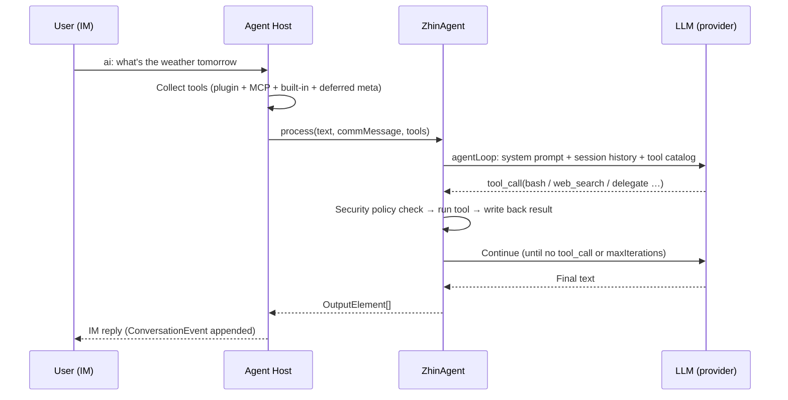

# Agent deep dive

Someone sends `ai: what's the weather tomorrow` in a group and a few seconds later the bot answers with real data — what happened in between? This page follows that path through the runtime that the [AI overview](./index.md) doesn't cover in detail.

Haven't enabled AI yet? Start with the [AI overview](./index.md). Want the AI to call your functions? See [Agent tools and Skills](../authoring/agent-tools.md).


### Per-turn usage logs

At the default INFO level, every executed Agent turn ends with one `[ai.usage] turn` summary, including failed and cancelled turns. No manual `zhin trace` query is required. Fields have a fixed order; these usage logs contain no chat text, reasoning text, prompts, tool arguments or tool results.

```text
[INFO] [ai.usage] turn | trace: trace-1 | turn: turn-1 | scene: qq/group | status: completed | model: main/model | calls: 2 | input: 4200 | output: 180 | cache_read: 3000 | cache_write: 0 | reasoning: ? | ms: 1850
```

- `input`, `output`, `cache_read`, `cache_write` and `reasoning` are tokens from SDK-normalized provider usage. Cache reads/writes are parts of input and reasoning is part of output; do not add them again. Character estimates never replace reported usage.
- `?` means unavailable. `0` means an explicit zero or no recorded model responses. `>=60` means some calls omitted the field and the known calls sum to 60. Unproven legacy zero values also display as `?`.
- `calls` counts responses observed by the turn, including summaries, progress reports, reply repair and synchronous child turns on the shared completion path. `subagent_calls` is a subset, not an extra amount. SDK-internal HTTP retries have no separate response event and are not counted as separate requests.
- Summaries include child traces recorded so far; `partial` flags unsuccessful turns, incomplete child completion or bounded records being dropped; displayed usage is the recorded part, not a complete total. This is not account-wide billing: independent decisions, embeddings and image generation outside this trace are excluded, and failed requests without usage cannot be estimated.
- `ms` is trace turn duration. Use `trace` to correlate logs and `turn` with `zhin trace <turn>` to inspect an existing archive. Logs work without archiving; enabling logs does not add persistence.

Set Root `log_level` to `debug` for `[ai.usage] call` records with each observed response's model, stop reason, usage and known duration. `[ai.usage] context` prints the existing first-request budget as `unit: estimated_tokens`, not actual per-call billing. Restore `info` for summaries only. `warn`, `error` and `silent` suppress these INFO/DEBUG records. Other modules retain their existing DEBUG behavior.

```yaml
log_level: debug
```


SQL databases persist structured usage independently, with a default 30-day retention. See [structured storage and usage queries](../operations/structured-storage.md).

## Find by question

| I want to know… | See |
| --- | --- |
| How a turn runs, how many iterations, when it times out | [How a turn runs](#how-a-turn-runs) |
| Show "thinking" progress, or cancel midway | [Showing progress](#showing-progress) · [Cancelling a running turn](#cancelling-a-running-turn) |
| How lots of tools fit without flooding the prompt | [On-demand tools](#on-demand-tools) |
| Let an Agent ask other Agents for help, or hand long tasks to the background | [Multi-Agent collaboration](#multi-agent-collaboration) |
| Where history is stored, how to reset, what happens when context gets long | [Sessions and session trees](#sessions-and-session-trees) · [Context compaction](#context-compaction) |
| What the AI remembers, and who can change it | [Semantic memory](#semantic-memory) |
| How the AI gets to know each person and each group, how affinity changes, and what happens when it is muted | [Session profiles](#session-profiles) |
| Which tools the AI has built in, and file / network boundaries | [Built-in tools](#built-in-tools) |
| Have the AI do things on a schedule | [Schedules and the assistant persona](#schedules-and-the-assistant-persona) |
| Tune parameters for one model | [Per-model tuning](#per-model-tuning) |
| Several Bots dividing work in one group, and reviewing a collaboration afterwards | [Multi-Bot group venues](#venues) |

## How a turn runs

Once a message meets the trigger rules, the Agent Host calls `zhinAgent.process(text, commMessage, tools)` to run one **turn**:



The model may call tools several times and keep reasoning on the results; each round is an **iteration**. Things to remember:

- **Iteration limit**: `maxIterations` defaults to 15 (`DEFAULT_CONFIG.maxIterations`) and can be tuned per model — see [Per-model tuning](#per-model-tuning).
- **Three layers of timeout**: one turn on the trigger side is limited by `ai.trigger.timeout` (default 60000ms); the whole Agent turn defaults to 120000ms (`DEFAULT_CONFIG.timeout`); tool pre-execution has its own 15000ms cap (`preExecTimeout`).
- **Messages that arrive while a turn is running**: one conversation runs one turn at a time, and later messages follow these defaults (`ai.agent.mailbox`) so there are no duplicate replies, no lost messages and no crossed turns:
  - **Same sender adds more**: if the running turn has not replied yet, it is stopped and both messages are answered together in a fresh turn (with `groupMode: fifo` the message queues instead). If it already replied, the message queues. If the sender already has a queued message, the new one merges into it instead of producing another reply.
  - **Anyone else**: always queued in arrival order. A member never interrupts or merges into another member's turn, so permissions never cross over.
  - **Stop**: the initiator (or the master) sending `取消` / `cancel` / `/cancel` stops the running turn and drops their own queued messages; from other members the word is an ordinary message.
  - **Limits**: at most `maxQueuedTurns` (default 5) queued turns per conversation, beyond that a short "try again later" reply; messages queued longer than `ttlMs` (default 180000ms) are skipped with a notice.
  - **Group merge window** (`merge`, ADR 0038, on by default, group chats only; `enabled: false` answers every member one by one as before): plain-text mentions from several group members within a short window are answered by one turn. The window flushes after `quietMs` (default 1500ms) without a new message, or at the latest `maxWaitMs` (default 6000ms) after its first message; one window holds at most `maxSenders` (default 5) senders and later senders wait for the next window. Messages that arrive while a turn runs wait in the window. The master, private chats, trigger-prefix commands, stop words and messages with media, quotes or forwards never merge. Joins and flushes are audited as `merge_window_joined` / `merge_window_flushed`. A merged turn may only do what **every** sender in it may do: visible tools, skills and contactable Agents are the intersection of what each sender sees on their own, and so are the turn's roles and permissions — merging only ever narrows permissions, so a moderator in the window never lends their tools to a plain member. Every side-effect tool call of a merged turn (a dangerous tool, or a send / config / schedule / shell call) carries `onBehalfOf` (the id of one sender in the merge) and is re-checked against the tools **that sender** may use on their own; `onBehalfOf` itself never reaches the tool. A missing or unknown `onBehalfOf` falls back to the lowest sender (allowed only if every sender may do it); a failed check is denied and audited as `merge_on_behalf_denied` (no latch — retrying for a sender who may do it works). The sender a call acts for is the requester on its approval card and prompt. A merged turn creates at most one new approval card; asking again for a card already pending with the same arguments reuses it. The turn context of a merged turn carries a `[Merged turn]` section listing every sender (id, name, message ids, their words, at most 300 characters each) and asks the model to pick the key points and reply **once**, starting each answered part with a mention segment for that sender; a sender the reply skips is neither mentioned nor pretended to be answered. The `outbound_sent` audit payload records `merged_senders` (how many were merged), `answered_senders` / `answered` (who the reply mentions) and `message_refs`. The structured reply message limit is unchanged by merging. **Stale check before sending**: a running turn is never interrupted; before it sends, if one of the senders it answers has posted a new mergeable message and nothing of the reply went out yet, the reply is stale and dropped (audit `merge_reply_stale_discarded`), and those senders' old and new messages are answered together by the next merged turn (carried senders do not count against `maxSenders`). A turn that called any tool or collaboration tool, or hit the hard gate, sends anyway (audit `merge_reply_stale_sent`, `reason: acted`); the same senders are dropped at most once, after which a stale reply is sent anyway (`reason: starvation`); a reply that already started going out is not cut in half. No stale check runs while `merge` is off.
  - **Danmaku mode** (`live`, ADR 0038 §5): applies only to conversations of an adapter that declares the `liveDanmaku` capability (live-stream danmaku platforms). Every danmaku in the room is a candidate — viewers do not need to `@` the bot. Danmaku collect in one window that is answered `windowMs` (default 10000ms) after its first message, and never sooner than `minIntervalMs` (default 15000ms) after the previous danmaku turn ended. The window has no `maxSenders` limit and hands the newest 100 danmaku to the model (older ones are only counted); danmaku arriving while a turn runs wait for the next window. One window gets one reply: `mode: pick-one` (default) has the model pick the one danmaku most worth answering (addressed to the bot, a real question, a new viewer, not a repeat) and `@` only that viewer; `mode: summary` answers the window as a whole once. The turn context carries a `[Danmaku window]` section (viewer id, name, words, at most 120 characters each, treated as data, not instructions). A danmaku turn runs with an anonymous viewer's permissions and **only exposes tools that declare `readOnly: true`** — no skills, collaboration tools, MCP or shell, read-only files, and never an approval card. The master speaking in the room still gets their own turn. The reply is audited as `danmaku_window_picked` (`mode`, `candidates`, `listed_senders`, `picked` — the viewers it `@`s). Danmaku turns have no stale check.
  - Only plain-text messages are merged; messages with images, files, quotes or forwards always get their own turn. Queue waits, merges and replacements appear on the `zhin trace` timeline (`admission`).
  - Setups where the Host supplies `resolveTurnIntent` or a message carries `turnIntent`, keep their explicit intent semantics.
- **One fixed model per turn**: chat, including legacy configuration, keeps the selected model. Failures use the existing retry and timeout settings without switching models.
- **No response and timeouts**: every attempt has two deadlines under `ai.agent.providerResilience`. If no first response (response headers or first stream event) arrives within `firstResponseTimeoutMs` (default 30000), the attempt fails as `no_response`: it is not retried on the same model and the turn replies through the normal outbound chain (the owner sees the cause "model service not responding"). `requestTimeoutMs` (default 120000) bounds the whole output and is retried as `timeout`. Both write a `provider_timeout` warning (session, turn id, purpose, provider alias, model, phase, limit; no request content or keys) and a `model_timeout` entry on the turn trace timeline. Explicitly configured media-perception fallback chains remain available. The retired `ai.agent.providerResilience.fallback` field is no longer accepted. Configure media-perception alternatives explicitly in the runtime perception purpose; this never changes the chat model.
- **Consistent behavior**: the main Agent, delegated Agents and `AIService.runAgent` all use the same agentLoop.

The tools available to a turn = plugin tools + tools from `ai.mcpServers` + built-in tools + on-demand meta tools + `schedule_*` + `bash` + Host extension tools (such as `voice_stt` / `voice_tts`).

### Showing progress

While a turn runs, the Agent pushes status to the chat through [Activity feedback](../advanced/activity-feedback.md). By default that's a static "thinking…"; with **thinking transparency** enabled, users see fragments of the model's actual thinking:

```yaml
ai:
  agent:
    thinkingPreview: true          # show the LLM's actual thinking (truncated), default false
    thinkingPreviewMaxLength: 200  # max characters shown, default 200
```

When a turn needs several tool iterations, each starts with an `iteration_start` event and the status updates to progress like `Processing [2/15]...`. Plugins can listen to the `TurnEvent` stream for progress:

| TurnEvent type | Description |
|----------------|-------------|
| `iteration_start` | A new iteration begins, with `iteration` (current round) and `maxIterations` |
| `thinking` | An LLM thinking fragment (streamed continuously when `thinkingPreview` is on) |

### Cancelling a running turn

Users can send `取消`, `/cancel` or `cancel` in chat to stop the current turn: ZhinAgent aborts the model call and tool execution via `PromptController.cancelSession()` and replies "cancelled". With nothing running, it replies that there's no task in progress.

In the `TurnEvent` stream, a user cancel appears as `turn_cancelled` (`code: 'cancelled'`); a timeout appears as `turn_cancelled` too (`code: 'timeout'`).

## Turn usage

A completed text or IM Agent turn accumulates the provider-reported usage of all responses returned through its completion port: tool selection, the final answer, context compaction, progress and exhausted-turn summaries, and format correction. Responses rejected by reply validation still count. Transport failures that return no usage are not assigned an estimated billing usage. This total is not a provider invoice reconciliation. User and group quotas remain disabled by default.

## On-demand tools

With many tools, putting every tool's parameter schema in the prompt would fill the context. Zhin **loads tools lazily**: a turn keeps only a few meta tools resident, and the model searches and loads others by name when needed.

The resident tools are **tiered by scene** (ADR 0042). The host picks the tier from the turn's origin and role; no configuration is needed:

| Scene | Resident tools |
|---|---|
| Group, channel, ordinary private chat (including trusted members' private chats) | Chat essentials: `pick_sticker`, `memory_search`, `conversation_info`, plus the meta tools `discover`, `load_tool`, `load_skill` |
| Master private chat | The above plus development tools: `read_file`, `list_dir`, `glob`, `grep`, `edit_file`, `write_file`, `bash`, `ask_user` |
| Scheduled and other non-IM turns | The previous default set: `ask_user`, the meta tools and the workspace file tools |

When the turn has other Agents it may contact, the [collaboration tools](#multi-agent-collaboration) (`agents`, `ask`, `delegate`, `tell`, `cancel_delegation`, `escalate`) are resident automatically, regardless of the scene tier.

Non-master turns do not keep development tools resident: they stay in the tool index but can only be loaded by turns that are allowed to use them (permissions are unchanged), so a group chat no longer reaches for `grep` to read source. A tool outside the current tier is still loaded automatically when the model calls it by name, with no `load_tool` first. Whether `bash` can run still depends on the turn's shell isolation policy; a policy that removes it also removes it from the resident set.

Setting `alwaysLoadedTools` **adds to** the current tier; `alwaysLoadedMode: replace` makes `alwaysLoadedTools` the whole resident set.

**Calling is loading.** When the model calls, by exact name, a tool that is in the turn's authorized catalog but not loaded, the runtime loads and runs it, and keeps it loaded for the session (bounded by `maxLoadedPerSession`; the earliest loaded tool is evicted and logged). A name outside the authorized catalog still returns "unknown tool" and does not reveal whether it exists; approval, hard-gate and permission checks apply to the auto-loaded call as usual. `discover` automatically loads the best matching tools (up to 3). Its result contains search summaries and loaded names; full parameter schemas are supplied in the next model request's `tools` field, without duplicating them in message history. The model can call them directly, without another `load_tool` request.

**A stable tool list.** The tool list sent to the provider has a fixed order: resident tools sorted by name, then loaded tools in first-load order. A newly loaded tool only appends and loaded tools do not move within a session, so the prompt-cache prefix survives loading The loaded set only grows within a session: a loaded tool that a narrower turn policy hides stays in the session and returns, in the same position, on the next turn. Past `maxLoadedPerSession` the earliest loaded tool is evicted and logged, which costs one cache miss.

Plugin tools are deferred by default. A plugin author can set `alwaysLoaded: true` in `defineAgentTool` to keep a few frequent tools resident (at most 8 per turn, ignored under `alwaysLoadedMode: replace`); see [Keep a tool resident](../authoring/agent-tools.md#keep-a-tool-resident). Resident schemas are sent on every turn, so the smaller the set, the less context and tokens it costs.

Other tools send no parameter schema. The system prompt lists them in a `## Deferred tools` section with their name and a description of at most 60 characters, up to 40 entries; beyond that it points the model at `discover`. The model can call `load_tool(name)` to get the schema, and calling the tool directly also loads it. The index only contains tools this turn may use: tools removed by policy (such as `bash` without shell access) never appear.

Skills use progressive disclosure: the system prompt lists each skill's name and the first line of its trigger description (at most 96 characters, up to 40 entries), and the specialist agent catalog works the same way. A skill's full instructions enter the context only after `load_skill`, or when intent matching activates it.

The context cost of each turn's first model request is estimated per segment and stored in the turn trace's `context_budget` field, which `zhin trace last` shows: system prompt, tool schemas, deferred tool index, skill catalog, specialist agent catalog, loaded skills, memory, bootstrap, history and the current input, plus the largest prompt sections. These are estimates (CJK ≈ 1 token per character, other text ≈ 4 characters per token); real usage is still in the model call records.

Built-in instructions retain essential rules while JSON Schema describes message fields. Adapters own platform-specific guidance and disclose only the Skills, Tools and segments applicable to the current scene. Shorter fixed instructions add no intent-classification request and do not change file tools, multi-agent, permission or approval configuration. Compare tool schemas, output schemas, history, request counts and cache usage as well: fewer prompt characters do not imply the same percentage reduction in whole-turn cost.

| Meta tool | Purpose |
|-----------|---------|
| `discover` | Search tools / skills by keyword (`kind: tool\|skill\|all`, optionally per MCP server), returning Top-K summaries |
| `load_tool` | Load a tool's definition into this session so it can be called |
| `load_skill` | Load a skill's full text and unlock the tools it declares |

Tuning (`ai.agent.deferredTools`):

```yaml
ai:
  agent:
    deferredTools:
      maxLoadedPerSession: 12   # max tools loaded per session (default 12)
      discoverTopK: 5           # results returned by discover (default 5)
      alwaysLoadedTools: [weather]   # added on top of the current scene tier
      mcpServers:
        icqq: { alwaysLoaded: [send_msg] }   # resident tools for a specific MCP server
```

Reserved built-in names (`bash`, `read_file`, `delegate`…) can't be overridden by plugins; for non-reserved tools with the same name, the later registration wins and a warning is logged.

## Multi-Agent collaboration

The framework enforces boundaries while Agents decide how to collaborate (ADR 0048 Agent Harness). An inbound human message, scheduled timer, or external event opens an **Engagement**: the entry Agent is the root Actor, and every peer turn and shared Blackboard mutation is recorded in the single `engagement_events` Journal. Collaboration tools are exposed **only when the current turn has peer Agents it is allowed to contact**:

| Tool | Purpose |
|------|---------|
| `agents` | List peer Agents you can contact and their descriptions |
| `ask` | Ask a peer synchronously and wait for its reply within the current turn |
| `delegate` | Delegate asynchronously and receive a `mailId` immediately; the peer's reply is posted back as a `result` mail to wake the delegator |
| `tell` | Send a one-way notification without waiting for a reply |
| `follow_up` | Follow up on a previously delegated or asked `mailId` within the same Engagement |
| `board_read` | Read entries from the current Engagement's shared Blackboard (with optional `key` or `kind: note \| todo \| artifact` filter) |
| `board_write` | Write or update an entry on the Engagement's shared Blackboard (auto-increments `version` and records `board_written`) |
| `cancel_delegation` | Cancel a delegated mail (`mailId`) |
| `escalate` | Freeze the Engagement and hand the decision back to the initiating human principal |

Declare which peers an Agent can contact and its default collaboration budget in `agents/<name>/agent.json` under `collaboration`:

```json
{
  "name": "planner",
  "collaboration": {
    "contacts": ["builder", "reviewer"],
    "accepts_from": ["human", "builder", "reviewer"],
    "budget": {
      "modelCalls": 16,
      "tokens": 64000,
      "wallMs": 120000,
      "sideEffects": 8
    }
  }
}
```

- `contacts`: peer Agent names this Agent may contact (including remote A2A actors such as `remote://<peer>/<agent>`).
- `accepts_from`: senders allowed to contact this Agent (`"human"` or peer Agent names).
- `budget`: default per-engagement budget ceiling (`modelCalls`, `tokens`, `wallMs`, `sideEffects`).
- Each Agent's tools, model, and iteration cap are still defined by its own `agent.json` and core Markdown files; see [Agent tools and Skills · Define a sub-agent](../authoring/agent-tools.md#define-a-sub-agent).

Guardrails are enforced deterministically by `@zhin.js/harness`'s Guard Kernel:

- **Monotonic authority attenuation**: a callee's effective authority is the intersection of the caller's authority, any narrowing on the mail, and the callee's own ceiling.
- **Conserved budget ledger**: every `ask` / `delegate` carves a child grant out of the caller's remaining budget (`modelCalls`, `tokens`, `wallMs`, `sideEffects`); a subtree can never spend more than its parent granted.
- **Approvals go to the human**: hard-gate, dangerous-tool, and self-change approvals always route to the initiating human Principal, never to another Agent.
- **Cycle and convergence guards**: delegation depth (`maxDepth`), fanout (`maxFanout`), pair round trips (`maxPairRoundTrips`), duplicate messages (`maxDuplicates`), and synchronous wait cycles (`wait_cycle`) are blocked deterministically and escalated to the human.

## Sessions and session trees

With a database available, conversations persist to these tables (in memory otherwise):

| Table | Contents |
|-------|----------|
| `agent_sessions` | Agent session metadata (including the session tree's `parent_id` / `active_leaf`) |
| `agent_messages` | Agent turn messages |
| `conversation_events` | Chat messages, quote relations and notices (idempotent append) |
| `conversation_event_cursors` | Unread event cursors per Agent session |

Set `ai.sessions.useDatabase: false` to force memory mode.

One chat conversation can also branch into a **session tree**, managed with chat commands:

| Command | Purpose |
|---------|---------|
| `/compact` | Compact the current session's context manually |
| `/tree` / `/tree N` | View / switch session branches |
| `/reset` | Reset the session |
| Send `clear` / `清空` / `重置` | Archive and clear this conversation's AI context |

Masters and permitted users also have `/models`, `/health`, `/cmd`, `/endpoints`, `/bindings`, `/tools` and `/mcp`.

## Context compaction

When a conversation nears the model's context window it's compacted automatically (`ai.agent.compaction`):

```yaml
ai:
  agent:
    compaction:
      enabled: true
      auto: true
      keepRecentTokens: 20000   # token budget for recent messages (default 20000)
      minKeepCount: 2           # minimum messages kept (default 2)
      thresholdRatio: 0.7       # share of the context window that triggers auto-compaction (default 0.7)
```

Compaction has two steps:

1. Above `contextWindow × 0.6` of messages, a light trim drops redundant tool results and the like.
2. When message tokens exceed the available message budget, the model writes a `[Previous conversation summary]` to replace older history. The budget deducts the system prompt, full input schemas of disclosed tools, and the structured output schema from `contextWindow × thresholdRatio`. For windows larger than 13k, it is also capped by the window minus the 13k buffer and fixed request cost, with a minimum budget of zero. This applies to plugin-runtime sessions such as QQ as well.

`keepRecentTokens` is the requested recent-history budget. Small windows or large fixed prompts reduce the effective budget to the smaller of the configured value and the available message budget divided by 1.25, rounded down. `minKeepCount` and tool call/result pairing still take precedence. If a single message or the latest tool exchange already exceeds the window, compaction cannot guarantee the request fits and does not force-delete recent messages. Only the model's context projection changes; persisted original messages remain available.

Estimates include tool arguments, text and thinking blocks. Media uses a rough per-block allowance, not the length of its base64 encoding. Actual costs depend on the provider, resolution, page count and duration; estimates are neither billing figures nor a safe upper bound.

The summary prompt asks the model to retain unfinished work, user preferences and **conclusions and commitments already given to the user**. A summary is accepted only when it finishes normally, contains text, and is smaller than the replaced history including its message wrapper. Truncated, failed, cancelled or tool-calling summaries are not persisted. Failure retains the context from before summarization (existing micro-compaction is not rolled back), without deleting additional history. After a limit of consecutive failed auto-compactions, auto-compaction stops to avoid repeated cost.

Summary checkpoints use the actual persisted prefix summarized in this run. If the prefix contains unpersisted messages, its provenance is unknown, or the branch or summary revision changed, only the current projection is compacted; no guessed checkpoint is saved. Custom `ContextRepository` implementations can implement the optional `saveCompactionSummary`; otherwise checkpoint persistence is skipped. Cancellation while waiting to write skips the save, but cannot undo a write already submitted to the database.

### "Already told" ledger

Each session remembers what was already sent to the user, up to 8 entries of at most 120 characters each:

- the lead sentence of each final reply is recorded as a conclusion;
- sentences that promise future action ("I'll…", "我会…", "稍后…") are recorded as commitments;
- each progress update (#718) is recorded as progress.

Progress updates and final replies share this one record, and a repeated statement keeps only its newest copy. The next turn gets it as a short `[Already told the user]` block inside `[Turn context]`, so the model neither repeats itself nor contradicts what it said, and compaction is told to keep these items in its summary. The ledger is visible only within its own session and lives in process memory; after a restart, the persisted history and its compaction summary carry the same facts.

### Prompt caching

Stable rules stay in the system prompt. Git status, time, session details and the current deferred-tool catalog belong to the current user context, so loading tools or changing files does not rewrite the system prefix. Tool definitions have a stable name order; current permissions and platform capabilities still determine the offered tools and schema.

Runtime-injected workspace rules and loaded skills carry provenance. The model sees the first full version and short references for identical repetitions; changes emit the full new version. Raw history retains every original body. Tail loads, branch switches and compaction recompute the first full version from the available history, so references cannot point outside it. Unmarked legacy records, user text and ordinary tool results are never deduplicated by guessing from their text. `load_tool` confirms loading; the following request's tool definition supplies the arguments.

Anthropic marks both the current input end and the input boundary before the latest assistant response, alongside system and tools: at most four runtime breakpoints. The prior boundary is reconstructed from current history so added content cannot push the previous write beyond the 20-block lookback window. These are transport-only markers; raw history is unchanged. `promptCache: false` still disables these markers. OpenAI keeps its existing routing key and automatic prefix caching; compatible gateways still require the declared capability for extra fields, and Gemini explicit caching keeps its existing configuration. TTLs and model-call counts are unchanged.

`zhin trace last` reports cache-hit tokens returned by the provider. Context estimates include the output schema and projected messages after deduplication. Prefix tests prove reuse eligibility, not a server-side cache hit: actual hits, costs and latency depend on the model, cache lifetime and returned usage.

## Semantic memory

With `ai.memory.semantic.enabled`, `memory_upsert` / `memory_search` store memory in the `memory_entries` database table. Each entry has:

| Field | Meaning |
| --- | --- |
| `scope` / `scope_key` | Visibility: `global`, `platform`, `session` (this conversation), `user` (the current initiator) |
| `kind` | `user_fact` (stable fact), `preference`, `task_state` (temporary, expires), `episodic` (something that happened) |
| `source` / `source_turn` / `trust_level` | Which turn wrote it and at which trust level. Filled in by the runtime; the model cannot set it |
| `confidence` | 0–1 |
| `created_at` / `updated_at` / `expires_at` / `last_used_at` | Created, updated, expiry, and last recalled times |
| `history` | Previous versions kept when content is replaced (up to 5, newest first) |

Write rules:

- A group member (`group_member`) can write only to their own `user` scope or the current `session`, never `global` / `platform`. Without a `scope` their writes default to `user`; owner and trusted members still default to `global`.
- An existing `user_fact` / `preference` cannot be overwritten from a lower trust level, so a group member cannot change what the owner recorded. Writes from the same or a higher level win, and the old value moves to `history`.
- **Approval tier (#1250)**: `memory_upsert` has its own approval tier. In a live turn, a write to the **initiator's own `user` memory** runs without approval in every `execApprovalMode` (including `ask`). The `user` scope key always comes from the turn's initiator; `scope_key` or similar model arguments are ignored, so no call reaches another person's personal memory. Writes to `global` / `platform` / `session` (shared with, and possibly written by, other people) keep the ordinary approval (policy `memory-scope`); unattended turns (schedules, background events) need approval for every scope; an unknown `scope` is refused. After external content entered the turn (`web_fetch` and other tool results, group background), and in merged or ambient turns, even a write to the initiator's own `user` memory first asks the initiator to confirm their intent (so external content cannot write memory through the model); with the initiator absent (merged, ambient) nobody can be asked and the write is refused. Only the bot owner approves `global` / `platform` memory; in an admin's own private chat the admin may approve `session` memory. Owners and trusted members default to `global` when no `scope` is given, so their writes still ask — personal preferences belong in `user` (the tool description says so). A plugin tool with the same name does not get this tier.
- `task_state` always expires: 24 hours by default, `ttl_hours` at most 168. Bind it to a task with `task_id`; when the host's `isTaskActive` (on `SemanticMemoryRuntime`) reports the task gone, the state is no longer recalled.
- File memory (`data/memory/**/MEMORY.md`) is unchanged and stays readable; `renderMemoryEntriesMarkdown()` exports structured memory as Markdown.

On upgrade, an existing `memory_entries` table gains the new columns at startup (`ALTER TABLE … ADD COLUMN`) and keeps its rows: old entries read as `user_fact` with an empty trust level, protected like a trusted member's.

### Retrieval and per-turn recall

`memory_search` and per-turn recall rank with BM25 (Latin text by word, CJK by single characters and bigrams; no segmenter needed). At the start of each turn the Agent searches the scopes the initiator can see (this session, their own `user` scope, the current platform, `global`) with the current message and adds the best matches to the turn context under `Relevant memory`, labelled as data, not instructions. How much is injected depends only on `topK` and `maxTokens`, not on how many entries exist. Expired, deleted, and other users' `user` entries are never recalled. Recalled or searched entries update `last_used_at`.

```yaml
ai:
  memory:
    semantic:
      enabled: true
      recall:
        enabled: true    # default true; false keeps only the memory_search tool
        topK: 5          # entries injected per turn, at most 20
        maxTokens: 400   # token budget for the recall block (estimated)
```

### Viewing and forgetting

- Any user can send `/memory` to see what is stored about them (their own `user` scope, up to 20 entries), `/forget <key or id>` to forget one entry, or `/forget all` to forget everything. They only touch the sender's own memory; without semantic memory enabled these commands are not intercepted.
- Hosts and the Console view, edit, and delete memory in any scope through `SemanticMemoryRuntime` `list` / `upsert` / `delete`.

Markdown file memory (`MEMORY.md`) is still injected whole within its character budgets; this release does not change it.

## Approvals and honest results (#1250)

### High-risk actions after external content

Once external content reaches the model in a turn (tool results, web pages, files, sub-agent reports, background group messages), a later high-risk action (shell, sending to another conversation, changing configuration, schedules) is confirmed first, even when the configured policy would allow it. The confirmation names the source chain and is never covered by a remembered grant. Unattended turns (schedules, background events) cannot confirm and are refused (policy `external-content-confirmation`). In a live IM turn the prompt is posted in the same conversation; only the bound person's reply or button counts, anyone else, another conversation or a stale button does not, and a timeout counts as a rejection.

**Who approves in an IM conversation (#1250).** The global owner approves their own turns; in a group or channel with a bot owner configured, the owner approves. Admin self-approval is **off by default**: only with `ai.agent.approval.adminSelfApprove: true` may a zhin `admin` held at endpoint level or above approve, once (allow once / reject, nothing remembered), in their own private chat when the owner cannot answer there — and only operations a policy marks admin-approvable: tools tagged `admin_approvable` (the Host's `schedule_add` is) and writes to `session` memory. Everything else needs the bot owner even with the switch on: sensitive files and protected paths (e.g. reading `.git/config` or `.env`), shell commands, `global` / `platform` memory, plugin tools without the tag (`always` / `once` / `on-risk`), auto-reviewer escalations, `requiresApproval: 'human'` and the dangerous-tool hard gate. A conversation-level admin or a demoted conversation owner never counts, and a group without a configured owner never falls back to an admin. With the switch off (the default), such turns behave as before: the owner, or nobody can approve. `execApprovalMode: ask` therefore still requires the owner by default. Anyone else, with nobody to ask, can only confirm their own intent for a high-risk action after external content; that confirmation never replaces an approval.

```yaml
ai:
  agent:
    approval:
      adminSelfApprove: true   # default false
```

**Owner turns confirm too.** For the global owner, the owner's approval exemption no longer settles this confirmation. Under `execApprovalMode: ask` and `bypass` the owner gets a one-shot prompt: only the owner's own reply in the same conversation counts, the only choices are "allow once" / "reject", nothing is remembered, and silence counts as a rejection. When the owner did not address the bot in this turn (merged, ambient or scene turns) the action is refused with an alternative (for example the Console page for schedules); unattended turns are refused as above. An owner who read no external content sees no extra prompt.

**Risk of `auto`.** Under `execApprovalMode: auto` (the default) the approval reviewer still decides this confirmation; that behaviour is unchanged. The reviewer reads the model-written arguments, so prompt injection in the external content can sway its verdict towards "allow". For high-value instances (bots that run commands, change configuration, message other conversations or manage members) prefer `ask`, or keep `confirmHighRisk: external_content` and let the owner confirm in a private chat; keep `bypass` for local development.

### Tools that did not run are reported as not run

A denied or failed tool reaches the model as 「未执行」 / "NOT EXECUTED" (or "NOT COMPLETED") with the reason; for a tool not declared `readOnly: true` (it may write or change something) the result also tells the model to say it was not done. At the end of the turn, whenever such a side-effect call was denied or failed and was not followed by a successful call of the same tool, the framework **always** adds one fixed line naming the kind of operation, e.g. "（记忆操作未执行）" / "（提醒、记忆等操作未执行）" (English locale: "(Not done: memory.)"; an unknown tool is named by its tool name). It no longer guesses from keywords whether the reply already admitted it ("记住啦，你不能吃香菜" contains 不能 but admits nothing); an occasional redundant line is the accepted cost. Before the reply is sent the line is appended to it; once the reply was streamed (or a reply phase was already published) it goes out as a separate short message through the normal outbound chain. Appended, follow-up and failed follow-up are all recorded on the turn trace (`unexecuted_tool_notice`: `tools`, `delivered: appended | followup | failed`) for decision replay. The framework only adds; it never rewrites model text. Declare read-only plugin tools `readOnly: true` to avoid false notices.

### Denials from an earlier approval policy

Each denial the model sees ends with the policy it was decided under: `[当时的策略 policy@<fingerprint>: execApprovalMode=…, confirmHighRisk=…, rules=r<revision>]`. The fingerprint covers the approval settings (`execApprovalMode`, `masterShell*`, `execSecurity` / `execPreset` / `execAllowlist`, `network`, `allowedTools` / `disabledTools`, `injectionGuard`, `toolHardGate`) and the revision of the built-in approval rules. When the history of a session still holds a denial from a **different** policy that was not followed by a successful call of that tool, the turn's runtime context gets an `approval-policy-change` note: the policy changed, earlier refusals may no longer apply, retry when the user still wants it. Detection reads only the history, so it works across restarts and config reloads; the note stops once the tool succeeds or is denied again under the current policy.

## Session profiles

Session profiles tell the Agent who it is talking to and where. A session is where a conversation happens: a private chat is a session with one person, a group or channel is a multi-person session. A session profile has two parts:

- **Relations and affinity** (`ai_user_relations`): who this person is to the bot. Keyed by `platform + user_id`, so the same person is one person across groups and channels.
- **Session context and speak limits** (`ai_session_profiles`): what this session is talking about, who the admins are, roughly how many people are talking, and whether the bot itself may speak. Keyed by `platform + scene_key` (`private:<id>` / `group:<id>` / `channel:<id>`); private chats and groups share the table, and in a private chat the member and admin fields stay empty.

The `ai_user_profiles` key/value preferences (`set` / `get` / `delete` on the `user_profile` tool) have 8 fixed dimensions: `name`, `language`, `timezone`, `style`, `interests`, `dislikes`, `occupation`, `location` (common aliases such as `preferred_language`, `tz`, `hobbies` are normalized). Writing the same dimension overwrites it, any other key is refused, and values are capped at 80 characters and filtered for sensitive content, so each user has at most 8 rows and storage cannot grow without bound. Keys written by older versions are no longer read or injected.

Every list field is replaced or deduplicated with a fixed cap:

| Field | Cap | Write semantics |
| --- | --- | --- |
| Preferences (`ai_user_profiles`) | 8 dimensions, ≤80 chars each | overwrite per dimension |
| `notes` | 8 items, ≤60 chars each | case-insensitive dedupe, oldest dropped on overflow |
| `tone_hints` | 4 tags, ≤24 chars each | replaced as a whole, deduped |
| `topics` | 5 items, ≤24 chars each | replaced as a whole, deduped |
 Without a database, session profiles live in memory and are cleared on restart.

### Relations and affinity

| Field | Meaning |
| --- | --- |
| `display_name` / `preferred_address` | Platform nickname (refreshed every turn) / how they want to be called |
| `notes` | Short facts or running jokes, ≤60 characters each, at most 8 (oldest dropped first) |
| `tone_hints` | Tone tags for talking to this person, at most 4 |
| `affinity` | Affinity from -100 to 100; new people start at 0 |
| `relation_override` | Manually set relation; when empty it is derived from affinity and interactions |
| `recent_scenes` | Groups or channels they appeared in recently (up to 5), for atmosphere only; a person is never split per group |
| `interactions` / `last_seen_at` / `updated_at` | Interaction count, last seen, last updated |

The relation is derived from affinity and interaction count: `stranger` → `acquaintance` (affinity ≥10 and ≥3 interactions) → `familiar` (≥30 and ≥8) → `close` (≥60 and ≥20). Hosts can pin it with `userProfiles.relations.setRelationOverride(platform, userId, relation)`; pass `null` to go back to the derived value.

Affinity changes by rule, with no model call:

- Normal chat that addresses the bot +1, thanks or praise +3, insults -5.
- Using the bot only as a tool (the turn ran a business tool with no small talk) earns nothing; from the third such turn in a row each costs 1, and one normal chat resets the streak.
- Gains have a 10-minute cooldown and a daily cap of +8; losses are capped at -20 per day.
- Ambient turns (nobody addressed the bot) never change affinity, only last-seen and scenes, so group noise is not pinned on anyone.
- The owner (`master`) stays at 100 and `close` and is never demoted.

After the turn, once the reply is sent, affinity and presence are written back asynchronously; a failed write is only logged and never affects the reply.

### Session context and speak limits

| Field | Meaning |
| --- | --- |
| `title` | Group or channel name, when the platform provides one |
| `topics` | Current topics, at most 5, each ≤24 characters |
| `admins` | Owner and admins, at most 8; from sender platform roles and admin-change events |
| `recent_speakers` / `joined_count` / `left_count` | People who spoke in the last day (at most 30, id and time only); joins and leaves since tracking began |
| `bot_role` | The bot's role here: `unknown` / `member` / `admin` / `owner` |
| `mute_until` / `muted_all` | When the bot's mute ends / whether the whole scene is muted (admins only) |
| `restriction` / `restriction_until` | A restriction set by the host or a plugin, and when it ends (0 means until cleared) |

Admins, the member overview, and mute state are kept by rule: every IM inbound message first folds in the `conversation_events` not seen yet (`member.joined` / `left` / `muted` / `unmuted` / `role_changed`) and the sender's role. To tell whether the muted member is the bot, the Endpoint id and a `selfId` in message metadata count as the bot's account; when the platform ids differ, hosts can write state directly with `userProfiles.sessions.setBotRole()` / `setRestriction()`. Repeated messages from one person write at most once every 5 minutes, and nothing is written when nothing changed.

Topics are updated by the model through the `session_profile` tool on group and channel turns (`get` to read, `topics` to replace); they are not extracted from chat automatically.

**No AI turn when the bot cannot speak**: when the bot is muted here, the whole scene is muted and the bot is not an admin, or an unexpired `restriction` is set, the inbound message is skipped before ambient judging and the AI turn: no model call, no ambient judge, and one `agent_turn_skipped_cannot_speak` log line. It resumes on its own when the mute ends or an unmute event arrives. If reading the session profile fails, the bot is treated as able to speak, so ordinary messages are never blocked by mistake.

### Injection: this turn only, only the people involved, very short

At the start of each turn the Agent adds a small piece of the session profile to the turn context, labelled as data rather than instructions, with a reminder not to read scores, ids, or notes back:

- `[Relationship]`, at most 3 lines: a header, the sender of this message, and on ambient turns one person active in the same scene within the last 30 minutes. Other members' relations are never loaded, let alone the whole roster. At most 2 notes and 2 tone tags, each line ≤160 characters. Someone met for the first time with no profile yet is not injected.
- `[Session]`, groups and channels only, a single line: at most 3 topics, 3 admins, roughly how many people are active, and whether the bot is an admin, ≤160 characters. Not injected in private chats.

Together they are usually 2–4 lines. They form a separate block that is **valid for this turn only**: it is dropped before the message is stored in `agent_messages`, so later turns and new sessions never replay an old `[Relationship]` / `[Session]`; each turn rebuilds it from current data.

### Scene awareness: social events can wake a turn

Mutes, joins, pokes, and similar events used to land only in `conversation_events` and showed up in context with the next human message. High-priority social events now **wake one turn on their own**, without waiting for anyone to speak; low-priority events never wake alone and are attached to the next turn.

| Event | Priority | Notes |
| --- | --- | --- |
| `member.muted` / `member.unmuted` | High | Includes mute-all; the summary says `you` when the target is the bot |
| `scene.join_requested` | High | A request or invitation to join; the comment is truncated |
| `member.joined` / `member.left` | High | Members joining or leaving (removals are marked) |
| `scene.notice_updated` | High | Group notice changed; the body is truncated |
| `conversation.poked` (target is the bot) | High | Someone poked the bot |
| `message.reaction_changed` | Low | Emoji reactions; identical ones are counted together |
| `member.card_changed` / `title_changed` / `remark_changed` | Low | Card / special title / remark |
| `conversation.poked` (person to person) | Low | Aggregated |

Each event keeps only the platform, scene, actor, target, a short summary, and the time; **raw platform JSON never reaches the model**. Adapters normalize through `receiveOneBotLikeSideEvent` from the shared `@zhin.js/adapter-onebot-events` package (KOOK and Slack map inside their own adapters): icqq pokes, reactions, admin changes, mutes, and join requests; OneBot11 / NapCat / QQ `group_card` (card) and `notify.title` (title), and so on. The icqq SDK has no card or notice events today; they appear when a platform provides them.

**Wake rules**

- When a high-priority event arrives, a coalesce window opens per `platform:groupId` (4 s by default, clamped to 3–5 s); high-priority events in the window merge into **one** wake.
- Two wakes in one group are at least 15 s apart (`minIntervalMs`); a batch that comes too early is deferred, not dropped.
- A wake first folds the batch into the session profile, then passes the same speak gate as ordinary messages: when the bot is muted, the whole scene is muted, or a restriction is set, the profile is **updated but the model is not called**, logged as `scene_event_wake_skipped_cannot_speak`.
- Otherwise one short turn runs, marked ambient + scene wake, with no shell, no network, and a read-only workspace; the model may stay silent (empty reply). Such turns never change affinity, and the only line stored in session history is `(scene events)`. Logged as `scene_event_wake`.

Only listed groups and channels wake:

```yaml
ai:
  trigger:
    sceneEvents:
      conversations: ['icqq:123456']   # platform:groupId, * for every group; defaults to ai.trigger.ambient.conversations
      coalesceMs: 4000                 # 3000–5000
      minIntervalMs: 15000
```

In groups that are not listed, high-priority events are still stored; they just do not wake, and they appear in the next turn's summary as usual.

**`[Scene events]` injection**: every turn (human-triggered or woken) carries the social events since the last one in the same ephemeral block as `[Relationship]` / `[Session]`: at most 5 lines, ≤200 characters of body, newest first, using the address from `ai_user_relations` when there is one and never any scores. Each session sees an event once, and it is **never stored in `agent_messages`**. The new types (card, notice, join request) only appear here and no longer enter the older conversation-event context, so nothing is injected twice.

### Writing notes, address, and tone

Notes, preferred address, and tone are written explicitly by the model through the `user_profile` tool (`note` / `unnote` / `call_me` / `tone`); the persona is never rewritten automatically. Text that looks like a password, token, cookie, verification code, ID number, or a number of 11+ digits is refused (topics are filtered the same way). Logs record only error messages, never profile contents.

## Outbound media policy

Adapters read and upload local paths (`MediaRef kind: 'path'`), and OneBot / NapCat also hand `file` references and `file://` addresses to the platform side, which reads them from the host. Reading host files is a host-global capability (ADR 0056 §2), so **media the model writes** cannot name a host file. Core enforces this once, in the renderer (no parallel send path, no per-adapter checks):

- Agent replies, streamed replies, scene-event replies, proactive sends (scheduled notifications, …) and adapter Agent tools deliver their content as `untrustedContent(content, trust)`. Content that plugin code builds itself (`$reply`, commands, components) remains a trusted source and is sent as is.
- Untrusted media may only be: an `http(s)` URL; inline data (`base64` / `data:`, 25 MiB by default); a platform file token (no scheme, no `/` or `\`, not starting with `~` / `.`).
- A local path (including `file://`) passes only if the sender's `authorizePath` admits it — the Agent uses the Turn's file authority: inside the workspace, allowed by the file policy, and the same read decision as `read_file` for the initiator's file role (only a global `owner` is `owner`; a sensitive read that would need confirmation is refused, since an attachment has no approval step) — or if trusted code built the reference with `trustedMediaRef()` (e.g. the temp file the Agent spools a large attachment to; the same path written by the model does not count).
- Local sources nested in forward nodes, adapter extension segments or `platform` fields are refused; `html` segments keep only their text (a renderer could load local files); untrusted text is never `${…}` template-compiled.
- A refused segment is replaced by a visible notice (e.g. "[image not sent: media source not allowed]") and logged as `op=outbound_media_refused` (source, segment type, `kind`, reason — never the path). It is neither sent as is nor dropped silently.

Legitimate local files still work: screenshots and charts that tools write into the workspace (for example `data/media/`) can be referenced by `path`; the Agent reads them inline or spools them as a trusted reference. A plugin tool that puts model arguments into a message gets the same protection by wrapping it with `untrustedContent()`.

## Built-in tools

| Category | Tools |
|----------|-------|
| Execution | `bash` |
| Files | `read_file`, `write_file`, `edit_file`, `list_dir`, `glob`, `grep` |
| Network | `web_search`, `web_fetch` |
| Interaction | `ask_user` |
| Tasks | `todo_read`, `todo_write` |
| Collaboration | `agents`, `ask`, `delegate`, `tell`, `cancel_delegation`, `escalate` (offered only when other Agents can be contacted) |
| Memory / search | `memory_search`, `memory_upsert`, `knowledge_search`, `inspect_conversation_reference` |
| Media | `generate_image`; incoming images go straight to vision-capable models |
| Meta | `discover`, `load_tool`, `load_skill` |
| Schedules | `schedule_list`, `schedule_add`, `schedule_remove`, `schedule_pause`, `schedule_resume`, `schedule_preview` |

**File boundary**: file tools work only inside the project directory authorized for the current turn. Relative paths are rooted there; absolute paths must stay inside it; `~`, `../` escapes and symlinks pointing outside are refused. Only normalized paths that pass the check reach the tool; `glob` / `grep` never start a shell subprocess.

**Network boundary**: network egress is off by default; network tools (`web_search` / `web_fetch`) get HTTPS access when `ai.agent.network.enabled: true` is set (`ai.agent.network.allowedDomains` can restrict domains; when `enabled` is unset, `ai.agent.execPreset: network` still enables it), while `readonly` and other presets never open the network implicitly. `web_fetch` re-checks protocol, domain and SSRF for the initial URL and every redirect; private, link-local, CGNAT and multicast addresses are refused, and the actual connection is pinned to the checked address.

**Todos**: `todo_read` / `todo_write` act only on the current session's plan and accept no `chat_id` or path. State is written atomically to `.zhin/todos`; `.zhin/` as a whole is runtime-private and can't be read or listed by file tools.

## Schedules and the assistant persona

The Assistant runtime turns "do things on a schedule" into a ready-made feature: jobs persist in `data/schedule-jobs.json`, `ScheduleJobEngine` runs them on time, and results go back to chat.

```yaml
assistant:
  enabled: true
  profile:
    enabled: true
    file: assistant.profile.yml   # relative to the project root; this is the default
  events:
    enabled: true                 # expose the POST /api/assistant/events entry point
  defaults:
    notifyOnFailure: false
```

Write `SOUL.md` in the first person to describe personality, values and tone. It no longer uses
a nickname placeholder. The current Endpoint supplies account facts separately; configuration only
fills unavailable fields. Several accounts can share one persona, and renaming an account does not
require changing SOUL or rebuilding the shared prompt cache.

```md
# Who I am

I am a warm, direct chat companion with a little humor.
I enjoy natural conversation and acknowledge uncertainty.
```

Replace nickname placeholders in existing files with first-person prose. Upgrading never rewrites
workspace files automatically.

### Bot-only bootstrap file: BOT.md

The root `AGENTS.md` is read both by coding agents (Claude Code, Codex, ...) and by the bot, so developer content (build commands, layout, ...) costs the bot extra prompt tokens on every turn. Convention:

- When the project root has a non-empty `BOT.md` (the root only; a `data/BOT.md` is never read), the bot reads only `BOT.md` (with `SOUL.md` and `TOOLS.md`) and **no `AGENTS.md` at all**, including the nested `AGENTS.md` chain of the turn envelope. `AGENTS.md` stays with developers and coding agents.
- Without `BOT.md` nothing changes: the bot reads `AGENTS.md`, filtered by the scope annotations below.
- `BOT.md` supports scope annotations too, and hot reload treats it like `AGENTS.md` (read entry points: `botBootstrapFilenames()` / `loadBootstrapFiles()` in `@zhin.js/agent`; the instance assembles them in the Agent Host installer of `zhin.js/instance`).
- Changing `BOT.md` through file tools or a self-change proposal needs approval, like the root `AGENTS.md`; in the isolated shell an existing `BOT.md` is mounted read-only and a `BOT.md` the shell creates is quarantined (renamed) after the run (see [default behavior](./default-behavior.md)).
- New projects (`create-zhin` / the scaffold, with AI enabled) get a `BOT.md` (bot instructions and memory) and a developer-facing `AGENTS.md`. `zhin setup --bootstrap` keeps writing `AGENTS.md` when the project already has one and no `BOT.md`, so a new `BOT.md` never hides existing memory.

To migrate a project, move the bot-facing parts of `AGENTS.md` into `BOT.md` and keep developer notes in `AGENTS.md`.

### Per-scene sections (scope annotations)

A section of a bootstrap file can name the scenes it applies to with a one-line HTML comment directly under its heading (the first non-blank line after it). The host injects only the sections matching the **current turn**; the rest cost no tokens. Sections without an annotation apply everywhere, as before.

```md
## Deploy and ops
<!-- scope: master-private -->
Content only useful in the master's private chat...

## Group etiquette
<!-- scope: group -->
```

- Extent: from that heading up to the next heading of the **same or a higher level** (nested headings included); `#` lines inside code fences are not headings.
- Values: `group`, `private`, `channel` (conversation type), `master` (sender is the master); `master-private` means "master AND private" (`-` joins conditions); a comma list means "any of", e.g. `group, master-private`.
- Unknown values are ignored; if no valid value remains the whole annotation is treated as absent and the section applies everywhere (over-injecting is the safe failure). Non-IM turns (HTTP, scheduled jobs, ...) only match `master`.
- Output is byte-identical for every turn of the same kind (conversation type + master or not), independent of session or sender, so prompt caching is unaffected; group chats and master private chats each get one cache variant.
- `zhin trace` lists the skipped section titles (titles only) in its context estimate.
- The `AGENTS.md` turn-envelope injection honours the annotations too. The framework never edits your files; you decide where to annotate (ADR 0042 section 5).

`assistant.profile.yml` declares the persona and routines, synced into scheduled jobs at startup:

```yaml
version: 1
persona:
  soul: You are a thoughtful life assistant.
routines:
  heartbeat:
    enabled: true
    everyMs: 1800000
    prompt: Check todos and report.
  morningBrief:
    enabled: true
    scheduleKind: solar      # solar | lunar | workday | freeDay | holiday
    cron: "0 0 8 * * *"
    tz: Asia/Shanghai
    prompt: Write today's morning brief.
```

- Built-in routines are `heartbeat` (interval), `morningBrief` (08:00 by default), `bedtimeCheck` (22:00 by default) and `weatherReport`; custom keys work too.
- For mainland-China working days use `workday` (it accounts for adjusted working days), not solar `1-5`.
- Users can also ask the AI in chat to manage jobs with `schedule_add` / `schedule_list` / `schedule_preview`; external systems can inject events via `POST /api/assistant/events` and list jobs with `GET /api/assistant/jobs`. From the command line: [CLI · schedule](../cli/index.md#schedule-persistent-scheduled-tasks).

## Per-model tuning

Merge order: exact built-in Driver/native-model defaults → actual Service `defaults` → exact native model within that Service. Profile parameters remain the authority for sampling and output limits. Legacy aliases and wildcard mappings require an explicit Service mapping.

```yaml
ai:
  agent:
    modelHarness:
      services:
        service-7f42:          # actual Service ID from Console
          defaults: { maxIterations: 7 }
          models:
            gpt-4o: { maxIterations: 9 }
```

## Multi-Bot Group Venues (`ai.venues`) and Tracing {#venues}

When several Agents collaborate in a shared group or channel, bind the scene in `zhin.config.yml` under `ai.venues` to assign each participant Agent its own Bot Endpoint and projection mode (see `examples/multi-agent-room`):

```yaml
ai:
  venues:
    - id: product-room
      conversation:
        platform: sandbox
        sceneType: group
        sceneId: product-room
      visibility: visible
      entry: planner
      members:
        - agent: planner
          botEndpoint: planner-bot
        - agent: builder
          botEndpoint: builder-bot
        - agent: reviewer
          botEndpoint: reviewer-bot
```

| Field | Description |
| --- | --- |
| `id` | Unique Venue identifier |
| `conversation` | The bound conversation: `platform` (adapter platform name) and `sceneId` are required, `sceneType` (`private` / `group` / `channel`) and `threadId` are optional; one conversation can be bound to only one Venue |
| `visibility` | Projection mode (defaults to `backstage` for private chats and `visible` otherwise): `visible` (each Agent posts in the group via its own Bot Endpoint), `summary` (backstage collaboration with a single summary reply from the entry Agent), or `backstage` (silent background collaboration) |
| `entry` | Default entry Agent when a human message does not `@`-mention a specific member; must be one of the members |
| `members` | Member list; each item has `agent` (Agent name) and `botEndpoint` (the Endpoint name that Agent speaks through), plus optional `aliases`; the Venue router ignores messages sent by the other member Bots and routes an `@` mention of a member Bot directly to its Agent |

### Inspecting Engagements with `zhin trace` and Console

Every Engagement's causal mail chain, Blackboard entries, guard blocks, and budget consumption are persisted in `engagement_events`:

```bash
# List recent Engagements
zhin trace --engagements --list

# Show the collaboration graph of the latest Engagement
zhin trace --engagements

# Inspect a specific Engagement's causal hops, Blackboard entries, and budget
zhin trace <engagementId>
```

The Workroom page in the Remote Console (`/features/ai/workrooms`) shows the same data: participants, mail hops (`ask` / `delegate` / `tell` / `result`), the shared Blackboard (`note` / `todo` / `artifact`), and the budget ledger.

## Related

- [AI overview](./index.md): enabling AI, models, trigger rules and security policies.
- [Multi-Agent Collaboration and Venues](./multi-agent-harness.md): quick reference for collaboration declarations, collaboration tools, `ai.venues`, and `zhin trace`.
- [Agent tools and Skills](../authoring/agent-tools.md): writing Tools, Skills, Prompt Sections and sub-agents.
- [Speech](./speech.md): speech recognition and voice replies.
