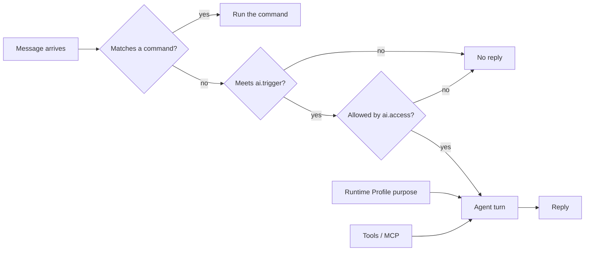

# AI capabilities overview

Out of the box Zhin only runs commands; it doesn't "chat". With AI enabled, **messages that match no command** go to an LLM, which can also call tools you write.

AI is optional: without it, the bot depends on no model SDK and needs no API key.

## Enable and select a model

```bash
npx zhin setup --ai
pnpm install
pnpm dev
```

The wizard records explicit model IDs and capabilities in an `ai.plan.yml` import proposal. Start Console, review the proposal and explicitly import it. An empty Host can start without a model: configure a Service, Account, Profile and purpose in Console. The database graph is authoritative; updates affect the next operation without restarting the process.

API Keys use the Host-private key form or an `env://AI_API_KEY` reference; values are not stored in the public graph. Host subscription Accounts use an explicit OAuth flow. Personal Accounts currently support API Keys. Install the optional AI stack (`@zhin.js/agent zod ai`) and the selected Driver's SDK; pure IM installations remain independent.

See [Services and subscription Accounts](../../ai/providers.md) and [upgrade and version boundaries](../../ai/provider-upgrade.md).

## When the AI replies

Messages that match no command are checked in this order:

| Order | Situation | Default |
| --- | --- | --- |
| 1 | Starts with `/`, `!` or `！` | Skip the AI, to avoid clashing with commands |
| 2 | Starts with `#`, `AI:` or `ai:` | Sent to the AI (DMs and groups), with the prefix removed |
| 3 | The bot is mentioned in a group or channel | Sent to the AI |
| 4 | Direct message | The whole message goes to the AI |
| 5 | A DM containing a configured keyword | Sent to the AI |

So in groups the bot **doesn't** butt in by default — only when mentioned or prefixed. All of this is configurable; see [ai.trigger](#ai-trigger).

## Let the AI do things

By default the AI can only talk. To let it check the weather, search music or query a database, put a tool in `tools/`:

```ts
// tools/weather/index.ts
import { defineAgentTool } from '@zhin.js/tool';
import { z } from 'zod';

export default defineAgentTool<{ city: string }>({
  description: 'Get the current weather for a city',
  inputSchema: z.object({ city: z.string().min(1) }),
  async execute({ city }) {
    const response = await fetch(`https://wttr.in/${encodeURIComponent(city)}?format=3`);
    return response.text();
  },
});
```

A tool's parameter schema reaches the model as written: `enum`, `anyOf`, nullable types, `integer`, `format` and value ranges are kept, for MCP tools too. Arguments the model sends back are checked against the same constraints, and a violation is reported to the model so it can call again. Gemini rejects fields without a type, so those go to Gemini as strings.

Restricting tools, requiring confirmation, packaging procedures as Skills and adding business context are covered in [Agent tools and Skills](../authoring/agent-tools.md).

## Common adjustments

| I want to… | Change |
| --- | --- |
| Switch model or vendor, or use a local model | [Services and Profiles](../../ai/providers.md) |
| Trigger in groups without a mention, or change prefixes | [ai.trigger](#ai-trigger) |
| Open the AI to only some users or groups | [ai.access](#ai-access) |
| Use different Agents or models in different groups | [ai.agents](#ai-agents) |
| Let the AI use tools from external MCP servers | [ai.mcpServers](#ai-mcpservers) |
| Control which shell commands the AI may run and whether they need approval | [ai.agent](#ai-agent) |
| Understand and reply with voice | [Speech](./speech.md) |

## Configuration reference

Everything lives under `ai:` in `zhin.config.yml`; `${VAR}` expands from environment variables.

### Models and Agent roles

Service, Account, Profile and purpose selection live in the runtime graph. `ai.plan.yml` is only an explicit import proposal; startup and hot reload never apply it automatically. Model names do not prove tool, media or streaming support. Directory refresh is explicit and its observations need capability confirmation before use.

`ai.agents` retains role authority, MCP selection and fallback display metadata. It does not contain provider/model/preset selectors. Endpoint account data takes precedence over configured nickname fallbacks. A role's model is selected by its `agents.<role>` Profile purpose. See [model policy](./model-policy.md).

### ai.mcpServers

Connect the AI to **external MCP servers** and use their tools. Requires `@modelcontextprotocol/sdk`.

```yaml
ai:
  mcpServers:
    - name: icqq
      transport: streamable-http      # stdio | streamable-http | sse
      url: ${ICQQ_MCP_URL}
      headers:
        Authorization: Bearer ${ICQQ_MCP_TOKEN}
    - name: filesystem
      transport: stdio
      command: npx
      args: ["-y", "@modelcontextprotocol/server-filesystem", "/tmp/zhin-mcp-test"]
```

- Once connected, the server's tools join the tool pool under names prefixed with the server name.
- **If any server fails to connect, the new config doesn't take effect** and the old version keeps serving.
- `ai.agents.<name>.mcpServers` may only reference names declared here, or config validation fails.

::: tip The other direction: make your bot an MCP server
To let external AI clients connect to your bot, use the top-level `mcp:` config and run `pnpm add @zhin.js/mcp @zhin.js/agent zod ai`. This is separate from `ai.mcpServers`; setting one doesn't enable the other. See [MCP Server configuration](https://github.com/zhinjs/zhin/blob/main/packages/host/mcp/README.md).
:::

### ai.trigger

```yaml
ai:
  trigger:
    prefixes: ["ai:"]          # default ['#', 'AI:', 'ai:']
    ignorePrefixes: ["/"]      # default ['/', '!', '！']
    respondToAt: true          # default true: trigger when mentioned in a group
    respondToPrivate: true     # default true: trigger on every DM
    keywords: []               # trigger when a DM contains one of these
    timeout: 60000             # per-turn timeout (ms)
    thinkingMessage: Thinking… # optional placeholder reply before processing
    # errorTemplate: "Error: {error}"  # optional; unset, the bot says it lagged in a chat voice and the owner also sees the cause
    masters: ["10001"]         # users with approval rights
    trusted: []                # trusted users (below master)
```

Mention triggering relies on the adapter flagging the message as mentioning the bot (CQ codes, Slack `app_mention`, etc.).

When a turn fails, the bot says so in a chat voice ("刚卡了一下，你再说一遍？") without mentioning models, keys or retries; when the sender is the owner (master), a short cause is appended in brackets, such as "（模型额度用完了）". The full error goes to the logs only. HTTP, Console and other non-chat entry points keep the precise messages. A configured `errorTemplate` still formats entry-level errors.

Mentions, quotes and DMs always reach the Agent. The Agent may still decide no reply is needed and return an empty reply (`{"messages":[]}`), in which case nothing is sent.

#### Ambient group engagement

When nobody addresses the bot in a group, it can decide by itself whether to chime in:

```yaml
ai:
  trigger:
    ambient:
      conversations: ["icqq:1048877509"]  # platform:groupId; "*" for every group
      judge:                              # judge model, defaults to the main Agent model; prefer a cheap, fast one
        - groq/openai/gpt-oss-120b        # a list is tried in order when one fails or is rate limited
        - groq/openai/gpt-oss-20b
      quietMs: 4000                       # wait until the group is quiet, then judge the burst once
      cooldownMs: 120000                  # minimum gap between two unprompted interjections
      maxPerHour: 3                       # unprompted interjections per group per hour
      conversationWindowMs: 180000        # after the bot speaks, the group is in a conversation for this long
      judgeIntervalMs: 30000              # outside a conversation, judge a group at most this often (deferred, not dropped)
      minConfidence: 0.7                  # judge confidence required to engage
      mode: active                        # shadow: log the judgment without replying
```

How it works:
1. After a new message, wait `quietMs` for the group to go quiet; messages in that window are judged together.
2. The judge reads the last 20 messages (the bot's own lines are labeled `You (this bot)`) and returns whether to engage and how confident it is.
   - **In a conversation** (the bot spoke within `conversationWindowMs`, addressed or not): replies to it depend only on the judge, not on the cooldown or hourly cap, with a safety ceiling of 30 per hour.
   - **Otherwise**: unprompted interjections are limited by `cooldownMs` and `maxPerHour`; the judge runs at most once per `judgeIntervalMs`, and a burst that arrives inside that window is judged when it ends (or superseded by a newer message) instead of being dropped.
3. Above the threshold, the main Agent handles the message as usual. Its context says nobody called it, and it can still stay quiet.

Each judgment logs an `ambient_engagement` line (decision, confidence, reason). Run in `shadow` first to see whether the judgments are sound, then switch to `active`.

##### Structured decisions

Configure a decision Profile per task under the import proposal's `purposes.decisions`, or in Console. The six tasks are skills, tools, memory, agents, approval and ambient. Missing tasks are off; shadow records raw evidence, while active lets the owning task apply it. Public `evaluate` returns genuine Choice/Score/Noul evidence, not task application state. See [structured decisions](../../ai/structured-decisions.md).

The independent Language `ambient` purpose supplies the normal engagement judge, inheriting deployment chat when omitted. It is distinct from `decisions.ambient`; personal chat overrides do not select either Host task. Existing trigger timing and addressed-message rules remain in effect.

### ai.access

Control which conversations may use the AI (e.g. for platform AIGC compliance):

```yaml
ai:
  access:
    mode: whitelist     # open (default) | closed | whitelist
    users: ["10001"]    # allowed user ids
    groups: ["123456"]  # allowed group / channel ids
    denyMessage: AI is not enabled for this conversation.
```

Denied DMs get `denyMessage`; denied groups and channels get no reply.

### ai.multimodal.perception

This section controls perception processing limits (`kinds`, `maxChars`, `timeoutMs`, `maxItemsPerTurn`). Model selection belongs to the runtime `perception` purpose, including only its explicitly configured fallback chain. A text-only chat model can receive a description from that service. Unsupported media is not silently presented as successfully understood.

### ai.agent

`ai.agent` controls how the AI runs — most importantly, the security policy for execution tools like `bash`:

```yaml
ai:
  agent:
    execSecurity: allowlist       # deny | allowlist (default) | full
    execPreset: readonly          # readonly | network | development | custom
    execAllowlist: [make]         # allowlist when execPreset=custom
    execApprovalMode: ask         # ask (default) | bypass | auto
    gitStatus: true               # default true: one-line git status in the prompt (skipped outside git repos)
    contextPaths: []              # extra context files for the system prompt (~ and relative paths ok)
    systemPromptMaxChars: 100000  # total system prompt character limit
    mailbox:
      groupMode: supersede        # default: a sender's new message replaces their own unanswered turn; fifo queues everything
      maxQueuedTurns: 5           # queued turns allowed per conversation
      ttlMs: 180000               # queue timeout
      merge:                      # group merge window (ADR 0038), group chats only
        enabled: true
        quietMs: 1500             # flush after this much quiet
        maxWaitMs: 6000           # longest a window waits
        maxSenders: 5             # senders per merged reply
      live:                       # danmaku mode (ADR 0038), liveDanmaku adapters only
        mode: pick-one            # pick-one answers one danmaku / summary answers the window once
        windowMs: 10000           # danmaku window
        minIntervalMs: 15000      # minimum gap between two danmaku replies
```

**Command allowlists**: `execPreset` widens step by step — `readonly` (ls, cat, grep, find…) → `network` (adds curl, wget, ping…) → `development` (adds npm, node, git, python…). In every mode, dangerous commands such as `sudo`, `eval`, `dd` and `export` are refused, and operations like `rm -rf node_modules` are hard-blocked.

**Approval modes**:

| `execApprovalMode` | Behavior |
| --- | --- |
| `ask` (default) | Ask a master for approval |
| `auto` | A tool-less reviewer Agent decides; if it can't, it asks a master; model errors, timeouts or invalid output are denied |
| `bypass` | Skip approval — but never the dangerous-command blocklist, tool permissions, file / network boundaries or the sandbox |

In groups and channels an approval offers "deny / just this once / this conversation / always allow"; in DMs, "deny / just this once / always allow". "This conversation" applies to everyone in it; "always allow" applies only to the current sender; every lasting decision is bound to the current conversation. `/approve always bash` and `/approve rule <regex>` manage this account's persistent allow rules.

::: details More details
- **Global context files**: besides `contextPaths`, `~/.config/zhin/AGENTS.md` and `~/.config/zhin/ZHIN.md` are loaded automatically (skipped if absent) as a `# User Context` section before project context; 8KB per file, 16KB total.
- **Prompt budget**: over `systemPromptMaxChars`, `opportunistic` content is removed first; if `required` content doesn't fit, the turn fails explicitly.
- **Command check chain**: dangerous blocklist → strip env prefixes (`FOO=bar cmd` matches as `cmd`) → strip wrappers (`timeout 10 cmd`) → split compound commands (`&&`, `|` checked per segment) → outside `full`, reject newlines, `$(...)` and backticks → read-only commands pass automatically. Approval goes through the current turn's `ApprovalPort`.
- **Legacy approval files**: V1 approval files aren't migrated online; rebuild rules explicitly before upgrading.
- **Message queueing**: `mailbox.groupMode` is also the default turn-intent policy. `supersede` lets a sender's new message replace their own unanswered turn (other members' messages always queue and never interrupt someone else); `fifo` queues in arrival order. See [Agent: messages that arrive while a turn is running](./agent.md). `steer`, `follow_up` and `observe` are set explicitly by adapters, commands or other policies; cross-participant `steer` / `follow_up` authorization can only come from the Host's trusted `resolveTurnIntent` policy, never from message metadata. Tools stay bound to the active turn's authority, and the execution log records who triggered the control and the turn ID.
:::

## How it works



An empty model graph leaves management available; inference reports not configured. Unauthenticated Accounts may be saved without logging in. A failed explicit selection reports its error instead of selecting another model or account.

## Next steps

- [Agent tools and Skills](../authoring/agent-tools.md): let the AI call your functions.
- [Agent deep dive](./agent.md): turns, on-demand tools, sub-tasks, sessions and context compaction.
- [Speech](./speech.md): speech recognition and voice replies.
- [Console](../console/index.md): watch AI conversations and runs in the browser.


Summary, approval and ambient tasks no longer add their own implicit temperature or output-cap overrides. Explicit Profile settings win. Generic SDK calls without an explicit cap retain the established effective budget: the declared model cap, otherwise 8192. This is not materialized into the Profile; Codex does not send that unsupported field. This update does not remove generic defaults across all services.
