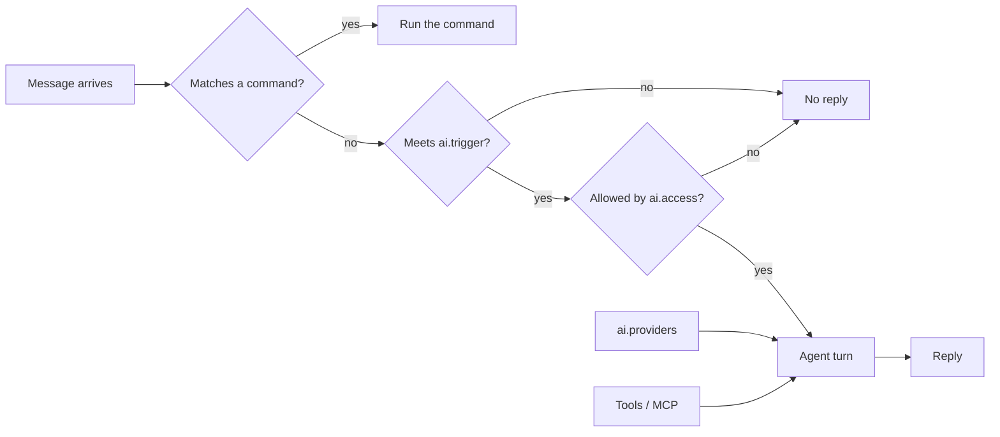

# AI capabilities overview

Out of the box Zhin only runs commands; it doesn't "chat". With AI enabled, **messages that match no command** go to an LLM, which can also call tools you write.

AI is optional: without it, the bot depends on no model SDK and needs no API key.

## Enable it in three steps

**1. Run the wizard**

```bash
npx zhin setup --ai
pnpm install
```

The wizard asks for a model service (OpenAI, Anthropic, DeepSeek, Google, any OpenAI-compatible API, or a local Ollama), installs the SDK and the Agent runtime, and declares the tool and Prompt Section capabilities in `package.json`.

**2. Add your key**

Cloud model keys go in `.env` (the wizard tells you the variable name, e.g. `AI_API_KEY`). Local Ollama needs no key.

**3. Try it**

```bash
pnpm dev
```

Send a sentence in a Sandbox DM, or `ai: hello` in a group, and the bot replies with the model.

The wizard writes roughly this to `zhin.config.yml`:

```yaml
ai:
  enabled: true
  providers:
    openai-main:          # a name you choose
      sdk: openai
      apiKey: ${AI_API_KEY}
  agents:
    zhin:                 # the main Agent must be named zhin
      provider: openai-main
      model: gpt-4o-mini
```

`providers` say *which model service to connect to*; `agents` say *which Agent uses which model*.

::: details Installing by hand instead of the wizard
```bash
pnpm add @zhin.js/agent zod ai
pnpm add @ai-sdk/openai   # the SDK for your vendor
```

Installing `@zhin.js/agent` alone doesn't make `tools/` and `prompt-sections/` work — you must also declare `@zhin.js/tool` and `@zhin.js/prompt-section` in `package.json#zhin.features`. In code, import `ZhinAgent`, `AIService` and friends from `zhin.js/agent` (or `@zhin.js/agent`). Model SDKs are optional dependencies; if one is missing, startup reports `Missing peer dependency` with the install command.
:::

## When the AI replies

Messages that match no command are checked in this order:

| Order | Situation | Default |
| --- | --- | --- |
| 1 | Starts with `/`, `!` or `！` | Skip the AI, to avoid clashing with commands |
| 2 | Starts with `#`, `AI:` or `ai:` | Sent to the AI (DMs and groups), with the prefix removed |
| 3 | The bot is mentioned in a group or channel | Sent to the AI |
| 4 | Direct message | The whole message goes to the AI |
| 5 | A DM containing a configured keyword | Sent to the AI |

So in groups the bot **doesn't** butt in by default — only when mentioned or prefixed. All of this is configurable; see [ai.trigger](#ai-trigger).

## Let the AI do things

By default the AI can only talk. To let it check the weather, search music or query a database, put a tool in `tools/`:

```ts
// tools/weather/index.ts
import { defineAgentTool } from '@zhin.js/tool';
import { z } from 'zod';

export default defineAgentTool<{ city: string }>({
  description: 'Get the current weather for a city',
  inputSchema: z.object({ city: z.string().min(1) }),
  async execute({ city }) {
    const response = await fetch(`https://wttr.in/${encodeURIComponent(city)}?format=3`);
    return response.text();
  },
});
```

A tool's parameter schema reaches the model as written: `enum`, `anyOf`, nullable types, `integer`, `format` and value ranges are kept, for MCP tools too. Arguments the model sends back are checked against the same constraints, and a violation is reported to the model so it can call again. Gemini rejects fields without a type, so those go to Gemini as strings.

Restricting tools, requiring confirmation, packaging procedures as Skills and adding business context are covered in [Agent tools and Skills](../authoring/agent-tools.md).

## Common adjustments

| I want to… | Change |
| --- | --- |
| Switch model or vendor, or use a local model | [ai.providers](#ai-providers) |
| Trigger in groups without a mention, or change prefixes | [ai.trigger](#ai-trigger) |
| Open the AI to only some users or groups | [ai.access](#ai-access) |
| Use different Agents or models in different groups | [ai.agents](#ai-agents) |
| Let the AI use tools from external MCP servers | [ai.mcpServers](#ai-mcpservers) |
| Control which shell commands the AI may run and whether they need approval | [ai.agent](#ai-agent) |
| Understand and reply with voice | [Speech](./speech.md) |

## Configuration reference

Everything lives under `ai:` in `zhin.config.yml`; `${VAR}` expands from environment variables.

### ai.providers

Each provider is keyed by a name you choose; `sdk` picks the model SDK:

```yaml
ai:
  providers:
    openrouter:
      sdk: openai-compatible
      baseUrl: ${OPENROUTER_BASE_URL}
      apiKey: ${OPENROUTER_API_KEY}
```

| sdk | Install | Key settings |
|-----|---------|--------------|
| `openai` | `@ai-sdk/openai` | `apiKey`, optional `baseUrl` (a proxy root gets `/v1`, same rule as `openai-compatible`) |
| `openai-compatible` | `@ai-sdk/openai-compatible` | `baseUrl` + `apiKey` (`/v1` appended when the path has no version, see `compat` below); Cloudflare Workers AI can use `accountId` instead of `baseUrl` |
| `anthropic` | `@ai-sdk/anthropic` | `apiKey`, optional `baseUrl` (`/v1` appended) |
| `deepseek` | `@ai-sdk/deepseek` | `apiKey`, optional `baseUrl` |
| `minimax` | `@ai-sdk/minimax` | `apiKey`, optional `baseUrl` (default `https://api.minimax.io/anthropic/v1`; for the China site use `https://api.minimaxi.com/anthropic`, `/v1` is appended) |
| `google` | `@ai-sdk/google` | `apiKey`, optional `baseUrl` (`/v1beta` appended) |
| `ollama` | `@ai-sdk/openai-compatible` (via the OpenAI-compatible API) | `host` (default `http://127.0.0.1:11434`, `/v1` appended); no `apiKey`; set `contextWindow` (see below) |

Optional fields:

- `models`: the models allowed. When omitted, they are fetched from `/v1/models` after startup (last cache first, then refreshed in the background).
- `input`: content types the model accepts, `text | image | audio | video | file`. When omitted, the default depends on the SDK and model name:
  - Gemini chat models on `sdk: google` are natively multimodal and default to `text, image, audio, video, file`. TTS, embedding, image-generation and Live models are text-only.
  - On `sdk: openai`, GPT-4o, GPT-4.1, GPT-4.5, GPT-5.x, o1, o3 and o4-mini default to `text, image`, and so does every Claude 3+ model on `sdk: anthropic`. The audio, realtime, TTS, search, embedding and image-generation variants, plus o1-mini and o3-mini, are text-only. PDFs and other files are off by default; set `input: [text, image, file]` to send them.
  - Other SDKs (DeepSeek, MiniMax, Ollama, gateways) are text-only, because one vendor's models differ in what they accept. Groq is the exception: Llama 4 Scout / Maverick default to `text, image`, while GPT-OSS and the other models stay text-only.

  An explicit `input` always wins.
- `contextWindow`: context window size. When omitted, most providers assume 128k. `sdk: ollama` is the exception: zhin reads `OLLAMA_CONTEXT_LENGTH` (when zhin and Ollama share a machine) and otherwise assumes 4096. Ollama sizes the context by VRAM (4k below 24 GiB, 32k for 24–48 GiB, 256k above), its OpenAI-compatible API cannot raise it per request, and it **silently drops the start** of a longer prompt, system prompt included. So zhin errs low. Set `contextWindow` to the CONTEXT column of `ollama ps`. Startup prints a hint when it is missing.
- `thinkingLevel`: reasoning depth, `off | low | medium | high`. When omitted, the provider default applies. zhin passes it to each SDK as the AI SDK `reasoning` option, and the SDK maps it to its own setting: Gemini 3 `thinkingLevel` (`off` becomes `minimal`), the Gemini 2.5 thinking budget, the Claude thinking budget, or OpenAI and DeepSeek reasoning effort. A thinking setting already in `providerOptions` (`thinkingConfig`, `thinking`, `reasoningEffort` or `effort`) wins. MiniMax always uses adaptive thinking and ignores it.
- `maxOutputTokens`: output token cap per request, default `8192`. Gemini and Claude count thinking tokens against it, so raise it with `thinkingLevel: high` to keep replies from being cut off.
- `compat` (`openai-compatible` / `ollama`):
  - `includeUsage`: request streamed usage (`stream_options.include_usage`). Default `true`. Without it most compatible servers stream no token counts. Set `false` for a server that rejects the field.
  - `appendV1`: whether `/v1` is appended to `baseUrl`. Unset: a path that already names a version (`/api/v3`, `/api/paas/v4`, `/v1beta/openai`) or ends in `/openai` is used as written; anything else gets `/v1`, so existing `https://host` and `https://host/api` configs behave as before. `true` always appends (the old behaviour), `false` never does.
  - `promptCacheKey`: send OpenAI's `prompt_cache_key`. Default `false`, because strict gateways reject unknown fields.
  - `supportsDeveloperRole` (`sdk: openai`): `false` sends the system prompt of reasoning models (o-series, gpt-5) with the `system` role, for OpenAI-protocol endpoints that reject `developer`.
  - `supportsReasoningContent` and `toolCallsInAssistant` are deprecated and have no effect.
- `authScheme`: the `Authorization` scheme. Unset uses the SDK default (`Bearer` for OpenAI-style SDKs, `x-api-key` for Anthropic, `x-goog-api-key` for Google). `''` sends `Authorization: <key>`; `Bearer`, `Token` and so on send `Authorization: <scheme> <key>`. Chat and model-list requests use the same rule.
- `timeout`, `maxRetries`: this provider's per-request timeout (ms, 0 disables) and retries per model. They override `requestTimeoutMs` / `maxRetries` in `ai.providerResilience`; a per-model `modelHarness.requestTimeoutMs` still wins.
- `firstChunkTimeoutMs`, `chunkTimeoutMs`: streaming stall timeouts (ms), off by default. The first bounds the wait for response headers and the first chunk; the second bounds silence between chunks. A stall counts as a timeout: it is retried, then fails over to a fallback model. This catches a connected-but-silent request well before `timeout`; a few tens of seconds is a good value.
- `imageGeneration`: defaults for text-to-image.
- `providerOptions`: AI SDK `providerOptions` keyed by SDK name, merged into every request. For Gemini, this is where safety settings and thinking depth go:

  ```yaml
  ai:
    providers:
      gemini:
        sdk: google
        apiKey: ${GEMINI_API_KEY}
        defaultModel: gemini-3.8-flash
        providerOptions:
          google:
            safetySettings:
              - { category: HARM_CATEGORY_HARASSMENT, threshold: BLOCK_ONLY_HIGH }
            thinkingConfig: { thinkingLevel: low }
  ```

  If Gemini refuses on safety grounds (SAFETY, PROHIBITED_CONTENT, RECITATION, a blocked prompt and so on), the user sees a polite refusal that names the reason instead of an empty reply. Such a refusal is neither retried nor sent to a fallback model: the same content gets the same verdict, and switching models to get past it would bypass your `safetySettings`. Gemini uses implicit caching: the system prompt and tool definitions stay unchanged, and cache hits are reported as `cacheRead` in usage and as `cache_read_tokens` in the turn trace. For a steadier discount, turn on explicit caching with `contextCache: { mode: explicit, ttlSeconds: 600 }`. zhin then creates a `cachedContents` entry for the system prompt and tool definitions and reuses it within the TTL. A changed prefix gets a new cache and the old one is deleted. If the server has dropped the cache, zhin resends the full request. If a cache can't be created (for example, the prefix is too short), it falls back to implicit caching. Cache storage is billed by the hour. Explicit caching works on Gemini 3 and 2.5 only; Gemini 4 Argon and later don't support it.

  Explicit caching also requires the proxy to implement `cachedContents`. Creation failures are reported by the `ai-context-cache` logger with `gemini_cache_create`, the HTTP status when available, and the fallback reason. The existing failure backoff is retained for the same prefix, including across standalone text completions. Logs exclude prompts, credentials, and upstream response bodies. A reported `cacheRead` can come from implicit caching and does not prove that an explicit cache was created.

  Gemini requires tool names to match `^[A-Za-z_][A-Za-z0-9_.:-]{0,127}$`. Plugin instance keys such as `60s` become the tool-name prefix, so a name like `60s__skill__60s-life__weather` starts with a digit and Gemini rejects it with 400 `Invalid function name`. zhin rewrites such names before sending them to Gemini (for example `_60s__skill__60s-life__weather`, with a short hash added on a collision or when a name is too long) and maps the model's tool calls back. Execution, permissions and session history keep the original names, so you don't need to rename plugin keys. Valid names are sent unchanged, and other providers are not affected.

- **Gemini through your own proxy**: if the proxy simply forwards requests (same requests, same `x-goog-api-key` auth, same responses; only the host differs), point `baseUrl` at it. Both the root and a URL ending in `/v1beta` work; a trailing `/` is dropped and `/v1beta` is never doubled. The default is `https://generativelanguage.googleapis.com`. `generateContent`, streaming `streamGenerateContent`, explicit-cache `cachedContents` (create and delete) and the model list all use this URL. If the proxy needs extra request headers, add the optional `headers`; they are sent on every request:

  ```yaml
  ai:
    providers:
      gemini:
        sdk: google
        apiKey: ${GEMINI_API_KEY}
        baseUrl: https://gemini-proxy.example.com   # same as https://gemini-proxy.example.com/v1beta
        headers:                                   # optional
          x-proxy-tag: zhin
  ```

- **Groq (GroqCloud)**: Groq uses `openai-compatible`, and zhin ships a Groq preset. With the alias `groq` (or `groqcloud`) you can omit `sdk` and `baseUrl`. A `baseUrl` on `api.groq.com` is treated as Groq under any alias, and `sdk: openai` is switched to `openai-compatible`:

  ```yaml
  ai:
    providers:
      groq:
        sdk: openai-compatible
        baseUrl: https://api.groq.com/openai/v1
        apiKey: ${GROQ_API_KEY}
        models:
          - openai/gpt-oss-120b
          - openai/gpt-oss-20b
        # thinkingLevel: medium   # GPT-OSS defaults to low; medium / high also work
  ```

  Caveats:
  - Earlier reasoning is sent back as `reasoning`, the field Groq accepts. Groq rejects the SDK's default `reasoning_content`, which made the second step of every tool loop fail with a 400.
  - Groq rejects `logprobs`, `top_logprobs`, `logit_bias` and an `n` above 1, so zhin never sends them.
  - `reasoning_effort` goes only to GPT-OSS and Qwen 3. GPT-OSS defaults to `low`, which keeps replies fast and helps you stay under the free tier's 8K tokens per minute. Other models (Llama, for example) never get the field, even with `thinkingLevel` set.
  - GPT-OSS is text-only. Images are handled the way zhin handles any model without image support, so they never reach Groq. Llama 4 Scout and Maverick default to `text, image`. An explicit `input` always wins.
  - The context window comes from the model id: 131072 for GPT-OSS and 128k for other models. Override it with `contextWindow`.
  - Free-tier limits are low: GPT-OSS gets about 8K tokens per minute and 1,000 requests per day (see [Groq rate limits](https://console.groq.com/docs/rate-limits)). A 429 on a per-minute limit (RPM / TPM) is retried after `retry-after`. A per-day limit (RPD / TPD) can't recover until the next day, so zhin skips retries and moves to the next candidate model (limits are per model). If no candidate is left, the user is told today's quota is used up.

### ai.agents

Bind Agent names to `provider + model`. `zhin` is the main Agent and must exist:

```yaml
ai:
  agents:
    zhin:
      provider: openrouter
      model: openrouter/free
      mcpServers: [icqq]        # MCP servers this Agent uses
      nickname: Zhi             # how the AI refers to itself, and its display name
    planner:
      provider: openrouter
      model: openrouter/free
      permission:               # which sub-agents it may dispatch
        task: { "researcher": allow, "*": deny }
```

| Field | Description |
|------|------|
| `provider` / `model` | A name from `ai.providers` and a model id (required) |
| `mcpServers` | Names from `ai.mcpServers` |
| `nickname` | The AI's self-reference and display name |
| `permission.task` | glob → `allow` / `deny`, limiting which sub-agents `spawn_task` may dispatch |

IM messages always go to `zhin`; other Agents are only called by name (`spawn_task`, collaboration roles).

::: warning Deprecated: `priority` / `match`
`ai.agents.<name>.priority` and `match` (including `hasMedia`, `scene`, `adapter` and every other condition) never took effect. They are still accepted, but startup logs a warning, `zhin config check --fix` deletes them, and they will be removed in the next minor release. To let a text-only model understand images, use [`ai.multimodal.perception`](#ai-multimodal-perception).
:::

### ai.mcpServers

Connect the AI to **external MCP servers** and use their tools. Requires `@modelcontextprotocol/sdk`.

```yaml
ai:
  mcpServers:
    - name: icqq
      transport: streamable-http      # stdio | streamable-http | sse
      url: ${ICQQ_MCP_URL}
      headers:
        Authorization: Bearer ${ICQQ_MCP_TOKEN}
    - name: filesystem
      transport: stdio
      command: npx
      args: ["-y", "@modelcontextprotocol/server-filesystem", "/tmp/zhin-mcp-test"]
```

- Once connected, the server's tools join the tool pool under names prefixed with the server name.
- **If any server fails to connect, the new config doesn't take effect** and the old version keeps serving.
- `ai.agents.<name>.mcpServers` may only reference names declared here, or config validation fails.

::: tip The other direction: make your bot an MCP server
To let external AI clients connect to your bot, use the top-level `mcp:` config and run `pnpm add @zhin.js/mcp @zhin.js/agent zod ai`. This is separate from `ai.mcpServers`; setting one doesn't enable the other. See [MCP Server configuration](https://github.com/zhinjs/zhin/blob/main/packages/host/mcp/README.md).
:::

### ai.trigger

```yaml
ai:
  trigger:
    prefixes: ["ai:"]          # default ['#', 'AI:', 'ai:']
    ignorePrefixes: ["/"]      # default ['/', '!', '！']
    respondToAt: true          # default true: trigger when mentioned in a group
    respondToPrivate: true     # default true: trigger on every DM
    keywords: []               # trigger when a DM contains one of these
    timeout: 60000             # per-turn timeout (ms)
    thinkingMessage: Thinking… # optional placeholder reply before processing
    # errorTemplate: "Error: {error}"  # optional; unset, the bot says it lagged in a chat voice and the owner also sees the cause
    masters: ["10001"]         # users with approval rights
    trusted: []                # trusted users (below master)
```

Mention triggering relies on the adapter flagging the message as mentioning the bot (CQ codes, Slack `app_mention`, etc.).

When a turn fails, the bot says so in a chat voice ("刚卡了一下，你再说一遍？") without mentioning models, keys or retries; when the sender is the owner (master), a short cause is appended in brackets, such as "（模型额度用完了）". The full error goes to the logs only. HTTP, Console and other non-chat entry points keep the precise messages. A configured `errorTemplate` still formats entry-level errors.

Mentions, quotes and DMs always reach the Agent. The Agent may still decide no reply is needed and return an empty reply (`{"messages":[]}`), in which case nothing is sent.

#### Ambient group engagement

When nobody addresses the bot in a group, it can decide by itself whether to chime in:

```yaml
ai:
  trigger:
    ambient:
      conversations: ["icqq:1048877509"]  # platform:groupId; "*" for every group
      judge:                              # judge model, defaults to the main Agent model; prefer a cheap, fast one
        - groq/openai/gpt-oss-120b        # a list is tried in order when one fails or is rate limited
        - groq/openai/gpt-oss-20b
      quietMs: 4000                       # wait until the group is quiet, then judge the burst once
      cooldownMs: 120000                  # minimum gap between two unprompted interjections
      maxPerHour: 3                       # unprompted interjections per group per hour
      conversationWindowMs: 180000        # after the bot speaks, the group is in a conversation for this long
      judgeIntervalMs: 30000              # outside a conversation, judge a group at most this often
      minConfidence: 0.7                  # judge confidence required to engage
      mode: active                        # shadow: log the judgment without replying
```

How it works:
1. After a new message, wait `quietMs` for the group to go quiet; messages in that window are judged together.
2. The judge reads the last 20 messages (the bot's own lines are labeled `You (this bot)`) and returns whether to engage and how confident it is.
   - **In a conversation** (the bot spoke within `conversationWindowMs`, addressed or not): replies to it depend only on the judge, not on the cooldown or hourly cap, with a safety ceiling of 30 per hour.
   - **Otherwise**: unprompted interjections are limited by `cooldownMs` and `maxPerHour`.
3. Above the threshold, the main Agent handles the message as usual. Its context says nobody called it, and it can still stay quiet.

Each judgment logs an `ambient_engagement` line (decision, confidence, reason). Run in `shadow` first to see whether the judgments are sound, then switch to `active`.

##### Let the structured-decision model judge

With [structured decisions](../../ai/structured-decisions.md) (Chinese) set up (for example TypeSafe Jev), the decision model can replace the chat-model judge for "should the bot speak up?", which is usually faster and more consistent:

```yaml
ai:
  decisions:
    provider: root/typesafe
    ambient:
      mode: shadow        # start in shadow: the judge list still decides; Jev's call is logged as ambient_decision_shadow
      timeoutMs: 3000     # budget per judgment (default 3000); a timeout counts as a failure
      # minConfidence: 0.8  # optional: treat "engage" below this probability as "stay quiet"
  trigger:
    ambient:
      conversations: ["icqq:1048877509"]
      judge:              # fallback in active mode when Jev fails, times out or answers invalidly
        - groq/openai/gpt-oss-120b
```

- `off` or unset: unchanged, only the `judge` list.
- `shadow`: the `judge` list decides; Jev judges the same messages and its answer is logged as `ambient_decision_shadow` for comparison.
- `active`: Jev decides; on failure the `judge` list takes over (a failed judge is passed over for 60 seconds). The `ambient_engagement` log line names `decision:<model>` in its `judge` field.

`quietMs`, `cooldownMs`, `maxPerHour`, `conversationWindowMs`, `judgeIntervalMs`, `ambient.minConfidence` and `ambient.mode: shadow` still apply; addressed, quoted, prefix-matched and private messages still skip the ambient judge. Both `minConfidence` values apply (the stricter wins).

### ai.access

Control which conversations may use the AI (e.g. for platform AIGC compliance):

```yaml
ai:
  access:
    mode: whitelist     # open (default) | closed | whitelist
    users: ["10001"]    # allowed user ids
    groups: ["123456"]  # allowed group / channel ids
    denyMessage: AI is not enabled for this conversation.
```

Denied DMs get `denyMessage`; denied groups and channels get no reply.

### ai.multimodal.perception

When the main model cannot see images (for example Groq `gpt-oss` takes text only), an image normally becomes a `[Media unsupported:provider_input: image]` placeholder and the AI does not know what is in it. With `perception` configured, an image-capable model (for example Gemini Flash-Lite) first describes the image in text, and that description goes to the main model:

```yaml
ai:
  providers:
    groq:
      sdk: openai-compatible
      baseUrl: https://api.groq.com/openai/v1
      apiKey: ${GROQ_API_KEY}
    gemini:
      sdk: google
      apiKey: ${GEMINI_API_KEY}
  agents:
    zhin:
      provider: groq
      model: openai/gpt-oss-120b
  multimodal:
    perception:
      provider: gemini              # required, a name from ai.providers
      model: gemini-2.5-flash-lite  # required, must declare input for the kinds below
      kinds: [image]                # optional: image | video | file, default [image]; file means PDF only
      maxChars: 800                 # optional: description length cap, default 800
      timeoutMs: 30000              # optional: per-request timeout, default 30000
      maxItemsPerTurn: 4            # optional: media described per turn, default 4
```

| Field | Meaning |
| --- | --- |
| `provider` / `model` | The model that describes media. `provider` must be a name from `ai.providers`; a wrong value fails startup and `zhin config check` reports it |
| `kinds` | Kinds to describe. Audio is not here; it keeps using speech-to-text from `ai.multimodal.audio` |
| `maxChars` | Longer descriptions are cut off |
| `timeoutMs` | Per-request timeout. A failure is retried at most once, with the same retry, timeout and error classification as the main chat |
| `maxItemsPerTurn` | Media beyond this count in one turn keep the placeholder |

How it behaves:

- Only media the main model cannot take is described. If the main model can see images, the image goes to it directly and `perception` is not called.
- A description starts with `[图片描述]` / `[视频描述]` / `[文件描述]` and is marked as **untrusted external content**: text inside an image can carry instructions, so the model treats it as data only. A turn that read a description counts as having seen external content, so running commands, messaging other conversations, changing config or creating scheduled tasks afterwards needs approval, and the approval card lists "图片/媒体的自动描述" (automatic media description) in its source chain.
- The description is saved with the user message in the session history, so later turns can still ask about "that image". The image itself is not saved.
- Images with the same content (sha256 of the bytes) are described once, so common stickers and memes do not cost another call.
- If a description fails, times out or exceeds `maxItemsPerTurn`, the old placeholder is used and the turn carries on. Each media item's result is recorded as a `media_resolution` event in the `zhin trace` timeline; a successful description has `code: media_perception` and names the model used.
- Without `perception`, behaviour is exactly as before.

### ai.agent

`ai.agent` controls how the AI runs — most importantly, the security policy for execution tools like `bash`:

```yaml
ai:
  agent:
    execSecurity: allowlist       # deny | allowlist (default) | full
    execPreset: readonly          # readonly | network | development | custom
    execAllowlist: [make]         # allowlist when execPreset=custom
    execApprovalMode: ask         # ask (default) | bypass | auto
    gitStatus: true               # default true: one-line git status in the prompt (skipped outside git repos)
    contextPaths: []              # extra context files for the system prompt (~ and relative paths ok)
    systemPromptMaxChars: 100000  # total system prompt character limit
    inboundQueue:
      groupMode: supersede        # default: a sender's new message replaces their own unanswered turn; fifo queues everything
      maxQueuedTurns: 5           # queued turns allowed per conversation
      ttlMs: 180000               # queue timeout
      merge:                      # group merge window (ADR 0038), group chats only
        enabled: true
        quietMs: 1500             # flush after this much quiet
        maxWaitMs: 6000           # longest a window waits
        maxSenders: 5             # senders per merged reply
      live:                       # danmaku mode (ADR 0038), liveDanmaku adapters only
        mode: pick-one            # pick-one answers one danmaku / summary answers the window once
        windowMs: 10000           # danmaku window
        minIntervalMs: 15000      # minimum gap between two danmaku replies
```

**Command allowlists**: `execPreset` widens step by step — `readonly` (ls, cat, grep, find…) → `network` (adds curl, wget, ping…) → `development` (adds npm, node, git, python…). In every mode, dangerous commands such as `sudo`, `eval`, `dd` and `export` are refused, and operations like `rm -rf node_modules` are hard-blocked.

**Approval modes**:

| `execApprovalMode` | Behavior |
| --- | --- |
| `ask` (default) | Ask a master for approval |
| `auto` | A tool-less reviewer Agent decides; if it can't, it asks a master; model errors, timeouts or invalid output are denied |
| `bypass` | Skip approval — but never the dangerous-command blocklist, tool permissions, file / network boundaries or the sandbox |

In groups and channels an approval offers "deny / just this once / this conversation / always allow"; in DMs, "deny / just this once / always allow". "This conversation" applies to everyone in it; "always allow" applies only to the current sender; every lasting decision is bound to the current conversation. `/approve always bash` and `/approve rule <regex>` manage this account's persistent allow rules.

::: details More details
- **Global context files**: besides `contextPaths`, `~/.config/zhin/AGENTS.md` and `~/.config/zhin/ZHIN.md` are loaded automatically (skipped if absent) as a `# User Context` section before project context; 8KB per file, 16KB total.
- **Prompt budget**: over `systemPromptMaxChars`, `opportunistic` content is removed first; if `required` content doesn't fit, the turn fails explicitly.
- **Command check chain**: dangerous blocklist → strip env prefixes (`FOO=bar cmd` matches as `cmd`) → strip wrappers (`timeout 10 cmd`) → split compound commands (`&&`, `|` checked per segment) → outside `full`, reject newlines, `$(...)` and backticks → read-only commands pass automatically. Approval goes through the current turn's `ApprovalPort`.
- **Legacy approval files**: V1 approval files aren't migrated online; rebuild rules explicitly before upgrading.
- **Message queueing**: `inboundQueue.groupMode` is also the default turn-intent policy. `supersede` lets a sender's new message replace their own unanswered turn (other members' messages always queue and never interrupt someone else); `fifo` queues in arrival order. See [Agent: messages that arrive while a turn is running](./agent.md). `steer`, `follow_up` and `observe` are set explicitly by adapters, commands or other policies; cross-participant `steer` / `follow_up` authorization can only come from the Host's trusted `resolveTurnIntent` policy, never from message metadata. Tools stay bound to the active turn's authority, and the execution log records who triggered the control and the turn ID.
:::

## How it works



At startup Zhin tidies the `ai:` config: providers whose credentials expand to empty are dropped (debug log only), and Agents bound to them are skipped. If no usable `zhin` Agent remains, AI stays off — **without** affecting the rest of the bot.

## Next steps

- [Agent tools and Skills](../authoring/agent-tools.md): let the AI call your functions.
- [Agent deep dive](./agent.md): turns, on-demand tools, sub-tasks, sessions and context compaction.
- [Speech](./speech.md): speech recognition and voice replies.
- [Console](../console/index.md): watch AI conversations and runs in the browser.
