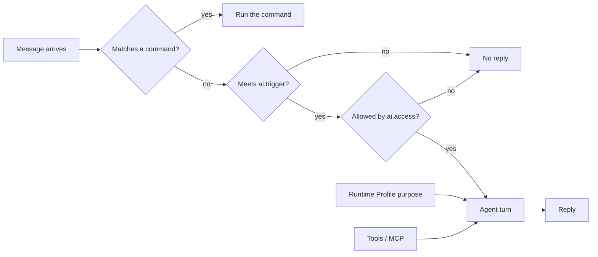

# AI capabilities overview

Out of the box Zhin only runs commands; it doesn't "chat". With AI enabled, **messages that match no command** go to an LLM, which can also call tools you write.

AI is optional: without it, the bot depends on no model SDK and needs no API key.

## 2-minute quick start

1. **Run the setup wizard to choose a provider**:

   ```bash
   npx zhin setup --ai
   pnpm install
   ```

   The wizard enables `ai: { enabled: true }` in `zhin.config.yml` and generates `ai.plan.yml` with your chosen provider preset (OpenAI, DeepSeek, Qwen/DashScope, SiliconFlow, Volcengine, MiniMax, OpenRouter, Anthropic, or local Ollama) plus `.env` placeholders.

2. **Start the bot and chat immediately**:

   ```bash
   pnpm dev
   ```

   On first startup (when the Host database has no model graph yet), `ai.plan.yml` is **automatically seeded into the Host database** — you can open `/sandbox` and chat with the bot right away without manual Console steps! You can adjust Services, Accounts, Profiles, and purposes anytime on the Console **AI & models** page (`/features/ai`), and changes take effect on the very next turn without restarting the process.

```yaml
# Example ai.plan.yml (DeepSeek)
version: 1
services:
  deepseek:
    driver: deepseek
    models:
      deepseek-chat:
        id: deepseek-chat
        kinds: [language]
        protocol: openai-chat
        input: [text]
        streaming: true
        toolCalling: true
accounts:
  default:
    service: deepseek
    auth:
      method: api-key
      source: env://DEEPSEEK_API_KEY
profiles:
  chat-default:
    account: default
    model: deepseek-chat
purposes:
  chat:
    profile: chat-default
```

API Keys live in `.env` (referenced via `env://AI_API_KEY`) or in the Host-private key form in Console. Host subscription Accounts use an explicit OAuth flow. Install the optional AI stack (`@zhin.js/agent zod ai`) and the selected Driver's SDK; pure IM installations remain independent.

See [Services and subscription Accounts](./providers.md) and [upgrade and version boundaries](./provider-upgrade.md).

## When the AI replies

Messages that match no command are checked in this order:

| Order | Situation | Default |
| --- | --- | --- |
| 1 | Starts with `/`, `!` or `！` | Skip the AI, to avoid clashing with commands |
| 2 | Starts with `#`, `AI:` or `ai:` | Sent to the AI (DMs and groups), with the prefix removed |
| 3 | The bot is mentioned in a group or channel | Sent to the AI |
| 4 | Direct message | The whole message goes to the AI |
| 5 | A DM containing a configured keyword | Sent to the AI |

So in groups the bot **doesn't** butt in by default — only when mentioned or prefixed. All of this is configurable; see [ai.trigger](#ai-trigger).

## Let the AI do things

By default the AI can only talk. To let it check the weather, search music or query a database, put a tool in `tools/`:

```ts
// tools/weather/index.ts
import { defineAgentTool } from '@zhin.js/tool';
import { z } from 'zod';

export default defineAgentTool<{ city: string }>({
  description: 'Get the current weather for a city',
  inputSchema: z.object({ city: z.string().min(1) }),
  async execute({ city }) {
    const response = await fetch(`https://wttr.in/${encodeURIComponent(city)}?format=3`);
    return response.text();
  },
});
```

A tool's parameter schema reaches the model as written: `enum`, `anyOf`, nullable types, `integer`, `format` and value ranges are kept, for MCP tools too. Arguments the model sends back are checked against the same constraints, and a violation is reported to the model so it can call again. Gemini rejects fields without a type, so those go to Gemini as strings.

Restricting tools, requiring confirmation, packaging procedures as Skills and adding business context are covered in [Agent tools and Skills](../authoring/agent-tools.md).

## Common adjustments

| I want to… | Change |
| --- | --- |
| Switch model or vendor, or use a local model | [Services and Profiles](./providers.md) |
| Trigger in groups without a mention, or change prefixes | [ai.trigger](#ai-trigger) |
| Open the AI to only some users or groups | [ai.access](#ai-access) |
| Give a role a nickname and choose its MCP servers | [ai.agents](../configuration/index.md#ai-agents) |
| Let the AI use tools from external MCP servers | [ai.mcpServers](#ai-mcpservers) |
| Control which shell commands the AI may run and whether they need approval | [ai.agent](#ai-agent) |
| Understand and reply with voice | [Speech](./speech.md) |

## Configuration reference

Everything lives under `ai:` in `zhin.config.yml`; `${VAR}` expands from environment variables.

### Models and Agent roles

Service, Account, Profile, and purpose selection (`chat`, `compaction`, `ambient`, `perception`, etc.) live in the Host database. When the database is empty on first startup, `ai.plan.yml` is seeded automatically; you can also review/import proposals or update Profiles anytime in Console.

`ai.agents` retains role authority, MCP selection, and fallback display metadata. It does not contain provider/model/preset selectors. Endpoint account data takes precedence over configured nickname fallbacks. A role's model is selected by its `agents.<role>` Profile purpose. See [model policy](./model-policy.md).

### ai.mcpServers

Connect the AI to **external MCP servers** and use their tools. Requires `@modelcontextprotocol/sdk`.

It takes two steps, and **without the second one no Agent can use the tools**:

1. `ai.mcpServers` **only connects**: it declares how to reach each server.
2. `ai.agents.<name>.mcpServers` **binds**: list a server's `name` there and that Agent can call its tools. IM messages are handled by `zhin`, so you usually bind on `ai.agents.zhin`.

```yaml
ai:
  mcpServers:                         # step 1: connect
    - name: github
      transport: streamable-http      # stdio | streamable-http | sse
      url: https://api.githubcopilot.com/mcp/
      headers:
        Authorization: Bearer ${GITHUB_MCP_TOKEN}
    - name: filesystem
      transport: stdio
      command: npx
      args: ["-y", "@modelcontextprotocol/server-filesystem", "/tmp/zhin-mcp-test"]
  agents:
    zhin:
      mcpServers: [github, filesystem]  # step 2: bind to zhin, which handles IM messages
    researcher:
      mcpServers: [github]              # turns that name researcher (schedules, A2A) use its own binding
```

- Once connected, the server's tools join the tool pool under names prefixed with the server name, but a turn only gets the tools of the servers listed in the `mcpServers` of the Agent it runs as. IM messages (including turns routed to a plugin sub-agent) always use `ai.agents.zhin.mcpServers`; another Agent's binding applies only to turns that name that Agent (schedules, A2A and other protocol entries). With `ai.agents.zhin: {}` and no `mcpServers`, chat cannot use a single MCP tool.
- A server that is connected but bound to no Agent is marked "connected, but no Agent can use it" in `zhin status`, and listed by `zhin doctor` and the Console attention inbox (`mcp.unbound`); the Agent's ready log reads `ready | zhin | mcp: - | 未绑定: github(待连接)` — the `mcp:` part lists only the servers that Agent is bound to.
- **If any server fails to connect, the new config doesn't take effect** and the old version keeps serving.
- `ai.agents.<name>.mcpServers` may only reference names declared here, or config validation fails.

::: tip The other direction: make your bot an MCP server
To let external AI clients connect to your bot, use the top-level `mcp:` config and run `pnpm add @zhin.js/mcp @zhin.js/agent zod ai`. This is separate from `ai.mcpServers`; setting one doesn't enable the other. See [MCP Server configuration](https://github.com/zhinjs/zhin/blob/main/packages/host/mcp/README.md).
:::

### ai.trigger

```yaml
ai:
  trigger:
    prefixes: ["ai:"]          # default ['#', 'AI:', 'ai:']; a prefix equal to the adapter's commandPrefix no longer triggers (see below)
    ignorePrefixes: ["/"]      # default ['/', '!', '！']; the adapter's commandPrefix (when non-empty) always counts as a command prefix too
    respondToAt: true          # default true: trigger when mentioned in a group
    respondToPrivate: true     # default true: trigger on every DM
    keywords: []               # trigger when a DM contains one of these
    timeout: 60000             # per-turn timeout (ms)
    thinkingMessage: Thinking… # optional placeholder reply before processing
    # errorTemplate: "Error: {error}"  # optional; unset, the bot says it lagged in a chat voice and the owner also sees the cause
```

A trigger prefix in `prefixes` that equals the adapter's `commandPrefix` no longer takes effect: with `commandPrefix: '#'`, `#xxx` is matched as a command first, and if no command claims it, it is still a command-like message and is not handed to the AI by the default `#` trigger prefix. To summon the AI by prefix on such an adapter, use a different trigger prefix (for example `ai:`).

Mention triggering relies on the adapter flagging the message as mentioning the bot (CQ codes, Slack `app_mention`, etc.).

When a turn fails, the bot says so in a chat voice ("刚卡了一下，你再说一遍？") without mentioning models, keys or retries; when the sender is the owner (master), a short cause is appended in brackets, such as "（模型额度用完了）". The full error goes to the logs only. HTTP, Console and other non-chat entry points keep the precise messages. A configured `errorTemplate` still formats entry-level errors.

Mentions, quotes and DMs always reach the Agent. The Agent may still decide no reply is needed and return an empty reply (`{"messages":[]}`), in which case nothing is sent.

#### Ambient group engagement

When nobody addresses the bot in a group, it can decide by itself whether to chime in:

```yaml
ai:
  trigger:
    ambient:
      conversations: ["icqq:1048877509"]  # platform:groupId; "*" for every group
      quietMs: 4000                       # wait until the group is quiet, then judge the burst once
      cooldownMs: 120000                  # minimum gap between two unprompted interjections
      maxPerHour: 3                       # unprompted interjections per group per hour
      conversationWindowMs: 180000        # after the bot speaks, the group is in a conversation for this long
      judgeIntervalMs: 30000              # outside a conversation, judge a group at most this often (deferred, not dropped)
```

This section only says which groups take part and how often. The judging model, the threshold and "watch only" are set in the interjection judge (`purposes.ambient`), see "Interjection judge" below. `ai.trigger.ambient.minConfidence` / `mode` are deprecated ([migration notes](../migrations/ambient-judge.md)).

How it works:
1. After a new message, wait `quietMs` for the group to go quiet; messages in that window are judged together.
2. The judge reads the last 20 messages (the bot's own lines are labeled `You (this bot)`) and returns whether to engage and how confident it is.
   - **In a conversation** (the bot spoke within `conversationWindowMs`, addressed or not): replies to it depend only on the judge, not on the cooldown or hourly cap, with a safety ceiling of 30 per hour.
   - **Otherwise**: unprompted interjections are limited by `cooldownMs` and `maxPerHour`; the judge runs at most once per `judgeIntervalMs`, and a burst that arrives inside that window is judged when it ends (or superseded by a newer message) instead of being dropped.
3. Above the threshold, the main Agent handles the message as usual. Its context says nobody called it, and it can still stay quiet.

Each judgment logs an `ambient_engagement` line (decision, confidence, reason, and the judging model `judge`: `language:<service>/<model>` for a chat model, `decision:<model>` for a decision model; `fallbackFrom` after a switch to a fallback; on `judge_failed`, `judge` and the error class `error`, never the error text). Each judge call also writes an `[ai.usage] judge` line (`scene: ambient`, see [Agent usage logs](./agent.md)). Set the interjection judge to watch only (`purposes.ambient.mode: shadow`) first to see whether the judgments are sound, then switch back to `active`.

##### Switching interjection per group

`conversations` is the global default. To switch one group off, or only one group on, use the feature switch instead of editing the configuration file (the configuration needs an `ai.trigger.ambient` section, `conversations` may be empty; without the section there is no interjection at all):

- A group admin (zhin `admin` role, with `features.selfService.enabled`) sends `feature disable ambient`, `feature enable ambient` or `feature reset ambient` in the group (Chinese: 「功能 关闭 插话」); add a level (`endpoint`, `adapter`) at the end, the default is this conversation.
- Once an upper level switches it off, lower levels cannot switch it back on (as for plugins).
- For example `conversations: ["*"]` plus `feature disable ambient` in a noisy group means "every group except this one"; new groups join automatically.

A message that does not mention the bot, is not a command, and arrives in a group without interjection gets no reply but records an outcome: `not_addressed` (reason `no_command_not_ambient` and others). A judgment not to chime in records `ambient_silent`. These records stay in process memory for 24 hours, go to the instance log (`op=inbound_outcome`) and are attached to the Console message diagnostics record.

##### Interjection judge

The interjection judge decides **whether** to speak when nobody addressed the bot in a group; what to say is written by the `chat` purpose. It is one deployment-level setting, in Console "Interjection judge" or an imported `ai.plan.yml`:

```yaml
purposes:
  ambient:
    profile: jev-ambient            # main judge: a language model or a decision model (e.g. TypeSafe); omitted: the deployment chat model and its fallbacks
    fallbacks: [deepseek-flash]     # fallback chain, both model kinds may be mixed; only next to profile
    compare: gpt-mini               # optional compared model: recorded only, never decides
    minConfidence: 0.7              # the one threshold, 0..1, default 0.7
    mode: active                    # shadow: record only, never speak (Console "watch only"); default active
    timeoutMs: 3000                 # one decision-model evaluation, default 3000; language members do not use it
```

The string form `ambient: <profile>` equals `{ profile: <profile> }`; a write always replaces the whole item, `null` clears it.

**Fallback chain**: one judgment is one operation; members are tried in order and share the 15-second budget of the judgment, which stops at once when the budget is used up or a newer message supersedes it. Members in their skip period are passed over (all of them skipped: `judge_failed`, reason `all_unavailable`). Every judgment starts at the head again, so a recovered primary is used again. On a member's failure:

| Failure | Next member | Global skip table |
|---|---|---|
| Quota exhausted, billing, rejected credential (401 …) | yes | yes, until the reset time |
| Timeout, network error, 5xx | yes | this judgment only; skipped globally for 5 minutes once 2 judgments gave up on the model within 2 minutes (timeouts and network / 5xx counted apart) |
| Invalid answer (an invalid decision result; a language answer that is not valid JSON or misses fields) | yes | no |
| Plain 403, rate limit, content block, context overflow | no, `judge_failed` | no |

Every switch logs `ambient_judge_fallback` and shows in Console "recent switches" (`purpose: ambient`). When the whole chain fails, the `ambient_silent` outcome lists the failure class of every member.

**Confidence**: for both model kinds the confidence is how sure the judge is of the choice it made: the self-reported `confidence` of a language model, the probability of the chosen option for a decision model. The bot speaks only when the judge chose to engage with at least `minConfidence`; a choice to stay quiet never speaks. The same 0.7 does not mean exactly the same for both kinds; a binary decision that chose "engage" already has a probability ≥ 0.5, so a threshold below 0.5 does nothing for a decision model (`zhin doctor` says so). Use a compared model to see the difference.

**Compared model**: judges the same input at the same time and only records what it would have done (`ambient_compare` log, `compare*` audit fields); it never changes the result, has no fallback chain, and a failure is only `compare_failed`. Agreement compares "would it speak after the same threshold"; the Console ambient status shows the last 24 hours (per deciding chain member). A compared model doubles the model calls of each judgment.

Temperature and output limits come from the selected Profile. For the other decision purposes see [structured decisions](./structured-decisions.md).

### ai.access

Control which conversations may use the AI (e.g. for platform AIGC compliance):

```yaml
ai:
  access:
    mode: whitelist     # open (default) | closed | whitelist
    users: ["10001"]    # allowed user ids
    groups: ["123456"]  # allowed group / channel ids
    denyMessage: AI is not enabled for this conversation.
```

Denied DMs get `denyMessage`; denied groups and channels get no reply.

### ai.multimodal.perception

When the primary chat model does not support an incoming media type, the perception layer uses the `perception` Language Profile configured in `ai.plan.yml` or Console (including its explicitly configured fallback chain) to generate a description for the chat model:

```yaml
ai:
  multimodal:
    perception:
      kinds: [image]
      maxChars: 800
      timeoutMs: 30000
      maxItemsPerTurn: 4
```

Unsupported or failed media is explicitly marked as unrecognized and never silently presented as understood.

Every request that reaches the perception service is a model call of the turn, one row per request to each candidate of the fallback chain (failed ones and one in flight at cancellation included): it appears in the trace's `model_calls` (marked as perception), the `[ai.usage]` summary and `agent_usage_calls`, with that request's service id and model; when it failed, was cancelled or reported no usage, the quota is charged an estimate and the usage is recorded as unknown. The trace's `media` lists each item's outcome, the perception service / model, whether the description came from the cache, and the injected description (up to 4000 characters; longer text is cut and its full length recorded). In a turn that can work with other agents, a framework note follows the description: answer from it, and do not ask another agent only to look at the media again. When the description is not enough and the peer must look itself, the model passes `attach_media: true` to `ask` / `delegate`; only then does the original media go with the request, if that agent's model takes images / video / files (once per agent and turn, at most 8 items and 20 MiB per turn, separate from the root turn's image budget). Nothing is attached by default.

### ai.agent

`ai.agent` controls how the AI runs — most importantly, the security policy for execution tools like `bash`:

```yaml
ai:
  agent:
    execSecurity: allowlist       # deny | allowlist (default) | full
    execPreset: readonly          # readonly | network | development | custom
    execAllowlist: [make]         # allowlist when execPreset=custom
    execApprovalMode: ask         # auto (default) | ask | bypass
    gitStatus: true               # default true: one-line git status in the prompt (skipped outside git repos)
    contextPaths: []              # extra context files for the system prompt (~ and relative paths ok)
    systemPromptMaxChars: 100000  # total system prompt character limit
    mailbox:
      groupMode: supersede        # default: a sender's new message replaces their own unanswered turn; fifo queues everything
      maxQueuedTurns: 5           # queued turns allowed per conversation
      ttlMs: 180000               # queue timeout
      merge:                      # group merge window (ADR 0038), group chats only
        enabled: true
        quietMs: 1500             # flush after this much quiet
        maxWaitMs: 6000           # longest a window waits
        maxSenders: 5             # senders per merged reply
      live:                       # danmaku mode (ADR 0038), liveDanmaku adapters only
        mode: pick-one            # pick-one answers one danmaku / summary answers the window once
        windowMs: 10000           # danmaku window
        minIntervalMs: 15000      # minimum gap between two danmaku replies
```

**Command allowlists**: `execPreset` widens step by step — `readonly` (ls, cat, grep, find…) → `network` (adds curl, wget, ping…) → `development` (adds npm, node, git, python…). In every mode, dangerous commands such as `sudo`, `eval`, `dd` and `export` are refused, and operations like `rm -rf node_modules` are hard-blocked.

**Approval modes**:

| `execApprovalMode` | Behavior |
| --- | --- |
| `ask` (default) | Ask a master for approval |
| `auto` | A tool-less reviewer Agent decides; if it can't, it asks a master; model errors, timeouts or invalid output are denied |
| `bypass` | Skip approval — but never the dangerous-command blocklist, tool permissions, file / network boundaries or the sandbox |

In groups and channels an approval offers "deny / just this once / this conversation / always allow"; in DMs, "deny / just this once / always allow". "This conversation" applies to everyone in it; "always allow" applies only to the current sender; every lasting decision is bound to the current conversation. `approve always bash` and `approve rule <regex>` (sent with this account's command prefix) manage this account's persistent allow rules.

::: details More details
- **Global context files**: besides `contextPaths`, `~/.config/zhin/AGENTS.md` and `~/.config/zhin/ZHIN.md` are loaded automatically (skipped if absent) as a `# User Context` section before project context; 8KB per file, 16KB total.
- **Prompt budget**: over `systemPromptMaxChars`, `opportunistic` content is removed first; if `required` content doesn't fit, the turn fails explicitly.
- **Command check chain**: dangerous blocklist → strip env prefixes (`FOO=bar cmd` matches as `cmd`) → strip wrappers (`timeout 10 cmd`) → split compound commands (`&&`, `|` checked per segment) → outside `full`, reject newlines, `$(...)` and backticks → read-only commands pass automatically. Approval goes through the current turn's `ApprovalPort`.
- **Legacy approval files**: V1 approval files aren't migrated online; rebuild rules explicitly before upgrading.
- **Message queueing**: `mailbox.groupMode` is also the default turn-intent policy. `supersede` lets a sender's new message replace their own unanswered turn (other members' messages always queue and never interrupt someone else); `fifo` queues in arrival order. See [Agent: messages that arrive while a turn is running](./agent.md). `steer`, `follow_up` and `observe` are set explicitly by adapters, commands or other policies; cross-participant `steer` / `follow_up` authorization can only come from the Host's trusted `resolveTurnIntent` policy, never from message metadata. Tools stay bound to the active turn's authority, and the execution log records who triggered the control and the turn ID.
:::

## How it works



An empty model graph leaves management available; inference reports not configured. Unauthenticated Accounts may be saved without logging in. A failed explicit selection reports its error instead of selecting another model or account.

## Next steps

- [Agent tools and Skills](../authoring/agent-tools.md): let the AI call your functions.
- [Agent deep dive](./agent.md): turns, on-demand tools, sub-tasks, sessions and context compaction.
- [Speech](./speech.md): speech recognition and voice replies.
- [Console](../console/index.md): watch AI conversations and runs in the browser.


Summary, approval and ambient tasks no longer add their own implicit temperature or output-cap overrides. Explicit Profile settings win. Generic SDK calls without an explicit cap retain the established effective budget: the declared model cap, otherwise 8192. This is not materialized into the Profile; Codex does not send that unsupported field. This update does not remove generic defaults across all services.
