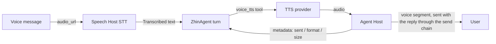

# Speech

A voice message arrives in a group, the bot understands it and can even reply with synthesized speech — that is what the optional `@zhin.js/speech` package provides:

- **Incoming voice is transcribed automatically** (STT) and the text goes to the AI;
- **The AI gets two voice tools**: `voice_stt` (recognize) and `voice_tts` (synthesize).

Without the package, the `speech:` config is skipped with a warning and nothing else is affected.



## Quick start

```bash
pnpm add @zhin.js/speech
```

Add a `speech:` section at the top level of `zhin.config.yml`; after a restart the instance assembles the Speech Host automatically:

```yaml
speech:
  stt: { provider: openai, model: whisper-1, host: https://api.openai.com, apiKey: ${OPENAI_API_KEY} }
  tts: { provider: edge, voice: zh-CN-XiaoxiaoNeural }
```

## Configuration

```yaml
speech:
  stt:
    provider: openai          # ollama | openai
    model: whisper-1
    host: https://api.openai.com
    apiKey: ${OPENAI_API_KEY}
  tts:
    provider: edge            # edge | openai | azure | custom
    voice: zh-CN-XiaoxiaoNeural
```

## STT (Speech-to-Text)

| Provider | Description |
|----------|-------------|
| `openai` | Calls `{host}/v1/audio/transcriptions` (OpenAI-compatible whisper interface); `model` defaults to `whisper-1`, `host` defaults to `https://api.openai.com`, language fixed to `zh`, timeout 60s |
| `ollama` | **Currently unavailable**: Ollama does not have audio transcription models; calling it will produce an immediate error suggesting to switch to `openai` |

`stt.enabled: false` can disable STT independently. Inbound voice first passes through the shared media materialization and real MIME/size validation pipeline. With the `transcribe` strategy, Agent Host then adds the transcript as derived text for the current Turn. Download, validation, and transcription failures produce explicit media terminal states; they never pretend that the model successfully understood the audio.

Audio format extension is inferred from MIME type (wav / mp3 / ogg / webm / amr / silk / m4a / flac); unrecognizable formats are treated as wav.

## TTS (Text-to-Speech)

`tts.provider` defaults to `edge`. Four providers:

| Provider | Key Configuration | Description |
|----------|-------------------|-------------|
| `edge` | `voice` (default `zh-CN-XiaoxiaoNeural`), `rate` (default `+0%`), `pitch` (default `+0Hz`), `edgeTtsCommand` (default `edge-tts`) | Calls the local `edge-tts` CLI, outputs mp3; requires installing this command separately |
| `openai` | `host` (default `https://api.openai.com`), `model` (default `tts-1`), `voice` (default `alloy`), `speed` | Calls `{host}/v1/audio/speech`; apiKey uses `tts.apiKey`, falls back to `stt.apiKey` if absent |
| `azure` | `region` (default `eastasia`), `subscriptionKey`, `voice` | Azure Cognitive Services REST, outputs 16kHz mp3 |
| `custom` | `baseUrl` (required), `headers`, `model`, `voice`, `speed` | Any OpenAI-compatible TTS endpoint, body matches `/v1/audio/speech` |

TTS request timeout is uniformly 30s, output format is mp3 (`openai` / `custom` can optionally use wav).

### edge-tts under launchd / systemd

The `edge` provider runs the local `edge-tts` command (`pip install edge-tts`). When the instance is managed by launchd, systemd, pm2 and the like, its `PATH` is usually short and does **not** include `~/.local/bin` or a virtualenv's `bin`, so an `edge-tts` that works in your terminal is not found by the service. Under a service manager set `edgeTtsCommand` to the **absolute path of the executable** (not `~`, which is not expanded):

```yaml
speech:
  tts:
    provider: edge
    edgeTtsCommand: /Users/me/.local/bin/edge-tts   # output of `command -v edge-tts`
```

At startup the Speech Host checks whether `edgeTtsCommand` can run (a lookup on `PATH` / the file system only; the command is not executed; at most 3 seconds). When it cannot:

- the startup log is a warning, `degraded | … | tts: edge (unavailable: not-found edge-tts)`, never `ready`;
- the Console attention inbox lists "Speech synthesis (edge) is unavailable" (`speech.unavailable`, pointing at `speech.tts.edgeTtsCommand`), and `zhin doctor` lists it while the instance runs;
- a `voice_tts` call checks again first (no restart needed after installing edge-tts) and, if it still cannot run, returns the reason ("edge-tts not found …") so the model can tell the user exactly that.

The other providers (openai / azure / custom TTS, openai / ollama STT) are HTTP services without a local command; a wrong address or key is reported with its reason when they are called.

## Agent Tools

After the Speech Host is assembled, two tools are registered with the Agent (`source: speech`):

| Tool | Parameters | Returns |
|------|-----------|---------|
| `voice_stt` | `audio_url` or `file_path` (local absolute path, choose one) | `{ text }`; returns `{ error }` on failure |
| `voice_tts` | `text` (required), `voice` (overrides default), `provider` (`edge` / `openai` / `azure` / `custom`) | The model sees `{ format, size, sent: true, note }`; `{ error }` (with the reason) on failure |

`voice_tts` can temporarily switch providers per call, making it convenient to use multiple voices within a single deployment.

The synthesized audio **never reaches the model**: before the tool result goes to the model, the Agent takes the audio out and sends it once, as a voice segment with this turn's reply, through the normal send chain (`Message.$reply` → OutboundRenderer → Endpoint); the model only sees metadata and a note that the voice was sent and must not be repeated. Base64 / data URLs in any tool result are replaced by a one-line note before the model sees them, and when a tool of this turn already produced audio, inline audio copied into the model's reply is not sent as a second voice message.

## Related

- [AI Capabilities Overview](./index.md)
- [Agent Deep Dive](./agent.md)
