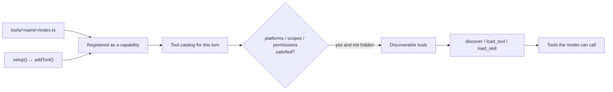

# Agent tools and Skills

With AI enabled, the bot answers messages that match no command using an LLM. This page is about letting it **do things**:

- **Tool**: a function the AI can call — check the weather, search music, query a database.
- **Skill**: a playbook the AI loads only when needed, optionally with its own Tools.
- **Prompt Section**: background knowledge for the AI, such as product terms and answer style.
- **Sub-agent**: a specialized assistant with its own responsibilities, rules and tools.

::: tip Before you start
Run `npx zhin setup --ai` first. The wizard installs a model SDK and declares `@zhin.js/tool` and `@zhin.js/prompt-section`, which is what makes `tools/` and `prompt-sections/` recognized. See the [AI overview](../ai/index.md).
:::

## Your first tool

```ts
// tools/weather/index.ts
import { defineAgentTool } from '@zhin.js/tool';
import { z } from 'zod';

export default defineAgentTool<{ city: string }>({
  description: 'Get the current weather for a city',
  inputSchema: z.object({ city: z.string().min(1) }),
  requiresApproval: 'never',
  async execute({ city }) {
    const response = await fetch(`https://wttr.in/${encodeURIComponent(city)}?format=3`);
    return response.text();
  },
});
```

Save, then ask the bot in a DM "What's the weather in Berlin?" — the AI calls this tool and answers from the result.

- `description` and `inputSchema` are **written for the model**: say clearly what the tool does and what the parameters are, so it gets called at the right moment.
- `inputSchema` can be a Zod 4 object or a JSON Schema whose root is `object`. The framework validates arguments before calling.
- Whatever `execute` returns goes back to the model, which turns it into a reply.

## Common tasks

### Restrict where a tool is available

```ts
export default defineAgentTool({
  description: 'Kick a group member',
  platforms: ['icqq'],           // QQ only
  scopes: ['group'],             // group chats only
  permissions: ['role(master)'], // only in conversations started by a master
  // ...
});
```

When the conditions don't hold, the model doesn't see the tool at all. `permissions` uses the same rules as a command's [`permit`](./commands.md). `hidden: true` registers the tool without offering it to the model; it can still be called by name.

### Ask the user to confirm first

```ts
export default defineAgentTool({
  description: 'Delete a record',
  requiresApproval: 'always',
  // ...
});
```

| Value | When the user must confirm |
| --- | --- |
| `'always'` | Every call |
| `'once'` | The first call in a conversation |
| `'on-risk'` (default) | When risky. Unknown plugin operations are confirmed; `bash`, file and network tools skip a second confirmation once security policy has verified the exact command, path or URL |
| `'never'` | Never |

`'never'` only skips the confirmation step — it **cannot** bypass permissions or network, filesystem and shell security policies.

### Declare a dangerous tool (hard gate)

Tools that kick, mute or promote members, post group announcements / channel posts / comments, send red packets or transfers, or change the bot's profile must declare `risk: 'dangerous'`:

```ts
export default defineAgentTool({
  description: 'Kick a group member',
  risk: 'dangerous',
  riskCategory: 'member', // member | publish | funds | identity
  // ...
});
```

Dangerous tools go through the [dangerous-tool hard gate](/en/ai/default-behavior#dangerous-tool-hard-gate), which is separate from `requiresApproval`:

- Every call needs a fresh human approval (or a card an operator approved in the Console for the same arguments). `requiresApproval: 'never'`, `execApprovalMode: bypass`, the automatic reviewer and the owner role cannot skip it.
- When the call is denied, times out, or nobody can be asked, it does not run, and the model is told it was refused, needs human approval, and must not be retried. Later calls to the same tool, or to another tool in the same dangerous category, are refused for the rest of the turn.
- Tools on the core list (such as each adapter's `group_kick`, `set_mute`, `send_group_notice`) are dangerous even without a declaration; declaring `risk: 'safe'` does not lower them. Read-only queries need no declaration.

### Offer a tool based on config

When a config switch or available resource decides, register in `setup` in `plugin.ts`:

```ts
// plugins/utils/lottery/plugin.ts (excerpt)
import { definePlugin } from 'zhin.js';
import { defineAgentTool } from '@zhin.js/tool';

export default definePlugin({
  name: 'lottery',
  async setup(context) {
    if (!context.config.get().agentToolsEnabled) return; // not offered when disabled
    context.addTool('lottery_sync', defineAgentTool({
      description: 'Synchronize lottery draws',
      requiresApproval: 'always',
      inputSchema: { type: 'object', properties: {} },
      execute: async (_input, toolContext) => {
        const database = toolContext.use(lotteryDatabaseToken);
        return database.sync();
      },
    }));
  },
});
```

`addTool` behaves exactly like the `tools/` folder and is replaced automatically on hot reload — no manual unregistering.

### Use plugin services inside a tool

The second argument to `execute` gives access to plugin services and the current context:

| Field | Description |
| --- | --- |
| `config` | This plugin's config |
| `use(token)` | Get services the plugin provides |
| `origin` / `principal` | Which conversation the call came from and which user it acts for |
| `policy` | The security policy in effect |
| `question` | Ask the user something (next section) |
| `$client` | Platform client inferred from the adapter |

Always get dependencies through this argument rather than looking up other plugins at execution time, so the tool uses the right version of each resource during hot reloads.

`config` is `unknown` by default. To type it, use `defineAgentTool.withConfig`: fix the config type first and give the input type on the second call (with a Zod `inputSchema` the input type is inferred):

```ts
export default defineAgentTool.withConfig<WeatherConfig>()<{ city: string }>({
  description: 'Look up the weather',
  inputSchema: { type: 'object', properties: { city: { type: 'string' } }, required: ['city'] },
  execute({ city }, { config }) {
    return fetchWeather(city, config.apiKey); // config: WeatherConfig
  },
});
```

`defineAgentTool<Input, Result, Config>({...})` keeps working.

### Ask the user from a tool

Use `context.question` when you need more input from the user. Unattended runs such as schedules don't provide it, so handle its absence. The built-in `ask_user` tool uses the same mechanism and matches replies by conversation and user identity.

### Tools only offered in certain situations

Where a tool lives decides **when** the model can see it:

| Location | Visible to the model |
| --- | --- |
| `tools/<name>/index.ts` | Once the plugin is enabled (discoverable) |
| `skills/<skill>/tools/<name>/index.ts` | After that Skill is loaded |
| `agents/<agent>/tools/<name>/index.ts` | When that sub-agent is selected |
| `agents/<agent>/skills/<skill>/tools/<name>/index.ts` | When that Agent is selected and its Skill loaded |

Keep root `tools/` for general, frequent tools that need no extra explanation. Tools that only make sense for one platform, workflow or role belong in that Skill or Agent so they don't take up prompt space otherwise. Every tool is still validated at startup, even when not yet offered.

### Keep a tool resident

Plugin tools are **deferred** by default: the model only sees their name and a one-line description in the system prompt's tool index, and gets the parameter schema through `discover` / `load_tool` when it needs one (calling the tool directly also loads it). For a tool needed in almost every conversation, declare `alwaysLoaded: true` so its schema is sent to the model on every turn:

```ts
export default defineAgentTool({
  description: 'Translate text into a target language',
  alwaysLoaded: true,
  execute: async (input) => { /* ... */ },
})
```

::: warning Keep the resident set small
Every resident tool's schema is sent on every model call. It uses context, adds token cost, and gives the model more tools to hesitate between. Only opt in for the one or two tools that are truly frequent; leave the rest deferred.
:::

Rules:

- Leaving it out or setting `false` keeps the tool deferred, so existing plugins behave exactly as before.
- The flag only decides whether a tool is resident; it never widens admission. A tool that fails `platforms`, `scopes` or `permissions` stays invisible, and `hidden` tools or private tools under a Skill / Agent directory are never made resident by it.
- At most 8 plugin tools per turn become resident through this flag. Extra tools stay deferred in tool order (still reachable with `discover`), and a warning is logged once.
- Operators have the final say: with `ai.agent.deferredTools.alwaysLoadedMode: replace`, the resident set is exactly `alwaysLoadedTools` and plugin declarations are ignored. Listing a tool name in `alwaysLoadedTools` also makes it resident, without the limit of 8.
- Platform-only tools (with `platforms` set) are already resident once they pass admission, so they don't need the flag.

### Give the AI business context

Use a Prompt Section for product terms, answer conventions or tool-use constraints:

```ts
// prompt-sections/project-rules/index.ts
import { defineAgentPromptSection } from '@zhin.js/prompt-section';

export default defineAgentPromptSection({
  title: 'Project rules',
  content: 'Answer with repository-local terminology and cite changed files.',
  layer: 'context',
  order: 70,
  retention: 'preferred',
  maxChars: 1000,
  profiles: ['interactive'],
});
```

The folder name is the section's name; no `id` needed. After saving, new conversations use the new content and conversations already in progress keep the old version.

- `order` decides position within a layer; `retention` decides what gets dropped first when the prompt budget is tight. Fields: [Reference](#prompt-section-fields).
- Console's capability catalog shows whether **Prompt Sections** are active (source, version, budget policy) but never their text, since it may contain internal policy. Runnable example: `examples/full-bot/prompt-sections/custom/index.ts`.
- A Prompt Section **only changes the model's context; it grants no tools, data or approval rights**.

::: details Declaring the Prompt Section capability by hand
Without `npx zhin setup --ai`, declare both the dependency and the Feature in `package.json`:

```json
{
  "dependencies": {
    "@zhin.js/prompt-section": "latest"
  },
  "zhin": {
    "features": [
      { "package": "@zhin.js/prompt-section", "api": "^1.0.0" }
    ]
  }
}
```
:::

### Package a procedure as a Skill

A Skill is `skills/<name>/SKILL.md`: a playbook with frontmatter. The model normally sees only its summary, loads the full text when needed, and that unlocks the tools in its folder.

```markdown
---
name: memory-consolidate
description: At turn end or when the master says "remember", write 1–3 retrievable facts to memory_entries
tools:
  - memory_upsert
  - memory_search
---

(Detailed steps go here…)
```

Split a Skill that covers several independently triggered tasks, so a simple task doesn't pull in every tool. Skills shipped by adapters go in `agents/<platform>/skills/<name>/` and appear only in that platform's conversations.

Classify before disclosure. Adapters own their Skill instructions, Tool descriptions and platform segment hints; the framework filters them using trusted inbound identity. Use `platforms` for the platform, `scopes` for conversation kinds, separate Skills by purpose, and keep authorization in `permissions`. Saying “group only” in prose is insufficient.

For example, ICQQ likes remain in the common `icqq-interaction` Skill; group pokes and sign-in belong to `icqq-group-interaction`. Both that Skill's frontmatter and its private Tools declare `scopes: ['group']`. Private turns receive neither its catalog entry, instructions nor tools, even if previously loaded. Omitted `scopes` means all scenes, not all permissions.

Group administration is disclosed in groups. For guild/channel administration, use the adapter's canonical scene: Slack channels are `group`, while Discord, KOOK and QQ channels are `channel`. Keep group creation, account queries and user lookup separate as common capabilities. Split mixed-scene Skills.

### Define a sub-agent

A sub-agent is an `agents/<name>/` folder with its own responsibilities, boundaries and tools. It must contain four files:

| File | Contents |
| --- | --- |
| `agent.json` | Name, model, extra public tools, etc. |
| `system.md` | Role and responsibilities |
| `boundaries.md` | What it must not do |
| `conventions.md` | Working conventions; may only extend the plugin root's `AGENTS.md`, never contradict it |

Optional `workflows/`, `tools/`, `skills/`, `hooks/` and `knowledge/` hold scenario flows, private tools, private Skills, hooks and a knowledge base. Mistakes that recur belong in `conventions.md`.

A platform adapter's Agent is selected automatically when a message arrives from that platform; if one platform has several automatic candidates, routing reports a conflict — merge responsibilities or let the user choose explicitly. Full format: [`@zhin.js/agent-feature`](https://github.com/zhinjs/zhin/blob/main/packages/im/agent-feature/README.md).

## Recommended layout

```text
my-plugin/
├── AGENTS.md                         # rules for the main Agent
├── tools/
│   └── short-url/
│       ├── index.ts                  # declares the tool only
│       └── client.ts                 # implementation in the same folder
├── skills/short-url/
│   ├── SKILL.md
│   ├── tools/normalize/index.ts      # Skill-only tool
│   └── hooks/audit/index.ts
├── hooks/audit/index.ts
└── agents/reviewer/
    ├── agent.json
    ├── system.md
    ├── boundaries.md
    ├── conventions.md
    ├── workflows/
    ├── tools/check-result/index.ts   # Agent-only tool
    ├── skills/review/
    │   ├── SKILL.md
    │   ├── tools/check-result/index.ts
    │   └── hooks/audit/index.ts
    ├── hooks/audit/index.ts
    └── knowledge/
```

- A tool's `index.ts` only declares; the implementation sits in the same folder. Code shared by several tools of one Skill goes in the Skill root (e.g. `skills/github-account/handlers.ts`).
- Don't reach into plugin internals from leaf folders with `../../../../src/...`. Genuinely shared runtime contracts should be a stable package API, or be imported once through a bridge module owned by the Skill / Agent.

## Reference

### Tool fields

| Field | Required | Description |
| --- | --- | --- |
| `description` | Yes | What the tool does, for the model |
| `inputSchema` | No | Zod 4 object or a JSON Schema with an `object` root; validated before execution |
| `requiresApproval` | No | `'never' \| 'on-risk' \| 'once' \| 'always'`, default `'on-risk'` |
| `risk` | No | `'dangerous' \| 'safe'`; `dangerous` goes through the hard gate, see [Declare a dangerous tool](#declare-a-dangerous-tool-hard-gate) |
| `riskCategory` | No | `'member' \| 'publish' \| 'funds' \| 'identity'`, shown on the approval card; `funds` is disabled by default |
| `platforms` | No | Restrict to platforms, e.g. `['icqq']`; empty means all |
| `scopes` | No | Restrict to `'private' \| 'group' \| 'channel'`; empty means all |
| `permissions` | No | Permission rules; all must pass |
| `hidden` | No | Registered but not offered to the model; still callable by name |
| `alwaysLoaded` | No | `true` sends the schema to the model on every turn; default `false` (deferred). See [Keep a tool resident](#keep-a-tool-resident) |
| `readOnly` | No | `true` declares the tool only reads (changes nothing on the platform, in storage or for other people); restricted turns such as live danmaku turns (ADR 0038 §5) only expose tools with `readOnly: true`. Undeclared counts as writing |
| `execute(input, context)` | Yes | The function; `context` described above |

### Permission rules

`permissions` is parsed by `@zhin.js/permission`: `adapter(name)`, `group(id,...)`, `private(id,...)`, `channel(id,...)`, `user(id,...)`, `role(master|trusted|user)`, plus adapter-checked platform identity `platform(adapter,perm)` (e.g. group owner / admin). All rules in the list must pass; commas inside one rule mean any-of. **Unrecognized rules are always denied.**

### Prompt Section fields

| Field | Meaning |
| --- | --- |
| `layer` | Semantic layer: `role` / `task` / `context` / `safety`, etc. |
| `order` | Within a layer, larger numbers come first |
| `retention` | When over budget: `required` can't be dropped (the turn fails explicitly instead of silently truncating); `preferred` is kept preferentially; `opportunistic` yields first |
| `maxChars` | Character limit for this section |
| `profiles` | `interactive` (chat), `schedule` (scheduled runs), or both |
| `platforms` | Optional: inject only on given platforms, e.g. `['github']` |
| `scopes` | Optional: inject only in specified IM scenes: `private`, `group`, `channel`; combinations allowed, empty lists rejected |

The total budget is `ai.agent.systemPromptMaxChars`.

### Tool discovery settings

Tools aren't all stuffed into the prompt. `ai.agent.deferredTools` (`ZhinAgentConfig`) controls on-demand loading:

| Key | Default | Description |
| --- | --- | --- |
| `maxLoadedPerSession` | `12` | Max tools loaded at once per conversation |
| `discoverTopK` | `5` | Results returned by `discover` |
| `alwaysLoadedTools` | Tiered by scene, see [On-demand tools](../ai/agent.md#on-demand-tools) | Always visible to the model; configured names are added to the current scene tier |
| `alwaysLoadedMode` | `'extend'` | `'replace'` makes `alwaysLoadedTools` replace the defaults entirely |
| `mcpServers` | `{}` | Per-MCP-server overrides of the `alwaysLoaded` list |

## How it works



1. **Admission.** At the start of each turn, tools are filtered by the message's platform, scope and sender; tools that don't qualify are invisible to the model.
2. **On-demand loading.** By default only `alwaysLoadedTools`, platform-only tools that passed admission, and plugin tools declared `alwaysLoaded: true` are exposed. The model searches tools and Skills with `discover` (names and summaries), loads a tool's parameter schema with `load_tool`, and loads a Skill's full text — unlocking its tools — with `load_skill`. Loaded state is kept per conversation and evicted past the limit; concurrent turns and sub-tasks are isolated. The Anthropic channel sends unloaded tools with a `deferLoading` flag; other channels send only loaded ones.
3. **Approval and execution.** After admission and before execution, `requiresApproval` is checked; execution is bound to the owning plugin's config and resources.

::: details Implementation details
- Both registration styles write to one capability table published by a single `ToolIndex`; there is no second dynamic registry. `addTool()` writes during the new version's preparation; if preparation fails it never becomes visible, and on success it goes live with the whole version.
- Plugin Runtime's `CapabilityIngress` filters Tools and Skills using the current turn's trusted `origin.platform`, `origin.scope` and permission subject. Prompt sections also filter by platform and scene. Missing IM context on a non-IM request does not bypass these restrictions.
- Model-visible names (`qualifiedName`): root plugin tools keep their local name; child plugin tools join the plugin path segments and folder name with `__`, e.g. `maps__get-weather`. Execution stays bound to the original plugin's pinned version context.
- On-demand loading is managed by a per-turn deferred controller (`packages/im/agent/src/tool-catalog/deferred-turn-controller.ts`), with state in `DeferredToolSessionSnapshot`, never keyed by IM `Message`.
- `ask_user` is a framework capability that requests input through the current turn's `QuestionPort`; unattended turns (e.g. schedules) get no port and never fall back to a global message, adapter or user queue.
- Agent / Skill private tools are validated during startup preparation but don't enter the model's tool catalog early.
:::

## Next steps

- [AI overview](../ai/index.md): models, trigger rules, memory and MCP.
- [Agent deep dive](../ai/agent.md): security policies, approval, sub-tasks and execution logs.
- [AI Agent learning path](../paths/ai-agent.md): add an Agent to an IM bot step by step.
