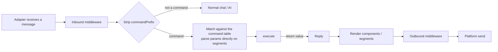

# Commands

A command is a function that runs when a user sends something like `/hello` or `/remind 10 drink water`. This page starts with the simplest command and adds params, options, permissions and rich replies step by step.

## The simplest command

Create `commands/hello/index.ts` in the plugin root:

```ts
// commands/hello/index.ts
import { defineCommand } from 'zhin.js/command';

export default defineCommand({
  description: 'Say hello',
  execute: () => 'Hello from zhin.',
});
```

Save, send `/hello`, and the bot replies `Hello from zhin.`.

- **The file path is the command name.** Only `index.ts` (or `index.tsx`) is the entry; other files in the folder can be helpers.
- **Whatever `execute` returns is the reply.**
- `description` shows up in the command list and help — always write one.

::: details Single-file style
If you don't want folders, register the same definition in `plugin.ts`; the result is identical:

```ts
import { definePlugin } from 'zhin.js';
import { defineCommand } from 'zhin.js/command';

export default definePlugin({
  name: 'my-bot',
  setup({ addCommand }) {
    addCommand('hello', defineCommand({
      description: 'Say hello',
      execute: () => 'Hello from one file.',
    }));
  },
});
```

Both styles share the same command table and conflict detection. As commands grow, move them into `commands/`; editing one then reloads only that file.
:::

## Common tasks

### Accept parameters

Declare params in order under `params`; the `params` passed to `execute` gets the right types automatically:

```ts
// commands/remind/index.ts  →  /remind 10 drink water
import { defineCommand } from 'zhin.js/command';

export default defineCommand({
  description: 'Create a reminder',
  params: {
    minutes: { type: 'integer', min: 1, max: 1440, description: 'Minutes' },
    note: { type: 'text', default: 'Take a break', description: 'What to remind' },
  },
  execute({ params }) {
    // params.minutes: number, params.note: string
    return `OK, I'll remind you in ${params.minutes} min: ${params.note}`;
  },
});
```

- `/remind 10 drink water`: `minutes` is `10`, `note` is `drink water`.
- `/remind 10`: `note` falls back to `Take a break`.
- `/remind abc`: the bot replies with the validation error automatically; `execute` doesn't run.

Common constraints:

| Option | Effect |
| --- | --- |
| `default: …` | Value when nothing is given |
| `optional: true` | May be omitted; the value is then `undefined` |
| `min` / `max` | Range for numbers or text length |
| `choices: [...]` | Only these values are allowed |
| `pattern` | Check text with a regex |
| `validate(value, session)` | Custom check returning `true`, `false` or an error message |
| `rest: true` | Collect all remaining input as an array; must be the last param |

All param types: [Reference · Param types](#param-types).

### Add options

Options are switches like `--count 2` or `-q` that can appear anywhere:

```ts
export default defineCommand({
  description: 'Create a reminder',
  params: {
    minutes: { type: 'integer', min: 1 },
  },
  options: {
    count: { type: 'integer', alias: 'c', default: 1, min: 1, max: 10 },
    quiet: { type: 'boolean', default: false },
  },
  execute({ params, options }) {
    // options.count: number, options.quiet: boolean
    if (options.quiet) return;                  // no reply
    return `Reminding ${options.count} time(s)`;
  },
});
```

`--count 2`, `--count=2` and `-c 2` are equivalent; `--quiet` means `true`, `--quiet=false` means `false`.

### Generated help

Once a command declares `params` or `options`, `/remind --help` shows help generated from the declaration, including the current platform's command prefix.

### Aliases and shortcuts

```ts
export default defineCommand({
  description: 'Like',
  alias: ['zan'],                         // /zan runs this command
  shortcut: { 'max likes': { count: 10 } }, // sending exactly "max likes" is like passing count=10
  params: { count: { type: 'integer', default: 1 } },
  execute: ({ params }) => `Liked ${params.count} time(s)`,
});
```

Aliases may be multi-word (e.g. `'gh issue'`). A shortcut fires only when the trimmed message **exactly equals** the key. Aliases, shortcuts and real command names must not collide; conflicts fail at startup.

### Restrict who can use it

Declare rules with `permit`; the bot refuses when they aren't met:

```ts
export default defineCommand({
  description: 'Wipe data',
  permit: ['role(master)'],              // master only
  execute: () => 'Wiped',
});
```

| Rule | Meaning |
| --- | --- |
| `role(master)` / `role(trusted)` | Sender role |
| `adapter(icqq)` | Only on one platform |
| `group(123)` / `private(…)` / `channel(…)` / `user(…)` | Only in given groups, DMs, channels, or for given users |

All rules in the array must pass (**AND**); commas inside one rule mean **any of** (OR). Users without permission don't see the command's help either.

There are three roles: `user` → `trusted` → `master` (`master` includes `trusted`). Name the master in the adapter config:

```yaml
# zhin.config.yml
plugins:
  qq:
    master: '10001'        # master for the whole adapter
    endpoints:
      - name: main
        appid: ${QQ_APPID}
        master: '10001'    # or per account
```

For the same check in middleware or event handlers, use `checkPermissions`:

```ts
import { checkPermissions } from 'zhin.js';

if (!(await checkPermissions(context, ['group(team)', 'role(trusted)']))) return;
```

It reuses the same rules but does not replace AI tool approval or execution security policies.

### Reply with images, cards or several messages

`execute` may return:

| Return value | Effect |
| --- | --- |
| A string | Text reply |
| `component('status-card', props)` | Renders a [component](./middleware-components.md); image-capable platforms show it as an image |
| `raw({ type: 'html', data: { html, width } })` | A platform segment sent as-is |
| An array of the above | Multiple segments |
| `undefined` | No reply (e.g. you already replied with `input.$reply()`) |

```ts
// commands/card/index.ts
import { defineCommand } from 'zhin.js/command';
import { component } from 'zhin.js/component';

export default defineCommand({
  description: 'Status card',
  execute: () => component('status-card', { title: 'my-bot', lines: [] }),
});
```

For multi-step conversations, return a `Promise`: send the first reply, then keep sending with `input.$reply(...)`.

### Know who sent it and where

```ts
export default defineCommand({
  description: 'Who and where',
  execute: ({ adapter, endpoint, scene, sender }) =>
    `${sender?.name ?? sender?.id} @ ${scene?.type}:${scene?.id} via ${adapter}/${endpoint} roles=${sender?.role.join(',')}`,
});
```

`sender` is the sender (with roles), `scene` is the group / DM / channel, and `adapter` and `endpoint` are the platform and account. All fields: [Reference · execute argument](#execute-argument).

### Use services from your plugin

Services provided in `setup` with `context.resources.provide(token, value)` are available in commands via `use(token)`:

```ts
export default defineCommand({
  description: "Show today's pick",
  async execute({ use }) {
    const { db } = use(lotteryRuntimeToken);
    // ...query and return
  },
});
```

`use` throws when the service is missing. See [definePlugin · Provide resources to your own commands and tools](./define-plugin.md).

### Subcommands

Nested folders are subcommands; segments are joined with spaces:

| File | Command |
| --- | --- |
| `commands/hello/index.ts` | `hello` |
| `commands/qq/endpoint/list/index.ts` | `qq endpoint list` |
| `commands/qq/endpoint/add/[[name]]/index.ts` | `qq endpoint add [name]` |

The plugin name is never prepended automatically. If two plugins' commands collide, give one of them `commandNamespace: admin` and all its commands become `admin xxx`.

### Params as folders

A param can also be the last path segment, Next.js style. Types and defaults are still declared in `params`:

| Folder | Meaning | Shown in help | `params` declaration |
| --- | --- | --- | --- |
| `[name]/index.ts` | Required | `<name>` | `params: { name: { type: 'string' } }` |
| `[[name]]/index.ts` | Optional | `[name]` | `params: { name: { type: 'string', default: '' } }` |
| `[...name]/index.ts` | Collect all remaining input | `<...name>` | `params: { name: { type: 'text' } }`, value is an array |
| `[[...name]]/index.ts` | Optional collect-all | `[...name]` | Same; empty array when omitted |

Declaring several params in `commands/remind/index.ts` is usually better than a folder per param. Folder params suit "command followed by an object name", such as `qq endpoint remove <name>`. Details: [Reference · Folder param rules](#folder-param-rules).

### Accept images, mentions and other non-text params

Param types can be message segments such as `image` or `mention`:

```ts
// commands/upload/[asset]/index.ts  →  /upload [image] caption text
import { defineCommand } from 'zhin.js/command';

export default defineCommand({
  params: {
    asset: { type: 'image', description: 'Image to upload' },
  },
  execute: ({ params, args, segments }) => ({
    uploaded: params.asset,          // the image MediaRef
    captionWords: args,              // remaining text, split on whitespace
    remainingSegments: segments,     // remaining content, keeping images, mentions, etc.
  }),
});
```

Matching happens directly on message segments; images and mentions are never flattened to text first. These params don't support defaults.

### Set a command prefix

By default there is **no** prefix: every message is tried as a command. Once a connection sets `commandPrefix`, only messages starting with it are treated as commands; the rest go to normal chat or the AI:

```yaml
plugins:
  qq:
    commandPrefix: '/'     # only messages like "/qq endpoint list" trigger commands
    endpoints:
      - name: main
        commandPrefix: ''  # override for a single account
```

The Sandbox created by `npm create zhin-app` is set to `/`.

## What happens on bad input

| Situation | Bot behavior |
| --- | --- |
| The message isn't a command | No response; passed on to later middleware, normal chat or the AI |
| Right command, missing or wrong params | Replies with the reason and help |
| No permission | Replies with a refusal, without help |
| Success | Replies with `execute`'s return value |

Param errors are reported only when the input is clearly a given command: `remind nope` gets an error, while `reminder 3` or ordinary chat isn't treated as a command. Permission checks run before param validation.

## Reference

### Param types

| Kind | `type` | Value |
| --- | --- | --- |
| Text | `string` / `word` / `text` | A string; `text` reads the remaining continuous text, keeping quotes and newlines |
| Number | `number` / `integer` / `float` | A number; `integer` requires an integer, `float` a decimal |
| Boolean | `boolean` | `true` / `false` |
| Segment | `mention` / `image` / `face` / `reply` / `forward` / `dice` / `rps` | Fields of the matching segment |

### Param declaration rules

- Params consume input in declaration order. Required params can't follow optional ones; `rest: true` must be last.
- `text` reads continuous text and belongs after other ordinary params.
- Defaults may be dynamic functions; dynamic defaults and shortcut prefills are validated too.
- Invalid static defaults, bad param order and duplicate option aliases fail **at load time**; dynamic defaults are validated at dispatch.
- Options may appear between params; negative numbers aren't mistaken for options; nothing after `--` is parsed as an option. With `params` or `options` declared, unknown or repeated options fail validation.
- Commands without declared params can parse free input themselves from `args` (remaining words) and `segments` (remaining segments).

Real examples: [QR code](https://github.com/zhinjs/zhin/tree/main/plugins/utils/qrcode) uses text, image size and defaults; [code runner](https://github.com/zhinjs/zhin/tree/main/plugins/utils/code-runner) uses a folder param for the language plus code and timeout options.

### execute argument

`execute(context)` receives a read-only object:

| Field | Description |
| --- | --- |
| `params` | Declared params, typed from the declaration |
| `options` | Declared options; `undefined` when unset without a default |
| `args` | Words left after the command name (split on whitespace) |
| `segments` | Remaining segments, keeping images, mentions and other non-text content |
| `config` | This plugin's config |
| `input` | The message that triggered the command; may be absent for Host or programmatic calls |
| `adapter` | Adapter instance id, e.g. `root/icqq` |
| `endpoint` | Account / connection name |
| `scene` | `{ id, type, name? }`: group, DM or channel |
| `sender` | `{ id, name?, role: string[] }`: the sender and their roles |
| `use(token)` | Get a service provided by the plugin; throws when missing |
| `owner` | The plugin that owns the command |
| `generation` | Current version number (increments on each hot reload) |

`input` isn't always a message (it may come from a Host call), so type-check before reading the sender; for non-message sources `$reply` does nothing. `input` is typed as `CommandMessage` by default, structurally compatible with the runtime `Message` (layering prevents `@zhin.js/command` from depending on `@zhin.js/core`).

### alias / permit / shortcut

| Field | Behavior |
|---|---|
| `alias` | Replaces all static parts of the command name; folder params follow |
| `permit` | Built-in rules: `adapter\|group\|private\|channel\|user\|role(...)`. Failure returns `denied`; no auth subject also means denied, and programmatic `CommandIndex.execute` can't bypass it |
| `shortcut` | `{ trigger text: prefilled params }`, fires on an exact match after trimming |

Conflicts are judged on the full word sequence: `b` and `b list` can coexist.

### Folder param rules

- One folder param per command, and it must be the last segment. `commands/[note]/index.ts` matches a top-level single-word input; `commands/remind/[note]/index.ts` forms `remind <note>`.
- A param with a `default` must use double brackets `[[name]]`; a folder param without a matching `params` entry throws `CommandPathSyntaxError`.
- TypeScript can't see folder shapes: for `[[id]]` without a default, declare `params.id.optional: true`; for `[...items]`, declare `params.items.rest: true`. Put the folder param first in `params`.
- For collect-all params the element granularity follows the type: `text` collects by segment (plain text is one element); `word` / `string` split on whitespace; numbers and booleans split into words and convert each; `mention` / `image` collect by segment.
- Static folder names are lowercase kebab-case (`hello/`, `lottery-today/`) or names containing non-ASCII characters without ASCII capitals (e.g. `赞我/`); param folders are ASCII only.
- **Static wins**: `list/index.ts` always beats `[name]/index.ts`; among dynamic routes, more static segments win.
- Routes that are still identical after `commandNamespace` fail at startup; give conflicting plugins different namespaces.

## Going deeper

### How a command runs



Matching uses a fixed priority: static commands before dynamic ones, and more specific dynamic paths first. After a match, remaining text is split into `args`, and the full remaining segments stay in `segments`. For example `qq endpoint remove mybot` matches `qq endpoint remove <name>` with empty `args` and `params.name === 'mybot'`.

`commandPrefix` is read from the adapter instance the message belongs to (default `''`); when the instance configures `endpoints`, the source account's `commandPrefix` wins. Implementation: `packages/im/core/src/plugin-runtime/im/message-dispatcher.ts`.

Programmatic `CommandIndex.dispatch()` returns `status: unmatched | invalid | denied | executed`: `unmatched` has `matched: false`; `invalid` carries `issues: { field, message }[]` and `help`; `denied` means permission refused; only `executed` has a business return value. A Host can pass a real `PermissionSubject` for authorization.

### Endpoint management commands for adapters

::: details Generate list / add / remove commands for an adapter
`createEndpointCommands(spec, defineCommand)` from `@zhin.js/adapter` generates `<adapter> endpoint list / add / remove` so accounts can be managed from chat. Every platform adapter uses it except email (nested config objects) and sandbox (no credentials): qq, icqq, napcat, onebot11, onebot12, milky, satori, slack, telegram, discord, kook, lark, dingtalk, line, wecom, wechat-mp, weixin-ilink, github.

- `list`: running accounts plus those configured under `plugins.<adapterKey>.endpoints`.
- `add <name> <key=value...>`: enter fields. Credentials marked `env: true` are written to `.env` (keys like `TELEGRAM_BOT1_TOKEN`) and the config stores a `${REF}`; YAML keeps existing comments; duplicate names are refused.
- `remove <name>`: removes from config, effective after restart; clean up `.env` keys manually.
- Special add flows (e.g. QQ QR binding) take over `add` through `spec.bindFlow`; QQ therefore has an extra `qq endpoint cancel`.
- `add` / `remove` are master-only; with no master configured they're allowed, and the first binder becomes the new account's `master`.

These commands depend only on `EndpointConfigurationStore` and never touch files directly. The official CLI provides `endpointConfigurationStoreToken`; if you assemble `RootRuntime` yourself, provide an implementation of the same interface. `plugins` must be an object map; legacy arrays need an explicit migration first.

Wiring steps (telegram as the example):

```ts
// 1. src/telegram-runtime-state.ts: registry of running accounts
export const telegramRuntimeStateToken = defineEndpointRuntimeStateToken('telegram');

// 2. provide the state in plugin.ts setup(); register in adapters/telegram/index.ts create()
context.resources.provide(telegramRuntimeStateToken, createEndpointRuntimeState());
// create(): context.use(telegramRuntimeStateToken).endpoints.set(config.name, { name: config.name, mode: config.mode });

// 3. src/telegram-endpoint-commands.ts: generate commands (defineCommand is injected by the adapter to avoid cross-package imports)
export const telegramEndpointCommands = createEndpointCommands({
  adapterKey: 'telegram',          // = plugins.<key> in zhin.config.yml
  adapterDisplayName: 'Telegram',
  fields: [{ key: 'token', required: true, env: true, description: 'Telegram bot token' }],
  running: (use) => use(telegramRuntimeStateToken).endpoints.values(),
  describeEntry: (entry) => `token: ${String(entry.token)}`,
}, defineCommand);

// 4. commands/telegram/endpoint/list/index.ts, add/[[name]]/index.ts, remove/[name]/index.ts
export default telegramEndpointCommands.list; // / .add / .remove
```

`fields` should match `endpoints.items.properties` in the adapter's `schema.json`; `add` reads `key=value` pairs from `args`, splitting on the first `=`.

For finer business permissions, check inside `execute` — e.g. the endpoint commands' `isEndpointOperator` reads the `master` list from `config`, the sender id from `input`, and returns a refusal when they don't match.
:::

## Next steps

- [Middleware & components](./middleware-components.md): keyword replies, message cards and JSX.
- [Convention directories](./conventions.md): where other capabilities go.
- [Agent tools](./agent-tools.md): let the AI call your features too.
