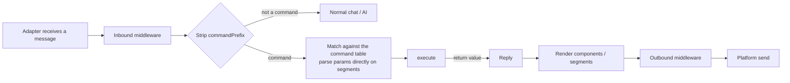

# Commands

For feedback and menu layout policies, see [Customize built-in presentation](./behavior-customization.md).

A command is a function that runs when a user sends something like `/hello` or `/remind 10 drink water`. This page starts with the simplest command and adds params, options, permissions and rich replies step by step.

The `remind` command here is a development example. For a ready-to-use persistent reminder with follow-up questions, see [Create reminders without AI](../solutions/reminders.md).

## The simplest command

Create `commands/hello/index.ts` in the plugin root:

```ts
// commands/hello/index.ts
import { defineCommand } from 'zhin.js/command';

export default defineCommand({
  description: 'Say hello',
  execute: () => 'Hello from zhin.',
});
```

Save, send `/hello`, and the bot replies `Hello from zhin.`.

- **The file path is the command name.** Only `index.ts` (or `index.tsx`) is the entry; other files in the folder can be helpers.
- **Whatever `execute` returns is the reply.**
- `description` shows up in the command list and help — always write one.

::: details Single-file style
If you don't want folders, register the same definition in `plugin.ts`; the result is identical:

```ts
import { definePlugin } from 'zhin.js';
import { defineCommand } from 'zhin.js/command';

export default definePlugin({
  name: 'my-bot',
  setup({ addCommand }) {
    addCommand('hello', defineCommand({
      description: 'Say hello',
      execute: () => 'Hello from one file.',
    }));
  },
});
```

Both styles share the same command table and conflict detection. As commands grow, move them into `commands/`; editing one then reloads only that file.
:::

## Platform types and the operation Session

Load installed adapter declarations once in the project, for example by including `"node"` and `"@zhin.js/adapter-icqq"` in `compilerOptions.types` while preserving existing entries. Business commands do not import Adapter classes. Installing a package alone does not make TypeScript scan its declarations.

```ts
import { defineCommand } from 'zhin.js/command';

export default defineCommand({
  adapter: 'icqq',
  params: { text: { type: 'text' } },
  options: { silent: { type: 'boolean', default: false } },
  async execute({ session, params, options }) {
    if (!session) return;
    session.adapter;  // IcqqAdapter
    session.endpoint; // IcqqEndpoint, extending the actual ICQQ Client
    session.scene;    // Narrow kind before using scene-specific fields
    session.sender;   // Separate platformRoles and authorizationRoles
    session.event;    // The original SDK callback object
    if (!options.silent) await session.reply(params.text);
  },
});
```

Parameter, option, `withConfig`, and factory inference remains intact. Direct execution without a real IM input has no Session. Canonical message handlers and inbound middleware share the same operation view; unrelated native callbacks do not fabricate one.

Stopping or reconnecting the account cancels the captured signal. Framework replies cannot switch to a replacement connection. Retaining an SDK reference does not make direct native calls cancellable; use the unified send chain.

## Common tasks

### Browse loaded commands

With the Command Feature enabled, the built-in keyword is **`菜单`** (Chinese for “menu”); no help plugin is needed. Send it in a bot conversation like any other command. If the current account uses `commandPrefix: '/'`, prefix every message below with `/`:

| Message (without a prefix) | Result |
| --- | --- |
| `菜单` | Commands, descriptions, and immediate child plugins of the root plugin |
| `菜单 rss` | Commands and immediate children of the plugin instance named `rss` |
| `菜单 foo.bar` | Commands and children of nested plugin `bar` under `foo` |
| `菜单 --page 2` | The second page of the root menu |
| `菜单 rss --page 2` | The second page of the `rss` instance menu |
| `remind --help` | A command's parameters, options, and usage, without executing it |

The menu browses one plugin at a time; it does not flatten every plugin's commands into one list. Plugin names here are **instance keys**, not npm package names. Start with `菜单` and follow the child plugin names it returns.

Set the keyword at the top level of the project's `zhin.config.yml`, alongside `plugins`:

```yaml
menuKeyword: help
```

This changes the entry to `help` (or `/help` with a `/` prefix). Set `menuKeyword: false` or `menuKeyword: ''` to disable the built-in menu. Without configuration, the keyword remains `菜单`; `help` is not a default alias.

With `@zhin.js/html-renderer` installed, the menu emits a styled HTML card through the unified outbound pipeline. Image-capable platforms receive a menu image; native HTML platforms follow their declared HTML policy. If rendering fails or the platform requires text or cannot accept the generated image, the original text menu is preserved. Without a renderer, it remains plain text. Browsing, prefixes and custom keywords are unchanged.

Each page contains at most **30 entries**, counting commands and child plugins together. The menu shows totals, the current page and explicit previous/next messages, using the current prefix and keyword. Text fallback uses the same page; it never sends every page at once. Page numbers must be positive integers; out-of-range requests report the actual page count. Long names and descriptions in the image are limited to two lines; command help retains the full declaration.

On endpoints declaring **both native Markdown and native keyboard support**, a multi-page menu also includes a Markdown page indicator and **Previous / Next** buttons. Previous is disabled on the first page, Next on the last; a single-page menu omits the controls. Each click sends the requested page through the unified reply pipeline, preserving the custom keyword, prefix and plugin target. Callback bindings stay within the original conversation and generation; expired or retired-generation buttons cannot invoke old handlers. Endpoints missing either capability retain the textual navigation. Telegram's disabled button wire format requires Bot API 10.3+; see [DisabledButton](https://core.telegram.org/bots/api#disabledbutton).

The default artwork, ornaments and icons are embedded; they need no external downloads. Customize the presentation at the project root:

```yaml
menuStyle:
  title: My Bot · Command Atlas
  subtitle: A little help for your everyday
  accentColor: '#e7c993'
  # Optional: your own artwork; omit to use the built-in landscape.
  backgroundImage: https://example.com/my-menu.webp
```

`backgroundImage` accepts HTTP(S) URLs or PNG/JPEG/WebP base64 data URLs, not file paths or executable CSS. Remote artwork must be reachable from the bot host; its availability is independent of the HTML renderer. Use a data URL for fully offline custom artwork. `accentColor` accepts a six-digit hex color; invalid optional values use the defaults. These settings change image presentation only.

### Accept parameters

Declare params in order under `params`; the `params` passed to `execute` gets the right types automatically:

```ts
// commands/remind/index.ts  →  /remind 10 drink water
import { defineCommand } from 'zhin.js/command';

export default defineCommand({
  description: 'Create a reminder',
  params: {
    minutes: { type: 'integer', min: 1, max: 1440, description: 'Minutes' },
    note: { type: 'text', default: 'Take a break', description: 'What to remind' },
  },
  execute({ params }) {
    // params.minutes: number, params.note: string
    return `OK, I'll remind you in ${params.minutes} min: ${params.note}`;
  },
});
```

- `/remind 10 drink water`: `minutes` is `10`, `note` is `drink water`.
- `/remind 10`: `note` falls back to `Take a break`.
- `/remind abc`: the bot replies with the validation error automatically; `execute` doesn't run.

Common constraints:

| Option | Effect |
| --- | --- |
| `default: …` | Value when nothing is given |
| `optional: true` | May be omitted; the value is then `undefined` |
| `min` / `max` | Range for numbers or text length |
| `choices: [...]` | Only these values are allowed |
| `pattern` | Check text with a regex |
| `validate(value, session)` | Custom check returning `true`, `false` or an error message |
| `rest: true` | Collect all remaining input as an array; must be the last param |

All param types: [Reference · Param types](#param-types).

### Add options

Options are switches like `--count 2` or `-q` that can appear anywhere:

```ts
export default defineCommand({
  description: 'Create a reminder',
  params: {
    minutes: { type: 'integer', min: 1 },
  },
  options: {
    count: { type: 'integer', alias: 'c', default: 1, min: 1, max: 10 },
    quiet: { type: 'boolean', default: false },
  },
  execute({ params, options }) {
    // options.count: number, options.quiet: boolean
    if (options.quiet) return;                  // no reply
    return `Reminding ${options.count} time(s)`;
  },
});
```

`--count 2`, `--count=2` and `-c 2` are equivalent; `--quiet` means `true`, `--quiet=false` means `false`.

### Generated help

Once a command declares `params` or `options`, `/remind --help` shows help generated from the declaration, including the current platform's command prefix.

### Aliases and shortcuts

```ts
export default defineCommand({
  description: 'Like',
  alias: ['zan'],                         // /zan runs this command
  shortcut: { 'max likes': { count: 10 } }, // sending exactly "max likes" is like passing count=10
  params: { count: { type: 'integer', default: 1 } },
  execute: ({ params }) => `Liked ${params.count} time(s)`,
});
```

Aliases may be multi-word (e.g. `'gh issue'`). A shortcut fires only when the trimmed message **exactly equals** the key. Aliases, shortcuts and real command names must not collide; conflicts fail at startup.

### Restrict who can use it

Declare rules with `permit`; the bot refuses when they aren't met:

```ts
export default defineCommand({
  description: 'Wipe data',
  permit: ['role(master)'],              // master only
  execute: () => 'Wiped',
});
```

| Rule | Meaning |
| --- | --- |
| `role(master)` / `role(trusted)` | Sender role |
| `adapter(icqq)` | Only on one platform |
| `group()` / `private()` / `channel()` | Restrict conversation kind; an empty value or `*` matches any ID of that kind |
| `group(123)` / `private(…)` / `channel(…)` / `user(…)` | Compare the corresponding conversation or sender ID, without restricting the complete account, parent or thread |

All rules in the array must pass (**AND**); commas inside one rule mean **any of** (OR). Users without permission don't see the command's help either.

The builtin role check only makes `master` imply `trusted`; it does not infer `user`, `admin` or `owner`. Roles come from the actual message. Name the master in the adapter config:

```yaml
configVersion: 2
# zhin.config.yml
plugins:
  qq: "@zhin.js/adapter-qq"
qq:
  master: '10001' # master for the whole adapter
  endpoints:
    - name: main
      appid: ${QQ_APPID}
      master: '10001' # or per account
```

For the same check in middleware or event handlers, use `checkPermissions`:

```ts
import { checkPermissions } from 'zhin.js';

if (!(await checkPermissions(context, ['group(team)', 'role(trusted)']))) return;
```

It reuses the same rules but does not replace AI tool approval or execution security policies.

### Limit repeated execution and show progress {#execution-policy}

Add `execution` to individual expensive commands. Commands without it keep their existing behavior. This complete example can live in `commands/slow/index.ts`:

```ts
import { setTimeout as delay } from 'node:timers/promises';
import { defineCommand } from 'zhin.js/command';

export default defineCommand({
  description: 'Demonstrate cooldown and concurrency for a slow task',
  execution: { cooldownMs: 10_000, maxConcurrent: 1, progressAfterMs: 1_500 },
  async execute({ signal }) {
    await delay(3_000, undefined, { signal });
    return 'Demo task completed';
  },
});
```

Send `slow` as a real user in the original conversation, adjusting the actual account prefix and plugin namespace. A progress notice may arrive after 1.5 seconds, followed by the result. This is a local delay demonstration with no business-service calls. A pending notice is stopped when business work ends; an already-started notice drains before the final reply, preserving message order.

Budgets are isolated by command capability, real sender and complete conversation identity: Endpoint, kind, ID, parent and thread. Aliases and shortcuts share the same budget. This is not a plugin-wide or all-user concurrency cap.

- `cooldownMs` starts when business execution is accepted. Failure and cancellation still consume it. Help, invalid arguments, permission denial and admission refusal do not. Maximum: one day.
- `maxConcurrent` remains occupied until business work, rendering, outbound middleware and final sending actually settle. A retirement or hot-reload cancellation signal does not release a still-running operation. Generations share the budget. Maximum: 1000.
- `progressAfterMs` is off by default. When set, each operation can emit at most one notice for that command during business waiting. It uses the original conversation's unified reply path. Failed or uncertain notice delivery is not retried. Maximum: one hour.

All values must be positive integers, with at least one policy specified. Cooldown refusals include the remaining time when recorded. Busy operations have no predictable completion time. Diagnostics use `limited`, distinct from permission denial and platform delivery failure; a refused command is not handed to an Agent for another execution attempt.

Policies require a genuine Core inbound operation and complete identity. Direct `CommandIndex` calls outside that operation cannot manufacture a source to bypass admission. Continue to `await input.$reply(...)` for additional replies; work started by arbitrary future timers is outside an already-finished operation. Cooldown does not replace idempotency, permissions or reconciliation, never retries `unknown`, and does not create a cancellation button for an operation that cannot be cancelled.

### Reply with images, cards or several messages

`execute` may return:

| Return value | Effect |
| --- | --- |
| A string | Text reply |
| `component('status-card', props)` | Renders a [component](./middleware-components.md); image-capable platforms show it as an image |
| `raw({ type: 'html', data: { html, width } })` | A platform segment sent as-is |
| An array of the above | Multiple segments |
| `undefined` | No reply (e.g. you already replied with `input.$reply()`) |

```ts
// commands/card/index.ts
import { defineCommand } from 'zhin.js/command';
import { component } from 'zhin.js/component';

export default defineCommand({
  description: 'Status card',
  execute: () => component('status-card', { title: 'my-bot', lines: [] }),
});
```

For multi-step conversations, return a `Promise`: send the first reply, then keep sending with `input.$reply(...)`.

### Know who sent it and where

```ts
export default defineCommand({
  description: 'Who and where',
  execute: ({ adapter, endpoint, scene, sender }) =>
    `${sender?.name ?? sender?.id} @ ${scene?.type}:${scene?.id} via ${adapter}/${endpoint} roles=${sender?.role.join(',')}`,
});
```

`sender` is the sender (with roles), `scene` is the group / DM / channel, and `adapter` and `endpoint` are the platform and account. All fields: [Reference · execute argument](#execute-argument).

### Use services from your plugin

Services provided in `setup` with `context.resources.provide(token, value)` are available in commands via `use(token)`:

```ts
export default defineCommand({
  description: "Show today's pick",
  async execute({ use }) {
    const { db } = use(lotteryRuntimeToken);
    // ...query and return
  },
});
```

`use` throws when the service is missing. See [definePlugin · Provide resources to your own commands and tools](./define-plugin.md).

### Type the config {#typed-config}

A command in a convention folder does not know which plugin it belongs to, so `config` is `unknown` by default. Use `defineCommand.withConfig`: fix the config type first, then define the command:

```ts
import { defineCommand } from 'zhin.js/command';
import type { EchoConfig } from '../../../src/index.js'; // keep in sync with schema.json

export default defineCommand.withConfig<EchoConfig>()({
  params: { text: { type: 'string' } },
  execute({ params, config }) {
    return `${config.prefix ?? ''}${params.text}`; // params.text: string, config: EchoConfig
  },
});
```

The function `defineCommand.withConfig<EchoConfig>()` returns can be reused: write `export const defineEchoCommand = defineCommand.withConfig<EchoConfig>()` once in `src/` and call it from each command file.

The older `defineCommand<EchoConfig>({...})` still works, but TypeScript cannot infer the remaining type arguments once one is given explicitly, so `params` falls back to `Record<string, CommandParameterValue>`. Use `withConfig` when you want `params` and `options` inferred.

### Subcommands

Nested folders are subcommands; segments are joined with spaces:

| File | Command |
| --- | --- |
| `commands/hello/index.ts` | `hello` |
| `commands/qq/endpoint/list/index.ts` | `qq endpoint list` |
| `commands/qq/endpoint/add/[[name]]/index.ts` | `qq endpoint add [name]` |

The plugin name is never prepended automatically. If two plugins' commands collide, give one of them `commandNamespace: admin` and all its commands become `admin xxx`.

When only a few commands overlap with another plugin, list them in that plugin instance's `disabledCommands` and keep the rest under their own names:

```yaml
plugins:
  60s: "@zhin.js/plugin-60s"
60s:
  disabledCommands: [fanyi, weather]   # local command paths, without commandNamespace or parameters
```

A parent path such as `netease` also removes `netease login`, `netease status` and its other subcommands. Disabled commands are left out of routing and do not occupy their routes, so another plugin may use the same name. Entries that match no command are ignored.

### Params as folders

A param can also be the last path segment, Next.js style. Types and defaults are still declared in `params`:

| Folder | Meaning | Shown in help | `params` declaration |
| --- | --- | --- | --- |
| `[name]/index.ts` | Required | `<name>` | `params: { name: { type: 'string' } }` |
| `[[name]]/index.ts` | Optional | `[name]` | `params: { name: { type: 'string', default: '' } }` |
| `[...name]/index.ts` | Collect all remaining input | `<...name>` | `params: { name: { type: 'text' } }`, value is an array |
| `[[...name]]/index.ts` | Optional collect-all | `[...name]` | Same; empty array when omitted |

Declaring several params in `commands/remind/index.ts` is usually better than a folder per param. Folder params suit "command followed by an object name", such as `qq endpoint remove <name>`. Details: [Reference · Folder param rules](#folder-param-rules).

### Accept images, mentions and other non-text params

Param types can be message segments such as `image` or `mention`:

```ts
// commands/upload/[asset]/index.ts  →  /upload [image] caption text
import { defineCommand } from 'zhin.js/command';

export default defineCommand({
  params: {
    asset: { type: 'image', description: 'Image to upload' },
  },
  execute: ({ params, args, segments }) => ({
    uploaded: params.asset,          // the image MediaRef
    captionWords: args,              // remaining text, split on whitespace
    remainingSegments: segments,     // remaining content, keeping images, mentions, etc.
  }),
});
```

Matching happens directly on message segments; images and mentions are never flattened to text first. These params don't support defaults.

### Set a command prefix

By default there is **no** prefix: every message is tried as a command. Once a connection sets `commandPrefix`, only messages starting with it are treated as commands; the rest go to normal chat or the AI:

```yaml
configVersion: 2
plugins:
  qq: "@zhin.js/adapter-qq"
qq:
  commandPrefix: '/' # only messages like "/qq endpoint list" trigger commands
  endpoints:
    - name: main
      commandPrefix: '' # override for a single account
```

The Sandbox created by `npm create zhin-app` is set to `/`.

## What happens on bad input

| Situation | Bot behavior |
| --- | --- |
| The message isn't a command | No response; passed on to later middleware, normal chat or the AI |
| Right command, missing or wrong params | Replies with the reason and help |
| No permission | Replies with a refusal, without help |
| Success | Replies with `execute`'s return value |

Param errors are reported only when the input is clearly a given command: `remind nope` gets an error, while `reminder 3` or ordinary chat isn't treated as a command. Permission checks run before param validation.

## Reference

### Param types

| Kind | `type` | Value |
| --- | --- | --- |
| Text | `string` / `word` / `text` | A string; `text` reads the remaining continuous text, keeping quotes and newlines |
| Number | `number` / `integer` / `float` | A number; `integer` requires an integer, `float` a decimal |
| Boolean | `boolean` | `true` / `false` |
| Segment | `mention` / `image` / `face` / `reply` / `forward` / `dice` / `rps` | Fields of the matching segment |

### Param declaration rules

- Params consume input in declaration order. Required params can't follow optional ones; `rest: true` must be last.
- `text` reads continuous text and belongs after other ordinary params.
- Defaults may be dynamic functions; dynamic defaults and shortcut prefills are validated too.
- Invalid static defaults, bad param order and duplicate option aliases fail **at load time**; dynamic defaults are validated at dispatch.
- Options may appear between params; negative numbers aren't mistaken for options; nothing after `--` is parsed as an option. With `params` or `options` declared, unknown or repeated options fail validation.
- Commands without declared params can parse free input themselves from `args` (remaining words) and `segments` (remaining segments).

Real examples: [QR code](https://github.com/zhinjs/zhin/tree/main/plugins/utils/qrcode) uses text, image size and defaults; [code runner](https://github.com/zhinjs/zhin/tree/main/plugins/utils/code-runner) uses a folder param for the language plus code and timeout options.

### execute argument

`execute(context)` receives a read-only object:

| Field | Description |
| --- | --- |
| `params` | Declared params, typed from the declaration |
| `options` | Declared options; `undefined` when unset without a default |
| `args` | Words left after the command name (split on whitespace) |
| `segments` | Remaining segments, keeping images, mentions and other non-text content |
| `config` | This plugin's config |
| `input` | The message that triggered the command; may be absent for Host or programmatic calls |
| `adapter` | Adapter instance id, e.g. `root/icqq` |
| `endpoint` | Account / connection name |
| `scene` | `{ id, type, name? }`: group, DM or channel |
| `sender` | `{ id, name?, role: string[] }`: the sender and their roles |
| `use(token)` | Get a service provided by the plugin; throws when missing |
| `owner` | The plugin that owns the command |
| `generation` | Current version number (increments on each hot reload) |

`input` isn't always a message (it may come from a Host call), so type-check before reading the sender; for non-message sources `$reply` does nothing. `input` is typed as `CommandMessage` by default, structurally compatible with the runtime `Message` (layering prevents `@zhin.js/command` from depending on `@zhin.js/core`).

### alias / permit / shortcut

| Field | Behavior |
|---|---|
| `alias` | Replaces all static parts of the command name; folder params follow |
| `permit` | Built-in rules: `adapter\|group\|private\|channel\|user\|role(...)`. Failure returns `denied`; no auth subject also means denied, and programmatic `CommandIndex.execute` can't bypass it |
| `shortcut` | `{ trigger text: prefilled params }`, fires on an exact match after trimming |

Conflicts are judged on the full word sequence: `b` and `b list` can coexist.

### Folder param rules

- One folder param per command, and it must be the last segment. `commands/[note]/index.ts` matches a top-level single-word input; `commands/remind/[note]/index.ts` forms `remind <note>`.
- A param with a `default` must use double brackets `[[name]]`; a folder param without a matching `params` entry throws `CommandPathSyntaxError`.
- TypeScript can't see folder shapes: for `[[id]]` without a default, declare `params.id.optional: true`; for `[...items]`, declare `params.items.rest: true`. Put the folder param first in `params`.
- For collect-all params the element granularity follows the type: `text` collects by segment (plain text is one element); `word` / `string` split on whitespace; numbers and booleans split into words and convert each; `mention` / `image` collect by segment.
- Static folder names are lowercase kebab-case (`hello/`, `lottery-today/`) or names containing non-ASCII characters without ASCII capitals (e.g. `赞我/`); param folders are ASCII only.
- **Static wins**: `list/index.ts` always beats `[name]/index.ts`; among dynamic routes, more static segments win.
- Routes that are still identical after `commandNamespace` fail at startup; give conflicting plugins different namespaces.

## Going deeper

### How a command runs



Matching uses a fixed priority: static commands before dynamic ones, and more specific dynamic paths first. After a match, remaining text is split into `args`, and the full remaining segments stay in `segments`. For example `qq endpoint remove mybot` matches `qq endpoint remove <name>` with empty `args` and `params.name === 'mybot'`.

`commandPrefix` is read from the adapter instance the message belongs to (default `''`); when the instance configures `endpoints`, the source account's `commandPrefix` wins. Implementation: `packages/im/core/src/plugin-runtime/im/message-dispatcher.ts`.

Programmatic `CommandIndex.dispatch({ input, source, snapshot })` returns `status: unmatched | invalid | denied | executed`: `unmatched` has `matched: false`; `invalid` carries `issues: { field, message }[]` and `help`; `denied` means permission refused; only `executed` has a business return value. A Host can pass a real `PermissionSubject` for authorization.

### Endpoint management commands for adapters

::: details Generate list / add / remove commands for an adapter
`createEndpointCommands(spec, defineCommand)` generates `<adapter> endpoint list / add / remove` and shares the owning Adapter and persistence with Console. Declare platform-specific QR or login commands separately rather than hiding them in a generic `bindFlow` callback.

- `list` reads account configuration and runtime status from the owning Adapter, without another Endpoint Map.
- `add <id> <key=value...>` saves disabled configuration only. Start the account manually in Console.
- `remove <id>` cancels the target incarnation and closes its connection. History remains; recreating the same name gets a new identity.
- Before the first change, an administrator must review existing accounts and confirm migration in Console. Chat commands cannot confirm it.
- Later changes use encrypted persistence without modifying startup files or `.env`, or restarting Root. Missing runtime or database support rejects writes without a file fallback.
- Existing master permissions apply. Refresh on revision conflict; verify an unknown commit through authoritative state before any further action, without automatically retrying it.

```ts
// src/telegram-endpoint-commands.ts
import { createEndpointCommands } from 'zhin.js/adapter';
import { defineCommand } from 'zhin.js/command';

export const telegramEndpointCommands = createEndpointCommands({
  adapterKey: 'telegram',
  adapterDisplayName: 'Telegram',
  fields: [{ key: 'token', required: true, env: true,
    description: 'Telegram bot token' }],
}, defineCommand);

// commands/telegram/endpoint/list/index.ts
export default telegramEndpointCommands.list;
// add/[id]/index.ts exports .add; remove/[id]/index.ts exports .remove
```

`adapterKey` is the registered Adapter name within the current owner. The framework resolves its directory from the real command operation’s owner, generation and AdapterIndex, never from display names. Register the actual `AdapterRegistry` type once; no RuntimeState token or separate Client token is needed.

`fields` is a closed list matching the platform schema. Nested fields use explicitly declared dotpaths such as `smtp.port`; `type` accepts `string | number | boolean`, defaulting to string. Arbitrary object merging is not supported. `env: true` or `secret: true` marks sensitive fields for masked responses and Host-private persistence; it does not enable `.env` writes. `add` reads `key=value` arguments and splits at the first `=`.

The real entry uses the common `isEndpointOperator` master check. Additional platform permissions must not replace or widen that gate.
:::


## Next steps

- [Middleware & components](./middleware-components.md): keyword replies, message cards and JSX.
- [Convention directories](./conventions.md): where other capabilities go.
- [Agent tools](./agent-tools.md): let the AI call your features too.
