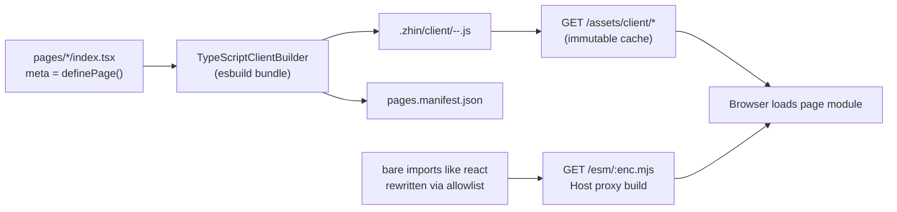

# Console pages and layouts

Plugins can do more than send chat messages — they can contribute whole React pages to Remote Console. The Sandbox adapter's `/sandbox` chat page is one.

Like commands, pages live in a **convention directory**, `pages/`; files are discovered automatically and compiled into modules the browser can load.

## Your first page

```tsx
// pages/index/index.tsx
import { definePage } from '@zhin.js/console-contract';

export const meta = definePage({
  title: 'My Plugin',
  titleI18n: { 'zh-CN': '我的插件' },
  icon: 'Box',
  order: 10,
});

export default function MyPluginPage() {
  return <div>Hello from my plugin</div>;
}
```

- The **default export** is a React component — the page content.
- The **named export `meta`** declares title, icon and order.
- Only `pages/<name>/index.tsx` (or `index.ts`) is a page; other files in the folder can be imported as components and helpers.

Start the bot, open Console, and the page appears in the navigation.

## Page metadata

Every `meta` field is optional; `definePage` throws on unknown keys:

| Field | Default | Description |
| --- | --- | --- |
| `title` | Generated from the folder name (`foo-bar` → `Foo Bar`) | Navigation and header title |
| `titleI18n` | none | Explicit titles for `zh-CN` / `en`, e.g. `{ en: 'My Plugin' }`; missing entries retain `title` |
| `icon` | none | A lucide-style icon name, e.g. `'Box'`, `'Workflow'` |
| `order` | `100` | Navigation order; lower comes first |
| `hideInNav` | `false` | Hide from navigation |
| `requiredPermissions` | `[]` | Permissions required to access, matched against the token's `permissions` |
| `requiredRoles` | `[]` | Roles required to access, matched against the token's `roles` |

Navigation and the page list are filtered by the caller's token. The full token sees every page. Any other token sees only pages whose requirements its `permissions` and `roles` meet. Without a token, only pages with no requirements show. For token setup, see [Console users and permissions](../console/index.md#users-and-permissions).

Console selects `titleI18n` using its independent interface language. This only changes navigation and breadcrumb display, never routes, permissions or page content. Plugins localize their own components; third-party titles without translations remain unchanged.

## Page addresses

Address = plugin path + page name:

| File | Owning plugin | Address |
| --- | --- | --- |
| `pages/index/index.tsx` | `sandbox` | `/sandbox` |
| `pages/workroom/index.tsx` | your bot (root) | `/p-workroom` |
| `pages/index/index.tsx` | your bot (root) | `/` |

`index` maps to the plugin path itself; other pages map to `p-<name>`. Two pages resolving to the same address fail at startup. Implementation: `pageRoute` in `packages/console/plugin-contract/src/page.ts`.

## Custom navigation and footer

`pages/` has two reserved names:

- `pages/nav/index.tsx`: the navigation area
- `pages/footer/index.tsx`: the footer

Default-export a React component; no `meta` needed. When both `.ts` and `.tsx` exist for a slot, `.tsx` wins. Projects created by `npm create zhin-app` already include both as examples.

## Example: the Sandbox chat page

The Sandbox adapter (`plugins/adapters/sandbox`) provides both an adapter and a page, so its `package.json#zhin` declares two Features:

```json
{
  "zhin": {
    "protocol": 1,
    "type": "plugin",
    "entry": "./plugin.ts",
    "runtime": "trusted",
    "features": [
      { "package": "@zhin.js/adapter", "api": "^1.0.0" },
      { "package": "@zhin.js/page", "api": "^1.0.0" }
    ]
  }
}
```

- `@zhin.js/adapter` discovers the adapter under `adapters/`, providing the WebSocket `/sandbox` connection.
- `@zhin.js/page` discovers `pages/index/index.tsx`, which is why Console shows a `/sandbox` chat page.

The page's `SandboxChat` component connects to `/sandbox` over WebSocket (address and token in `pages/sandboxTransport.ts`). Sending a message in the page is equivalent to a real platform receiving one: it goes through middleware, command matching and the AI. So you can fully debug commands, component rendering and the Agent without any real platform. Sandbox displays outbound HTML directly instead of converting it to an image or text — see [Middleware & components](./middleware-components.md#how-it-looks-on-each-platform).

The plugin entry itself needs nothing; the page and adapter are discovered automatically:

```ts
// plugins/adapters/sandbox/plugin.ts
import { definePlugin } from 'zhin.js';

export default definePlugin({
  name: 'sandbox',
  metadata: { displayName: 'Sandbox Adapter' },
});
```

## Page data: plugin RPC

When a page needs to show a plugin's runtime status or offer a few buttons, the plugin can register its own Console RPC instead of opening a WebSocket or an HTTP route.

In `setup`, the plugin registers a read-only `status` and, if needed, a few limited actions:

```ts
// plugin.ts
import { definePlugin } from 'zhin.js';
import { definePluginConsoleRpc, PluginConsoleRpcError, pluginConsoleRpcToken } from 'zhin.js/plugin-runtime';

export default definePlugin({
  name: 'ambient',
  setup(context) {
    context.resources.provide(pluginConsoleRpcToken, definePluginConsoleRpc({
      status: {
        page: 'index', // same access rules as pages/index
        handler: async () => ({
          mode: 'shadow',
          recent: recentJudgments(10).map(j => ({ at: j.at, spoke: j.engaged })),
        }),
      },
      actions: {
        'clear-cooldown': {
          page: 'index',
          handler: async ({ group }) => {
            if (typeof group !== 'string') throw new PluginConsoleRpcError('invalid_input', 'Pick a group');
            return { cleared: clearCooldown(group) };
          },
        },
      },
    }));
  },
});
```

Pages call it with `pluginRpc` from `@zhin.js/client`. `pluginId` is the plugin's PluginId (for example `root/ambient`), the same value as `owner` in the page list:

```tsx
import { pluginRpc } from '@zhin.js/client';

const status = await pluginRpc<{ mode: string }>('root/ambient', 'status');
await pluginRpc('root/ambient', 'clear-cooldown', { group: '123' });
```

Requests go through the existing `POST /api/console/request`, with the type `plugin.<pluginId>.status` or `plugin.<pluginId>.<action>`. Action names may use only lowercase letters, digits and `-`, and `status` is reserved.

Besides `status`, you can register a few **read-only queries** under `queries`. They follow the same rules as `status` (`page`, `demo` and `requiredPermissions` all work). A query and an action can't share a name:

```ts
definePluginConsoleRpc({
  queries: {
    history: { page: 'index', handler: async () => ({ days: last7Days() }) },
  },
});
```

Access rules:

- **Follows the page**: with `page` set, the caller must meet that page's `requiredPermissions` and `requiredRoles`, plus any the method declares itself. If the page isn't loaded in the current generation, the call is refused.
- **The full token** can call every method.
- **Any other token** (`scope: user` / `demo`) can read `status` if it holds every required permission and role. A `status` with no requirements at all is open to these tokens only when it sets `demo: true`.
- **Actions**: other tokens can run an action only when the action **itself** declares `requiredPermissions`, `requiredRoles` or `anyOfPermissions` and the token meets all of them, including the page's. Otherwise the call is refused. An action with no requirements of its own needs the full token; a page's requirements never open an action on their own.
- **Any one of**: holding **one** of the permissions in `anyOfPermissions` is enough (on top of `requiredPermissions`). Use it when a new permission sits beside an older one, for example approval cards accept `ops:approve` or the older `tool_approvals:resolve`.

```ts
actions: {
  'clear-cooldown': {
    page: 'index',                          // the page's requirements apply first
    requiredPermissions: ['ambient:write'], // then this one lets ordinary users run it
    handler: async ({ group }) => ({ cleared: clearCooldown(String(group)) }),
  },
},
```

Ordinary users see what you return, so:

- Return only the few fields the page needs. Don't return log records, prompts, chat text or secrets.
- The result must be JSON and at most 256 KB. The request's `data` must be a JSON object of at most 64 KB.
- A handler that doesn't return within 10 seconds times out, and its `signal` is aborted.
- To show users why something failed, throw `PluginConsoleRpcError`. Its message is shown as is. Any other error shows only a generic failure message.

Plugin RPC doesn't change configuration. Use `config:patch` for that.

### Built-in status: ambient engagement and skills assistant

Ambient engagement (群聊插话) and the skills assistant (技能助手) are provided by the Host itself, not by a plugin, so they sit under the root plugin:

| Method | Call | Permission needed |
| --- | --- | --- |
| `plugin.root.ambient` | `pluginRpc('root', 'ambient')` | `ambient:read` |
| `plugin.root.skills` | `pluginRpc('root', 'skills')` | `skills:read` |

The full token doesn't need these permissions. Pages list the same permission in `requiredPermissions`, and tokens get it in `http.tokens[].permissions` (see [Users and permissions](../console/index.md#users-and-permissions)). Both queries are read-only and take no input.

The data lives only in memory: the last 24 hours, at most 2000 entries, cleared on restart. It never includes chat text, prompts, judge reasons or secrets. All times are millisecond timestamps.

`plugin.root.ambient` returns:

```ts
interface AmbientStatus {
  enabled: boolean;                       // at least one group is configured
  mode: 'off' | 'shadow' | 'active';      // shadow: judge without speaking
  groups: number | 'all';                 // configured groups, or 'all' for '*'
  judges: string[];                       // judge models in order (provider/model)
  last24h: { spoke: number; watched: number; stayed_quiet: number; skipped: number };
  decisionShadow: { agreed: number; disagreed: number }; // ai.decisions.ambient shadow vs the chat-model judge
  recent: Array<{                         // newest first, at most 20
    at: number;
    group: string;                        // platform:groupId
    outcome: 'spoke' | 'watched' | 'stayed_quiet' | 'skipped';
    skipReason?: 'cooldown' | 'hourly_cap' | 'judge_interval' | 'no_context' | 'judge_failed';
    confidence?: number;                  // 0..1, two decimals
    judge?: 'decision' | 'chat-model';
  }>;
  updatedAt: number | null;
}
```

`watched` means the judge would have spoken but shadow mode kept it quiet.

`plugin.root.skills` returns call statistics for structured decisions (choosing skills, tools, memory, sub-agents, approvals and ambient engagement):

```ts
interface SkillsStatus {
  tasks: Array<{                          // one row per task, sorted by name
    task: 'skills' | 'tools' | 'memory' | 'agents' | 'approval' | 'ambient';
    mode: 'off' | 'shadow' | 'active';    // mode of the latest call
    calls: number; selected: number; abstained: number; shadow: number; failed: number;
    averageMs: number;
    inputTokens: number; outputTokens: number;
    lastModel?: string;
    lastAt: number;
  }>;
  totals: { calls: number; inputTokens: number; outputTokens: number };
  recent: Array<{                         // newest first, at most 20
    at: number; task: string; mode: string;
    outcome: 'selected' | 'abstained' | 'failed' | 'shadow';
    durationMs: number;
    model?: string;
    reason?: string;                      // machine-readable failure/abstain reason, never free text
  }>;
  updatedAt: number | null;
}
```

### Built-in queries: decision replay

The decision replay on the Bot status (机器人状态) page (ADR 0036 slice C) is also provided by the Host. It reads the `ai_decision_events` decision audit table: one row each time the bot decides whether to call the model, whether to speak, or whether to call a tool. Rows from one turn share a `turn_id`.

| Method | Call | Permission needed |
| --- | --- | --- |
| `plugin.root.decisions` | `pluginRpc('root', 'decisions', { ... })` | `decisions:read` |
| `plugin.root.decision-turn` | `pluginRpc('root', 'decision-turn', { turnId })` | `decisions:read` |
| `plugin.root.decisions-export` | `pluginRpc('root', 'decisions-export', { since, until, ... })` | `decisions:read` |

All three are read-only. Times are millisecond timestamps. `kind` and `outcome` only accept the ADR 0036 enums; a typo returns `invalid_input` rather than an empty result.

- `decisions`: the list, newest first. Optional input: `platform`, `sceneId`, `kind`, `outcome`, `reasonCode` (e.g. `cold_field_mention_only_on`, for rows that share a kind), `since` (inclusive), `before` (exclusive), `limit` (default 50, at most 200). Returns `{ persistent, items, nextBefore }`. When `nextBefore` isn't `null`, pass it back as `before` for the next page.
- `decision-turn`: one turn's timeline, oldest first. Returns `{ turnId, startedAt, endedAt, truncated, events }`. A turn with no rows (or past retention) returns `not_found`.
- `decisions-export`: exports a time window. `since` and `until` are required (both inclusive, at most 31 days), and the list filters can be added. Pages come back oldest first as `{ table, exportedAt, window, filters, count, nextSince, events }`. When `nextSince` isn't `null`, pass it back as `since`; the pages' `events` joined in order are the full export.

Each row uses the table's column names (`id`, `ts`, `turn_id`, `instance_id`, `platform`, `scene_id`, `user_id`, `kind`, `outcome`, `reason_code`, `reason_detail`, `payload`, `actor`, `actor_id`), with `payload` as an object. Rows are redacted when written: no secrets, cookies, tokens or full prompts.

A single result is capped at 256 KB, so the list and export are paged by size. Rows from the same millisecond always land on the same page, so paging by timestamp never skips or repeats a row. Without a database (`persistent: false`) only the last 200 in-process rows are visible.

Rows are kept for 14 days by default; change it with `ai.audit.retentionDays`. Expired rows are removed at startup and then hourly. For the switches, see the control plane below.

### Built-in actions: control plane

The control plane on the Bot status (机器人状态) page (ADR 0036 slice D) is also provided by the Host. It is the one place to make the bot go quiet right away.

| Method | Call | Permission needed |
| --- | --- | --- |
| `plugin.root.control` | `pluginRpc('root', 'control')` | `control:read` |
| `plugin.root.control-set` | `pluginRpc('root', 'control-set', { expectedRevision, instance?, sessions? })` | `control:write` (an action; the admin token can always call it) |

Four switches:

| Switch | Effect |
| --- | --- |
| `emergency_stop` | No model calls and no outbound messages (including proactive ones such as scheduled notices); only the audit and Console reads remain |
| `muted` | Doesn't speak: incoming messages, ambient engagement and scene event wakes never reach the model |
| `read_only` | No writes: no model calls, no outbound messages |
| `mention_only` | Only messages that @ the bot (match the trigger) or private chats reach the model; ambient engagement and scene event wakes are skipped |

There are two levels: the instance default (`instance`) and per-session overrides (`sessions`, by `platform` + `sceneId`; `sceneId` looks like `group:123`, the same key as the session profile). An override can only be stricter: `false` in a session just removes that override and never relaxes an instance switch. The order is `emergency_stop → instance muted → session muted → read_only → mention_only → normal speak / ambient / scene event policy`, and the first match wins. The control plane runs before the session profile's can-speak check, so a blocked message skips that check and ambient judging. If a switch changes while a turn is running, the bot checks again before sending, and any of the first three switches stops the message.

- `control`: returns `{ revision, instance, sessions, temporary, updatedAt, updatedBy, persistent, available, precedence }`. `temporary[]` holds overrides added by policy (for now only the cold-field `mention_only`, see below); each has `platform`, `sceneId`, `switch`, `source` (`cold_field`), `actor` (`policy`), `since` and `expiresAt`. It doesn't count towards `revision`. `available: false` means the saved state can't be read right now. Until it can, every check acts as `emergency_stop` (fail closed) and writes are refused.
- `control-set`: changes only the switches you send. `expectedRevision` is required (read it with `control` first); if it doesn't match you get `conflict` and nothing is overwritten. On success it returns the new state and `changed` (how many scopes actually changed). Sending `mention_only: false` explicitly (per session clears that session, at instance level clears all) also clears cold-field temporary overrides, writing one `control_change` / `cold_field_mention_only_cleared` row (`actor=operator`) per session.

Each block writes a `kind=control_gate` row (`reason_code` is `control_emergency_stop`, `control_muted_instance`, `control_muted_session`, `control_read_only` or `control_mention_only`). Each change writes one `kind=control_change` row per changed scope with `actor=operator` and the before and after values in `payload`; both show up in the decision replay. The switches are saved in the `ai_control_state` table and survive a restart; without a database they live only in the process.

The model has no tool that can read or change these switches: it can't unmute itself or turn off `emergency_stop`. The dangerous-tool hard gate is slice E and isn't covered here.

### Built-in operations: welcome and leave records

The per-session ops config (ADR 0037 phase 1, slice A) is also served by the Host. The Console page comes later; only the RPC exists for now.

| Method | Call | Permission |
| --- | --- | --- |
| `plugin.root.session-ops` | `pluginRpc('root', 'session-ops')` | `control:read` |
| `plugin.root.session-ops-preview` | `pluginRpc('root', 'session-ops-preview', { platform, sceneId, template? })` | `control:read` |
| `plugin.root.session-ops-set` | `pluginRpc('root', 'session-ops-set', { expectedRevision, defaults?, sessions? })` | `control:write` (an action; the admin token can always call it) |

The config is keyed by `platform` + `sceneId` (like `group:123`, the same key as the session profile) and is stored apart from the session profile:

| Field | Meaning | Default |
| --- | --- | --- |
| `welcome.enabled` | Send a welcome (per session only) | `false` |
| `welcome.template` | Template; variables `{members}` (mentions each one), `{nickname}`, `{group}`, `{rules_url}`; unknown variables are kept as written | `欢迎 {members} 加入{group}！` |
| `welcome.mergeWindowMs` | Joins inside this window share one welcome; `0` turns merging off | `60000` |
| `welcome.maxPerHour` | Most welcomes per session per hour | `10` |
| `welcome.rulesUrl` | Value of `{rules_url}` | empty |
| `leave.record` | Record leaves in the audit log | `true` |
| `leave.notify` | Post a message when someone leaves (stored only for now, nothing is sent) | `false` |
| `coldField.enabled` | Cold field (slice C): turn it on (per session only) | `false` |
| `coldField.threshold` | How many group messages in a row, not addressed and not engaged by ambient, before a temporary `mention_only` (1–1000) | `20` |
| `coldField.durationMs` | How long the temporary `mention_only` lasts (1 minute – 24 hours) | `1800000` |
| `ops.cooldownMs` | Group-ops cooldown (slice E): one hard-gate approval card per `platform + sceneId + action` (the tool's local name, e.g. `kick_member`) within this time; `0` turns it off, max 24 hours. Settable as instance default and per session | `60000` |

- `session-ops`: returns `{ revision, defaults, sessions, updatedAt, updatedBy, persistent, available }`; each session has `overrides` (fields set explicitly) and `effective` (merged with the instance defaults).
- `session-ops-preview`: renders only. It doesn't send and doesn't write to the audit log. It uses the last real join seen in that session (in memory) or a sample member, and returns `{ text, parts, unknownVars, sample, members, enabled }`. Pass `template` to preview a template you haven't saved.
- `session-ops-set`: `defaults` takes only the template and numbers (no switches). In `sessions[]`, the fields you send replace the old values, `null` falls back to the instance default, and `reset: true` removes the session's config. `expectedRevision` is required; a mismatch returns `conflict`. Every scope that actually changed writes one `kind=config_change`, `actor=operator` row.

Group-ops cooldown (ADR 0037 §3, slice E): before the hard gate **creates a new approval card**, it checks the cooldown. The timer starts when the card is created, whether it is later approved, denied or times out. Calling the same action again during the cooldown is refused **without a new card**; the model is told it is cooling down and how many milliseconds remain. That writes `kind=ops_cooldown`, `outcome=deny`, `reason_code=ops_cooldown_hit` (`payload` has `action`, `target`, `remainingMs`, `platform`, `sceneId`) plus a `tool_hard_gate` deny row with the same `turn_id`. Outside a cooldown it writes `ops_cooldown_passed` and goes on to approval. A card an operator already approved in the Console still runs for the same arguments (that card started the timer). The timers live in process memory and reset on restart; the cooldown only throttles cards, dangerous tools still need a human approval every time.

Cold field (ADR 0037 §1.3, slice C): only group messages count. An unaddressed group message that went through ambient judging and wasn't engaged (including ambient's own cooldown / cap skips) adds 1. Being addressed, an ambient engagement or the bot speaking on its own (a scene event wake reply, a template welcome, an announcement) resets it. Messages with ambient off, or blocked earlier by the control plane or the session profile, neither count nor reset. At `coldField.threshold` the session gets a temporary `mention_only` (`actor=policy`, `expiresAt` = now + `durationMs`), written as `kind=control_change`, `reason_code=cold_field_mention_only_on`; it is removed automatically when it expires, writing `cold_field_mention_only_expired`. Temporary overrides are stored apart from the operator's switches, only ever make things stricter, never change a manual switch, and show up in `control`'s `temporary[]`. While one is active, skipped entries still write `control_gate` with `reason_detail` `policy:mention_only`. Counters and temporary overrides live in process memory and reset on restart. A session that is already `mention_only` doesn't get another one.

A welcome goes: join → merge window → hourly cap → control plane (a template welcome counts as addressed: `mention_only`, including the cold-field override, doesn't block it; the stop switches still do) → session-profile speak check → send. A blocked welcome is only audited and never sent later; a failed send isn't retried. Once `welcome.enabled` is on for a session, scene event wakes no longer run the model for joins, so the template welcome isn't doubled. Rows use `kind=member_lifecycle` with `welcome_sent` / `welcome_merged` / `welcome_rate_limited` / `welcome_disabled` / `member_leave_recorded`; blocks by the control plane or the session profile keep their `control_*` / `cannot_speak_*` codes. The config lives in the `ai_session_ops` table; if it can't be read, no welcome is sent and leaves are still recorded.

### Built-in: announcements (draft → approve → send)

Announcements (ADR 0037 phase 1, slice B) are Host RPCs; the Console page comes later. Reads need `control:read`; create, edit and submit need `control:write`; **approve, reject and resend need the approver permission `ops:approve`** (slice E), so `control:write` alone cannot approve. `ops:approve` also lists and settles dangerous-tool approval cards (see [Dangerous-tool approval cards](#built-in-actions-dangerous-tool-approval-cards)).

| Method | Call | Permission |
| --- | --- | --- |
| `plugin.root.announcements` | `pluginRpc('root', 'announcements', { platform, sceneId, status? })` | `control:read` |
| `plugin.root.announcement` | `pluginRpc('root', 'announcement', { id })` | `control:read` |
| `plugin.root.announcement-create` | `pluginRpc('root', 'announcement-create', { platform, sceneId, content, endpoint? })` | `control:write` (action) |
| `plugin.root.announcement-edit` | `pluginRpc('root', 'announcement-edit', { id, expectedRevision, content })` | `control:write` (action) |
| `plugin.root.announcement-submit` | `pluginRpc('root', 'announcement-submit', { id, expectedRevision })` | `control:write` (action) |
| `plugin.root.announcement-approve` | `pluginRpc('root', 'announcement-approve', { id, expectedRevision })` | `ops:approve` (action) |
| `plugin.root.announcement-reject` | `pluginRpc('root', 'announcement-reject', { id, expectedRevision, reason? })` | `ops:approve` (action) |
| `plugin.root.announcement-resend` | `pluginRpc('root', 'announcement-resend', { id, expectedRevision })` | `ops:approve` (action) |

Status only moves forward: `draft` → `pending` → `approved` → `sent`, with `rejected` / `expired` / `failed` on the side. Editing the text (in any non-final status) goes back to `draft` and recomputes `contentHash`; a `pending` announcement expires after 24 hours. The model can only create drafts with the `announcement_draft` tool (`risk: safe`); it can't submit, approve, or send.

- `announcement-approve` sends **right away** and returns the status after sending plus `send.result` (`sent` / `failed`). Order: hash check → control plane (judged as addressed, so `mention_only` doesn't block) → session-profile speak check → hard gate (this approval counts as the hard-gate approval, **no second approval card**) → the platform's group-notice API.
- A blocked or failed send becomes `failed` with a reason. It isn't queued or retried; `announcement-resend` puts it back to `pending` and it needs another approval. If the text no longer matches the approved hash, it's refused (`announcement_hash_mismatch`).
- Every action needs `expectedRevision`; a mismatch returns `conflict` and nothing is overwritten. Each transition writes one `kind=announcement` row (`announcement_drafted` / `_submitted` / `_approved` / `_rejected` / `_expired` / `_sent` / `_send_failed` / `_resend` / `_hash_mismatch`); blocks by the control plane or session profile keep their `control_*` / `cannot_speak_*` codes. Data lives in the `ai_announcements` table.

### Built-in actions: dangerous-tool approval cards

Calls stopped by the hard gate (ADR 0036 §3) leave an approval card here. The approver permission is `ops:approve` (ADR 0037 §3, slice E), separate from `control:write`. The older permissions still work so existing tokens keep working; holding either one is enough.

| Method | Call | Permission |
| --- | --- | --- |
| `plugin.root.tool-approvals` | `pluginRpc('root', 'tool-approvals')` | `tool_approvals:read` or `ops:approve` |
| `plugin.root.resolve-tool-approval` | `pluginRpc('root', 'resolve-tool-approval', { id, decision: 'approve' \| 'deny' })` | `ops:approve` or `tool_approvals:resolve` (action; the admin token can always call it) |

## Saving settings from a page (config:patch)

When a page changes a few settings, use `config:patch` to write exact paths instead of overwriting a whole section with `config:set`. Everything else in `zhin.config.yml`, including comments, is kept; the YAML/Config page stays available for advanced users.

```ts
const { revision } = await wsManager.getConfigSource();
const result = await wsManager.patchConfig({
  instanceKey: 'typesafe',          // omit to use the Host allowlist
  expectedRevision: revision,
  patches: [
    { op: 'set', path: ['ai', 'decisions', 'skills', 'mode'], value: 'shadow' },
    { op: 'remove', path: ['typesafe', 'timeoutMs'] },
  ],
});
if (result.status === 'saved' && result.restartRequired) showRestartHint(result.message);
if (result.status === 'conflict') showLatest(result.current, result.revision); // never overwrites someone else's change
if (result.status === 'invalid') showErrors(result.errors);
```

**Which paths can be written**

| Call | Writable scope |
| --- | --- |
| With `instanceKey` | The instance's own block `[instanceKey, ...]`, plus Host sub-paths declared in the plugin `schema.json` root under `x-zhin-config.patchPaths` |
| Without `instanceKey` | `HOST_CONFIG_PATCH_PATHS` (exported by `@zhin.js/console-protocol`; currently `ai.trigger.ambient`) |

Declaring cross-scope ownership in a plugin (the TypeSafe decision provider, for example):

```json
{
  "type": "object",
  "x-zhin-config": { "patchPaths": ["ai.decisions"] },
  "properties": { "...": {} }
}
```

`patchPaths` may only name Host config paths at least two levels deep (such as `ai.decisions`). It cannot claim `plugin`, `http`, `plugins`, a whole Host key or another plugin's block. A path outside the scope is rejected and nothing is written.

**Rules**

- `expectedRevision` is required; read it from `config:get-source`. If the file changed in the meantime the result is `status: 'conflict'` with the latest `revision` and the current value at each path; nothing is overwritten silently.
- Every touched top-level section is validated against its schema before writing. Failures return `status: 'invalid'` with full paths (e.g. `$.ai.trigger.ambient.mode`) and nothing is written.
- On success `restartRequired` says whether Host config changed: when `true` the file is saved but the process must restart for it to take effect, and `message` says so.
- A successful write publishes `config:updated` with `paths` (the paths written) and the new `revision`.
- Full-scope tokens only; not available on Demo deployments. At most 32 patches per call and 16 segments per path.
- Plugin status and actions use plugin RPC (`plugin.<PluginId>.status` / `plugin.<PluginId>.<action>`); don't use it to write config.

## How it works

Page files run in the **browser**, so Node doesn't load them; the client builder (`TypeScriptClientBuilder`, `packages/console/pagemanager`) bundles them with esbuild:



- **Output**: each page is bundled as `<owner>-<localName>-<contentHash>.js` into the project's `.zhin/client/` and served by `GET /assets/client/*` (`cache-control: immutable`; new content means a new file name). `@zhin.js/console-contract` is replaced with a no-op stub at bundle time, and `meta` is extracted statically.
- **One React only**: browsers don't understand bare imports like `import 'react'`, so imports on the `ALLOWED_ESM_CANONICAL` allowlist (`react`, `react-dom`, `react-dom/client`, `react/jsx-runtime(-dev)`, `react-router`, `react-router-dom`) are rewritten to `/esm/<enc>.mjs`, built and proxied on demand by the Host so the whole Console shares one React instance. Anything off the allowlist returns 403.
- **Routes**: registered in `basic/cli/src/plugin-runtime/console/host.ts`. `GET /console` is the page index, `GET /console/api/pages` returns the page manifest, and other paths are matched to pages and served a page shell (with an importmap and mount script); no match returns 404, insufficient permission 403. The browser loads the page with `import(moduleUrl)` and mounts the default export on `#root`.

## Next steps

- [Convention directories](./conventions.md): where other capabilities go.
- [Console](../console/index.md): what Console itself can do.
