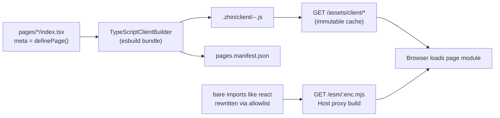

# Console pages and layouts

Plugins can do more than send chat messages — they can contribute whole React pages to Remote Console. The Sandbox adapter's `/sandbox` chat page is one.

Like commands, pages live in a **convention directory**, `pages/`; files are discovered automatically and compiled into modules the browser can load.

## Your first page

```tsx
// pages/index/index.tsx
import { definePage } from '@zhin.js/console-contract';

export const meta = definePage({
  title: 'My Plugin',
  icon: 'Box',
  order: 10,
});

export default function MyPluginPage() {
  return <div>Hello from my plugin</div>;
}
```

- The **default export** is a React component — the page content.
- The **named export `meta`** declares title, icon and order.
- Only `pages/<name>/index.tsx` (or `index.ts`) is a page; other files in the folder can be imported as components and helpers.

Start the bot, open Console, and the page appears in the navigation.

## Page metadata

Every `meta` field is optional; `definePage` throws on unknown keys:

| Field | Default | Description |
| --- | --- | --- |
| `title` | Generated from the folder name (`foo-bar` → `Foo Bar`) | Navigation and header title |
| `icon` | none | A lucide-style icon name, e.g. `'Box'`, `'Workflow'` |
| `order` | `100` | Navigation order; lower comes first |
| `hideInNav` | `false` | Hide from navigation |
| `requiredPermissions` | `[]` | Permissions required to access, matched against the token's `permissions` |
| `requiredRoles` | `[]` | Roles required to access, matched against the token's `roles` |

Navigation and the page list are filtered by the caller's token. The full token sees every page. Any other token sees only pages whose requirements its `permissions` and `roles` meet. Without a token, only pages with no requirements show. For token setup, see [Console users and permissions](../console/index.md#users-and-permissions).

## Page addresses

Address = plugin path + page name:

| File | Owning plugin | Address |
| --- | --- | --- |
| `pages/index/index.tsx` | `sandbox` | `/sandbox` |
| `pages/workroom/index.tsx` | your bot (root) | `/p-workroom` |
| `pages/index/index.tsx` | your bot (root) | `/` |

`index` maps to the plugin path itself; other pages map to `p-<name>`. Two pages resolving to the same address fail at startup. Implementation: `pageRoute` in `packages/console/plugin-contract/src/page.ts`.

## Custom navigation and footer

`pages/` has two reserved names:

- `pages/nav/index.tsx`: the navigation area
- `pages/footer/index.tsx`: the footer

Default-export a React component; no `meta` needed. When both `.ts` and `.tsx` exist for a slot, `.tsx` wins. Projects created by `npm create zhin-app` already include both as examples.

## Example: the Sandbox chat page

The Sandbox adapter (`plugins/adapters/sandbox`) provides both an adapter and a page, so its `package.json#zhin` declares two Features:

```json
{
  "zhin": {
    "protocol": 1,
    "type": "plugin",
    "entry": "./plugin.ts",
    "runtime": "trusted",
    "features": [
      { "package": "@zhin.js/adapter", "api": "^1.0.0" },
      { "package": "@zhin.js/page", "api": "^1.0.0" }
    ]
  }
}
```

- `@zhin.js/adapter` discovers the adapter under `adapters/`, providing the WebSocket `/sandbox` connection.
- `@zhin.js/page` discovers `pages/index/index.tsx`, which is why Console shows a `/sandbox` chat page.

The page's `SandboxChat` component connects to `/sandbox` over WebSocket (address and token in `pages/sandboxTransport.ts`). Sending a message in the page is equivalent to a real platform receiving one: it goes through middleware, command matching and the AI. So you can fully debug commands, component rendering and the Agent without any real platform. Sandbox displays outbound HTML directly instead of converting it to an image or text — see [Middleware & components](./middleware-components.md#how-it-looks-on-each-platform).

The plugin entry itself needs nothing; the page and adapter are discovered automatically:

```ts
// plugins/adapters/sandbox/plugin.ts
import { definePlugin } from 'zhin.js';

export default definePlugin({
  name: 'sandbox',
  metadata: { displayName: 'Sandbox Adapter' },
});
```

## Page data: plugin RPC

When a page needs to show a plugin's runtime status or offer a few buttons, the plugin can register its own Console RPC instead of opening a WebSocket or an HTTP route.

In `setup`, the plugin registers a read-only `status` and, if needed, a few limited actions:

```ts
// plugin.ts
import { definePlugin } from 'zhin.js';
import { definePluginConsoleRpc, PluginConsoleRpcError, pluginConsoleRpcToken } from 'zhin.js/plugin-runtime';

export default definePlugin({
  name: 'ambient',
  setup(context) {
    context.resources.provide(pluginConsoleRpcToken, definePluginConsoleRpc({
      status: {
        page: 'index', // same access rules as pages/index
        handler: async () => ({
          mode: 'shadow',
          recent: recentJudgments(10).map(j => ({ at: j.at, spoke: j.engaged })),
        }),
      },
      actions: {
        'clear-cooldown': {
          page: 'index',
          handler: async ({ group }) => {
            if (typeof group !== 'string') throw new PluginConsoleRpcError('invalid_input', 'Pick a group');
            return { cleared: clearCooldown(group) };
          },
        },
      },
    }));
  },
});
```

Pages call it with `pluginRpc` from `@zhin.js/client`. `pluginId` is the plugin's PluginId (for example `root/ambient`), the same value as `owner` in the page list:

```tsx
import { pluginRpc } from '@zhin.js/client';

const status = await pluginRpc<{ mode: string }>('root/ambient', 'status');
await pluginRpc('root/ambient', 'clear-cooldown', { group: '123' });
```

Requests go through the existing `POST /api/console/request`, with the type `plugin.<pluginId>.status` or `plugin.<pluginId>.<action>`. Action names may use only lowercase letters, digits and `-`, and `status` is reserved.

Besides `status`, you can register a few **read-only queries** under `queries`. They follow the same rules as `status` (`page`, `demo` and `requiredPermissions` all work). A query and an action can't share a name:

```ts
definePluginConsoleRpc({
  queries: {
    history: { page: 'index', handler: async () => ({ days: last7Days() }) },
  },
});
```

Access rules:

- **Follows the page**: with `page` set, the caller must meet that page's `requiredPermissions` and `requiredRoles`, plus any the method declares itself. If the page isn't loaded in the current generation, the call is refused.
- **The full token** can call every method.
- **Any other token** can read `status` if it holds every required permission and role. A `status` with no requirements at all is open to these tokens only when it sets `demo: true`.
- **Actions** need the full token.

Ordinary users see what you return, so:

- Return only the few fields the page needs. Don't return log records, prompts, chat text or secrets.
- The result must be JSON and at most 256 KB. The request's `data` must be a JSON object of at most 64 KB.
- A handler that doesn't return within 10 seconds times out, and its `signal` is aborted.
- To show users why something failed, throw `PluginConsoleRpcError`. Its message is shown as is. Any other error shows only a generic failure message.

Plugin RPC doesn't change configuration. Use `config:patch` for that.

### Built-in status: ambient engagement and skills assistant

Ambient engagement (群聊插话) and the skills assistant (技能助手) are provided by the Host itself, not by a plugin, so they sit under the root plugin:

| Method | Call | Permission needed |
| --- | --- | --- |
| `plugin.root.ambient` | `pluginRpc('root', 'ambient')` | `ambient:read` |
| `plugin.root.skills` | `pluginRpc('root', 'skills')` | `skills:read` |

The full token doesn't need these permissions. Pages list the same permission in `requiredPermissions`, and tokens get it in `http.tokens[].permissions` (see [Users and permissions](../console/index.md#users-and-permissions)). Both queries are read-only and take no input.

The data lives only in memory: the last 24 hours, at most 2000 entries, cleared on restart. It never includes chat text, prompts, judge reasons or secrets. All times are millisecond timestamps.

`plugin.root.ambient` returns:

```ts
interface AmbientStatus {
  enabled: boolean;                       // at least one group is configured
  mode: 'off' | 'shadow' | 'active';      // shadow: judge without speaking
  groups: number | 'all';                 // configured groups, or 'all' for '*'
  judges: string[];                       // judge models in order (provider/model)
  last24h: { spoke: number; watched: number; stayed_quiet: number; skipped: number };
  decisionShadow: { agreed: number; disagreed: number }; // ai.decisions.ambient shadow vs the chat-model judge
  recent: Array<{                         // newest first, at most 20
    at: number;
    group: string;                        // platform:groupId
    outcome: 'spoke' | 'watched' | 'stayed_quiet' | 'skipped';
    skipReason?: 'cooldown' | 'hourly_cap' | 'judge_interval' | 'no_context' | 'judge_failed';
    confidence?: number;                  // 0..1, two decimals
    judge?: 'decision' | 'chat-model';
  }>;
  updatedAt: number | null;
}
```

`watched` means the judge would have spoken but shadow mode kept it quiet.

`plugin.root.skills` returns call statistics for structured decisions (choosing skills, tools, memory, sub-agents, approvals and ambient engagement):

```ts
interface SkillsStatus {
  tasks: Array<{                          // one row per task, sorted by name
    task: 'skills' | 'tools' | 'memory' | 'agents' | 'approval' | 'ambient';
    mode: 'off' | 'shadow' | 'active';    // mode of the latest call
    calls: number; selected: number; abstained: number; shadow: number; failed: number;
    averageMs: number;
    inputTokens: number; outputTokens: number;
    lastModel?: string;
    lastAt: number;
  }>;
  totals: { calls: number; inputTokens: number; outputTokens: number };
  recent: Array<{                         // newest first, at most 20
    at: number; task: string; mode: string;
    outcome: 'selected' | 'abstained' | 'failed' | 'shadow';
    durationMs: number;
    model?: string;
    reason?: string;                      // machine-readable failure/abstain reason, never free text
  }>;
  updatedAt: number | null;
}
```

## How it works

Page files run in the **browser**, so Node doesn't load them; the client builder (`TypeScriptClientBuilder`, `packages/console/pagemanager`) bundles them with esbuild:



- **Output**: each page is bundled as `<owner>-<localName>-<contentHash>.js` into the project's `.zhin/client/` and served by `GET /assets/client/*` (`cache-control: immutable`; new content means a new file name). `@zhin.js/console-contract` is replaced with a no-op stub at bundle time, and `meta` is extracted statically.
- **One React only**: browsers don't understand bare imports like `import 'react'`, so imports on the `ALLOWED_ESM_CANONICAL` allowlist (`react`, `react-dom`, `react-dom/client`, `react/jsx-runtime(-dev)`, `react-router`, `react-router-dom`) are rewritten to `/esm/<enc>.mjs`, built and proxied on demand by the Host so the whole Console shares one React instance. Anything off the allowlist returns 403.
- **Routes**: registered in `basic/cli/src/plugin-runtime/console/host.ts`. `GET /console` is the page index, `GET /console/api/pages` returns the page manifest, and other paths are matched to pages and served a page shell (with an importmap and mount script); no match returns 404, insufficient permission 403. The browser loads the page with `import(moduleUrl)` and mounts the default export on `#root`.

## Next steps

- [Convention directories](./conventions.md): where other capabilities go.
- [Console](../console/index.md): what Console itself can do.
