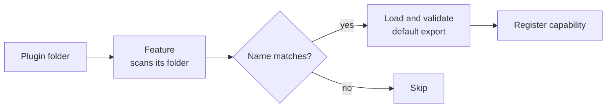

# Convention directories

**Put a file in the right folder and the capability registers itself** — no registration code in `plugin.ts`. This page tells you which folder each capability goes in and how to name it.

## Three rules

1. **One folder per capability; the entry is `index.ts`** (components and pages may use `index.tsx`). For example `commands/hello/index.ts`.
2. **The folder name is the capability's name.** `commands/hello/` is the `hello` command; `tools/weather/` is the `weather` tool.
3. **Other files in the folder are not registered.** Use them for helpers, types and tests imported by `index.ts`.

```text
my-plugin/
├── plugin.ts
├── commands/
│   └── hello/
│       ├── index.ts      # ✅ the /hello command
│       └── format.ts     # plain module imported by index.ts
└── middlewares/
    └── keyword-reply/
        └── index.ts      # ✅ the keyword-reply middleware
```

Skills and Agents are the exception: they are described in Markdown / JSON, with entries `skills/<name>/SKILL.md` and `agents/<name>/agent.json`.

## Quick lookup

| Folder | What it's for | Default export | Docs |
| --- | --- | --- | --- |
| `commands/` | Commands users run as `/xxx` | `defineCommand()` | [Commands](./commands.md) |
| `middlewares/` | Interceptors every message passes: keyword replies, filters | `defineMiddleware()` | [Middleware & components](./middleware-components.md) |
| `handlers/` | Platform events: joins, friend requests, login | `defineHandler()` | [This page](#handlers-platform-events) |
| `components/` | Reusable JSX message cards | `defineComponent()` | [Middleware & components](./middleware-components.md) |
| `schedules/` | Scheduled jobs | `defineSchedule()` | [This page](#schedules-scheduled-jobs) |
| `adapters/` | Connecting a new platform | `defineAdapter()` | [Adapter authoring](./adapters.md) |
| `pages/` | Custom pages in Console | page component | [Console pages](./console-pages.md) |
| `tools/` | Functions the AI can call | `defineAgentTool()` | [Agent tools](./agent-tools.md) |
| `prompt-sections/` | Background knowledge for the AI | `defineAgentPromptSection()` | [Agent tools](./agent-tools.md) |
| `skills/` | Playbooks the AI loads on demand | `SKILL.md` | [Agent tools](./agent-tools.md) |
| `agents/` | Sub-agent definitions | `agent.json` + Markdown | [Agent tools](./agent-tools.md) |
| `hooks/` | Hooks into Agent turns | `defineHook()` | [Agent deep dive](../ai/agent.md) |
| `mcps/` | MCP server declarations | `defineMcp()` | [AI overview](../ai/index.md) |

`commands/`, `middlewares/`, `handlers/`, `components/`, `schedules/` and `adapters/` work out of the box for your bot. The AI folders (`tools/`, `prompt-sections/`…) need AI enabled first (`npx zhin setup --ai` declares them). A child plugin must declare the folders it uses in its own `package.json` — see [How it works](#how-it-works).

Missing folders are simply skipped; create only the ones you use.

## Writing each folder

### commands/: commands

```ts
// commands/lottery-today/index.ts  →  /lottery-today
import { defineCommand } from 'zhin.js/command';

export default defineCommand({
  description: "Show today's pick",
  async execute() {
    return "Today's pick is…"; // the return value is the reply
  },
});
```

Nested folders are subcommands: `commands/admin/ban/index.ts` is `/admin ban`. Params can be folders too: `[name]` required, `[[name]]` optional, `[...name]` captures the rest. Full params, options and permissions: [Commands](./commands.md).

A command has at most one param folder, and it must be the last folder before `index.ts`. `commands/term/[word]/[...definition]/index.ts` throws `CommandPathSyntaxError`; write `commands/term/[word]/index.ts` instead and declare the remaining params after the folder param in `defineCommand({ params })`:

```ts
// commands/term/[word]/index.ts  →  /term <word> <...definition>
import { defineCommand } from 'zhin.js/command';

export default defineCommand({
  params: {
    word: { type: 'string' },                    // folder param, must come first
    definition: { type: 'text', rest: true },    // the rest of the input
  },
  execute: ({ params }) => ({ word: params.word, definition: params.definition }),
});
```

### middlewares/: middleware

```ts
// middlewares/keyword-reply/index.ts
import { defineMiddleware } from 'zhin.js/middleware';
import type { Message } from 'zhin.js';

export default defineMiddleware<Message>({
  async handle({ input }, next) {
    if (input.content === 'morning') return 'Good morning!'; // match: reply directly
    return next();                                           // no match: pass to later middleware and commands
  },
});
```

Middleware forms an ordered chain; you must call `next()` to continue. See [Middleware & components](./middleware-components.md).

### handlers/: platform events

Middleware handles *messages*; handlers handle *events*: joins, leaves, friend requests, login QR codes. Handlers aren't part of the message chain and have no `next()`.

```ts
// handlers/request-receive/index.ts
import { defineHandler } from 'zhin.js/handler';

export default defineHandler({
  event: 'request.receive', // dotted event names must be explicit
  async handle(event) {
    const request = event.payload;
    const ok = await this.interaction?.ask({ type: 'confirm', title: 'Approve this request?' });
    if (ok) await request.$approve();
  },
});
```

Events you can listen to:

| Event | Fires when |
| --- | --- |
| `message.receive` | A message arrives (before middleware and commands) |
| `notice.receive` | Notices: member changes, recalls, pokes… |
| `request.receive` | Requests needing approval: friend requests, join requests |
| `system.receive` | System events: login, online, offline |

::: details More handler details
- Without `event`, the folder name is the event name. `handlers/<name>/` is one level deep, so dotted events such as `message.receive` must declare `event` explicitly.
- `this.interaction` asks the user a question, a confirmation or a choice — the same interaction API commands have. Notice / Request provide it only with a real conversation; SystemEvent never does.
- `Message`, `Notice`, `Request` and `SystemEvent` types can be imported from `zhin.js` and match the handler payload. Plain fields are camelCase:
  - `id`, `type`, `name`, `timestamp`, `metadata`: event identity, full event name, millisecond timestamp, raw platform fields.
  - `endpoint`, `generation`: the connection and version the event belongs to; `endpointId` is the platform account id and `clientAdapter` the platform id.
  - Notice / Request `conversation?`, `actor?`, `target?` are present only when they exist; Request always has `actor`. SystemEvent has none of the three.
- `$client` and Request's `$approve()` / `$reject()` are valid only while the event is being handled. Read raw platform fields from `metadata`; for strongly typed SDK events, use a native-event handler with `adapter`.
- Adapters report events through `endpoint[endpointSpec].events`, and the runtime builds these standard objects.
- `addHandler(name, defineHandler(...))` in `setup` works the same way.
:::

### components/: message cards

```tsx
// components/status-card/index.tsx
import { defineComponent } from 'zhin.js/component';

export default defineComponent<{ title: string }>({
  render: ({ title }) => <text>{title}: online</text>,
});
```

Render it from a command with `component('status-card', { title: '…' })`. Platforms that support images get the JSX rendered as an image; others fall back to text. See [Middleware & components](./middleware-components.md).

### schedules/: scheduled jobs

`schedules/<name>/index.ts` default-exports `defineSchedule(...)`. `execute(ctx)` gets the plugin config and `use(token)` for that run; `addSchedule` in `plugin.ts` registers the same definition.

A job has no incoming message to reply to; send messages with proactive delivery (see [definePlugin · Send messages proactively](./define-plugin.md)). Data that must survive restarts belongs in persistent storage such as the database — never cache `ctx` or client objects. Full examples: [Schedule Feature](https://github.com/zhinjs/zhin/blob/main/packages/im/schedule-feature/README.md) and the [persistent reminder plugin](https://github.com/zhinjs/zhin/blob/main/plugins/utils/reminder/README.md).

### adapters/: connecting a new platform

```ts
// adapters/napcat/index.ts
import { defineAdapter } from 'zhin.js/adapter';
import { NapcatAdapter } from '../../src/adapter.js';
import type { NapCatEndpointConfig } from '../../src/protocol.js';

export default defineAdapter<NapCatEndpointConfig>({
  capabilities: ['inbound', 'outbound'],
  operations: ['recall'],
  createAdapter: context => new NapcatAdapter(context),
});
```

You only write an adapter for a platform Zhin doesn't support yet. See [Adapter authoring](./adapters.md) and [Endpoint lifecycle](./endpoint-lifecycle.md).

### tools/: tools for the AI

```ts
// tools/music-search/index.ts
import { defineAgentTool } from '@zhin.js/tool';

export default defineAgentTool<{ keyword: string }>({
  description: 'Search music and return a result list',
  inputSchema: {
    type: 'object',
    properties: { keyword: { type: 'string', description: 'Search keyword' } },
    required: ['keyword'],
  },
  requiresApproval: 'never',
  execute: ({ keyword }) => searchMusic(keyword),
});
```

`description` and `inputSchema` are written for the model: say clearly when to use the tool and what the parameters are. Tool names may be kebab-case or snake_case (e.g. `send_user_like`). See [Agent tools](./agent-tools.md).

### skills/ and agents/: AI capabilities described in documents

`skills/<name>/SKILL.md` is a playbook with frontmatter that the AI loads only when needed; the folder may also hold reference material and scripts:

```markdown
---
name: memory-consolidate
description: At turn end or when the master says "remember", write 1–3 retrievable facts to memory_entries
tools:
  - memory_upsert
  - memory_search
---
```

`agents/<name>/` defines a sub-agent and must contain `agent.json`, `system.md`, `boundaries.md` and `conventions.md`; optional `workflows/`, `tools/`, `skills/`, `hooks/` and `knowledge/` hold scenario flows, private tools, private Skills, private hooks and a knowledge base. The main Agent's rules live in the plugin root's `AGENTS.md`; a sub-agent's `conventions.md` may only extend them. See [`@zhin.js/agent-feature`](https://github.com/zhinjs/zhin/blob/main/packages/im/agent-feature/README.md).

### pages/: Console pages

`pages/<name>/index.tsx` is compiled to browser code and shown in Remote Console. `pages/nav/index.tsx` and `pages/footer/index.tsx` are special names that inject the navigation bar and footer. See [Console pages](./console-pages.md).

## Naming rules

- Folder names are lowercase kebab-case: `keyword-reply`, `lottery-today`.
- Static folders under `commands/` may also use Unicode names (e.g. `commands/赞我/`); param folders (`[name]`…) are ASCII only.
- `tools/` also allows snake_case (e.g. `send_user_like`).
- Duplicate names within a plugin fail at startup with `DiscoveryConflictError`.

::: details How each folder derives a capability name
| Folder | Name derivation | Example |
| --- | --- | --- |
| `commands/` | Folder segments from `commands/` to `index.ts` joined with `/`; `[name]`, `[[name]]`, `[...name]`, `[[...name]]` mean required, optional, catch-all, optional catch-all | `commands/lottery-today/index.ts` → `lottery-today`; `commands/lottery/[[game]]/index.ts` → `lottery/$game` |
| `middlewares/` | One named folder level | `middlewares/keyword-reply/index.ts` → `keyword-reply` |
| `handlers/` | One named folder level; the folder name is the event when `event` is omitted | `handlers/message-receive/index.ts` → `message-receive` |
| `components/` | One named folder level | `components/share-music/index.ts` → `share-music` |
| `adapters/` | Same | `adapters/napcat/index.ts` → `napcat` |
| `tools/` | `<name>/index.ts`; ASCII kebab or snake | `tools/music-search/index.ts` → `music-search`; `tools/send_user_like/index.ts` → `send_user_like` |
| `hooks/` | `<name>/index.ts`; private hooks may live inside an Agent or Skill | `hooks/audit/index.ts` → `audit` |
| `prompt-sections/` | One named folder level | `prompt-sections/project-rules/index.ts` → `project-rules` |
| `skills/` | First-level folder name; only `SKILL.md` inside is recognized | `skills/memory-consolidate/SKILL.md` → `memory-consolidate` |
| `agents/` | First-level folder name; only folders with `agent.json` | `agents/planner/agent.json` → `planner` |
| `mcps/` | One named folder level | `mcps/my-server/index.ts` → `my-server` |
| `schedules/` | One named folder level | `schedules/daily-report/index.ts` → `daily-report` |
| `pages/` | One named folder level; `nav` / `footer` are layout slots | `pages/workroom/index.tsx` → `workroom`; `pages/nav/index.tsx` → `nav` |

Malformed brackets in command param folders throw `CommandPathSyntaxError`. A param with a default must use double brackets and be declared in `params`, or the same error is thrown. The same error is thrown when a command has more than one param folder or a static folder after a param folder (such as `commands/[name]/info/`); the message names the file and shows the corrected path. When the folder param is not the first entry in `params`, the message shows the reordered list.
:::

## How it works

Each convention folder is scanned by a **Feature** (a capability package). On startup and hot reload, the Feature walks its folder, loads entry files that match the naming rules, validates their default export and registers them:



**Your bot (the Root plugin)** gets the official Stable Features automatically by depending on `zhin.js`, so `commands/` and friends just work. **Child plugins** declare the Features they use in their own `package.json`:

```jsonc
{
  "peerDependencies": { "@zhin.js/command": "^1.1.0" },
  "peerDependenciesMeta": { "@zhin.js/command": { "optional": true } },
  "zhin": {
    "features": [{ "package": "@zhin.js/command", "api": "^1.0.0" }]
  }
}
```

- Every package in `zhin.features` must also appear in `dependencies`, `peerDependencies` or `optionalDependencies`, or startup fails with `PackageResolutionError`.
- Child plugins declare Stable Features (command / middleware / component / handler) as **optional peers** provided by the bot — don't add them to their own `dependencies`, or there will be two copies.
- `@zhin.js/adapter`, `@zhin.js/tool` and similar go in `dependencies` or non-optional peers as needed.

::: details Full folder ↔ Feature table
A capability's full id is `owner\0feature\0localName` (`\0`-separated). `target: server` modules run in Node; `target: client` pages load in the browser from build output.

| Folder | File shape | Recursive | target | Feature package | featureId | Default export |
| --- | --- | --- | --- | --- | --- | --- |
| `commands/` | route folders + `index.ts` / `index.tsx` | yes (segments form levels) | server | `@zhin.js/command` | `zhin.command` | `defineCommand(...)` |
| `middlewares/` | `<name>/index.ts` | named folder | server | `@zhin.js/middleware` | `zhin.middleware` | `defineMiddleware(...)` |
| `handlers/` | `<name>/index.ts` | named folder | server | `@zhin.js/handler` | `zhin.handler` | `defineHandler(...)` |
| `components/` | `<name>/index.ts` / `index.tsx` | named folder | server | `@zhin.js/component` | `zhin.component` | `defineComponent(...)` |
| `adapters/` | `<name>/index.ts` | named folder | server | `@zhin.js/adapter` | `zhin.adapter` | `defineAdapter(...)` |
| `tools/` | `<name>/index.ts` | named folder | server | `@zhin.js/tool` | `zhin.agent-tool` | `defineAgentTool(...)` |
| `hooks/` | `<name>/index.ts` | named folder | server | `zhin.js/agent` | Agent Hook | `defineHook(...)` |
| `prompt-sections/<name>/` | `index.ts` | yes | server | `@zhin.js/prompt-section` | `zhin.agent-prompt-section` | `defineAgentPromptSection(...)` |
| `skills/` | subfolder + `SKILL.md` | one level | server | `@zhin.js/skill` | `zhin.skill` | Markdown text |
| `agents/` | `<name>/agent.json` + 3 core Markdown files | one level | server | `@zhin.js/agent-feature` | `zhin.agent` | folder-based Agent definition |
| `mcps/` | `<name>/index.ts` | named folder | server | `@zhin.js/mcp-feature` | `zhin.mcp` | `defineMcp(...)` |
| `schedules/` | `<name>/index.ts` | named folder | server | `@zhin.js/schedule-feature` | `zhin.schedule` | `defineSchedule(...)` |
| `pages/` | `<name>/index.ts(x)`; `nav` / `footer` are layout slots | named folder | client | `@zhin.js/page` / `@zhin.js/layout` | `zhin.page` / `zhin.layout` | page artifacts |

Apps depending on `zhin.js` import `define*` from facade subpaths: `zhin.js/command`, `zhin.js/middleware`, `zhin.js/handler`, `zhin.js/adapter`, `zhin.js/component`, plus `definePlugin` from `zhin.js`.
:::

## Real examples in this repo

| To see | Look at |
| --- | --- |
| Commands (incl. param folder `lottery/[[game]]/index.ts`) | `plugins/utils/lottery/commands/` |
| Middleware | `plugins/utils/group-suite/middlewares/`, `plugins/games/*/middlewares/` |
| Components | `plugins/utils/music/components/share-music/index.ts` |
| Adapters | `plugins/adapters/napcat/adapters/napcat/index.ts` |
| AI tools | `plugins/utils/music/tools/`, `plugins/utils/group-suite/tools/` |
| Skills | `examples/full-bot/skills/memory-consolidate/SKILL.md` |
| Sub-agents | `examples/multi-agent-room/agents/` |
| Console pages | `examples/full-bot/pages/workroom/index.tsx` |

## Next steps

- [Commands](./commands.md): params, options, permissions and help.
- [Middleware & components](./middleware-components.md): keyword replies, message cards and JSX.
- [Agent tools](./agent-tools.md): let the AI call your functions.
