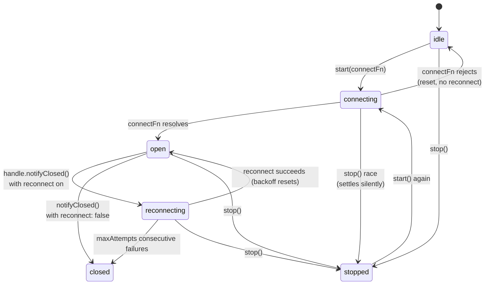

# Endpoint lifecycle

**Read this page when writing a WebSocket or SSE adapter.** Every long-lived connection needs the same logic: connect, reconnect with exponential backoff after a disconnect, heartbeat checks, and a clean stop. `createEndpointLifecycle` from `zhin.js/adapter` packages that as a ready-made base; napcat and other official adapters use it.

The classic bugs when hand-writing it: a late close event from an old socket kills the new connection; `stop()` racing a connect causes an unhandled rejection; a backoff timer is never cleared. The base avoids all of them — **stop writing `#started` / `#reconnectTimer` flags by hand.**

## Minimal usage

```ts
import { createEndpointLifecycle } from 'zhin.js/adapter';

const lifecycle = createEndpointLifecycle({ name: config.name });

// Connect: connectFn resolves when the connection opens, rejects on failure or close before open
await lifecycle.start(async (handle) => {
  const ws = new WebSocket(url, { headers });
  // Register a force-close function: stop() and the heartbeat watchdog both call it
  handle.onForceClose(() => { try { ws.close(); } catch { /* ignore */ } });

  await new Promise<void>((resolve, reject) => {
    let settled = false;
    ws.on('open', () => {
      settled = true;
      lifecycle.startHeartbeat(() => ws.ping(), config.heartbeat_interval);
      resolve();
    });
    ws.on('close', (code, reason) => {
      // Tell the base the peer disconnected; only connections that were once open reconnect
      handle.notifyClosed(new Error(`WS closed: ${code} ${reason}`));
      if (!settled) { settled = true; reject(new Error(`WS closed: ${code}`)); }
    });
    ws.on('error', (err) => {
      if (!settled) { settled = true; reject(err); }
    });
  });
});

// Stop: clears every timer, force-closes the connection, never triggers a reconnect
await lifecycle.stop();
```

Two behaviors to remember:

- **A failed first connection doesn't reconnect automatically.** `start()` throws the error to you and you decide whether to retry; only a connection that **was once open** reconnects after a disconnect.
- **`stop()` is an intentional stop**: safe to call repeatedly, never triggers a reconnect; if called while connecting, `start()` resolves quietly (stopping isn't a failure).

In the adapter's own `stop()`, call the base first, then clean up your own state:

```ts
// plugins/adapters/napcat/src/ws-endpoint.ts (excerpt)
async stop(): Promise<void> {
  await this.#lifecycle.stop();          // clear timers + force-close ws + settle races
  this.#unregisterAgent?.();             // adapter-specific cleanup
  rejectAllPending(this.#pending);
  this.#inboundDeduper.clear();
  if (this.#ws) {
    try { this.#ws.close(); } catch { /* ignore */ }
    this.#ws = undefined;
  }
}
```

## Configure reconnection and heartbeat

```ts
const lifecycle = createEndpointLifecycle({
  name: config.name,              // logging only
  reconnect: {
    initialIntervalMs: 5_000,     // first retry delay, default 5000
    multiplier: 2,                // backoff factor, default 2 (1 = fixed interval)
    maxIntervalMs: 60_000,        // delay cap, default 60000
    jitterMs: 250,                // max random jitter, default 250
    maxAttempts: Infinity,        // consecutive failures before entering closed
  },
  heartbeat: {
    intervalMs: 30_000,           // default interval for startHeartbeat; <=0 disables
    watchdogMisses: 0,            // missed rounds tolerated, default 0 = off
  },
});
```

- `reconnect: false` disables reconnection; a disconnect goes straight to `closed`.
- Actual delay = `min(initial × multiplier^attempt, max) + random(0, jitter)`, reset after a successful reconnect. The first disconnect logs WARN, later retries DEBUG, to avoid log spam.
- In tests, pass `random: () => 0` for a deterministic backoff sequence.

### Heartbeat watchdog

```ts
lifecycle.startHeartbeat(beat, intervalMs?);  // start (calling again clears the previous timer)
lifecycle.stopHeartbeat();                    // stop manually (called automatically on close, stop, watchdog)
lifecycle.notifyHeartbeatAck();               // "feed the dog": call on any reply from the peer
```

With `watchdogMisses: N`, if **N consecutive heartbeats get no reply at all**, the base calls your force-close function; the socket's `close` event then fires `notifyClosed` and normal backoff reconnection follows. So feed the watchdog in both `message` and `pong`:

```ts
ws.on('pong', () => this.#lifecycle.notifyHeartbeatAck());
ws.on('message', (data) => {
  this.#lifecycle.notifyHeartbeatAck();   // any traffic means it's alive
  handleMessage(data);
});
```

## Several accounts on one adapter

An adapter is declared once (`adapters/napcat/index.ts` → `defineAdapter`), but config can expand it into **several account connections (Endpoints)**:

```yaml
# examples/full-bot/zhin.config.yml (excerpt)
plugins:
  napcat:
    connection: ws                 # shared config for every account
    endpoints:
      - id: full-bot-napcat        # per-account config
        url: ${ONEBOT11_WS_URL}
        access_token: ${ONEBOT11_ACCESS_TOKEN}
```

- With a non-empty `endpoints`, each entry creates one account: the shared config (minus the `endpoints` key) is **shallow-merged** with the entry, and `id` is forced in. With `endpoints` empty or missing, one account is created from the shared config.
- `id` must be a non-empty string without `~` or `\0`; duplicate or invalid ids make the new config fail. The expanded account id is `<capabilityId>~<id>`.
- The `context.config` passed to `create(context)` is the **merged single-account config**, and `context.endpointId` is the account id (`context.name` is the adapter name). Adapter code never needs to know how many accounts exist; one instance serves one connection.

The expansion lives in `expandEndpointConfigs` in `packages/im/adapter/src/adapter-index.ts`.

## Endpoint lifecycle hooks

When you extend `Endpoint` with your own connection flow, the framework calls these hooks at each stage of a version switch:

| Hook | When |
| --- | --- |
| `start()` | The new version activates; allocate connection resources |
| `open()` | The new version activates; open the local event stream (inbound is still refused until the switch commits) |
| `close()` | Stop accepting new events; keep in-flight work |
| `stop()` | Release connection resources; must be safe to call repeatedly |
| `send(request)` | Send a message |

For `NapCatWsEndpoint`: `start()` calls `lifecycle.start(...)` to connect; `open()` / `close()` flip an `#open` flag (events are accepted only while open); `stop()` calls the base `stop()` and then its own cleanup.

## Resolving quotes, merged forwards and media

If the platform can look up content by native id, the Endpoint should provide a single `content: EndpointContentPort` — don't stuff `$getMsg`, quote metadata or pre-expanded forward text into messages:

```ts
interface EndpointContentPort {
  resolve(
    reference: ConversationReference, // message | forward | media
    context: {
      signal: AbortSignal;
      maxDepth: number;
      maxEntries: number;
      maxChars: number;
    },
  ): Promise<ConversationResolution>;
}
```

- The result must be one of `resolved | not_found | unsupported | forbidden | expired | failed`. Without platform support return `unsupported` — never empty or guessed content.
- `resolve()` must honor `signal` and the depth, entry and character budgets; Core holds the current version's snapshot lease for the whole async call.
- Authors inside messages and forwards are written as neutral `actor` data and must **never** be mapped to model roles.
- Media may return a stable URL, validated base64 / path, or an explicit failure; never expose token-bearing download URLs to the Agent.

## Going deeper

### State machine



- `started` is `true` exactly when the state is `connecting` / `open` / `reconnecting`.
- Every connection attempt bumps an internal version, and **`notifyClosed` / `onForceClose` on stale handles are ignored** — late events from an old socket can't affect the new connection.

### Example: napcat's ws-endpoint

`plugins/adapters/napcat/src/ws-endpoint.ts` is the canonical use of the base, in four parts:

```ts
export class NapCatWsEndpoint extends Endpoint<NapcatClient> {
  readonly client = new NapcatClient((action, params) => this.#callApi(action, params));
  readonly #lifecycle: EndpointLifecycle;
  #ws?: NapCatWsSocket;

  constructor(options: NapCatWsEndpointOptions) {
    super();
    // 1. Create the base in the constructor; reconnect_interval keeps its legacy fixed-interval meaning:
    //    multiplier 1, no jitter, no cap
    this.#lifecycle = createEndpointLifecycle({
      name: options.config.name,
      reconnect: {
        initialIntervalMs: options.config.reconnect_interval,
        multiplier: 1,
        maxIntervalMs: Number.MAX_SAFE_INTEGER,
        jitterMs: 0,
      },
    });
  }

  async start(): Promise<void> {
    if (this.#lifecycle.started) return;                 // idempotent
    await this.#lifecycle.start((handle) => this.#connect(handle));
  }
  // stop() as in "Minimal usage"; #connect(handle) as above
}
```

What the base removes for you:

| Hand-written | With the base |
| --- | --- |
| `#started` / `#stopping` / `opened` flags | `lifecycle.state` / `lifecycle.started` |
| `#reconnectTimer` + a hand-rolled `setTimeout` chain | Built-in backoff loop with interruptible waits; `stop()` wakes it immediately |
| `#heartbeatTimer` + a missed-reply counter | `startHeartbeat` + `watchdogMisses` + `notifyHeartbeatAck` |
| A late close from an old socket killing the new one | Stale handles expire automatically |
| `stop()` racing a connect into an unhandled rejection | Racing waits are settled together and resolve silently |

The adapter keeps only protocol logic: the Client's API transport, rejecting pending requests (`rejectAllPending`) and clearing the inbound deduper (`deduper.clear()`). The Client is a separate object; the Endpoint owns only the account connection, lifecycle and event entry.

## Next steps

- [Adapter authoring](./adapters.md): the basic `defineAdapter` form.
- [Message flow](../concepts/message-flow.md): the full inbound and outbound path.
