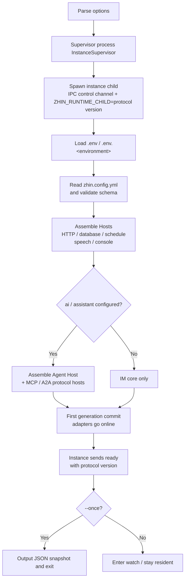

# zhin runtime start

`zhin runtime start` is the one command that starts the bot. It runs your TypeScript source directly with no build step and assembles HTTP, database, Console, Agent and other services from config. Watching is enabled only by an explicit `--watch`, independently of runtime mode.

## Common usage

```bash
# Daily development: HMR + Console
pnpm dev

# Production: disable watch, logs go to stdout (collected by systemd / container)
zhin runtime start --mode production --no-watch

# Bare-metal persistent: daemon + auto-start on boot
zhin runtime start --daemon
zhin service install

# CI smoke test: start once to verify configuration and assembly
zhin runtime start --once --mode test
```

| Situation | Use |
| --- | --- |
| Local development | `pnpm dev`: watches files, hot reload |
| A server managed by systemd / Docker | `--mode production --no-watch`: no file watching, logs to stdout |
| A server without a process manager | `--daemon`: built-in supervisor, restarts on crash |
| Checking config and assembly in CI | `--once`: start once, print JSON and exit |

## Options

| Option | Description |
| --- | --- |
| `--mode <mode>` | Run mode: `development` (default) / `test` / `production` |
| `--environment <name>` | Environment name, defaults to the `--mode` value; determines which `.env.<name>` is loaded, must match `/^[a-z0-9][a-z0-9-]*$/` |
| `--watch <scope...>` | Explicitly watch `source` / `config`, optionally combined as `--watch source config`. Omission watches neither |
| `--no-watch` | Compatibility spelling for no watching; cannot be combined with `--watch` |
| `--once` | Output a JSON snapshot after completing one startup, then exit |
| `--open` | Open Remote Console in the browser after a successful start in a terminal (TTY); `ZHIN_OPEN=1` does the same |
| `-d, --daemon` | Daemon mode: writes a pid file, redirects logs, auto-restarts on crash |
| `--log-file <path>` | Daemon log file, default `<project-root>/.zhin/logs/instance.log` (size-rotated) |
| `--standalone` | Development / test only: no supervisor, the instance runs its own Node HTTP server in this process; no managed restarts |

`zhin runtime start --help` lists these options with common examples. Unknown options cause an immediate error before startup (fail fast), and will not enter a restart loop.

## Native TypeScript (strip-types)

Runtime does not compile the project before startup. Node executes plugin source directly. Supported versions match repository `engines`: `>=22.19.0`; unsupported versions fail immediately.

Foreground mode selects a wrapper based on Node's TypeScript support. Daemon mode always uses the supervisor -> child-process structure described below.

Because it's "source as runtime," importing local TS files requires the `.js` extension (the runtime does specifier remapping), which is also one of the repository's code conventions.

::: details How `.tsx` entries are loaded
Server convention entries also support `.tsx`. The CLI first delegates to the process's active loader and enables a scoped TSX loader only when Node does not recognize the extension, so development watch, `--no-watch`, supervisor, and daemon modes use the same command. Set `"jsx": "react-jsx"` and an appropriate `"jsxImportSource"` in `tsconfig.json`; new scaffolds default to `zhin.js`, and a file can override it with `/** @jsxImportSource zhin.js */`.
:::

## Startup Flow



Note that the Agent stack is **loaded on demand**: only when `ai` / `assistant` is configured in any section will `@zhin.js/agent` be resolved; a pure IM project will not load AI dependencies. The output after successful startup also varies by environment -- in a TTY, it's a one-line summary (plugin count, HTTP address, online/offline adapters); in non-TTY or with `--once`, it outputs structured JSON (`{ started: true, ... }`), convenient for script consumption. Configuration validation failure reports `Invalid Plugin config in zhin.config.yml` and lists all issues.

## HMR Semantics

Only `--watch source config`, `--watch source` or `--watch config` enables the selected scope; `--once` registers no watchers. Omitting `--watch` does not prevent explicitly saving and applying configuration through Console. Scaffolded projects and repository examples explicitly select both scopes in `pnpm dev`; update existing development scripts if automatic reload is wanted.

Source changes are handled at two levels based on their scope of impact:

| Change | Handling |
| --- | --- |
| Plugin / application source code | **In-process generation reload**: only the affected capability slots and plugin subtrees are rebuilt; Console receives `hmr:reload` via SSE |
| Dependency manifest files (`pnpm-lock.yaml`, `pnpm-workspace.yaml`, `package-lock.json`, `yarn.lock`) | **Process-level restart**: the instance sends `restart-request` over the control channel, the supervisor answers with `shutdown` and starts a fresh instance once it has stopped |

Generation reload is transactional: the new generation completes assembly and commit first, then asynchronously disposes the old generation. The HTTP port is released then re-listened during generation switching, preventing port-occupied Console loss. File events from the same batch are merged into a single generation transaction to avoid continuous jitter.

## Process Management

### Daemon Mode

```bash
zhin runtime start --daemon            # Logs go to .zhin/logs/instance.log (size-rotated)
zhin runtime start -d --log-file ./bot.log
zhin stop                              # Stop (reads .zhin.pid)
```

The supervisor stays resident and writes its pid to `<project-root>/.zhin.pid`; the instance's stdout/stderr goes to the log file (default `.zhin/logs/instance.log`, rotated to `instance.log.1` … `.5` past 10 MiB) and the last 1000 lines are kept in memory. Crashes (signals or non-zero exit) trigger a re-launch; `zhin stop` or `kill -TERM <pid>` performs a normal shutdown. There is also **storm protection**: automatic restarts (crashes and restarts requested by the instance) are limited to 10 per minute, 3 seconds apart; past the budget the instance stays `crashed` and the supervisor exits, preventing a crash loop from flooding platform connections. In the foreground (without `--daemon`) the instance shares the terminal, restarts it requests still happen, and crashes are not restarted.

### Control channel and restarts

The supervisor spawns the instance over Node IPC (`serialization: 'advanced'`, ADR 0054 §3); the protocol lives in `@zhin.js/host-http/bridge`:

| Direction | Message | Meaning |
| --- | --- | --- |
| instance → supervisor | `ready` | Startup finished; carries the protocol version and generation. An incompatible version is rejected: the supervisor stops that instance and does not restart it |
| instance → supervisor | `restart-request` | Anything that needs a whole-process restart: Console restart, dependency changes, database switch, controlled self-change (replaces the former exit code `75`) |
| supervisor → instance | `shutdown` | `{ reason, budgetMs }`: the instance stops completely within the budget; after it the supervisor sends SIGTERM, then SIGKILL |
| instance → supervisor | `routes` | Route table (HTTP routes, WebSocket paths and how they authenticate, `apiBase`, generation); updated after plugin hot reloads and generation switches |
| supervisor → instance | `http.request` / `http.request.body` / `http.request.end` / `http.request.abort` | Request head (with the principal the gateway authenticated) and chunked request body |
| instance → supervisor | `http.response.head` / `http.response.body` / `http.response.end` / `http.response.error` | Response head and chunked response body (SSE, large files) |
| both | `http.request.credit` / `http.response.credit` | Credit-based backpressure: at most 256 KiB in flight per direction, chunks ≤ 64 KiB |
| both | `ws.open` / `ws.accepted` / `ws.rejected` / `ws.message` / `ws.close` / `ws.drain` | WebSocket connections and frames (text / binary); `ws.drain` drives `bufferedAmount` |
| supervisor → instance | `auth.authenticate` / `auth.audit` | Interim: until Console accounts move to the gateway (B1.4) the instance resolves sessions / API tokens and records gateway-side audit entries |
| instance → supervisor | `auth.state` / `auth.result` | Interim: whether an owner exists (reported on change) and the token resolution result |

**The instance has no HTTP server** (ADR 0054 §2): under the supervisor it serves its routes over the control channel with `BridgedHttpHost`, listens on no port and imports neither `node:http` nor `ws`; the gateway's single server receives HTTP and forwards it. The gateway authenticates the caller and forwards the principal with the request; the instance only authorizes (against the Console permission map) and no longer parses credentials itself.

**The gateway listens on `http.port`**: the supervisor of `zhin runtime start` (`pnpm dev`) is also the gateway and listens on the configured `http.host` / `http.port` (plus extra `http.listeners`), resolved from the project's `http.*` and `.env.<environment>`. `/pub/health` is answered by the gateway (with the instance state); `gateway.*` RPC on `POST {base}/console/request` (dependency transactions, instance start / stop / logs) is handled by the gateway and every other type is forwarded unchanged; all other requests are forwarded. While the instance is not ready, forwarded requests get `503 { code: 'instance_unavailable', state }` with `Retry-After`; a timeout gives `504 instance_timeout`, other bridge failures `502 instance_error`. A Console stop or a running dependency transaction does not end the supervisor.

A missing `ready` (60 seconds by default) counts as a failed start. `--once` ignores restart requests. `ZHIN_RUNTIME_CHILD` carries the gateway's protocol version; the instance refuses an incompatible one. `zhin.js/instance` refuses to start without a control channel; for development and tests, `zhin runtime start --standalone` (programmatically `runStartCommand({ standaloneHttp: true })`) runs its own HTTP server in this process, without managed restarts — a restart request then only stops the process.

### Exit Codes

| Exit Code | Meaning |
| --- | --- |
| `0` | Normal exit |
| `130` | Interrupted by a signal (Ctrl+C / SIGTERM) |
| other non-zero | The instance failed to start or crashed and was not restarted (its own exit code) |

### Orphan protection

When the supervisor disappears (`kill -9`, closed terminal, crash) the IPC channel closes and the instance stops completely and exits -- no zombie keeps platform connections and file watchers alive. On SIGINT / SIGTERM (and SIGHUP in the foreground) the supervisor sends `shutdown` to the instance; a second signal ends the instance immediately.

## Next steps

See [CLI Reference](./index.md) for commands, [Configuration Reference](../configuration/index.md) for values, and [Production operations](../operations/production) for backup and recovery.
