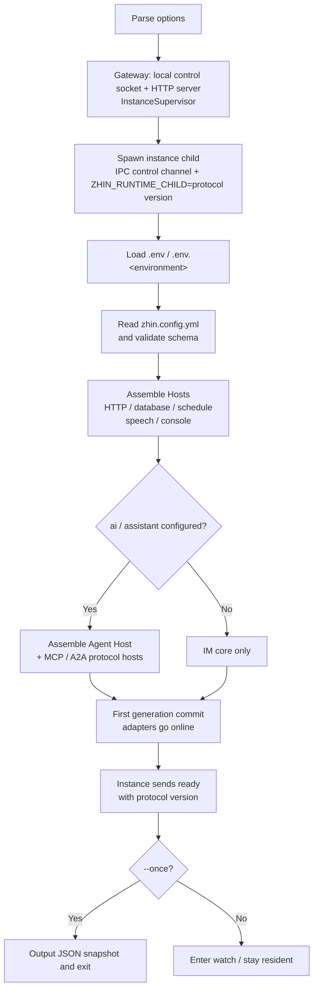

# zhin start

`zhin start` starts the project's **management gateway** (ADR 0054): a long-lived process that listens on `http.port`, serves the Console and launches the **Zhin instance** (IM Runtime, plugins, adapters, Agent) as a child process. While the instance crashes, is stopped or installs dependencies, the gateway keeps running and the Console still shows its state and logs. Your TypeScript source runs directly with no build step; watching is enabled only by an explicit `--watch`.

`zhin runtime start` is an alias of `zhin start --foreground` (gateway in the foreground).

## Common usage

```bash
# Daily development: gateway and instance in the foreground, HMR + Console; Ctrl+C stops both
pnpm dev                      # = zhin start --foreground --watch source config

# Server: run in the background (the default); logs go to .zhin/logs/
zhin start --mode production --no-watch
zhin status                   # gateway and instance state (--json for scripts)
zhin logs -f                  # instance logs
zhin restart                  # restart the instance only; gateway and Console stay up
zhin stop                     # stop the instance and the gateway

# systemd / Docker / PM2: the service manager owns a foreground process
zhin start --foreground --mode production --no-watch

# CI smoke test: start once to verify configuration and assembly; the gateway exits with it
zhin start --once --mode test
```

| Situation | Use |
| --- | --- |
| Local development | `pnpm dev`: foreground, watches files, hot reload |
| A server without a process manager | `zhin start`: background gateway, managed with `zhin status / logs / restart / stop` |
| A server managed by systemd / Docker / PM2 | `zhin start --foreground --mode production --no-watch`: foreground, logs to stdout |
| Checking config and assembly in CI | `--once`: start once, print JSON and exit |

## Options

| Option | Description |
| --- | --- |
| `-f, --foreground` | Run the gateway in the foreground (development, systemd, containers, PM2) and echo the instance output. When stdin is a terminal and the gateway is the terminal's foreground job, the instance shares that input (terminal adapters, login assist); a gateway started as a background job (`… &`) keeps it from the instance, also after a later `fg`. When the instance exits or crashes, the gateway restores the terminal settings it started with (`stty`; not on Windows). `--once` and `--standalone` always run in the foreground |
| `-d, --daemon` | Run in the background (what `zhin start` does by default). The background gateway's own output goes to `.zhin/logs/gateway.log` |
| `--mode <mode>` | Runtime mode: `development` (default) / `test` / `production` |
| `--environment <name>` | Environment name, defaults to `--mode`; selects `.env.<name>` and must match `/^[a-z0-9][a-z0-9-]*$/` |
| `--watch <scope...>` | Explicitly watch `source` / `config`; combine as `--watch source config`. Without it nothing is watched |
| `--no-watch` | Compatibility flag to watch nothing; cannot be combined with `--watch` |
| `--once` | Start once, print a JSON snapshot and exit (the gateway exits with the instance) |
| `--open` | Open the Remote Console in a browser after a TTY start; `ZHIN_OPEN=1` does the same |
| `--log-file <path>` | Instance log file, default `<project-root>/.zhin/logs/instance.log` (size-rotated; read by `zhin logs`) |
| `--standalone` | Development / test only: no gateway, the instance runs its own Node HTTP server in this process; no managed restarts |

`zhin start --help` lists these options with examples. Unknown options fail fast before startup instead of entering a restart loop.

## Management commands

| Command | Gateway running | Gateway not running |
| --- | --- | --- |
| `zhin start` | Says it is already running and shows the status | Starts gateway and instance in the background, waits for the control socket, prints the HTTP address and Console link |
| `zhin stop [--timeout <ms>]` | Sends `gateway.shutdown`: stops the instance, then the gateway, and waits for the process to exit | Nothing to do (a pre-gateway process with only `.zhin.pid` is still stopped) |
| `zhin restart` | `gateway.instance.restart`: restarts the instance only | Nothing to do |
| `zhin restart --gateway` | Stops the background gateway and starts it again with its original options (restart a foreground gateway in its terminal or service manager) | Nothing to do |
| `zhin status [--json]` | Gateway pid, mode, version, HTTP addresses, Console link; instance state (`stopped / starting / running / stopping / backoff / crashed`, pid, generation, last failure and log tail) | Says it is not running, **exit code 3** |
| `zhin logs [-f] [-n N]` | `gateway.instance.logs`: the last N lines (1–1000, default 200); `-f` polls for new lines | Reads `.zhin/logs/instance.log`; `-f` follows the file |
| `zhin install / uninstall / update` | Runs the dependency transaction through the gateway: stop instance → package manager → start instance, rolled back on failure; progress is streamed | Runs the same transaction directly in the project |

Through the gateway only npm registry packages (`name` / `name@range`) can be installed; git URLs, local paths and `--save-dev` need `zhin stop` first. `zhin update` without package names updates every dependency.

### Local control socket

The CLI talks to the gateway over a local control socket:

- Location: `<project-root>/.zhin/gateway.sock` (when that path exceeds the Unix socket path limit: `<tmp>/zhin-gateway-<project-path-hash>.sock`); on Windows the named pipe `\\.\pipe\zhin-gateway-<project-path-hash>-<random>` (a fresh name per start, recorded in `.zhin/gateway.json`).
- Permissions: the socket is created with mode `0600`, in a directory that must belong to the current user and must not be writable by others. Whoever can connect is the local owner (principal `local`), so run `zhin` as the user that started the gateway; otherwise the CLI reports that the socket belongs to another user.
- Handshake: each gateway start generates a handshake key, written only to the `0600` `.zhin/gateway.json`. After connecting, the CLI sends `gateway.hello { nonce }` and refuses the endpoint unless it answers with that key's HMAC (so it never talks to a same-named endpoint someone else created first).
- Windows limitation: Node cannot set an owner or DACL on a named pipe; the pipe keeps the system's default security descriptor. The random pipe name and the handshake keep other accounts from squatting the pipe and impersonating the gateway, provided they cannot read `.zhin/gateway.json` in the project directory; on multi-user Windows hosts keep the project in a directory only the current user can read (e.g. under the user profile).
- Agent: the gateway passes the actual endpoint (including the `<tmp>` fallback above) to the instance in `ZHIN_GATEWAY_SOCKET`; the Agent's file tools refuse it, and `bash` commands naming a gateway endpoint (`gateway.sock`, `zhin-gateway-<hash>…`) or that path are denied. This is a check on the command text: plugin code running unsandboxed as the gateway's OS user can still connect — the socket cannot tell processes of the same user apart.
- Protocol: one JSON value per line (at most 1 MiB, counted in UTF-8 bytes). Requests `{ id, type, data? }`, where `type` is a `gateway.*` RPC (`gateway.instance.*`, `gateway.packages.*`) or the local-only `gateway.info` / `gateway.shutdown` / `gateway.http.request`; answers `{ id, ok, data | error }`, preceded by `{ id, event }` lines with dependency-transaction progress.
- `gateway.http.request`: `zhin config` / `schedule` / `send` / `watch` reach `{base}/…` through it while a gateway runs, over the same route table as HTTP (gateway-owned routes first, then the instance). It runs as the local owner by default; with `ZHIN_CONSOLE_TOKEN` (or `--token-env`) set, the gateway authenticates that API token and runs and audits the request as its principal (`http.token` / `HTTP_TOKEN` is never sent over the socket). Request or response bodies over about 1 MiB, and event-stream (SSE) responses, are refused with a "use HTTP" error; paths cannot contain `\\`, and `GET` cannot carry a body.
- One gateway per project: a second gateway fails to start while the first one answers; a stale socket left by a `kill -9` is removed on the next start.
- State file: `.zhin/gateway.json` (`0600`) holds `{ pid, ports, origins, socket, startedAt, version, mode, args, logFile, handshakeKey }` and is removed when the gateway exits; `.zhin.pid` holds the gateway pid (migration commands use it to see whether the bot runs).

## Native TypeScript (strip-types)

Runtime does not compile the project before startup. Node executes plugin source directly. Supported versions match repository `engines`: `>=22.19.0`; unsupported versions fail immediately.

The gateway always runs the gateway -> instance child-process structure described below.

Because it's "source as runtime," importing local TS files requires the `.js` extension (the runtime does specifier remapping), which is also one of the repository's code conventions.

::: details How `.tsx` entries are loaded
Server convention entries also support `.tsx`. The CLI first delegates to the process's active loader and enables a scoped TSX loader only when Node does not recognize the extension, so development watch, `--no-watch`, foreground and background runs use the same command. Set `"jsx": "react-jsx"` and an appropriate `"jsxImportSource"` in `tsconfig.json`; new scaffolds default to `zhin.js`, and a file can override it with `/** @jsxImportSource zhin.js */`.
:::

## Startup Flow



Note that the Agent stack is **loaded on demand**: only when `ai` / `assistant` is configured in any section will `@zhin.js/agent` be resolved; a pure IM project will not load AI dependencies. The output after successful startup also varies by environment -- in a TTY, it's a one-line summary (plugin count, HTTP address, online/offline adapters); in non-TTY or with `--once`, it outputs structured JSON (`{ started: true, ... }`), convenient for script consumption. Configuration validation failure reports `Invalid Plugin config in zhin.config.yml` and lists all issues.

## HMR Semantics

Only `--watch source config`, `--watch source` or `--watch config` enables the selected scope; `--once` registers no watchers. Omitting `--watch` does not prevent explicitly saving and applying configuration through Console. Scaffolded projects and repository examples explicitly select both scopes in `pnpm dev`; update existing development scripts if automatic reload is wanted.

Source changes are handled at two levels based on their scope of impact:

| Change | Handling |
| --- | --- |
| Plugin / application source code | **In-process generation reload**: only the affected capability slots and plugin subtrees are rebuilt; Console receives `hmr:reload` via SSE |
| Dependency manifest files (`pnpm-lock.yaml`, `pnpm-workspace.yaml`, `package-lock.json`, `yarn.lock`) | **Process-level restart**: the instance sends `restart-request` over the control channel, the supervisor answers with `shutdown` and starts a fresh instance once it has stopped |

Generation reload is transactional: the new generation completes assembly and commit first, then asynchronously disposes the old generation. The HTTP port is released then re-listened during generation switching, preventing port-occupied Console loss. File events from the same batch are merged into a single generation transaction to avoid continuous jitter.

## Process Management

### Gateway and instance

The gateway is long-lived. The instance's stdout/stderr goes to the log file (default `.zhin/logs/instance.log`, rotated to `instance.log.1` … `.5` past 10 MiB) and the last 1000 lines stay in memory for `zhin logs` and the Console; in the foreground they are echoed to the terminal too. Crashes (signals or non-zero exit) are restarted, with **storm protection**: automatic restarts (crashes and restarts requested by the instance) are limited to 10 per minute, 3 seconds apart. Past the budget the instance stays `crashed` and **the gateway keeps running**; the Console and `zhin status` show the last failure and log tail until someone acts (`zhin restart` or a Console start). Stopping the instance from the Console / `zhin`, or a running dependency transaction, does not end the gateway either.

The gateway ends only on Ctrl+C / SIGTERM in the foreground (and SIGHUP in the foreground), `zhin stop` (`gateway.shutdown`), or the end of a `--once` instance. It sends `shutdown` to the instance and waits for it to stop, then closes its HTTP listeners and the control socket; a second signal ends the instance immediately.

### Control channel and restarts

The supervisor spawns the instance over Node IPC (`serialization: 'advanced'`, ADR 0054 §3); the protocol lives in `@zhin.js/host-http/bridge`:

| Direction | Message | Meaning |
| --- | --- | --- |
| instance → supervisor | `ready` | Startup finished; carries the protocol version and generation. An incompatible version is rejected: the supervisor stops that instance and does not restart it |
| instance → supervisor | `restart-request` | Anything that needs a whole-process restart: Console restart, dependency changes, database switch, controlled self-change (replaces the former exit code `75`) |
| supervisor → instance | `shutdown` | `{ reason, budgetMs }`: the instance stops completely within the budget; after it the supervisor sends SIGTERM, then SIGKILL |
| instance → supervisor | `routes` | Route table (HTTP routes, WebSocket paths and how they authenticate, `apiBase`, generation); updated after plugin hot reloads and generation switches |
| supervisor → instance | `http.request` / `http.request.body` / `http.request.end` / `http.request.abort` | Request head (with the principal the gateway authenticated) and chunked request body |
| instance → supervisor | `http.response.head` / `http.response.body` / `http.response.end` / `http.response.error` | Response head and chunked response body (SSE, large files) |
| both | `http.request.credit` / `http.response.credit` | Credit-based backpressure: at most 256 KiB in flight per direction, chunks ≤ 64 KiB |
| both | `ws.open` / `ws.accepted` / `ws.rejected` / `ws.message` / `ws.close` / `ws.drain` | WebSocket connections and frames (text / binary); `ws.drain` drives `bufferedAmount` |
| instance → supervisor | `catalog` | Plugin permission catalog of the current generation, sent on listen and on change; cached by the gateway for `/auth/me` and the role editor |
| instance → supervisor | `audit` | Audit entries written by the instance (the audit log lives in the gateway) |
| supervisor → instance | `principal-revoked` | A user was disabled / deleted, changed password or bindings: the instance closes that user's SSE streams and WebSockets |

**The instance has no HTTP server** (ADR 0054 §2): under the supervisor it serves its routes over the control channel with `BridgedHttpHost`, listens on no port and imports neither `node:http` nor `ws`; the gateway's single server receives HTTP and forwards it. The gateway authenticates the caller and forwards the principal with the request; the instance only authorizes (against the Console permission map), no longer parses credentials itself and never touches the `console_*` tables (protocol version 3).

**The gateway listens on `http.port`**: the gateway process of `zhin start` (`pnpm dev`) is also the supervisor and listens on the configured `http.host` / `http.port` (plus extra `http.listeners`), resolved from the project's `http.*` and `.env.<environment>`. `/pub/health` is answered by the gateway (with the instance state). **Console access control lives in the gateway**: it opens the project database itself (same `database` config as the instance; SQLite in WAL mode so both processes share the file), owns the `console_*` tables and serves `{base}/auth/*` (sign-in, the setup wizard, `/auth/me`, self-service tokens), the terminal (`{base}/console/terminal*`) and the audit log. On `POST {base}/console/request`, `gateway.*` (dependency transactions, instance start / stop / logs), `iam.*` and `onboarding.update` are handled by the gateway and every other type is forwarded unchanged; `{base}/events` merges the instance's events with `gateway.packages.progress` (gateway events only while the instance is offline); all other requests are forwarded. Without an instance (not started, crashed, stopped, during a dependency transaction) the Console can still sign in, initialize and use the gateway RPC. When the setup wizard switches databases the gateway closes its connection, opens the new database and restarts the instance. While the instance is not ready, forwarded requests get `503 { code: 'instance_unavailable', state }` with `Retry-After`; a timeout gives `504 instance_timeout`, other bridge failures `502 instance_error`. A stopped or crashed instance, or a running dependency transaction, does not end the gateway.

A missing `ready` (60 seconds by default) counts as a failed start. `--once` ignores restart requests. `ZHIN_RUNTIME_CHILD` carries the gateway's protocol version; the instance refuses an incompatible one. `zhin.js/instance` refuses to start without a control channel; for development and tests, `zhin start --standalone` (programmatically `runStartCommand({ standaloneHttp: true })`) runs its own HTTP server in this process, without managed restarts — a restart request then only stops the process.

### Exit Codes

| Command | Exit code | Meaning |
| --- | --- | --- |
| `zhin start --foreground` / `zhin runtime start` | `0` | Normal end (SIGTERM, `zhin stop`); systemd treats it as a clean stop |
| | `130` | Interrupted with Ctrl+C (SIGINT) |
| | non-zero | Startup failed (port in use, another gateway for this project, unsupported Node, unreadable config). An instance crash does **not** end the gateway |
| `zhin start --once` | the instance's exit code | Exit code after one start; non-zero when it failed or crashed |
| `zhin start` (background) | `0` / `1` | Gateway ready / gateway exited early or was not ready within 30 s (prints the tail of `.zhin/logs/gateway.log`) |
| `zhin status` | `0` / `3` | Gateway running / not running |
| other management commands | `0` / `1` | Success / failure (socket owned by another user, gateway not answering, transaction rolled back, …) |

### systemd

```ini
[Service]
Type=simple
WorkingDirectory=/srv/my-bot
ExecStart=/usr/bin/env npx zhin start --foreground --mode production --no-watch
Restart=always
RestartSec=10s
```

The service manager owns the gateway; the gateway restarts the instance, and after a crash storm the instance stays `crashed` while the gateway stays online, so `Restart=always` only applies when the gateway itself exits. `zhin service install` and the scaffolded service files use the same command.

### Orphan protection

When the gateway disappears (`kill -9`, closed terminal, crash) the IPC channel closes and the instance stops completely and exits -- no zombie keeps platform connections and file watchers alive. A `.zhin/gateway.sock` left behind by a `kill -9` is recognised as stale and removed by the next `zhin start`.

## Next steps

See [CLI Reference](./index.md) for commands, [Configuration Reference](../configuration/index.md) for values, and [Production operations](../operations/production) for backup and recovery.
