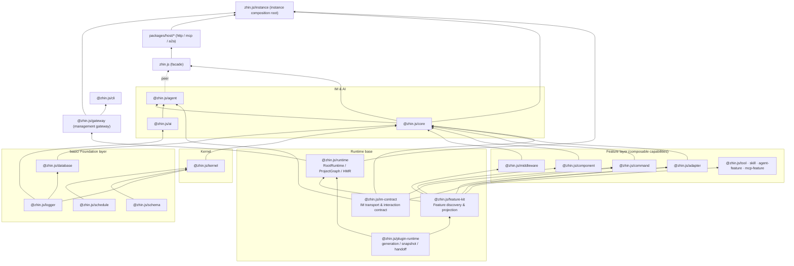

# Layered architecture

Zhin.js is made of dozens of small packages, but **to write bots and plugins you almost only install and import `zhin.js`**. This page explains how the packages are layered and why — for readers who want to understand the internals or contribute.

## Three things to remember

1. **There is one public entry.** `zhin.js` re-exports what plugin authors need: `definePlugin` from `zhin.js`, `defineCommand` and friends from subpaths such as `zhin.js/command` and `zhin.js/middleware`.
2. **AI is optional.** The default install is the IM core only (under 10MB); `@zhin.js/agent` and `@zhin.js/ai` are optional and used through `zhin.js/agent` / `zhin.js/ai`.
3. **Dependencies only point down.** Upper packages may depend on lower ones; lower packages never know upper ones exist. `pnpm check:architecture` enforces this in CI — it isn't just a convention.

| You are… | Depend on |
| --- | --- |
| Writing a bot or a regular plugin | `zhin.js` only |
| Writing AI tools | plus `@zhin.js/tool` (`npx zhin setup --ai` handles it) |
| Writing a new kind of capability (a Feature) | only `@zhin.js/feature-kit` / `@zhin.js/plugin-runtime` — not `@zhin.js/core` |
| Contributing to the framework itself | the layering rules below |

## Layer overview



Dependencies are defined by each package's `package.json`. Read the diagram from the bottom up:

The foundation consists of two independent zero-dependency contracts: `@zhin.js/plugin-runtime` owns generation, snapshots, disposal, and tokens; `@zhin.js/im-contract` (including `/interaction`) owns transport-neutral identities, segments, conversation events, delivery semantics, and typed user-interaction requests and conclusions. One layer up, `@zhin.js/feature-kit` depends only on the runtime base and provides the registration, discovery, and projection mechanism for Feature providers. Feature-layer packages (adapter / command / component / middleware / handler / tool / skill / ...) depend only on these foundation contracts and do not depend on each other.

Moving further up, `@zhin.js/core` assembles the adapter / command / component / middleware Features together with the kernel into the IM layer (Plugin, Adapter, Endpoint, message send/receive). The facade package `zhin.js` re-exports core packages as a unified entry -- plugin authors only need `import { ... } from 'zhin.js'`. `@zhin.js/agent`, `@zhin.js/ai`, etc. are optional peer dependencies, so the default installation contains only the IM core, with AI added on demand.

## Layer responsibilities

| Layer | Package | Responsibility |
|-------|---------|---------------|
| Foundation | `basic/logger` `schema` `schedule` `database` (also re-exported by `@zhin.js/kernel`) | Logging, config validation, scheduling, database -- zero/near-zero dependencies |
| Runtime base & IM contract | `@zhin.js/plugin-runtime` (including `/im-contract` and `/interaction`, imported from `zhin.js`) | Generation transactions, snapshot leases, handoff, explicit capability graphs (`definePluginCapabilityGraph`), plus Endpoint, conversation, segment, and structured user-interaction contracts |
| Feature mechanism | `@zhin.js/feature-kit` | Declare Feature providers, discover capabilities by convention, project into runtime indexes |
| Kernel | `@zhin.js/kernel` | Plugin system, error hierarchy, and foundation re-exports -- no IM concepts |
| Feature layer | `@zhin.js/adapter` `command` `component` `middleware` ... | Contract for a capability type (e.g. `defineAdapter`) + projection index (e.g. `AdapterIndex`) |
| AI engine | `@zhin.js/ai` (including provider-auth & model-registry) | Provider, auth, model registry, agentLoop, sessions, memory -- no IM concepts |
| Agent Harness | `@zhin.js/harness` | Multi-agent collaboration microkernel: per-actor serial Mailbox, Authority attenuation, conserved BudgetLedger, deterministic GuardKernel, shared Blackboard, and single-authority `engagement_events` Journal |
| IM layer | `@zhin.js/core` (including handler, actor, and `@zhin.js/core/runtime` IM Host installers) | Plugin, inbound spine (`inbound-spine`), outbound pipeline, command dispatch, multi-bot collaboration Venues, and Database/Outbound/Inbox Host implementations |
| Agent | `@zhin.js/agent` (including the `@zhin.js/agent/runtime` Agent/Inference Host runtime) | Unified mailbox ingress spine (`unified-mailbox-spine`), multi-model orchestration, collaboration tools, tool security policies, MCP client |
| Console | `@zhin.js/console-protocol` (including contract / review-kit), `@zhin.js/pagemanager`, `@zhin.js/client` | Server-Driven Blueprints (`definePageBlueprint`), multi-surface projection (Web / IM Card / CLI TUI), Console shell rendering (`renderConsoleShell`), and browser SDK |
| Facade | `zhin.js` | Re-exports the core authoring surface; `zhin.js/agent`, `zhin.js/ai` sub-paths exposed on demand |
| Runtime | `@zhin.js/runtime` (including the `/config-file` and `/isolate` subpaths) | `RootRuntime`: scans the project graph, composes configuration, executes generation transactions, HMR, and shared Host lifecycle |
| Assembly | `zhin.js/instance` | Instance composition root (ADR 0054 §0) -- wires domain Hosts into a runnable process and owns the installers for the generic HTTP/Protocol (MCP, A2A)/Speech/HTML-Renderer/Schedule Hosts (`packages/im/zhin/src/instance/*-host-installer.ts`) and the runtime-side Console backend |
| Management | `@zhin.js/gateway`, `@zhin.js/cli` | Management gateway: Console accounts and permissions, terminal, project configuration and package transactions, instance supervision; the CLI manages the project and resolves `zhin.js/instance` from it. Neither depends on `zhin.js` or IM layers |

## Composition root: `zhin.js/instance`

The framework itself does not "start" anything -- each layer only provides mechanisms. The entry code that assembles these mechanisms into a runnable process lives in `zhin.js/instance` (`packages/im/zhin/src/instance/`, ADR 0054 §0), the only composition root allowed to wire across all layers. IM and Agent Host implementations live in their owning domain packages (`@zhin.js/core/runtime`, `@zhin.js/agent/runtime`, and `@zhin.js/pagemanager`) so the composition root holds no domain state machines; the installers for the generic HTTP, Protocol, Speech, and HTML-Renderer Hosts live in `packages/im/zhin/src/instance/`. `zhin runtime start` (`basic/cli/src/commands/runtime.ts`) resolves `zhin.js/instance` from the project root; Console accounts, permissions and the terminal come from `@zhin.js/gateway` and are still installed into the in-process HTTP Host by the instance until B1.4.

`zhin runtime start` does the following:

1. Wraps the single YAML/JSON Root config with `createConfigDocument` (`@zhin.js/runtime`) into a transactional `ConfigDocumentPort`;
2. Creates `RootRuntime` (`@zhin.js/runtime`), injecting the module loader (in dev mode: `NativeDevelopmentModuleRuntime`), config port, and Root resource installer;
3. Assembles Host-level resources via `installResources`: HTTP/Protocol/Speech/HTML-Renderer Hosts (the CLI's `*-host-installer.ts`), Database/Outbound/Inbox/IM Hosts (`@zhin.js/core/runtime`), Agent/Inference Hosts (`@zhin.js/agent/runtime`), and Console shell & Blueprint routes (`@zhin.js/pagemanager`);
4. After startup, attaches `HmrCoordinator` -- file changes trigger generation reloads or process restarts.

A user project's entry point can therefore be minimal. `examples/minimal-bot/package.json`:

```json
{
  "name": "minimal-bot",
  "type": "module",
  "scripts": {
    "dev": "zhin runtime start",
    "start": "zhin runtime start --mode production --no-watch"
  },
  "dependencies": {
    "zhin.js": "workspace:*"
  },
  "zhin": {
    "protocol": 1,
    "type": "plugin",
    "entry": "./plugin.ts",
    "engine": "^1.0.0",
    "runtime": "trusted",
    "features": [],
    "plugins": []
  }
}
```

The project itself is a plugin (Root Plugin), and the CLI is responsible for discovering and starting it. For a full explanation of manifest fields, see [Plugin model](./plugin-model.md); for config declaration and validation, see [Config as data](./config-as-data.md).

## Corollaries of the layering rules

When writing a Feature (a new capability type), depend only on `feature-kit` / `plugin-runtime` -- do not import `core`. `kernel` and `ai` know nothing about IM concepts like "group" or "direct message"; IM concepts only appear in `core` and above. Host packages (`packages/host/http`, `mcp`, `a2a`) sit above `core` and are assembled by the CLI; plugins do not depend on Host processes directly.

## JSX and visual components

`@zhin.js/jsx` owns lazy JSX trees and an HTML serializer, depending only on the canonical IM contract types. Core lays out JSX as ordered Segments; only `<html>` / `<Html>` children become `segment.html`. Native lowercase tags are typed without imports, and registered components can be used as named tags; `zhin.js/jsx` is the authoring facade. Optional `@zhin.js/components` uses this base plus Markdown parsing and syntax highlighting dependencies, accepts `JSXRenderable` display props and does not depend on Core, React or image engines. Render tools consume HTML; adapters declare platform policies.

```tsx
// 1. Native message JSX (auto-degrades to platform cards/buttons or numbered menus)
<card title="Build Status">
  <text>All checks passed</text>
  <button onClick={async () => 'Release triggered'}>Deploy to Production</button>
</card>

// 2. HTML subtree (rendered into an image segment via @zhin.js/html-renderer)
<html>
  <div style={{ padding: '24px', background: '#0f172a', color: '#f8fafc' }}>Status Board</div>
</html>
```
