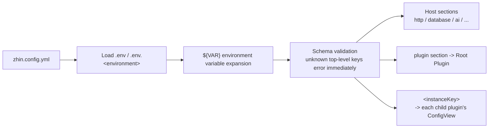

# Configuration Reference

See [Language and localization](./localization.md) for project, personal, and Console language settings.

This is the complete reference for `zhin.config.yml`. When configuring for the first time, run `npx zhin setup` to generate a config that boots, then come back here for the fields you need to change.

## Most common changes

| I want to… | See |
| --- | --- |
| Change the HTTP port or expose Console externally | [http](#http) |
| Connect a database | [database](#database) |
| Configure a plugin or adapter, add platform credentials | [plugin and plugins](#plugin-and-plugins) |
| Log one adapter into several accounts | [endpoints array](#endpoints-array-one-instance-with-multiple-accounts) |
| Set masters or the command prefix | [Adapter instances](#adapter-instances-master-trusted-commandprefix) |
| Configure AI models | [ai](#ai), or the [AI overview](../ai/index.md) |
| Reference secrets from `.env` | [Environment variable expansion](#environment-variable-expansion) |
| See a complete minimal config | [Minimal configuration](#minimal-configuration) |

## Where the config file lives

At startup, `zhin runtime start` checks these project-root candidates in order. If more than one exists, startup fails instead of guessing:

1. `config.yml`
2. `config.yaml`
3. `config.json`
4. `zhin.config.yml`
5. `zhin.config.yaml`
6. `zhin.config.json`

It is recommended to use `zhin.config.yml` consistently. All examples in this document use it.

For field-by-field types, required fields, defaults, and plugin schemas, use the [generated configuration field reference](./generated). It is generated from Runtime source and each plugin’s single configuration declaration (`config: Schema.object(...)` or `schema.json`), with drift blocked in CI.

## How to use this reference

Run `npx zhin doctor` before committing. After startup, trust what Console shows is actually running — what the file says isn't necessarily what's live (for example, if a new config fails validation, the old one keeps running).

| What you need to change | Where it belongs |
| --- | --- |
| Installed plugins and Features | dependencies and `package.json#zhin` |
| Host, plugin-instance, and AI values | `zhin.config.yml` |
| Secrets and environment differences | `.env` / `.env.<environment>`, referenced with `${VAR}` |
| Workrooms, members, and chat or repository bindings | persistent Workroom Catalog, managed in Console |
| What the runtime actually published | Endpoint, capability catalog, and generation state in Console |

Use `configVersion: 2`. Install dependencies, map instance aliases to packages in `plugins`, and place business values in same-named top-level blocks. `disable_plugins` lists inactive instances; Feature requirements remain in `package.json#zhin.features`. See the [migration guide](../../migrations/plugin-instance-declarations.md).

## Loading and Validation Flow



Configuration passes JSON Schema validation, and **only the keys listed below are allowed at the top level**. A misspelled key produces `Invalid Plugin config in zhin.config.yml` at startup.

Host sections are consumed by CLI assembly. Each plugin receives only its own same-named business block.

## Environment Variable Expansion

`${VAR}`, `${VAR:-default}`, and `${VAR:=default}` within string values are expanded:

```yaml
http:
  token: ${HTTP_TOKEN:-dev-token}   # Falls back to dev-token when HTTP_TOKEN is not set
```

An unset variable without a default expands to an empty string. For fields such as `apiKey`, this triggers AI-provider soft pruning.

Dotenv loads `.env` then `.env.<environment>`. `--environment` selects the name and defaults to `development`. Keep secrets in environment variables, never in the configuration file.

## Top-Level Keys

| Key | Type | Description |
| --- | --- | --- |
| `log_level` | string \| number | Log level (e.g., `info`, `debug`); `ZHIN_LOG_LEVEL` / `LOG_LEVEL` environment variables can temporarily override |
| `http` | object | HTTP Host (Console / API entry point) |
| `database` | object | Database |
| `speech` | object | Speech STT/TTS (requires `@zhin.js/speech` installed) |
| `assistant` | object | Assistant Runtime (scheduled tasks / event API) |
| `ai` | object | AI stack (requires `@zhin.js/agent` etc., see below) |
| `mcp` | object | MCP Host (exposes bot tools as an MCP Server) |
| `a2a` | object | A2A Host (Agent Card / remote Agent interop) |
| `htmlRenderer` | object | Shotium HTML rendering (e.g., `width` / `viewport` / `scale`) |
| `menuKeyword` | string \| false | Built-in menu keyword; defaults to `菜单`, `false` or an empty string disables it |
| `menuStyle` | object | Menu title, subtitle, accent color and background when rendering is available |
| `plugin` | object | Root Plugin (the application itself) configuration |
| `configVersion` | number | Must be 2 |
| `plugins` | object | Instance alias to package mapping |
| `disable_plugins` | string[] | Disabled aliases; values are retained |
| `<instanceKey>` | object | Business configuration of a declared instance |

## http

```yaml
http:
  port: 8086                 # Runtime fallback when no config exists
  host: 127.0.0.1            # Default 127.0.0.1
  token: ${HTTP_TOKEN}       # API Bearer token
  corsOrigins:               # Allowed cross-origin sources
    - "https://console.zhin.dev"
  base: /api                 # API mount path
```

With no configuration, Runtime falls back to 8086; the current project scaffold writes 8068. Trust the project configuration and startup log.

Local development can access without `token`; production must set one. `tokens` supports multiple scoped tokens.

## database

Use the CLI to generate both the config references and the `.env` connection values:

```bash
npx zhin setup --database
npx zhin config check
```

`setup` writes the non-secret structure to `zhin.config.yml` and the actual connection values to the
project-root `.env`. Runtime reads `.env` first, then overrides matching keys from the selected
`.env.<environment>`. For example, use
`zhin runtime start --mode production --no-watch` to load `.env.production` by default; an explicit
`--environment <name>` selects a different environment overlay.

### SQLite

```yaml
database:
  dialect: sqlite            # Default sqlite
  filename: ./data/bot.db
```

When `database` is omitted entirely, it defaults to `<project-root>/.zhin/data.sqlite`. SQLite uses the
built-in Node.js driver and needs no connection environment variables.

### PostgreSQL

The dialect name is `pg` (not `postgres`):

```yaml
database:
  dialect: pg
  host: ${DB_HOST}
  port: ${DB_PORT}
  user: ${DB_USER}
  password: ${DB_PASSWORD}
  database: ${DB_DATABASE}
```

```dotenv
DB_HOST=127.0.0.1
DB_PORT=5432
DB_USER=postgres
DB_PASSWORD=change-me
DB_DATABASE=zhin_bot
```

`DB_PORT` must contain only the port number; do not include `http://`, a host name, or `host:port`.
Create `DB_DATABASE` first and allow `DB_USER` to connect from the machine running the bot. If the bot
runs in a container, `127.0.0.1` points to that container; use the PostgreSQL service name or a reachable
host address instead.

### Other dialects

The CLI database selector shows both the currently supported, live-tested server version and the driver version generated for the project:

| Dialect | Currently supported live-tested version | Generated driver dependency |
| --- | --- | --- |
| `sqlite` | Built-in Node.js `node:sqlite` (Node.js 22.5+) | none |
| `mysql` | MySQL 8.4 LTS | `mysql2 ^3.23.2` |
| `pg` | PostgreSQL 17 | `pg ^8.22.0` |
| `mongodb` | MongoDB 7 | `mongodb ^7.5.0` |
| `redis` | Redis 8 | `redis ^6.1.0` |
| `memory` | Built into Zhin | none |

The live acceptance baseline is the concrete version covered by maintainer tests. It is not a claim that
the driver can connect only to that server version; the wider compatibility range depends on the driver and
the database server protocol.

| Dialect | Configuration fields | Environment variables generated by the CLI |
| --- | --- | --- |
| `mysql` | `host`, `port`, `user`, `password`, `database` | `DB_HOST`, `DB_PORT` (default `3306`), `DB_USER`, `DB_PASSWORD`, `DB_DATABASE` |
| `mongodb` | `url`, `dbName` | `DB_URL` (for example `mongodb://127.0.0.1:27017`), `DB_NAME` |
| `redis` | `socket.host`, `socket.port`, `password`, `database` | `REDIS_HOST`, `REDIS_PORT` (default `6379`), `REDIS_PASSWORD`, `REDIS_DB` |
| `memory` | none | none |

The network database drivers are `mysql2`, `pg`, `mongodb`, and `redis`. When you select a database in
project creation or `zhin setup --database`, the CLI writes the accepted driver version shown above to
`package.json`. `create-zhin-app` installs dependencies automatically; after `zhin setup`, run the prompted
`pnpm install` command yourself.

Run `npx zhin config check` before startup. If the values only exist in `.env.production`, run
`npx zhin config check --environment production`. Missing database environment variables are reported as errors.
An empty, non-integer, or out-of-range port is rejected before the driver loads, with the exact config path
and `.env` variable in the message. On older versions, `ERR_SOCKET_BAD_PORT` / `Received type number (NaN)`
usually means `${DB_PORT}` is missing from the project-root `.env`; add it or rerun
`npx zhin setup --database`.

## speech

```yaml
speech:
  stt: { provider: ollama, model: whisper, host: http://localhost:11434 }
  tts: { provider: edge, voice: zh-CN-XiaoxiaoNeural }
```

When configured, this enables the speech pipeline and exposes `voice_stt` / `voice_tts` tools to the Agent. `@zhin.js/speech` is an optional peer dependency and must be installed separately.

## assistant

```yaml
assistant:
  enabled: true                    # Enable unified JobStore, default false
  profile:
    enabled: true
    file: assistant.profile.yml    # Profile file, drives scheduled tasks
  events:
    enabled: true                  # Open POST /api/assistant/events
    rateLimitPerMinute: 60         # Default 60
  defaults:
    notifyOnFailure: false         # Whether to notify on Job failure, default false
```

The remaining sub-key is `queue` (Schedule execution concurrency/retry/timeout). Schedule facts are always persisted to `schedule-jobs.json`; manage them with [`zhin schedule`](../cli/index.md#schedule-persistent-scheduled-tasks).

## mcp / a2a

```yaml
mcp:
  enabled: true
  path: /mcp
  token: ${HTTP_TOKEN}                  # Falls back to http.token if unset
  allowUnauthenticatedLocalhost: false  # Recommend false for production

a2a:
  enabled: true
  path: /a2a
```

Both sections are mounted on the HTTP Host and enabled as needed; when not configured, the corresponding SDK is not loaded. Remote Workroom execution uses fixed-generation `a2a.workroomCallbacks` and `a2a.workroomRemoteExecutors` transport bindings (an A2A extension: frozen and moved out of the package root to `@zhin.js/workroom/remote`; the transport bindings are only active when configured, but default assembly still creates the internal placeholder Remote Callback Runtime and Remote Assignment Authority, to be handled after C2). Project membership and conversation bindings remain in the persistent Workroom Catalog, not in process configuration. See the complete [`@zhin.js/a2a` example on GitHub](https://github.com/zhinjs/zhin/blob/main/packages/host/a2a/README.md#workroom-execution-callbacks).

## ai

The `ai` section is consumed by the Agent Host. Whenever `ai` / `assistant` is configured in any section, the startup graph loads the Agent stack; providers missing credentials are soft-pruned and do not block startup.

### providers: Named Model Providers

```yaml
ai:
  providers:
    deepseek:
      sdk: deepseek                  # Required
      apiKey: ${DEEP_SEEK_API_KEY}
    openrouter:
      sdk: openai-compatible
      baseUrl: ${OPENROUTER_BASE_URL}
      apiKey: ${OPENROUTER_API_KEY}
      contextWindow: 32768
      models:                        # Allowed model whitelist
        - "openrouter/free"
    ollama-local:
      sdk: ollama
      host: http://127.0.0.1:11434   # ollama uses host instead of baseUrl
    cloudflare:
      sdk: openai-compatible
      apiKey: ${CLOUDFLARE_API_TOKEN}
      accountId: ${CLOUDFLARE_ACCOUNT_ID}
```

| Field | Description |
| --- | --- |
| `sdk` | Required, one of seven: `openai`, `anthropic`, `google`, `deepseek`, `minimax`, `ollama`, `openai-compatible` |
| `apiKey` / `baseUrl` / `host` | Credentials and endpoint; `ollama` uses `host`, Cloudflare also requires `accountId` |
| `models` | Explicit model list |
| `defaultModel`, `contextWindow`, `timeout`, `maxRetries`, `firstChunkTimeoutMs`, `chunkTimeoutMs`, `headers` | Behavior tuning (see the [AI docs](../ai/index.md)) |
| `authScheme` | Authorization scheme; unset uses the SDK default, `''` sends the bare key, `Bearer` / `Token` send `<scheme> <key>` |
| `imageGeneration` | Text-to-image defaults (for drivers that support this capability, e.g., `defaultModel`, `defaultSize`, `watermarkEnabled`, `promptSuffix`) |

Provider aliases can be named arbitrarily; when `sdk` is not explicitly specified, it is inferred from the alias prefix (e.g., `deepseek-main` -> `deepseek`); if inference fails, it falls back to `openai-compatible`. The corresponding `@ai-sdk/*` packages are optional peers and should be installed based on which SDK is used.

### agents: Bind Models and Roles

```yaml
ai:
  agents:
    zhin:                            # Main Agent, default entry point
      provider: openrouter           # References the provider alias
      model: openrouter/free
      mcpServers: [icqq]             # References names in ai.mcpServers
    researcher:
      provider: openrouter
      model: openrouter/free
      nickname: 'Researcher'         # Agent self-reference and UI display name
```

| Field | Description |
| --- | --- |
| `provider` / `model` | Required, the bound provider alias and model |
| `nickname` | Agent self-reference and UI display name |
| `mcpServers` | List of MCP Server names visible to this Agent |
| `permission.task` | `spawn_task` visible child Agent types (glob -> `allow` / `deny`) |

IM messages always go to `zhin`. `priority` / `match` are deprecated (they never took effect); `zhin config check --fix` deletes them. See [ai.agents](../ai/index.md#ai-agents).

### mcpServers: External MCP Servers

```yaml
ai:
  mcpServers:
    - name: icqq
      transport: streamable-http     # stdio | streamable-http | sse
      url: ${ICQQ_MCP_URL}
      headers:
        Authorization: Bearer ${ICQQ_MCP_TOKEN}
    - name: local-tools
      transport: stdio
      command: npx
      args: ["-y", "some-mcp-server"]
      env: { FOO: bar }
```

Once connected successfully, these Servers' tools enter the Agent tool pool (assigned by `agents.<name>.mcpServers`).

### Other ai Sub-sections

```yaml
ai:
  sessions:                # Session storage
    maxHistory: 200        # Default 200 in database mode, 100 in memory mode
    expireMs: 604800000    # Default 7 days in database mode, 24h in memory mode
    useDatabase: true      # Default true; uses Database Root Host (.zhin/data.sqlite when database is omitted)
  context:                 # Group chat context recording
    enabled: true
    maxRecentMessages: 100
    summaryThreshold: 50
    keepAfterSummary: 10
    maxContextTokens: 4000
  memory:                  # Three-layer Markdown file memory, enabled by default
    semantic:
      enabled: true        # Generation-owned memory_search/memory_upsert; requires the Database Host
      autoConsolidate: false
      recall:              # per-turn BM25 recall, on by default
        topK: 5
        maxTokens: 400
    # memory_entries must be ready during candidate activation or that generation fails closed
    # memoryMcp is deprecated; use the native memory_search / memory_upsert tools above
  access:                  # AI access control
    mode: open             # open | closed | whitelist, default open
    users: []              # Allowed user IDs in whitelist mode
    groups: []
    denyMessage: ...
  agent:                   # Tool execution security
    inboundQueue:
      groupMode: supersede # supersede (default) | fifo
    execSecurity: allowlist    # deny | allowlist | full
    execPreset: readonly       # readonly | network | development | custom
    execAllowlist: ["^ls ", "^cat "]
    maxIterations: 15          # Maximum tool iterations per turn, default 15
    thinkingPreview: false     # Show LLM actual thinking content (truncated) in activity feedback instead of static "Thinking...", default false
    thinkingPreviewMaxLength: 200  # Max chars for thinkingPreview, default 200
  trigger:                 # AI trigger rules
    prefixes: ["ai:"]          # Trigger prefixes, default ['#', 'AI:', 'ai:']
    respondToAt: true          # Respond to @bot, default true
    respondToPrivate: true     # Private chats bypass prefix requirement, default true
    ignorePrefixes: ['/', '!', '！']  # Avoid conflicting with commands
    timeout: 60000
```

`ai.multimodal` governs multimodal input and output. When the main model cannot see images, `ai.multimodal.perception` lets another model describe them first; see [AI · ai.multimodal.perception](../ai/index.md#ai-multimodal-perception). `knowledge_search` is published only when `ai.knowledge.baseDir` is explicitly configured, and that directory must stay inside the project root.

Remote Agents no longer attach through `ai.remoteAgents`. An optional A2A Executor enters through the persistent Workroom Catalog and generation-owned authority, under Assignment lease/fence and Journal contracts.

`ai.workrooms` has been removed. Projects, members, and collaboration spaces are managed by the persistent Workroom Catalog in Console; revision-checked saves take effect without restarting the runtime.

## plugin and plugins

```yaml
configVersion: 2
# Root Plugin (the application itself) configuration; keys are determined by the application's config schema
plugin:
  terminal:
    interactive: true

# Child plugin configuration, keyed by instanceKey
plugins:
  sandbox: "@zhin.js/adapter-sandbox"
sandbox:
  endpoints:
    - id: sandbox-bot
      owner: sandbox-user
```

`instanceKey` defaults to the last package-name segment without the `adapter-`, `plugin-`, or `service-` prefix. For example, `@zhin.js/adapter-icqq` becomes `icqq`.

`zhin install` writes the package reference under `plugins.<instanceKey>` and business settings under the top-level alias. It no longer writes manifest mounts.

### Adapter Instances: master / trusted / commandPrefix

Platform adapter plugin instance configurations support three common keys:

| Key | Location | Description |
| --- | --- | --- |
| `master` | Instance top-level | Stable Endpoint Owner ID used for authorization and explicit `/approve` management commands |
| `trusted` | Instance top-level / per-endpoint | Trusted user ID list; array or whitespace/comma-separated string |
| `commandPrefix` | Instance top-level / per-endpoint | Command prefix, default `''`; per-endpoint values override top-level |

### endpoints Array: One Instance with Multiple Accounts

Multi-account adapters use the `endpoints` array to declare multiple Endpoints:

```yaml
configVersion: 2
plugins:
  icqq: "@zhin.js/adapter-icqq"
icqq:
  master: "${ICQQ_MASTER}" # Top-level shared: applies to all endpoints
  endpoints:
    # Per-entry: name is required, other fields merge with top-level (per-entry takes priority)
    - name: "${ICQQ_ACCOUNT_1}"
    - name: "${ICQQ_ACCOUNT_2}"
```

Expansion rules (`@zhin.js/adapter`'s `expandEndpointConfigs`):

- Each endpoint's final configuration = instance configuration (without the `endpoints` key) shallow-merged with the entry's fields, **per-entry fields override top-level**.
- `name` is required and must be a non-empty string; must not contain `~`; duplicates keep only the first with a warning.
- When `endpoints` is empty or all entries are invalid, it falls back to a single Endpoint (named after the instanceKey).

Real-world example (QQ official bot, main account through proxy gateway + sandbox account coexisting):

```yaml
configVersion: 2
plugins:
  qq: "@zhin.js/adapter-qq"
  slack: "@zhin.js/adapter-slack"
qq:
  endpoints:
    - name: zhin
      appid: "${QQ_APPID}"
      secret: "${QQ_SECRET}"
      mode: websocket
      sandbox: false
      gatewayUrl: "https://bots.example.com/gateway/102005927"
      intents: [ GUILDS, GROUP_AND_C2C_EVENT, PUBLIC_GUILD_MESSAGES ]
    - name: "102069707"
      appid: "${QQ_SANDBOX_APPID}"
      secret: "${QQ_SANDBOX_SECRET}"
      mode: websocket
      sandbox: true
      intents: [ GUILDS, GROUP_AND_C2C_EVENT ]
slack:
  endpoints:
    - name: zhin
      token: "${SLACK_TOKEN}"
      appToken: "${SLACK_APP_TOKEN}"
      signingSecret: "${SLACK_SIGNING_SECRET}"
      socketMode: true
```

For adapter-specific fields (`appid`, `intents`, `socketMode`, `url`, `access_token`, etc.), see the README of the corresponding adapter package.

## Minimal Configuration

You can run without any Host sections -- this is the entire configuration for `examples/minimal-bot`:

```yaml
configVersion: 2
plugin:
  terminal:
    interactive: true

plugins: {}
```

After starting, use the `zhin setup` wizard to progressively add database / adapters / AI (see [CLI Reference](../cli/index.md)); for how to run, see [zhin runtime start in Detail](../cli/runtime.md).
