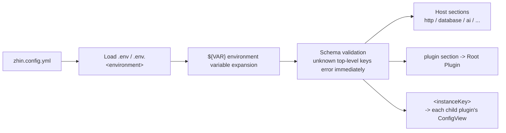

# Configuration Reference

See [Language and localization](./localization.md) for project, personal, and Console language settings.

This is the complete reference for `zhin.config.yml`. When configuring for the first time, run `npx zhin setup` to generate a config that boots, then come back here for the fields you need to change.

## Most common changes

| I want to… | See |
| --- | --- |
| Change the HTTP port or expose Console externally | [http](#http) |
| Connect a database | [database](#database) |
| Configure a plugin or adapter, add platform credentials | [plugin and plugins](#plugin-and-plugins) |
| Log one adapter into several accounts | [endpoints array](#endpoints-array-one-instance-with-multiple-accounts) |
| Set the command prefix | [Adapter instances](#adapter-instances-commandprefix) |
| Configure AI models | [ai](#ai), or the [AI overview](../ai/index.md) |
| Reference secrets from `.env` | [Environment variable expansion](#environment-variable-expansion) |
| Apply configuration changes selectively | [Applying configuration changes](#applying-configuration-changes) |
| See a complete minimal config | [Minimal configuration](#minimal-configuration) |

## Where the config file lives

At startup (`zhin start`), the instance checks these project-root candidates in order. If more than one exists, startup fails instead of guessing:

1. `config.yml`
2. `config.yaml`
3. `config.json`
4. `zhin.config.yml`
5. `zhin.config.yaml`
6. `zhin.config.json`

It is recommended to use `zhin.config.yml` consistently. All examples in this document use it.

For field-by-field types, required fields, defaults, and plugin schemas, use the [generated configuration field reference](./generated). It is generated from Runtime source and each plugin’s single configuration declaration (`config: Schema.object(...)` or `schema.json`), with drift blocked in CI.

## How to use this reference

Run `npx zhin doctor` before committing. After startup, trust what Console shows is actually running — what the file says isn't necessarily what's live (for example, if a new config fails validation, the old one keeps running).

| What you need to change | Where it belongs |
| --- | --- |
| Installed plugins and Features | dependencies and `package.json#zhin` |
| Host, plugin-instance, and AI values | `zhin.config.yml` |
| Secrets and environment differences | `.env` / `.env.<environment>`, referenced with `${VAR}` |
| Multi-Bot collaboration venues | `ai.venues` in `zhin.config.yml` |
| Which Agents may contact each other, and collaboration budget ceilings | `collaboration` in `agents/<name>/agent.json` |
| What the runtime actually published | Endpoint, capability catalog, and generation state in Console |

Use `configVersion: 2`. Install dependencies, map instance aliases to packages in `plugins`, and place business values in same-named top-level blocks. `disable_plugins` lists inactive instances (change it with `zhin disable` / `zhin enable`); Feature requirements remain in `package.json#zhin.features`. See the [migration guide](../../migrations/plugin-instance-declarations.md).

## Loading and Validation Flow



Configuration passes JSON Schema validation, and **only the keys listed below are allowed at the top level**. A misspelled key produces `Invalid Plugin config in zhin.config.yml` at startup.

Host sections are consumed by the instance composition root (`zhin.js/instance`) and the management gateway. Each plugin receives only its own same-named business block.

## Applying configuration changes

`zhin start` **watches changes only when `--watch` is explicit**. Without it, editing a file does not apply it automatically. Development scripts that need watching should select their scopes:

```bash
npx zhin start --foreground --watch source config  # Source and configuration
npx zhin start --foreground --watch config         # Configuration only
npx zhin start --foreground --watch source         # Source only
npx zhin start --foreground --mode production      # Neither
```

`--no-watch` remains a compatibility alias for watching neither and cannot be combined with `--watch`. Source watching does not enable configuration watching; a source reload does not pull in configuration that is still pending a restart.

**A successful save does not mean every change is active.** Console configuration forms request application after saving and display the file revision separately from each application result. Even with watching disabled, the new Console's runtime status panel offers “Apply saved configuration”: it applies the saved revision, without saving an unsubmitted form draft or restarting the process. An older Host without application details is explicitly shown as unconfirmed.

| Change | Application boundary |
| --- | --- |
| Only the configured `nickname` / `profile` fallback of an adapter declaring in-place profile updates | New profile reads use the new fallback while retaining the connection. No platform profile write is made; an observed platform nickname still takes precedence |
| Profile or purpose selection in model management | A separate domain transaction persists the graph. New operations read it; in-flight operations retain their graph, model and leases. This is not a file-application group |
| HTTP listeners, database connections, `.env` inputs, YAML account roles, and other startup dependencies | Parts without a safe replacement path remain pending a process restart and keep their old effective values |
| Other plugin configuration | Uses the owning plugin's existing local reload path; an undeclared update capability does not imply an in-place update |

A file save can apply partially. For example, an account nickname fallback may apply while an HTTP port change waits for restart. Model graph changes have separate domain revisions and mutation receipts; file save/apply does not mutate that graph, credentials or personal bindings. If the complete candidate fails validation, the current runtime is retained. Failure, an unconfirmed outcome, and supersession by a newer revision are distinct; refresh read-only to verify an unconfirmed outcome rather than submitting it again.

Agent installation, role permissions and other startup dependencies without declared replacement support remain pending restart. Profile model/parameter edits apply to the next turn; deleting and recreating a resource does not transfer its old account identity. Plugins use the operation-bound InferenceClient instead of retaining SDK/provider instances.

### Manage configuration in chat

With the root Command Feature installed, a Bot owner can send `config` (Chinese alias `配置`) in a **private chat** with the Bot to see its usage. There are exactly four subcommands:

- `config fields [scope]`: list chat-manageable field paths and types, without values;
- `config get <path>`: read one field's saved value;
- `config set <path> <value>`: change one field;
- `config unset <path>`: remove one optional field.

Hints use the account's actual command prefix and namespace. AI Agent is not required.

**Who can use it**: only someone holding the chat role `owner` on the same adapter that received the private message — globally, at the adapter level or on any account of that adapter ([Chat roles](../concepts/chat-roles.md)); identities are registered per adapter, so owners of other adapters (including another plugin instance of the same adapter package) cannot use it. Groups, channels and forged metadata never reach the save path.

**Entry is per adapter; field scope is project-wide**: authorization (entry) only considers masters on the same Adapter instance that received the message. Once authorized, the manageable field scope is **every chat-safe leaf in the project** plus the Host allowlist `HOST_CONFIG_PATCH_PATHS`; it is not limited to the authorizing adapter's own plugin, so any legitimate owner can manage chat-safe fields globally (including other plugins' fields). If an owner should not change other plugins, do not grant them master, or manage those settings with the CLI/Console.

**What can change**:

- Host config is limited to the same allowlist as ordinary Console pages (`HOST_CONFIG_PATCH_PATHS`, currently fields under `ai.trigger.ambient`). Use the CLI or Console for `locale`, `http`, `database` and other Host settings.
- Plugin config must be proven safe by its schema. Secrets, tokens, passwords, missing schemas and uncertain scopes are rejected.
- Permission fields such as owners, trust lists, approvals and tool gates (`master`, `trusted`, `roles`, `endpoints[*].roles`, `toolHardGate.*`; the people lists themselves moved into the database, see [Upgrading to chat roles](../migrations/chat-roles.md)) cannot be read or changed in chat. Matching is by contains/prefix/suffix, so compound names are refused too, e.g. `adminIds`, `ownerId`, `masterId`, `trustedUsers`, `superUsers`, `whitelist`/`allowlist`/`blacklist` and `bypass` (such as content-moderation's `inbound.whitelist.userIds` and `inbound.bypass`). The rule is deliberately conservative: ordinary fields whose names contain these words (e.g. `masterVolume`) must be changed with the CLI.
- `endpoints[*].id` / `endpoints[*].name` bind account-level masters and trust lists, so remapping them is an indirect permission change and is refused in chat; `set`/`unset` only target fields listed by `config fields <root>`.
- A `set` value cannot contain a `${…}` or `env://` environment reference (regardless of whether the name looks like a secret), so a later read or echo cannot leak an environment value; existing references are not affected by other operations.
- Chat reads and writes a **single leaf field** (a scalar or scalar array) only; whole objects cannot be overwritten or removed, and required fields cannot be unset. `configVersion`, `plugins`, `disable_plugins`, root `plugin` and undeclared instances cannot be changed either.

Paths accept dotted notation such as `mybot.nickname` or JSON Pointer such as `/mybot/dot.key` (`~1` escapes `/`, `~0` escapes `~`). Values are parsed by field type: numbers, booleans and arrays use JSON; string fields accept plain text, for example `config set mybot.nickname -- My Bot` (add the actual prefix). Object values are not accepted.

Saving follows the complete candidate validation and selective application described above. Failures before saving are reported as not saved. A lost commit acknowledgement is reported as unconfirmed: do not resend, check with `get` first; the command never retries or rolls back automatically. Denials only state a reason and never echo values, defaults or raw exceptions.

### Files and database records have separate ownership

`zhin.config.yml` remains the deployment declaration, and Console configuration forms still write that file. The entire configuration is not moved into a database. Managed Endpoint desired records, model Services/Accounts/Profiles/purposes, and personal Session choices retain their own domain databases and APIs. File updates do not overwrite explicit domain records or clear personal choices. YAML account seeds do not rewrite existing managed accounts; adapter profile defaults can still update accounts that inherit them.

## Environment Variable Expansion

`${VAR}`, `${VAR:-default}`, and `${VAR:=default}` within string values are expanded:

```yaml
http:
  token: ${HTTP_TOKEN:-dev-token}   # Falls back to dev-token when HTTP_TOKEN is not set
```

An unset variable without a default expands to an empty string. For fields such as `apiKey`, this triggers AI-provider soft pruning.

Dotenv loads `.env` then `.env.<environment>`. `--environment` selects the name and defaults to `development`. Keep secrets in environment variables, never in the configuration file.

## Top-Level Keys

| Key | Type | Description |
| --- | --- | --- |
| `log_level` | string \| number | Log level (e.g., `info`, `debug`); `ZHIN_LOG_LEVEL` / `LOG_LEVEL` environment variables can temporarily override |
| `http` | object | HTTP Host (Console / API entry point) |
| `database` | object | Database |
| `speech` | object | Speech STT/TTS (requires `@zhin.js/speech` installed) |
| `assistant` | object | Assistant Runtime (scheduled tasks / event API) |
| `ai` | object | AI stack (requires `@zhin.js/agent` etc., see below) |
| `mcp` | object | MCP Host (exposes bot tools as an MCP Server) |
| `a2a` | object | A2A Host (Agent Card / remote Agent interop) |
| `htmlRenderer` | object | Shotium HTML rendering (e.g., `width` / `viewport` / `scale`) |
| `menuKeyword` | string \| false | Built-in menu keyword; defaults to `菜单`, `false` or an empty string disables it |
| `menuStyle` | object | Menu title, subtitle, accent color and background when rendering is available |
| `plugin` | object | Root Plugin (the application itself) configuration |
| `configVersion` | number | Must be 2 |
| `plugins` | object | Instance alias to package mapping |
| `disable_plugins` | string[] | Disabled aliases; values are retained |
| `<instanceKey>` | object | Business configuration of a declared instance |

## http

```yaml
http:
  port: 8086                 # Runtime fallback when no config exists
  host: 127.0.0.1            # Default 127.0.0.1
  token: ${HTTP_TOKEN}       # bootstrap token: only creates the first Console owner, refused afterwards
  corsOrigins:               # Allowed cross-origin sources
    - "https://console.zhin.dev"
  base: /api                 # API mount path
```

With no configuration, Runtime falls back to 8086; the current project scaffold writes 8068. Trust the project configuration and startup log.

Local development can access without `token`; production must set one. `tokens` supports multiple scoped tokens.

## database

Use the CLI to generate both the config references and the `.env` connection values:

```bash
npx zhin setup --database
npx zhin config check
```

`setup` writes the non-secret structure to `zhin.config.yml` and the actual connection values to the
project-root `.env`. Runtime reads `.env` first, then overrides matching keys from the selected
`.env.<environment>`. For example, use
`zhin start --mode production` to load `.env.production` by default; an explicit
`--environment <name>` selects a different environment overlay.

### SQLite

```yaml
database:
  dialect: sqlite            # Default sqlite
  filename: ./data/bot.db
```

When `database` is omitted entirely, it defaults to `<project-root>/.zhin/data.sqlite`. SQLite uses the
built-in Node.js driver and needs no connection environment variables.

### PostgreSQL

The dialect name is `pg` (not `postgres`):

```yaml
database:
  dialect: pg
  host: ${DB_HOST}
  port: ${DB_PORT}
  user: ${DB_USER}
  password: ${DB_PASSWORD}
  database: ${DB_DATABASE}
```

```dotenv
DB_HOST=127.0.0.1
DB_PORT=5432
DB_USER=postgres
DB_PASSWORD=change-me
DB_DATABASE=zhin_bot
```

`DB_PORT` must contain only the port number; do not include `http://`, a host name, or `host:port`.
Create `DB_DATABASE` first and allow `DB_USER` to connect from the machine running the bot. If the bot
runs in a container, `127.0.0.1` points to that container; use the PostgreSQL service name or a reachable
host address instead.

### Other dialects

The CLI database selector shows both the currently supported, live-tested server version and the driver version generated for the project:

| Dialect | Currently supported live-tested version | Generated driver dependency |
| --- | --- | --- |
| `sqlite` | Built-in Node.js `node:sqlite` (Node.js 22.5+) | none |
| `mysql` | MySQL 8.4 LTS | `mysql2 ^3.23.2` |
| `pg` | PostgreSQL 17 | `pg ^8.22.0` |
| `mongodb` | MongoDB 7 | `mongodb ^7.5.0` |
| `redis` | Redis 8 | `redis ^6.1.0` |
| `memory` | Built into Zhin | none |

The live acceptance baseline is the concrete version covered by maintainer tests. It is not a claim that
the driver can connect only to that server version; the wider compatibility range depends on the driver and
the database server protocol.

| Dialect | Configuration fields | Environment variables generated by the CLI |
| --- | --- | --- |
| `mysql` | `host`, `port`, `user`, `password`, `database` | `DB_HOST`, `DB_PORT` (default `3306`), `DB_USER`, `DB_PASSWORD`, `DB_DATABASE` |
| `mongodb` | `url`, `dbName` | `DB_URL` (for example `mongodb://127.0.0.1:27017`), `DB_NAME` |
| `redis` | `socket.host`, `socket.port`, `password`, `database` | `REDIS_HOST`, `REDIS_PORT` (default `6379`), `REDIS_PASSWORD`, `REDIS_DB` |
| `memory` | none | none |

The network database drivers are `mysql2`, `pg`, `mongodb`, and `redis`. When you select a database in
project creation or `zhin setup --database`, the CLI writes the accepted driver version shown above to
`package.json`. `create-zhin-app` installs dependencies automatically; after `zhin setup`, run the prompted
`pnpm install` command yourself.

Run `npx zhin config check` before startup. If the values only exist in `.env.production`, run
`npx zhin config check --environment production`. Missing database environment variables are reported as errors.
An empty, non-integer, or out-of-range port is rejected before the driver loads, with the exact config path
and `.env` variable in the message. On older versions, `ERR_SOCKET_BAD_PORT` / `Received type number (NaN)`
usually means `${DB_PORT}` is missing from the project-root `.env`; add it or rerun
`npx zhin setup --database`.

## speech

```yaml
speech:
  stt: { provider: ollama, model: whisper, host: http://localhost:11434 }
  tts: { provider: edge, voice: zh-CN-XiaoxiaoNeural }
```

When configured, this enables the speech pipeline and exposes `voice_stt` / `voice_tts` tools to the Agent. `@zhin.js/speech` is an optional peer dependency and must be installed separately.

## assistant

```yaml
assistant:
  enabled: true                    # Enable unified JobStore, default false
  profile:
    enabled: true
    file: assistant.profile.yml    # Profile file, drives scheduled tasks
  events:
    enabled: true                  # Open POST /api/assistant/events
    rateLimitPerMinute: 60         # Default 60
  defaults:
    notifyOnFailure: false         # Whether to notify on Job failure, default false
```

The remaining sub-key is `queue` (Schedule execution concurrency/retry/timeout). Schedule facts are persisted in the database (falling back to `schedule-jobs.json` when no relational database is configured); manage them on a running bot with [`zhin schedule`](../cli/index.md#schedule-persistent-scheduled-tasks).

## mcp / a2a {#mcp-a2a}

```yaml
mcp:
  enabled: true
  path: /mcp
  token: ${MCP_TOKEN}                   # MCP protocol token; does not fall back to http.token
  allowUnauthenticatedLocalhost: false  # Recommend false for production

a2a:
  enabled: true
  path: /a2a
  token: ${A2A_TOKEN}                   # A2A protocol token; does not fall back to http.token
```

Both sections are mounted on the HTTP Host and enabled as needed; when not configured, the corresponding SDK is not loaded.

**Authentication**: the Bearer accepts two kinds of credential:

- the protocol token `mcp.token` / `a2a.token`;
- a Console API token issued after the account (or one of its roles) has been granted the **global** permission `mcp.access` / `a2a.access`; see [Access control · API tokens](../console/access-control.md#api-tokens). A token never holds more than the account that issued it, and stops working as soon as the account is disabled or the token revoked.

`http.token` is the bootstrap token: it is valid only until the first owner exists (MCP / A2A accept it until then too) and is refused everywhere afterwards, so it is not a protocol credential. Outside production, A2A without `a2a.token` accepts loopback requests only, and MCP accepts local requests by default (turn that off with `allowUnauthenticatedLocalhost: false`). Production always requires a Bearer.

Cross-process Agent collaboration travels over `a2a.mailbox` (ADR 0048): each Mail is signed together with its Authority and budget grant, so a remote peer cannot widen authority or exceed the granted budget.

```yaml
a2a:
  enabled: true
  mailbox:
    enabled: true
    path: /a2a/mailbox                  # inbound route, defaults to /a2a/mailbox
    secret: ${A2A_MAILBOX_SECRET}       # signing secret; required in production
    peers:
      - actor: remote-reviewer          # the name local Agents list under contacts
        url: https://agents.example.com/a2a/mailbox
        secret: ${A2A_MAILBOX_SECRET}   # optional, overrides the global secret
```

`a2a.workroomCallbacks` and `a2a.workroomRemoteExecutors` were removed with ADR 0048; startup fails if either is present. See [Configuration Fields (Generated)](./generated.md) for the field list.

## ai

`ai` stores Agent startup behavior and tool permissions. Models are managed through the Console or explicit plan imports and persisted in the inference database. An empty graph still permits management startup; inference reports a missing Profile when its purpose is not configured.

### providers: Runtime model resources

Startup configuration no longer accepts `ai.providers`, `modelCatalog`, `modelPolicy`, `decisions`, or an Agent's `provider/model/preset` selectors. A Service describes its protocol, an Account owns authentication and private credential references, and a Profile selects a model and parameters. Chat, summary, ambient, image, perception and decision purposes select Profiles. Personal Sessions can select an authorized language Profile.

`ai.plan.yml` in the project root is imported automatically only once, when the model database is empty, as the initial configuration; after that it is explicit review/apply/export input that never overwrites existing settings, and it is not an `ai.plan` property in `zhin.config.yml`. See the [model interface upgrade](../ai/provider-upgrade.md) for migration, backup and recovery boundaries.

### agents: Roles and tool permissions {#ai-agents}

```yaml
ai:
  enabled: true
  agents:
    zhin:
      mcpServers: [icqq]             # References names in ai.mcpServers
    researcher:
      nickname: 'Researcher'         # Task role name; IM identity comes from the Endpoint
```

| Field | Description |
| --- | --- |
| `nickname` | Task role display name; the Endpoint supplies the current account profile |
| `mcpServers` | MCP Server names visible to this Agent |

Model role bindings belong to runtime purpose configuration. IM messages always enter `zhin`. `priority` / `match` are deprecated (they never took effect); `zhin config check --fix` removes them.

### mcpServers: External MCP Servers

```yaml
ai:
  mcpServers:
    - name: icqq
      transport: streamable-http     # stdio | streamable-http | sse
      url: ${ICQQ_MCP_URL}
      headers:
        Authorization: Bearer ${ICQQ_MCP_TOKEN}
    - name: local-tools
      transport: stdio
      command: npx
      args: ["-y", "some-mcp-server"]
      env: { FOO: bar }
```

Once connected successfully, these Servers' tools enter the Agent tool pool (assigned by `agents.<name>.mcpServers`).

### Other ai Sub-sections

```yaml
ai:
  sessions:                # Session storage
    maxHistory: 200        # Default 200 in database mode, 100 in memory mode
    expireMs: 604800000    # Default 7 days in database mode, 24h in memory mode
    useDatabase: true      # Default true; uses Database Root Host (.zhin/data.sqlite when database is omitted)
  context:                 # Group chat context recording
    enabled: true
    maxRecentMessages: 100
    summaryThreshold: 50
    keepAfterSummary: 10
    maxContextTokens: 4000
  memory:                  # Three-layer Markdown file memory, enabled by default
    semantic:
      enabled: true        # Generation-owned memory_search/memory_upsert; requires the Database Host
      autoConsolidate: false
      recall:              # per-turn BM25 recall, on by default
        topK: 5
        maxTokens: 400
    # memory_entries must be ready during candidate activation or that generation fails closed
    # memoryMcp is deprecated; use the native memory_search / memory_upsert tools above
  access:                  # AI access control
    mode: open             # open | closed | whitelist, default open
    users: []              # Allowed user IDs in whitelist mode
    groups: []
    denyMessage: ...
  agent:                   # Tool execution security
    mailbox:
      groupMode: supersede # supersede (default) | fifo
    execSecurity: allowlist    # deny | allowlist | full
    execPreset: readonly       # readonly | network | development | custom
    execAllowlist: ["^ls ", "^cat "]
    maxIterations: 15          # Maximum tool iterations per turn, default 15
    thinkingPreview: false     # Show LLM actual thinking content (truncated) in activity feedback instead of static "Thinking...", default false
    thinkingPreviewMaxLength: 200  # Max chars for thinkingPreview, default 200
  trigger:                 # AI trigger rules
    prefixes: ["ai:"]          # Trigger prefixes, default ['#', 'AI:', 'ai:']
    respondToAt: true          # Respond to @bot, default true
    respondToPrivate: true     # Private chats bypass prefix requirement, default true
    ignorePrefixes: ['/', '!', '！']  # Avoid conflicting with commands
    timeout: 60000
```

`ai.multimodal` governs multimodal input and output. When the main model cannot see images, the perception purpose in model management selects a Profile to describe them first; see [AI · ai.multimodal.perception](../ai/index.md#ai-multimodal-perception). `knowledge_search` is published only when `ai.knowledge.baseDir` is explicitly configured, and that directory must stay inside the project root.

`ai.remoteAgents` and `ai.workroom` / `ai.workrooms` were removed with ADR 0048; startup fails if any of them is present. Declare remote Agents under `a2a.mailbox.peers`, groups or channels shared by several Bots under `ai.venues`, and each Agent's contacts and per-collaboration budget ceiling under `collaboration` in `agents/<name>/agent.json`. See [Multi-Agent Collaboration and Venues](../ai/multi-agent-harness.md).

## plugin and plugins

```yaml
configVersion: 2
# Root Plugin (the application itself) configuration; keys are determined by the application's config schema
plugin:
  terminal:
    interactive: true

# Child plugin configuration, keyed by instanceKey
plugins:
  sandbox: "@zhin.js/adapter-sandbox"
sandbox:
  endpoints:
    - id: sandbox-bot
      owner: sandbox-user
```

`instanceKey` defaults to the last package-name segment without the `adapter-`, `plugin-`, or `service-` prefix. For example, `@zhin.js/adapter-icqq` becomes `icqq`.

`zhin install` writes the package reference under `plugins.<instanceKey>` and business settings under the top-level alias. It no longer writes manifest mounts.

### Adapter Instances: commandPrefix

Platform adapter plugin instance configurations support a common key:

| Key | Location | Description |
| --- | --- | --- |
| `commandPrefix` | Instance top-level / per-endpoint | Command prefix, default `''`; per-endpoint values override top-level |

The owner and trusted users are no longer configured here: manage them in the **Roles** tab of the Console object pages or with `role grant` in chat; old `master` / `trusted` fields move into the database on the first start, see [Upgrading to chat roles](../migrations/chat-roles.md). Platform standing is not mapped into zhin roles: `roles` (mapping rules) was removed and stops startup (see [Upgrading to chat roles](../migrations/chat-roles.md#mappings)).

### endpoints Array: One Instance with Multiple Accounts

Multi-account adapters use the `endpoints` array to declare multiple Endpoints:

```yaml
configVersion: 2
plugins:
  icqq: "@zhin.js/adapter-icqq"
icqq:
  endpoints:
    # Per-entry: id is required, other fields merge with top-level (per-entry takes priority)
    - id: "${ICQQ_ACCOUNT_1}"
    - id: "${ICQQ_ACCOUNT_2}"
```

Expansion rules (`@zhin.js/adapter`'s `expandEndpointConfigs`):

- Connection fields are shallow-merged, with per-entry fields taking precedence. Profile fallbacks merge separately per field.
- Every entry requires a non-empty `id`. Reserved delimiters (`~` and NUL), duplicate IDs and invalid entries are rejected.
- Missing or empty `endpoints` creates one Endpoint using the top-level `id`, or the instance key when it is absent.

Real-world example (QQ official bot, main account through proxy gateway + sandbox account coexisting):

```yaml
configVersion: 2
plugins:
  qq: "@zhin.js/adapter-qq"
  slack: "@zhin.js/adapter-slack"
qq:
  endpoints:
    - id: zhin
      appid: "${QQ_APPID}"
      secret: "${QQ_SECRET}"
      mode: websocket
      sandbox: false
      gatewayUrl: "https://bots.example.com/gateway/102005927"
      intents: [ GUILDS, GROUP_AND_C2C_EVENT, PUBLIC_GUILD_MESSAGES ]
    - id: "102069707"
      appid: "${QQ_SANDBOX_APPID}"
      secret: "${QQ_SANDBOX_SECRET}"
      mode: websocket
      sandbox: true
      intents: [ GUILDS, GROUP_AND_C2C_EVENT ]
slack:
  endpoints:
    - id: zhin
      token: "${SLACK_TOKEN}"
      appToken: "${SLACK_APP_TOKEN}"
      signingSecret: "${SLACK_SIGNING_SECRET}"
      socketMode: true
```

For adapter-specific fields (`appid`, `intents`, `socketMode`, `url`, `access_token`, etc.), see the README of the corresponding adapter package.

## Minimal Configuration

You can run without any Host sections -- this is the entire configuration for `examples/minimal-bot`:

```yaml
configVersion: 2
plugin:
  terminal:
    interactive: true

plugins: {}
```

After starting, use the `zhin setup` wizard to progressively add database / adapters / AI (see [CLI Reference](../cli/index.md)); for how to run, see [zhin start in Detail](../cli/runtime.md).

## Account self profile

The Agent uses the current Endpoint's platform facts first. Adapter-level `nickname` and `profile`
are missing-field fallbacks; each `endpoints[]` entry can override them. `profile` is merged per field.
Saving these defaults never changes the platform account. A known empty signature or interests list
stays empty, and group cards remain separate. The existing AI nickname is the final fallback;
internal task agents keep their role identities.

```yaml
icqq:
  nickname: Zhin
  profile:
    gender: unknown
    interests: [music, photography]
    bio: A conversational assistant
  endpoints:
    - id: "bot QQ ID"
      nickname: Zhin Bot
      profile:
        interests: [music, reading]
```

`profile` accepts `gender`, `age`, `birthday` (`YYYY-MM-DD`), `signature`, `avatar` (image URL),
`interests` (string array), and `bio`. Missing information stays unknown. Ordinary turns reuse facts
read for that account incarnation; `get_self_profile` refreshes them explicitly. `set_self_profile`
changes one actually supported platform field under the existing identity approval policy. Editing
fallback configuration and changing platform profile are separate operations.
