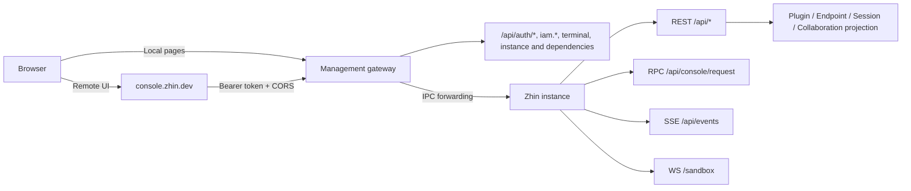

# Console

Console is the bot's browser admin UI. Use it to **connect chat accounts, turn plugins on or off per group, grant chat roles, install plugins, find out why a message got no reply, and manage the instance and access control**.

There is nothing to deploy: open <https://console.zhin.dev> and enter the API address `zhin start` prints (new projects default to `http://127.0.0.1:8068`). The first time, use the `HTTP_TOKEN` from `.env` (the bootstrap token) to complete [setup and onboarding](./onboarding.md); afterwards sign in with your account. You can also open the Host's own local `/console` and Sandbox pages.

The Console talks to the **management gateway** ([ADR 0054](../../adr/0054-management-gateway.md)): the gateway owns sign-in, permissions, setup, instance start / stop, dependency installs and the terminal, and forwards everything else to the Zhin instance. While the instance crashes, stops or installs dependencies, the Console can still sign in and show instance state and logs; only pages served by the instance return `503` for a while, and an **Instance unavailable** banner appears at the top (see [When the instance is offline](#instance-offline)).

| Topic | Contents |
| --- | --- |
| [Setup and onboarding](./onboarding.md) | Database → owner → AI → chat platforms; credentials and permissions per step |
| [Features and layered configuration](./features.md) | The **Features** tab of the object pages: on / off and overrides at the global, adapter, account and conversation levels, inheritance and locking; the **Roles** tab and chat roles |
| [Access control](./access-control.md) | Console users, roles, API tokens, audit log; permission catalog and plugin permission levels |
| [Operations](./operations.md) | Instance (runtime status and project dependencies), plugin installs and rollback, database / config / scheduled tasks / files, terminal |

## Navigation {#navigation}

The backbone of the Console is a four-level object tree: **Global ─ Adapter ─ Account ─ Conversation** (the same four levels as [layered feature configuration](./features.md) and [chat roles](../concepts/chat-roles.md)). Every object has exactly one page, and everything about it lives in that page's tabs. **Accounts and conversations** in the sidebar opens the global page; click down from there.

| Level | Route | Tabs (fixed order) |
| --- | --- | --- |
| Global | `/scope` | Overview · Features · Roles · Records |
| Adapter | `/scope/:adapter` | Overview · Features · Roles · Records |
| Account | `/scope/:adapter/:endpoint` | Overview · Chat · Access · Features · Roles · Records |
| Conversation | `/scope/:adapter/:endpoint/:conversation` | Overview · Chat · Features · Roles · Records |

- `:adapter` is the adapter instance alias (the top-level key in the configuration, such as `qq` or `tg-main`), `:endpoint` is the account ID, and `:conversation` is `<kind>:<id>` (`group`, `private` or `channel`) URI-encoded as a whole, for example `/scope/qq/bot-1/group%3A123`.
- The open tab is kept in `?tab=` (`chat`, `access`, `features`, `roles`, `records`; Overview is the default and stays out of the address), so refreshes and shared links land on it.
- A tab you have no permission for is still shown (with a lock) and explains which permission is missing; nothing is hidden silently. Overview needs `endpoint.view` or `feature.view`, Chat and Access need `endpoint.view` or `endpoint.operate`, Features needs `feature.view`, Roles needs `iam.manage`, Records needs `status.view`.

| Tab | Contents |
| --- | --- |
| Overview | Global: every chat account (status, pending events, accounts waiting for login), online counts per adapter, and **Connect platform account**. Adapter: its accounts and **Connections** (provided by the adapter plugin: add, edit, start / stop accounts and their login method). Account: runtime status, friend requests and invitations, notifications, plus conversations with overrides and recently active ones. Conversation: the features changed for this conversation only |
| Chat | Account: the conversation list beside the chat (conversations, friend requests and invitations, notifications); the open conversation is kept in the address (`?tab=chat&conversation=<kind>:<id>`). Conversation: this conversation only, with members, **Recent diagnostics** and history in its header |
| Access (接入) | Account pages only: connection state and **Test connection** (reads state, sends nothing), pending login verifications (QR code, slider ticket, SMS or device lock), and a link to the adapter's **Connections** for changing connection parameters |
| Features | One row per plugin: effective state, source level, overrides at this level, locking level. Expand a row to see each field's inherited / overridden / effective value and source. The global Features tab is the overview of all features and switches to a **Matrix** view (`?view=matrix`). See [Features and layered configuration](./features.md) |
| Roles | Chat roles at this level (Owner / Administrator / Trusted): granted here, inherited from above, and **Grant a role**. See [chat roles](./features.md#chat-roles) |
| Records | Entries already filtered to this scope: chat history, decision replay, runtime logs, audit log; each says how precise the filter is (Exact / Wider scope / Text match) |

The header of an object page has a breadcrumb (each level below Global is labeled and ancestors are clickable), the display name with status badges (Online / Offline / Overridden / Locked), the full identity (such as `qq / bot-1 / group:123`) with **Copy scope key**, and **Switch scope** on the right. **Switching scope changes only what you are looking at; it never grants permissions.**

### Sidebar {#sidebar}

Pages outside the object tree are in the sidebar, grouped as below. A group with no page the current identity can see is not shown.

| Group | Entries (routes) | Not in the menu, reached from another page |
| --- | --- | --- |
| Overview | Home `/dashboard`, Runtime logs `/logs`, Bot status `/agent/workbench`, Token usage `/agent/usage` | Decision replay `/agent/replay` (from Bot status and the Records tab) |
| Conversation | Try a conversation `/sandbox` (Sandbox plugin page), Accounts and conversations `/scope`, Chat history `/agent/sessions` | Adapter / account / conversation object pages |
| Features | Feature matrix `/features`, AI & models `/features/ai`, Skills assistant `/features/ai/skills`, Group participation `/features/ai/ambient`, Workroom `/features/ai/workrooms`, Runtime Capabilities `/introspection`, Message scenario lab `/scenario-lab`, and plugin pages that declare no group | Global settings `/features/global/:plugin`, Workroom setup `/features/ai/workrooms/catalog`, Command permissions `/permissions`, Group welcome setup `/use-cases/group-welcome` |
| Plugins | Plugins `/plugins`, Plugin store `/marketplace` | Plugin details `/plugins/:name` |
| Operations | Instance `/ops/instance`, Database `/ops/database`, Configuration file `/ops/config`, Environment variables `/ops/env`, Scheduled tasks `/ops/schedules`, Project files `/ops/files`, Terminal `/ops/terminal` | — |
| Access control | Users `/access/users`, Roles `/access/roles`, API tokens `/access/tokens`, Audit log `/access/audit` | — |

Your user name in the top bar opens Personal settings `/account` (change password, my API tokens); while onboarding is unfinished, a banner at the top opens Get started `/onboarding`. Plugin pages land in the group they declare in `/entries` (`metadata.section`, such as `ops` or `运维`), or in Features when undeclared; an adapter plugin's own page (such as `/qq`) still opens, and its account management is also embedded in that adapter's object page under **Connections**.

::: details Where old addresses go
Old bookmarks keep working; the Console redirects them:

| Old address | Now |
| --- | --- |
| `/endpoints` | `/scope` (global overview) |
| `/endpoints/:adapter/:endpointId` | The account's Chat tab; with `channelType` + `channelId`, that conversation's Chat tab |
| `/features/adapters`, `/features/adapters/:adapter` | `/scope`, `/scope/:adapter` |
| `/features/adapters/:adapter/endpoints/:endpoint` | The account's Features tab (`?tab=conversations` → account Overview) |
| `/features/adapters/:adapter/endpoints/:endpoint/conversations/:conversation` | The conversation's Features tab |
| `/features/global`, `/features/ai/models` | `/features`, `/features/ai` |
| `/config` | `/ops/config` (`/config?plugin=x` → `/features/global/x`) |
| `/env`, `/files`, `/database` | `/ops/env`, `/ops/files`, `/ops/database` |
| `/tasks`, `/cron`, `/assistant/jobs` | `/ops/schedules` (the last two open the Scheduled reminders and Assistant tasks tabs) |
| `/agent/models`, `/agent/skills`, `/agent/ambient`, `/agent/workrooms` | `/features/ai`, `/features/ai/skills`, `/features/ai/ambient`, `/features/ai/workrooms` |
:::

## Where to do what {#tasks}

| I want to… | Go to |
| --- | --- |
| Connect a platform account | [Connect an account](#connect-account) |
| Stop one group from using a plugin | [Turn a plugin off in a conversation](#turn-off-in-conversation) |
| Let someone manage features in a group | [Grant a role](#grant-role) |
| Install, update or uninstall a plugin | [Install a plugin](#install-plugin) |
| Find out why a message got no reply | [Why there was no reply](#why-no-reply) |
| An **Instance unavailable** banner appeared | [When the instance is offline](#instance-offline) |
| Send a test message | **Try a conversation** in the sidebar, or an account's Chat tab |
| Look back at what the bot said | **Chat history** in the sidebar, or the Records tab of any object page (already filtered) |
| Check that commands, middleware and tools are loaded | **Runtime Capabilities** in the sidebar; one plugin's capabilities are under **Capabilities** in its details |
| See scheduled tasks | Operations → Scheduled tasks (**All tasks** overview; each kind of task in its own tab) |
| Edit the configuration file or environment variables | Operations → Configuration file / Environment variables (a plugin's settings are in **Global settings**) |
| Give a colleague an account or an API token | Access control → Users / API tokens, see [Access control](./access-control.md) |

### Connect an account {#connect-account}

1. Open **Accounts and conversations** (`/scope`) and pick a platform under **Connect platform account**. If the adapter is not installed the button reads **Install the adapter first** and opens the plugin store (see [Install a plugin](#install-plugin)); otherwise **Connect** opens that adapter's page.
2. Under **Connections** in the adapter's Overview, click **Add account** and fill in the token, address or login method. Needs `endpoint.manage`.
3. Open the new account's Access tab: **Test connection** confirms the connection; QR code, slider, SMS or device-lock verifications appear in the login section, and the account comes online once you complete them. The global overview's **Waiting for login** lists these accounts too.
4. Receive and send a message in the account's Chat tab to confirm both directions work.

When the Host is not running the account, the Access tab says why (removed from the configuration, disabled, or not started yet) and offers **Open adapter**.

### Turn a plugin off in a conversation {#turn-off-in-conversation}

1. Open the conversation page: **Accounts and conversations** → adapter → account → click the conversation in the account's Overview list (or in Chat).
2. Open the Features tab, switch off the plugin's row, and confirm in the action receipt.
3. Only this conversation is affected: commands stop matching, middleware does not run, and Agent tools are not visible here. To switch it off for a whole account or adapter, use the Features tab of that object page; once a level above is off, the levels below show **Locked** and cannot switch it back on.

The conversation level can change only fields the plugin declares as conversation-level; the rest are read-only. See [inheritance rules](./features.md#resolution).

### Grant a role {#grant-role}

1. Open the object page of the target scope (global, adapter, account or conversation) and its Roles tab. Needs `iam.manage` (a scoped binding on that adapter / account counts).
2. Under **Grant a role**, enter the platform user ID, choose Owner, Administrator or Trusted, and confirm. The role applies at this level and every scope below it.
3. Revoking removes only roles granted directly at this level; an inherited role is revoked at the level that granted it.

Chat roles only affect what people can do with the bot in chat; they do not affect Console sign-in or permissions (those are the roles in [Access control](./access-control.md)). Platform group owners / admins are a platform standing and never become zhin roles automatically. See [chat roles](../concepts/chat-roles.md).

### Install a plugin {#install-plugin}

1. Open the **Plugin store** (`/marketplace`), search, and open the plugin details; the details verify the registry's latest version.
2. Click **Install**: the gateway first builds an installation plan; after you confirm, it stops the instance, installs, validates and starts it again, rolling back on failure and showing progress live. Needs `plugin.manage`.
3. If the plugin has required settings, **Needs configuration** appears; its button opens the configuration form, and on submit the gateway writes the declaration and restarts the instance.
4. Decide where it is on in the Features tab of the object pages. **Where it is on** in the plugin details summarizes the switches at every level.

Installed plugins are listed under **Plugins** (`/plugins`) with source, version and health; updates and uninstalls run from **Version and dependencies** in the plugin details, through the same gateway transaction. All project dependencies are managed under **Project dependencies** on the Instance page. See [dependency installs and rollback](./operations.md#packages).

### Why there was no reply {#why-no-reply}

1. Open the conversation's Chat tab and click **Recent diagnostics** in its header, or the diagnostics button beside the inbound message. Diagnostics show the processing stages, command state, reply target and delivery result (read-only; nothing is replayed).
2. Open the conversation's Records tab → **Decision replay**: why the bot replied or stayed quiet, whether it called a model, whether it sent anything.
3. Suspect a permission rule on a command: open **Command permissions** (`/permissions`, also reachable from the command catalog in Runtime Capabilities) and test the rule with an assumed zhin role and platform standing.
4. Suspect the plugin is off here: check that plugin's effective state and source level in the conversation's Features tab.
5. Suspect the instance itself: check the runtime status and instance logs on the Instance page.

Diagnostics are kept in memory for the last 15 minutes, at most 500 records; finding nothing does not mean processing succeeded. See [message troubleshooting](../troubleshooting/messages.md).

### When the instance is offline {#instance-offline}

When the gateway returns `503 instance_unavailable` (the instance is not running), `504 instance_timeout` (no answer in time) or `502 instance_error` (the answer failed or the instance is overloaded), every page shows an **Instance unavailable** banner at the top: it counts down `Retry-After` and retries automatically, and offers **Retry now** and **View instance**.

- Access control, Instance and Terminal are served by the gateway and keep working; other pages show **Instance unavailable** in the affected sections instead of blocking the whole page. When the instance is back the banner disappears and sections re-read automatically.
- On the Instance page, read the state and **Logs before the failure**, fix the cause, then **Start** or **Restart** (needs `ops.restart`). See [Instance](./operations.md#instance).
- A write submitted as the banner appeared shows **Outcome unknown** in its receipt: click **Check current state** first and do not submit again (see [action receipts](#receipts)).

## Home {#home}

Home (`/dashboard`) answers "what needs handling now":

- **Needs attention**: offline chat accounts, disconnected MCP services, logged errors and warnings, an unreachable Host, each with a link to handle it.
- The **Key metrics** use different bases, and each card says which:
  - **Messages received** is *observed in buffer*: from the Host's in-memory event buffer (the last 24 hours, or since the oldest buffered event when the buffer is shorter), cleared when the instance restarts;
  - **Error logs** are *stored totals*: from the log database, counted again after logs are cleaned up;
  - **Chat accounts online** is the *current state*, with the online rate.
- Messages in the last 24 hours, recent messages, process and resources (runtime, memory, CPU). The full runtime status of the process and instance is only on the Instance page.

## Status messages and action receipts {#receipts}

Each situation has one wording: No data, No permission (lists the permissions needed), Not installed (go to the plugin store), Needs a newer Host, Locked (links to the locking level), Changed by someone else (re-read before deciding), Database busy, Instance unavailable, Needs configuration, Disconnected, Outcome unknown, Read failed. The raw error goes under **Technical details**; a failed read is never shown as an empty list.

Every write (switching a feature, changing an override, granting / revoking a role, installing a plugin…) first lists what will change, then asks you to confirm and submit; the result appears in place as an action receipt:

| Result | Meaning | Next step |
| --- | --- | --- |
| Completed / Partly done | The Host confirmed the change | Close the receipt |
| Not applied | The Host refused (permission, validation, conflict, lock, or not forwarded because the instance was unavailable) | Read the reason and prepare again |
| Outcome unknown | The request went out but no trustworthy answer came back (timeout, disconnect, `504` / `502`) | Only **Check current state** (a read-only re-read); do not submit again |

Deleting, revoking, switching off globally and other wide-reaching actions ask for a second confirmation.

## Command permissions {#command-permissions}

**Command permissions** (`/permissions`) explains why a command's `permit` matches or not, along the dimensions of [chat roles](../concepts/chat-roles.md):

- Pick a command from the current generation (search by name, description or plugin instance); the page explains each item of its `permit` and its `adapter` constraint: every item of the array must hold (AND), and commas inside one item's parentheses mean any one of them (OR).
- Optionally fill in an assumed conversation and account, a sender ID, an **assumed zhin role** (Ordinary user / Trusted / Administrator / Owner) and an **assumed platform standing** (Owner / Administrator / Member / Guest, plus platform role IDs), then click **Check hypothetical conditions**.
- The identity is entirely assumed and never checked with the platform; an empty field means unknown, never a known role. The page runs neither the command nor platform or custom checkers; those show **Not evaluated**, missing facts show **Insufficient evidence**. **Condition met** does not mean authorized or executable.
- Needs an account with `status.view`; refresh the catalog and check again when the generation changes.

## How the Console reaches the Host {#architecture}

The browser opens either the remote Console (console.zhin.dev) or the Host's own local pages; both talk only to the management gateway, which forwards instance interfaces to the Zhin instance over IPC.

::: details Why can Console connect while the bot is still logging in?
The HTTP service, Console RPC and SSE are process control-plane services that start listening before all plugins have started (before the first generation is published). So while an adapter such as ICQQ is still waiting for a QR scan, slider or device confirmation, the browser can complete login through `login.list`, `login.submit` and `endpoint.login.pending`. Pages that depend on started plugins may be empty or show not-ready until every adapter finishes starting.
:::



## Deployment and Configuration

All configuration is in the `http:` section at the top level of `zhin.config.yml`:

```yaml
http:
  port: 8068                 # Scaffold default; trust project config
  host: 127.0.0.1            # Default 127.0.0.1; change to 0.0.0.0 for remote access
  token: ${HTTP_TOKEN}       # Bootstrap token: only creates the first owner
  corsOrigins:               # CORS whitelist; https://console.zhin.dev is always automatically included
    - "http://localhost:5173"
  base: /api                 # API prefix, default /api
```

`/api` requests need a Bearer credential (a sign-in session or an API token, see [Users and permissions](#users-and-permissions)). `/pub/*`, the Console shell, and page routes stay public. `corsOrigins` is merged with the Remote Console origin.

The management gateway listens on `http.port`; if the port is taken, `zhin start` fails to start. A restart from the Console restarts only the instance (over the control channel); the gateway and the Console connection stay up.

Runtime falls back to 8086 when no config exists; the current scaffold writes 8068. Always trust project configuration and the startup log.

## Find the page from the symptom

| Symptom | Start here | Fact to verify |
| --- | --- | --- |
| Console cannot connect | Home / startup log | Host, port, token, CORS, and HTTP Host degradation |
| **Instance unavailable** banner | Instance | Instance state, the last failure and instance logs |
| Platform is online but receives nothing | The account's Access and Overview tabs | Connection, pending login verifications, friend requests and notifications, platform callback |
| Message received but no reply | The conversation's Chat tab → Recent diagnostics; Records → Decision replay | Processing stages, command state, why it replied or not, delivery result |
| Command, middleware, or component is missing | Runtime Capabilities + the conversation's Features tab | Current-generation capability, order, and owner; whether the plugin is off or locked by a level above in this conversation |
| A command is unavailable to someone | Command permissions + the Roles tab | Each `permit` item, the sender's zhin role and platform standing |
| Agent does not call a tool | Bot status + Runtime Capabilities | Visibility, approval, security policy, trace, and cancellation |
| Messages disappear after refresh | The conversation's Chat tab + Runtime logs | History RPC recovery and SSE recovery gap |
| The expected Agent does not answer in a multi-Bot group | Workroom + Bot status | whether `conversation` in `ai.venues` matches the group, whether every `members[].botEndpoint` is online, and whether `entry` is one of the members |
| File changed but behavior did not | Configuration file + Home | Successful save and publication of a new generation |

## Page Features

| Page | Data Source | Description |
|------|-------------|-------------|
| Home | `GET /api/system/status`, `GET /api/stats`, event buffer, log statistics | Items that need attention, key metrics (with their basis), recent messages, process and resources |
| Accounts and conversations (object tree) | RPC `endpoint.list` / `endpoint.test`, `login.*`, `feature.get` / `feature.set-*` / `feature.conversations`, `chat-roles.list` / `grant` / `revoke` + inbox tables | The four object page levels: global / adapter / account / conversation; the account's Chat tab holds the unified inbox (messages / requests / notices), its Access tab the connection test and LoginAssist login tasks |
| Adapter connections | `plugin.<pluginId>.status` + RPC `endpoint.list` / `endpoint.test` + `login.*` | Provided by the adapter plugin and embedded in the adapter object page's Overview: connection state and test, adding / editing / starting / stopping accounts; QQ adds QR-code binding |
| Plugins / plugin details | `GET /api/plugins`, `GET /api/plugins/<name>`, RPC `plugin:*`, `gateway.packages.*` | Installed plugins with source, version and health; details cover version and dependencies, where it is on, declaration and configuration, permissions, capabilities; install / update / uninstall plans and commits, configuration validation, diagnostics |
| Plugin store | `GET /pub/marketplace/search`, `/pub/marketplace/detail/*`, `GET /api/marketplace/updates` | Plugin index (plugins.json + npmmirror), latest-version verification, update checks |
| Feature matrix / Global settings | RPC `feature.matrix`, `feature.get`, `config:*` | Each feature's switch globally and per adapter; a plugin's global Schema form |
| Configuration file | RPC `config:get-source` / `config:replace-source` / `config:set` / `config:patch` | View and revision-checked edits of the Root config in its current YAML/JSON format; simple pages write by path with `config:patch` (see [plugin pages](../authoring/console-pages.md#saving-settings-from-a-page-config-patch)) |
| Runtime logs | `GET /api/logs`, `GET /api/logs/stats`, `DELETE /api/logs`, `POST /api/logs/cleanup` | System logs (`SystemLog` table, requires Database) |
| Scheduled tasks | RPC `cron:*`, `GET /api/tasks/*`, `POST /api/tasks/create` / `change` | **All tasks** overview; administrator tasks, scheduled reminders, assistant tasks and execution history each in a tab |
| Database | RPC `db:info` / `db:tables` / `db:select` / `db:insert` / `db:update` / `db:delete` / `db:kv:*` | Database browsing and editing, KV storage |
| Project files / Environment variables | RPC `files:tree` / `files:read` / `files:save`, `env:list` / `env:save` | Project file tree and `.env` management |
| Instance | RPC `gateway.instance.status` / `logs` / `start` / `stop` / `restart`, `gateway.packages.*` | The single detail page for runtime status: state, start / stop, instance logs, project dependencies |
| Runtime Capabilities | `GET /api/introspection/{commands,middlewares,components,tools,prompt-sections,endpoints,bindings,mcp}`, `POST /api/introspection/components/render` | Current-generation contracts, owners, middleware order, component rendering lab, and Prompt Section governance metadata |
| Chat history | `GET/POST /api/agent/sessions/*`, `GET /api/conversations/history?sessionKey=...&beforeSequence=...` | AI session tree and branch switching; GET returns an empty `state: not_started` tree before a channel conversation has AI history. The canonical record of what was actually sent and received is separate from the Agent's internal session tree and does not require AI to have run |
| Workroom | `GET /api/agent/engagements[/*]` (requires `agent.view`); RPC `agent.engagements.list` / `agent.engagements.get` / `agent.venues.list` | Read-only projection: recent Engagements, one Engagement's events and Blackboard, and the configured Venues; the data comes from the `engagement_events` Journal and Console cannot rewrite it |
| Try a conversation (Sandbox) | WS `/sandbox` | Built-in sandbox chat, direct conversation without platform integration |

Real-time pushes go through SSE: `GET /api/events` (page directory sync, HMR reload, message/configuration events). The event stream and history (`/api/events`, `/api/events/history`) require `status.view`.

::: details HTTP / RPC Protocol Status Codes and Boundary Contracts

Tree `preview` values remain short summaries. Read a complete user message on demand with `GET /api/agent/sessions/<encoded-sessionKey>/message?sessionId=<tree.sessionId>&messageId=<positive-safe-integer>` under the existing session HTTP authentication boundary. The response is `data: { messageId, text }`, without image payloads or branch mutation. A changed session incarnation returns `409`; a missing message, a message from another session, or a non-user message returns `404`; an older runtime without the reader returns `501`. Only retained message text is available.

Conversation history requires `endpoint.view` and returns the latest 50 canonical events in ascending sequence order. The response is `data: { conversation, items, nextBeforeSequence, hasMore }`; load earlier events with the exclusive `beforeSequence` cursor. Created messages include complete text and safe media references; recalls include `messageRef`. Other event types expose only type, timestamp, and sequence, and still count toward pagination. Local media paths, base64, and raw platform payloads are omitted. Missing history returns `404 history_not_recorded`, an ambiguous parent/thread address returns `409 conversation_ambiguous`, and an unavailable Endpoint mapping or store returns `503 history_unavailable`. Agent context is never substituted for recorded chat. Responses are not cached; clients must verify the complete `conversation` is unchanged before joining pages.

The conversation's turn-usage action and Trace view read the existing Agent archive. `GET /api/agent/trace-archive/turns` returns turn summaries, trusted origins and usage calls including subagents. `GET /api/agent/trace-archive/turn` loads execution details without request bodies; `GET /api/agent/trace-archive/request?sessionKey=...&turnId=...&requestId=...` loads an individual body on demand. A current-conversation query supplies the complete canonical `conversation` as JSON. Timestamps and coarse session keys are not message associations; older records without a proven origin are not attributed to the selected chat. All routes require `agent.view` and prohibit HTTP caching.

Reported usage separates input/output and cache/reasoning details; missing fields are not zero. Category token estimates are not a distribution of billed usage. Request bodies are model inputs captured at the SDK invocation boundary, grouped as instructions, tool definitions, ordered messages and output format. They are not HTTP wire captures or proof of upstream receipt. Framework retries and model fallback have separate request records; SDK-internal retries of the same input remain one semantic request rather than individual HTTP attempt records. Historical bodies are never reconstructed from current configuration.

Request bodies are recorded by default under the Host's `data/agent-traces`, retaining redacted text and media placeholders rather than image/audio binaries. Defaults retain at most seven days with a hard 64 MiB archive cap. Capacity cleanup removes the oldest records; oversized bodies leave statistics and an explicit unavailable-body status. Set `ai.agent.recordRequestBodies: false` to stop recording new bodies. Existing `ZHIN_TRACE_RETENTION_DAYS` / `ZHIN_TRACE_MAX_MB` overrides remain available, independently of numeric usage-database retention. Expired records are immediately excluded from reads; files are pruned by post-startup maintenance, on writes and by the existing hourly maintenance. One Host process owns writes to each data directory. The 64 MiB cap bounds archived data, not process memory: atomic replacements can temporarily keep a second file, while concurrent turns and queued writes can retain multiple bodies in memory.

Fixed string choices, such as the calendar `provider`, can use the existing select field instead of
forcing the entire document into source editing. The supported `anyOf` consists of 1–64 unique,
nonempty string constants of at most 256 characters, with no extra branch validation constraints;
only the outer default is used. Object unions, mixed types, `oneOf`, and other combinations that
cannot be represented completely still use source editing. The original JSON Schema validator is
unchanged. A saved value outside the options, including an environment reference, must be preserved
until explicitly replaced; changing one choice must not remove other backends or instances.
This display requires the corresponding Console update.
:::

## Agent run policy in Try a conversation

When you open an Agent session in **Try a conversation**, the working directory and security policy belong to each run. They are not Prompt content, and the model cannot elevate them. A safe beginner baseline is the current project directory, `workspace-write`, `ask`, and network access disabled.

| Field | Accepted values | How to choose |
| --- | --- | --- |
| `safetyMode` | `read-only` / `workspace-write` / `danger-full-access` | Use read-only for inspection, workspace-write for project edits, and full host access only for a local task whose risks are understood |
| `approvalMode` | `ask` / `auto` / `bypass` | Default to `ask`; `auto` uses a dedicated review Agent and asks the master when uncertain; `bypass` approves immediately while permissions and sandbox policy still apply |
| `networkAccess` | `false` / `true` | Enable only when the task needs the network; `danger-full-access` inherently includes network authority |
| `workingDirectory` | directory path | Point to the project directory this run may use; avoid a broad system root |

These values are a closed contract, not free-form labels. Unknown `safetyMode` or `approvalMode` values fall back to `workspace-write` or `ask`; the page should always echo the effective policy before execution.

## Standard acceptance run

1. Home reports a healthy connection, nothing open under **Needs attention**, and readable version and runtime data.
2. Send a message in **Try a conversation**; then receive and send one in an account's Chat tab, refresh, and confirm the history remains.
3. Inspect current owners for commands, middleware, components, Tools, and Prompt Sections in Runtime Capabilities; confirm the plugin's effective state in the conversation's Features tab.
4. Run an Agent task and verify working directory, security policy, approval, cancellation, trace, and artifacts.
5. If `ai.venues` is configured, send a real message in that group, confirm the entry Agent answers, and check that Workroom and `zhin trace --engagements` list the collaboration.

A release is ready only when the current generation and durable projections agree. Disk configuration and plugin manifests are candidate inputs.

## /entries Plugin Page Mechanism

Plugins can contribute their own pages to the Console. The mechanism has three steps:

1. The plugin declares client pages (pagemanager), and the build output is served by the Host at `/assets/client/*`;
2. The Host's ConsoleRuntime aggregates the page directory. `GET /entries` returns `{ entries, runtimeEnvHint }` -- each entry contains `id`, `title`, `route`, `module` (page module URL), `order`, `hash`;
3. The Remote Console / local shell fetches `/entries` and dynamically imports the corresponding modules for rendering; bare browser imports (react, etc.) are proxied by the Host's `/esm/*` as executable ESM.

Page directory changes are pushed in real-time to connected UIs via SSE `sync` events. For which sidebar group a page lands in, see [Sidebar](#sidebar).

## Users and permissions

Console users, roles, sessions and API tokens live in the project database (ADR 0049), not in the config file. Pages and permissions in detail: [Access control](./access-control.md). Upgrading from an older version: see [Upgrading to Console access control](../migrations/console-access-control.md) and [Upgrading to the management gateway](../migrations/management-gateway.md).

- **Setup**: while the database has no owner, `http.token` is a bootstrap token that can only create the first owner (Console wizard, or `zhin console init`). After that it is refused everywhere. A local Host without `http.token` is open to everyone until setup.
- **Sign-in**: users sign in with username and password and get a session token (12-hour sliding expiry, 30 days at most). Changing the password, disabling or deleting a user revokes all of that user's sessions at once.
- **API tokens**: users issue long-lived tokens for automation, never exceeding their own permissions and revocable one by one. CLI tools read them from `ZHIN_CONSOLE_TOKEN`.
- **Roles**: built-in `owner` (everything), `admin` (everything except the terminal and user management), `operator` (messaging and feature configuration) and `viewer` (read-only). A role binds globally, to one adapter, or to one account.
- **Permission checks**: every Console RPC and every `/api` route is listed in the permission map of `@zhin.js/console-protocol`; anything unlisted is denied. Every denied request and every write is written to the audit log.
- **Offline rescue**: `zhin console user create|passwd|disable|enable|list` opens the project database directly, without a running Host.
- **In the gateway** (ADR 0054 §3, §7): sign-in, the setup wizard, `/auth/me`, `iam.*`, `onboarding.update`, the terminal and the audit log are handled by the management gateway, which opens the project database itself (SQLite in WAL mode, sharing the file with the instance). While the instance is stopped, crashed or being updated the Console can still sign in, initialize and show the instance state and logs; only pages and APIs the instance provides answer `503`. Disabling or deleting a user, changing their password or their role bindings immediately closes that user's live connections to the instance (event stream, WebSockets).
- **Onboarding state**: `GET {base}/auth/setup` and `/auth/me` (for callers holding `plugin.manage`) carry an `onboarding` field; the RPC `onboarding.update { step: 'ai' | 'adapters' | 'finish', status: 'done' | 'skipped' }` needs `plugin.manage`, plus `agent.configure` for step 3 (`ai`) and `endpoint.manage` for step 4 (`adapters`) (ADR 0053 §2). Dependency install progress arrives on the Console event stream as `gateway.packages.progress`, or alone from `GET {base}/gateway/packages/progress`.

A page's `requiredPermissions` and `requiredRoles` decide who sees it: built-in permissions (such as `status.view`) come from roles; plugin-defined permission names (`<plugin>:<action>`, such as `ambient:read`, `decisions:read`, `control:read`, `ops:approve`) are granted by **level**. The page lists (`/entries`, `/console/api/pages` and `/console/api/topology`) are filtered per caller and never cached.

### Plugin permission levels

Every plugin permission has a level: `read` (view), `operate` (day-to-day actions) or `manage` (manage, approve, change configuration). A plugin can declare the level in `definePluginConsoleRpc({ permissions })` (see [Plugin Console pages](../authoring/console-pages.md#plugin-permission-levels)); otherwise it is inferred from the suffix:

| Suffix | Level |
| --- | --- |
| `:read`, `:view` | `read` |
| `:approve`, `:manage`, `:admin`, `:write`, `:config` | `manage` |
| anything else (such as `:resolve`, `:send`) | `operate` |

Built-in roles grant plugin permissions by level through three catalog permissions, `plugin.perms.read`, `plugin.perms.operate` and `plugin.perms.manage`:

| Role | Plugin permissions |
| --- | --- |
| `viewer` | `read` |
| `operator` | `read`, `operate` |
| `admin` | every level |
| `owner` | everything (unchanged) |

- **Custom roles** can include those level permissions, or list single plugin permissions (for example only `ops:approve`). The format must be `<plugin>:<action>`. A name no loaded plugin uses is still saved (the plugin may not be installed yet, or be disabled); the call returns `warnings`, and the name grants nothing until a plugin uses it.
- **Scope**: page visibility uses global bindings only. Plugin Console RPC checks each method's declared permissions; for a plugin that owns an adapter (`root/<adapter>`), a role bound to that adapter (or to the account an account method names) also counts, one bound to another adapter never does.
- **API tokens** can be narrowed to single plugin permissions (such as `onebot11:read`); they take effect only when the issuing user holds them (by name or by level), so a token never exceeds its user.
- `iam.roles.list` returns each role's effective plugin permissions (`pluginPermissions`, with source `level` / `explicit`) and the loaded plugins' permission catalog (top-level `pluginPermissions: [{ permission, plugin, level, description? }]`), for the Console's role editor.

Plugin routes such as reverse WebSockets and Webhooks do not use Console accounts; the plugin authenticates them with its own credential (for example OneBot's `access_token`).

## Terminal

With `console.terminal.enabled: true` the Console offers a host shell and allow-listed SSH targets (ADR 0051). Only owners holding `ops.terminal` can use it, and session start and end are audited. It is off by default; when off, no terminal route is registered. Read the [terminal safety notes and SSH fingerprint pinning](./operations.md#terminal) before enabling it; see the [configuration reference](../configuration/generated.md) for the fields.

## Related

- [AI Capabilities Overview](../ai/index.md)
- [Agent Deep Dive](../ai/agent.md): The runtime behind the Console's Bot status and Chat history pages
- [Console path](../paths/console.md): a task-by-task walk through the Console
