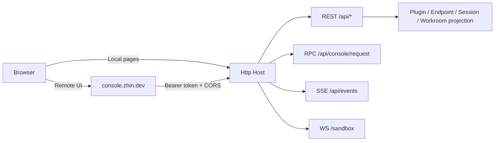

# Console

Console is the bot's browser admin UI. Use it to **send test messages, read logs, edit config, manage plugins and accounts, and watch what the AI is doing**.

There is nothing to deploy: open <https://console.zhin.dev> and enter the API address the bot prints at startup (new projects default to `http://127.0.0.1:8068`) and the `HTTP_TOKEN` from `.env`. You can also open the bot's own local `/console` and Sandbox pages.

## What you can do once connected

| Page | What it's for |
| --- | --- |
| Chat accounts / Try a chat | Send test messages; see traffic per platform account |
| Chat history | Look back at what the bot and people said, and continue from any point |
| Runtime Capabilities (Advanced) | Confirm commands, middleware, components and tools are loaded, and which plugin they come from |
| Activity log | Browse runtime logs by time and source |
| Config (Advanced) | Edit `zhin.config.yml` through a form or source editor; failed saves roll back automatically |
| Bot status | See AI conversations, tool calls, approvals and cancellations. Its decision replay lists, newest first, why the bot replied or stayed quiet each time; expand one turn into a timeline or export a time range as JSON (needs a token with `decisions:read`; kept 14 days by default, change with `ai.audit.retentionDays`) |
| Group chime-in (群聊插话) | Choose whether the bot joins a group conversation when nobody @-mentions it (Off / Watch only / Join in), in which groups, and how often per hour, and see the last 24 hours. Saved changes take effect after a restart. Viewing needs a token with `ambient:read`; changing settings needs the admin token |
| Skills assistant (技能助手) | Let a dedicated helper pick skills, tools and memories, choose which agent handles a request, auto-approve approvals, and judge whether to chime in to a group. Each item is Off / Watch only / On, and you can see how often it was used and how often it worked in the last 24 hours. Requires `@zhin.js/service-typesafe` (`zhin setup --decisions`). Saved changes take effect after a restart. Viewing needs a token with `skills:read`; changing settings needs the admin token |
| Workroom (Advanced) | See persistent task spaces and task boards |

## Sidebar navigation

Console is aimed at everyday users: the sidebar is grouped by what you want to do, and pages use plain names. Existing page links (routes) are unchanged.

| Group | Pages |
| --- | --- |
| Everyday (常用) | Home, Chat accounts, Chat history, Reminders, Activity log |
| Bot (机器人) | Bot status, Try a chat, Assistant jobs (shown when the assistant is enabled), Group chime-in, Skills assistant |
| Features (功能) | Manage features, Feature store, Task center |
| Advanced (高级, folded by default) | Config, Environment, Project files, Database, Runtime Capabilities, Message scenario lab, Workroom |

Old → new names: Dashboard → Home, Conversations & Channels → Chat accounts, Conversation branches → Chat history, Agent playground → Try a chat, Agent Overview / Agent workbench → Bot status, Scheduled tasks → Reminders, Logs → Activity log, Plugins → Manage features, Marketplace → Feature store.

YAML editing of `zhin.config.yml` is still available under **Advanced → Config** for experienced users and CI.

::: details Why can Console connect while the bot is still logging in?
The HTTP service, Console RPC and SSE are process control-plane services that start listening before all plugins have started (before the first generation is published). So while an adapter such as ICQQ is still waiting for a QR scan, slider or device confirmation, the browser can complete login through `login.list`, `login.submit` and `endpoint.login.pending`. Pages that depend on started plugins may be empty or show not-ready until every adapter finishes starting.
:::



## Deployment and Configuration

All configuration is in the `http:` section at the top level of `zhin.config.yml`:

```yaml
http:
  port: 8068                 # Scaffold default; trust project config
  host: 127.0.0.1            # Default 127.0.0.1; change to 0.0.0.0 for remote access
  token: ${HTTP_TOKEN}       # Main token (full scope)
  tokens:                    # Additional scoped tokens (optional)
    - token: ${DEMO_TOKEN}
      scope: demo            # full | demo
  corsOrigins:               # CORS whitelist; https://console.zhin.dev is always automatically included
    - "http://localhost:5173"
  base: /api                 # API prefix, default /api
```

With a token configured, `/api` requests require a Bearer token. `/pub/*`, the Console shell, and page routes stay public. `corsOrigins` is merged with the Remote Console origin.

A port conflict soft-degrades the HTTP Host: Adapters and Agents keep running, but Console is unavailable. A Console restart exits with code 51 and the CLI daemon relaunches the process.

Runtime falls back to 8086 when no config exists; the current scaffold writes 8068. Always trust project configuration and the startup log.

## Find the page from the symptom

| Symptom | Start here | Fact to verify |
| --- | --- | --- |
| Console cannot connect | Dashboard / startup log | Host, port, token, CORS, and HTTP Host degradation |
| Platform is online but receives nothing | Endpoint detail | Connection, inbox, requests/notices, and platform callback |
| Command, middleware, or component is missing | Runtime Capabilities | Current-generation capability, order, and owner |
| Agent does not call a tool | Agent Studio + Runtime Capabilities | Visibility, approval, security policy, trace, and cancellation |
| Messages disappear after refresh | Endpoint conversation + Logs | History RPC recovery and SSE recovery gap |
| Workroom does not claim a chat or repository | Workrooms + Task board | Catalog revision, full space address, Orchestrator, and Project Inbox |
| File changed but behavior did not | Config + Dashboard | Successful save and publication of a new generation |

## Page Features

| Page | Data Source | Description |
|------|-------------|-------------|
| Dashboard | `GET /api/system/status`, `GET /api/stats` | Runtime status, version, statistics overview |
| Plugins | `GET /api/plugins`, `GET /api/plugins/<name>` | Plugin list and details (commands, tools, config schema) |
| Endpoints | Endpoint summary + inbox table | Platform endpoint connection status; detail page includes unified inbox (messages / requests / notifications) |
| Config | RPC `config:get-source` / `config:replace-source` / `config:set` / `config:patch` | View the active YAML/JSON Root source and edit it with revision checks; simple pages write exact paths with `config:patch` (see [Console pages](../authoring/console-pages.md#saving-settings-from-a-page-config-patch)) |
| Logs | `GET /api/logs`, `GET /api/logs/stats`, `DELETE /api/logs`, `POST /api/logs/cleanup` | System logs (`SystemLog` table, requires Database to be running) |
| Cron | RPC `cron:*` | In-memory tasks registered by plugins (list); with Agent installed, can add/delete/pause persistent tasks |
| Database | RPC `db:info` / `db:tables` / `db:select` / `db:insert` / `db:update` / `db:delete` / `db:kv:*` | Database browsing and editing, KV storage |
| Files | RPC `files:tree` / `files:read` / `files:save`, `env:list` / `env:save` | Project file tree and `.env` management |
| Runtime Capabilities | `GET /api/introspection/{commands,middlewares,components,tools,prompt-sections,endpoints,bindings,mcp}`, `POST /api/introspection/components/render` | Current-generation contracts, owners, middleware order, component rendering lab, and Prompt Section governance metadata |
| Agent Sessions | `GET/POST /api/agent/sessions/*` | AI session tree viewing and branch switching; GET returns an empty `state: not_started` tree before a channel conversation creates an AI session |
| Conversation History | `GET /api/conversations/history?sessionKey=...&beforeSequence=...` | Recorded canonical inbound and sent messages, separate from Agent context; no prior AI turn required |
| Workrooms | Persistent Workroom Catalog + Profile RPC + `GET /api/agent/workroom/runs[/*]` | Revision-CAS management for Projects, members, Agent roles, and chat/channel/repository bindings; diagnose and initialize Profile/Planning Policy; inspect replayed Runs, Tasks, and Assignments |
| Marketplace | `GET /pub/marketplace/search`, `/pub/marketplace/detail/*`, `GET /api/marketplace/updates` | Plugin marketplace (plugins.json + npmmirror) and update checks |
| Sandbox | WS `/sandbox` | Built-in sandbox chat, direct conversation without platform integration |

Tree `preview` values remain short summaries. Read a complete user message on demand with `GET /api/agent/sessions/<encoded-sessionKey>/message?sessionId=<tree.sessionId>&messageId=<positive-safe-integer>` under the existing session HTTP authentication boundary. The response is `data: { messageId, text }`, without image payloads or branch mutation. A changed session incarnation returns `409`; a missing message, a message from another session, or a non-user message returns `404`; an older runtime without the reader returns `501`. Only retained message text is available.

Conversation history requires full scope and returns the latest 50 canonical events in ascending sequence order. The response is `data: { conversation, items, nextBeforeSequence, hasMore }`; load earlier events with the exclusive `beforeSequence` cursor. Created messages include complete text and safe media references; recalls include `messageRef`. Other event types expose only type, timestamp, and sequence, and still count toward pagination. Local media paths, base64, and raw platform payloads are omitted. Missing history returns `404 history_not_recorded`, an ambiguous parent/thread address returns `409 conversation_ambiguous`, and an unavailable Endpoint mapping or store returns `503 history_unavailable`. Agent context is never substituted for recorded chat. Responses are not cached; clients must verify the complete `conversation` is unchanged before joining pages.

The conversation's turn-usage action and Trace view read the existing Agent archive. `GET /api/agent/trace-archive/turns` returns turn summaries, trusted origins and usage calls including subagents. `GET /api/agent/trace-archive/turn` loads execution details without request bodies; `GET /api/agent/trace-archive/request?sessionKey=...&turnId=...&requestId=...` loads an individual body on demand. A current-conversation query supplies the complete canonical `conversation` as JSON. Timestamps and coarse session keys are not message associations; older records without a proven origin are not attributed to the selected chat. All routes require full scope and prohibit HTTP caching.

Reported usage separates input/output and cache/reasoning details; missing fields are not zero. Category token estimates are not a distribution of billed usage. Request bodies are model inputs captured at the SDK invocation boundary, grouped as instructions, tool definitions, ordered messages and output format. They are not HTTP wire captures or proof of upstream receipt. Framework retries and model fallback have separate request records; SDK-internal retries of the same input remain one semantic request rather than individual HTTP attempt records. Historical bodies are never reconstructed from current configuration.

Request bodies are recorded by default under the Host's `data/agent-traces`, retaining redacted text and media placeholders rather than image/audio binaries. Defaults retain at most seven days with a hard 64 MiB archive cap. Capacity cleanup removes the oldest records; oversized bodies leave statistics and an explicit unavailable-body status. Set `ai.agent.recordRequestBodies: false` to stop recording new bodies. Existing `ZHIN_TRACE_RETENTION_DAYS` / `ZHIN_TRACE_MAX_MB` overrides remain available, independently of numeric usage-database retention. Expired records are immediately excluded from reads; files are pruned by post-startup maintenance, on writes and by the existing hourly maintenance. One Host process owns writes to each data directory. The 64 MiB cap bounds archived data, not process memory: atomic replacements can temporarily keep a second file, while concurrent turns and queued writes can retain multiple bodies in memory.

Real-time pushes go through SSE: `GET /api/events` (page directory sync, HMR reload, message/configuration events).

Fixed string choices, such as the calendar `provider`, can use the existing select field instead of
forcing the entire document into source editing. The supported `anyOf` consists of 1–64 unique,
nonempty string constants of at most 256 characters, with no extra branch validation constraints;
only the outer default is used. Object unions, mixed types, `oneOf`, and other combinations that
cannot be represented completely still use source editing. The original JSON Schema validator is
unchanged. A saved value outside the options, including an environment reference, must be preserved
until explicitly replaced; changing one choice must not remove other backends or instances.
This display requires the corresponding Console update.

## Agent Studio run policy

The working directory and security policy belong to each run. They are not Prompt content, and the model cannot elevate them. A safe beginner baseline is the current project directory, `workspace-write`, `ask`, and network access disabled.

| Field | Accepted values | How to choose |
| --- | --- | --- |
| `safetyMode` | `read-only` / `workspace-write` / `danger-full-access` | Use read-only for inspection, workspace-write for project edits, and full host access only for a local task whose risks are understood |
| `approvalMode` | `ask` / `auto` / `bypass` | Default to `ask`; `auto` uses a dedicated review Agent and asks the master when uncertain; `bypass` approves immediately while permissions and sandbox policy still apply |
| `networkAccess` | `false` / `true` | Enable only when the task needs the network; `danger-full-access` inherently includes network authority |
| `workingDirectory` | directory path | Point to the project directory this run may use; avoid a broad system root |

These values are a closed contract, not free-form labels. Unknown `safetyMode` or `approvalMode` values fall back to `workspace-write` or `ask`; Agent Studio should always echo the effective policy before execution.

## Standard acceptance run

1. Dashboard reports a healthy connection with readable version and runtime data.
2. Send a Sandbox message, refresh, and confirm Endpoint history remains.
3. Inspect current owners for commands, middleware, components, Tools, and Prompt Sections.
4. Run an Agent task and verify working directory, security policy, approval, cancellation, trace, and artifacts.
5. For a Workroom, prove that a real chat, channel, or repository event enters the correct Project.

A release is ready only when the current generation and durable projections agree. Disk configuration and plugin manifests are candidate inputs.

## /entries Plugin Page Mechanism

Plugins can contribute their own pages to the Console. The mechanism has three steps:

1. The plugin declares client pages (pagemanager), and the build output is served by the Host at `/assets/client/*`;
2. The Host's ConsoleRuntime aggregates the page directory. `GET /entries` returns `{ entries, runtimeEnvHint }` -- each entry contains `id`, `title`, `route`, `module` (page module URL), `order`, `hash`;
3. The Remote Console / local shell fetches `/entries` and dynamically imports the corresponding modules for rendering; bare browser imports (react, etc.) are proxied by the Host's `/esm/*` as executable ESM.

Page directory changes are pushed in real-time to connected UIs via SSE `sync` events.

## Users and permissions

Console users are the `http.tokens` entries in `zhin.config.yml`: each extra token is one user. There's no separate account store, sign-up or login. To add a user, add a token; to remove one, delete its token. Give it `permissions` and `roles`, and the Console shows it only the pages whose requirements those meet. Plugin page status endpoints follow the same rules:

```yaml
http:
  token: ${HTTP_TOKEN}            # Admin: full, can see and change everything
  tokens:
    - token: ${ALICE_TOKEN}
      scope: user                 # Ordinary user (same as demo): can't change config
      principalId: alice
      permissions: [ambient:read, ambient:write] # matched against page and plugin action requiredPermissions
      roles: [member]             # matched against a page's requiredRoles
```

- **Full tokens**, including the primary `token`, see every page. `permissions` and `roles` don't affect them.
- **`scope: user` tokens** are ordinary users. `user` and `demo` mean exactly the same; prefer `user` in new configs. A missing or unknown `scope` is also treated as an ordinary user, never as the admin.
- Ordinary users see only pages whose `requiredPermissions` and `requiredRoles` their `permissions` and `roles` meet. They can run a plugin action only when the action declares its own `requiredPermissions` or `requiredRoles` and the token meets all of them (see [plugin RPC](../authoring/console-pages.md#page-data-plugin-rpc)). Built-in admin operations, such as changing config or managing plugins, still need a full token.
- **Without a token**, only pages with no requirements show.
- **With no tokens configured** (local development), everyone counts as the admin, as before.
- The page lists (`/entries`, `/console/api/pages` and `/console/api/topology`) are filtered by token and never cached.

Pages choose their own permission and role names, such as `ambient:read`. The built-in ambient engagement and skills assistant status use `ambient:read` and `skills:read` (see [Built-in status](../authoring/console-pages.md#built-in-status-ambient-engagement-and-skills-assistant)); the decision replay uses `decisions:read` (see [Decision replay](../authoring/console-pages.md#built-in-queries-decision-replay)); the control plane uses `control:read` and `control:write` (see [Control plane](../authoring/console-pages.md#built-in-actions-control-plane)); approvers (dangerous-tool approval cards, approving / rejecting / resending announcements) use `ops:approve` (see [Approval cards](../authoring/console-pages.md#built-in-actions-dangerous-tool-approval-cards)).

## Demo Scope (Read-Only Deployment)

Issue a `scope: demo` token for demonstrations. Demo exposes only server-authorized, redacted data; a client-side mask is never a secret boundary.

- Allowed: event stream and history, Runtime Capabilities, read-only Console RPC, system status, statistics, and plugin catalog;
- WebSocket only for `/sandbox`;
- All other write operations (changing config, clearing logs, DB writes, etc.) return `403`.

The main token has `full` scope with all permissions.

## Related

- [AI Capabilities Overview](../ai/index.md)
- [Agent Deep Dive](../ai/agent.md): The runtime behind Console's Agent Sessions / Orchestration pages
