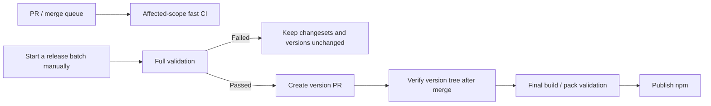

# Development Workflow

From finishing code to merging into main, there are several checkpoints: local build and test, the complete harness suite, changeset, and CI publishing. This page walks through the day-to-day workflow in that order.

## Collaboration

Describe the problem and acceptance criteria in an [issue](https://github.com/zhinjs/zhin/issues), then link the implementation PR. The [delivery board](https://github.com/orgs/zhinjs/projects/3) tracks active issues and PRs through Todo → In Progress → Done. New or updated open items are added automatically; historical merged PRs do not need backfilling. The [GitHub Wiki](https://github.com/zhinjs/zhin/wiki) is a documentation entry point; the maintained technical content lives in this repository's `docs/` directory.

Plugin usability work is accepted in phases under the [plugin authoring and installation experience plan](/contributing/plugin-experience-plan) (Chinese). Behavior customization follows the [behavior customization implementation plan](/contributing/behavior-customization-plan) (Chinese); keeping default behavior and explicitly choosing a new policy are accepted separately.

The scope and acceptance boundary for Chinese and English support is in the [internationalization and localization plan](/contributing/internationalization-plan) (Chinese); the configuration entry points for users and plugin authors are in [Language and Localization](../configuration/localization.md).

## Environment Setup

- Node.js `>=22.19.0`
- pnpm 9 (repo pins `packageManager: pnpm@9.0.2`)

```bash
pnpm install   # Install all workspace dependencies
```

## Common Commands

```bash
pnpm dev        # Start examples/minimal-bot (Sandbox + Console); recommended for first-time verification
pnpm dev:full   # Start examples/full-bot (L4 reference)
pnpm dev:test   # Start examples/test-bot (maintainer kitchen sink)
pnpm build      # Turbo builds all packages in order: basic -> packages -> plugins
pnpm test       # Full Vitest run
pnpm type-check # tsc --noEmit (tsconfig.typecheck.json)
pnpm lint       # ESLint
```

When verifying a single package, prefer `pnpm --filter <pkg> build|test` instead of running a full build by default.

The Windows CI build uses `scripts/ci/build-windows.ps1`: one pnpm process runs every `build`
script under `basic/`, `packages/`, and `plugins/` serially in workspace dependency order, which
avoids starting pnpm and cmd again for each package. Linux and everyday local builds keep using
Turbo. The Windows job preserves the original failing exit code and uploads a
`windows-build-resources-*` diagnostic artifact with the runner image, Node version, and process,
handle, and memory samples; it records no environment variables, command lines, or credentials.
Sampled peaks are also written to the build log, so they stay readable even when the runner cannot
start the artifact upload process.

When diagnosing CI, start with the failing step and its raw log: type errors, assertion failures,
and documentation drift must be fixed in source or tests. `0xC0000142`
(`STATUS_DLL_INIT_FAILED`) happens while a Windows child process initializes and should be read
together with the resource artifact. If later processes and cleanup steps cannot start either,
retrying in place does not recover the runner. The same commit passing on a different runner only
proves that one environment failure recovered, not that an intermittent problem is fixed.

If you get an error about `@zhin.js/scaffold-wizard` not being found before working on CLI or create-zhin-app, build it first (output goes to `lib/`; Node cannot resolve it before building):

```bash
pnpm --filter @zhin.js/scaffold-wizard build   # or pnpm prepare:cli
```

## Harness CI Gates (pnpm check:all)

Release candidates must also pass `pnpm check:created-project`: the script packs the candidate
dependencies, runs the packed `create-zhin-app -y --skip-install` in an empty temporary directory,
installs, and then verifies `/hello`, command hot reload, a production restart, and `doctor --live`
over a real Sandbox WebSocket. Nightly full validation and formal release batches both run it; it
needs npm network access and a random local port, so it is not an offline unit test.
The Sandbox acceptance also uses the installed CLI to preview and run `migrate` in a workspace
sub-package, reinstalls dependencies, and imports the local package to confirm that explicit
`workspace:` links, custom scripts, configuration, and user files are preserved. This validates
the upgrade flow of the current candidate packages; it does not mean every historical version or
database migration has been verified.
Set `ZHIN_KEEP_ACCEPTANCE_TEMP=1` to keep the temporary project after a failure; it is removed
automatically on success.

`pnpm check:platform-candidates` verifies the offline contracts for QQ Official and Telegram. The
coverage and the remaining real-device gaps are in [platform stable certification](/contributing/platform-acceptance) (Chinese). Passing offline does not promote a platform automatically.

The most valuable command to run before committing is `pnpm check:all`: it runs every check registered in `scripts/check-all-harness.mjs` (including type-check, lint, and unit tests). Full validation uses this suite; ordinary PRs use the affected-scope checks described below. If CI runs a separate coverage job, you can set `HARNESS_SKIP_TEST=1` to skip the `pnpm test` portion and avoid running tests twice.

Below are the checks grouped by responsibility (the command in parentheses can be run individually).

**Quality Baseline**

| Check | Description |
| --- | --- |
| Type Check (`pnpm type-check`) | `tsc --noEmit` |
| Lint (`pnpm lint`) | ESLint (.ts/.tsx) |
| Unit Tests (`pnpm test`) | Full Vitest run |
| Production Config (`pnpm check:prod`) | No debug code in production config |

**Architecture & Dependencies**

| Check | Description |
| --- | --- |
| Architecture Layers (`pnpm check:architecture`) | Layer dependency direction (basic -> kernel -> ai -> core -> agent -> zhin) |
| Dependency Policy (`pnpm check:dependency-policy`) | Scaffold dependency policy, Changesets config, and internal peer ranges |
| Release Plan (`pnpm check:release-plan`) | Patch only; the gate rejects minor/major, including bumps inferred through dependency propagation |
| No Koa Import (`pnpm check:no-koa`) | Plugins must not directly import koa |
| Install Size (`pnpm check:install-size`) | zhin.js IM core production `node_modules` <= 10MB |

**API Snapshots & Plugin Spec**

| Check | Description |
| --- | --- |
| API Surface (`pnpm check:api-surface`) | Public API surface snapshot |
| Plugin Runtime API (`pnpm check:plugin-runtime-api`) | Convention-based plugin runtime API surface snapshot |
| Plugin Spec (`pnpm check:plugin`) | Plugins conform to standard spec |
| Plugin Capability Publish (`pnpm check:plugin-capability-publish`) | Plugins publish their capability directories with the required files, prepublish build, and peer dependencies |
| Publish Repository (`pnpm check:publish-repository`) | Publishable packages have `repository.url` matching github.com/zhinjs/zhin (npm provenance) |
| Agent Tool Schema (`pnpm check:agent-tool-schema`) | `tools` inputSchema matches defineAgentTool/execute types |
| Skill Authoring Boundaries (`pnpm check:skill-authoring-boundaries`) | Skills use `skills/<name>/SKILL.md` and explicitly mount the Feature |

**IM Chain & Runtime Conventions**

| Check | Description |
| --- | --- |
| IM Send Path (`pnpm check:harness-paths`) | Must not bypass the Adapter.sendMessage unified chain |
| IM Session SSOT (`pnpm check:im-session-ssot`) | IM scene/session identity resolution uses core SSOT |
| No Platform Branches (`pnpm check:no-platform-branches`) | Platform name literals and platform-keyed tables (`icqq`, `discord`…) are forbidden in core / agent / ai / adapter `src` and `basic/cli/src/plugin-runtime`; differences must read the adapter capability profile (ADR 0044). Exceptions are listed in `scripts/no-platform-branches-allowlist.json` with a reason |
| Removed Plugin API (`pnpm check:no-removed-plugin-api`) | Removed Plugin lookup APIs must not reappear in production source |

**AI Layer**

| Check | Description |
| --- | --- |
| LLM Runtime Boundaries (`pnpm check:llm-runtime-boundaries`) | Runtime code resolves models through an owner-scoped `LlmApiRuntime` and does not import ambiguous `getModel` |
| Legacy AI Exports (`pnpm check:legacy-ai-exports`) | `@zhin.js/ai` no longer exports SessionManager and similar symbols |
| Provider Gateway (`pnpm check:provider-gateway`) | LLM gateway sdk/contextWindow preset contract |
| A2A Mesh (`pnpm check:a2a-mesh`) | No residual MCP Agent Mesh v1 symbols |

**Adapter Contracts**

| Check | Description |
| --- | --- |
| Outbound Media Policies (`pnpm check:outbound-media-policies`) | segments.outboundMedia declarations and contract tests |
| AI Outbound Adapters (`pnpm check:ai-outbound`) | aiOutboundExtensions declaration and contract tests |
| Interactive Segments (`pnpm check:interactive-segments`) | interactivePolicy declaration and contract tests |
| Segment Adapters (`pnpm check:segments`) | defineAdapter segments declaration contract (sandbox must pass) |

**Documentation Consistency**

| Check | Description |
| --- | --- |
| Doc Links (`pnpm check:doc-links`) | Documentation relative links are not broken |
| Doc Orphans (`pnpm check:doc-orphans`) | All site Markdown files are in sidebar or allowlist |
| README Exports (`pnpm check:readme-exports`) | README imports match package exports |
| Config Docs (`pnpm check:config-docs`) | Config documentation aligns with DEFAULT_CONFIG key fields |
| Generated Config Reference (`pnpm check:config-reference`) | Generated configuration fields stay aligned with Runtime source and plugin JSON Schema |
| Source-owned Config Enums (`pnpm check:config-enums`) | Source-owned configuration enums stay aligned across Runtime/plugin Schema, generated reference, and narrative docs |
| Troubleshooting Center (`pnpm check:troubleshooting`) | The incident catalog stays aligned with bilingual Symptom → Cause → Action → Verification pages |
| Install Tiers SSOT (`pnpm check:install-tiers-ssot`) | Chinese `README.zh-CN.md` Install tiers table matches `docs/snippets/install-tiers.md` |
| Adapter Docs Sync (`pnpm check:adapter-docs`) | Platform adapter docs sync with `plugins/adapters/*/README.md` (fix with `pnpm sync:adapter-docs`) |
| Platform Tiers SSOT (`pnpm check:platform-tiers-ssot`) | Capability tiers/adapter index matches `scripts/adapter-meta.mjs` |
| Deployment Templates (`pnpm check:deployment-templates`) | Compose, systemd, and Kubernetes templates match their Chinese and English download entries |

**Smoke Tests**

| Check | Description |
| --- | --- |
| Stable Smoke (`pnpm check:stable`) | Sandbox + Agent core unit tests + minimal-bot contract |
| L4-CI (`pnpm check:l4-ci`) | L4 deterministic subset (orchestration/memory/full-bot contract); full `pnpm check:l4` is run manually (not wired into a workflow yet) |

## Agent Evaluation Rules

- **A PR that fixes an Agent behavior bug must include an eval case.** First write a case under `packages/im/agent/evals/cases/` that reproduces the problem (scripted model, deterministic), confirm it fails before the fix and passes after, then submit the fix. The case's `source` names the related issue, PR, or QQ incident. See [`packages/im/agent/evals/README.md`](https://github.com/zhinjs/zhin/blob/main/packages/im/agent/evals/README.md).
- The PR gate runs scripted cases only: `pnpm eval:agent`, with no real model calls.
- The real-model capability matrix runs nightly only (`.github/workflows/nightly-evals.yml`, `pnpm eval:nightly`) as a trend metric, not a required PR check; the budget ceiling is in the evals README.
- Chat quality (sounding human, persona, tact) is evaluated locally with `pnpm eval:chat --workspace <workspace>`: it runs fixed scenarios with the workspace's real model and SOUL, applies deterministic checks plus a judge model score, and compares against the previous report. When you change chat prompts, the reply format, or the model, attach the before/after comparison to the PR. See [`evals/chat/README.md`](https://github.com/zhinjs/zhin/blob/main/evals/chat/README.md).

## Package Exports and Published Manifests

Workspace packages declare a `"development": "./src/*.ts"` export condition so Vitest, Vite, and tsx run TypeScript sources inside the repo. `src/` is not in the npm tarball, so the published `package.json` must not carry that condition; otherwise any tool that enables `development` (Vitest 4 does by default) looks for files that do not exist.

- Every publishable package has `publishConfig.exports` equal to `exports` without `development`. `pnpm publish` (and therefore `changeset publish`) swaps it in when packing, so local development is unaffected.
- After changing `exports`, run `pnpm sync:publish-exports`. `scripts/sync-publish-exports.test.ts` fails on drift, on a published manifest that still has `development`, or on an export target outside `files`.
- `pnpm check:pack-imports` checks each package as `pnpm publish` sees it (with `publishConfig` applied): every `exports` condition, `development` included, must point at a file in the tarball. It also checks the tarball layout: `zhin.entry` must be packed JavaScript and no test files (`tests/`, `__tests__/`, `*.test.*`, `*.spec.*`) may be packed (errors); packed build configuration, source maps whose sources are neither packed nor inlined, and TypeScript sources no source map refers to are warnings. The full layout standard (`lib/` for library code, `plugin.js` and convention directories at the package root, a `files` whitelist without tests) is in the Chinese [publishing guide](/contributing/publishing#发布包目录规范).
- `pnpm check:plugin-scaffold` packs the `zhin.js` dependency closure, checks no packed manifest still has `development`, then runs `zhin new` from the locally built CLI, installs against those tarballs, and runs the generated Vitest, `tsc`, and `pnpm pack`.
- Publish with `pnpm publish` only: `npm publish` ignores `publishConfig.exports` and does not rewrite `workspace:` protocols.

## Changeset Workflow

### Change review and compatibility

A PR should be organized around one acceptance goal. A purely internal refactor keeps public
exports, configuration formats, and runtime behavior unchanged and proves it with the original
callers or scenario tests; large refactors are submitted in steps so directory moves, behavior
changes, and new features are not mixed.

When a public contract is involved, the PR states the affected exports, configuration, plugin
manifest, Console protocol, or delivery semantics, whether the original call style keeps working,
and the matching tests. A changeset is a release record, not proof of compatibility. Under the
current patch-only release policy, an incompatible change should first keep a compatibility path
for existing callers; when that is impossible, discuss the release policy, version boundary, and
migration plan separately first — do not ship it just to get past the patch gate.
The Adapter operation migration was explicitly approved by the maintainer to use patch, and marks
the incompatibility with Adapter Feature API 2 and explicit old/new npm version boundaries; the
scope and recovery requirements are in the
[version boundary plan](https://github.com/zhinjs/zhin/blob/main/docs/plans/adapter-operation-version-boundaries.md) (Chinese).
That approval does not replace release, deployment, or production data change approvals, and it is
not a default authorization for other breaking patches.

A new gate must prove that it both rejects a violating sample and accepts a valid one; state the
scope it protects so a passing check is not read as a guarantee beyond its coverage. Validation
that runs a user project must preserve the user's configuration and credentials.

The repo uses [changesets](https://github.com/changesets/changesets) for version management and changelogs (config in `.changeset/config.json`: `baseBranch: main`, `access: public`). Any change that affects the behavior of a published package must include a changeset:

```bash
pnpm release   # = pnpm changeset; interactively select affected packages and semver level, generates .changeset/*.md
pnpm bump      # = pnpm changeset version; consumes changesets, bumps version numbers, writes CHANGELOG
pnpm pub       # = pnpm changeset publish; publishes to npm
```

During daily development you only need `pnpm release` to commit the changeset file; `bump` and `pub` are executed by CI.

The version policy permits `patch` only. Every changeset declaration must use `patch`, and
`approvedNonPatchReleases` in `.changeset/version-policy.json` must stay empty.
`pnpm check:release-plan` inspects both the raw declarations and the complete plan Changesets
derives; any `minor` or `major`, including bumps inferred through dependency propagation, fails CI,
and there is no exemption entry.
Release coverage deliberately ignores only tests and Changesets-generated `CHANGELOG.md` files.
Package-local build, type-check, and tooling configuration can change emitted code or declarations,
so those configuration changes also require a patch changeset.

The version PR and the post-merge publish job use the same coverage check. While the current
version tag does not exist yet, the gate looks in Git history for a version commit that consumed
patch changesets, bumped the patch version, and added the matching CHANGELOG entry, and uses that
commit as the baseline for packages awaiting publication. Package changes added after the version
commit still need a changeset; a package with neither a tag nor a valid version record is blocked.
Tags are created by the real publish flow and never need to be created ahead of time.

Internal peer dependencies use `workspace:^` so compatible internal minor releases publish as caret
ranges instead of exact versions, which would otherwise push unrelated upstream packages to major. Private examples do not participate in Changesets versioning or tags.

### 1.1 stable line

The official npm ecosystem uses the 1.1.x stable line. Eighty-one packages whose 1.1.0 version
was still available start at 1.1.0. Seven packages that had already published 1.1.0 use their next
available 1.1.x patch because npm does not permit version reuse. Historical higher versions remain
available to preserve existing lockfiles and are marked as superseded by the corresponding 1.1.x
stable release. Each official package points both `latest` and `stable` to that release; routine
releases then increment patch only.

| Package whose 1.1.0 is reserved | Stable version |
| --- | --- |
| `@zhin.js/adapter` | `1.1.12` |
| `@zhin.js/agent` | `1.1.23` |
| `@zhin.js/ai` | `1.1.33` |
| `@zhin.js/client` | `1.1.5` |
| `@zhin.js/console-protocol` | `1.1.5` |
| `@zhin.js/core` | `1.1.35` |
| `@zhin.js/plugin-runtime` | `1.1.9` |

## Publishing (GitHub CI)

Everyday PRs and the merge queue use a fast CI that aims to finish the real checks **within 5 minutes**: it validates the affected packages and their downstream consumers, builds once on Linux Node 24, runs the selected unit tests in four shards that reuse the build output, and checks source contracts, the release plan, and lint for changed files. Global dependency or toolchain changes widen the scope to every package; a failure is never disguised as success by a timeout or an empty test run. GitHub runner queue time is outside the repository's control.

The required check is `checks`: it aggregates the real results of planning, contracts, build, and test, and a planning failure or any task that should have run and failed blocks the merge. When the **same SHA** merged into main already has a successful CI run, the result is reused; a failed lookup, missing evidence, or a different SHA all continue to validate. A pure version PR must match the whole file tree produced by re-running Changesets from the validated baseline; a title or branch name alone never skips checks.

The full Node 22/24/26 × Linux/Windows matrix, coverage, databases, four-platform installs, packed consumers, scaffolding, and the documentation browser acceptance stay in `.github/workflows/full-validation.yml`, which runs daily at 02:00 (Asia/Shanghai / Asia/Manila) and can be started manually. A full release batch calls the same workflow. Nightly only validates; it consumes no changesets and publishes nothing.

### Explicit release batch

1. Go to Actions → **Build and Publish** → **Run workflow** and choose `main`. Ordinary pushes to main no longer update the version PR or run the full release checks.
2. While main still has changesets, the batch first runs full validation against that immutable source commit. On failure or cancellation, main's versions, CHANGELOGs, and changesets stay exactly as they were; fix and start the batch again.
3. Only after full validation succeeds does it run `pnpm bump` and create or update the `chore: update versions` PR. If main has advanced, it refuses to generate versions for the old batch and must be re-run. The version PR and its merge queue also verify the formal full-validation record for the current baseline.
4. After the version PR merges, the workflow verifies the generated tree against the validated source, builds the final versions, validates tarball imports and installed consumers, and finally publishes to npm. The full matrix is not run a second time on the same source.
5. A partial failure after npm publishing has started **does not roll versions back**: npm cannot overwrite a published version. Keep source and versions unchanged and re-run the same workflow manually to continue; Changesets skips packages that are already published. If the source has changed, continuing with the old versions is refused and the new batch must be handled first.

A version PR left over from the old flow also needs one new formal batch first; an earlier push CI or nightly success alone does not authorize publishing. Publish permissions, OIDC, first-publish checks, and branch protection are all retained.



npm authentication tries trusted publishing (OIDC) first and falls back to the npm token for packages that have no trusted publisher yet. Every publish carries provenance. The setup steps and the per-package npmjs.com checklist are in [npm publishing and trusted publishing](/contributing/publishing) (Chinese).

### First publish for new packages

npm trusted publishing cannot create a new package name. A maintainer must publish once by hand and add the trusted publisher on npmjs.com; later versions go through changesets.

Detect locally:

```bash
pnpm check:unpublished
```

If it lists unpublished packages, build and publish each one for the first time, for example:

```bash
pnpm build
(cd path/to/pkg && npm publish --access public)
```

Then add the trusted publisher (npm >= 11.15.0):

```bash
npm trust github <package> --repo zhinjs/zhin --file publish.yml --env npm-production --allow-publish --yes
```

Then go to Actions → **Build and Publish** → **Run workflow** and re-run it manually.

PR fast checks are in `.github/workflows/ci.yml`; full checks are in `.github/workflows/full-validation.yml`, used for nightly and formal release batches. Full coverage of supported platforms and Node versions was not removed; only the stage where it runs changed.

## Debugging

- **Log level**: Set `log_level` to `debug` in `zhin.config.yml` (default is `info`) to see detailed framework internal logs.
- **Console logs page**: Runtime logs are written to the `SystemLog` database model via `DatabaseLogTransport`. The Remote Console logs page reads from it. Open [console.zhin.dev](https://console.zhin.dev) in your browser, fill in the API Base URL (e.g. `http://127.0.0.1:8086`) and Bearer Token (`http.token` config) to view.
- **Single-package debugging**: `pnpm --filter <pkg> test` with `-t '<test name>'` to filter tests; `pnpm test:watch` to enter watch mode.
