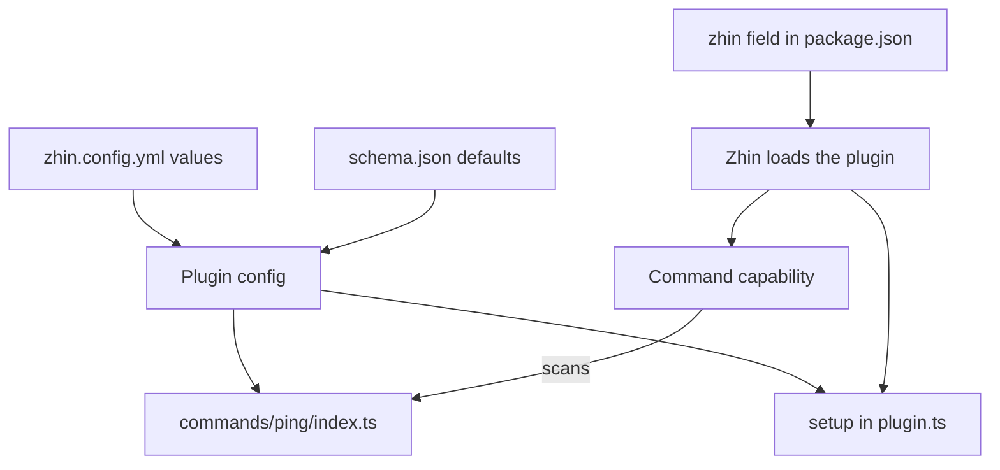

# Write your first plugin

This page walks you through a plugin called `ping-pong`: a user sends `/ping` and the bot replies with text **you can change in config**.

By the end you will know the four building blocks of a plugin — manifest, entry, command, config — and how to mount a plugin on a bot. It takes about 15 minutes.

::: tip Before you start
- You have created and run `my-bot` from the [Quick start](./index.md) (if not, run `npm create zhin-app my-bot -y`).
- Node.js ≥22.19.0 and pnpm 9+. `pnpm dev` runs TypeScript source directly — no build step.
:::

::: tip Want a ready-made skeleton?
This page writes four files by hand to explain each part. In practice, generate them with `npx zhin new ping-pong` (inside a bot project) or `npx @zhin.js/cli new ping-pong --standalone` (a standalone plugin to publish to npm); the output also includes tests and a README.
:::

::: details Just want the least code possible?
One file can register a command too: call `addCommand('ping', defineCommand({ ... }))` inside `setup({ addCommand })` in `plugin.ts`. See [single-file-bot](../examples/index.md#single-file-bot-one-bot-ts-is-a-bot). This page shows the "one capability per file" layout that scales better as features grow.
:::

## The files you will create

Create four files under `my-bot/plugins/ping-pong/`:

```text
plugins/ping-pong/
├── package.json        # ① manifest: tells Zhin this is a plugin
├── plugin.ts           # ② plugin entry
├── commands/
│   └── ping/
│       └── index.ts    # ③ the /ping command
└── schema.json         # ④ config options and defaults
```

Config **values** don't live in the plugin; they go in the bot's `zhin.config.yml` (step 5). That way the same plugin can be configured differently on different bots.

## 1. The manifest: package.json

A plugin is an npm package. What makes Zhin recognize it is the `zhin` field in `package.json`:

```json
{
  "name": "ping-pong",
  "private": true,
  "version": "0.1.0",
  "type": "module",
  "scripts": {
    "dev": "zhin runtime start"
  },
  "dependencies": {
    "zhin.js": "^1.1.0"
  },
  "devDependencies": {
    "@zhin.js/cli": "^1.1.0"
  },
  "peerDependencies": {
    "@zhin.js/command": "^1.1.0"
  },
  "peerDependenciesMeta": {
    "@zhin.js/command": { "optional": true }
  },
  "zhin": {
    "protocol": 1,
    "type": "plugin",
    "entry": "./plugin.ts",
    "engine": "^1.0.0",
    "runtime": "trusted",
    "features": [
      { "package": "@zhin.js/command", "api": "^1.0.0" }
    ],
    "plugins": []
  }
}
```

Three parts matter for now:

- **`zhin.entry`** — the entry file, i.e. `plugin.ts` from the next step.
- **`zhin.features`** — capabilities the plugin uses. Declaring `@zhin.js/command` is what makes Zhin scan the `commands/` folder.
- **`peerDependencies`** — the bot provides `@zhin.js/command`; the plugin only says "I need it" and doesn't install its own copy.

::: details Why an optional peerDependency? What do the other fields mean?
A capability package may exist only once in a bot. If the child plugin put `@zhin.js/command` in its own `dependencies`, there would be two copies and startup would fail (even with identical versions). So the child declares it as an optional peer and the bot installs it.

`optional: true` only affects npm installation; at runtime, a capability listed in `zhin.features` is still **required**.

| Field | Meaning |
|------|------|
| `entry` | Entry file; must be a package-relative path starting with `./` |
| `runtime` | `trusted` runs the plugin in the main process |
| `features` | Capability packages this plugin uses. Your bot (the Root plugin) inherits the common ones by depending on `zhin.js`, but child plugins must declare their own |
| `plugins` | Child plugins this plugin mounts — empty here |

Full details: [Plugin model](../concepts/plugin-model.md).
:::

## 2. The entry: plugin.ts

```ts
import { definePlugin } from 'zhin.js';

interface PingPongConfig {
  reply: string;
}

export default definePlugin<PingPongConfig>({
  name: 'ping-pong',
  // Console plugin card display
  metadata: { displayName: 'Ping Pong', icon: 'Blocks' },

  async setup(context) {
    // Config view: schema.json provides defaults, zhin.config.yml overrides
    const config = context.config.get();
    console.log(`[ping-pong] setup: reply=${config.reply}`);

    // Optional: return a Dispose callback, executed at generation end (hot-reload safe)
    return () => console.log('[ping-pong] disposed');
  },
});
```

- The `name` in `definePlugin` may only contain lowercase letters, digits and hyphens.
- `setup` runs when the plugin loads. `context.config.get()` reads this plugin's config.
- The function `setup` returns runs **before the plugin unloads or hot-reloads**. Close any timers or connections there, or they will leak across reloads.

You don't register the command in the entry — the file in the next step is discovered automatically.

## 3. The command: commands/ping/index.ts

```ts
import { defineCommand } from 'zhin.js/command';

interface PingPongConfig {
  reply: string;
}

export default defineCommand.withConfig<PingPongConfig>()({
  description: 'Reply with the configured text',
  execute({ config }) {
    return config.reply;
  },
});
```

**The folder path is the command name**: `commands/ping/index.ts` is `/ping`, and `commands/admin/ban/index.ts` is `/admin ban`. Only `index.ts` is the command entry; other files in the same folder can be imported as helpers.

The `config` passed to `execute` is the same config `setup` reads. `defineCommand.withConfig<PingPongConfig>()` fixes the config type first and the second call defines the command, so `params` and `options` are still inferred (see [Commands · Type the config](../authoring/commands.md#typed-config)). For params, options and permissions, see [Commands](../authoring/commands.md).

## 4. Config options: schema.json

`schema.json` declares which config options the plugin has and their defaults, using standard JSON Schema:

```json
{
  "$schema": "https://json-schema.org/draft/2020-12/schema",
  "type": "object",
  "additionalProperties": false,
  "properties": {
    "reply": {
      "type": "string",
      "default": "pong",
      "description": "Reply content for the /ping command"
    }
  }
}
```

If `reply` isn't set in the config file, the default `pong` is used. Console also generates a config form from this file.

::: details Which JSON Schema features does the Console form support?
Console can only convert structures that map directly to a form. `$ref`, `anyOf`, `oneOf`, `allOf`, `prefixItems`, `patternProperties` and array-form `items` are not supported yet and report a clear error. Runtime validation is not limited by this. For complex settings such as `ai` or `htmlRenderer`, edit the config file directly or use Console's source editor.
:::

## 5. Mount it on your bot

Go back to the bot root `my-bot/` and install dependencies:

```bash
pnpm add @zhin.js/command@^1.1.0 --ignore-workspace-root-check
cd plugins/ping-pong
pnpm install
cd ../..
```

Declare the dependency in **the bot's** `package.json` (`zhin.plugins` stays empty; the main configuration declares instances) (merge with what's there — don't overwrite it):

```json
{
  "dependencies": {
    "@zhin.js/command": "^1.1.0"
  },
  "zhin": {
    "plugins": []
  }
}
```

- `package` points at the plugin folder. It must start with `./` and cannot escape the project with `..`.
- `instanceKey` is the plugin's name inside this bot: lowercase letters, digits and hyphens only.

Finally, in **the bot's** `zhin.config.yml`, add the config under the `instanceKey`:

```yaml
configVersion: 2
plugins:
  ping-pong: './plugins/ping-pong'
ping-pong:
  reply: pong!
```

::: details Why does the bot depend on @zhin.js/command too?
Projects created by `npm create zhin-app` already include `plugins/*` in the pnpm workspace. The bot depends on `@zhin.js/command` directly and the child uses that same copy through its peer — don't add it to the child's `dependencies`. Zhin requires every capability package to come from exactly one physical directory.
:::

## 6. Run and verify

```bash
pnpm dev
```

Check, in order:

1. The terminal prints `[ping-pong] setup: reply=pong!` — the plugin loaded and read its config.
2. Send `/ping` in the Sandbox and the bot replies `pong!`.
3. Change `reply` in `zhin.config.yml`, save, and send `/ping` again — the new reply appears without a restart. Editing `commands/ping/index.ts` works the same way.

Just want to check that the plugin assembles, without the interactive mode? Run `zhin runtime start --once`.

::: tip No reply?
- The command prefix comes from each connection's `commandPrefix`; the scaffolded Sandbox uses `/`, other platforms may use none.
- No setup log line: check the package path in `plugins.ping-pong` in the bot configuration.
- Run `npx zhin doctor` for an environment check.
:::

## How it works



On startup Zhin reads the manifest and loads the capabilities listed in `features`; the Command capability scans `commands/` and registers each file it finds. Config is the `schema.json` defaults merged with the values from `zhin.config.yml`, and is handed to both `setup` and the command. When you save a file, this whole process re-runs in the background and replaces the old version only after it validates.

## Alternative: a plugin as an application

Put a `zhin.config.yml` inside the plugin folder and the plugin can start as a complete bot on its own, with no host project. This is handy for developing and debugging one plugin in isolation.

The plugin is then the Root, so its config goes under `plugin:`:

```yaml
# ping-pong/zhin.config.yml
configVersion: 2
plugin:
  reply: pong!

plugins: {}
```

As a standalone application it must install the capability package itself and connect at least one adapter to receive messages:

```bash
cd plugins/ping-pong
pnpm add @zhin.js/command@^1.1.0 --ignore-workspace-root-check
pnpm exec zhin setup --adapters  # pick Sandbox or another adapter
pnpm install
pnpm dev
```

## Next steps

- [Commands](../authoring/commands.md): add params, options and permissions to `/ping`.
- [Convention directories](../authoring/conventions.md): where middleware, components, schedules and other capabilities go.
- [definePlugin overview](../authoring/define-plugin.md): use databases, timers and proactive messages in `setup`.
- [Complete plugin delivery](../authoring/plugin-delivery.md): test your plugin and publish it to npm.
- [Local development guide](../authoring/local-dev.md): develop local plugins or zhin source against your own bot project.
