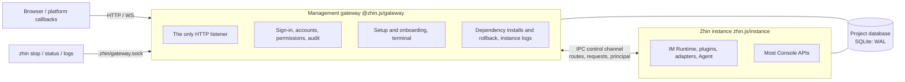

# Upgrading to the Management Gateway

Previously, `zhin runtime start` ran a parent process whose only job was to restart a child; HTTP, the Console, configuration writes and plugin installs all lived in the child (the Bot itself), and the child asked for a restart by exiting with code `75`. When the Bot failed to start, crashed or was installing dependencies, the Console went down with it.

Zhin now runs two processes ([ADR 0054](../../adr/0054-management-gateway.md)):



- The **gateway** is started by `zhin start` and stays up: it listens on `http.port` and owns sign-in and permissions, the setup wizard, the terminal, dependency installs, instance start / stop and logs. It never loads plugin code.
- The **instance** can only be launched by the gateway and runs the IM Runtime, plugins, adapters and the Agent. It no longer listens on a port: routes registered by plugins are handed to the gateway, which receives the requests and forwards them over the control channel.
- While the instance crashes, stops or installs dependencies, the gateway keeps running; the Console can still sign in, show the instance state and logs, and start the instance again.

This page is for existing projects. For a new project, follow the [Quick Start](../getting-started/index.md).

## At a glance

| Before | Now | Section |
| --- | --- | --- |
| `zhin runtime start` (foreground; the parent only restarts) | `zhin start --foreground`; `zhin runtime start` is its alias | [Starting](#start) |
| `zhin start` (alias of `zhin runtime start`) | Runs the gateway **in the background** by default; manage it with `zhin stop / restart / status / logs` | [Starting](#start) |
| The child exits with `75` to request a restart | The instance sends `restart-request` over the control channel and the gateway restarts it; exit code `75` means nothing any more | [Exit codes and monitoring](#exit-codes) |
| An instance crash ends the whole process; systemd / PM2 restart it | The gateway restarts the instance (at most 10 times a minute); beyond that it stays `crashed` while the gateway keeps running | [Exit codes and monitoring](#exit-codes) |
| Only `@zhin.js/cli` and `zhin.js` | Add `@zhin.js/gateway`; upgrade all three together | [Dependencies](#dependencies) |
| HTTP routes receive Node `IncomingMessage` / `ServerResponse` | Web standard `Request` → `Response`; WebSockets are `WsConnection` | [Custom HTTP routes](#http-routes) |
| `http.tokens`, demo mode | Removed: users, roles and API tokens live in the database | [Console access control](#access-control) |
| Logs only on stdout | Instance logs always go to `.zhin/logs/instance.log`; a background gateway writes `.zhin/logs/gateway.log` | [Logs](#logs) |
| Only the instance connects to the database | Gateway and instance both connect; SQLite uses WAL | [SQLite](#sqlite) |

## 1. Before you upgrade {#before}

1. **Stop the Bot** (`zhin stop`, or stop systemd / PM2 / the container). Replacing the dependency directory under a running process makes it load a mix of old and new files.
2. Back up: Git commit, `package.json` and the lockfile, `zhin.config.yml`, `.env`, the database (`.zhin/data.sqlite` for SQLite, see [SQLite](#sqlite)), `data/` and `.zhin/`.
3. If you maintain your own plugins or adapters that register HTTP / WebSocket routes, migrate them as described in [Custom HTTP routes](#http-routes) first.

## 2. Dependencies: upgrade gateway and instance together {#dependencies}

```bash
pnpm add zhin.js@latest @zhin.js/gateway@latest
pnpm add -D @zhin.js/cli@latest
pnpm install
```

- `@zhin.js/cli` itself depends on `@zhin.js/gateway`; listing the gateway in the project makes the lockfile pin it to the same release as `zhin.js`.
- **Gateway and instance must be upgraded together.** The control channel carries a protocol version: the instance's `ready` message includes it, and on a mismatch the gateway rejects the instance, stops restarting it and reports the upgrade in `zhin status` and the Console. Upgrading only one side leaves the instance unable to start.
- Commit the lockfile in production and deploy with `pnpm install --frozen-lockfile`.

## 3. Console access control {#access-control}

When upgrading from `@zhin.js/cli` 1.1.x, the same release also brings Console access control (ADR 0049):

- `http.tokens` is removed and the gateway refuses to start while it is still configured;
- demo mode (`scope: demo` tokens) is removed; a demo site is now a real Host with a read-only account, see [Deploying a demo site](../operations/demo-deployment.md);
- `http.token` is only a **bootstrap token**: once the first owner exists it is refused on every endpoint;
- automation uses API tokens issued by users (`ZHIN_CONSOLE_TOKEN`).

Full steps: [Upgrading to Console access control](./console-access-control.md). Sign-in, setup, accounts and audit are all handled by the gateway, which opens the project database itself, so **setup works even when the instance is not running**.

## 4. Starting {#start}

| Scenario | Command |
| --- | --- |
| Local development (hot reload) | `zhin start --foreground --watch source config` (scaffolded `pnpm dev`) |
| systemd / Docker / PM2 / Kubernetes | `zhin start --foreground --mode production --no-watch` (scaffolded `pnpm start`) |
| Bare metal without a process manager | `zhin start --mode production --no-watch` (background); manage it with `zhin status / logs -f / restart / stop` |
| CI smoke test | `zhin start --once --mode test` (starts once in the foreground and exits; the gateway exits with the instance) |

Update the scripts in the project's `package.json`:

```json
{
  "scripts": {
    "dev": "zhin start --foreground --watch source config",
    "start": "zhin start --foreground --mode production --no-watch",
    "stop": "zhin stop"
  }
}
```

Old scripts that call `zhin runtime start …` keep working (it is an alias for `zhin start --foreground`). What changes is that **a bare `zhin start` now runs in the background**: process managers must pass `--foreground`, otherwise the command returns right after starting the gateway and the service manager concludes the service has exited.

- `--daemon` is still accepted and only means "background" (the default). It no longer means "foreground plus crash restarts": crash restarts apply in every mode.
- `zhin restart` restarts only the instance; gateway and Console stay up. `zhin restart --gateway` restarts the gateway too (background gateway only; for a foreground gateway it explains why, prints the systemd / PM2 replacement command and exits non-zero).
- While the gateway runs, `zhin install / uninstall / update` go through it: stop the instance → package manager → start the instance, rolling back on failure. Git URLs, local paths and `--save-dev` require `zhin stop` first.
- Management commands talk to the gateway over the local control socket `.zhin/gateway.sock` (`0600`) and **must run as the same system user that started the gateway**.

All options and behaviour: [zhin start](../cli/runtime.md).

### `--standalone`: development and tests only {#standalone}

`zhin start --standalone` starts no gateway: the instance runs its own Node HTTP server in-process and assembles sign-in and the terminal itself. There is no managed restart: a Console "restart" or a dependency change only stops the process. Use it to test or debug the instance itself, never for deployments.

Without a control channel (neither launched by a gateway nor `--standalone`), the instance entry `zhin.js/instance` refuses to start and points to `zhin start`.

## 5. systemd / Docker / PM2 {#process-managers}

### systemd

```ini
[Service]
Type=simple
WorkingDirectory=/srv/my-bot
# Before: ExecStart=/usr/bin/env npx zhin runtime start --mode production --no-watch
ExecStart=/usr/bin/env npx zhin start --foreground --mode production --no-watch
Restart=always
RestartSec=10s
```

The documented [`zhin@.service`](../operations/production.md) runs `pnpm start`; updating the script is enough. `Restart=always` now only matters when the gateway itself exits; instance crashes are handled by the gateway. cgroup limits such as `MemoryMax` apply to gateway and instance together.

### Docker / Compose

The documented Dockerfile starts with `CMD ["pnpm", "start"]`; updating the `start` script is enough. Also check:

- `/app/.zhin` must be writable (the gateway creates `gateway.sock`, `gateway.json` and `logs/` there). The template mounts it as a named volume, so it works with a read-only root filesystem.
- Health checks: `/pub/health` is now answered by the gateway and keeps succeeding while the instance is crashed. For orchestration to notice an unavailable instance, use `/pub/ready` for readiness (it returns `503` until the instance is ready).
- Keep `init: true` (or `docker run --init`) and a sufficient `stop_grace_period`: on SIGTERM the gateway first lets the instance stop cleanly, then closes its listeners.

### PM2

```js
// ecosystem.config.cjs
module.exports = {
  apps: [{
    name: 'my-bot',
    script: 'node_modules/.bin/zhin',
    // Before: args: 'runtime start --mode production --no-watch'
    args: 'start --foreground --mode production --no-watch',
    autorestart: true,
  }],
};
```

PM2 manages the gateway process; `max_memory_restart` only measures the gateway, not the instance child process.

## 6. Exit codes and monitoring {#exit-codes}

| Situation | Before | Now |
| --- | --- | --- |
| Console restart, dependency change, database switch | The child exits with `75` and the parent restarts it | The instance sends `restart-request`; the gateway restarts the instance and keeps running |
| Instance crash | The process exits non-zero; an external supervisor restarts it | The gateway restarts the instance; more than 10 crashes a minute → `crashed`, waiting for a human |
| SIGTERM / `zhin stop` | `0` | `0` (instance first, then gateway) |
| Ctrl+C | `130` | `130` |
| `zhin status` | — | `0` when the gateway runs, `3` when it does not |

Monitoring that detects Bot crashes from the process exit code must switch to:

- the instance state in `zhin status --json` (`stopped / starting / running / stopping / backoff / crashed`, last exit code, log tail);
- `/pub/ready` (runtime readiness) and `/pub/health` (gateway liveness, including the instance state);
- the Console **Operations → Instance** page (`/ops/instance`).

## 7. Custom HTTP routes: `Request` / `Response` {#http-routes}

Only plugins or adapters that register their own HTTP / WebSocket routes need changes (official adapters and plugins are already migrated). The route contract no longer exposes Node's `IncomingMessage` / `ServerResponse` / raw `ws` sockets; it uses Web standard objects instead: a handler receives a `Request` and a context and returns a `Response`. Because the instance has no HTTP server, the request really comes from the gateway, and the old signature cannot work.

### HTTP routes

Before:

```ts
import type { IncomingMessage, ServerResponse } from 'node:http';

http.route('POST', '/my-plugin/hook', async (req: IncomingMessage, res: ServerResponse, url: URL) => {
  const chunks: Buffer[] = [];
  for await (const chunk of req) chunks.push(chunk as Buffer);
  const body = JSON.parse(Buffer.concat(chunks).toString('utf8'));
  if (req.headers['x-signature'] !== sign(body)) {
    res.statusCode = 401;
    res.end('unauthorized');
    return;
  }
  res.setHeader('content-type', 'application/json');
  res.end(JSON.stringify({ ok: true, id: url.searchParams.get('id') }));
});
```

Now:

```ts
import { readJsonBody, jsonResponse } from '@zhin.js/host-http';

http.route('POST', '/my-plugin/hook', async (request, { url, params, remoteAddress }) => {
  const body = await readJsonBody(request, { limit: 1024 * 1024 }); // throws HttpBodyError(413) when too large
  if (request.headers.get('x-signature') !== sign(body)) {
    return new Response('unauthorized', { status: 401 });
  }
  return jsonResponse(200, { ok: true, id: url.searchParams.get('id') });
});
```

- Context fields: `url` (parsed URL), `params` (path parameters; for a prefix route `/x/*` the remainder is `params['*']`), `remoteAddress`, and for routes under `{base}` also `principal` (the caller the gateway authenticated).
- These helpers come from `@zhin.js/host-http` (re-exported from the contract package `@zhin.js/host-http-contract`). Read bodies with `readBodyBytes` / `readTextBody` / `readJsonBody` (1 MiB limit by default, adjustable with `limit`); webhooks that verify signatures should read the raw bytes with `readBodyBytes`.
- Build responses with `new Response(...)`, `jsonResponse` or `emptyResponse`. SSE and large downloads use `createResponseStream()` (with backpressure) and `SSE_HEADERS`.
- An unexpected exception in a handler returns only a generic error message; details go to the log. Return your own `Response` for errors the caller should see.
- The Node server implementation moved to `@zhin.js/host-http/node` and is only used by `--standalone` and tests; plugins must not import it.

### WebSocket routes

Before:

```ts
const handle = http.ws('/my-plugin/ws');
handle.onConnection(({ socket, request }) => {
  socket.on('message', (data) => socket.send(data));
  socket.on('close', () => cleanup());
  logger.info(request.socket.remoteAddress);
});
```

Now:

```ts
const handle = http.ws('/my-plugin/ws', { auth: 'protocol' });
const release = handle.onConnection((connection) => {
  // connection: WsConnection — url, headers, remoteAddress, bufferedAmount
  connection.onMessage((data) => connection.send(data));   // data: string | Uint8Array
  connection.onClose((code, reason) => cleanup());
  logger.info(connection.remoteAddress);
});
```

- Frames travel over the control channel; `bufferedAmount` reflects the backlog, so throttle large sends by it.
- Protocol-level ping / pong belongs to the gateway (see [heartbeat_interval](#heartbeat)); plugins no longer call `socket.ping()`.
- The `auth` option is explained in the next section.

## 8. Reverse WebSockets and `access_token` {#reverse-ws}

Adapter reverse WebSockets (`connection: wss` for OneBot 11 / 12, NapCat, Milky) and webhooks do not use Console accounts: the plugin authenticates them with its own credential, and the gateway forwards them unchanged.

- Register your own reverse WS with `http.ws(path, { auth: 'protocol' })` and check the peer in `onConnection` with `verifyProtocolAccessToken(accessToken, connection)` (`@zhin.js/host-http`), closing with `connection.close(4003, 'Unauthorized')` on failure.
- The check accepts `Authorization: Bearer <access_token>` or `?access_token=`.
- **Without `access_token`, only loopback peers (127.0.0.1 / ::1) are accepted.**

::: warning Always set `access_token` behind a reverse proxy
The gateway does not read `X-Forwarded-For`; the peer address it sees is the hop that connected directly. When a reverse proxy (nginx, Caddy, Cloudflare Tunnel, …) runs on the same machine as the gateway, every connection through the proxy appears to come from `127.0.0.1` — a reverse WebSocket without `access_token` is then open to the whole internet. Configure `access_token` on every endpoint exposed through a reverse proxy.
:::

## 9. `heartbeat_interval` {#heartbeat}

**Reverse** WebSockets for OneBot 11, NapCat and Milky (`connection: wss`, Zhin is the server) no longer send pings at `heartbeat_interval`: the gateway carries the connection, sends a protocol-level ping every 30 seconds and drops peers that do not answer with a pong. Leaving `heartbeat_interval` in the configuration is harmless; it just has no effect in this mode. Forward connections (`connection: ws`, Zhin is the client) and OneBot 12 reverse connections still use `heartbeat_interval`.

## 10. Plugin permission levels and plugin RPC authorization {#plugin-permissions}

Two behaviour changes affect custom roles and plugin authors:

1. **Plugin permissions are granted to built-in roles by level.** A plugin permission (`<plugin>:<action>`, such as `onebot11:read` or `ops:approve`) belongs to one of `read` / `operate` / `manage`: `viewer` gets `read`, `operator` gets `read` + `operate`, `admin` and `owner` get all. Undeclared levels are inferred from the suffix (`:read` / `:view` → `read`; `:approve` / `:manage` / `:admin` / `:write` / `:config` → `manage`; anything else → `operate`).
2. **Plugin Console RPC is authorized per method.** Previously a signed-in user calling `plugin.<id>.<method>` was only checked for `feature.view` (read) / `feature.configure` (write), so `operator` could run actions such as `ops:approve`. Now each method's own `requiredPermissions` and its page's requirements are checked, with `403 forbidden` otherwise; when neither declares anything, read methods need `feature.view` and actions need `feature.configure`.

For plugin authors: declare each permission's level in `definePluginConsoleRpc({ permissions })`, especially permissions ending in `:write` that are everyday operations (left undeclared they are inferred as `manage`, which only `admin` and above hold):

```ts
definePluginConsoleRpc({
  permissions: [
    { id: 'rss:read', level: 'read', description: 'View subscriptions' },
    { id: 'rss:write', level: 'operate', description: 'Add and remove subscriptions' },
  ],
  // ...methods
});
```

For administrators: after upgrading, review custom roles under **Access control → Roles** — plugin actions that used to work with `feature.configure` now need the matching plugin permission or level permission (`plugin.perms.read|operate|manage`). Names and level rules: [Console access control](../console/access-control.md#plugin-permissions).

## 11. Where the logs are {#logs}

| Log | Location |
| --- | --- |
| Instance stdout / stderr | Always written to `.zhin/logs/instance.log`, rotated past 10 MiB to `instance.log.1` … `.5`; the gateway also keeps the last 1000 lines in memory |
| Foreground gateway | Instance output is also echoed to the terminal; process managers keep collecting stdout |
| Background gateway's own output | `.zhin/logs/gateway.log` |
| Audit log | The `console_audit_log` table in the project database (Console **Access control → Audit log**) |

`zhin logs [-f] [-n N]` reads recent lines from the gateway while it runs, and `instance.log` otherwise. `--log-file <path>` moves the instance log. Include the log directory in backups and disk alerts.

## 12. SQLite: two processes share one file {#sqlite}

To allow sign-in and setup while the instance is offline, the gateway opens the project database itself (same `database` configuration as the instance), so a SQLite file has two connections:

- File databases always use **WAL** (`journal_mode=WAL`). `data.sqlite-wal` and `data.sqlite-shm` appear next to the database; they are part of it.
- **Backups**: with the Bot stopped, copy `.sqlite`, `-wal` and `-shm` together, or take a consistent snapshot while running with `sqlite3 .zhin/data.sqlite ".backup backup.sqlite"`. Never copy the `.sqlite` file alone.
- Do not put SQLite on a network file system (NFS, SMB): WAL relies on shared memory and does not work across hosts.
- When the processes contend for the write lock, the instance's SQLite dialect retries with bounded asynchronous backoff (5 seconds by default) and the gateway only writes single statements. An occasional `SQLITE_BUSY` log line is not corruption; if it persists, look for a third process (a backup script, a manual `sqlite3` session) holding the lock.
- Network databases (MySQL, PostgreSQL, …) also get one connection per process; size connection pool limits for two processes.

## 13. New files {#files}

| File | Purpose |
| --- | --- |
| `.zhin/gateway.sock` | Local control socket (`0600`; a named pipe on Windows); `zhin stop / status / logs` use it, and whoever connects is treated as the local owner |
| `.zhin/gateway.json` | State of the running gateway (pid, ports, start arguments); removed when the gateway exits |
| `.zhin.pid` | Gateway pid |
| `.zhin/logs/` | Instance and gateway logs |
| `.zhin/onboarding.json` | Console onboarding progress; after an upgrade, steps that are already configured are marked done |

Do not commit `.zhin/` to Git or bake it into container images. A stale socket left behind by `kill -9` is cleaned up on the next `zhin start`.

## 14. Changed security defaults {#security-defaults}

- **SSH terminal targets must pin the host key**: every `console.terminal.ssh[]` target needs `hostFingerprint`, otherwise config validation fails. Get it with `ssh-keyscan -t ed25519 <host> | ssh-keygen -lf -`. If you really cannot pin it, set `insecureAcceptAnyHostKey: true`; the Console marks that target as "insecure: host key not verified".
- **Reverse proxies**: `X-Forwarded-For` / `Forwarded` are not trusted by default. Behind a reverse proxy, set `http.trustProxy` (`true`, a hop count, or a list of proxy IPs / CIDRs) so login rate limiting and audit see the real client address. Either way, a request carrying a forwarding header never counts as loopback: reverse WebSockets without `access_token` and the MCP / A2A localhost exemption refuse proxied requests — configure credentials for them.
- **Database**: instance-side database tools (the Console database page, raw SQL, Agent file tools) cannot reach the gateway's `console_*` tables; Agent file tools treat SQLite files as sensitive.

## Rollback {#rollback}

With the Bot stopped, restore the pre-upgrade lockfile, `package.json`, configuration and database snapshot, then run `pnpm install --frozen-lockfile`. Downgrading only `@zhin.js/cli` or only `zhin.js` does not work — gateway and instance protocol versions must match. Accounts, roles and audit entries created in the Console after the upgrade live in the database; restoring an older snapshot loses them.

## Checklist {#checklist}

- [ ] `zhin.js`, `@zhin.js/gateway` and `@zhin.js/cli` come from the same release; the lockfile is committed
- [ ] Process manager commands (systemd / Docker / PM2) include `--foreground`
- [ ] Monitoring uses `zhin status --json` and `/pub/ready` instead of process exit codes
- [ ] Custom HTTP / WebSocket routes use `Request` / `Response` / `WsConnection`
- [ ] Every reverse WebSocket endpoint exposed through a reverse proxy has an `access_token`
- [ ] Custom roles were reviewed against the new plugin RPC authorization
- [ ] `.zhin/` is writable and the log directory is covered by disk alerts
- [ ] SQLite backups include `-wal` / `-shm`, or use `.backup`
- [ ] An owner exists and can sign in to the Console (see [Upgrading to Console access control](./console-access-control.md))
