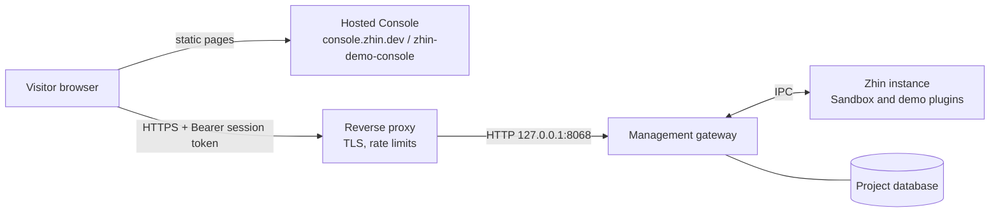

# Deploying a Demo Site

Demo mode (`scope: demo` tokens in `http.tokens`) has been removed ([ADR 0049](../../adr/0049-console-rbac.md)). A demo site is now an ordinary Zhin Host — gateway plus instance — with one read-only account whose username and password are published; visitors sign in through the hosted Console (`console.zhin.dev`, or the `zhin-demo-console` project on Cloudflare). Visitors see a real backend, and what they can do is decided by the account's role rather than a hard-coded RPC allowlist.



This page only describes how to deploy one; it does not refer to any existing demo server.

## 1. Prepare a dedicated project

Use a **separate project** for the demo — never open a demo account on a production Bot. A read-only account can see status, logs, the account list, conversations and inboxes, feature configuration (secret values masked), database contents and project files.

```bash
npm create zhin-app zhin-demo -- -y --adapter sandbox
cd zhin-demo
```

- Install only the plugins and adapters the demo needs (Sandbox needs no platform account). Do not configure real platform credentials, model keys or any private data.
- In `zhin.config.yml`, bind the Host to loopback and let a reverse proxy serve HTTPS:

  ```yaml
  http:
    host: 127.0.0.1
    port: 8068
    token: ${HTTP_TOKEN}          # bootstrap token, refused once the owner exists
    corsOrigins:
      # console.zhin.dev is always merged in; list your own Console domain here
      - "https://zhin-demo-console.pages.dev"
  ```

- Do not enable the terminal: keep `console.terminal.enabled: false` (the default).

## 2. Start gateway and instance

Let a process manager own the foreground gateway, exactly as in production (templates: [Deployment and recovery](./production.md)):

```bash
pnpm install --frozen-lockfile
zhin start --foreground --mode production --no-watch   # = pnpm start
```

Confirm both are running:

```bash
zhin status
curl --fail http://127.0.0.1:8068/pub/health
curl --fail http://127.0.0.1:8068/pub/ready
```

## 3. Create the owner and the demo account

The owner is for maintainers only. Create it on the server as the same system user that runs the service (no browser involved, the bootstrap token is never exposed). While the gateway runs these commands go to it over the local control socket; without one they write the project database directly. **Do this before the reverse proxy or a public ingress is opened** — until an owner exists, the bootstrap token is a full credential for anyone who can reach the Host:

```bash
# Owner: first-time setup
printf '%s\n' "$OWNER_PASSWORD" | zhin console init --yes --owner maintainer --password-stdin

# Demo account: the default role is viewer
printf '%s\n' "$DEMO_PASSWORD" | zhin console user create demo --role viewer --password-stdin
zhin console user list
```

Passwords need at least 10 characters. The demo password will be public, but still do not reuse a password from anywhere else.

### Use a narrower role than the built-in `viewer` (recommended)

The built-in `viewer` holds every `*.view` / `*.read` permission except `ops.config.read` and `ops.env.read`, which includes `ops.database.read` (database browser), `ops.files.read` (project files), `ops.schedule.read` and `plugin.perms.read`. A demo rarely needs visitors to browse the database or files. Sign in as the owner, copy `viewer` under **Access control → Roles**, and remove what you do not want public, for example:

| Keep | Remove |
| --- | --- |
| `status.view`, `endpoint.view`, `feature.view`, `agent.view` | `ops.database.read`, `ops.files.read`, `ops.schedule.read` |
| `plugin.perms.read` or specific `<plugin>:read` names the demo plugins need | Read permissions of other plugins |

Then bind the demo account to that role: `zhin console user create demo --role demo-viewer --password-stdin`, or change the binding under **Access control → Users**. To let visitors send messages in the Sandbox, add `endpoint.operate` (the `/sandbox` WebSocket requires it); without it they can only look.

## 4. Point the hosted Console at the demo backend

The Console is a static site; which Host it connects to comes from the address bar. The published link **carries the API address only, never a token**:

```text
https://console.zhin.dev/?apiBaseUrl=https%3A%2F%2Fdemo-api.example.org
```

- `apiBaseUrl` excludes `/api`; the Console appends `http.base`. The Console removes the parameter from the address bar after reading it and asks the visitor to confirm the first connection to an unknown Host.
- With the `zhin-demo-console` project on Cloudflare (the same build of the Console repository, `npm run build:demo`), use its domain in the link and add that domain to `http.corsOrigins`.
- Publish on the demo page: the Console link, username `demo`, the demo password, and a note such as "read-only demo, data is reset regularly".

A visitor opens the link → signs in with the username and password → sees the sections and pages the demo role allows; other sections are hidden entirely and writes return `403`.

## 5. Maintenance

- **Reset demo data**: periodically stop the service, restore a clean database snapshot (SQLite together with `-wal` / `-shm`) and start again. Accounts and roles live in the same database, so the snapshot must contain them.
- **Change the demo password**: `zhin console user passwd demo --password-stdin`; all of the account's sessions end immediately.
- **Pause the demo**: `zhin console user disable demo`; `enable` to resume.
- **See who did what**: the owner reads sign-in successes and failures and denied requests under **Access control → Audit log**.
- **Upgrade**: gateway, instance and CLI together, see [Upgrading to the management gateway](../migrations/management-gateway.md).

## Hardening checklist {#hardening}

- [ ] **Read-only account only**: the demo account is bound to `viewer` or a narrower custom role; never `operator` or above, never any `*.write` / `*.manage` / `ops.restart` / `iam.*` / `plugin.manage`.
- [ ] **No terminal**: keep `console.terminal.enabled` at `false`. Only owners with `ops.terminal` could use it, but a demo machine has no reason to enable it.
- [ ] **Dedicated project, no real data**: no real platform credentials or model keys; `.env` holds only `HTTP_TOKEN`.
- [ ] **Publish only after setup**: create the owner before opening the port; after setup `http.token` is refused everywhere. Use a random bootstrap token and never put it in a public README, image or demo page.
- [ ] **Reverse proxy**: bind the Host to `127.0.0.1` and serve HTTPS from nginx / Caddy / Cloudflare Tunnel; preserve the `Authorization` header, streaming SSE responses (never cache `/api/events`) and WebSocket upgrades.
- [ ] **Rate limits**: the gateway has a built-in sign-in limit (5 failures per IP and username in 15 minutes, then exponential backoff with `429`). By default it does not read `X-Forwarded-For`, so requests through a proxy share the proxy's address — the sign-in limit then applies to all visitors at once, and the audit log records the proxy's IP. With `http.trustProxy` set (for example `[loopback]`, see [Production](./production.md#_2-network-and-authentication)) the gateway takes the client address from a trusted proxy's forwarding headers; still rate-limit `/api/auth/login` and `/api/*` per client IP at the proxy and keep real IPs in its logs.
- [ ] **`access_token` on reverse WebSockets**: if the demo uses OneBot / NapCat / Milky reverse WebSockets, configure `access_token`. Without it the gateway accepts only loopback peers — and connections through a same-host reverse proxy look exactly like loopback.
- [ ] **CORS lists only what is needed**: `http.corsOrigins` contains only the demo Console's domain (`console.zhin.dev` is merged automatically).
- [ ] **Expose only the routes you need**: forward only `/api/*`, `/pub/*` and the pages / WebSockets the demo needs at the proxy; return 404 for the rest.
- [ ] **Reset and rotate regularly**: restore a clean snapshot on a schedule, rotate the demo password and review unusual denials in the audit log.
