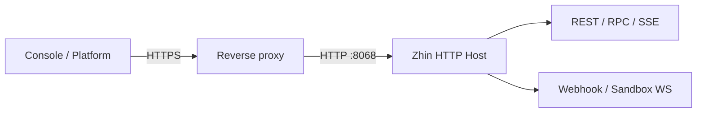

# Run Zhin as a recoverable service

Use this for a single Bot, a multi-Bot collaboration venue, or Remote Console. The goal is explicit ownership for process, ingress, secrets, state, monitoring, backup, and recovery.

## Six things to have before going live

| Item | How | Details |
| --- | --- | --- |
| Pinned dependencies | Commit the lockfile; never run production on drifting `latest` | [1. Release baseline](#_1-release-baseline) |
| Host not exposed directly | Bind the Host to `127.0.0.1` and terminate HTTPS at a reverse proxy | [2. Network and authentication](#_2-network-and-authentication) |
| Secrets only via environment | `HTTP_TOKEN` (the bootstrap token), platform credentials and model keys live in `.env` or a secret manager | [2. Network and authentication](#_2-network-and-authentication) |
| Create the Console owner before opening the port | `zhin console init`, or the Console wizard while the Host is reachable only locally; the bootstrap token stops working afterwards | [Creating the first owner](#first-owner) |
| Automatic restart on crash | Supervise with Docker, systemd or Kubernetes | [3. Templates](#_3-copy-ready-deployment-templates) · [4. Supervision](#_4-process-supervision) |
| Recoverable data | Back up the database, `.zhin/` and `data/schedule-jobs.json` regularly, and rehearse restores | [5. Durable state and backup](#_5-durable-state-and-backup) |

Use `/pub/health` and `/pub/ready` for health checks; see [6. Monitoring and alerts](#_6-monitoring-and-alerts).

## 1. Release baseline

- Use Node `>=22.19.0` (projects and the compiled IM library) and commit the lockfile.
- Run `zhin doctor`, `pnpm build`, and project tests.
- Run `zhin start --once --mode test` to prove assembly (one foreground run; the gateway exits with the instance).
- Record the commit, lockfile hash, configuration version, and data restore point.

The minimum production configuration is an executable fixture:

<<< ../../snippets/production/zhin.config.yml

Inject secrets only through environment variables. The fixture binds to loopback and expects a same-host TLS proxy. Use `0.0.0.0` only when a container or separate gateway must connect directly.

## 2. Network and authentication



The proxy must preserve Authorization, raw Webhook bodies, SSE streaming, and WebSocket Upgrade. Never cache `/api/events` or rewrite a body that a platform signature covers.

Behind a reverse proxy, set `http.trustProxy`; otherwise login rate limiting and audit IPs only see the proxy:

```yaml
http:
  host: 127.0.0.1
  trustProxy: [loopback]   # trust the same-host proxy only; also accepts IPs / CIDRs, a hop count, or true
```

It is off by default: the TCP peer is the client and any client-supplied `X-Forwarded-For` / `Forwarded` is ignored. When on, forwarding headers count only when sent by a trusted proxy, walked from the proxy towards the client up to the first untrusted hop. A proxied request (one carrying a forwarding header) never counts as local: adapter reverse WebSockets without `access_token` and the MCP / A2A localhost exemption refuse it, so endpoints exposed through a same-host proxy need credentials.

`GET /pub/health` reports process liveness. `GET /pub/ready` reports runtime readiness, returning 503 before the first committed generation and 200 when required components are ready. The public response contains only `ready`.

By default a committed generation and initialized Database Host are required. Configure additional requirements explicitly:

```yaml
http:
  readiness:
    database: true
    endpoints:
      - owner: root/sandbox
        name: sandbox~sandbox-bot
    # Optional AI requirement; omit for IM-only projects:
    # agents: [zhin]
```

`owner` is the exact plugin instance path. `name` is the stable last part of the capability ID: `adapter-slot~endpoints[].id` for expanded accounts, otherwise the adapter slot. Display names are not selectors. Unlisted endpoints are optional; missing or disabled required instances fail readiness.

<a id="account-start"></a>
**Account logins do not hold back instance readiness.** The instance reports ready once its generation is committed, without waiting for every account (Endpoint) to log in: at startup each account gets a grace period of about 3 seconds, accounts that finish within it come online before ready as before, and the rest keep starting in the background. A 200 from `/pub/ready` or a running instance in `zhin start` therefore does not mean the accounts are online; list an account under `http.readiness.endpoints` above when readiness must wait for it.

- An account whose background start fails is retried automatically with backoff: 5 seconds first, doubling up to 5 minutes, with ±20% jitter and no attempt limit. Each failure logs one `endpoint_start_failed` line with the error class and code only (never the raw message, which may contain credentials).
- No automatic retry for configuration errors, unsupported configuration and interactive logins (`login.mode: interactive`, such as ICQQ QR code or device lock): those accounts stay in "start failed" until you choose Relogin or Start in the Console. Relogin also retries an account that is waiting for its next automatic retry at once.
- An account start failure no longer fails instance startup or rolls back a hot reload: a reload with a broken account configuration commits, the old account goes offline, and the new one fails and is handled as above. A slow account that does not finish within the grace period is now replaced "old down, then new up" on reload.
- Sending to an account before it is online fails immediately (`not_sent`); nothing is queued.
- `zhin start --once` may exit before slow accounts come online.

The details of `GET /api/system/readiness` include `endpoints[]` (each account's `phase`, `attempt`, `failure` and `nextRetryAt`) for troubleshooting only; they never decide readiness. `phase` is `pending`, `starting`, `online`, `reconnecting`, `offline`, `retrying` (failed, automatic retry scheduled) or `failed` (waiting for a person). The Console's connection list adds `awaiting_assist`: the account is waiting for you to complete a login challenge.

The gateway's `gateway.readyTimeout` (60 seconds by default) bounds instance readiness only and no longer covers account login time: however long a QR code or device lock waits, the gateway does not treat the instance start as timed out or restart it.

`GET /api/system/readiness` returns generation, check time, component reasons and remediation, which requires the `status.view` permission. It respects custom `http.base`. The CLI consumes that same report:

```bash
# Inject a Console API token with status.view through ZHIN_CONSOLE_TOKEN.
zhin doctor --live http://127.0.0.1:8068 --json
# For http.base=/control:
zhin doctor --live http://127.0.0.1:8068/control --json
```

Exit status is 0 when ready and 1 for non-readiness, authentication or request failures. These checks make no external network calls: database `initialized` is not a live SQL test, endpoint readiness requires admission and a locally observed `transportState` of `open`; disconnecting, reconnecting and unobserved transports are not ready, and agent `binding_configured` is not provider credential validation. Real platform delivery still requires separate acceptance evidence. Upgrade the CLI to a version exposing `/pub/ready` before using the updated Kubernetes readiness probe.

`http.token` is a **bootstrap token**, not a long-lived credential: while the database has no owner, anyone holding it can create the first owner; once an owner exists it is refused on every endpoint. In production set it to a random value and [create the first owner](#first-owner) before opening the port; then sign in with accounts. Give read-only observers a `viewer` account and automation an API token. Platform Webhooks and reverse WebSockets keep their own signing secrets or `access_token`; a Console credential cannot replace them.

## 3. Copy-ready deployment templates

The templates do not depend on an unpublished official Zhin image. They build a traceable image from your project and lockfile. Ensure `package.json` has `build` and `start` scripts, and set `http.host` to `0.0.0.0` inside containers; keep the public edge behind TLS.

### Docker Compose

Download the <a href="/deploy/production/Dockerfile" download>Dockerfile</a>, <a href="/deploy/production/docker-compose.yml" download>docker-compose.yml</a>, <a href="/deploy/production/dockerignore.txt" download=".dockerignore">.dockerignore</a>, and <a href="/deploy/production/env.example.txt" download=".env.example">.env.example</a> into the project root. The last two links use the standard dotfile names when saving:

```bash
cp .env.example .env
# Edit .env and replace at least HTTP_TOKEN (a random value, e.g. openssl rand -hex 32).
docker compose config
docker compose up -d --build
docker compose ps
curl --fail http://127.0.0.1:8068/pub/health
# First deployment: create the Console owner (the port is bound to 127.0.0.1, so nobody else can reach it yet)
printf '%s\n' "$OWNER_PASSWORD" | docker compose exec -T zhin ./node_modules/.bin/zhin console init -y --owner admin --password-stdin
```

The image's `CMD` is `pnpm start`, the foreground `zhin start --foreground --mode production --no-watch`: the container's main process is the management gateway, which supervises and restarts the instance. Compose injects Provider, Adapter, and other secrets from `.env`, while requiring `HTTP_TOKEN`. It runs as non-root with a read-only root filesystem. Only `data/`, `.zhin/`, and the temporary directory are writable, and both state directories use named volumes. Database-consistent backups are still required.

### systemd

Download <a href="/deploy/production/zhin@.service" download>zhin@.service</a>. The Linux username is the instance name and the project lives at `/srv/zhin/<user>`:

```bash
sudo install -m 0644 zhin@.service /etc/systemd/system/zhin@.service
sudo install -d -o zhin -g zhin /srv/zhin/zhin/.zhin /srv/zhin/zhin/data
sudo install -m 0600 -o zhin -g zhin .env /srv/zhin/zhin/.env
sudo systemctl daemon-reload
sudo systemctl enable --now zhin@zhin
sudo systemctl status zhin@zhin
journalctl -u zhin@zhin -f
```

Place the project in `/srv/zhin/zhin`, prepare a local `.env` containing `HTTP_TOKEN`, and ensure `pnpm` is in the unit's PATH. The unit's `ExecStart` is `pnpm start`, so the project's `start` script must run in the foreground (scaffolded projects use `zhin start --foreground --mode production --no-watch`); a bare `zhin start` detaches and systemd treats the service as exited. After the first start, create the owner as the same system user as the gateway (over the local control socket):

```bash
cd /srv/zhin/zhin
printf '%s\n' "$OWNER_PASSWORD" | sudo -u zhin ./node_modules/.bin/zhin console init -y --owner admin --password-stdin
```

 The unit requires that secret file, allows writes only to `.zhin/` and `data/`, and limits restart storms to five attempts in 120 seconds.

### Kubernetes

Download <a href="/deploy/production/kubernetes/resources.yaml" download>resources.yaml</a> and <a href="/deploy/production/kubernetes/kustomization.yaml" download>kustomization.yaml</a> into one directory. Build and push the Dockerfile first, then change `newName` and `newTag`:

```bash
kubectl create secret generic zhin-secrets \
  --from-env-file=.env
kubectl kustomize ./kubernetes
kubectl apply -k ./kubernetes
kubectl rollout status deployment/zhin
kubectl port-forward service/zhin 8068:8068
```

The image keeps your project's own `zhin.config.yml`, while the Secret projects the complete `.env`, so the template does not drop Provider or Adapter keys. Recreate the Secret and roll the Deployment after changing secrets. The template deliberately uses one replica and `Recreate`: default SQLite, file-backed state under `.zhin/`, and `ReadWriteOnce` volumes are not multi-writer systems. Before scaling horizontally, move to a shared database and make sure each file-backed state has a single writer. `/pub/health` is only a process probe; use Console acceptance for business readiness. After the first deployment, create the owner before exposing the Service:

```bash
printf '%s\n' "$OWNER_PASSWORD" | kubectl exec -i deploy/zhin -- ./node_modules/.bin/zhin console init -y --owner admin --password-stdin
```

### Creating the first owner {#first-owner}

A new deployment's project database has no Console owner yet. Until it has one, `http.token` (`HTTP_TOKEN` in `.env`) is a **bootstrap token**: anyone who holds it and can reach the Host can create the first owner and, through it, read and write the configuration, `.env`, the database and project files. So:

- **Create the owner before opening the port, the reverse proxy or a public ingress.** Once an owner exists the bootstrap token is refused on every endpoint and everyone signs in with an account; automation uses API tokens issued by an account (`ZHIN_CONSOLE_TOKEN`).
- Use a random bootstrap token, never a fixed value from an example or a document, and never publish it.
- A Host without `http.token` is open to anyone who can reach it until setup; production must set one.

Pick one of two ways:

1. **Command line** (recommended on servers and in containers): run `zhin console init` in the project directory as the same system user as the service (the commands with each template above). While the gateway runs, the command goes to it over the local control socket `.zhin/gateway.sock`; without one it writes the project database directly, so it can also run before the first start. All flags: [CLI reference](../cli/index.md#console).
2. **Console wizard**: only while the Host is reachable locally, for example through `ssh -L 8068:127.0.0.1:8068 <server>` or `kubectl port-forward`; open the Console with the setup link `zhin start` prints or with `HTTP_TOKEN`. See [Setup and onboarding](../console/onboarding.md).

Afterwards `zhin console init --status` reports setup as done. Add other people with `zhin console user create <username> --role viewer|operator|admin` or in the Console's Access pages; reset a forgotten password with `zhin console user passwd <username>`.

## 4. Process supervision

```bash
# Container or external supervisor: foreground, logs on stdout (this is pnpm start)
zhin start --foreground --mode production --no-watch

# Bare metal without a process manager: background gateway
zhin start --mode production --no-watch
zhin status          # gateway and instance state; exit code 3 when not running
zhin logs -f         # instance logs
zhin stop

# Linux: install a user-level systemd service
zhin service install --user
zhin service status --user
```

On macOS, use the launchd service commands without `--user`. Keep one restart owner: with systemd, launchd, Kubernetes, or PM2, let the external supervisor own a foreground gateway (`--foreground`). Use the background `zhin start` only for a directly managed bare-metal process.

The gateway (ADR 0054) is long-lived and supervises the instance: Console restarts, dependency changes and instance crashes are handled by restarting the instance inside the gateway; after a crash storm the instance stays `crashed` while the gateway stays online (the Console shows the logs and can start it again). The gateway exits with code 0 on SIGTERM / `zhin stop` and non-zero when it fails to start; an external supervisor only needs to restart it after an abnormal exit. Exit codes and a systemd example: [zhin start](../cli/runtime.md#exit-codes).

## 5. Durable state and backup

| State | Default location or authority | Backup requirement |
| --- | --- | --- |
| Primary database | `.zhin/data.sqlite` or configured backend | Database-consistent snapshot |
| Console account store | `.zhin/gateway.db` (with `-wal` / `-shm`, `0600`): Console users, roles, sessions, API tokens and audit ([ADR 0059](../../adr/0059-gateway-storage-isolation.md), Chinese) | **Back it up separately for every dialect**: `pg_dump` / `mysqldump` do not contain Console accounts. While the gateway runs use SQLite's online backup (`sqlite3 .zhin/gateway.db ".backup …"`), or copy it with its `-wal` file while stopped |
| Multi-Agent collaboration Journal | `engagement_events` table in the main database | Restored from the same snapshot as the main database; copy the full append-only data |
| Scheduled jobs | `data/schedule-jobs.json` | Save with config, timezone, and Endpoint targets |
| Runtime-private state | `.zhin/` | Select by feature; never expose through Agent file tools |
| Secrets | Secret manager / environment injection | Rotate separately; exclude from normal backup archives |

Use a database snapshot or stop writes before copying SQLite. Use the native backup tool for external databases and rehearse restoration regularly.

**Persist `.zhin/`** (container volume, Kubernetes PVC). The marker table `zhin_gateway_store` in the project database records the id of gateway.db: if gateway.db is lost the Console stays closed instead of reopening setup — restore a backup or run `zhin console init --reset-store`; redis / memory projects have no marker and rely on `.zhin/` alone. losing `.zhin/gateway.db` loses every Console account, session, token and audit entry; losing `.zhin/keys/` makes account and model credentials undecryptable. When upgrading to a release with ADR 0059, the gateway's first start moves the Console account tables an earlier version kept in the project database into `gateway.db`; Console sign-in answers 503 until it finishes — see the [upgrade notes](../migrations/gateway-storage.md). Before downgrading run `zhin console migrate --revert`.

To use the Console SQL editor on PostgreSQL / MySQL, create the restricted account with `zhin db console-role` (`--print-sql` for a DBA when a managed database does not let the main account create accounts) and allow it to log in only from the instance's host (`pg_hba.conf`, MySQL account host); see [configuration: `database.console`](../configuration/index.md#database-console).

## 6. Monitoring and alerts

Monitor the HTTP probe, restart count, Endpoint health, SSE recovery gaps, error rate, database capacity, collaborations (Engagements) frozen and waiting for a human, and Agent failure/cancellation ratio.

In the foreground the instance logs go to stdout and `.zhin/logs/instance.log`; in the background the gateway's own output goes to `.zhin/logs/gateway.log` and the instance logs to `.zhin/logs/instance.log`, rotated past 10 MiB (5 files kept). Include Endpoint, Project, runtimeId, or runId in alerts instead of forwarding only an error string.

## 7. Release and rollback

1. Pause ingress that creates new side effects while keeping read-only probes.
2. Back up the database (including `engagement_events`), scheduled jobs, configuration, and lockfile.
3. Install locked dependencies, then run doctor, tests, and one-shot startup.
4. Start production and complete [Console acceptance](/en/console/#standard-acceptance-run).
5. Observe one full business window before expiring the previous version and backup.

Rollback restores code, lockfile, configuration, and data from one checkpoint. If the new version wrote a new schema or external side effect, never downgrade packages alone; follow the migration's data recovery plan.

## Incident order

1. Is `/pub/health` reachable?
2. Does Home show the expected Host and version?
3. Is the Endpoint online and receiving inbox events?
4. Did the current generation publish the required capability?
5. Did the Database (including `engagement_events`) and SSE history recover from one authority?

See [Version compatibility and migration](./upgrades) and the [Console guide](/en/console/).
