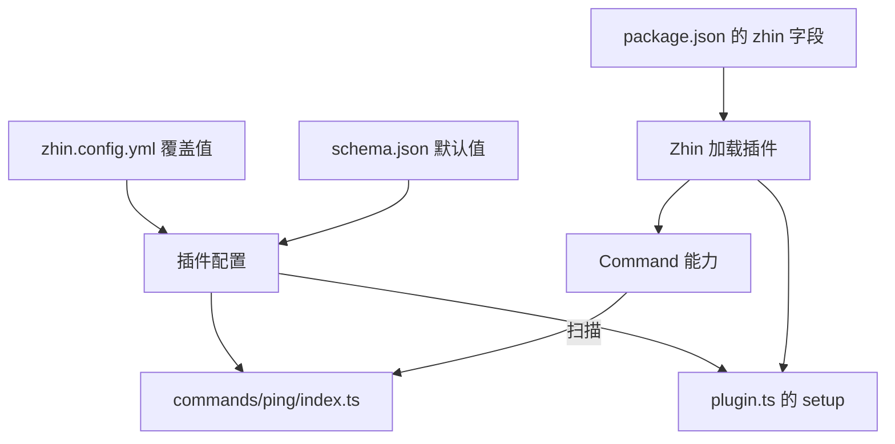

# 编写第一个插件

这一页带你写一个叫 `ping-pong` 的插件：用户发 `/ping`，Bot 回复一段**可以在配置里修改**的文字。

做完后你会掌握插件的四个基本组成——清单、入口、命令、配置——以及怎样把插件挂到 Bot 上。大约需要 15 分钟。

::: tip 开始前
- 已经按 [快速开始](./index.md) 创建并跑通了 `my-bot`（没有的话先运行 `npm create zhin-app my-bot -y`）。
- Node.js ≥22.12.0、pnpm 9+。`pnpm dev` 会直接运行 TypeScript 源码，不需要先编译。
:::

::: details 只想要最少的代码？
一个文件也能注册命令：在 `plugin.ts` 的 `setup({ addCommand })` 里调用 `addCommand('ping', defineCommand({ ... }))` 即可，见示例 [single-file-bot](../examples/index.md#single-file-bot-一个-bot-ts-就是机器人)。本页演示的是功能变多后更推荐的"一个能力一个文件"写法。
:::

## 你要创建的文件

在 `my-bot/plugins/ping-pong/` 下创建四个文件：

```text
plugins/ping-pong/
├── package.json        # ① 插件清单：告诉 Zhin 这是一个插件
├── plugin.ts           # ② 插件入口
├── commands/
│   └── ping/
│       └── index.ts    # ③ /ping 命令
└── schema.json         # ④ 配置项及默认值
```

配置的**值**不写在插件里，而是写在 Bot 的 `zhin.config.yml` 中（第 5 步）。这样同一个插件装到不同 Bot 上，可以有不同的配置。

## 1. 插件清单：package.json

插件就是一个 npm 包。让 Zhin 识别它的，是 `package.json` 里的 `zhin` 字段：

```json
{
  "name": "ping-pong",
  "private": true,
  "version": "0.1.0",
  "type": "module",
  "scripts": {
    "dev": "zhin runtime start"
  },
  "dependencies": {
    "zhin.js": "^1.1.0"
  },
  "devDependencies": {
    "@zhin.js/cli": "^1.1.0"
  },
  "peerDependencies": {
    "@zhin.js/command": "^1.1.0"
  },
  "peerDependenciesMeta": {
    "@zhin.js/command": { "optional": true }
  },
  "zhin": {
    "protocol": 1,
    "type": "plugin",
    "entry": "./plugin.ts",
    "engine": "^1.0.0",
    "runtime": "trusted",
    "features": [
      { "package": "@zhin.js/command", "api": "^1.0.0" }
    ],
    "plugins": []
  }
}
```

现在只需要关注三处：

- **`zhin.entry`**：入口文件，即下一步的 `plugin.ts`。
- **`zhin.features`**：插件要用到的能力。这里声明了 `@zhin.js/command`，Zhin 才会去扫描 `commands/` 目录。
- **`peerDependencies`**：`@zhin.js/command` 由 Bot 提供，插件只声明"我需要它"，自己不再安装一份。

::: details 为什么要用 optional peerDependency？其余字段是什么意思？
同一个能力包在一个 Bot 里只能存在一份。如果子插件把 `@zhin.js/command` 装进自己的 `dependencies`，就会出现两份，启动时报错（即使版本完全相同）。所以子插件把它声明为可选 peer，由 Bot 统一安装。

`optional: true` 只影响 npm 安装行为；运行时 `zhin.features` 里声明的能力仍然**必须**可用。

| 字段 | 含义 |
|------|------|
| `entry` | 入口文件，必须是 `./` 开头的包内相对路径 |
| `runtime` | `trusted` 表示在主进程内运行 |
| `features` | 本插件用到的能力包。你的 Bot（Root 插件）依赖 `zhin.js` 时会自动继承常用能力，但子插件需要自己声明 |
| `plugins` | 本插件再挂载的子插件，这里为空 |

完整说明见 [插件模型](../concepts/plugin-model.md)。
:::

## 2. 插件入口：plugin.ts

```ts
import { definePlugin } from 'zhin.js';

interface PingPongConfig {
  reply: string;
}

export default definePlugin<PingPongConfig>({
  name: 'ping-pong',
  // Console 插件卡片展示
  metadata: { displayName: 'Ping Pong', icon: 'Blocks' },

  async setup(context) {
    // 配置视图：schema.json 提供默认值，zhin.config.yml 覆盖
    const config = context.config.get();
    console.log(`[ping-pong] setup: reply=${config.reply}`);

    // 可选：返回 Dispose，在 generation 结束时执行（热重载安全）
    return () => console.log('[ping-pong] disposed');
  },
});
```

- `definePlugin` 的 `name` 只能用小写字母、数字和连字符。
- `setup` 在插件加载时运行。`context.config.get()` 读取这个插件的配置。
- `setup` 返回的函数会在插件**卸载或热重载前**执行。打开的定时器、连接都应在这里关闭，否则热重载后会残留。

入口里不需要注册命令——下一步的文件会被自动发现。

## 3. 命令：commands/ping/index.ts

```ts
import { defineCommand } from 'zhin.js/command';

interface PingPongConfig {
  reply: string;
}

export default defineCommand<PingPongConfig>({
  description: '回复配置的文案',
  execute({ config }) {
    return config.reply;
  },
});
```

**目录路径就是命令名**：`commands/ping/index.ts` 对应 `/ping`，`commands/admin/ban/index.ts` 对应 `/admin ban`。只有 `index.ts` 是命令入口，同目录下的其他文件可以作为辅助模块被引用。

`execute` 收到的 `config` 与 `setup` 里读到的是同一份配置。命令的参数、选项和权限写法见 [命令](../authoring/commands.md)。

## 4. 配置项：schema.json

`schema.json` 声明插件有哪些配置项、默认值是什么。它使用标准 JSON Schema：

```json
{
  "$schema": "https://json-schema.org/draft/2020-12/schema",
  "type": "object",
  "additionalProperties": false,
  "properties": {
    "reply": {
      "type": "string",
      "default": "pong",
      "description": "/ping 命令的回复内容"
    }
  }
}
```

没有在配置文件里填写 `reply` 时，就使用这里的默认值 `pong`。Console 也会根据它生成配置表单。

::: details Console 表单支持哪些 JSON Schema 写法？
Console 只能把可直接映射为表单的结构转换出来；`$ref`、`anyOf`、`oneOf`、`allOf`、`prefixItems`、`patternProperties` 和数组形式的 `items` 暂不支持，会明确报错。运行时的配置校验不受这个限制。复杂的 `ai`、`htmlRenderer` 等配置建议直接编辑配置文件，或使用 Console 的源码编辑器。
:::

## 5. 挂载到你的 Bot

回到 Bot 根目录 `my-bot/`。先安装插件依赖：

```bash
pnpm add @zhin.js/command@^1.1.0 --ignore-workspace-root-check
cd plugins/ping-pong
pnpm install
cd ../..
```

然后在 **Bot 的** `package.json` 里加上两处（与已有内容合并，不要覆盖）：

```json
{
  "dependencies": {
    "@zhin.js/command": "^1.1.0"
  },
  "zhin": {
    "plugins": [
      { "package": "./plugins/ping-pong", "instanceKey": "ping-pong" }
    ]
  }
}
```

- `package` 指向插件目录，必须以 `./` 开头，不能用 `..` 跳出项目。
- `instanceKey` 是这个插件在 Bot 里的名字，只能用小写字母、数字和连字符。

最后在 **Bot 的** `zhin.config.yml` 里，以 `instanceKey` 为键填写配置：

```yaml
plugins:
  ping-pong:
    reply: pong!
```

::: details 为什么 Bot 也要依赖 @zhin.js/command？
`npm create zhin-app` 生成的项目已把 `plugins/*` 纳入 pnpm workspace。Bot 直接依赖 `@zhin.js/command`，子插件通过 peer 使用同一份；不要再把它加到子插件的 `dependencies` 里。Zhin 要求每个能力包只来自一个物理目录。
:::

## 6. 运行并验证

```bash
pnpm dev
```

依次确认：

1. 终端出现 `[ping-pong] setup: reply=pong!` —— 插件已加载，并读到了配置。
2. 在 Sandbox 里发送 `/ping`，Bot 回复 `pong!`。
3. 把 `zhin.config.yml` 里的 `reply` 改成别的文字并保存，再发 `/ping` —— 不重启就能看到新回复。改 `commands/ping/index.ts` 也一样。

只想检查插件能否正常装配、不想进入交互模式？运行 `zhin runtime start --once`。

::: tip 没有回复？
- 命令前缀由每个平台连接的 `commandPrefix` 决定；脚手架生成的 Sandbox 设为 `/`，其他平台可能为空。
- 终端没有出现 setup 日志：检查 Bot `package.json` 里的 `zhin.plugins` 路径。
- 运行 `npx zhin doctor` 做一次环境检查。
:::

## 它是怎么工作的



启动时，Zhin 读取清单，加载 `features` 里声明的能力；Command 能力扫描 `commands/`，把找到的文件注册为命令。配置由 `schema.json` 的默认值和 `zhin.config.yml` 的值合并而成，同时提供给 `setup` 和命令。保存文件时，这个过程会在后台重新执行一遍，校验通过后才替换旧版本。

## 另一种方式：插件即应用

插件目录里放一个 `zhin.config.yml`，插件自己就能作为一个完整的 Bot 启动，不需要宿主项目。这适合独立开发和调试一个插件。

此时插件就是 Root，配置写在 `plugin:` 下：

```yaml
# ping-pong/zhin.config.yml
plugin:
  reply: pong!

plugins: {}
```

作为独立应用，它还需要自己安装能力包，并接入至少一个适配器才能收到消息：

```bash
cd plugins/ping-pong
pnpm add @zhin.js/command@^1.1.0 --ignore-workspace-root-check
pnpm exec zhin setup --adapters  # 选择 Sandbox 等适配器
pnpm install
pnpm dev
```

## 下一步

- [命令](../authoring/commands.md)：给 `/ping` 加参数、选项和权限。
- [约定目录](../authoring/conventions.md)：了解中间件、组件、定时任务等其他能力放在哪里。
- [definePlugin 全景](../authoring/define-plugin.md)：在 `setup` 里使用数据库、定时器、主动发消息。
- [插件完整交付](../authoring/plugin-delivery.md)：给插件写测试并发布到 npm。
- [本地联调指南](../authoring/local-dev.md)：在自己的 Bot 项目里联调本地插件或 zhin 源码。
