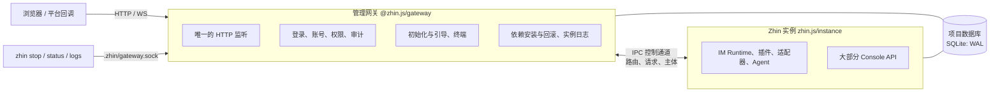

# 升级到管理网关

以前，`zhin runtime start` 起一个父进程，HTTP、Console、配置写入、插件安装全在子进程（也就是 Bot 本身）里；子进程以退出码 `75` 退出时父进程把它重新拉起。Bot 起不来、崩溃或正在装依赖时，Console 跟着一起消失。

现在拆成两个进程（[ADR 0054](../adr/0054-management-gateway.md)）：



- **网关**由 `zhin start` 启动，常驻运行：监听 `http.port`，负责登录与权限、初始化向导、终端、依赖安装、实例起停与日志。它不加载插件代码。
- **实例**只能由网关拉起，跑 IM Runtime、插件、适配器与 Agent。它不再监听端口：插件注册的路由交给网关，由网关接收请求后经控制通道转发。
- 实例崩溃、停止或正在安装依赖时，网关照常运行，Console 能登录、看实例状态与日志、重新启动实例。

本页面向已有项目。新建项目直接按[快速开始](../getting-started/index.md)走即可。

## 一览

| 以前 | 现在 | 本页 |
| --- | --- | --- |
| `zhin runtime start`（前台，父进程只负责重启） | `zhin start --foreground`；`zhin runtime start` 是它的别名 | [启动方式](#start) |
| `zhin start`（`zhin runtime start` 的别名） | 默认**后台**运行网关；`zhin stop / restart / status / logs` 管理 | [启动方式](#start) |
| 子进程以退出码 `75` 请求重启 | 实例经控制通道发 `restart-request`，网关重启实例；退出码 `75` 不再有意义 | [退出码与监控](#exit-codes) |
| 实例崩溃时整个进程退出，由 systemd / PM2 重启 | 实例由网关重启（每分钟最多 10 次），超限后停在 `crashed`，网关继续运行 | [退出码与监控](#exit-codes) |
| 只有 `@zhin.js/cli` 与 `zhin.js` | 再加 `@zhin.js/gateway`，三者同批升级 | [依赖](#dependencies) |
| HTTP 路由拿 Node `IncomingMessage` / `ServerResponse` | Web 标准 `Request` → `Response`，WebSocket 是 `WsConnection` | [自定义 HTTP 路由](#http-routes) |
| `http.tokens`、演示模式 | 已删除：用户、角色与 API 令牌存在数据库里 | [Console 访问控制](#access-control) |
| 日志只在 stdout | 实例日志总是写入 `.zhin/logs/instance.log`，后台网关写 `.zhin/logs/gateway.log` | [日志](#logs) |
| 只有实例连接数据库 | 网关和实例同时连接；SQLite 使用 WAL | [SQLite](#sqlite) |

## 1. 升级前 {#before}

1. **停止 Bot**（`zhin stop`，或停止 systemd / PM2 / 容器）。依赖目录在运行中被替换会让进程加载半新半旧的文件。
2. 备份：Git 提交、`package.json` 与锁文件、`zhin.config.yml`、`.env`、数据库（SQLite 的 `.zhin/data.sqlite`，见 [SQLite](#sqlite)）、`data/` 与 `.zhin/`。
3. 如果你维护自己的插件或适配器，并注册了 HTTP / WebSocket 路由，先按[自定义 HTTP 路由](#http-routes)改好再升级。

## 2. 依赖：网关与实例一起升级 {#dependencies}

```bash
pnpm add zhin.js@latest @zhin.js/gateway@latest
pnpm add -D @zhin.js/cli@latest
pnpm install
```

- `@zhin.js/cli` 本身依赖 `@zhin.js/gateway`；把网关也写进项目依赖，锁文件就会把它和 `zhin.js` 固定在同一批版本上。
- **网关与实例必须一起升级。** 两者之间的控制通道带协议版本：实例的 `ready` 消息携带版本号，不兼容时网关拒绝该实例、不再重启它，并在 `zhin status` 与 Console 里提示升级。只升级其中一个的结果就是实例起不来。
- 生产环境提交锁文件，用 `pnpm install --frozen-lockfile` 部署。

## 3. Console 访问控制 {#access-control}

如果你是从 `@zhin.js/cli` 1.1.x 升级，同一批版本里还有 Console 访问控制（ADR 0049）：

- `http.tokens` 已删除，配置里还有它时网关拒绝启动；
- 演示模式（`scope: demo` 令牌）已删除，演示站点改为一台真实 Host 加只读账号，见[部署演示站点](../operations/demo-deployment.md)；
- `http.token` 只用作**初始化令牌**：创建第一个所有者后它在所有接口上失效；
- 自动化改用用户签发的 API 令牌（`ZHIN_CONSOLE_TOKEN`）。

完整步骤见[升级到 Console 访问控制](./console-access-control.md)。现在登录、初始化、账号与审计都由网关处理，网关自己打开项目数据库，所以**实例没起来也能完成初始化**。

## 4. 启动方式 {#start}

| 场景 | 命令 |
| --- | --- |
| 本地开发（热重载） | `zhin start --foreground --watch source config`（脚手架的 `pnpm dev`） |
| systemd / Docker / PM2 / Kubernetes | `zhin start --foreground --mode production --no-watch`（脚手架的 `pnpm start`） |
| 裸机、没有进程管理器 | `zhin start --mode production --no-watch`（后台），用 `zhin status / logs -f / restart / stop` 管理 |
| CI 冒烟 | `zhin start --once --mode test`（前台起一次就退出，网关随实例退出） |

把项目 `package.json` 的脚本改成：

```json
{
  "scripts": {
    "dev": "zhin start --foreground --watch source config",
    "start": "zhin start --foreground --mode production --no-watch",
    "stop": "zhin stop"
  }
}
```

旧脚本里的 `zhin runtime start …` 不改也能跑（它是 `zhin start --foreground` 的别名）。要注意的是**裸的 `zhin start` 现在默认后台运行**，进程管理器里必须加 `--foreground`，否则命令启动网关后立刻返回，服务管理器会以为服务已经退出。

- `--daemon` 仍然接受，只表示后台运行（即默认行为），不再是「前台 + 崩溃重启」：崩溃重启对所有模式都生效。
- `zhin restart` 只重启实例，网关与 Console 不中断；`zhin restart --gateway` 连网关一起重启（仅后台网关）。
- `zhin install / uninstall / update` 在网关运行时经网关执行：停实例 → 包管理器 → 启实例，失败自动回滚。git 地址、本地路径与 `--save-dev` 需要先 `zhin stop`。
- 管理命令经本地控制套接字 `.zhin/gateway.sock`（`0600`）与网关通信，**必须以启动网关的同一个系统用户运行**。

命令的全部选项与行为见 [zhin start](../cli/runtime.md)。

### `--standalone`：只用于开发与测试 {#standalone}

`zhin start --standalone` 不启动网关，实例在本进程里自带 Node HTTP 服务器，并在进程内装配登录与终端。它没有受管重启：Console 的「重启」、依赖变化等只会停止进程。只在测试或调试实例本身时使用，不要用于部署。

没有控制通道（既不是网关拉起、也没有 `--standalone`）时，实例入口 `zhin.js/instance` 拒绝启动并提示使用 `zhin start`。

## 5. systemd / Docker / PM2 {#process-managers}

### systemd

```ini
[Service]
Type=simple
WorkingDirectory=/srv/my-bot
# 以前：ExecStart=/usr/bin/env npx zhin runtime start --mode production --no-watch
ExecStart=/usr/bin/env npx zhin start --foreground --mode production --no-watch
Restart=always
RestartSec=10s
```

文档提供的 [`zhin@.service`](../operations/production.md#systemd) 执行 `pnpm start`，脚本按上文改好即可。`Restart=always` 现在只在网关本身退出时生效；实例崩溃由网关处理。`MemoryMax` 等 cgroup 限制同时作用于网关和实例。

### Docker / Compose

文档提供的 Dockerfile 以 `CMD ["pnpm", "start"]` 启动，改好 `start` 脚本即可。另外检查：

- `/app/.zhin` 必须可写（网关在这里创建 `gateway.sock`、`gateway.json` 与 `logs/`）。模板已把它挂成命名卷，只读根文件系统下也能用。
- 健康检查：`/pub/health` 现在由网关回答，实例崩溃时它仍然返回成功。要让编排系统感知实例不可用，就绪检查改用 `/pub/ready`（实例未就绪时返回 `503`）。
- 保留 `init: true`（或 `docker run --init`）与足够的 `stop_grace_period`：网关收到 SIGTERM 后先让实例完整停止，再关闭监听。

### PM2

```js
// ecosystem.config.cjs
module.exports = {
  apps: [{
    name: 'my-bot',
    script: 'node_modules/.bin/zhin',
    // 以前：args: 'runtime start --mode production --no-watch'
    args: 'start --foreground --mode production --no-watch',
    autorestart: true,
  }],
};
```

PM2 托管的是网关进程，`max_memory_restart` 只看网关自己的内存，不含实例子进程。

## 6. 退出码与监控 {#exit-codes}

| 情况 | 以前 | 现在 |
| --- | --- | --- |
| Console 重启、依赖变化、数据库切换 | 子进程以 `75` 退出，父进程重启它 | 实例发 `restart-request`，网关重启实例，网关不退出 |
| 实例崩溃 | 进程退出（非零），由外部 supervisor 重启 | 网关重启实例；每分钟超过 10 次进入 `crashed`，等人处理 |
| SIGTERM / `zhin stop` | `0` | `0`（先停实例再停网关） |
| Ctrl+C | `130` | `130` |
| `zhin status` | — | 网关在运行 `0`，未运行 `3` |

依赖「进程退出码」判断 Bot 是否崩溃的监控需要改为看：

- `zhin status --json` 的实例状态（`stopped / starting / running / stopping / backoff / crashed`、最近退出码、日志尾部）；
- `/pub/ready`（运行时就绪）与 `/pub/health`（网关存活，含实例状态）；
- Console「运维 → 实例」页。

## 7. 自定义 HTTP 路由：改为 `Request` / `Response` {#http-routes}

只有自己写了 HTTP / WebSocket 路由的插件或适配器需要改（官方适配器与插件已经迁移）。路由契约不再暴露 Node 的 `IncomingMessage` / `ServerResponse` / 原始 `ws` 套接字，改为 Web 标准对象：处理函数接收 `Request` 和上下文，返回 `Response`。因为实例里没有 HTTP 服务器，请求其实来自网关，旧签名无法工作。

### HTTP 路由

以前：

```ts
import type { IncomingMessage, ServerResponse } from 'node:http';

http.route('POST', '/my-plugin/hook', async (req: IncomingMessage, res: ServerResponse, url: URL) => {
  const chunks: Buffer[] = [];
  for await (const chunk of req) chunks.push(chunk as Buffer);
  const body = JSON.parse(Buffer.concat(chunks).toString('utf8'));
  if (req.headers['x-signature'] !== sign(body)) {
    res.statusCode = 401;
    res.end('unauthorized');
    return;
  }
  res.setHeader('content-type', 'application/json');
  res.end(JSON.stringify({ ok: true, id: url.searchParams.get('id') }));
});
```

现在：

```ts
import { readJsonBody, jsonResponse } from '@zhin.js/host-http';

http.route('POST', '/my-plugin/hook', async (request, { url, params, remoteAddress }) => {
  const body = await readJsonBody(request, { limit: 1024 * 1024 }); // 超限抛出 HttpBodyError(413)
  if (request.headers.get('x-signature') !== sign(body)) {
    return new Response('unauthorized', { status: 401 });
  }
  return jsonResponse(200, { ok: true, id: url.searchParams.get('id') });
});
```

- 上下文字段：`url`（解析后的 URL）、`params`（路径参数；前缀路由 `/x/*` 的剩余部分在 `params['*']`）、`remoteAddress`，`{base}` 下的路由还有 `principal`（网关认证后的调用者）。
- 这些工具来自 `@zhin.js/host-http`（契约包 `@zhin.js/host-http-contract` 的再导出）。读请求体用 `readBodyBytes` / `readTextBody` / `readJsonBody`（默认上限 1 MiB，`limit` 可调）；需要验签的 Webhook 用 `readBodyBytes` 拿原始字节再验。
- 构造响应用 `new Response(...)`、`jsonResponse`、`emptyResponse`。SSE 与大文件下载用 `createResponseStream()`（带背压）配合 `SSE_HEADERS`。
- 处理函数抛出的未预期异常只返回通用错误信息，细节写日志；需要给调用方看的错误请自己返回 `Response`。
- Node 服务器实现移到了 `@zhin.js/host-http/node`，只在 `--standalone` 与测试里使用；插件不要直接导入它。

### WebSocket 路由

以前：

```ts
const handle = http.ws('/my-plugin/ws');
handle.onConnection(({ socket, request }) => {
  socket.on('message', (data) => socket.send(data));
  socket.on('close', () => cleanup());
  logger.info(request.socket.remoteAddress);
});
```

现在：

```ts
const handle = http.ws('/my-plugin/ws', { auth: 'protocol' });
const release = handle.onConnection((connection) => {
  // connection: WsConnection — url、headers、remoteAddress、bufferedAmount
  connection.onMessage((data) => connection.send(data));   // data: string | Uint8Array
  connection.onClose((code, reason) => cleanup());
  logger.info(connection.remoteAddress);
});
```

- 帧经控制通道传输，`bufferedAmount` 反映积压；发送大量数据时按它限速。
- 协议层的 ping / pong 由网关负责（见下文 [heartbeat_interval](#heartbeat)），插件不要再自己 `socket.ping()`。
- `auth` 的取值见下一节。

## 8. 反向 WebSocket 与 `access_token` {#reverse-ws}

适配器的反向 WebSocket（OneBot 11 / 12、NapCat、Milky 的 `connection: wss`）与 Webhook 不经过 Console 账号，由插件用自己的凭据鉴权，网关原样转发：

- 自己写的反向 WS 用 `http.ws(path, { auth: 'protocol' })` 注册，在 `onConnection` 里用 `verifyProtocolAccessToken(accessToken, connection)`（`@zhin.js/host-http`）校验对端，失败时 `connection.close(4003, 'Unauthorized')`。
- 校验接受 `Authorization: Bearer <access_token>` 或 `?access_token=`。
- **没配 `access_token` 时只接受回环地址（127.0.0.1 / ::1）的连接。**

::: warning 反向代理后面一定要配 `access_token`
网关不读取 `X-Forwarded-For`，它看到的对端地址是直接连过来的那一跳。反向代理（nginx、Caddy、Cloudflare Tunnel 等）和网关在同一台机器上时，所有经代理进来的连接在网关看来都来自 `127.0.0.1`——没配 `access_token` 的反向 WebSocket 会对整个公网开放。凡是经反向代理暴露的 endpoint，都要配上 `access_token`。
:::

## 9. `heartbeat_interval` {#heartbeat}

OneBot 11、NapCat、Milky 的**反向** WebSocket（`connection: wss`，Zhin 是服务端）不再按 `heartbeat_interval` 发送 ping：连接由网关承载，网关每 30 秒发一次协议层 ping，对端不回 pong 就断开连接。配置里留着 `heartbeat_interval` 不会报错，只是对这种模式不起作用。正向连接（`connection: ws`，Zhin 是客户端）与 OneBot 12 的反向连接仍按 `heartbeat_interval` 工作。

## 10. 插件权限级别与插件 RPC 授权 {#plugin-permissions}

两处行为变化影响自定义角色和插件作者：

1. **插件权限按级别授予内置角色。** 插件权限名（`<插件>:<动作>`，如 `onebot11:read`、`ops:approve`）属于 `read` / `operate` / `manage` 三级之一：`viewer` 得到 `read`，`operator` 得到 `read` + `operate`，`admin` 与 `owner` 得到全部。未声明级别时按后缀推断（`:read` / `:view` → `read`；`:approve` / `:manage` / `:admin` / `:write` / `:config` → `manage`；其余 → `operate`）。
2. **插件 Console RPC 按方法检查。** 以前已登录用户调用 `plugin.<id>.<method>` 只检查 `feature.view`（读）/ `feature.configure`（写），`operator` 因此能执行 `ops:approve` 之类的动作。现在逐个方法检查它声明的 `requiredPermissions` 与所属页面的要求，不满足返回 `403 forbidden`；都没声明时，读方法需要 `feature.view`，动作需要 `feature.configure`。

插件作者要做的：在 `definePluginConsoleRpc({ permissions })` 里声明每个权限的级别，尤其是以 `:write` 结尾却属于日常操作的权限（不声明会被推断为 `manage`，只有 `admin` 及以上能用）：

```ts
definePluginConsoleRpc({
  permissions: [
    { id: 'rss:read', level: 'read', description: '查看订阅' },
    { id: 'rss:write', level: 'operate', description: '增删订阅' },
  ],
  // ...methods
});
```

管理员要做的：升级后在 Console「访问控制 → 角色」核对自定义角色——以前靠 `feature.configure` 就能调用的插件动作，现在需要对应的插件权限或级别权限（`plugin.perms.read|operate|manage`）。权限名与级别规则见 [Console 访问控制](../console/access-control.md#plugin-permissions)。

## 11. 日志在哪里 {#logs}

| 日志 | 位置 |
| --- | --- |
| 实例 stdout / stderr | 总是写入 `.zhin/logs/instance.log`，超过 10 MiB 轮转为 `instance.log.1` … `.5`；网关另在内存里保留最近 1000 行 |
| 前台网关 | 实例输出同时回显到终端，进程管理器照常从 stdout 收集 |
| 后台网关自己的输出 | `.zhin/logs/gateway.log` |
| 审计日志 | 项目数据库的 `console_audit_log` 表（Console「访问控制 → 审计日志」） |

`zhin logs [-f] [-n N]` 在网关运行时从网关读最近的行，网关未运行时读 `instance.log`。`--log-file <path>` 可以改实例日志的位置。日志目录需要在备份与磁盘告警的范围内。

## 12. SQLite：两个进程共用一个文件 {#sqlite}

网关为了在实例离线时也能登录、初始化，自己打开项目数据库（与实例同一份 `database` 配置），所以 SQLite 文件同时有两个连接：

- 文件库总是使用 **WAL**（`journal_mode=WAL`）。数据库旁边会出现 `data.sqlite-wal` 与 `data.sqlite-shm`，它们是数据库的一部分。
- **备份**：停掉 Bot 后复制 `.sqlite`、`-wal`、`-shm` 三个文件，或者在运行中用 `sqlite3 .zhin/data.sqlite ".backup backup.sqlite"` 取一致性快照。不要只复制 `.sqlite` 一个文件。
- 不要把 SQLite 放在网络文件系统（NFS、SMB）上：WAL 依赖共享内存，跨主机不可用。
- 两个进程争用写锁时，实例的 SQLite 方言做有界的异步退避重试（默认 5 秒），网关的写入都是单语句。偶发的 `SQLITE_BUSY` 日志不代表数据损坏；持续出现时检查是否有第三个进程（备份脚本、手工 `sqlite3` 会话）长时间持锁。
- MySQL / PostgreSQL 等网络数据库同样由两个进程各自连接；连接池上限请按两个进程计算。

## 13. 新出现的文件 {#files}

| 文件 | 用途 |
| --- | --- |
| `.zhin/gateway.sock` | 本地控制套接字（`0600`，Windows 为命名管道）；`zhin stop / status / logs` 经它与网关通信，连上即视为本机所有者 |
| `.zhin/gateway.json` | 运行中网关的状态（pid、端口、启动参数），网关退出时删除 |
| `.zhin.pid` | 网关 pid |
| `.zhin/logs/` | 实例与网关日志 |
| `.zhin/onboarding.json` | Console 引导进度；已有项目升级后已配置的步骤自动标为完成 |

`.zhin/` 不要提交到 Git，也不要放进容器镜像。网关被 `kill -9` 后留下的失效套接字会在下次 `zhin start` 时自动清理。

## 14. 安全默认值的变化 {#security-defaults}

- **SSH 终端必须固定主机指纹**：`console.terminal.ssh[]` 的每个目标都要配置 `hostFingerprint`，否则配置校验失败。获取方式：`ssh-keyscan -t ed25519 <主机> | ssh-keygen -lf -`。确实无法固定时，写 `insecureAcceptAnyHostKey: true`，Console 会把该目标标为「不安全：未校验主机密钥」。
- **反向代理**：默认不信任 `X-Forwarded-For` / `Forwarded`。网关在反向代理之后时配置 `http.trustProxy`（`true`、跳数或代理 IP / CIDR 列表），登录限速与审计才会记录真实客户端地址。无论是否配置，带转发头的请求都不算本机连接：未配 `access_token` 的反向 WebSocket、MCP / A2A 的本机免鉴权对经代理的请求一律拒绝，请为它们配置凭据。
- **数据库**：实例侧的数据库工具（Console 数据库页、原始 SQL、Agent 文件工具）不能访问网关的 `console_*` 表；Agent 文件工具把 SQLite 文件视为敏感文件。

## 回滚 {#rollback}

保持 Bot 停止，恢复升级前的锁文件、`package.json`、配置与数据库快照，然后 `pnpm install --frozen-lockfile`。只降级 `@zhin.js/cli` 或只降级 `zhin.js` 不行——网关和实例的协议版本必须匹配。升级后已经在 Console 里创建的账号、角色与审计记录存在数据库里，恢复旧快照会丢掉它们。

## 检查清单 {#checklist}

- [ ] `zhin.js`、`@zhin.js/gateway`、`@zhin.js/cli` 来自同一批版本，锁文件已提交
- [ ] 进程管理器（systemd / Docker / PM2）的命令带 `--foreground`
- [ ] 监控改看 `zhin status --json`、`/pub/ready`，不再依赖进程退出码
- [ ] 自定义 HTTP / WebSocket 路由已改为 `Request` / `Response` / `WsConnection`
- [ ] 经反向代理暴露的反向 WebSocket endpoint 都配了 `access_token`
- [ ] 自定义角色已按新的插件 RPC 授权核对
- [ ] `.zhin/` 可写，日志目录纳入磁盘告警
- [ ] SQLite 备份同时包含 `-wal` / `-shm`，或使用 `.backup`
- [ ] 已创建所有者，Console 能用账号登录（见[升级到 Console 访问控制](./console-access-control.md)）
