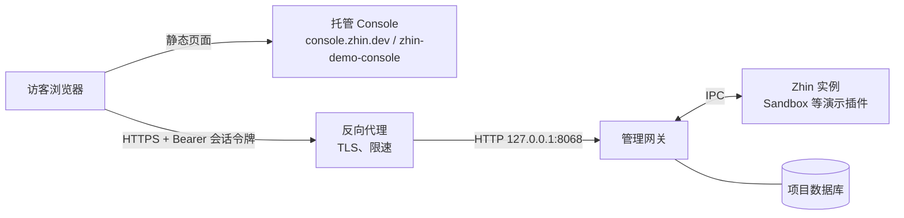

# 部署演示站点

演示模式（`http.tokens` 里的 `scope: demo` 令牌）已经删除（[ADR 0049](../adr/0049-console-rbac.md)）。演示站点现在就是一台普通的 Zhin Host：网关 + 实例，开一个只读账号，把用户名和密码公开出来，访客用托管的 Console（`console.zhin.dev`，或 Cloudflare 上的 `zhin-demo-console` 项目）登录。访客看到的是真实的后端，权限由账号的角色决定，而不是一份写死的 RPC 白名单。



本页只描述部署方法，不包含任何现成的演示服务器。

## 1. 准备一个专用项目

演示站点用一个**单独的项目**，不要在生产 Bot 上开演示账号：只读账号能看到状态、日志、账号列表、会话与收件箱、功能配置（机密字段以掩码返回）、数据库内容与项目文件。

```bash
npm create zhin-app zhin-demo -- -y --adapter sandbox
cd zhin-demo
```

- 只装演示需要的插件与适配器（Sandbox 不需要任何平台账号）。不要配置真实平台凭据、模型 Key 或任何私人数据。
- `zhin.config.yml` 里 Host 绑定回环地址，由反向代理对外提供 HTTPS：

  ```yaml
  http:
    host: 127.0.0.1
    port: 8068
    token: ${HTTP_TOKEN}          # 初始化令牌，创建所有者后失效
    corsOrigins:
      # console.zhin.dev 总是自动并入；用自己的 Console 域名时在这里列出
      - "https://zhin-demo-console.pages.dev"
  ```

- 不要打开终端：保持 `console.terminal.enabled: false`（默认值）。

## 2. 启动网关与实例

用进程管理器托管前台网关，命令与生产部署相同（模板见[生产部署与运维](./production.md#_3-可复制的部署模板)）：

```bash
pnpm install --frozen-lockfile
zhin start --foreground --mode production --no-watch   # 即 pnpm start
```

确认网关与实例都在运行：

```bash
zhin status
curl --fail http://127.0.0.1:8068/pub/health
curl --fail http://127.0.0.1:8068/pub/ready
```

## 3. 创建所有者与演示账号

所有者只给维护者自己用。在服务器上、以运行服务的同一个系统用户创建（不需要经过浏览器，也不暴露初始化令牌）。网关在运行时这些命令经本地控制套接字交给网关，未运行时直接写项目数据库；**在反向代理或公网入口开放之前完成这一步**——所有者创建前，初始化令牌对能连上 Host 的任何人都是全权凭据：

```bash
# 所有者：初始化（第一次运行时）
printf '%s\n' "$OWNER_PASSWORD" | zhin console init --yes --owner maintainer --password-stdin

# 演示账号：默认角色就是 viewer
printf '%s\n' "$DEMO_PASSWORD" | zhin console user create demo --role viewer --password-stdin
zhin console user list
```

密码至少 10 位。演示密码是要公开的，但仍然不要复用任何别处的密码。

### 用收窄的角色代替内置 `viewer`（推荐）

内置 `viewer` 含所有 `*.view` / `*.read` 权限（不含 `ops.config.read`、`ops.env.read`），其中包括 `ops.database.read`（数据库浏览）、`ops.files.read`（项目文件）、`ops.schedule.read` 与 `plugin.perms.read`。演示站点通常不需要让访客翻数据库和文件。用所有者登录 Console，在「访问控制 → 角色」复制 `viewer`，去掉不想公开的权限，例如：

| 保留 | 去掉 |
| --- | --- |
| `status.view`、`endpoint.view`、`feature.view`、`agent.view` | `ops.database.read`、`ops.files.read`、`ops.schedule.read` |
| 演示插件需要的 `plugin.perms.read` 或具体的 `<插件>:read` | 其他插件的读权限 |

然后把演示账号绑到这个角色：`zhin console user create demo --role demo-viewer --password-stdin`，或在 Console「访问控制 → 用户」里改绑定。要让访客在 Sandbox 里发消息，再加上 `endpoint.operate`（`/sandbox` WebSocket 需要它）；不加则只能看。

## 4. 让托管 Console 连接演示后端

Console 是纯静态站点，连接哪台 Host 由地址栏决定。公开的链接**只带 API 地址，不带任何令牌**：

```text
https://console.zhin.dev/?apiBaseUrl=https%3A%2F%2Fdemo-api.example.org
```

- `apiBaseUrl` 不含 `/api`，Console 自己拼接 `http.base`。Console 读取参数后会从地址栏移除；第一次连接未知 Host 时会请访客确认。
- 使用 Cloudflare 上的 `zhin-demo-console` 项目（Console 仓库的同一份构建，`npm run build:demo`）时，链接换成它的域名，并把该域名加进 `http.corsOrigins`。
- 在演示页面上公开：Console 链接、用户名 `demo`、演示密码，以及「这是只读演示，数据会定期重置」之类的说明。

访客打开链接 → 输入用户名和密码登录 → 看到的是演示账号的角色允许的分区与页面，其余分区整体隐藏，写操作返回 `403`。

## 5. 维护

- **重置演示数据**：定期停止服务、恢复一份干净的数据库快照（SQLite 连同 `-wal` / `-shm`）再启动。账号与角色也存在这个数据库里，快照里要包含它们。
- **改演示密码**：`zhin console user passwd demo --password-stdin`，该账号的全部会话立即失效。
- **暂停演示**：`zhin console user disable demo`；恢复用 `enable`。
- **看谁做了什么**：所有者在「访问控制 → 审计日志」查看登录成功与失败、被拒绝的请求。
- **升级**：网关、实例和 CLI 同批升级，见[升级到管理网关](../migrations/management-gateway.md)。

## 加固清单 {#hardening}

- [ ] **只开只读账号**：演示账号绑定 `viewer` 或更窄的自定义角色；不给 `operator` 及以上，不给任何 `*.write` / `*.manage` / `ops.restart` / `iam.*` / `plugin.manage`。
- [ ] **不开终端**：`console.terminal.enabled` 保持 `false`。终端只对持有 `ops.terminal` 的所有者开放，但演示机上没有理由打开它。
- [ ] **专用项目、无真实数据**：不配置真实平台凭据、模型 Key；`.env` 只有 `HTTP_TOKEN`。
- [ ] **初始化之后再公开**：先创建所有者再开放端口；初始化完成后 `http.token` 在所有接口上失效。初始化令牌用随机值，不要写进公开的 README、镜像或演示页面。
- [ ] **反向代理**：Host 绑定 `127.0.0.1`，由 nginx / Caddy / Cloudflare Tunnel 提供 HTTPS；保留 `Authorization` 头、SSE 流式响应（不要缓存 `/api/events`）与 WebSocket Upgrade。
- [ ] **限速**：网关自带登录限速（同一 IP 与用户名 15 分钟内 5 次失败后指数退避，返回 `429`）。默认不读取 `X-Forwarded-For`，经代理进来的请求共用代理的地址——登录限速会对所有访客一起生效，审计里的 IP 也是代理地址。设置 `http.trustProxy`（如 `[loopback]`，见[生产部署](./production.md#_2-网络与鉴权)）后网关按受信任代理的转发头取客户端地址；同时仍在反向代理上按客户端 IP 给 `/api/auth/login` 与 `/api/*` 加限速，日志里保留真实 IP。
- [ ] **反向 WebSocket 配 `access_token`**：演示里用到 OneBot / NapCat / Milky 的反向 WebSocket 时必须配 `access_token`。没配时网关只接受回环连接，而经同机反向代理进来的连接看起来正是回环。
- [ ] **CORS 只列需要的源**：`http.corsOrigins` 只写演示 Console 的域名（`console.zhin.dev` 自动并入）。
- [ ] **只暴露需要的路由**：在反向代理上只转发 `/api/*`、`/pub/*` 与演示需要的页面 / WebSocket，其余返回 404。
- [ ] **定期重置与轮换**：按计划恢复干净快照、轮换演示密码，并检查审计日志里的异常拒绝。
