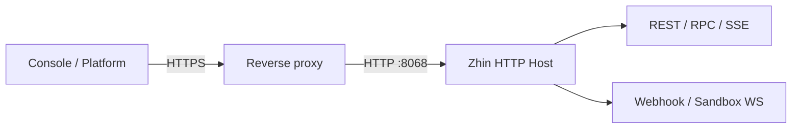

# 把 Zhin 部署成可恢复的服务

这份方案面向单实例 Bot、多 Bot 协作场所和远程 Console。目标是让进程、入口、密钥、状态、监控、备份与恢复都有明确责任人。

## 上线前至少做到这六件事

| 事项 | 怎么做 | 详见 |
| --- | --- | --- |
| 固定依赖版本 | 提交 lockfile，生产不使用漂移的 `latest` | [1. 发布前基线](#_1-发布前基线) |
| 不把 Host 直接暴露到公网 | Host 绑定 `127.0.0.1`，由反向代理提供 HTTPS | [2. 网络与鉴权](#_2-网络与鉴权) |
| 密钥只走环境变量 | `HTTP_TOKEN`（初始化令牌）、平台凭据、模型 Key 都放 `.env` 或密钥管理 | [2. 网络与鉴权](#_2-网络与鉴权) |
| 先创建 Console 所有者，再开放端口 | `zhin console init`，或只在本机可达时走 Console 向导；之后初始化令牌失效 | [首次创建所有者](#first-owner) |
| 进程崩溃能自动拉起 | 用 Docker、systemd 或 Kubernetes 托管 | [3. 部署模板](#_3-可复制的部署模板) · [4. 进程托管](#_4-进程托管) |
| 数据能恢复 | 定期备份数据库、`.zhin/` 与 `data/schedule-jobs.json`，并演练恢复 | [5. 持久状态与备份](#_5-持久状态与备份) |

用 `/pub/health` 和 `/pub/ready` 做健康检查，见 [6. 监控与告警](#_6-监控与告警)。

## 1. 发布前基线

- 使用 Node `>=22.19.0`（脚手架项目与编译后的 IM 库相同），依赖由 lockfile 固定。
- 执行 `zhin doctor`、`pnpm build` 与项目测试。
- 用 `zhin start --once --mode test` 验证装配（前台运行一次，网关随实例退出）。
- 记录当前提交、lockfile hash、配置版本与数据备份点。

最小生产配置来自可执行 fixture：

<<< ../snippets/production/zhin.config.yml

密钥只通过环境变量注入。示例将 Host 绑定在 loopback，由同机反向代理提供 TLS；若容器或独立网关需要直连，再显式改为 `0.0.0.0`。

## 2. 网络与鉴权



反向代理必须保留 Authorization、Webhook 原始请求体、SSE 流式响应与 WebSocket Upgrade。不要缓存 `/api/events`，也不要改写需要平台验签的 body。

在反向代理后面运行时设置 `http.trustProxy`，否则登录限流、审计 IP 看到的都是代理地址：

```yaml
http:
  host: 127.0.0.1
  trustProxy: [loopback]   # 只信任同机代理；也可写 IP / CIDR 列表、跳数或 true
```

默认关闭：只用 TCP 对端地址，任何客户端自带的 `X-Forwarded-For` / `Forwarded` 都被忽略。开启后只有来自受信任代理的转发头才生效，从代理一侧向客户端逐跳回溯到第一个不受信任的地址。经代理转发的请求（带转发头）永远不算本机连接：未配置 `access_token` 的适配器反向 WebSocket、MCP / A2A 的本机免鉴权都会拒绝它，因此通过同机代理暴露这些端点时必须配置凭据。

`GET /pub/health` 是存活探针，只证明 HTTP 进程可响应。`GET /pub/ready` 是运行时就绪探针：启动尚未提交 generation 时返回 503，就绪时返回 200；公开响应仅包含 `ready`，不暴露配置或账号信息。

默认就绪条件是已提交 generation 且 Database Host 已初始化。可在项目配置中声明必需组件：

```yaml
http:
  readiness:
    database: true
    endpoints:
      - owner: root/sandbox
        name: sandbox~sandbox-bot
    # 启用 AI 后可要求指定 binding；IM-only 项目省略此项
    # agents: [zhin]
```

`owner` 是插件实例路径；`name` 是 capability ID 最后一段的稳定槽名。多账号展开使用 `适配器槽名~endpoints[].id`，未展开时使用适配器槽名。不要填平台昵称。未列出的 Endpoint 不阻止就绪；必需插件被禁用或对应槽不存在时返回 503。

详细报告通过需要 `status.view` 权限的 `GET /api/system/readiness` 获取（自定义 `http.base` 同样生效），包含 generation、检查时间、逐项原因和修复建议。CLI 使用同一报告：

```bash
# ZHIN_CONSOLE_TOKEN 由环境注入，值为带 status.view 的 Console API 令牌
zhin doctor --live http://127.0.0.1:8068 --json
# 自定义 http.base=/control
zhin doctor --live http://127.0.0.1:8068/control --json
```

就绪时退出码为 0，未就绪、认证失败或请求失败时为 1。探针不执行外部网络请求：Database 的 `initialized` 不等于实时 SQL 查询成功；Endpoint 只有准入开放且本地 `transportState` 为 `open` 才就绪，断开/重连/状态未提供分别返回对应原因；Agent 的 `binding_configured` 不等于模型凭据有效。本地传输状态也不能证明真实收发，平台实机仍需单独验收。

`http.token` 是**初始化令牌**，不是长期的鉴权密钥：数据库里还没有所有者时，持有它就能创建第一个所有者；所有者创建后它在所有接口上失效。生产环境用随机值设置它，并在开放端口之前完成[首次创建所有者](#first-owner)；之后用账号登录。只读观察给 `viewer` 账号，自动化用 API 令牌。平台 Webhook 和反向 WebSocket 继续使用各自的签名密钥或 `access_token`，不能拿 Console 凭据代替。

## 3. 可复制的部署模板

模板不依赖尚未发布的官方 Zhin 镜像，而是从你的项目和 lockfile 构建可追溯镜像。先确保项目的 `package.json` 包含 `build` 与 `start`，并将 `http.host` 设为 `0.0.0.0`（仅容器内；公网仍应经过 TLS 入口）。

### Docker Compose

下载 <a href="/deploy/production/Dockerfile" download>Dockerfile</a>、<a href="/deploy/production/docker-compose.yml" download>docker-compose.yml</a>、<a href="/deploy/production/dockerignore.txt" download=".dockerignore">.dockerignore</a> 和 <a href="/deploy/production/env.example.txt" download=".env.example">.env.example</a> 到项目根目录。后两个链接会用标准点文件名保存：

```bash
cp .env.example .env
# 编辑 .env：至少替换 HTTP_TOKEN（随机值，如 openssl rand -hex 32）
docker compose config
docker compose up -d --build
docker compose ps
curl --fail http://127.0.0.1:8068/pub/health
# 首次部署：创建 Console 所有者（端口只绑定在 127.0.0.1，此时外部还连不上）
printf '%s\n' "$OWNER_PASSWORD" | docker compose exec -T zhin ./node_modules/.bin/zhin console init -y --owner admin --password-stdin
```

镜像的 `CMD` 是 `pnpm start`，即前台运行的 `zhin start --foreground --mode production --no-watch`：容器主进程是管理网关，实例由网关监管重启。Compose 会将 `.env` 中的 Provider、Adapter 等密钥一并注入容器，并强制要求 `HTTP_TOKEN`。它默认以非 root、只读根文件系统运行，只开放 `data/`、`.zhin/` 与临时目录，并持久化两个命名卷。备份前仍需按数据库类型取得一致性快照。

### systemd

下载 <a href="/deploy/production/zhin@.service" download>zhin@.service</a>。模板把 Linux 用户名同时作为实例名，约定项目位于 `/srv/zhin/<user>`：

```bash
sudo install -m 0644 zhin@.service /etc/systemd/system/zhin@.service
sudo install -d -o zhin -g zhin /srv/zhin/zhin/.zhin /srv/zhin/zhin/data
sudo install -m 0600 -o zhin -g zhin .env /srv/zhin/zhin/.env
sudo systemctl daemon-reload
sudo systemctl enable --now zhin@zhin
sudo systemctl status zhin@zhin
journalctl -u zhin@zhin -f
```

先把项目放到 `/srv/zhin/zhin`，在本地准备好含 `HTTP_TOKEN` 的 `.env`，并确认 `pnpm` 位于 unit 的 PATH。unit 的 `ExecStart` 是 `pnpm start`，项目的 `start` 脚本必须前台运行（脚手架默认 `zhin start --foreground --mode production --no-watch`）；裸的 `zhin start` 会转入后台，systemd 随即认为服务已退出。首次启动后创建所有者（与网关同一个系统用户，经本地控制套接字）：

```bash
cd /srv/zhin/zhin
printf '%s\n' "$OWNER_PASSWORD" | sudo -u zhin ./node_modules/.bin/zhin console init -y --owner admin --password-stdin
```

unit 把密钥文件设为启动必需条件，只允许项目的 `.zhin/` 与 `data/` 写入，且在 120 秒内最多尝试启动 5 次。

### Kubernetes

下载 <a href="/deploy/production/kubernetes/resources.yaml" download>resources.yaml</a> 与 <a href="/deploy/production/kubernetes/kustomization.yaml" download>kustomization.yaml</a> 到同一目录。先构建并推送上面的 Dockerfile，然后修改 `newName` 与 `newTag`：

```bash
kubectl create secret generic zhin-secrets \
  --from-env-file=.env
kubectl kustomize ./kubernetes
kubectl apply -k ./kubernetes
kubectl rollout status deployment/zhin
kubectl port-forward service/zhin 8068:8068
```

镜像会保留项目自己的 `zhin.config.yml`，Secret 则从 `.env` 整体投影，因此 Provider 与 Adapter 密钥不会被模板吞掉；修改密钥后需要重建 Secret 并滚动重启。模板固定单副本与 `Recreate`，因为默认 SQLite、`.zhin/` 下的文件状态和 `ReadWriteOnce` 卷不是多写者系统。需要水平扩容时，先迁移到共享数据库，并确认每份文件状态只有一个写入者。Kubernetes 模板分别使用 `/pub/health` 判断存活、`/pub/ready` 判断运行时就绪；请先升级到提供就绪探针的 CLI 版本再应用模板。首次部署后，在暴露 Service 之前创建所有者：

```bash
printf '%s\n' "$OWNER_PASSWORD" | kubectl exec -i deploy/zhin -- ./node_modules/.bin/zhin console init -y --owner admin --password-stdin
```

### 首次创建所有者 {#first-owner}

新部署的项目数据库里还没有 Console 所有者。这时 `http.token`（`.env` 里的 `HTTP_TOKEN`）是**初始化令牌**：任何持有它、能连到 Host 的人都可以创建第一个所有者，进而读写配置、`.env`、数据库与项目文件。所以：

- **先创建所有者，再开放端口、反向代理或公网入口。** 所有者一旦存在，初始化令牌在所有接口上失效，之后一律用账号登录；自动化改用账号签发的 API 令牌（`ZHIN_CONSOLE_TOKEN`）。
- 初始化令牌用随机值，不要用示例或文档里的固定值，也不要贴到公开页面。
- 没有配置 `http.token` 的 Host 在初始化前对所有能连上的人开放，生产环境必须配置它。

两种做法任选其一：

1. **命令行**（服务器与容器推荐）：在项目目录、以运行服务的同一个系统用户执行 `zhin console init`（上面各模板的命令）。网关在运行时命令经本地控制套接字 `.zhin/gateway.sock` 交给网关；网关未运行时直接写项目数据库，也可以在首次启动前完成。完整参数见 [CLI 参考](../cli/index.md#console)。
2. **Console 向导**：只在 Host 仅本机可达时进行，例如 `ssh -L 8068:127.0.0.1:8068 <服务器>` 或 `kubectl port-forward`，然后用 `zhin start` 打印的初始化链接或 `HTTP_TOKEN` 打开 Console 完成向导。见 [初始化与引导](../console/onboarding.md)。

完成后 `zhin console init --status` 显示已初始化。其他人用 `zhin console user create <用户名> --role viewer|operator|admin` 或 Console「访问控制」添加；忘记密码用 `zhin console user passwd <用户名>`。

## 4. 进程托管

```bash
# 容器或外部 supervisor：前台运行，由平台收集 stdout（pnpm start 即此命令）
zhin start --foreground --mode production --no-watch

# 裸机、没有进程管理器：后台运行网关
zhin start --mode production --no-watch
zhin status          # 网关与实例状态；未运行时退出码 3
zhin logs -f         # 实例日志
zhin stop

# Linux：安装用户级 systemd 服务
zhin service install --user
zhin service status --user
```

macOS 使用不带 `--user` 的 launchd 服务命令。只保留一层进程重启策略：使用 systemd、launchd、Kubernetes 或 PM2 时，让外部 supervisor 管理前台网关（`--foreground`）；只有直接裸机运行时才用后台的 `zhin start`。

网关（ADR 0054）常驻并监管实例：Console 重启、依赖变化、实例崩溃都由网关在进程内重启实例，崩溃风暴后实例停在 `crashed` 而网关保持在线（Console 可看日志、可重新启动）。网关只在 SIGTERM / `zhin stop` 时以退出码 0 结束，启动失败时非零；外部 supervisor 只需在网关异常退出时重新拉起。退出码与 systemd 示例见 [zhin start](../cli/runtime.md#退出码)。

## 5. 持久状态与备份

| 状态 | 默认位置或权威源 | 备份要求 |
| --- | --- | --- |
| 主数据库 | `.zhin/data.sqlite` 或 `database` 指定后端 | 使用数据库一致性快照 |
| 多 Agent 协作 Journal | 主数据库的 `engagement_events` 表 | 随主数据库同一快照恢复；append-only 数据必须完整复制 |
| 调度任务 | `data/schedule-jobs.json` | 与配置、时区和目标 Endpoint 一起保存 |
| Runtime 私有状态 | `.zhin/` | 按功能选择；不要通过 Agent 文件工具暴露 |
| 密钥 | Secret manager / 环境注入 | 单独轮换，不进入普通备份包 |

SQLite 备份应使用数据库快照或停写复制，不要在写入中直接复制单个文件。外部数据库使用对应引擎的备份工具，并定期做恢复演练。

## 6. 监控与告警

监控至少覆盖 HTTP 探针、进程重启次数、Endpoint 在线状态、SSE recovery gap、日志错误率、数据库容量、被冻结待人处理的协作（Engagement）和 Agent 失败/取消比例。

前台运行时实例日志同时进入 stdout 与 `.zhin/logs/instance.log`；后台运行时网关自身输出写 `.zhin/logs/gateway.log`，实例日志写 `.zhin/logs/instance.log`，超过 10 MiB 自动轮转（保留 5 份）。告警应携带 Endpoint、Project、runtimeId 或 runId，避免只报一段错误文本。

Runtime Process Host 在启动和运行期间记录 `unhandledRejection`，避免未观察的后台 Promise 拒绝按 Node 默认策略直接结束整个进程；操作恢复仍由对应适配器负责，例如 ICQQ 心跳超时走网络断线与重连流程。启动、命令和消息发送中被调用方观察到的拒绝仍按原链路报错。停止 Runtime 时移除该监听器，不接管 `uncaughtException`；显式配置 Node `--unhandled-rejections=strict` 时仍遵循该严格退出策略。

## 7. 发布与回滚

1. 暂停会产生新副作用的入口，保留只读探针。
2. 备份数据库（含 `engagement_events`）、调度任务、配置与 lockfile。
3. 安装锁定依赖，运行 doctor、测试与一次性启动。
4. 启动生产进程，完成 [Console 标准验收](/console/#一次标准验收)。
5. 观察一个完整业务窗口，再解除旧版本与备份保留。

回滚必须恢复代码、lockfile、配置和数据的同一检查点。若新版本已经写入新 Schema 或外部副作用，不要只降级 npm 包；先执行迁移说明中的数据恢复方案。

## 事故检查顺序

1. `/pub/health` 是否可达。
2. Dashboard 是否连接到预期 Host 与版本。
3. Endpoint 是否在线，统一收件箱是否收到事件。
4. 当前 generation 是否发布所需能力。
5. Database（含 `engagement_events`）与 SSE history 是否从同一权威恢复。

升级操作见[版本兼容与迁移](./upgrades)，页面级诊断见 [Console](/console/)。
