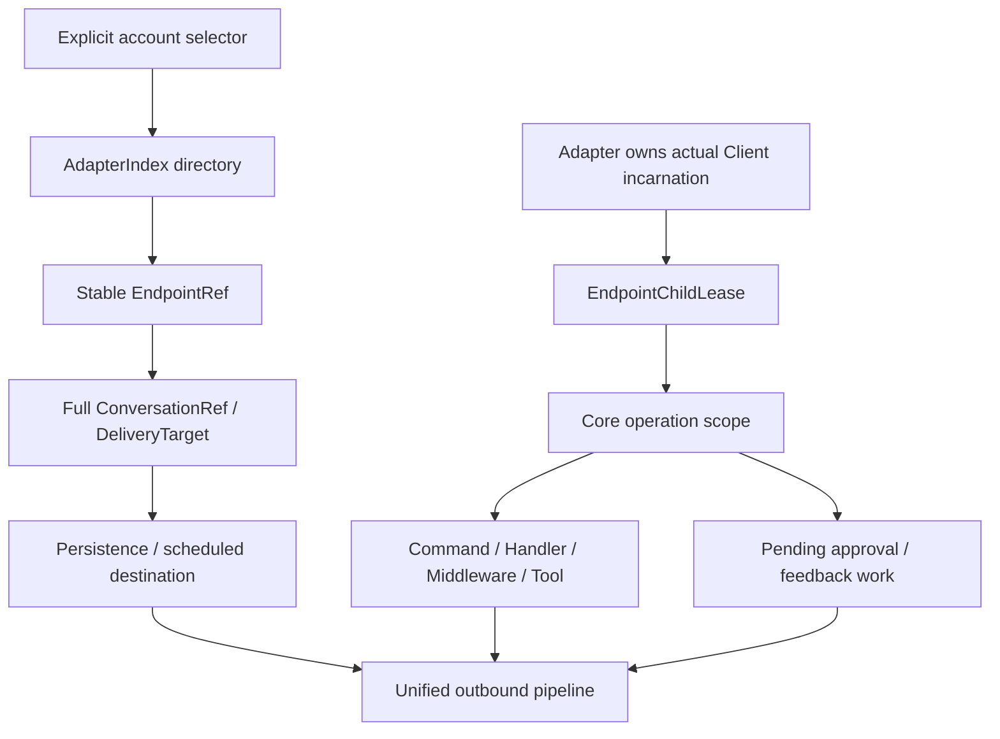
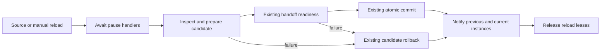

# Adapter operation contracts and design review

Status: the original scope and the concrete event-driven HMR proposal were approved on 2026-10-31.
Implementation and cross-module verification are in progress. The user approved a coordinated npm patch
batch with explicit new-plugin minimums and old-plugin support bounds; publication remains separate.
Baseline: main `76ef403b9` (includes merged #1104). The source and offline
reproductions below establish remaining gaps in the target migration. Existing
build, harness and CI results remain valid for their tested scenarios; they do
not establish the missing invariants.

Related: [architecture](../concepts/architecture.md),
[target migration](./adapter-target-mode-migration.md),
[original design](./adapter-session-runtime-refactor.md),
[adapter authoring](../authoring/adapters.md).

## Scope

Finish the approved account/session architecture across Adapter, Core, authoring
Features and consuming plugins. Include closure lifetime, cohesive parameters,
encapsulation, inheritance and polymorphism where they affect these paths.
Preserve platform policies, permissions, thresholds, protocol behavior, genuine
SDK Client types, literal Adapter inference and the unified message pipeline.
No Worker, Controller, extra account directory, global latest-client lookup or
new dependency is proposed. Unrelated high-arity functions do not enter scope
merely because their parameter count is high.

## Evidence and affected seams

| Concern | Verified observation | Responsible code |
| --- | --- | --- |
| Pending transport cancellation | An OB12 upload response starts `send_message` after account retirement; stop waits for the responses | `adapter.ts`, OB12 WS transport and send pipeline; verify equivalent OB11 paths |
| Single routing authority | A recall with account A's MessageRef and account B's selector invokes B | Core `endpoint-runtime.ts` |
| Complete operation lifetime | Native Handler signal remains active after account stop; old kick approval and feedback timer operate on restarted Client | Core inbound, Handler dispatch, group-rule enforcement and activity feedback |
| Persistent account identity | Games and RSS/Bilibili/earthquake subscriptions collide across real account replacement; OwnerApproval records inherit by account name | game-kit, plugin capture/storage seams, approval address/store |
| Complete conversation and actor | Game/quiz keys omit parent or thread; repeater combines accounts; feedback flattens addresses; missing game sender becomes `smoke` | downstream input projections and state keys |
| Platform ID fidelity | OB12 numeric coercion rounds a large ID and rejects nonnumeric IDs | OB12 management projection |
| Polymorphic ports | Object spread drops management class prototype methods | AdapterIndex scoped port decorator |
| Presentation vs identity | Console derives a dynamic account label from the UUID suffix instead of the directory's actual name | CLI Inbox recorder |
| Parameter cohesion | RuntimeMessage constructor has 14 parameters; renderer recursion has 11; claim reservation has 9 | Core message, rendering and interaction modules |
| Guidance drift | Seven live authoring/audit instructions still described removed factories/base classes | `.github/` and `agents/dev/system.md` (corrected in this branch) |

These observations use synthetic/local reproductions, not real platform calls.
Some affected code predates #1104; the finding is incomplete target migration,
not proof that every defect was introduced by that PR. OwnerApproval inheritance
is confirmed in storage/management; a current FullAgent execution bypass has
not been established.

## Identity and ownership

| Concept | Owner and allowed use |
| --- | --- |
| Account selector | Explicit configuration/admin input; one unique directory resolution |
| EndpointRef | Stable, non-reusable logical account identity; safe in persisted references |
| ConversationRef / DeliveryTarget | Full Endpoint, kind, ID, parent and thread; state and delayed destination identity |
| EndpointChildLease | One actual Client incarnation, cancellation and execution authority; never serialized |
| OperationSession | Author-bound projection of the same captured operation; no second mutable context |

Names are presentation/selection data. Do not parse capability-ID suffixes in
consumers or treat account names as durable identity. Reuse existing
`createDeliveryTarget`, `conversationRefKey` and task-storage codecs; preserve
NUL-containing IDs in supported SQL dialects. Public boundaries validate input;
trusted internal modules consume the validated shape without repeated guesses.



Durable subscriptions intentionally outlive a connection and resolve the same
logical account at execution. In-flight approvals, feedback and audit work must
retain the originating incarnation's lifetime. A Root generation lease alone
cannot express account cancellation.

## Closure and function design

Functions and constructors must not retain long positional parameter lists.
Use a documented named interface for object inputs when several related fields
are required. Keep short, unambiguous calls positional where that is clearer;
do not mechanically introduce a global numeric lint gate. Group a real request,
dependency set or traversal state, rather than hiding unrelated parameters in a
generic `options` bag. Document field semantics, optionality and lifetime. Keep
configuration, immutable input data and live execution authority separate.

- A closure captures a specific scope, immutable input and a narrow dependency.
  It must not switch from a captured account to the directory's latest Client.
- Long-lived callbacks own cancellation/disposal registration. Release leases,
  listeners and timers on success, failure, rejection and cancellation.
- Do not capture a whole RuntimeMessage, credential-bearing configuration or
  snapshot merely to retain an address or one operation.
- Render recursion shares immutable render dependencies, while ancestry/depth
  are branch-local. Sibling branches must not share mutable ancestry sets.
- Author rebinding shares message facts and rebinds authority; it does not clone
  a fourteen-argument construction sequence or create another state owner.

Illustrative target shapes (pseudocode, not additional public APIs):

```ts
new RuntimeMessage(facts, operation)
// facts: canonical scene, actor, text/segments, message reference and timestamps
// operation: captured Endpoint lease, snapshot/author authority and send port

render(content, renderContext)
visit(content, traversal)
// renderContext: one render operation's dependencies and cache
// traversal: per-branch depth and ancestry, never a singleton

reserveClaim(source, request, operation)
// request: prompt, deadline, locale and actions
// operation: participant and lifetime authority, not a second participant ID
```

An existing concrete candidate is OB12's six-argument WS action function:
`socket`, `pending`, `sequence` and selected `self` belong to one Client. A private
RPC closure can own those values and the existing epoch signal, while exposing
`call(action, params, operationSignal?)`, response acceptance and disconnection.
The RPC closure owns request correlation, not connection/reconnect state; the
existing EndpointLifecycle keeps that responsibility. WS and WSS use the same
request logic without creating another cross-account manager.

`Adapter.#mutate` should likewise consume a cohesive prepared change and caller
context, rather than independent `next`, `apply` and action-description values.
Keep the existing single CAS and unknown-commit recovery semantics. This is an
internal representation improvement, not another mutation queue or retry policy.
Capture the frozen desired snapshot once when constructing an epoch; asynchronous
preparation, binding and cleanup all refer to that snapshot rather than rereading
mutable `child.desired`. These are design improvements, not independently proven
production failures.

## Encapsulation, inheritance and polymorphism

Keep the existing generic Adapter as the Template Method owner of desired
state, CAS semantics, actual epochs and leases. Platform subclasses provide
configuration validation, identity verification, construction and actual
platform behavior. They do not override the generic mutation/retirement protocol
or duplicate its desired/actual state. Readonly message facts and author views
share their captured operation; do not freeze, clone or serialize the native SDK
Client or original callback object.

Endpoint remains a genuine SDK/protocol Client subclass with `endpointSpec`.
Keep SDK method/event overloads intact and derive Endpoint/Event types from the
single AdapterRegistry. Private fields protect mutable runtime state; expose
immutable data or narrow bound operations, not internal maps.

Use composition for independent dependencies and request-bound behavior. Keep
game session inheritance where it centralizes real persistence/CAS invariants;
subclasses own game rules, not transport addressing. Let shared game session
creation own canonical target encoding and scope keys, so individual games do
not reconstruct transport columns. Remove the legacy unknown-input-to-smoke-message
bridge rather than adding another conversion.

Feedback keeps the existing reaction,
message, native-typing and no-op strategy implementations; replace the cached
fake-Endpoint facade and latest-account resolution with scoped effect closures.
Group-rule enforcement receives a source-bound effects port for inspection,
notification and moderation; existing policy/approval decisions remain in the
enforcer, while platform permission checks remain in the real management port.

Scoped control/management is a Decorator over an explicit semantic method set.
Support both object literals and class prototype methods and preserve their
receiver, including private-field access. Do not discover capability by copying
own properties, inspect arbitrary arguments to guess an AbortSignal, or wrap the
entire native SDK in a Proxy. A bound operation captures the exact incarnation;
it must never resolve a replacement Client when invoked later.

Keep simple domain functions simple. A factory is justified for per-operation
capture; a Strategy only when existing behavior genuinely varies; a Template
Method only where a base owns a shared invariant. Do not introduce command
buses, service locators, builder hierarchies or pattern classes without a real
variation they encapsulate.

## Cancellation through existing transport ownership

Adapter already aborts the epoch signal before lease drain. Make the actual
transport/pending-request owner consume that signal. Prefer this existing seam
over adding a second shutdown state machine or a new lifecycle hook.

```ts
// Pseudocode: transport and scope are existing instance-owned responsibilities.
// rpc is created once per owning Client; call is bound once per send.
const rpc = createOnebot12Rpc({ self, epochSignal: execution.signal })
const call = (action, params) => rpc.call(action, params, request.signal)
const media = await materialize(payload, call)
return call('send_message', buildSendParams(conversation, media))
```

The same transport refuses new action admission after retirement and settles
pending waits before Adapter waits for their leases. Preserve the difference
between cancellation before submission and an already-submitted unknown result;
never retry an uncertain platform effect. If a third-party SDK cannot abort its
work, end the logical wait and reject late continuations without claiming the
remote effect was canceled. Audit HTTP/media and WS paths, not only text sends.

Core captures the child lease for every genuine Endpoint event. Handler dispatch
receives the operation signal explicitly even when the event has no chat scene
or OperationSession. Native events must not acquire invented sender/scene data.
Pending work retains only the necessary scoped capability and cancellation;
caller completion must not strand its retained lease.

Existing-message controls use MessageRef as the routing authority. Explicit
admin selection remains a separate input path; contradictory reference and
selector must not route to a different account. Keep unsupported, unavailable,
failed and unknown outcomes distinguishable through the existing error model.

## Implementation sequence and verification

1. **Contracts and operation scope:** unify selector resolution and canonical
   references; bind all event kinds to one source-validated lease/signal; make
   scoped ports honor class/literal polymorphism. Verify literal Adapter
   inference, SDK methods/overloads and author-bound replies through public entry
   points, including negative type assertions. Exercise frozen object ports and
   class prototype methods using private fields, receiver binding, thrown errors
   and stale incarnations.
2. **Transport cancellation:** wire pending owners and multi-stage operations to
   epoch/request signals. Reproduce stop during upload, pending action, native
   Handler and startup; prove no later action is submitted, another account keeps
   running, listeners/timers are released and unknown effects are not retried.
3. **Consumers and persistent identity:** migrate games, subscriptions, approvals,
   feedback and Console projection to those contracts. Verify account replacement
   isolation, same-account reconnect continuity, full parent/thread identity,
   missing sender handling and opaque platform IDs. Keep explicit configuration
   selectors and existing group-rule sharing policy intact.
4. **Message/render/interaction internals:** reshape cohesive inputs and closures
   while preserving rendering order, branch-local cycle/depth checks, JSX cache,
   interaction early-answer buffering, fixed deadlines and author permissions.
5. **Whole change review:** account for every behavior difference; run focused
   integration regressions, public package/type checks, then required harness,
   Agent eval and affected Console gates before publication. Retain unrelated
   protections and assertions; a structural refactor is not permission to relax
   tests. Re-run original failing reproductions against the finished paths.

Use real AdapterIndex/Core/Feature/plugin implementations with local fake
external transport. Do not mock the contract under test into its removed shape.
Report mock/local, CI and real-provider evidence separately. No real credentials,
provider calls, merge, release or deployment are authorized by this proposal.

## Confirmed follow-up decisions

The user approved the [historical data migration contract](./adapter-operation-data-migration.md):
read-only preview, exact administrator-selected binding, retained originals, scope maintenance,
transactional writes and explicit resumption. Active games must support explicit maintenance
migration. Historical permissions remain candidates requiring fresh authorization.

Adapter authors augment `AdapterRegistry` only through `@zhin.js/feature-kit` and declare it
as a direct dependency. Facade entry points re-export the registry for use, but are not alternative
augmentation locations. The same rule applies to generated plugins and packed consumers.
Business commands keep literal Adapter selection and infer the native Endpoint without importing
an Adapter class. Verification includes two independently registered adapters in a consumer of
real package tarballs, rather than relying only on workspace source resolution.

Captured operations stop admitting new calls on `release()`. Already admitted calls retain their
source Client and Root snapshot until they finish. Releasing an owner does not rebind work to the
latest Client. Explicit caller cancellation and the approved account stop/replacement contract
remain separate from HMR. The current candidate also composes Root retirement into some task
signals; that HMR-triggered cancellation must be revisited under the confirmed direction below.


## Event-driven HMR direction (confirmed)

The framework publishes lifecycle facts and control signals. Each plugin owns the decision to
abort, finish or retain its work, and the actions required after reload. Completion of a pause
handler means the plugin has applied its chosen policy; it does not mean every task was aborted
or drained. The framework must not infer or enforce that business policy.

Use a small typed event envelope (pseudocode; public names are not implemented yet):

```ts
interface RuntimeEvent<TDetails> {
  readonly signal: AbortSignal;
  readonly details: Readonly<TDetails>;
}
```

HMR details identify the trigger, changed sources, affected plugin instances and generations.
The completion event also identifies the outcome and the instance that remains active. Carry
these actual facts rather than asking subscribers to query a global latest-instance registry.

The event signal describes cancellation of the event/control operation. It is not implicitly
combined with every plugin task signal. A plugin may observe it, pass it to selected work, or
use its own task controller according to its resource semantics.

```ts
// Pseudocode: the plugin chooses its own policy and cleanup/recovery actions.
events.on('hmr.pause', async ({ signal, details }) => {
  await plugin.prepareForReload({ signal, details });
});
events.on('hmr.resume', async ({ signal, details }) => {
  await plugin.afterReload({ signal, details });
});
```

### Framework responsibilities

- Dispatch lifecycle events to the relevant plugin instances and await their handlers when the
  reload depends on their completion. Ordinary observation events retain their existing semantics.
- Keep subscription ownership in the plugin Scope; dispose subscriptions with that instance.
- Publish the outcome to the instances that received pause and the instances active afterwards.
  Deduplicate reused instances by object identity, not PluginId. A replaced instance may still own
  retained work and needs the outcome too; its notification does not reopen admission.
- Preserve one commit authority, precise resource identity and failure reporting. A failure after
  commit cannot be reported as though the commit had been rolled back.

### Plugin responsibilities

- Decide whether to abort, finish, checkpoint or continue work, and how to handle its timers,
  queues, connections and other resources.
- Implement the chosen pause/recovery policy and report its outcome through the handler promise.
- Decide which state to reread and which tasks or resources to resume after the outcome event.

### Changes to evaluate before implementation

Reuse the current HMR transaction, handoff and Scope cleanup seams. Existing `onPlan`, `onReload`
and generation-commit observers are diagnostic notifications; they cannot silently become
awaited business barriers. Add the lifecycle delivery at the actual transaction seam rather than
creating another process-wide event manager or another reload state machine.

Review Root-retirement signal composition in Core capture and Agent ingress. Retain the original
Client and snapshot for work that the plugin elects to finish; stop deriving a mandatory task-abort
policy from the fact that an HMR generation was replaced. Account identity, explicit caller
cancellation, permission checks and administrator-approved account stop behavior remain intact.

The same event style should guide lifecycle and state-change collaboration elsewhere in the
system. Apply it through verified existing call paths; direct reads and request/response operations
need no blanket conversion. Persistent administrator-controlled data migration keeps its own
maintenance journal: an HMR resume event does not authorize resuming a migration plan.

The user approved the concrete proposal below and implementation has started. Validation must
cover callback placement, actual instance ownership and removal of superseded coordination.

### Concrete implementation proposal (approved)

The source review found three different facts currently coupled together: generation replacement,
closure of new admission, and cancellation of accepted work. Keep the first two in the framework;
the plugin decides the third. The existing Snapshot/Endpoint leases already retain concrete
resources, so no second task manager or reload state machine is needed.

**Author interface.** Add `events.on('hmr.pause', handler)` and
`events.on('hmr.resume', handler)` to the setup context. Keep `lifecycle.add()` for disposal and
`handoff` for candidate readiness; neither becomes another event registry. The same Root-scoped
event subscription port is available to Host installers. Only the Runtime can dispatch control
events. Registration belongs to the actual Plugin Scope, is retained when that Scope is reused,
and is disposed with it. A child does not inherit its parent's subscription record.

```ts
interface HmrEvent<TDetails> {
  readonly signal: AbortSignal;
  readonly details: Readonly<TDetails>;
}

// Author interface adopted by the approved implementation.
setup({ events, lifecycle }) {
  events.on('hmr.pause', async event => jobs.prepareReload(event));
  events.on('hmr.resume', async event => jobs.completeReload(event));
  lifecycle.add(() => jobs.dispose());
}
```

Details carry the source/manual trigger, changed source paths, planned plugin/capability scope,
previous and active generation, recipient owner/instance creation generation, and outcome
(`committed`, `unchanged`, `rejected`, `cancelled` or `restart-required`). Distinguish the planned
invalidation scope from the final replacement set. The completion event states whether its
recipient is still active or has been replaced. It conveys no new permission, Client or global
latest-instance lookup. No configuration values, credentials or arbitrary task state are copied
into the event.

The current manual `reload(target)` actually rebuilds the entire Root; its `target` is not an
accurate affected-instance selector. Report that existing full replacement instead of silently
changing manual reload behavior as part of this work.

**Placement.** Deliver through `RootRuntime`'s existing serialized reload operation, not through
`HmrCoordinator.onPlan/onReload` or `RootController.onGenerationCommit`. Keep RootController's
single prepare/readiness/commit/rollback authority unchanged:



- In `root-runtime.ts`, hold the previous snapshot lease around the complete reload attempt.
  Inside the Controller prepare callback, deliver pause before candidate code is evaluated or
  setup/activation runs. Move `#planRuntimeInputs` into that callback: today it can load an inline
  Plugin schema before the callback, so adding a notification after that read would be too late.
  The filesystem coordinator may invalidate module-cache metadata beforehand; it must not start
  candidate setup or execute plugin lifecycle handlers itself.
- Await every dispatched pause handler's settlement. An acknowledgement means that handler
  finished its chosen preparation, not that the framework drained its jobs. A rejection prevents
  candidate publication and follows existing rollback; it does not prove the rejecting plugin
  restored its own state. Notify every instance whose pause was attempted of the actual outcome.
- After Controller settlement, acquire the active snapshot lease before the next await. Notify
  the union of paused previous instances and active instances, once per actual subscription
  record. A new instance can receive completion without having received pause. Do not notify a
  rejected/disposed candidate. Release both reload leases after notification settlement; jobs
  that continue must retain their own existing operation scope beyond that point.
- The pause signal is the Controller transaction signal. Completion uses the explicit Root stop
  signal described below. If stop already prevents the active lease from being acquired, notify
  only still-leased previous recipients, with `outcome: 'cancelled'` and reason `root-stopping`.
  Never invoke a disposed instance or invent an unconditionally live recovery signal.
- Completion handlers decide checkpoint reads, timer/queue changes and remaining-job actions.
  Their failure is reported through the existing control-error path with the committed outcome
  intact; it must not throw a false precommit failure back into the coordinator's module rollback.
  Do not retry handlers, restart jobs, alter deadlines or clear migration maintenance implicitly.

For `runtime: isolated`, extend the existing Host/isolate request-response protocol with control
event delivery and cancellation facts correlated by request ID. Construct the event signal inside
the isolate; `AbortSignal` cannot be cloned across that transport. Do not use ordinary `call()`
(it rejects an already-retired recipient) or `requestAbortable()` (it forcibly closes the isolate).
Control delivery does not reopen business admission. Both worker and process transports require
the same behavior; trusted Host setup is not evidence for isolated plugins.

**Remove the superseded policy at its actual call sites.** The review verified these paths:

Today `SnapshotLease.retirementSignal` represents both replacement and `SnapshotStore.close()`.
Simply deleting its consumers would also remove explicit Root-stop cancellation. Separate those
facts at their existing owner: expose a Root-owned `stopSignal` through the lease, aborted by the
existing close operation, and use it where the old combination enforced explicit shutdown.
Retain the replacement notification as a fact; do not inspect error-message text to guess its
cause. This signal reports the existing stop transition, creates no second stop manager, and
must not abort on ordinary HMR. Verify old and current generation leases observe the same Root
stop while keeping their own distinct replacement facts.

| Existing location | Necessary change |
| --- | --- |
| Core `endpoint-runtime.ts` capture and `inbound-runtime.ts` message/notice/request/side-event dispatch | Replace mandatory snapshot-replacement cancellation with the explicit stop fact. Retain the exact Client, caller/Endpoint signals and snapshot until accepted work settles. |
| CLI Agent `turn/ingress-route.ts` | Remove its second Root-retirement binding; retain timeout, account/caller and Agent admission cancellation. |
| Core `interaction-runtime.ts` | Separate live captured questions from old generation admission. Address both `onDeactivate` cancellation and generation-only answer routing; otherwise a retained question can never receive its answer. Preserve participant/scene/account checks, expiry and supersession. |
| Adapter `endpoint.ts` raw-to-canonical continuation | Close new ingress on retirement while allowing an already-admitted receipt scope to finish. Do not resolve its continuation against the latest Endpoint. |
| HTTP Host `http-host.ts` WebSocket deactivation callback | Stop using gate deactivation alone to choose connection termination. The owning platform plugin chooses connection handling; new upgrades still require active admission and Host shutdown still owns listener cleanup. |
| CLI data-migration Controller | Do not make unrelated HMR cancel a leased provider request. The provider retains its transaction/maintenance policy, cancellation safe points, receipts and unknown-commit semantics. |

Keep `SnapshotStore` retirement as a lifecycle fact, `OwnerOperation`'s rule that an accepted frame
may finish while new calls to an inactive facade are rejected, concrete account epoch checks,
source-Client validation, and final resource disposal. Do not turn retained work into unrestricted
access to retired facades. A detached job without a retained operation does not gain ownership
merely by subscribing to events. Account stop/replacement remains the separately approved
cancel-in-flight operation; this proposal adds no shutdown or process-restart policy.

**Verification sequence.** First reproduce unrelated HMR cancelling a real Command/Agent and a
captured semantic operation. Then cover plugin-chosen abort/finish/retain, successful replacement,
reused Scope delivery once, rejected pause/candidate, concurrent stop, and completion failure after
commit. Verify explicit Root stop still cancels retained operations without cancelling them on
HMR. Verify pending questions still accept only the right participant/account/scene, stale JSX
callbacks gain no authority, original upload-to-send and raw-to-canonical work keep their captured
resources, and WebSocket handling follows its owner. Test trusted and isolated plugins separately.
Preserve caller/account cancellation and final-lease disposal tests. Finally run the full existing
architecture/public-package/Console/Agent gates. The tests currently asserting mandatory HMR
abort change under this approved contract; no assertion is removed to get green.

The existing lifecycle concept/CONTEXT documentation explicitly promises no generic pause/resume
stage. Update those descriptions with implementation, so they do not contradict the new author
contract. The proposal changes event coordination and its cancellation consumers, not the atomic
commit, native Client inheritance, literal Adapter inference or approved data-binding rules.

### Local validation snapshot (2026-10-31)

The existing implementation candidate, before this HMR revision, passed `pnpm build`
(104 tasks), `pnpm check:all` (all 59 checks), and `pnpm eval:agent` (11 files, 196 scripted tests).
The first sandboxed harness attempt failed on loopback listeners and package-cache access;
the complete local rerun passed without source or assertion changes. Logs:
`/tmp/zhin-operation-design-baseline-{build,check-all-local,agent-eval}.log`.
The updated proposal also passed the 316-file documentation link check and `git diff --check`.
These results do not validate the unimplemented event contract, CI, or real platforms/providers.
Remote main was verified as `82644488a644dd85f74666b034dad0cf5354a480`; this dirty candidate is
still based on `76ef403b9`. Main integration and post-change verification remain before publication.

### Audit corrections and local second-dialect evidence

The final ownership review reproduced and fixed four additional defects: Milky identity probes
accepted contradictory success envelopes; nested accepted migration work was omitted from drain;
concurrent feedback replacement could overwrite an unreleased capture; and transient feedback
timers used an incomplete scene key. Each causal regression failed before its fix. Existing policy,
durations, native SDK behavior and historical-data rules remain unchanged.

The shared migration suite now also runs against PostgreSQL when the existing explicit
`ZHIN_TEST_EXTERNAL_DATABASES=1` acceptance switch is set. SQLite and a task-owned local PostgreSQL
17.11 passed 26 cases together, including full parent/thread/NUL addresses, independent owner
data/journals, rollback, unknown commit, rejection baselines and explicit restoration/resumption.
Only synthetic data/credentials were used. The temporary container and its memory-only storage
were removed afterwards; the existing image and other containers were untouched. Evidence:
`/tmp/zhin-target-migration-local-postgres.log`. This is local database evidence, not CI or a
production migration. Later HMR changes require fresh final gates.

### Host approval ownership and confirmed lifecycle policy

Before this correction, Console `HostToolApprovals` stored a mutable process-level queue pointer.
Candidate Agent setup bound its fresh queue before commit, so rejection could hide the still-current
queue. On successful Root replacement, Console and the fixed IM approval command inspected only
the new queue, leaving old pending cards unreachable while their captured effects retained old leases. A real two-queue/Host/IM-channel reproduction confirms both the missing lookup and
the unsettled original waiter. Unrelated slot reload reuses the Root queue and must not cancel it.

The necessary ownership correction is to provide the existing queue as a Root-private Resource
and resolve a request-local facade from the Console RPC dispatcher's already-owned SnapshotLease.
Remove the mutable `bind/#queue` publication path, without replacing it with a latest-value stack
or a global queue registry. Preserve exact operator permissions, expiry, one-shot consumption,
and no-Agent absence semantics. This also makes candidate rollback preserve the current queue.

The user confirmed that actual owner replacement closes transient cards. The Host handles only
committed/replaced completion by terminally closing its old transient queue and settling pending
decisions. Later retained work cannot enqueue another unreachable card; its hard-gate path reports
unavailable/denied without cancelling ordinary chat. Reused, unrelated and rejected reloads leave
the queue open. Durable self-change approval restoration remains a separate flow.

This policy and the Root-private queue ownership correction are implemented. Integration regressions
cover candidate rollback/publication, Console and fixed IM decisions, pending-card settlement,
terminal enqueue rejection and retained ordinary chat. These are local checks, not production evidence.

### Confirmed patch cutover boundary

The target contracts intentionally remove prior positional and authoring APIs. The user permits
npm patch releases with explicit compatibility bounds. The [version boundary plan](./adapter-operation-version-boundaries.md)
lists the coordinated package floors, last supported old versions, Adapter Feature API admission
and migration/recovery requirements. The Adapter semantic API becomes 2 while npm packages remain
on their patch lines; the independent runtime engine contract stays unchanged. Undeclared plugin
compatibility remains unknown and is not silently converted to a rejection policy.

The earlier all-patch declaration was withdrawn before this decision. Its replacement must cover
Runtime and Isolate as well as the earlier affected packages and explicitly disclose intentional
plugin/API breaks. Release gates remain intact; passing them is not proof of compatibility.
Owner approval V3 still requires code-and-data rollback planning. No merge, registry publication,
deployment or production migration is authorized by the patch classification or by local checks.
